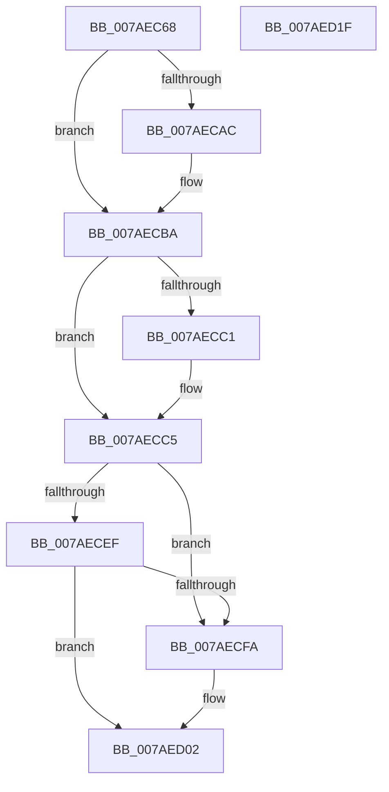

# WdipSemInitialize

- RVA: `0x007AEC68`–`0x007AED20` (길이 `184` bytes)
- VA: `0x00000001407AEC68`
- 실행 섹션: `PAGE`
- PDB 이름 있음: `예`; PDB Function 태그: `아니요`
- unwind 정보 RVA: `0x00060BC4`
- 디코드: `47`개 명령, `184/184` bytes 표시
- 미해석 바이트: `0` (있으면 어셈블리에 `.byte`로 보존)

> 이 문서는 커널 이미지의 기계어와 PDB 기호를 분석해 생성했습니다. 4번과 5번은 함수 원형과 자료형을 바이너리 사용 방식에서 추정한 C 해석이며 원본 소스 복구 결과는 아닙니다.

## 1. Dependencies

- 직접 호출 지점: **7**; 고유 호출 대상: **7**
- 직접 호출자로 확인된 함수: **1**
- RIP 상대 이미지 참조: **1**

### Outgoing calls
- `0x007AEC77` → [WdipSemInitializeGlobalState](WdipSemInitializeGlobalState_function_007AF5FC.md) (function, `0x007AF5FC`)
- `0x007AEC9C` → [KeAbPreAcquire](../../text/21/KeAbPreAcquire_function_00210230.md) (function, `0x00210230`)
- `0x007AECB5` → [ExfAcquirePushLockExclusiveEx](../../text/20/ExfAcquirePushLockExclusiveEx_function_0020FC90.md) (function, `0x0020FC90`)
- `0x007AECC5` → [WdipSemCleanStart](WdipSemCleanStart_function_007AF590.md) (function, `0x007AF590`)
- `0x007AECFD` → [ExfReleasePushLock](../../text/26/ExfReleasePushLock_function_002638D0.md) (function, `0x002638D0`)
- `0x007AED05` → [KeAbPostRelease](../../text/2E/KeAbPostRelease_function_002E1600.md) (function, `0x002E1600`)
- `0x007AED0A` → [KeLeaveCriticalRegion](../../text/25/KeLeaveCriticalRegion_function_0025D8B0.md) (function, `0x0025D8B0`)

### Direct callers
- [EtwpInitialize](../../init/C4/EtwpInitialize_function_00C4DBCC.md) at `0x00C4DECD`

### Static image references
- `0x007AEC85` → RVA `0x00F01E08` (`.data`; read)

## 2. Other-region calls and transfers

- 다른 실행 섹션으로 향하는 call: **5**
  - `0x007AEC9C` → [KeAbPreAcquire](../../text/21/KeAbPreAcquire_function_00210230.md) (`PAGE` → `.text`)
  - `0x007AECB5` → [ExfAcquirePushLockExclusiveEx](../../text/20/ExfAcquirePushLockExclusiveEx_function_0020FC90.md) (`PAGE` → `.text`)
  - `0x007AECFD` → [ExfReleasePushLock](../../text/26/ExfReleasePushLock_function_002638D0.md) (`PAGE` → `.text`)
  - `0x007AED05` → [KeAbPostRelease](../../text/2E/KeAbPostRelease_function_002E1600.md) (`PAGE` → `.text`)
  - `0x007AED0A` → [KeLeaveCriticalRegion](../../text/25/KeLeaveCriticalRegion_function_0025D8B0.md) (`PAGE` → `.text`)
- 별도 외부 분기/꼬리 이동을 확인하지 못했습니다.

## 3. Assembly (complete function range)

```asm
007AEC68  48 89 5C 24 08                  mov qword ptr [rsp + 8], rbx
007AEC6D  48 89 74 24 10                  mov qword ptr [rsp + 0x10], rsi
007AEC72  57                              push rdi
007AEC73  48 83 EC 20                     sub rsp, 0x20
007AEC77  E8 80 09 00 00                  call 0x1407af5fc
007AEC7C  65 48 8B 04 25 88 01 00 00      mov rax, qword ptr gs:[0x188]
007AEC85  48 8D 3D 7C 31 75 00            lea rdi, [rip + 0x75317c]
007AEC8C  45 33 C0                        xor r8d, r8d
007AEC8F  33 D2                           xor edx, edx
007AEC91  48 8B CF                        mov rcx, rdi
007AEC94  66 FF 88 E4 01 00 00            dec word ptr [rax + 0x1e4]
007AEC9B  90                              nop
007AEC9C  E8 8F 15 A6 FF                  call 0x140210230
007AECA1  F0 48 0F BA 2F 00               lock bts qword ptr [rdi], 0
007AECA7  48 8B D8                        mov rbx, rax
007AECAA  73 0E                           jae 0x1407aecba
007AECAC  4C 8B C7                        mov r8, rdi
007AECAF  48 8B D0                        mov rdx, rax
007AECB2  48 8B CF                        mov rcx, rdi
007AECB5  E8 D6 0F A6 FF                  call 0x14020fc90
007AECBA  33 F6                           xor esi, esi
007AECBC  48 85 DB                        test rbx, rbx
007AECBF  74 04                           je 0x1407aecc5
007AECC1  C6 43 0A 01                     mov byte ptr [rbx + 0xa], 1
007AECC5  E8 C6 08 00 00                  call 0x1407af590
007AECCA  0F 0D 0D 37 31 75 00            prefetchw byte ptr [rip + 0x753137]
007AECD1  48 8B 05 30 31 75 00            mov rax, qword ptr [rip + 0x753130]
007AECD8  48 8B C8                        mov rcx, rax
007AECDB  48 83 E1 F0                     and rcx, 0xfffffffffffffff0
007AECDF  48 83 F9 10                     cmp rcx, 0x10
007AECE3  48 8D 50 F0                     lea rdx, [rax - 0x10]
007AECE7  48 0F 46 D6                     cmovbe rdx, rsi
007AECEB  A8 02                           test al, 2
007AECED  75 0B                           jne 0x1407aecfa
007AECEF  F0 48 0F B1 15 10 31 75 00      lock cmpxchg qword ptr [rip + 0x753110], rdx
007AECF8  74 08                           je 0x1407aed02
007AECFA  48 8B CF                        mov rcx, rdi
007AECFD  E8 CE 4B AB FF                  call 0x1402638d0
007AED02  48 8B CF                        mov rcx, rdi
007AED05  E8 F6 28 B3 FF                  call 0x1402e1600
007AED0A  E8 A1 EB AA FF                  call 0x14025d8b0
007AED0F  48 8B 5C 24 30                  mov rbx, qword ptr [rsp + 0x30]
007AED14  48 8B 74 24 38                  mov rsi, qword ptr [rsp + 0x38]
007AED19  48 83 C4 20                     add rsp, 0x20
007AED1D  5F                              pop rdi
007AED1E  C3                              ret
007AED1F  CC                              int3
```

## 4. C-style interpretation (structured pseudocode)

```c
__int64 __fastcall WdipSemInitialize(__int64 a1, int a2, int a3)
{
    __int64 result;
    __int64 v_rsi;
    __int64 v_rsp;
    unsigned __int64 v_stack_p10;
    unsigned __int64 v_stack_p8;

    v_stack_p8 = v_rbx;
    v_stack_p10 = v_rsi;
    v_rsp = (v_rsp) - (32);
    result = WdipSemInitializeGlobalState(a1, a2, a3, a4);
    a3 = 0;
    a2 = 0;
    result = KeAbPreAcquire(v_rip + 7680380, a2, a3, a4);
    if (!(condition_is_above_or_equal)) {
        a3 = v_rip + 7680380;
        a2 = result;
        a1 = v_rip + 7680380;
        result = ExfAcquirePushLockExclusiveEx(a1, a2, a3, a4);
    }
    v_rsi = 0;
    if (result != 0) {
        *(unsigned __int8 *)(result + 10) = 1;
    }
    result = WdipSemCleanStart(a1, a2, a3, a4);
    a1 = (*(unsigned __int64 *)(v_rip + 7680304)) & (-16);
    a2 = *(unsigned __int64 *)(v_rip + 7680304) - 16;
    if (a1 <= 16) { a2 = 0; }
    if ((((unsigned __int8)(*(unsigned __int64 *)(v_rip + 7680304))) & (2)) != 0) goto loc_007AECFA;
    result = *(unsigned __int64 *)(v_rip + 7680304);
    if ((((unsigned __int8)(*(unsigned __int64 *)(v_rip + 7680304))) & (2)) != 0) {
        a1 = v_rip + 7680380;
        result = ExfReleasePushLock(a1, a2, a3, a4);
    }
    result = KeAbPostRelease(v_rip + 7680380, a2, a3, a4);
    result = KeLeaveCriticalRegion(v_rip + 7680380, a2, a3, a4);
    v_rsp = (v_rsp) + (32);
    return result;
}
```

## 5. (Beta) C Style

```c
int64_t WdipSemInitialize(int64_t Arg1, int32_t Arg2, int32_t Arg3)
{
    int64_t result;
    int64_t local_rsi;
    int64_t local_rsp;
    uint64_t v_stack_p10;
    uint64_t v_stack_p8;

    v_stack_p8 = local_rbx;
    v_stack_p10 = local_rsi;
    local_rsp = (local_rsp) - (32);
    result = WdipSemInitializeGlobalState(Arg1, Arg2, Arg3, a4);
    Arg3 = 0;
    Arg2 = 0;
    result = KeAbPreAcquire(v_rip + 7680380, Arg2, Arg3, a4);
    if (!(condition_is_above_or_equal)) {
        Arg3 = v_rip + 7680380;
        Arg2 = result;
        Arg1 = v_rip + 7680380;
        result = ExfAcquirePushLockExclusiveEx(Arg1, Arg2, Arg3, a4);
    }
    local_rsi = 0;
    if (result != 0) {
        *(uint8_t *)(result + 0xA) = 1;
    }
    result = WdipSemCleanStart(Arg1, Arg2, Arg3, a4);
    Arg1 = (*(uint64_t *)(v_rip + 0x753130)) & (-16);
    Arg2 = *(uint64_t *)(v_rip + 0x753130) - 16;
    if (Arg1 <= 16) { Arg2 = 0; }
    if ((((uint8_t)(*(uint64_t *)(v_rip + 0x753130))) & (2)) != 0) goto loc_007AECFA;
    result = *(uint64_t *)(v_rip + 0x753130);
    if ((((uint8_t)(*(uint64_t *)(v_rip + 0x753130))) & (2)) != 0) {
        Arg1 = v_rip + 7680380;
        result = ExfReleasePushLock(Arg1, Arg2, Arg3, a4);
    }
    result = KeAbPostRelease(v_rip + 7680380, Arg2, Arg3, a4);
    result = KeLeaveCriticalRegion(v_rip + 7680380, Arg2, Arg3, a4);
    local_rsp = (local_rsp) + (32);
    return result;
}
```

## 6. Execution-region graph

[열기: 2D/3D 그래프와 함수 탐색 컨트롤 패널](../../../control-panel.html?section=page&rva=0x007AEC68&view=graph)

- 2D 그래프는 위에서 아래로 흐르고, 3D 그래프는 빈 공간을 드래그해 회전합니다. Shift+드래그는 이동, 휠은 확대·축소, 함수 노드 선택은 대상 보고서 이동입니다.

### Static fallback


