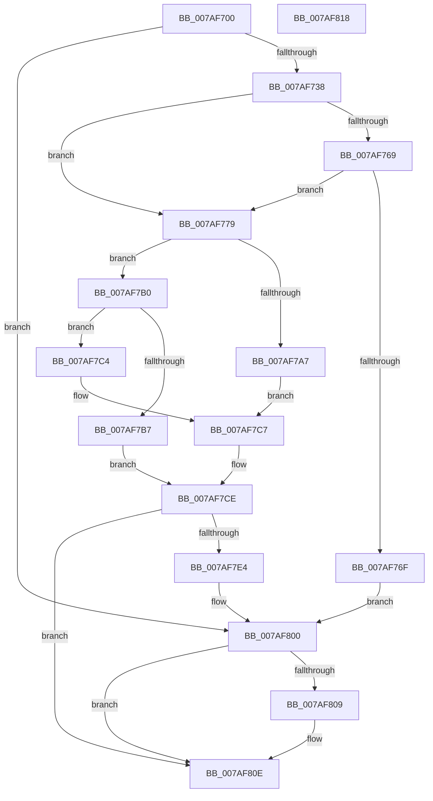

# WdipSemLoadConfigInfo

- RVA: `0x007AF700`–`0x007AF819` (길이 `281` bytes)
- VA: `0x00000001407AF700`
- 실행 섹션: `PAGE`
- PDB 이름 있음: `예`; PDB Function 태그: `아니요`
- unwind 정보 RVA: `0x000C3C24`
- 디코드: `78`개 명령, `281/281` bytes 표시
- 미해석 바이트: `0` (있으면 어셈블리에 `.byte`로 보존)

> 이 문서는 커널 이미지의 기계어와 PDB 기호를 분석해 생성했습니다. 4번과 5번은 함수 원형과 자료형을 바이너리 사용 방식에서 추정한 C 해석이며 원본 소스 복구 결과는 아닙니다.

## 1. Dependencies

- 직접 호출 지점: **6**; 고유 호출 대상: **5**
- 직접 호출자로 확인된 함수: **1**
- RIP 상대 이미지 참조: **6**

### Outgoing calls
- `0x007AF729` → [WdipSemOpenRegistryKey](../7B/WdipSemOpenRegistryKey_function_007B17C8.md) (function, `0x007B17C8`)
- `0x007AF760` → [WdipSemQueryValueFromRegistry](../7B/WdipSemQueryValueFromRegistry_function_007B185C.md) (function, `0x007B185C`)
- `0x007AF79C` → [WdipSemQueryValueFromRegistry](../7B/WdipSemQueryValueFromRegistry_function_007B185C.md) (function, `0x007B185C`)
- `0x007AF7EF` → [RtlInitUnicodeString](../../text/42/RtlInitUnicodeString_function_0042A780.md) (function, `0x0042A780`)
- `0x007AF7FB` → [ZwDeleteValueKey](../../text/6A/ZwDeleteValueKey_function_006AECB0.md) (function, `0x006AECB0`)
- `0x007AF809` → [ZwClose](../../text/6A/ZwClose_function_006AD2B0.md) (function, `0x006AD2B0`)

### Direct callers
- [WdipSemCleanStart](WdipSemCleanStart_function_007AF590.md) at `0x007AF5AC`

### Static image references
- `0x007AF718` → RVA `0x00B06A90` (` ?? ::NNGAKEGL::`string'`; read)
- `0x007AF745` → RVA `0x00B06B40` (` ?? ::NNGAKEGL::`string'`; read)
- `0x007AF786` → RVA `0x00B06B20` (` ?? ::NNGAKEGL::`string'`; read)
- `0x007AF7B7` → RVA `0x00F02028` (`.data`; write)
- `0x007AF7D5` → RVA `0x00F01E04` (`.data`; write)
- `0x007AF7E4` → RVA `0x00B06D50` (` ?? ::NNGAKEGL::`string'`; read)

## 2. Other-region calls and transfers

- 다른 실행 섹션으로 향하는 call: **3**
  - `0x007AF7EF` → [RtlInitUnicodeString](../../text/42/RtlInitUnicodeString_function_0042A780.md) (`PAGE` → `.text`)
  - `0x007AF7FB` → [ZwDeleteValueKey](../../text/6A/ZwDeleteValueKey_function_006AECB0.md) (`PAGE` → `.text`)
  - `0x007AF809` → [ZwClose](../../text/6A/ZwClose_function_006AD2B0.md) (`PAGE` → `.text`)
- 별도 외부 분기/꼬리 이동을 확인하지 못했습니다.

## 3. Assembly (complete function range)

```asm
007AF700  40 55                           push rbp
007AF702  53                              push rbx
007AF703  57                              push rdi
007AF704  48 8B EC                        mov rbp, rsp
007AF707  48 83 EC 40                     sub rsp, 0x40
007AF70B  48 83 65 38 00                  and qword ptr [rbp + 0x38], 0
007AF710  4C 8D 45 38                     lea r8, [rbp + 0x38]
007AF714  83 65 28 00                     and dword ptr [rbp + 0x28], 0
007AF718  48 8D 0D 71 73 35 00            lea rcx, [rip + 0x357371]
007AF71F  83 65 20 00                     and dword ptr [rbp + 0x20], 0
007AF723  33 D2                           xor edx, edx
007AF725  83 65 30 00                     and dword ptr [rbp + 0x30], 0
007AF729  E8 9A 20 00 00                  call 0x1407b17c8
007AF72E  8B D8                           mov ebx, eax
007AF730  85 C0                           test eax, eax
007AF732  0F 88 C8 00 00 00               js 0x1407af800
007AF738  48 8B 4D 38                     mov rcx, qword ptr [rbp + 0x38]
007AF73C  48 8D 45 28                     lea rax, [rbp + 0x28]
007AF740  48 89 44 24 28                  mov qword ptr [rsp + 0x28], rax
007AF745  48 8D 15 F4 73 35 00            lea rdx, [rip + 0x3573f4]
007AF74C  BB 04 00 00 00                  mov ebx, 4
007AF751  48 8D 45 20                     lea rax, [rbp + 0x20]
007AF755  44 8B CB                        mov r9d, ebx
007AF758  48 89 44 24 20                  mov qword ptr [rsp + 0x20], rax
007AF75D  44 8B C3                        mov r8d, ebx
007AF760  E8 F7 20 00 00                  call 0x1407b185c
007AF765  85 C0                           test eax, eax
007AF767  78 10                           js 0x1407af779
007AF769  83 7D 20 00                     cmp dword ptr [rbp + 0x20], 0
007AF76D  75 0A                           jne 0x1407af779
007AF76F  BB 01 00 00 C0                  mov ebx, 0xc0000001
007AF774  E9 87 00 00 00                  jmp 0x1407af800
007AF779  48 8B 4D 38                     mov rcx, qword ptr [rbp + 0x38]
007AF77D  48 8D 45 28                     lea rax, [rbp + 0x28]
007AF781  48 89 44 24 28                  mov qword ptr [rsp + 0x28], rax
007AF786  48 8D 15 93 73 35 00            lea rdx, [rip + 0x357393]
007AF78D  48 8D 45 30                     lea rax, [rbp + 0x30]
007AF791  44 8B CB                        mov r9d, ebx
007AF794  44 8B C3                        mov r8d, ebx
007AF797  48 89 44 24 20                  mov qword ptr [rsp + 0x20], rax
007AF79C  E8 BB 20 00 00                  call 0x1407b185c
007AF7A1  8B D8                           mov ebx, eax
007AF7A3  85 C0                           test eax, eax
007AF7A5  79 09                           jns 0x1407af7b0
007AF7A7  33 DB                           xor ebx, ebx
007AF7A9  B8 58 02 00 00                  mov eax, 0x258
007AF7AE  EB 17                           jmp 0x1407af7c7
007AF7B0  8B 45 30                        mov eax, dword ptr [rbp + 0x30]
007AF7B3  85 C0                           test eax, eax
007AF7B5  75 0D                           jne 0x1407af7c4
007AF7B7  88 05 6B 28 75 00               mov byte ptr [rip + 0x75286b], al
007AF7BD  B8 58 02 00 00                  mov eax, 0x258
007AF7C2  EB 0A                           jmp 0x1407af7ce
007AF7C4  6B C0 3C                        imul eax, eax, 0x3c
007AF7C7  C6 05 5A 28 75 00 01            mov byte ptr [rip + 0x75285a], 1
007AF7CE  48 8B 7D 38                     mov rdi, qword ptr [rbp + 0x38]
007AF7D2  0F 57 C0                        xorps xmm0, xmm0
007AF7D5  89 05 29 26 75 00               mov dword ptr [rip + 0x752629], eax
007AF7DB  0F 11 45 F0                     movups xmmword ptr [rbp - 0x10], xmm0
007AF7DF  48 85 FF                        test rdi, rdi
007AF7E2  74 2A                           je 0x1407af80e
007AF7E4  48 8D 15 65 75 35 00            lea rdx, [rip + 0x357565]
007AF7EB  48 8D 4D F0                     lea rcx, [rbp - 0x10]
007AF7EF  E8 8C AF C7 FF                  call 0x14042a780
007AF7F4  48 8D 55 F0                     lea rdx, [rbp - 0x10]
007AF7F8  48 8B CF                        mov rcx, rdi
007AF7FB  E8 B0 F4 EF FF                  call 0x1406aecb0
007AF800  48 8B 4D 38                     mov rcx, qword ptr [rbp + 0x38]
007AF804  48 85 C9                        test rcx, rcx
007AF807  74 05                           je 0x1407af80e
007AF809  E8 A2 DA EF FF                  call 0x1406ad2b0
007AF80E  8B C3                           mov eax, ebx
007AF810  48 83 C4 40                     add rsp, 0x40
007AF814  5F                              pop rdi
007AF815  5B                              pop rbx
007AF816  5D                              pop rbp
007AF817  C3                              ret
007AF818  CC                              int3
```

## 4. C-style interpretation (structured pseudocode)

```c
__int64 __fastcall WdipSemLoadConfigInfo(__int64 a1, int a2)
{
    __int64 result;
    __int64 v_rbx;
    __int64 v_rsp;
    unsigned __int64 v_stack_m28;
    unsigned __int64 v_stack_m30;
    unsigned __int64 v_stack_m38;
    unsigned int v_stack_p10;
    unsigned int v_stack_p18;
    unsigned __int64 v_stack_p20;
    unsigned int v_stack_p8;

    v_rsp = (v_rsp) - (64);
    a2 = 0;
    result = WdipSemOpenRegistryKey(v_rip + 3502961, a2, v_stack_p20, a4);
    if (sign_flag) goto loc_007AF800;
    v_stack_m30 = v_stack_p10;
    v_stack_m38 = v_stack_p8;
    result = WdipSemQueryValueFromRegistry(v_stack_p20, v_rip + 3503092, 4, 4);
    if (sign_flag) goto loc_007AF779;
    if (v_stack_p8 != 0) goto loc_007AF779;
    goto loc_007AF800;
loc_007AF779:
    v_stack_m30 = v_stack_p10;
    v_stack_m38 = v_stack_p18;
    result = WdipSemQueryValueFromRegistry(v_stack_p20, v_rip + 3502995, (unsigned int)((unsigned int)((unsigned int)(0xC0000001ULL))), (unsigned int)((unsigned int)((unsigned int)(0xC0000001ULL))));
    if (!sign_flag) goto loc_007AF7B0;
    v_rbx = 0;
    goto loc_007AF7C7;
loc_007AF7B0:
    if ((unsigned int)((unsigned int)(v_stack_p18)) != 0) goto loc_007AF7C4;
    *(unsigned __int8 *)(v_rip + 7678059) = (unsigned __int8)((unsigned int)(v_stack_p18));
    goto loc_007AF7CE;
loc_007AF7C4:
    result = (unsigned int)((600) * (600));
loc_007AF7C7:
    *(unsigned __int8 *)(v_rip + 7678042) = 1;
loc_007AF7CE:
    *(unsigned int *)(v_rip + 7677481) = (unsigned int)(result);
    v_stack_m28 = v_xmm0;
    if (v_stack_p20 == 0) goto loc_007AF80E;
    result = RtlInitUnicodeString(v_stack_m28, v_rip + 3503461, (unsigned int)((unsigned int)((unsigned int)(0xC0000001ULL))), (unsigned int)((unsigned int)((unsigned int)(0xC0000001ULL))));
    result = ZwDeleteValueKey(v_stack_p20, v_stack_m28, (unsigned int)((unsigned int)((unsigned int)(0xC0000001ULL))), (unsigned int)((unsigned int)((unsigned int)(0xC0000001ULL))));
loc_007AF800:
    if (v_stack_p20 != 0) {
        result = ZwClose(v_stack_p20, v_stack_m28, (unsigned int)((unsigned int)((unsigned int)(0xC0000001ULL))), (unsigned int)((unsigned int)((unsigned int)(0xC0000001ULL))));
    }
    v_rsp = (v_rsp) + (64);
    return 0;
}
```

## 5. (Beta) C Style

```c
int64_t WdipSemLoadConfigInfo(int64_t Arg1, int32_t Arg2)
{
    int64_t result;
    int64_t local_rbx;
    int64_t local_rsp;
    uint64_t v_stack_m28;
    uint64_t v_stack_m30;
    uint64_t v_stack_m38;
    uint32_t v_stack_p10;
    uint32_t v_stack_p18;
    uint64_t v_stack_p20;
    uint32_t v_stack_p8;

    local_rsp = (local_rsp) - (64);
    Arg2 = 0;
    result = WdipSemOpenRegistryKey(v_rip + 3502961, Arg2, v_stack_p20, a4);
    if (sign_flag) goto loc_007AF800;
    v_stack_m30 = v_stack_p10;
    v_stack_m38 = v_stack_p8;
    result = WdipSemQueryValueFromRegistry(v_stack_p20, v_rip + 3503092, 4, 4);
    if (sign_flag) goto loc_007AF779;
    if (v_stack_p8 != 0) goto loc_007AF779;
    goto loc_007AF800;
loc_007AF779:
    v_stack_m30 = v_stack_p10;
    v_stack_m38 = v_stack_p18;
    result = WdipSemQueryValueFromRegistry(v_stack_p20, v_rip + 3502995, (uint32_t)((uint32_t)((uint32_t)(0xC0000001ULL))), (uint32_t)((uint32_t)((uint32_t)(0xC0000001ULL))));
    if (!sign_flag) goto loc_007AF7B0;
    local_rbx = 0;
    goto loc_007AF7C7;
loc_007AF7B0:
    if ((uint32_t)((uint32_t)(v_stack_p18)) != 0) goto loc_007AF7C4;
    *(uint8_t *)(v_rip + 0x75286B) = (uint8_t)((uint32_t)(v_stack_p18));
    goto loc_007AF7CE;
loc_007AF7C4:
    result = (uint32_t)((600) * (600));
loc_007AF7C7:
    *(uint8_t *)(v_rip + 0x75285A) = 1;
loc_007AF7CE:
    *(uint32_t *)(v_rip + 0x752629) = (uint32_t)(result);
    v_stack_m28 = v_xmm0;
    if (v_stack_p20 == 0) goto loc_007AF80E;
    result = RtlInitUnicodeString(v_stack_m28, v_rip + 3503461, (uint32_t)((uint32_t)((uint32_t)(0xC0000001ULL))), (uint32_t)((uint32_t)((uint32_t)(0xC0000001ULL))));
    result = ZwDeleteValueKey(v_stack_p20, v_stack_m28, (uint32_t)((uint32_t)((uint32_t)(0xC0000001ULL))), (uint32_t)((uint32_t)((uint32_t)(0xC0000001ULL))));
loc_007AF800:
    if (v_stack_p20 != 0) {
        result = ZwClose(v_stack_p20, v_stack_m28, (uint32_t)((uint32_t)((uint32_t)(0xC0000001ULL))), (uint32_t)((uint32_t)((uint32_t)(0xC0000001ULL))));
    }
    local_rsp = (local_rsp) + (64);
    return 0;
}
```

## 6. Execution-region graph

[열기: 2D/3D 그래프와 함수 탐색 컨트롤 패널](../../../control-panel.html?section=page&rva=0x007AF700&view=graph)

- 2D 그래프는 위에서 아래로 흐르고, 3D 그래프는 빈 공간을 드래그해 회전합니다. Shift+드래그는 이동, 휠은 확대·축소, 함수 노드 선택은 대상 보고서 이동입니다.

### Static fallback


