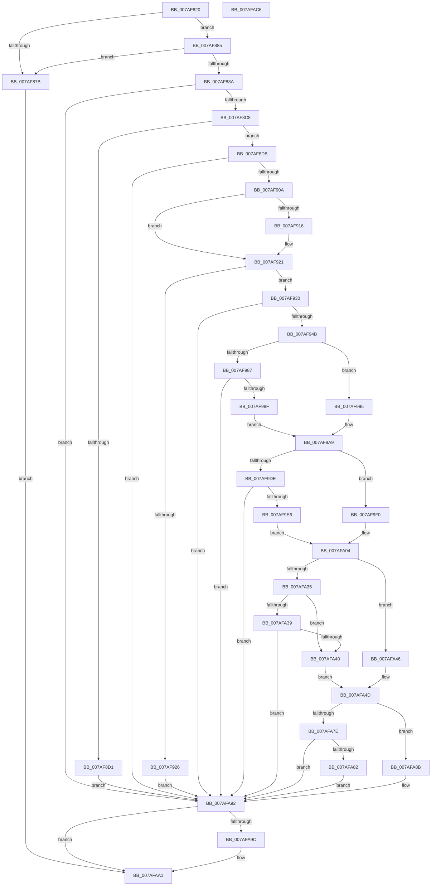

# WdipSemLoadNextContextProvider

- RVA: `0x007AF820`–`0x007AFAC7` (길이 `679` bytes)
- VA: `0x00000001407AF820`
- 실행 섹션: `PAGE`
- PDB 이름 있음: `예`; PDB Function 태그: `아니요`
- unwind 정보 RVA: `0x000D3040`
- 디코드: `178`개 명령, `679/679` bytes 표시
- 미해석 바이트: `0` (있으면 어셈블리에 `.byte`로 보존)

> 이 문서는 커널 이미지의 기계어와 PDB 기호를 분석해 생성했습니다. 4번과 5번은 함수 원형과 자료형을 바이너리 사용 방식에서 추정한 C 해석이며 원본 소스 복구 결과는 아닙니다.

## 1. Dependencies

- 직접 호출 지점: **11**; 고유 호출 대상: **8**
- 직접 호출자로 확인된 함수: **1**
- RIP 상대 이미지 참조: **7**

### Outgoing calls
- `0x007AF896` → [memset](../../text/6C/memset_function_006C6C40.md) (function, `0x006C6C40`)
- `0x007AF8B9` → [ZwEnumerateKey](../../text/6A/ZwEnumerateKey_function_006AD710.md) (function, `0x006AD710`)
- `0x007AF8EF` → [RtlInitUnicodeString](../../text/42/RtlInitUnicodeString_function_0042A780.md) (function, `0x0042A780`)
- `0x007AF8FB` → [RtlGUIDFromString](../8F/RtlGUIDFromString_function_008F1EF0.md) (function, `0x008F1EF0`)
- `0x007AF93C` → [WdipSemOpenRegistryKey](../7B/WdipSemOpenRegistryKey_function_007B17C8.md) (function, `0x007B17C8`)
- `0x007AF977` → [WdipSemQueryValueFromRegistry](../7B/WdipSemQueryValueFromRegistry_function_007B185C.md) (function, `0x007B185C`)
- `0x007AF9D3` → [WdipSemQueryValueFromRegistry](../7B/WdipSemQueryValueFromRegistry_function_007B185C.md) (function, `0x007B185C`)
- `0x007AFA2A` → [WdipSemQueryValueFromRegistry](../7B/WdipSemQueryValueFromRegistry_function_007B185C.md) (function, `0x007B185C`)
- `0x007AFA73` → [WdipSemQueryValueFromRegistry](../7B/WdipSemQueryValueFromRegistry_function_007B185C.md) (function, `0x007B185C`)
- `0x007AFA9C` → [ZwClose](../../text/6A/ZwClose_function_006AD2B0.md) (function, `0x006AD2B0`)
- `0x007AFAAA` → [_security_check_cookie](../../text/6A/_security_check_cookie_function_006AC640.md) (function, `0x006AC640`)

### Direct callers
- [WdipSemLoadNextScenario](WdipSemLoadNextScenario_function_007AFDE0.md) at `0x007B0259`

### Static image references
- `0x007AF838` → RVA `0x00E0A740` (`.data`; read)
- `0x007AF90D` → RVA `0x00022198` (`.rdata`; read)
- `0x007AF91A` → RVA `0x000221A0` (`.rdata`; read)
- `0x007AF95A` → RVA `0x00B06D40` (` ?? ::NNGAKEGL::`string'`; read)
- `0x007AF9B8` → RVA `0x00B06D90` (` ?? ::NNGAKEGL::`string'`; read)
- `0x007AFA13` → RVA `0x00B06D70` (` ?? ::NNGAKEGL::`string'`; read)
- `0x007AFA5C` → RVA `0x00B06C60` (` ?? ::NNGAKEGL::`string'`; read)

## 2. Other-region calls and transfers

- 다른 실행 섹션으로 향하는 call: **5**
  - `0x007AF896` → [memset](../../text/6C/memset_function_006C6C40.md) (`PAGE` → `.text`)
  - `0x007AF8B9` → [ZwEnumerateKey](../../text/6A/ZwEnumerateKey_function_006AD710.md) (`PAGE` → `.text`)
  - `0x007AF8EF` → [RtlInitUnicodeString](../../text/42/RtlInitUnicodeString_function_0042A780.md) (`PAGE` → `.text`)
  - `0x007AFA9C` → [ZwClose](../../text/6A/ZwClose_function_006AD2B0.md) (`PAGE` → `.text`)
  - `0x007AFAAA` → [_security_check_cookie](../../text/6A/_security_check_cookie_function_006AC640.md) (`PAGE` → `.text`)
- 별도 외부 분기/꼬리 이동을 확인하지 못했습니다.

## 3. Assembly (complete function range)

```asm
007AF820  48 89 5C 24 20                  mov qword ptr [rsp + 0x20], rbx
007AF825  55                              push rbp
007AF826  56                              push rsi
007AF827  57                              push rdi
007AF828  41 56                           push r14
007AF82A  41 57                           push r15
007AF82C  48 8D 6C 24 C9                  lea rbp, [rsp - 0x37]
007AF831  48 81 EC 00 01 00 00            sub rsp, 0x100
007AF838  48 8B 05 01 AF 65 00            mov rax, qword ptr [rip + 0x65af01]
007AF83F  48 33 C4                        xor rax, rsp
007AF842  48 89 45 2F                     mov qword ptr [rbp + 0x2f], rax
007AF846  45 33 F6                        xor r14d, r14d
007AF849  0F 57 C0                        xorps xmm0, xmm0
007AF84C  44 89 74 24 30                  mov dword ptr [rsp + 0x30], r14d
007AF851  49 8B F8                        mov rdi, r8
007AF854  4C 89 74 24 38                  mov qword ptr [rsp + 0x38], r14
007AF859  8B DA                           mov ebx, edx
007AF85B  44 89 74 24 40                  mov dword ptr [rsp + 0x40], r14d
007AF860  48 8B F1                        mov rsi, rcx
007AF863  44 89 74 24 44                  mov dword ptr [rsp + 0x44], r14d
007AF868  4C 89 74 24 48                  mov qword ptr [rsp + 0x48], r14
007AF86D  44 89 74 24 34                  mov dword ptr [rsp + 0x34], r14d
007AF872  0F 11 45 87                     movups xmmword ptr [rbp - 0x79], xmm0
007AF876  48 85 C9                        test rcx, rcx
007AF879  75 0A                           jne 0x1407af885
007AF87B  BB 0D 00 00 C0                  mov ebx, 0xc000000d
007AF880  E9 1C 02 00 00                  jmp 0x1407afaa1
007AF885  48 85 FF                        test rdi, rdi
007AF888  74 F1                           je 0x1407af87b
007AF88A  33 D2                           xor edx, edx
007AF88C  48 8D 4D 97                     lea rcx, [rbp - 0x69]
007AF890  41 B8 98 00 00 00               mov r8d, 0x98
007AF896  E8 A5 73 F1 FF                  call 0x1406c6c40
007AF89B  48 8D 44 24 30                  lea rax, [rsp + 0x30]
007AF8A0  45 33 C0                        xor r8d, r8d
007AF8A3  48 89 44 24 28                  mov qword ptr [rsp + 0x28], rax
007AF8A8  4C 8D 4D 97                     lea r9, [rbp - 0x69]
007AF8AC  8B D3                           mov edx, ebx
007AF8AE  C7 44 24 20 96 00 00 00         mov dword ptr [rsp + 0x20], 0x96
007AF8B6  48 8B CE                        mov rcx, rsi
007AF8B9  E8 52 DE EF FF                  call 0x1406ad710
007AF8BE  8B D8                           mov ebx, eax
007AF8C0  85 C0                           test eax, eax
007AF8C2  0F 88 CA 01 00 00               js 0x1407afa92
007AF8C8  81 7D A3 80 00 00 00            cmp dword ptr [rbp - 0x5d], 0x80
007AF8CF  72 0A                           jb 0x1407af8db
007AF8D1  BB 05 00 00 80                  mov ebx, 0x80000005
007AF8D6  E9 B7 01 00 00                  jmp 0x1407afa92
007AF8DB  8B 45 A3                        mov eax, dword ptr [rbp - 0x5d]
007AF8DE  48 8D 55 A7                     lea rdx, [rbp - 0x59]
007AF8E2  48 D1 E8                        shr rax, 1
007AF8E5  48 8D 4D 87                     lea rcx, [rbp - 0x79]
007AF8E9  66 44 89 74 45 A7               mov word ptr [rbp + rax*2 - 0x59], r14w
007AF8EF  E8 8C AE C7 FF                  call 0x14042a780
007AF8F4  48 8B D7                        mov rdx, rdi
007AF8F7  48 8D 4D 87                     lea rcx, [rbp - 0x79]
007AF8FB  E8 F0 25 14 00                  call 0x1408f1ef0
007AF900  8B D8                           mov ebx, eax
007AF902  85 C0                           test eax, eax
007AF904  0F 88 88 01 00 00               js 0x1407afa92
007AF90A  48 8B 07                        mov rax, qword ptr [rdi]
007AF90D  48 2B 05 84 28 87 FF            sub rax, qword ptr [rip - 0x78d77c]
007AF914  75 0B                           jne 0x1407af921
007AF916  48 8B 47 08                     mov rax, qword ptr [rdi + 8]
007AF91A  48 2B 05 7F 28 87 FF            sub rax, qword ptr [rip - 0x78d781]
007AF921  48 85 C0                        test rax, rax
007AF924  75 0A                           jne 0x1407af930
007AF926  BB 01 00 00 C0                  mov ebx, 0xc0000001
007AF92B  E9 62 01 00 00                  jmp 0x1407afa92
007AF930  4C 8D 44 24 38                  lea r8, [rsp + 0x38]
007AF935  48 8B D6                        mov rdx, rsi
007AF938  48 8D 4D A7                     lea rcx, [rbp - 0x59]
007AF93C  E8 87 1E 00 00                  call 0x1407b17c8
007AF941  8B D8                           mov ebx, eax
007AF943  85 C0                           test eax, eax
007AF945  0F 88 47 01 00 00               js 0x1407afa92
007AF94B  48 8B 4C 24 38                  mov rcx, qword ptr [rsp + 0x38]
007AF950  48 8D 44 24 30                  lea rax, [rsp + 0x30]
007AF955  48 89 44 24 28                  mov qword ptr [rsp + 0x28], rax
007AF95A  48 8D 15 DF 73 35 00            lea rdx, [rip + 0x3573df]
007AF961  41 BF 04 00 00 00               mov r15d, 4
007AF967  48 8D 44 24 40                  lea rax, [rsp + 0x40]
007AF96C  45 8B CF                        mov r9d, r15d
007AF96F  48 89 44 24 20                  mov qword ptr [rsp + 0x20], rax
007AF974  45 8B C7                        mov r8d, r15d
007AF977  E8 E0 1E 00 00                  call 0x1407b185c
007AF97C  8B D8                           mov ebx, eax
007AF97E  BE 34 00 00 C0                  mov esi, 0xc0000034
007AF983  85 C0                           test eax, eax
007AF985  79 0E                           jns 0x1407af995
007AF987  3B C6                           cmp eax, esi
007AF989  0F 85 03 01 00 00               jne 0x1407afa92
007AF98F  C6 47 12 FF                     mov byte ptr [rdi + 0x12], 0xff
007AF993  EB 14                           jmp 0x1407af9a9
007AF995  8B 44 24 40                     mov eax, dword ptr [rsp + 0x40]
007AF999  BA FF 00 00 00                  mov edx, 0xff
007AF99E  85 C0                           test eax, eax
007AF9A0  0F B6 C8                        movzx ecx, al
007AF9A3  0F 44 CA                        cmove ecx, edx
007AF9A6  88 4F 12                        mov byte ptr [rdi + 0x12], cl
007AF9A9  48 8B 4C 24 38                  mov rcx, qword ptr [rsp + 0x38]
007AF9AE  48 8D 44 24 30                  lea rax, [rsp + 0x30]
007AF9B3  48 89 44 24 28                  mov qword ptr [rsp + 0x28], rax
007AF9B8  48 8D 15 D1 73 35 00            lea rdx, [rip + 0x3573d1]
007AF9BF  41 B9 08 00 00 00               mov r9d, 8
007AF9C5  48 8D 44 24 48                  lea rax, [rsp + 0x48]
007AF9CA  48 89 44 24 20                  mov qword ptr [rsp + 0x20], rax
007AF9CF  45 8D 41 03                     lea r8d, [r9 + 3]
007AF9D3  E8 84 1E 00 00                  call 0x1407b185c
007AF9D8  8B D8                           mov ebx, eax
007AF9DA  85 C0                           test eax, eax
007AF9DC  79 12                           jns 0x1407af9f0
007AF9DE  3B C6                           cmp eax, esi
007AF9E0  0F 85 AC 00 00 00               jne 0x1407afa92
007AF9E6  48 83 C9 FF                     or rcx, 0xffffffffffffffff
007AF9EA  48 89 4F 18                     mov qword ptr [rdi + 0x18], rcx
007AF9EE  EB 14                           jmp 0x1407afa04
007AF9F0  48 8B 44 24 48                  mov rax, qword ptr [rsp + 0x48]
007AF9F5  48 83 C9 FF                     or rcx, 0xffffffffffffffff
007AF9F9  48 85 C0                        test rax, rax
007AF9FC  48 0F 44 C1                     cmove rax, rcx
007AFA00  48 89 47 18                     mov qword ptr [rdi + 0x18], rax
007AFA04  48 8B 4C 24 38                  mov rcx, qword ptr [rsp + 0x38]
007AFA09  48 8D 44 24 30                  lea rax, [rsp + 0x30]
007AFA0E  48 89 44 24 28                  mov qword ptr [rsp + 0x28], rax
007AFA13  48 8D 15 56 73 35 00            lea rdx, [rip + 0x357356]
007AFA1A  48 8D 44 24 34                  lea rax, [rsp + 0x34]
007AFA1F  45 8B CF                        mov r9d, r15d
007AFA22  45 8B C7                        mov r8d, r15d
007AFA25  48 89 44 24 20                  mov qword ptr [rsp + 0x20], rax
007AFA2A  E8 2D 1E 00 00                  call 0x1407b185c
007AFA2F  8B D8                           mov ebx, eax
007AFA31  85 C0                           test eax, eax
007AFA33  79 11                           jns 0x1407afa46
007AFA35  3B C6                           cmp eax, esi
007AFA37  74 07                           je 0x1407afa40
007AFA39  83 7C 24 34 03                  cmp dword ptr [rsp + 0x34], 3
007AFA3E  72 52                           jb 0x1407afa92
007AFA40  44 89 77 20                     mov dword ptr [rdi + 0x20], r14d
007AFA44  EB 07                           jmp 0x1407afa4d
007AFA46  8B 44 24 34                     mov eax, dword ptr [rsp + 0x34]
007AFA4A  89 47 20                        mov dword ptr [rdi + 0x20], eax
007AFA4D  48 8B 4C 24 38                  mov rcx, qword ptr [rsp + 0x38]
007AFA52  48 8D 44 24 30                  lea rax, [rsp + 0x30]
007AFA57  48 89 44 24 28                  mov qword ptr [rsp + 0x28], rax
007AFA5C  48 8D 15 FD 71 35 00            lea rdx, [rip + 0x3571fd]
007AFA63  48 8D 44 24 44                  lea rax, [rsp + 0x44]
007AFA68  45 8B CF                        mov r9d, r15d
007AFA6B  45 8B C7                        mov r8d, r15d
007AFA6E  48 89 44 24 20                  mov qword ptr [rsp + 0x20], rax
007AFA73  E8 E4 1D 00 00                  call 0x1407b185c
007AFA78  8B D8                           mov ebx, eax
007AFA7A  85 C0                           test eax, eax
007AFA7C  79 0D                           jns 0x1407afa8b
007AFA7E  3B C6                           cmp eax, esi
007AFA80  75 10                           jne 0x1407afa92
007AFA82  41 8B DE                        mov ebx, r14d
007AFA85  44 89 77 24                     mov dword ptr [rdi + 0x24], r14d
007AFA89  EB 07                           jmp 0x1407afa92
007AFA8B  8B 44 24 44                     mov eax, dword ptr [rsp + 0x44]
007AFA8F  89 47 24                        mov dword ptr [rdi + 0x24], eax
007AFA92  48 8B 4C 24 38                  mov rcx, qword ptr [rsp + 0x38]
007AFA97  48 85 C9                        test rcx, rcx
007AFA9A  74 05                           je 0x1407afaa1
007AFA9C  E8 0F D8 EF FF                  call 0x1406ad2b0
007AFAA1  8B C3                           mov eax, ebx
007AFAA3  48 8B 4D 2F                     mov rcx, qword ptr [rbp + 0x2f]
007AFAA7  48 33 CC                        xor rcx, rsp
007AFAAA  E8 91 CB EF FF                  call 0x1406ac640
007AFAAF  48 8B 9C 24 48 01 00 00         mov rbx, qword ptr [rsp + 0x148]
007AFAB7  48 81 C4 00 01 00 00            add rsp, 0x100
007AFABE  41 5F                           pop r15
007AFAC0  41 5E                           pop r14
007AFAC2  5F                              pop rdi
007AFAC3  5E                              pop rsi
007AFAC4  5D                              pop rbp
007AFAC5  C3                              ret
007AFAC6  CC                              int3
```

## 4. C-style interpretation (structured pseudocode)

```c
__int64 __fastcall WdipSemLoadNextContextProvider(__int64 a1, int a2, __int64 a3)
{
    __int64 result;
    __int64 v_r14;
    __int64 v_rsp;
    unsigned __int64 v_stack_m100;
    unsigned int v_stack_m108;
    unsigned __int64 v_stack_m30;
    unsigned __int64 v_stack_m5F;
    unsigned __int64 v_stack_mB8;
    unsigned int v_stack_mBC;
    unsigned __int64 v_stack_mC8;
    unsigned __int64 v_stack_mD8;
    unsigned __int64 v_stack_mE0;
    unsigned int v_stack_mE4;
    unsigned int v_stack_mE8;
    unsigned __int64 v_stack_mF0;
    unsigned int v_stack_mF4;
    unsigned int v_stack_mF8;
    unsigned __int64 v_stack_p20;

    v_stack_p20 = v_rbx;
    v_rsp = (v_rsp) - (256);
    result = (*(unsigned __int64 *)(v_rip + 6663937)) ^ (v_rsp);
    v_stack_m30 = result;
    v_r14 = 0;
    v_stack_mF8 = 0;
    v_stack_mF0 = 0;
    v_stack_mE8 = 0;
    v_stack_mE4 = 0;
    v_stack_mE0 = 0;
    v_stack_mF4 = 0;
    v_stack_mD8 = v_xmm0;
    if (a1 != 0) goto loc_007AF885;
loc_007AF87B:
    goto loc_007AFAA1;
loc_007AF885:
    if (a3 == 0) goto loc_007AF87B;
    a2 = 0;
    result = memset(v_stack_mC8, a2, 152, a4);
    a3 = 0;
    v_stack_m100 = v_stack_mF8;
    v_stack_m108 = 150;
    result = ZwEnumerateKey(a1, (unsigned int)((unsigned int)((unsigned int)(0xC000000DULL))), a3, v_stack_mC8);
    if (sign_flag) goto loc_007AFA92;
    if (v_stack_mBC < 128) goto loc_007AF8DB;
    goto loc_007AFA92;
loc_007AF8DB:
    result = ((unsigned int)(v_stack_mBC)) >> (1);
    *(unsigned __int16 *)(v_stack_m5F + result * 2 - 89) = 0;
    result = RtlInitUnicodeString(v_stack_mD8, v_stack_mB8, a3, v_stack_mC8);
    result = RtlGUIDFromString(v_stack_mD8, 0, a3, v_stack_mC8);
    if (sign_flag) goto loc_007AFA92;
    result = (*(unsigned __int64 *)(a3)) - (*(unsigned __int64 *)(v_rip - 7919484));
    if (!(condition_is_not_equal)) {
        result = *(unsigned __int64 *)(a3 + 8);
        result = (result) - (*(unsigned __int64 *)(v_rip - 7919489));
    }
    if (result != 0) goto loc_007AF930;
    goto loc_007AFA92;
loc_007AF930:
    result = WdipSemOpenRegistryKey(v_stack_mB8, a1, v_stack_mF0, v_stack_mC8);
    if (sign_flag) goto loc_007AFA92;
    v_stack_m100 = v_stack_mF8;
    v_stack_m108 = v_stack_mE8;
    result = WdipSemQueryValueFromRegistry(v_stack_mF0, v_rip + 3503071, 4, 4);
    if (!sign_flag) goto loc_007AF995;
    if (((unsigned int)(result)) != ((unsigned int)((unsigned int)(0xC0000034ULL)))) goto loc_007AFA92;
    *(unsigned __int8 *)(a3 + 18) = 255;
    goto loc_007AF9A9;
loc_007AF995:
    a1 = (unsigned __int8)((unsigned int)(v_stack_mE8));
    if ((unsigned int)((unsigned int)(v_stack_mE8)) == 0) { a1 = 255; }
    *(unsigned __int8 *)(a3 + 18) = (unsigned __int8)(a1);
loc_007AF9A9:
    v_stack_m100 = v_stack_mF8;
    v_stack_m108 = v_stack_mE0;
    result = WdipSemQueryValueFromRegistry(v_stack_mF0, v_rip + 3503057, 8 + 3, 8);
    if (!sign_flag) goto loc_007AF9F0;
    if (((unsigned int)(result)) != ((unsigned int)((unsigned int)(0xC0000034ULL)))) goto loc_007AFA92;
    a1 = (v_stack_mF0) | (-1);
    *(unsigned __int64 *)(a3 + 24) = a1;
    goto loc_007AFA04;
loc_007AF9F0:
    a1 = (a1) | (-1);
    result = v_stack_mE0;
    if (v_stack_mE0 == 0) { result = a1; }
    *(unsigned __int64 *)(a3 + 24) = result;
loc_007AFA04:
    v_stack_m100 = v_stack_mF8;
    v_stack_m108 = v_stack_mF4;
    result = WdipSemQueryValueFromRegistry(v_stack_mF0, v_rip + 3502934, 4, 4);
    if (!sign_flag) goto loc_007AFA46;
    if (((unsigned int)(result)) == ((unsigned int)((unsigned int)(0xC0000034ULL)))) goto loc_007AFA40;
    if (v_stack_mF4 < 3) goto loc_007AFA92;
loc_007AFA40:
    *(unsigned int *)(a3 + 32) = 0;
    goto loc_007AFA4D;
loc_007AFA46:
    *(unsigned int *)(a3 + 32) = (unsigned int)((unsigned int)(v_stack_mF4));
loc_007AFA4D:
    v_stack_m100 = v_stack_mF8;
    v_stack_m108 = v_stack_mE4;
    result = WdipSemQueryValueFromRegistry(v_stack_mF0, v_rip + 3502589, 4, 4);
    if (!sign_flag) goto loc_007AFA8B;
    if (((unsigned int)(result)) != ((unsigned int)((unsigned int)(0xC0000034ULL)))) goto loc_007AFA92;
    *(unsigned int *)(a3 + 36) = 0;
    goto loc_007AFA92;
loc_007AFA8B:
    *(unsigned int *)(a3 + 36) = (unsigned int)((unsigned int)(v_stack_mE4));
loc_007AFA92:
    result = (unsigned int)(v_stack_mE4);
    if (v_stack_mF0 != 0) {
        result = ZwClose(v_stack_mF0, v_rip + 3502589, 4, 4);
    }
    a1 = (v_stack_m30) ^ (v_rsp);
    result = _security_check_cookie(a1, v_rip + 3502589, 4, 4);
    v_rsp = (v_rsp) + (256);
    return result;
}
```

## 5. (Beta) C Style

```c
int64_t WdipSemLoadNextContextProvider(int64_t Arg1, int32_t Arg2, int64_t Arg3)
{
    int64_t result;
    int64_t local_r14;
    int64_t local_rsp;
    uint64_t v_stack_m100;
    uint32_t v_stack_m108;
    uint64_t v_stack_m30;
    uint64_t v_stack_m5F;
    uint64_t v_stack_mB8;
    uint32_t v_stack_mBC;
    uint64_t v_stack_mC8;
    uint64_t v_stack_mD8;
    uint64_t v_stack_mE0;
    uint32_t v_stack_mE4;
    uint32_t v_stack_mE8;
    uint64_t v_stack_mF0;
    uint32_t v_stack_mF4;
    uint32_t v_stack_mF8;
    uint64_t v_stack_p20;

    v_stack_p20 = local_rbx;
    local_rsp = (local_rsp) - (256);
    result = (*(uint64_t *)(v_rip + 0x65AF01)) ^ (local_rsp);
    v_stack_m30 = result;
    local_r14 = 0;
    v_stack_mF8 = 0;
    v_stack_mF0 = 0;
    v_stack_mE8 = 0;
    v_stack_mE4 = 0;
    v_stack_mE0 = 0;
    v_stack_mF4 = 0;
    v_stack_mD8 = v_xmm0;
    if (Arg1 != 0) goto loc_007AF885;
loc_007AF87B:
    goto loc_007AFAA1;
loc_007AF885:
    if (Arg3 == 0) goto loc_007AF87B;
    Arg2 = 0;
    result = memset(v_stack_mC8, Arg2, 152, a4);
    Arg3 = 0;
    v_stack_m100 = v_stack_mF8;
    v_stack_m108 = 150;
    result = ZwEnumerateKey(Arg1, (uint32_t)((uint32_t)((uint32_t)(0xC000000DULL))), Arg3, v_stack_mC8);
    if (sign_flag) goto loc_007AFA92;
    if (v_stack_mBC < 128) goto loc_007AF8DB;
    goto loc_007AFA92;
loc_007AF8DB:
    result = ((uint32_t)(v_stack_mBC)) >> (1);
    *(uint16_t *)(v_stack_m5F + result * 2 - 0x59) = 0;
    result = RtlInitUnicodeString(v_stack_mD8, v_stack_mB8, Arg3, v_stack_mC8);
    result = RtlGUIDFromString(v_stack_mD8, 0, Arg3, v_stack_mC8);
    if (sign_flag) goto loc_007AFA92;
    result = (*(uint64_t *)(Arg3)) - (*(uint64_t *)(v_rip - 0x78D77C));
    if (!(condition_is_not_equal)) {
        result = *(uint64_t *)(Arg3 + 0x8);
        result = (result) - (*(uint64_t *)(v_rip - 0x78D781));
    }
    if (result != 0) goto loc_007AF930;
    goto loc_007AFA92;
loc_007AF930:
    result = WdipSemOpenRegistryKey(v_stack_mB8, Arg1, v_stack_mF0, v_stack_mC8);
    if (sign_flag) goto loc_007AFA92;
    v_stack_m100 = v_stack_mF8;
    v_stack_m108 = v_stack_mE8;
    result = WdipSemQueryValueFromRegistry(v_stack_mF0, v_rip + 3503071, 4, 4);
    if (!sign_flag) goto loc_007AF995;
    if (((uint32_t)(result)) != ((uint32_t)((uint32_t)(0xC0000034ULL)))) goto loc_007AFA92;
    *(uint8_t *)(Arg3 + 0x12) = 255;
    goto loc_007AF9A9;
loc_007AF995:
    Arg1 = (uint8_t)((uint32_t)(v_stack_mE8));
    if ((uint32_t)((uint32_t)(v_stack_mE8)) == 0) { Arg1 = 255; }
    *(uint8_t *)(Arg3 + 0x12) = (uint8_t)(Arg1);
loc_007AF9A9:
    v_stack_m100 = v_stack_mF8;
    v_stack_m108 = v_stack_mE0;
    result = WdipSemQueryValueFromRegistry(v_stack_mF0, v_rip + 3503057, 8 + 3, 8);
    if (!sign_flag) goto loc_007AF9F0;
    if (((uint32_t)(result)) != ((uint32_t)((uint32_t)(0xC0000034ULL)))) goto loc_007AFA92;
    Arg1 = (v_stack_mF0) | (-1);
    *(uint64_t *)(Arg3 + 0x18) = Arg1;
    goto loc_007AFA04;
loc_007AF9F0:
    Arg1 = (Arg1) | (-1);
    result = v_stack_mE0;
    if (v_stack_mE0 == 0) { result = Arg1; }
    *(uint64_t *)(Arg3 + 0x18) = result;
loc_007AFA04:
    v_stack_m100 = v_stack_mF8;
    v_stack_m108 = v_stack_mF4;
    result = WdipSemQueryValueFromRegistry(v_stack_mF0, v_rip + 3502934, 4, 4);
    if (!sign_flag) goto loc_007AFA46;
    if (((uint32_t)(result)) == ((uint32_t)((uint32_t)(0xC0000034ULL)))) goto loc_007AFA40;
    if (v_stack_mF4 < 3) goto loc_007AFA92;
loc_007AFA40:
    *(uint32_t *)(Arg3 + 0x20) = 0;
    goto loc_007AFA4D;
loc_007AFA46:
    *(uint32_t *)(Arg3 + 0x20) = (uint32_t)((uint32_t)(v_stack_mF4));
loc_007AFA4D:
    v_stack_m100 = v_stack_mF8;
    v_stack_m108 = v_stack_mE4;
    result = WdipSemQueryValueFromRegistry(v_stack_mF0, v_rip + 3502589, 4, 4);
    if (!sign_flag) goto loc_007AFA8B;
    if (((uint32_t)(result)) != ((uint32_t)((uint32_t)(0xC0000034ULL)))) goto loc_007AFA92;
    *(uint32_t *)(Arg3 + 0x24) = 0;
    goto loc_007AFA92;
loc_007AFA8B:
    *(uint32_t *)(Arg3 + 0x24) = (uint32_t)((uint32_t)(v_stack_mE4));
loc_007AFA92:
    result = (uint32_t)(v_stack_mE4);
    if (v_stack_mF0 != 0) {
        result = ZwClose(v_stack_mF0, v_rip + 3502589, 4, 4);
    }
    Arg1 = (v_stack_m30) ^ (local_rsp);
    result = _security_check_cookie(Arg1, v_rip + 3502589, 4, 4);
    local_rsp = (local_rsp) + (256);
    return result;
}
```

## 6. Execution-region graph

[열기: 2D/3D 그래프와 함수 탐색 컨트롤 패널](../../../control-panel.html?section=page&rva=0x007AF820&view=graph)

- 2D 그래프는 위에서 아래로 흐르고, 3D 그래프는 빈 공간을 드래그해 회전합니다. Shift+드래그는 이동, 휠은 확대·축소, 함수 노드 선택은 대상 보고서 이동입니다.

### Static fallback


