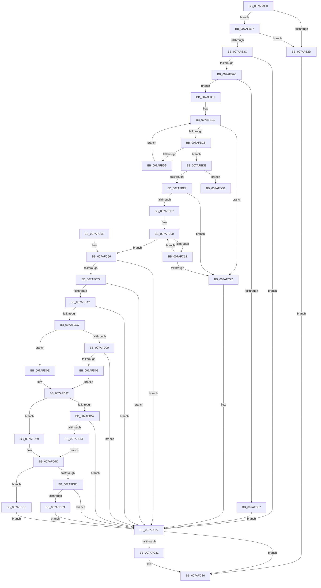

# WdipSemLoadNextEndEvent

- RVA: `0x007AFAD0`–`0x007AFDD7` (길이 `775` bytes)
- VA: `0x00000001407AFAD0`
- 실행 섹션: `PAGE`
- PDB 이름 있음: `예`; PDB Function 태그: `아니요`
- unwind 정보 RVA: `0x000D3020`
- 디코드: `201`개 명령, `775/775` bytes 표시
- 미해석 바이트: `0` (있으면 어셈블리에 `.byte`로 보존)

> 이 문서는 커널 이미지의 기계어와 PDB 기호를 분석해 생성했습니다. 4번과 5번은 함수 원형과 자료형을 바이너리 사용 방식에서 추정한 C 해석이며 원본 소스 복구 결과는 아닙니다.

## 1. Dependencies

- 직접 호출 지점: **15**; 고유 호출 대상: **10**
- 직접 호출자로 확인된 함수: **1**
- RIP 상대 이미지 참조: **4**

### Outgoing calls
- `0x007AFB49` → [memset](../../text/6C/memset_function_006C6C40.md) (function, `0x006C6C40`)
- `0x007AFB6D` → [ZwEnumerateKey](../../text/6A/ZwEnumerateKey_function_006AD710.md) (function, `0x006AD710`)
- `0x007AFBA7` → [memset](../../text/6C/memset_function_006C6C40.md) (function, `0x006C6C40`)
- `0x007AFBB8` → [memset](../../text/6C/memset_function_006C6C40.md) (function, `0x006C6C40`)
- `0x007AFC31` → [ZwClose](../../text/6A/ZwClose_function_006AD2B0.md) (function, `0x006AD2B0`)
- `0x007AFC42` → [_security_check_cookie](../../text/6A/_security_check_cookie_function_006AC640.md) (function, `0x006AC640`)
- `0x007AFC5F` → [RtlInitUnicodeString](../../text/42/RtlInitUnicodeString_function_0042A780.md) (function, `0x0042A780`)
- `0x007AFC6C` → [RtlGUIDFromString](../8F/RtlGUIDFromString_function_008F1EF0.md) (function, `0x008F1EF0`)
- `0x007AFC83` → [RtlInitUnicodeString](../../text/42/RtlInitUnicodeString_function_0042A780.md) (function, `0x0042A780`)
- `0x007AFC97` → [RtlUnicodeStringToInteger](../99/RtlUnicodeStringToInteger_function_00993480.md) (function, `0x00993480`)
- `0x007AFCB8` → [WdipSemOpenRegistryKey](../7B/WdipSemOpenRegistryKey_function_007B17C8.md) (function, `0x007B17C8`)
- `0x007AFCF0` → [WdipSemQueryValueFromRegistry](../7B/WdipSemQueryValueFromRegistry_function_007B185C.md) (function, `0x007B185C`)
- `0x007AFD4C` → [WdipSemQueryValueFromRegistry](../7B/WdipSemQueryValueFromRegistry_function_007B185C.md) (function, `0x007B185C`)
- `0x007AFDA6` → [WdipSemQueryValueFromRegistry](../7B/WdipSemQueryValueFromRegistry_function_007B185C.md) (function, `0x007B185C`)
- `0x007AFDD1` → [_report_rangecheckfailure](../../text/4F/_report_rangecheckfailure_function_004F5FDC.md) (function, `0x004F5FDC`)

### Direct callers
- [WdipSemLoadNextScenario](WdipSemLoadNextScenario_function_007AFDE0.md) at `0x007B01A9`

### Static image references
- `0x007AFAE6` → RVA `0x00E0A740` (`.data`; read)
- `0x007AFCD6` → RVA `0x00B06D40` (` ?? ::NNGAKEGL::`string'`; read)
- `0x007AFD31` → RVA `0x00B06D90` (` ?? ::NNGAKEGL::`string'`; read)
- `0x007AFD8C` → RVA `0x00B06C60` (` ?? ::NNGAKEGL::`string'`; read)

## 2. Other-region calls and transfers

- 다른 실행 섹션으로 향하는 call: **9**
  - `0x007AFB49` → [memset](../../text/6C/memset_function_006C6C40.md) (`PAGE` → `.text`)
  - `0x007AFB6D` → [ZwEnumerateKey](../../text/6A/ZwEnumerateKey_function_006AD710.md) (`PAGE` → `.text`)
  - `0x007AFBA7` → [memset](../../text/6C/memset_function_006C6C40.md) (`PAGE` → `.text`)
  - `0x007AFBB8` → [memset](../../text/6C/memset_function_006C6C40.md) (`PAGE` → `.text`)
  - `0x007AFC31` → [ZwClose](../../text/6A/ZwClose_function_006AD2B0.md) (`PAGE` → `.text`)
  - `0x007AFC42` → [_security_check_cookie](../../text/6A/_security_check_cookie_function_006AC640.md) (`PAGE` → `.text`)
  - `0x007AFC5F` → [RtlInitUnicodeString](../../text/42/RtlInitUnicodeString_function_0042A780.md) (`PAGE` → `.text`)
  - `0x007AFC83` → [RtlInitUnicodeString](../../text/42/RtlInitUnicodeString_function_0042A780.md) (`PAGE` → `.text`)
  - `0x007AFDD1` → [_report_rangecheckfailure](../../text/4F/_report_rangecheckfailure_function_004F5FDC.md) (`PAGE` → `.text`)
- 별도 외부 분기/꼬리 이동을 확인하지 못했습니다.

## 3. Assembly (complete function range)

```asm
007AFAD0  40 55                           push rbp
007AFAD2  53                              push rbx
007AFAD3  56                              push rsi
007AFAD4  57                              push rdi
007AFAD5  41 56                           push r14
007AFAD7  48 8D AC 24 F0 FE FF FF         lea rbp, [rsp - 0x110]
007AFADF  48 81 EC 10 02 00 00            sub rsp, 0x210
007AFAE6  48 8B 05 53 AC 65 00            mov rax, qword ptr [rip + 0x65ac53]
007AFAED  48 33 C4                        xor rax, rsp
007AFAF0  48 89 85 00 01 00 00            mov qword ptr [rbp + 0x100], rax
007AFAF7  45 33 F6                        xor r14d, r14d
007AFAFA  0F 57 C0                        xorps xmm0, xmm0
007AFAFD  4C 89 74 24 40                  mov qword ptr [rsp + 0x40], r14
007AFB02  49 8B F8                        mov rdi, r8
007AFB05  44 89 74 24 30                  mov dword ptr [rsp + 0x30], r14d
007AFB0A  8B DA                           mov ebx, edx
007AFB0C  44 89 74 24 34                  mov dword ptr [rsp + 0x34], r14d
007AFB11  48 8B F1                        mov rsi, rcx
007AFB14  44 89 74 24 38                  mov dword ptr [rsp + 0x38], r14d
007AFB19  44 89 74 24 3C                  mov dword ptr [rsp + 0x3c], r14d
007AFB1E  4C 89 74 24 48                  mov qword ptr [rsp + 0x48], r14
007AFB23  0F 11 44 24 50                  movups xmmword ptr [rsp + 0x50], xmm0
007AFB28  48 85 C9                        test rcx, rcx
007AFB2B  75 0A                           jne 0x1407afb37
007AFB2D  BB 0D 00 00 C0                  mov ebx, 0xc000000d
007AFB32  E9 FF 00 00 00                  jmp 0x1407afc36
007AFB37  48 85 FF                        test rdi, rdi
007AFB3A  74 F1                           je 0x1407afb2d
007AFB3C  33 D2                           xor edx, edx
007AFB3E  48 8D 4C 24 60                  lea rcx, [rsp + 0x60]
007AFB43  41 B8 98 00 00 00               mov r8d, 0x98
007AFB49  E8 F2 70 F1 FF                  call 0x1406c6c40
007AFB4E  48 8D 44 24 30                  lea rax, [rsp + 0x30]
007AFB53  45 33 C0                        xor r8d, r8d
007AFB56  48 89 44 24 28                  mov qword ptr [rsp + 0x28], rax
007AFB5B  4C 8D 4C 24 60                  lea r9, [rsp + 0x60]
007AFB60  8B D3                           mov edx, ebx
007AFB62  C7 44 24 20 96 00 00 00         mov dword ptr [rsp + 0x20], 0x96
007AFB6A  48 8B CE                        mov rcx, rsi
007AFB6D  E8 9E DB EF FF                  call 0x1406ad710
007AFB72  8B D8                           mov ebx, eax
007AFB74  85 C0                           test eax, eax
007AFB76  0F 88 AB 00 00 00               js 0x1407afc27
007AFB7C  BB 80 00 00 00                  mov ebx, 0x80
007AFB81  39 5C 24 6C                     cmp dword ptr [rsp + 0x6c], ebx
007AFB85  72 0A                           jb 0x1407afb91
007AFB87  BB 05 00 00 80                  mov ebx, 0x80000005
007AFB8C  E9 96 00 00 00                  jmp 0x1407afc27
007AFB91  8B 44 24 6C                     mov eax, dword ptr [rsp + 0x6c]
007AFB95  48 8D 4D 00                     lea rcx, [rbp]
007AFB99  48 D1 E8                        shr rax, 1
007AFB9C  4C 8B C3                        mov r8, rbx
007AFB9F  33 D2                           xor edx, edx
007AFBA1  66 44 89 74 44 70               mov word ptr [rsp + rax*2 + 0x70], r14w
007AFBA7  E8 94 70 F1 FF                  call 0x1406c6c40
007AFBAC  4C 8B C3                        mov r8, rbx
007AFBAF  48 8D 8D 80 00 00 00            lea rcx, [rbp + 0x80]
007AFBB6  33 D2                           xor edx, edx
007AFBB8  E8 83 70 F1 FF                  call 0x1406c6c40
007AFBBD  41 8B D6                        mov edx, r14d
007AFBC0  83 FA 40                        cmp edx, 0x40
007AFBC3  73 5D                           jae 0x1407afc22
007AFBC5  8B C2                           mov eax, edx
007AFBC7  48 03 C0                        add rax, rax
007AFBCA  0F B7 4C 04 70                  movzx ecx, word ptr [rsp + rax + 0x70]
007AFBCF  66 83 F9 3B                     cmp cx, 0x3b
007AFBD3  74 09                           je 0x1407afbde
007AFBD5  66 89 4C 05 00                  mov word ptr [rbp + rax], cx
007AFBDA  FF C2                           inc edx
007AFBDC  EB E2                           jmp 0x1407afbc0
007AFBDE  48 3B C3                        cmp rax, rbx
007AFBE1  0F 83 EA 01 00 00               jae 0x1407afdd1
007AFBE7  FF C2                           inc edx
007AFBE9  66 44 89 74 05 00               mov word ptr [rbp + rax], r14w
007AFBEF  45 8B CE                        mov r9d, r14d
007AFBF2  83 FA 40                        cmp edx, 0x40
007AFBF5  73 2B                           jae 0x1407afc22
007AFBF7  4C 8D 44 24 70                  lea r8, [rsp + 0x70]
007AFBFC  4D 8D 04 50                     lea r8, [r8 + rdx*2]
007AFC00  41 0F B7 08                     movzx ecx, word ptr [r8]
007AFC04  41 8B C1                        mov eax, r9d
007AFC07  66 89 8C 45 80 00 00 00         mov word ptr [rbp + rax*2 + 0x80], cx
007AFC0F  66 85 C9                        test cx, cx
007AFC12  74 42                           je 0x1407afc56
007AFC14  FF C2                           inc edx
007AFC16  49 83 C0 02                     add r8, 2
007AFC1A  41 FF C1                        inc r9d
007AFC1D  83 FA 40                        cmp edx, 0x40
007AFC20  72 DE                           jb 0x1407afc00
007AFC22  BB 01 00 00 C0                  mov ebx, 0xc0000001
007AFC27  48 8B 4C 24 40                  mov rcx, qword ptr [rsp + 0x40]
007AFC2C  48 85 C9                        test rcx, rcx
007AFC2F  74 05                           je 0x1407afc36
007AFC31  E8 7A D6 EF FF                  call 0x1406ad2b0
007AFC36  8B C3                           mov eax, ebx
007AFC38  48 8B 8D 00 01 00 00            mov rcx, qword ptr [rbp + 0x100]
007AFC3F  48 33 CC                        xor rcx, rsp
007AFC42  E8 F9 C9 EF FF                  call 0x1406ac640
007AFC47  48 81 C4 10 02 00 00            add rsp, 0x210
007AFC4E  41 5E                           pop r14
007AFC50  5F                              pop rdi
007AFC51  5E                              pop rsi
007AFC52  5B                              pop rbx
007AFC53  5D                              pop rbp
007AFC54  C3                              ret
007AFC55  CC                              int3
007AFC56  48 8D 55 00                     lea rdx, [rbp]
007AFC5A  48 8D 4C 24 50                  lea rcx, [rsp + 0x50]
007AFC5F  E8 1C AB C7 FF                  call 0x14042a780
007AFC64  48 8B D7                        mov rdx, rdi
007AFC67  48 8D 4C 24 50                  lea rcx, [rsp + 0x50]
007AFC6C  E8 7F 22 14 00                  call 0x1408f1ef0
007AFC71  8B D8                           mov ebx, eax
007AFC73  85 C0                           test eax, eax
007AFC75  78 B0                           js 0x1407afc27
007AFC77  48 8D 95 80 00 00 00            lea rdx, [rbp + 0x80]
007AFC7E  48 8D 4C 24 50                  lea rcx, [rsp + 0x50]
007AFC83  E8 F8 AA C7 FF                  call 0x14042a780
007AFC88  4C 8D 44 24 34                  lea r8, [rsp + 0x34]
007AFC8D  BA 0A 00 00 00                  mov edx, 0xa
007AFC92  48 8D 4C 24 50                  lea rcx, [rsp + 0x50]
007AFC97  E8 E4 37 1E 00                  call 0x140993480
007AFC9C  8B D8                           mov ebx, eax
007AFC9E  85 C0                           test eax, eax
007AFCA0  78 85                           js 0x1407afc27
007AFCA2  0F B7 44 24 34                  movzx eax, word ptr [rsp + 0x34]
007AFCA7  4C 8D 44 24 40                  lea r8, [rsp + 0x40]
007AFCAC  48 8B D6                        mov rdx, rsi
007AFCAF  66 89 47 10                     mov word ptr [rdi + 0x10], ax
007AFCB3  48 8D 4C 24 70                  lea rcx, [rsp + 0x70]
007AFCB8  E8 0B 1B 00 00                  call 0x1407b17c8
007AFCBD  8B D8                           mov ebx, eax
007AFCBF  85 C0                           test eax, eax
007AFCC1  0F 88 60 FF FF FF               js 0x1407afc27
007AFCC7  48 8B 4C 24 40                  mov rcx, qword ptr [rsp + 0x40]
007AFCCC  48 8D 44 24 30                  lea rax, [rsp + 0x30]
007AFCD1  48 89 44 24 28                  mov qword ptr [rsp + 0x28], rax
007AFCD6  48 8D 15 63 70 35 00            lea rdx, [rip + 0x357063]
007AFCDD  41 B9 04 00 00 00               mov r9d, 4
007AFCE3  48 8D 44 24 38                  lea rax, [rsp + 0x38]
007AFCE8  45 8B C1                        mov r8d, r9d
007AFCEB  48 89 44 24 20                  mov qword ptr [rsp + 0x20], rax
007AFCF0  E8 67 1B 00 00                  call 0x1407b185c
007AFCF5  8B D8                           mov ebx, eax
007AFCF7  BE 34 00 00 C0                  mov esi, 0xc0000034
007AFCFC  85 C0                           test eax, eax
007AFCFE  79 0E                           jns 0x1407afd0e
007AFD00  3B C6                           cmp eax, esi
007AFD02  0F 85 1F FF FF FF               jne 0x1407afc27
007AFD08  C6 47 12 FF                     mov byte ptr [rdi + 0x12], 0xff
007AFD0C  EB 14                           jmp 0x1407afd22
007AFD0E  8B 44 24 38                     mov eax, dword ptr [rsp + 0x38]
007AFD12  BA FF 00 00 00                  mov edx, 0xff
007AFD17  85 C0                           test eax, eax
007AFD19  0F B6 C8                        movzx ecx, al
007AFD1C  0F 44 CA                        cmove ecx, edx
007AFD1F  88 4F 12                        mov byte ptr [rdi + 0x12], cl
007AFD22  48 8B 4C 24 40                  mov rcx, qword ptr [rsp + 0x40]
007AFD27  48 8D 44 24 30                  lea rax, [rsp + 0x30]
007AFD2C  48 89 44 24 28                  mov qword ptr [rsp + 0x28], rax
007AFD31  48 8D 15 58 70 35 00            lea rdx, [rip + 0x357058]
007AFD38  41 B9 08 00 00 00               mov r9d, 8
007AFD3E  48 8D 44 24 48                  lea rax, [rsp + 0x48]
007AFD43  48 89 44 24 20                  mov qword ptr [rsp + 0x20], rax
007AFD48  45 8D 41 03                     lea r8d, [r9 + 3]
007AFD4C  E8 0B 1B 00 00                  call 0x1407b185c
007AFD51  8B D8                           mov ebx, eax
007AFD53  85 C0                           test eax, eax
007AFD55  79 12                           jns 0x1407afd69
007AFD57  3B C6                           cmp eax, esi
007AFD59  0F 85 C8 FE FF FF               jne 0x1407afc27
007AFD5F  48 83 C9 FF                     or rcx, 0xffffffffffffffff
007AFD63  48 89 4F 18                     mov qword ptr [rdi + 0x18], rcx
007AFD67  EB 14                           jmp 0x1407afd7d
007AFD69  48 8B 44 24 48                  mov rax, qword ptr [rsp + 0x48]
007AFD6E  48 83 C9 FF                     or rcx, 0xffffffffffffffff
007AFD72  48 85 C0                        test rax, rax
007AFD75  48 0F 44 C1                     cmove rax, rcx
007AFD79  48 89 47 18                     mov qword ptr [rdi + 0x18], rax
007AFD7D  48 8B 4C 24 40                  mov rcx, qword ptr [rsp + 0x40]
007AFD82  48 8D 44 24 30                  lea rax, [rsp + 0x30]
007AFD87  48 89 44 24 28                  mov qword ptr [rsp + 0x28], rax
007AFD8C  48 8D 15 CD 6E 35 00            lea rdx, [rip + 0x356ecd]
007AFD93  41 B9 04 00 00 00               mov r9d, 4
007AFD99  48 8D 44 24 3C                  lea rax, [rsp + 0x3c]
007AFD9E  45 8B C1                        mov r8d, r9d
007AFDA1  48 89 44 24 20                  mov qword ptr [rsp + 0x20], rax
007AFDA6  E8 B1 1A 00 00                  call 0x1407b185c
007AFDAB  8B D8                           mov ebx, eax
007AFDAD  85 C0                           test eax, eax
007AFDAF  79 14                           jns 0x1407afdc5
007AFDB1  3B C6                           cmp eax, esi
007AFDB3  0F 85 6E FE FF FF               jne 0x1407afc27
007AFDB9  41 8B DE                        mov ebx, r14d
007AFDBC  44 89 77 24                     mov dword ptr [rdi + 0x24], r14d
007AFDC0  E9 62 FE FF FF                  jmp 0x1407afc27
007AFDC5  8B 44 24 3C                     mov eax, dword ptr [rsp + 0x3c]
007AFDC9  89 47 24                        mov dword ptr [rdi + 0x24], eax
007AFDCC  E9 56 FE FF FF                  jmp 0x1407afc27
007AFDD1  E8 06 62 D4 FF                  call 0x1404f5fdc
007AFDD6  CC                              int3
```

## 4. C-style interpretation (structured pseudocode)

```c
__int64 __fastcall WdipSemLoadNextEndEvent(__int64 a1, int a2, __int64 a3)
{
    __int64 result;
    __int64 v_r14;
    __int64 v_rsp;
    unsigned __int64 v_stack_m138;
    unsigned __int64 v_stack_m1C8;
    unsigned int v_stack_m1CC;
    unsigned __int64 v_stack_m1D8;
    unsigned __int64 v_stack_m1E8;
    unsigned __int64 v_stack_m1F0;
    unsigned __int64 v_stack_m1F8;
    unsigned int v_stack_m1FC;
    unsigned int v_stack_m200;
    unsigned int v_stack_m204;
    unsigned int v_stack_m208;
    unsigned __int64 v_stack_m210;
    unsigned int v_stack_m218;
    unsigned __int64 v_stack_m38;
    unsigned __int64 v_stack_mB8;
    unsigned __int64 v_stack_p20;
    unsigned __int64 v_stack_p28;
    unsigned __int64 v_stack_p30;
    unsigned __int64 v_stack_p34;
    unsigned __int64 v_stack_p38;
    unsigned __int64 v_stack_p3C;
    unsigned __int64 v_stack_p40;
    unsigned __int64 v_stack_p48;
    unsigned __int64 v_stack_p50;
    unsigned __int64 v_stack_p70;

    v_rsp = (v_rsp) - (528);
    result = (*(unsigned __int64 *)(v_rip + 6663251)) ^ (v_rsp);
    v_stack_m38 = result;
    v_r14 = 0;
    v_stack_m1F8 = 0;
    v_stack_m208 = 0;
    v_stack_m204 = 0;
    v_stack_m200 = 0;
    v_stack_m1FC = 0;
    v_stack_m1F0 = 0;
    v_stack_m1E8 = v_xmm0;
    if (a1 != 0) goto loc_007AFB37;
loc_007AFB2D:
    goto loc_007AFC36;
loc_007AFB37:
    if (a3 == 0) goto loc_007AFB2D;
    a2 = 0;
    result = memset(v_stack_m1D8, a2, 152, a4);
    a3 = 0;
    v_stack_m210 = v_stack_m208;
    v_stack_m218 = 150;
    result = ZwEnumerateKey(a1, (unsigned int)((unsigned int)((unsigned int)(0xC000000DULL))), a3, v_stack_m1D8);
    if (sign_flag) goto loc_007AFC27;
    if (v_stack_m1CC < 128) goto loc_007AFB91;
    goto loc_007AFC27;
loc_007AFB91:
    result = ((unsigned int)(v_stack_m1CC)) >> (1);
    a2 = 0;
    *(unsigned __int16 *)(v_rsp + result * 2 + 112) = 0;
    result = memset(v_stack_m138, a2, (unsigned int)(0x80000005ULL), v_stack_m1D8);
    a2 = 0;
    result = memset(v_stack_mB8, a2, (unsigned int)(0x80000005ULL), v_stack_m1D8);
loc_007AFBC0:
    if (0 >= 64) goto loc_007AFC22;
    result = (0) + (0);
    if (((unsigned __int16)(*(unsigned __int16 *)(v_rsp + result * 1 + 112))) == 59) goto loc_007AFBDE;
    *(unsigned __int16 *)(v_stack_m138 + result * 1) = (unsigned __int16)(*(unsigned __int16 *)(v_rsp + result * 1 + 112));
    a2 = (unsigned int)((0) + 1);
    goto loc_007AFBC0;
loc_007AFBDE:
    if (result >= ((unsigned int)(0x80000005ULL))) goto loc_007AFDD1;
    a2 = (unsigned int)((a2) + 1);
    *(unsigned __int16 *)(v_stack_m138 + result * 1) = 0;
    if (a2 >= 64) goto loc_007AFC22;
loc_007AFC00:
    *(unsigned __int16 *)(v_stack_m138 + 0 * 2 + 128) = (unsigned __int16)(*(unsigned __int16 *)(v_stack_m1C8 + a2 * 2));
    if ((unsigned __int16)(*(unsigned __int16 *)(v_stack_m1C8 + a2 * 2)) == 0) goto loc_007AFC56;
    a2 = (unsigned int)((a2) + 1);
    a3 = (v_stack_m1C8 + a2 * 2) + (2);
    a4 = (unsigned int)((0) + 1);
    if (a2 < 64) goto loc_007AFC00;
loc_007AFC22:
loc_007AFC27:
    result = 0;
    if (v_stack_m1F8 != 0) {
        result = ZwClose(v_stack_m1F8, a2, a3, a4);
    }
    a1 = (v_stack_m38) ^ (v_rsp);
    result = _security_check_cookie(a1, a2, a3, a4);
    v_rsp = (v_rsp) + (528);
    return result;
loc_007AFC56:
    result = RtlInitUnicodeString(v_stack_p50, v_stack_m138, a3, a4);
    result = RtlGUIDFromString(v_stack_p50, a3, a3, a4);
    if (sign_flag) goto loc_007AFC27;
    result = RtlInitUnicodeString(v_stack_p50, v_stack_mB8, a3, a4);
    result = RtlUnicodeStringToInteger(v_stack_p50, 10, v_stack_p34, a4);
    if (sign_flag) goto loc_007AFC27;
    *(unsigned __int16 *)(a3 + 16) = (unsigned __int16)(v_stack_p34);
    result = WdipSemOpenRegistryKey(v_stack_p70, a1, v_stack_p40, a4);
    if (sign_flag) goto loc_007AFC27;
    v_stack_p28 = v_stack_p30;
    v_stack_p20 = v_stack_p38;
    result = WdipSemQueryValueFromRegistry(v_stack_p40, v_rip + 3502179, 4, 4);
    if (!sign_flag) goto loc_007AFD0E;
    if (((unsigned int)(result)) != ((unsigned int)((unsigned int)(0xC0000034ULL)))) goto loc_007AFC27;
    *(unsigned __int8 *)(a3 + 18) = 255;
    goto loc_007AFD22;
loc_007AFD0E:
    a1 = (unsigned __int8)((unsigned int)(v_stack_p38));
    if ((unsigned int)((unsigned int)(v_stack_p38)) == 0) { a1 = 255; }
    *(unsigned __int8 *)(a3 + 18) = (unsigned __int8)(a1);
loc_007AFD22:
    v_stack_p28 = v_stack_p30;
    v_stack_p20 = v_stack_p48;
    result = WdipSemQueryValueFromRegistry(v_stack_p40, v_rip + 3502168, 8 + 3, 8);
    if (!sign_flag) goto loc_007AFD69;
    if (((unsigned int)(result)) != ((unsigned int)((unsigned int)(0xC0000034ULL)))) goto loc_007AFC27;
    a1 = (v_stack_p40) | (-1);
    *(unsigned __int64 *)(a3 + 24) = a1;
    goto loc_007AFD7D;
loc_007AFD69:
    a1 = (a1) | (-1);
    result = v_stack_p48;
    if (v_stack_p48 == 0) { result = a1; }
    *(unsigned __int64 *)(a3 + 24) = result;
loc_007AFD7D:
    v_stack_p28 = v_stack_p30;
    v_stack_p20 = v_stack_p3C;
    result = WdipSemQueryValueFromRegistry(v_stack_p40, v_rip + 3501773, 4, 4);
    if (!sign_flag) goto loc_007AFDC5;
    if (((unsigned int)(result)) != ((unsigned int)((unsigned int)(0xC0000034ULL)))) goto loc_007AFC27;
    *(unsigned int *)(a3 + 36) = 0;
    goto loc_007AFC27;
loc_007AFDC5:
    *(unsigned int *)(a3 + 36) = (unsigned int)((unsigned int)(v_stack_p3C));
    goto loc_007AFC27;
loc_007AFDD1:
    result = _report_rangecheckfailure(v_stack_p40, v_rip + 3501773, 4, 4);
    return result;
}
```

## 5. (Beta) C Style

```c
int64_t WdipSemLoadNextEndEvent(int64_t Arg1, int32_t Arg2, int64_t Arg3)
{
    int64_t result;
    int64_t local_r14;
    int64_t local_rsp;
    uint64_t v_stack_m138;
    uint64_t v_stack_m1C8;
    uint32_t v_stack_m1CC;
    uint64_t v_stack_m1D8;
    uint64_t v_stack_m1E8;
    uint64_t v_stack_m1F0;
    uint64_t v_stack_m1F8;
    uint32_t v_stack_m1FC;
    uint32_t v_stack_m200;
    uint32_t v_stack_m204;
    uint32_t v_stack_m208;
    uint64_t v_stack_m210;
    uint32_t v_stack_m218;
    uint64_t v_stack_m38;
    uint64_t v_stack_mB8;
    uint64_t v_stack_p20;
    uint64_t v_stack_p28;
    uint64_t v_stack_p30;
    uint64_t v_stack_p34;
    uint64_t v_stack_p38;
    uint64_t v_stack_p3C;
    uint64_t v_stack_p40;
    uint64_t v_stack_p48;
    uint64_t v_stack_p50;
    uint64_t v_stack_p70;

    local_rsp = (local_rsp) - (528);
    result = (*(uint64_t *)(v_rip + 0x65AC53)) ^ (local_rsp);
    v_stack_m38 = result;
    local_r14 = 0;
    v_stack_m1F8 = 0;
    v_stack_m208 = 0;
    v_stack_m204 = 0;
    v_stack_m200 = 0;
    v_stack_m1FC = 0;
    v_stack_m1F0 = 0;
    v_stack_m1E8 = v_xmm0;
    if (Arg1 != 0) goto loc_007AFB37;
loc_007AFB2D:
    goto loc_007AFC36;
loc_007AFB37:
    if (Arg3 == 0) goto loc_007AFB2D;
    Arg2 = 0;
    result = memset(v_stack_m1D8, Arg2, 152, a4);
    Arg3 = 0;
    v_stack_m210 = v_stack_m208;
    v_stack_m218 = 150;
    result = ZwEnumerateKey(Arg1, (uint32_t)((uint32_t)((uint32_t)(0xC000000DULL))), Arg3, v_stack_m1D8);
    if (sign_flag) goto loc_007AFC27;
    if (v_stack_m1CC < 128) goto loc_007AFB91;
    goto loc_007AFC27;
loc_007AFB91:
    result = ((uint32_t)(v_stack_m1CC)) >> (1);
    Arg2 = 0;
    *(uint16_t *)(local_rsp + result * 2 + 0x70) = 0;
    result = memset(v_stack_m138, Arg2, (uint32_t)(0x80000005ULL), v_stack_m1D8);
    Arg2 = 0;
    result = memset(v_stack_mB8, Arg2, (uint32_t)(0x80000005ULL), v_stack_m1D8);
loc_007AFBC0:
    if (0 >= 64) goto loc_007AFC22;
    result = (0) + (0);
    if (((uint16_t)(*(uint16_t *)(local_rsp + result * 1 + 0x70))) == 59) goto loc_007AFBDE;
    *(uint16_t *)(v_stack_m138 + result * 1) = (uint16_t)(*(uint16_t *)(local_rsp + result * 1 + 0x70));
    Arg2 = (uint32_t)((0) + 1);
    goto loc_007AFBC0;
loc_007AFBDE:
    if (result >= ((uint32_t)(0x80000005ULL))) goto loc_007AFDD1;
    Arg2 = (uint32_t)((Arg2) + 1);
    *(uint16_t *)(v_stack_m138 + result * 1) = 0;
    if (Arg2 >= 64) goto loc_007AFC22;
loc_007AFC00:
    *(uint16_t *)(v_stack_m138 + 0x0 * 2 + 0x80) = (uint16_t)(*(uint16_t *)(v_stack_m1C8 + Arg2 * 2));
    if ((uint16_t)(*(uint16_t *)(v_stack_m1C8 + Arg2 * 2)) == 0) goto loc_007AFC56;
    Arg2 = (uint32_t)((Arg2) + 1);
    Arg3 = (v_stack_m1C8 + Arg2 * 2) + (2);
    a4 = (uint32_t)((0) + 1);
    if (Arg2 < 64) goto loc_007AFC00;
loc_007AFC22:
loc_007AFC27:
    result = 0;
    if (v_stack_m1F8 != 0) {
        result = ZwClose(v_stack_m1F8, Arg2, Arg3, a4);
    }
    Arg1 = (v_stack_m38) ^ (local_rsp);
    result = _security_check_cookie(Arg1, Arg2, Arg3, a4);
    local_rsp = (local_rsp) + (528);
    return result;
loc_007AFC56:
    result = RtlInitUnicodeString(v_stack_p50, v_stack_m138, Arg3, a4);
    result = RtlGUIDFromString(v_stack_p50, Arg3, Arg3, a4);
    if (sign_flag) goto loc_007AFC27;
    result = RtlInitUnicodeString(v_stack_p50, v_stack_mB8, Arg3, a4);
    result = RtlUnicodeStringToInteger(v_stack_p50, 10, v_stack_p34, a4);
    if (sign_flag) goto loc_007AFC27;
    *(uint16_t *)(Arg3 + 0x10) = (uint16_t)(v_stack_p34);
    result = WdipSemOpenRegistryKey(v_stack_p70, Arg1, v_stack_p40, a4);
    if (sign_flag) goto loc_007AFC27;
    v_stack_p28 = v_stack_p30;
    v_stack_p20 = v_stack_p38;
    result = WdipSemQueryValueFromRegistry(v_stack_p40, v_rip + 3502179, 4, 4);
    if (!sign_flag) goto loc_007AFD0E;
    if (((uint32_t)(result)) != ((uint32_t)((uint32_t)(0xC0000034ULL)))) goto loc_007AFC27;
    *(uint8_t *)(Arg3 + 0x12) = 255;
    goto loc_007AFD22;
loc_007AFD0E:
    Arg1 = (uint8_t)((uint32_t)(v_stack_p38));
    if ((uint32_t)((uint32_t)(v_stack_p38)) == 0) { Arg1 = 255; }
    *(uint8_t *)(Arg3 + 0x12) = (uint8_t)(Arg1);
loc_007AFD22:
    v_stack_p28 = v_stack_p30;
    v_stack_p20 = v_stack_p48;
    result = WdipSemQueryValueFromRegistry(v_stack_p40, v_rip + 3502168, 8 + 3, 8);
    if (!sign_flag) goto loc_007AFD69;
    if (((uint32_t)(result)) != ((uint32_t)((uint32_t)(0xC0000034ULL)))) goto loc_007AFC27;
    Arg1 = (v_stack_p40) | (-1);
    *(uint64_t *)(Arg3 + 0x18) = Arg1;
    goto loc_007AFD7D;
loc_007AFD69:
    Arg1 = (Arg1) | (-1);
    result = v_stack_p48;
    if (v_stack_p48 == 0) { result = Arg1; }
    *(uint64_t *)(Arg3 + 0x18) = result;
loc_007AFD7D:
    v_stack_p28 = v_stack_p30;
    v_stack_p20 = v_stack_p3C;
    result = WdipSemQueryValueFromRegistry(v_stack_p40, v_rip + 3501773, 4, 4);
    if (!sign_flag) goto loc_007AFDC5;
    if (((uint32_t)(result)) != ((uint32_t)((uint32_t)(0xC0000034ULL)))) goto loc_007AFC27;
    *(uint32_t *)(Arg3 + 0x24) = 0;
    goto loc_007AFC27;
loc_007AFDC5:
    *(uint32_t *)(Arg3 + 0x24) = (uint32_t)((uint32_t)(v_stack_p3C));
    goto loc_007AFC27;
loc_007AFDD1:
    result = _report_rangecheckfailure(v_stack_p40, v_rip + 3501773, 4, 4);
    return result;
}
```

## 6. Execution-region graph

[열기: 2D/3D 그래프와 함수 탐색 컨트롤 패널](../../../control-panel.html?section=page&rva=0x007AFAD0&view=graph)

- 2D 그래프는 위에서 아래로 흐르고, 3D 그래프는 빈 공간을 드래그해 회전합니다. Shift+드래그는 이동, 휠은 확대·축소, 함수 노드 선택은 대상 보고서 이동입니다.

### Static fallback


