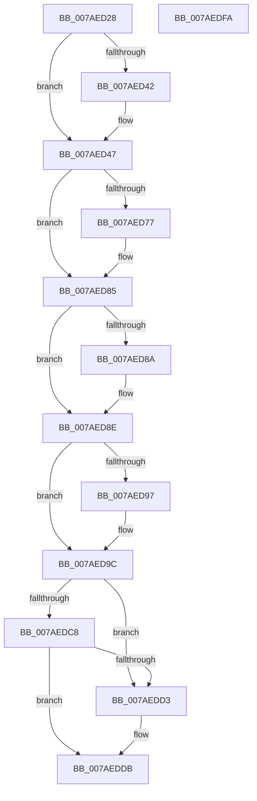

# WdipSemUpdate

- RVA: `0x007AED28`–`0x007AEDFB` (길이 `211` bytes)
- VA: `0x00000001407AED28`
- 실행 섹션: `PAGE`
- PDB 이름 있음: `예`; PDB Function 태그: `아니요`
- unwind 정보 RVA: `0x00060BC4`
- 디코드: `54`개 명령, `211/211` bytes 표시
- 미해석 바이트: `0` (있으면 어셈블리에 `.byte`로 보존)

> 이 문서는 커널 이미지의 기계어와 PDB 기호를 분석해 생성했습니다. 4번과 5번은 함수 원형과 자료형을 바이너리 사용 방식에서 추정한 C 해석이며 원본 소스 복구 결과는 아닙니다.

## 1. Dependencies

- 직접 호출 지점: **8**; 고유 호출 대상: **8**
- 직접 호출자로 확인된 함수: **1**
- RIP 상대 이미지 참조: **3**

### Outgoing calls
- `0x007AED42` → [WdipSemInitializeGlobalState](WdipSemInitializeGlobalState_function_007AF5FC.md) (function, `0x007AF5FC`)
- `0x007AED67` → [KeAbPreAcquire](../../text/21/KeAbPreAcquire_function_00210230.md) (function, `0x00210230`)
- `0x007AED80` → [ExfAcquirePushLockExclusiveEx](../../text/20/ExfAcquirePushLockExclusiveEx_function_0020FC90.md) (function, `0x0020FC90`)
- `0x007AED97` → [WdipSemShutdown](../7B/WdipSemShutdown_function_007B0954.md) (function, `0x007B0954`)
- `0x007AED9C` → [WdipSemCleanStart](WdipSemCleanStart_function_007AF590.md) (function, `0x007AF590`)
- `0x007AEDD6` → [ExfReleasePushLock](../../text/26/ExfReleasePushLock_function_002638D0.md) (function, `0x002638D0`)
- `0x007AEDDE` → [KeAbPostRelease](../../text/2E/KeAbPostRelease_function_002E1600.md) (function, `0x002E1600`)
- `0x007AEDE3` → [KeLeaveCriticalRegion](../../text/25/KeLeaveCriticalRegion_function_0025D8B0.md) (function, `0x0025D8B0`)

### Direct callers
- [WdiUpdateSem](../../text/64/WdiUpdateSem_function_0064E064.md) at `0x0064E071`

### Static image references
- `0x007AED39` → RVA `0x00F01E00` (`.data`; read)
- `0x007AED50` → RVA `0x00F01E08` (`.data`; read)
- `0x007AED8E` → RVA `0x00F01E18` (`.data`; read)

## 2. Other-region calls and transfers

- 다른 실행 섹션으로 향하는 call: **5**
  - `0x007AED67` → [KeAbPreAcquire](../../text/21/KeAbPreAcquire_function_00210230.md) (`PAGE` → `.text`)
  - `0x007AED80` → [ExfAcquirePushLockExclusiveEx](../../text/20/ExfAcquirePushLockExclusiveEx_function_0020FC90.md) (`PAGE` → `.text`)
  - `0x007AEDD6` → [ExfReleasePushLock](../../text/26/ExfReleasePushLock_function_002638D0.md) (`PAGE` → `.text`)
  - `0x007AEDDE` → [KeAbPostRelease](../../text/2E/KeAbPostRelease_function_002E1600.md) (`PAGE` → `.text`)
  - `0x007AEDE3` → [KeLeaveCriticalRegion](../../text/25/KeLeaveCriticalRegion_function_0025D8B0.md) (`PAGE` → `.text`)
- 별도 외부 분기/꼬리 이동을 확인하지 못했습니다.

## 3. Assembly (complete function range)

```asm
007AED28  48 89 5C 24 08                  mov qword ptr [rsp + 8], rbx
007AED2D  48 89 74 24 10                  mov qword ptr [rsp + 0x10], rsi
007AED32  57                              push rdi
007AED33  48 83 EC 20                     sub rsp, 0x20
007AED37  33 FF                           xor edi, edi
007AED39  40 38 3D C0 30 75 00            cmp byte ptr [rip + 0x7530c0], dil
007AED40  75 05                           jne 0x1407aed47
007AED42  E8 B5 08 00 00                  call 0x1407af5fc
007AED47  65 48 8B 04 25 88 01 00 00      mov rax, qword ptr gs:[0x188]
007AED50  48 8D 35 B1 30 75 00            lea rsi, [rip + 0x7530b1]
007AED57  45 33 C0                        xor r8d, r8d
007AED5A  33 D2                           xor edx, edx
007AED5C  48 8B CE                        mov rcx, rsi
007AED5F  66 FF 88 E4 01 00 00            dec word ptr [rax + 0x1e4]
007AED66  90                              nop
007AED67  E8 C4 14 A6 FF                  call 0x140210230
007AED6C  F0 48 0F BA 2E 00               lock bts qword ptr [rsi], 0
007AED72  48 8B D8                        mov rbx, rax
007AED75  73 0E                           jae 0x1407aed85
007AED77  4C 8B C6                        mov r8, rsi
007AED7A  48 8B D0                        mov rdx, rax
007AED7D  48 8B CE                        mov rcx, rsi
007AED80  E8 0B 0F A6 FF                  call 0x14020fc90
007AED85  48 85 DB                        test rbx, rbx
007AED88  74 04                           je 0x1407aed8e
007AED8A  C6 43 0A 01                     mov byte ptr [rbx + 0xa], 1
007AED8E  40 38 3D 83 30 75 00            cmp byte ptr [rip + 0x753083], dil
007AED95  74 05                           je 0x1407aed9c
007AED97  E8 B8 1B 00 00                  call 0x1407b0954
007AED9C  E8 EF 07 00 00                  call 0x1407af590
007AEDA1  8B D8                           mov ebx, eax
007AEDA3  0F 0D 0D 5E 30 75 00            prefetchw byte ptr [rip + 0x75305e]
007AEDAA  48 8B 05 57 30 75 00            mov rax, qword ptr [rip + 0x753057]
007AEDB1  48 8B C8                        mov rcx, rax
007AEDB4  48 83 E1 F0                     and rcx, 0xfffffffffffffff0
007AEDB8  48 83 F9 10                     cmp rcx, 0x10
007AEDBC  48 8D 50 F0                     lea rdx, [rax - 0x10]
007AEDC0  48 0F 46 D7                     cmovbe rdx, rdi
007AEDC4  A8 02                           test al, 2
007AEDC6  75 0B                           jne 0x1407aedd3
007AEDC8  F0 48 0F B1 15 37 30 75 00      lock cmpxchg qword ptr [rip + 0x753037], rdx
007AEDD1  74 08                           je 0x1407aeddb
007AEDD3  48 8B CE                        mov rcx, rsi
007AEDD6  E8 F5 4A AB FF                  call 0x1402638d0
007AEDDB  48 8B CE                        mov rcx, rsi
007AEDDE  E8 1D 28 B3 FF                  call 0x1402e1600
007AEDE3  E8 C8 EA AA FF                  call 0x14025d8b0
007AEDE8  48 8B 74 24 38                  mov rsi, qword ptr [rsp + 0x38]
007AEDED  8B C3                           mov eax, ebx
007AEDEF  48 8B 5C 24 30                  mov rbx, qword ptr [rsp + 0x30]
007AEDF4  48 83 C4 20                     add rsp, 0x20
007AEDF8  5F                              pop rdi
007AEDF9  C3                              ret
007AEDFA  CC                              int3
```

## 4. C-style interpretation (structured pseudocode)

```c
__int64 __fastcall WdipSemUpdate(__int64 a1, int a2, int a3)
{
    __int64 result;
    __int64 v_rdi;
    __int64 v_rsp;
    unsigned __int64 v_stack_p10;
    unsigned __int64 v_stack_p8;

    v_stack_p8 = v_rbx;
    v_stack_p10 = v_rsi;
    v_rsp = (v_rsp) - (32);
    v_rdi = 0;
    if ((*(unsigned __int8 *)(v_rip + 7680192)) == 0) {
        result = WdipSemInitializeGlobalState(a1, a2, a3, a4);
    }
    a3 = 0;
    a2 = 0;
    result = KeAbPreAcquire(v_rip + 7680177, a2, a3, a4);
    if (!(condition_is_above_or_equal)) {
        a3 = v_rip + 7680177;
        a2 = result;
        a1 = v_rip + 7680177;
        result = ExfAcquirePushLockExclusiveEx(a1, a2, a3, a4);
    }
    if (result != 0) {
        *(unsigned __int8 *)(result + 10) = 1;
    }
    if ((*(unsigned __int8 *)(v_rip + 7680131)) != 0) {
        result = WdipSemShutdown(a1, a2, a3, a4);
    }
    result = WdipSemCleanStart(a1, a2, a3, a4);
    a1 = (*(unsigned __int64 *)(v_rip + 7680087)) & (-16);
    a2 = *(unsigned __int64 *)(v_rip + 7680087) - 16;
    if (a1 <= 16) { a2 = 0; }
    if ((((unsigned __int8)(*(unsigned __int64 *)(v_rip + 7680087))) & (2)) != 0) goto loc_007AEDD3;
    result = *(unsigned __int64 *)(v_rip + 7680087);
    if ((((unsigned __int8)(*(unsigned __int64 *)(v_rip + 7680087))) & (2)) != 0) {
        a1 = v_rip + 7680177;
        result = ExfReleasePushLock(a1, a2, a3, a4);
    }
    result = KeAbPostRelease(v_rip + 7680177, a2, a3, a4);
    result = KeLeaveCriticalRegion(v_rip + 7680177, a2, a3, a4);
    v_rsp = (v_rsp) + (32);
    return (unsigned int)((unsigned int)((unsigned int)((unsigned int)(result))));
}
```

## 5. (Beta) C Style

```c
int64_t WdipSemUpdate(int64_t Arg1, int32_t Arg2, int32_t Arg3)
{
    int64_t result;
    int64_t local_rdi;
    int64_t local_rsp;
    uint64_t v_stack_p10;
    uint64_t v_stack_p8;

    v_stack_p8 = local_rbx;
    v_stack_p10 = local_rsi;
    local_rsp = (local_rsp) - (32);
    local_rdi = 0;
    if ((*(uint8_t *)(v_rip + 0x7530C0)) == 0) {
        result = WdipSemInitializeGlobalState(Arg1, Arg2, Arg3, a4);
    }
    Arg3 = 0;
    Arg2 = 0;
    result = KeAbPreAcquire(v_rip + 7680177, Arg2, Arg3, a4);
    if (!(condition_is_above_or_equal)) {
        Arg3 = v_rip + 7680177;
        Arg2 = result;
        Arg1 = v_rip + 7680177;
        result = ExfAcquirePushLockExclusiveEx(Arg1, Arg2, Arg3, a4);
    }
    if (result != 0) {
        *(uint8_t *)(result + 0xA) = 1;
    }
    if ((*(uint8_t *)(v_rip + 0x753083)) != 0) {
        result = WdipSemShutdown(Arg1, Arg2, Arg3, a4);
    }
    result = WdipSemCleanStart(Arg1, Arg2, Arg3, a4);
    Arg1 = (*(uint64_t *)(v_rip + 0x753057)) & (-16);
    Arg2 = *(uint64_t *)(v_rip + 0x753057) - 16;
    if (Arg1 <= 16) { Arg2 = 0; }
    if ((((uint8_t)(*(uint64_t *)(v_rip + 0x753057))) & (2)) != 0) goto loc_007AEDD3;
    result = *(uint64_t *)(v_rip + 0x753057);
    if ((((uint8_t)(*(uint64_t *)(v_rip + 0x753057))) & (2)) != 0) {
        Arg1 = v_rip + 7680177;
        result = ExfReleasePushLock(Arg1, Arg2, Arg3, a4);
    }
    result = KeAbPostRelease(v_rip + 7680177, Arg2, Arg3, a4);
    result = KeLeaveCriticalRegion(v_rip + 7680177, Arg2, Arg3, a4);
    local_rsp = (local_rsp) + (32);
    return (uint32_t)((uint32_t)((uint32_t)((uint32_t)(result))));
}
```

## 6. Execution-region graph

[열기: 2D/3D 그래프와 함수 탐색 컨트롤 패널](../../../control-panel.html?section=page&rva=0x007AED28&view=graph)

- 2D 그래프는 위에서 아래로 흐르고, 3D 그래프는 빈 공간을 드래그해 회전합니다. Shift+드래그는 이동, 휠은 확대·축소, 함수 노드 선택은 대상 보고서 이동입니다.

### Static fallback


