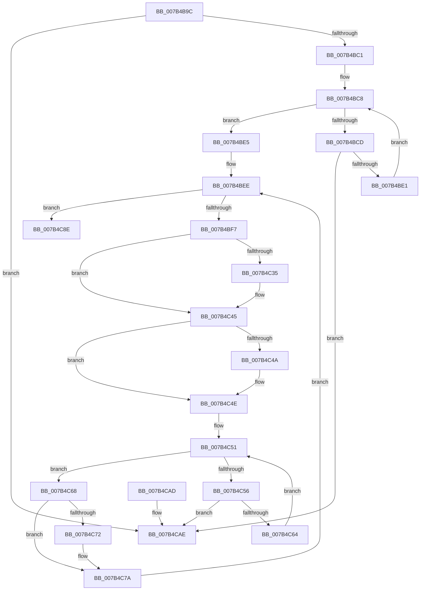

# EtwCleanupSiloState

- RVA: `0x007B4B9C`–`0x007B4CB9` (길이 `285` bytes)
- VA: `0x00000001407B4B9C`
- 실행 섹션: `PAGE`
- PDB 이름 있음: `예`; PDB Function 태그: `아니요`
- unwind 정보 RVA: `0x000D36CC`
- 디코드: `85`개 명령, `285/285` bytes 표시
- 미해석 바이트: `0` (있으면 어셈블리에 `.byte`로 보존)

> 이 문서는 커널 이미지의 기계어와 PDB 기호를 분석해 생성했습니다. 4번과 5번은 함수 원형과 자료형을 바이너리 사용 방식에서 추정한 C 해석이며 원본 소스 복구 결과는 아닙니다.

## 1. Dependencies

- 직접 호출 지점: **7**; 고유 호출 대상: **7**
- 직접 호출자로 확인된 함수: **1**
- RIP 상대 이미지 참조: **0**

### Outgoing calls
- `0x007B4C24` → [KeAbPreAcquire](../../text/21/KeAbPreAcquire_function_00210230.md) (function, `0x00210230`)
- `0x007B4C40` → [ExfAcquirePushLockSharedEx](../../text/21/ExfAcquirePushLockSharedEx_function_0021044C.md) (function, `0x0021044C`)
- `0x007B4C75` → [ExfReleasePushLockShared](../../text/26/ExfReleasePushLockShared_function_00263440.md) (function, `0x00263440`)
- `0x007B4C7D` → [KeAbPostRelease](../../text/2E/KeAbPostRelease_function_002E1600.md) (function, `0x002E1600`)
- `0x007B4C82` → [KeLeaveCriticalRegion](../../text/25/KeLeaveCriticalRegion_function_0025D8B0.md) (function, `0x0025D8B0`)
- `0x007B4C91` → [EtwpCleanupSiloState](EtwpCleanupSiloState_function_007B59CC.md) (function, `0x007B59CC`)
- `0x007B4CB3` → [KeBugCheck](../../text/4F/KeBugCheck_function_004FD640.md) (function, `0x004FD640`)

### Direct callers
- [PspDeleteServerSiloGlobals](../77/PspDeleteServerSiloGlobals_function_0077FC54.md) at `0x0077FD37`

### Static image references
- 디코드된 RIP-relative 메모리 참조가 없습니다.

## 2. Other-region calls and transfers

- 다른 실행 섹션으로 향하는 call: **6**
  - `0x007B4C24` → [KeAbPreAcquire](../../text/21/KeAbPreAcquire_function_00210230.md) (`PAGE` → `.text`)
  - `0x007B4C40` → [ExfAcquirePushLockSharedEx](../../text/21/ExfAcquirePushLockSharedEx_function_0021044C.md) (`PAGE` → `.text`)
  - `0x007B4C75` → [ExfReleasePushLockShared](../../text/26/ExfReleasePushLockShared_function_00263440.md) (`PAGE` → `.text`)
  - `0x007B4C7D` → [KeAbPostRelease](../../text/2E/KeAbPostRelease_function_002E1600.md) (`PAGE` → `.text`)
  - `0x007B4C82` → [KeLeaveCriticalRegion](../../text/25/KeLeaveCriticalRegion_function_0025D8B0.md) (`PAGE` → `.text`)
  - `0x007B4CB3` → [KeBugCheck](../../text/4F/KeBugCheck_function_004FD640.md) (`PAGE` → `.text`)
- 별도 외부 분기/꼬리 이동을 확인하지 못했습니다.

## 3. Assembly (complete function range)

```asm
007B4B9C  48 89 5C 24 10                  mov qword ptr [rsp + 0x10], rbx
007B4BA1  48 89 6C 24 18                  mov qword ptr [rsp + 0x18], rbp
007B4BA6  56                              push rsi
007B4BA7  57                              push rdi
007B4BA8  41 54                           push r12
007B4BAA  41 56                           push r14
007B4BAC  41 57                           push r15
007B4BAE  48 83 EC 20                     sub rsp, 0x20
007B4BB2  45 33 FF                        xor r15d, r15d
007B4BB5  48 8B F9                        mov rdi, rcx
007B4BB8  48 85 C9                        test rcx, rcx
007B4BBB  0F 84 ED 00 00 00               je 0x1407b4cae
007B4BC1  44 8B 41 10                     mov r8d, dword ptr [rcx + 0x10]
007B4BC5  41 8B D7                        mov edx, r15d
007B4BC8  41 3B D0                        cmp edx, r8d
007B4BCB  73 18                           jae 0x1407b4be5
007B4BCD  48 8B 87 C8 02 00 00            mov rax, qword ptr [rdi + 0x2c8]
007B4BD4  8B CA                           mov ecx, edx
007B4BD6  48 83 3C C8 01                  cmp qword ptr [rax + rcx*8], 1
007B4BDB  0F 85 CD 00 00 00               jne 0x1407b4cae
007B4BE1  FF C2                           inc edx
007B4BE3  EB E3                           jmp 0x1407b4bc8
007B4BE5  41 8B F7                        mov esi, r15d
007B4BE8  41 BC 11 00 00 00               mov r12d, 0x11
007B4BEE  83 FE 40                        cmp esi, 0x40
007B4BF1  0F 83 97 00 00 00               jae 0x1407b4c8e
007B4BF7  8B C6                           mov eax, esi
007B4BF9  45 33 C0                        xor r8d, r8d
007B4BFC  4C 6B F0 38                     imul r14, rax, 0x38
007B4C00  65 48 8B 04 25 88 01 00 00      mov rax, qword ptr gs:[0x188]
007B4C09  33 D2                           xor edx, edx
007B4C0B  49 81 C6 D0 02 00 00            add r14, 0x2d0
007B4C12  4C 03 F7                        add r14, rdi
007B4C15  66 FF 88 E4 01 00 00            dec word ptr [rax + 0x1e4]
007B4C1C  90                              nop
007B4C1D  49 8D 5E 30                     lea rbx, [r14 + 0x30]
007B4C21  48 8B CB                        mov rcx, rbx
007B4C24  E8 07 B6 A5 FF                  call 0x140210230
007B4C29  48 8B E8                        mov rbp, rax
007B4C2C  33 C0                           xor eax, eax
007B4C2E  F0 4C 0F B1 23                  lock cmpxchg qword ptr [rbx], r12
007B4C33  74 10                           je 0x1407b4c45
007B4C35  4C 8B CB                        mov r9, rbx
007B4C38  4C 8B C5                        mov r8, rbp
007B4C3B  33 D2                           xor edx, edx
007B4C3D  48 8B CB                        mov rcx, rbx
007B4C40  E8 07 B8 A5 FF                  call 0x14021044c
007B4C45  48 85 ED                        test rbp, rbp
007B4C48  74 04                           je 0x1407b4c4e
007B4C4A  C6 45 0A 01                     mov byte ptr [rbp + 0xa], 1
007B4C4E  41 8B CF                        mov ecx, r15d
007B4C51  83 F9 03                        cmp ecx, 3
007B4C54  73 12                           jae 0x1407b4c68
007B4C56  8B C1                           mov eax, ecx
007B4C58  48 C1 E0 04                     shl rax, 4
007B4C5C  49 03 C6                        add rax, r14
007B4C5F  48 39 00                        cmp qword ptr [rax], rax
007B4C62  75 4A                           jne 0x1407b4cae
007B4C64  FF C1                           inc ecx
007B4C66  EB E9                           jmp 0x1407b4c51
007B4C68  49 8B C4                        mov rax, r12
007B4C6B  F0 4C 0F B1 3B                  lock cmpxchg qword ptr [rbx], r15
007B4C70  74 08                           je 0x1407b4c7a
007B4C72  48 8B CB                        mov rcx, rbx
007B4C75  E8 C6 E7 AA FF                  call 0x140263440
007B4C7A  48 8B CB                        mov rcx, rbx
007B4C7D  E8 7E C9 B2 FF                  call 0x1402e1600
007B4C82  E8 29 8C AA FF                  call 0x14025d8b0
007B4C87  FF C6                           inc esi
007B4C89  E9 60 FF FF FF                  jmp 0x1407b4bee
007B4C8E  48 8B CF                        mov rcx, rdi
007B4C91  E8 36 0D 00 00                  call 0x1407b59cc
007B4C96  48 8B 5C 24 58                  mov rbx, qword ptr [rsp + 0x58]
007B4C9B  48 8B 6C 24 60                  mov rbp, qword ptr [rsp + 0x60]
007B4CA0  48 83 C4 20                     add rsp, 0x20
007B4CA4  41 5F                           pop r15
007B4CA6  41 5E                           pop r14
007B4CA8  41 5C                           pop r12
007B4CAA  5F                              pop rdi
007B4CAB  5E                              pop rsi
007B4CAC  C3                              ret
007B4CAD  CC                              int3
007B4CAE  B9 1D 01 00 00                  mov ecx, 0x11d
007B4CB3  E8 88 89 D4 FF                  call 0x1404fd640
007B4CB8  CC                              int3
```

## 4. C-style interpretation (structured pseudocode)

```c
__int64 __fastcall EtwCleanupSiloState(__int64 a1)
{
    __int64 result;
    __int64 v_r14;
    __int64 v_r15;
    __int64 v_rsi;
    __int64 v_rsp;
    unsigned __int64 v_stack_p10;
    unsigned __int64 v_stack_p18;

    v_stack_p10 = v_rbx;
    v_stack_p18 = v_rbp;
    v_rsp = (v_rsp) - (32);
    v_r15 = 0;
    if (a1 == 0) goto loc_007B4CAE;
loc_007B4BC8:
    if (0 >= ((unsigned int)((unsigned int)(*(unsigned int *)(a1 + 16))))) goto loc_007B4BE5;
    if ((*(unsigned __int64 *)(*(unsigned __int64 *)(a1 + 712) + 0 * 8)) != 1) goto loc_007B4CAE;
    a2 = (unsigned int)((0) + 1);
    goto loc_007B4BC8;
loc_007B4BE5:
loc_007B4BEE:
    if (0 >= 64) goto loc_007B4C8E;
    a3 = 0;
    v_r14 = (v_r14) * (0);
    a2 = 0;
    v_r14 = (v_r14) + (720);
    v_r14 = (v_r14) + (a1);
    result = KeAbPreAcquire(v_r14 + 48, a2, a3, a4);
    result = 0;
    if (!(condition_is_equal)) {
        a4 = v_r14 + 48;
        a3 = 0;
        a2 = 0;
        a1 = v_r14 + 48;
        result = ExfAcquirePushLockSharedEx(a1, a2, a3, a4);
    }
    if (result != 0) {
        *(unsigned __int8 *)(result + 10) = 1;
    }
loc_007B4C51:
    if (0 >= 3) goto loc_007B4C68;
    result = (0) << (4);
    result = (result) + (v_r14);
    if ((*(unsigned __int64 *)(result)) != result) goto loc_007B4CAE;
    a1 = (unsigned int)((0) + 1);
    goto loc_007B4C51;
loc_007B4C68:
    result = 17;
    if ((*(unsigned __int64 *)(result)) != result) {
        a1 = v_r14 + 48;
        result = ExfReleasePushLockShared(a1, a2, a3, a4);
    }
    result = KeAbPostRelease(v_r14 + 48, a2, a3, a4);
    result = KeLeaveCriticalRegion(v_r14 + 48, a2, a3, a4);
    v_rsi = (unsigned int)((0) + 1);
    goto loc_007B4BEE;
loc_007B4C8E:
    result = EtwpCleanupSiloState(a1, a2, a3, a4);
    v_rsp = (v_rsp) + (32);
    return result;
loc_007B4CAE:
    result = KeBugCheck(285, a2, a3, a4);
    return result;
}
```

## 5. (Beta) C Style

```c
int64_t EtwCleanupSiloState(void *Arg1)
{
    uint8_t *arg1 = (uint8_t *)Arg1;

    int64_t result;
    int64_t local_r14;
    int64_t local_r15;
    int64_t local_rsi;
    int64_t local_rsp;
    uint64_t v_stack_p10;
    uint64_t v_stack_p18;

    v_stack_p10 = local_rbx;
    v_stack_p18 = local_rbp;
    local_rsp = (local_rsp) - (32);
    local_r15 = 0;
    if (Arg1 == NULL) goto loc_007B4CAE;
loc_007B4BC8:
    if (0 >= ((uint32_t)((uint32_t)(*(uint32_t *)(arg1 + 0x10))))) goto loc_007B4BE5;
    if ((*(uint64_t *)(*(uint64_t *)(arg1 + 0x2C8) + 0x0 * 8)) != 1) goto loc_007B4CAE;
    a2 = (uint32_t)((0) + 1);
    goto loc_007B4BC8;
loc_007B4BE5:
loc_007B4BEE:
    if (0 >= 64) goto loc_007B4C8E;
    a3 = 0;
    local_r14 = (local_r14) * (0);
    a2 = 0;
    local_r14 = (local_r14) + (720);
    local_r14 = (local_r14) + (Arg1);
    result = KeAbPreAcquire(local_r14 + 48, a2, a3, a4);
    result = 0;
    if (!(condition_is_equal)) {
        a4 = local_r14 + 48;
        a3 = 0;
        a2 = 0;
        Arg1 = local_r14 + 48;
        result = ExfAcquirePushLockSharedEx(Arg1, a2, a3, a4);
    }
    if (result != 0) {
        *(uint8_t *)(result + 0xA) = 1;
    }
loc_007B4C51:
    if (0 >= 3) goto loc_007B4C68;
    result = (0) << (4);
    result = (result) + (local_r14);
    if ((*(uint64_t *)(result)) != result) goto loc_007B4CAE;
    Arg1 = (uint32_t)((0) + 1);
    goto loc_007B4C51;
loc_007B4C68:
    result = 17;
    if ((*(uint64_t *)(result)) != result) {
        Arg1 = local_r14 + 48;
        result = ExfReleasePushLockShared(Arg1, a2, a3, a4);
    }
    result = KeAbPostRelease(local_r14 + 48, a2, a3, a4);
    result = KeLeaveCriticalRegion(local_r14 + 48, a2, a3, a4);
    local_rsi = (uint32_t)((0) + 1);
    goto loc_007B4BEE;
loc_007B4C8E:
    result = EtwpCleanupSiloState(Arg1, a2, a3, a4);
    local_rsp = (local_rsp) + (32);
    return result;
loc_007B4CAE:
    result = KeBugCheck(285, a2, a3, a4);
    return result;
}
```

### 관측된 메모리 오프셋

구조체 형식이 확인되지 않은 접근은 인자 기준의 오프셋으로만 기록했습니다.

| 기준 인자 | 오프셋 표현 | 폭 (bit) | 접근 |
|---|---:|---:|---|
| `Arg1` | `+ 0x2C8` | `64` | `R` |

## 6. Execution-region graph

[열기: 2D/3D 그래프와 함수 탐색 컨트롤 패널](../../../control-panel.html?section=page&rva=0x007B4B9C&view=graph)

- 2D 그래프는 위에서 아래로 흐르고, 3D 그래프는 빈 공간을 드래그해 회전합니다. Shift+드래그는 이동, 휠은 확대·축소, 함수 노드 선택은 대상 보고서 이동입니다.

### Static fallback


