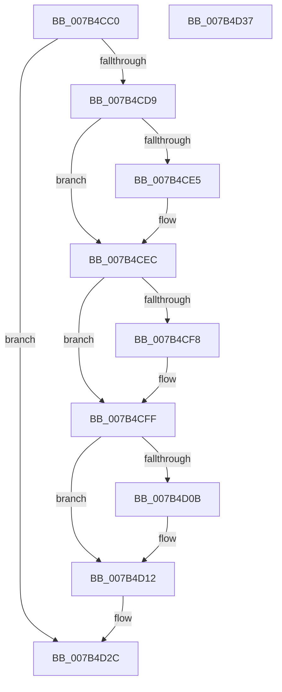

# EtwDeleteProcessor

- RVA: `0x007B4CC0`–`0x007B4D38` (길이 `120` bytes)
- VA: `0x00000001407B4CC0`
- 실행 섹션: `PAGE`
- PDB 이름 있음: `예`; PDB Function 태그: `아니요`
- unwind 정보 RVA: `0x0005CAAC`
- 디코드: `33`개 명령, `120/120` bytes 표시
- 미해석 바이트: `0` (있으면 어셈블리에 `.byte`로 보존)

> 이 문서는 커널 이미지의 기계어와 PDB 기호를 분석해 생성했습니다. 4번과 5번은 함수 원형과 자료형을 바이너리 사용 방식에서 추정한 C 해석이며 원본 소스 복구 결과는 아닙니다.

## 1. Dependencies

- 직접 호출 지점: **5**; 고유 호출 대상: **2**
- 직접 호출자로 확인된 함수: **2**
- RIP 상대 이미지 참조: **0**

### Outgoing calls
- `0x007B4CE7` → [ExFreePoolWithTag](../../poolcode/B8/ExFreePoolWithTag_function_00B82870.md) (function, `0x00B82870`)
- `0x007B4CFA` → [ExFreePoolWithTag](../../poolcode/B8/ExFreePoolWithTag_function_00B82870.md) (function, `0x00B82870`)
- `0x007B4D0D` → [ExFreePoolWithTag](../../poolcode/B8/ExFreePoolWithTag_function_00B82870.md) (function, `0x00B82870`)
- `0x007B4D15` → [EtwpCCSwapDeleteProcessor](../../text/65/EtwpCCSwapDeleteProcessor_function_00654598.md) (function, `0x00654598`)
- `0x007B4D1F` → [ExFreePoolWithTag](../../poolcode/B8/ExFreePoolWithTag_function_00B82870.md) (function, `0x00B82870`)

### Direct callers
- [KiStartDynamicProcessor](../74/KiStartDynamicProcessor_function_007456C8.md) at `0x00745CAE`
- [KeStartAllProcessors](../../init/C3/KeStartAllProcessors_function_00C36F78.md) at `0x00C3746E`

### Static image references
- 디코드된 RIP-relative 메모리 참조가 없습니다.

## 2. Other-region calls and transfers

- 다른 실행 섹션으로 향하는 call: **5**
  - `0x007B4CE7` → [ExFreePoolWithTag](../../poolcode/B8/ExFreePoolWithTag_function_00B82870.md) (`PAGE` → `POOLCODE`)
  - `0x007B4CFA` → [ExFreePoolWithTag](../../poolcode/B8/ExFreePoolWithTag_function_00B82870.md) (`PAGE` → `POOLCODE`)
  - `0x007B4D0D` → [ExFreePoolWithTag](../../poolcode/B8/ExFreePoolWithTag_function_00B82870.md) (`PAGE` → `POOLCODE`)
  - `0x007B4D15` → [EtwpCCSwapDeleteProcessor](../../text/65/EtwpCCSwapDeleteProcessor_function_00654598.md) (`PAGE` → `.text`)
  - `0x007B4D1F` → [ExFreePoolWithTag](../../poolcode/B8/ExFreePoolWithTag_function_00B82870.md) (`PAGE` → `POOLCODE`)
- 별도 외부 분기/꼬리 이동을 확인하지 못했습니다.

## 3. Assembly (complete function range)

```asm
007B4CC0  48 89 5C 24 08                  mov qword ptr [rsp + 8], rbx
007B4CC5  57                              push rdi
007B4CC6  48 83 EC 20                     sub rsp, 0x20
007B4CCA  48 8B 99 A8 8B 00 00            mov rbx, qword ptr [rcx + 0x8ba8]
007B4CD1  48 8B F9                        mov rdi, rcx
007B4CD4  48 85 DB                        test rbx, rbx
007B4CD7  74 53                           je 0x1407b4d2c
007B4CD9  48 8B 8B 48 01 00 00            mov rcx, qword ptr [rbx + 0x148]
007B4CE0  48 85 C9                        test rcx, rcx
007B4CE3  74 07                           je 0x1407b4cec
007B4CE5  33 D2                           xor edx, edx
007B4CE7  E8 84 DB 3C 00                  call 0x140b82870
007B4CEC  48 8B 8B 40 01 00 00            mov rcx, qword ptr [rbx + 0x140]
007B4CF3  48 85 C9                        test rcx, rcx
007B4CF6  74 07                           je 0x1407b4cff
007B4CF8  33 D2                           xor edx, edx
007B4CFA  E8 71 DB 3C 00                  call 0x140b82870
007B4CFF  48 8B 8B 50 01 00 00            mov rcx, qword ptr [rbx + 0x150]
007B4D06  48 85 C9                        test rcx, rcx
007B4D09  74 07                           je 0x1407b4d12
007B4D0B  33 D2                           xor edx, edx
007B4D0D  E8 5E DB 3C 00                  call 0x140b82870
007B4D12  48 8B CB                        mov rcx, rbx
007B4D15  E8 7E F8 E9 FF                  call 0x140654598
007B4D1A  33 D2                           xor edx, edx
007B4D1C  48 8B CB                        mov rcx, rbx
007B4D1F  E8 4C DB 3C 00                  call 0x140b82870
007B4D24  48 83 A7 A8 8B 00 00 00         and qword ptr [rdi + 0x8ba8], 0
007B4D2C  48 8B 5C 24 30                  mov rbx, qword ptr [rsp + 0x30]
007B4D31  48 83 C4 20                     add rsp, 0x20
007B4D35  5F                              pop rdi
007B4D36  C3                              ret
007B4D37  CC                              int3
```

## 4. C-style interpretation (structured pseudocode)

```c
__int64 __fastcall EtwDeleteProcessor(__int64 a1, int a2)
{
    __int64 result;
    __int64 v_rsp;
    unsigned __int64 v_stack_p8;

    v_stack_p8 = v_rbx;
    v_rsp = (v_rsp) - (32);
    if (*(unsigned __int64 *)(a1 + 35752) == 0) goto loc_007B4D2C;
    if (*(unsigned __int64 *)(*(unsigned __int64 *)(a1 + 35752) + 328) != 0) {
        a2 = 0;
        result = ExFreePoolWithTag(*(unsigned __int64 *)(*(unsigned __int64 *)(a1 + 35752) + 328), a2, a3, a4);
    }
    if (*(unsigned __int64 *)(*(unsigned __int64 *)(a1 + 35752) + 320) != 0) {
        a2 = 0;
        result = ExFreePoolWithTag(*(unsigned __int64 *)(*(unsigned __int64 *)(a1 + 35752) + 320), a2, a3, a4);
    }
    if (*(unsigned __int64 *)(*(unsigned __int64 *)(a1 + 35752) + 336) != 0) {
        a2 = 0;
        result = ExFreePoolWithTag(*(unsigned __int64 *)(*(unsigned __int64 *)(a1 + 35752) + 336), a2, a3, a4);
    }
    result = EtwpCCSwapDeleteProcessor(*(unsigned __int64 *)(a1 + 35752), a2, a3, a4);
    a2 = 0;
    result = ExFreePoolWithTag(*(unsigned __int64 *)(a1 + 35752), a2, a3, a4);
loc_007B4D2C:
    v_rsp = (v_rsp) + (32);
    return result;
}
```

## 5. (Beta) C Style

```c
int64_t EtwDeleteProcessor(void *Arg1, int32_t Arg2)
{
    uint8_t *arg1 = (uint8_t *)Arg1;

    int64_t result;
    int64_t local_rsp;
    uint64_t v_stack_p8;

    v_stack_p8 = local_rbx;
    local_rsp = (local_rsp) - (32);
    if (*(uint64_t *)(arg1 + 0x8BA8) == 0) goto loc_007B4D2C;
    if (*(uint64_t *)(*(uint64_t *)(arg1 + 0x8BA8) + 0x148) != 0) {
        Arg2 = 0;
        result = ExFreePoolWithTag(*(uint64_t *)(*(uint64_t *)(arg1 + 0x8BA8) + 0x148), Arg2, a3, a4);
    }
    if (*(uint64_t *)(*(uint64_t *)(arg1 + 0x8BA8) + 0x140) != 0) {
        Arg2 = 0;
        result = ExFreePoolWithTag(*(uint64_t *)(*(uint64_t *)(arg1 + 0x8BA8) + 0x140), Arg2, a3, a4);
    }
    if (*(uint64_t *)(*(uint64_t *)(arg1 + 0x8BA8) + 0x150) != 0) {
        Arg2 = 0;
        result = ExFreePoolWithTag(*(uint64_t *)(*(uint64_t *)(arg1 + 0x8BA8) + 0x150), Arg2, a3, a4);
    }
    result = EtwpCCSwapDeleteProcessor(*(uint64_t *)(arg1 + 0x8BA8), Arg2, a3, a4);
    Arg2 = 0;
    result = ExFreePoolWithTag(*(uint64_t *)(arg1 + 0x8BA8), Arg2, a3, a4);
loc_007B4D2C:
    local_rsp = (local_rsp) + (32);
    return result;
}
```

### 관측된 메모리 오프셋

구조체 형식이 확인되지 않은 접근은 인자 기준의 오프셋으로만 기록했습니다.

| 기준 인자 | 오프셋 표현 | 폭 (bit) | 접근 |
|---|---:|---:|---|
| `Arg1` | `+ 0x8BA8` | `64` | `R` |
| `Arg1` | `+ 0x8BA8` | `64` | `R/W` |

## 6. Execution-region graph

[열기: 2D/3D 그래프와 함수 탐색 컨트롤 패널](../../../control-panel.html?section=page&rva=0x007B4CC0&view=graph)

- 2D 그래프는 위에서 아래로 흐르고, 3D 그래프는 빈 공간을 드래그해 회전합니다. Shift+드래그는 이동, 휠은 확대·축소, 함수 노드 선택은 대상 보고서 이동입니다.

### Static fallback


