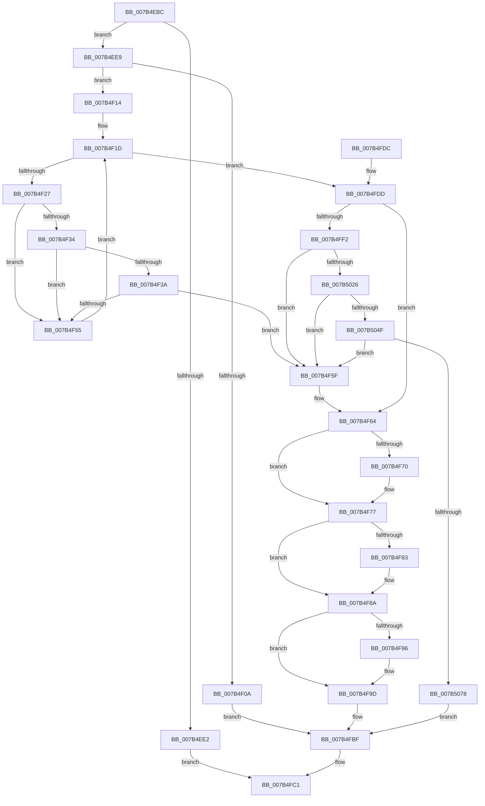

# EtwInitializeProcessor

- RVA: `0x007B4EBC`–`0x007B5084` (길이 `456` bytes)
- VA: `0x00000001407B4EBC`
- 실행 섹션: `PAGE`
- PDB 이름 있음: `예`; PDB Function 태그: `아니요`
- unwind 정보 RVA: `0x000D3714`
- 디코드: `111`개 명령, `456/456` bytes 표시
- 미해석 바이트: `0` (있으면 어셈블리에 `.byte`로 보존)

> 이 문서는 커널 이미지의 기계어와 PDB 기호를 분석해 생성했습니다. 4번과 5번은 함수 원형과 자료형을 바이너리 사용 방식에서 추정한 C 해석이며 원본 소스 복구 결과는 아닙니다.

## 1. Dependencies

- 직접 호출 지점: **12**; 고유 호출 대상: **5**
- 직접 호출자로 확인된 함수: **3**
- RIP 상대 이미지 참조: **2**

### Outgoing calls
- `0x007B4EFD` → [ExAllocatePool2](../../poolcode/B8/ExAllocatePool2_function_00B820F0.md) (function, `0x00B820F0`)
- `0x007B4F48` → [ExAllocatePool2](../../poolcode/B8/ExAllocatePool2_function_00B820F0.md) (function, `0x00B820F0`)
- `0x007B4F72` → [ExFreePoolWithTag](../../poolcode/B8/ExFreePoolWithTag_function_00B82870.md) (function, `0x00B82870`)
- `0x007B4F85` → [ExFreePoolWithTag](../../poolcode/B8/ExFreePoolWithTag_function_00B82870.md) (function, `0x00B82870`)
- `0x007B4F98` → [ExFreePoolWithTag](../../poolcode/B8/ExFreePoolWithTag_function_00B82870.md) (function, `0x00B82870`)
- `0x007B4FA0` → [EtwpStackDeleteProcessor](../../text/65/EtwpStackDeleteProcessor_function_00651D90.md) (function, `0x00651D90`)
- `0x007B4FA8` → [EtwpCCSwapDeleteProcessor](../../text/65/EtwpCCSwapDeleteProcessor_function_00654598.md) (function, `0x00654598`)
- `0x007B4FB2` → [ExFreePoolWithTag](../../poolcode/B8/ExFreePoolWithTag_function_00B82870.md) (function, `0x00B82870`)
- `0x007B4FE3` → [EtwpStackInitializeProcessor](../../text/65/EtwpStackInitializeProcessor_function_00651DD8.md) (function, `0x00651DD8`)
- `0x007B5011` → [ExAllocatePool2](../../poolcode/B8/ExAllocatePool2_function_00B820F0.md) (function, `0x00B820F0`)
- `0x007B503A` → [ExAllocatePool2](../../poolcode/B8/ExAllocatePool2_function_00B820F0.md) (function, `0x00B820F0`)
- `0x007B5063` → [ExAllocatePool2](../../poolcode/B8/ExAllocatePool2_function_00B820F0.md) (function, `0x00B820F0`)

### Direct callers
- [KiStartDynamicProcessor](../74/KiStartDynamicProcessor_function_007456C8.md) at `0x00745934`
- [KeStartAllProcessors](../../init/C3/KeStartAllProcessors_function_00C36F78.md) at `0x00C372CD`
- [EtwpInitialize](../../init/C4/EtwpInitialize_function_00C4DBCC.md) at `0x00C4DCA6`
- [EtwpInitialize](../../init/C4/EtwpInitialize_function_00C4DBCC.md) at `0x00C4DD50`

### Static image references
- `0x007B4ED5` → RVA `0x00FC6AA8` (`ALMOSTRO`; read)
- `0x007B4F27` → RVA `0x00E68520` (`.data`; read)

## 2. Other-region calls and transfers

- 다른 실행 섹션으로 향하는 call: **12**
  - `0x007B4EFD` → [ExAllocatePool2](../../poolcode/B8/ExAllocatePool2_function_00B820F0.md) (`PAGE` → `POOLCODE`)
  - `0x007B4F48` → [ExAllocatePool2](../../poolcode/B8/ExAllocatePool2_function_00B820F0.md) (`PAGE` → `POOLCODE`)
  - `0x007B4F72` → [ExFreePoolWithTag](../../poolcode/B8/ExFreePoolWithTag_function_00B82870.md) (`PAGE` → `POOLCODE`)
  - `0x007B4F85` → [ExFreePoolWithTag](../../poolcode/B8/ExFreePoolWithTag_function_00B82870.md) (`PAGE` → `POOLCODE`)
  - `0x007B4F98` → [ExFreePoolWithTag](../../poolcode/B8/ExFreePoolWithTag_function_00B82870.md) (`PAGE` → `POOLCODE`)
  - `0x007B4FA0` → [EtwpStackDeleteProcessor](../../text/65/EtwpStackDeleteProcessor_function_00651D90.md) (`PAGE` → `.text`)
  - `0x007B4FA8` → [EtwpCCSwapDeleteProcessor](../../text/65/EtwpCCSwapDeleteProcessor_function_00654598.md) (`PAGE` → `.text`)
  - `0x007B4FB2` → [ExFreePoolWithTag](../../poolcode/B8/ExFreePoolWithTag_function_00B82870.md) (`PAGE` → `POOLCODE`)
  - `0x007B4FE3` → [EtwpStackInitializeProcessor](../../text/65/EtwpStackInitializeProcessor_function_00651DD8.md) (`PAGE` → `.text`)
  - `0x007B5011` → [ExAllocatePool2](../../poolcode/B8/ExAllocatePool2_function_00B820F0.md) (`PAGE` → `POOLCODE`)
  - `0x007B503A` → [ExAllocatePool2](../../poolcode/B8/ExAllocatePool2_function_00B820F0.md) (`PAGE` → `POOLCODE`)
  - `0x007B5063` → [ExAllocatePool2](../../poolcode/B8/ExAllocatePool2_function_00B820F0.md) (`PAGE` → `POOLCODE`)
- 별도 외부 분기/꼬리 이동을 확인하지 못했습니다.

## 3. Assembly (complete function range)

```asm
007B4EBC  48 8B C4                        mov rax, rsp
007B4EBF  48 89 58 08                     mov qword ptr [rax + 8], rbx
007B4EC3  48 89 68 10                     mov qword ptr [rax + 0x10], rbp
007B4EC7  48 89 70 18                     mov qword ptr [rax + 0x18], rsi
007B4ECB  48 89 78 20                     mov qword ptr [rax + 0x20], rdi
007B4ECF  41 57                           push r15
007B4ED1  48 83 EC 20                     sub rsp, 0x20
007B4ED5  48 83 3D CB 1B 81 00 00         cmp qword ptr [rip + 0x811bcb], 0
007B4EDD  48 8B E9                        mov rbp, rcx
007B4EE0  75 07                           jne 0x1407b4ee9
007B4EE2  33 C0                           xor eax, eax
007B4EE4  E9 D8 00 00 00                  jmp 0x1407b4fc1
007B4EE9  41 BF 40 00 00 00               mov r15d, 0x40
007B4EEF  BA C0 01 00 00                  mov edx, 0x1c0
007B4EF4  41 8B CF                        mov ecx, r15d
007B4EF7  41 B8 45 74 77 70               mov r8d, 0x70777445
007B4EFD  E8 EE D1 3C 00                  call 0x140b820f0
007B4F02  48 8B F8                        mov rdi, rax
007B4F05  48 85 C0                        test rax, rax
007B4F08  75 0A                           jne 0x1407b4f14
007B4F0A  BB 17 00 00 C0                  mov ebx, 0xc0000017
007B4F0F  E9 AB 00 00 00                  jmp 0x1407b4fbf
007B4F14  48 8D B0 98 01 00 00            lea rsi, [rax + 0x198]
007B4F1B  33 DB                           xor ebx, ebx
007B4F1D  48 83 FB 14                     cmp rbx, 0x14
007B4F21  0F 83 B6 00 00 00               jae 0x1407b4fdd
007B4F27  48 8D 05 F2 35 6B 00            lea rax, [rip + 0x6b35f2]
007B4F2E  83 3C 03 00                     cmp dword ptr [rbx + rax], 0
007B4F32  74 21                           je 0x1407b4f55
007B4F34  48 83 3E 00                     cmp qword ptr [rsi], 0
007B4F38  75 1B                           jne 0x1407b4f55
007B4F3A  BA 00 04 00 00                  mov edx, 0x400
007B4F3F  41 B8 43 43 73 77               mov r8d, 0x77734343
007B4F45  49 8B CF                        mov rcx, r15
007B4F48  E8 A3 D1 3C 00                  call 0x140b820f0
007B4F4D  48 89 06                        mov qword ptr [rsi], rax
007B4F50  48 85 C0                        test rax, rax
007B4F53  74 0A                           je 0x1407b4f5f
007B4F55  48 83 C3 04                     add rbx, 4
007B4F59  48 83 C6 08                     add rsi, 8
007B4F5D  EB BE                           jmp 0x1407b4f1d
007B4F5F  BB 17 00 00 C0                  mov ebx, 0xc0000017
007B4F64  48 8B 8F 48 01 00 00            mov rcx, qword ptr [rdi + 0x148]
007B4F6B  48 85 C9                        test rcx, rcx
007B4F6E  74 07                           je 0x1407b4f77
007B4F70  33 D2                           xor edx, edx
007B4F72  E8 F9 D8 3C 00                  call 0x140b82870
007B4F77  48 8B 8F 40 01 00 00            mov rcx, qword ptr [rdi + 0x140]
007B4F7E  48 85 C9                        test rcx, rcx
007B4F81  74 07                           je 0x1407b4f8a
007B4F83  33 D2                           xor edx, edx
007B4F85  E8 E6 D8 3C 00                  call 0x140b82870
007B4F8A  48 8B 8F 50 01 00 00            mov rcx, qword ptr [rdi + 0x150]
007B4F91  48 85 C9                        test rcx, rcx
007B4F94  74 07                           je 0x1407b4f9d
007B4F96  33 D2                           xor edx, edx
007B4F98  E8 D3 D8 3C 00                  call 0x140b82870
007B4F9D  48 8B CF                        mov rcx, rdi
007B4FA0  E8 EB CD E9 FF                  call 0x140651d90
007B4FA5  48 8B CF                        mov rcx, rdi
007B4FA8  E8 EB F5 E9 FF                  call 0x140654598
007B4FAD  33 D2                           xor edx, edx
007B4FAF  48 8B CF                        mov rcx, rdi
007B4FB2  E8 B9 D8 3C 00                  call 0x140b82870
007B4FB7  48 83 A5 A8 8B 00 00 00         and qword ptr [rbp + 0x8ba8], 0
007B4FBF  8B C3                           mov eax, ebx
007B4FC1  48 8B 5C 24 30                  mov rbx, qword ptr [rsp + 0x30]
007B4FC6  48 8B 6C 24 38                  mov rbp, qword ptr [rsp + 0x38]
007B4FCB  48 8B 74 24 40                  mov rsi, qword ptr [rsp + 0x40]
007B4FD0  48 8B 7C 24 48                  mov rdi, qword ptr [rsp + 0x48]
007B4FD5  48 83 C4 20                     add rsp, 0x20
007B4FD9  41 5F                           pop r15
007B4FDB  C3                              ret
007B4FDC  CC                              int3
007B4FDD  8B 55 24                        mov edx, dword ptr [rbp + 0x24]
007B4FE0  48 8B CF                        mov rcx, rdi
007B4FE3  E8 F0 CD E9 FF                  call 0x140651dd8
007B4FE8  8B D8                           mov ebx, eax
007B4FEA  85 C0                           test eax, eax
007B4FEC  0F 88 72 FF FF FF               js 0x1407b4f64
007B4FF2  48 8B 0D AF 1A 81 00            mov rcx, qword ptr [rip + 0x811aaf]
007B4FF9  BE 45 74 77 61                  mov esi, 0x61777445
007B4FFE  41 BF 48 00 00 00               mov r15d, 0x48
007B5004  44 8B C6                        mov r8d, esi
007B5007  8B 51 10                        mov edx, dword ptr [rcx + 0x10]
007B500A  41 8B CF                        mov ecx, r15d
007B500D  48 C1 E2 03                     shl rdx, 3
007B5011  E8 DA D0 3C 00                  call 0x140b820f0
007B5016  48 89 87 48 01 00 00            mov qword ptr [rdi + 0x148], rax
007B501D  48 85 C0                        test rax, rax
007B5020  0F 84 39 FF FF FF               je 0x1407b4f5f
007B5026  48 8B 05 7B 1A 81 00            mov rax, qword ptr [rip + 0x811a7b]
007B502D  44 8B C6                        mov r8d, esi
007B5030  41 8B CF                        mov ecx, r15d
007B5033  8B 50 10                        mov edx, dword ptr [rax + 0x10]
007B5036  48 C1 E2 03                     shl rdx, 3
007B503A  E8 B1 D0 3C 00                  call 0x140b820f0
007B503F  48 89 87 40 01 00 00            mov qword ptr [rdi + 0x140], rax
007B5046  48 85 C0                        test rax, rax
007B5049  0F 84 10 FF FF FF               je 0x1407b4f5f
007B504F  48 8B 05 52 1A 81 00            mov rax, qword ptr [rip + 0x811a52]
007B5056  44 8B C6                        mov r8d, esi
007B5059  41 8B CF                        mov ecx, r15d
007B505C  8B 50 10                        mov edx, dword ptr [rax + 0x10]
007B505F  48 C1 E2 03                     shl rdx, 3
007B5063  E8 88 D0 3C 00                  call 0x140b820f0
007B5068  48 89 87 50 01 00 00            mov qword ptr [rdi + 0x150], rax
007B506F  48 85 C0                        test rax, rax
007B5072  0F 84 E7 FE FF FF               je 0x1407b4f5f
007B5078  48 89 BD A8 8B 00 00            mov qword ptr [rbp + 0x8ba8], rdi
007B507F  E9 3B FF FF FF                  jmp 0x1407b4fbf
```

## 4. C-style interpretation (structured pseudocode)

```c
__int64 __fastcall EtwInitializeProcessor(__int64 a1)
{
    __int64 result;
    __int64 v_rbx;
    __int64 v_rsi;
    __int64 v_rsp;
    unsigned __int64 v_stack_p10;
    unsigned __int64 v_stack_p18;
    unsigned __int64 v_stack_p20;
    unsigned __int64 v_stack_p8;

    *(unsigned __int64 *)(v_rsp + 8) = v_rbx;
    *(unsigned __int64 *)(v_rsp + 16) = v_rbp;
    *(unsigned __int64 *)(v_rsp + 24) = v_rsi;
    *(unsigned __int64 *)(v_rsp + 32) = v_rdi;
    v_rsp = (v_rsp) - (32);
    if ((*(unsigned __int64 *)(v_rip + 8461259)) != 0) goto loc_007B4EE9;
    result = 0;
    goto loc_007B4FC1;
loc_007B4EE9:
    result = ExAllocatePool2(64, 448, (unsigned int)(0x70777445ULL), a4);
    if (result != 0) goto loc_007B4F14;
    goto loc_007B4FBF;
loc_007B4F14:
    v_rbx = 0;
loc_007B4F1D:
    if (0 >= 20) goto loc_007B4FDD;
    if ((*(unsigned int *)(v_rbx + v_rip + 7026162 * 1)) == 0) goto loc_007B4F55;
    if ((*(unsigned __int64 *)(result + 408)) != 0) goto loc_007B4F55;
    result = ExAllocatePool2(64, (unsigned int)(0x400ULL), (unsigned int)(0x77734343ULL), a4);
    *(unsigned __int64 *)(result + 408) = result;
    if (result == 0) goto loc_007B4F5F;
loc_007B4F55:
    v_rbx = (v_rbx) + (4);
    v_rsi = (result + 408) + (8);
    goto loc_007B4F1D;
loc_007B4F5F:
loc_007B4F64:
    if (*(unsigned __int64 *)(result + 328) != 0) {
        a2 = 0;
        result = ExFreePoolWithTag(*(unsigned __int64 *)(result + 328), a2, (unsigned int)(0x77734343ULL), a4);
    }
    if (*(unsigned __int64 *)(result + 320) != 0) {
        a2 = 0;
        result = ExFreePoolWithTag(*(unsigned __int64 *)(result + 320), a2, (unsigned int)(0x77734343ULL), a4);
    }
    if (*(unsigned __int64 *)(result + 336) != 0) {
        a2 = 0;
        result = ExFreePoolWithTag(*(unsigned __int64 *)(result + 336), a2, (unsigned int)(0x77734343ULL), a4);
    }
    result = EtwpStackDeleteProcessor(result, a2, (unsigned int)(0x77734343ULL), a4);
    result = EtwpCCSwapDeleteProcessor(result, a2, (unsigned int)(0x77734343ULL), a4);
    a2 = 0;
    result = ExFreePoolWithTag(result, a2, (unsigned int)(0x77734343ULL), a4);
loc_007B4FBF:
loc_007B4FC1:
    v_rsp = (v_rsp) + (32);
    return (unsigned int)((unsigned int)((unsigned int)(0xC0000017ULL)));
loc_007B4FDD:
    result = EtwpStackInitializeProcessor(v_stack_p20, (unsigned int)(*(unsigned int *)(v_stack_p10 + 36)), (unsigned int)(0x77734343ULL), a4);
    if (sign_flag) goto loc_007B4F64;
    a2 = ((unsigned int)(*(unsigned int *)(*(unsigned __int64 *)(v_rip + 8460975) + 16))) << (3);
    result = ExAllocatePool2(72, a2, (unsigned int)((unsigned int)((unsigned int)(0x61777445ULL))), a4);
    *(unsigned __int64 *)(v_stack_p20 + 328) = result;
    if (result == 0) goto loc_007B4F5F;
    a2 = ((unsigned int)(*(unsigned int *)(*(unsigned __int64 *)(v_rip + 8460923) + 16))) << (3);
    result = ExAllocatePool2(72, a2, (unsigned int)((unsigned int)((unsigned int)(0x61777445ULL))), a4);
    *(unsigned __int64 *)(v_stack_p20 + 320) = result;
    if (result == 0) goto loc_007B4F5F;
    a2 = ((unsigned int)(*(unsigned int *)(*(unsigned __int64 *)(v_rip + 8460882) + 16))) << (3);
    result = ExAllocatePool2(72, a2, (unsigned int)((unsigned int)((unsigned int)(0x61777445ULL))), a4);
    *(unsigned __int64 *)(v_stack_p20 + 336) = result;
    if (result == 0) goto loc_007B4F5F;
    *(unsigned __int64 *)(v_stack_p10 + 35752) = v_stack_p20;
    goto loc_007B4FBF;
}
```

## 5. (Beta) C Style

```c
int64_t EtwInitializeProcessor(void *Arg1)
{
    uint8_t *arg1 = (uint8_t *)Arg1;

    int64_t result;
    int64_t local_rbx;
    int64_t local_rsi;
    int64_t local_rsp;
    uint64_t v_stack_p10;
    uint64_t v_stack_p18;
    uint64_t v_stack_p20;
    uint64_t v_stack_p8;

    *(uint64_t *)(local_rsp + 0x8) = local_rbx;
    *(uint64_t *)(local_rsp + 0x10) = local_rbp;
    *(uint64_t *)(local_rsp + 0x18) = local_rsi;
    *(uint64_t *)(local_rsp + 0x20) = local_rdi;
    local_rsp = (local_rsp) - (32);
    if ((*(uint64_t *)(v_rip + 0x811BCB)) != 0) goto loc_007B4EE9;
    result = 0;
    goto loc_007B4FC1;
loc_007B4EE9:
    result = ExAllocatePool2(64, 448, (uint32_t)(0x70777445ULL), a4);
    if (result != 0) goto loc_007B4F14;
    goto loc_007B4FBF;
loc_007B4F14:
    local_rbx = 0;
loc_007B4F1D:
    if (0 >= 20) goto loc_007B4FDD;
    if ((*(uint32_t *)(local_rbx + v_rip + 0x6B35F2 * 1)) == 0) goto loc_007B4F55;
    if ((*(uint64_t *)(result + 0x198)) != 0) goto loc_007B4F55;
    result = ExAllocatePool2(64, (uint32_t)(0x400ULL), (uint32_t)(0x77734343ULL), a4);
    *(uint64_t *)(result + 0x198) = result;
    if (result == 0) goto loc_007B4F5F;
loc_007B4F55:
    local_rbx = (local_rbx) + (4);
    local_rsi = (result + 408) + (8);
    goto loc_007B4F1D;
loc_007B4F5F:
loc_007B4F64:
    if (*(uint64_t *)(result + 0x148) != 0) {
        a2 = 0;
        result = ExFreePoolWithTag(*(uint64_t *)(result + 0x148), a2, (uint32_t)(0x77734343ULL), a4);
    }
    if (*(uint64_t *)(result + 0x140) != 0) {
        a2 = 0;
        result = ExFreePoolWithTag(*(uint64_t *)(result + 0x140), a2, (uint32_t)(0x77734343ULL), a4);
    }
    if (*(uint64_t *)(result + 0x150) != 0) {
        a2 = 0;
        result = ExFreePoolWithTag(*(uint64_t *)(result + 0x150), a2, (uint32_t)(0x77734343ULL), a4);
    }
    result = EtwpStackDeleteProcessor(result, a2, (uint32_t)(0x77734343ULL), a4);
    result = EtwpCCSwapDeleteProcessor(result, a2, (uint32_t)(0x77734343ULL), a4);
    a2 = 0;
    result = ExFreePoolWithTag(result, a2, (uint32_t)(0x77734343ULL), a4);
loc_007B4FBF:
loc_007B4FC1:
    local_rsp = (local_rsp) + (32);
    return (uint32_t)((uint32_t)((uint32_t)(0xC0000017ULL)));
loc_007B4FDD:
    result = EtwpStackInitializeProcessor(v_stack_p20, (uint32_t)(*(uint32_t *)(v_stack_p10 + 0x24)), (uint32_t)(0x77734343ULL), a4);
    if (sign_flag) goto loc_007B4F64;
    a2 = ((uint32_t)(*(uint32_t *)(*(uint64_t *)(v_rip + 0x811AAF) + 0x10))) << (3);
    result = ExAllocatePool2(72, a2, (uint32_t)((uint32_t)((uint32_t)(0x61777445ULL))), a4);
    *(uint64_t *)(v_stack_p20 + 0x148) = result;
    if (result == 0) goto loc_007B4F5F;
    a2 = ((uint32_t)(*(uint32_t *)(*(uint64_t *)(v_rip + 0x811A7B) + 0x10))) << (3);
    result = ExAllocatePool2(72, a2, (uint32_t)((uint32_t)((uint32_t)(0x61777445ULL))), a4);
    *(uint64_t *)(v_stack_p20 + 0x140) = result;
    if (result == 0) goto loc_007B4F5F;
    a2 = ((uint32_t)(*(uint32_t *)(*(uint64_t *)(v_rip + 0x811A52) + 0x10))) << (3);
    result = ExAllocatePool2(72, a2, (uint32_t)((uint32_t)((uint32_t)(0x61777445ULL))), a4);
    *(uint64_t *)(v_stack_p20 + 0x150) = result;
    if (result == 0) goto loc_007B4F5F;
    *(uint64_t *)(v_stack_p10 + 0x8BA8) = v_stack_p20;
    goto loc_007B4FBF;
}
```

### 관측된 메모리 오프셋

구조체 형식이 확인되지 않은 접근은 인자 기준의 오프셋으로만 기록했습니다.

| 기준 인자 | 오프셋 표현 | 폭 (bit) | 접근 |
|---|---:|---:|---|
| `Arg1` | `+ 0x24` | `32` | `R` |
| `Arg1` | `+ 0x8BA8` | `64` | `R/W` |
| `Arg1` | `+ 0x8BA8` | `64` | `W` |

## 6. Execution-region graph

[열기: 2D/3D 그래프와 함수 탐색 컨트롤 패널](../../../control-panel.html?section=page&rva=0x007B4EBC&view=graph)

- 2D 그래프는 위에서 아래로 흐르고, 3D 그래프는 빈 공간을 드래그해 회전합니다. Shift+드래그는 이동, 휠은 확대·축소, 함수 노드 선택은 대상 보고서 이동입니다.

### Static fallback


