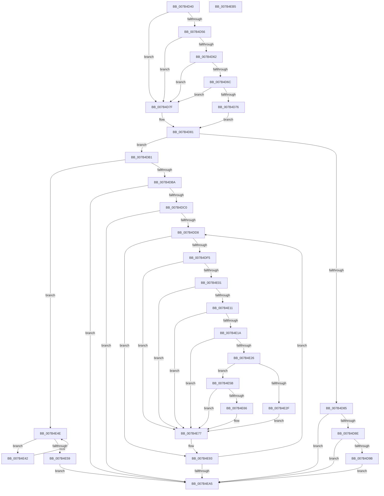

# EtwInitialize

- RVA: `0x007B4D40`–`0x007B4EB6` (길이 `374` bytes)
- VA: `0x00000001407B4D40`
- 실행 섹션: `PAGE`
- PDB 이름 있음: `예`; PDB Function 태그: `아니요`
- unwind 정보 RVA: `0x00060BC4`
- 디코드: `93`개 명령, `374/374` bytes 표시
- 미해석 바이트: `0` (있으면 어셈블리에 `.byte`로 보존)

> 이 문서는 커널 이미지의 기계어와 PDB 기호를 분석해 생성했습니다. 4번과 5번은 함수 원형과 자료형을 바이너리 사용 방식에서 추정한 C 해석이며 원본 소스 복구 결과는 아닙니다.

## 1. Dependencies

- 직접 호출 지점: **8**; 고유 호출 대상: **7**
- 직접 호출자로 확인된 함수: **3**
- RIP 상대 이미지 참조: **3**

### Outgoing calls
- `0x007B4DA7` → [EtwpInitialize](../../init/C4/EtwpInitialize_function_00C4DBCC.md) (function, `0x00C4DBCC`)
- `0x007B4DE8` → [ExAcquireRundownProtectionCacheAwareEx](../../text/41/ExAcquireRundownProtectionCacheAwareEx_function_00411F50.md) (function, `0x00411F50`)
- `0x007B4E1D` → [EtwpBuffersFlushRequired](../../text/3E/EtwpBuffersFlushRequired_function_003EB5AC.md) (function, `0x003EB5AC`)
- `0x007B4E26` → [KeGetEffectiveIrql](../../text/2F/KeGetEffectiveIrql_function_002F8030.md) (function, `0x002F8030`)
- `0x007B4E3B` → [KeSetEvent](../../text/33/KeSetEvent_function_0033F310.md) (function, `0x0033F310`)
- `0x007B4E49` → [EtwpInitialize](../../init/C4/EtwpInitialize_function_00C4DBCC.md) (function, `0x00C4DBCC`)
- `0x007B4E72` → [KeInsertQueueDpc](../../text/20/KeInsertQueueDpc_function_00207C50.md) (function, `0x00207C50`)
- `0x007B4E8E` → [ExReleaseRundownProtectionCacheAwareEx](../../text/25/ExReleaseRundownProtectionCacheAwareEx_function_0025F050.md) (function, `0x0025F050`)

### Direct callers
- [CmCompleteRegistryInitialization](../7D/CmCompleteRegistryInitialization_function_007DF1EC.md) at `0x007DF23A`
- [InitBootProcessor](../../init/C1/InitBootProcessor_function_00C1B1C8.md) at `0x00C1B7BD`
- [IoInitSystemPreDrivers](../../init/C2/IoInitSystemPreDrivers_function_00C2AC3C.md) at `0x00C2B5F2`
- [IoInitSystemPreDrivers](../../init/C2/IoInitSystemPreDrivers_function_00C2AC3C.md) at `0x00C2BC4C`

### Static image references
- `0x007B4D9B` → RVA `0x00EFF284` (`.data`; read)
- `0x007B4DC0` → RVA `0x00FC6AA8` (`ALMOSTRO`; read)
- `0x007B4DC9` → RVA `0x00EFF284` (`.data`; read/write)

## 2. Other-region calls and transfers

- 다른 실행 섹션으로 향하는 call: **8**
  - `0x007B4DA7` → [EtwpInitialize](../../init/C4/EtwpInitialize_function_00C4DBCC.md) (`PAGE` → `INIT`)
  - `0x007B4DE8` → [ExAcquireRundownProtectionCacheAwareEx](../../text/41/ExAcquireRundownProtectionCacheAwareEx_function_00411F50.md) (`PAGE` → `.text`)
  - `0x007B4E1D` → [EtwpBuffersFlushRequired](../../text/3E/EtwpBuffersFlushRequired_function_003EB5AC.md) (`PAGE` → `.text`)
  - `0x007B4E26` → [KeGetEffectiveIrql](../../text/2F/KeGetEffectiveIrql_function_002F8030.md) (`PAGE` → `.text`)
  - `0x007B4E3B` → [KeSetEvent](../../text/33/KeSetEvent_function_0033F310.md) (`PAGE` → `.text`)
  - `0x007B4E49` → [EtwpInitialize](../../init/C4/EtwpInitialize_function_00C4DBCC.md) (`PAGE` → `INIT`)
  - `0x007B4E72` → [KeInsertQueueDpc](../../text/20/KeInsertQueueDpc_function_00207C50.md) (`PAGE` → `.text`)
  - `0x007B4E8E` → [ExReleaseRundownProtectionCacheAwareEx](../../text/25/ExReleaseRundownProtectionCacheAwareEx_function_0025F050.md) (`PAGE` → `.text`)
- 별도 외부 분기/꼬리 이동을 확인하지 못했습니다.

## 3. Assembly (complete function range)

```asm
007B4D40  48 89 5C 24 08                  mov qword ptr [rsp + 8], rbx
007B4D45  48 89 74 24 10                  mov qword ptr [rsp + 0x10], rsi
007B4D4A  57                              push rdi
007B4D4B  48 83 EC 20                     sub rsp, 0x20
007B4D4F  8B D9                           mov ebx, ecx
007B4D51  48 85 D2                        test rdx, rdx
007B4D54  74 29                           je 0x1407b4d7f
007B4D56  48 8B BA F0 00 00 00            mov rdi, qword ptr [rdx + 0xf0]
007B4D5D  48 85 FF                        test rdi, rdi
007B4D60  74 1D                           je 0x1407b4d7f
007B4D62  48 83 BF 60 0E 00 00 00         cmp qword ptr [rdi + 0xe60], 0
007B4D6A  74 13                           je 0x1407b4d7f
007B4D6C  48 83 BF 68 0E 00 00 00         cmp qword ptr [rdi + 0xe68], 0
007B4D74  74 09                           je 0x1407b4d7f
007B4D76  48 81 C7 58 0E 00 00            add rdi, 0xe58
007B4D7D  EB 02                           jmp 0x1407b4d81
007B4D7F  33 FF                           xor edi, edi
007B4D81  85 DB                           test ebx, ebx
007B4D83  75 2C                           jne 0x1407b4db1
007B4D85  48 85 FF                        test rdi, rdi
007B4D88  0F 84 17 01 00 00               je 0x1407b4ea5
007B4D8E  48 8D 47 08                     lea rax, [rdi + 8]
007B4D92  48 39 00                        cmp qword ptr [rax], rax
007B4D95  0F 84 0A 01 00 00               je 0x1407b4ea5
007B4D9B  0F B6 0D E2 A4 74 00            movzx ecx, byte ptr [rip + 0x74a4e2]
007B4DA2  4C 8B C7                        mov r8, rdi
007B4DA5  33 D2                           xor edx, edx
007B4DA7  E8 20 8E 49 00                  call 0x140c4dbcc
007B4DAC  E9 F4 00 00 00                  jmp 0x1407b4ea5
007B4DB1  83 FB 03                        cmp ebx, 3
007B4DB4  0F 82 94 00 00 00               jb 0x1407b4e4e
007B4DBA  0F 85 E5 00 00 00               jne 0x1407b4ea5
007B4DC0  48 8B 05 E1 1C 81 00            mov rax, qword ptr [rip + 0x811ce1]
007B4DC7  33 FF                           xor edi, edi
007B4DC9  FE 05 B5 A4 74 00               inc byte ptr [rip + 0x74a4b5]
007B4DCF  39 78 10                        cmp dword ptr [rax + 0x10], edi
007B4DD2  0F 86 CD 00 00 00               jbe 0x1407b4ea5
007B4DD8  48 8B 88 C0 02 00 00            mov rcx, qword ptr [rax + 0x2c0]
007B4DDF  BA 01 00 00 00                  mov edx, 1
007B4DE4  48 8B 0C F9                     mov rcx, qword ptr [rcx + rdi*8]
007B4DE8  E8 63 D1 C5 FF                  call 0x140411f50
007B4DED  84 C0                           test al, al
007B4DEF  0F 84 9E 00 00 00               je 0x1407b4e93
007B4DF5  48 8B 05 AC 1C 81 00            mov rax, qword ptr [rip + 0x811cac]
007B4DFC  3B 78 10                        cmp edi, dword ptr [rax + 0x10]
007B4DFF  73 76                           jae 0x1407b4e77
007B4E01  48 8B 80 C8 02 00 00            mov rax, qword ptr [rax + 0x2c8]
007B4E08  48 8B 1C F8                     mov rbx, qword ptr [rax + rdi*8]
007B4E0C  F6 C3 01                        test bl, 1
007B4E0F  75 66                           jne 0x1407b4e77
007B4E11  F7 43 0C 00 04 00 00            test dword ptr [rbx + 0xc], 0x400
007B4E18  75 5D                           jne 0x1407b4e77
007B4E1A  48 8B CB                        mov rcx, rbx
007B4E1D  E8 8A 67 C3 FF                  call 0x1403eb5ac
007B4E22  84 C0                           test al, al
007B4E24  74 51                           je 0x1407b4e77
007B4E26  E8 05 32 B4 FF                  call 0x1402f8030
007B4E2B  3C 02                           cmp al, 2
007B4E2D  77 2C                           ja 0x1407b4e5b
007B4E2F  48 8D 8B E0 01 00 00            lea rcx, [rbx + 0x1e0]
007B4E36  45 33 C0                        xor r8d, r8d
007B4E39  33 D2                           xor edx, edx
007B4E3B  E8 D0 A4 B8 FF                  call 0x14033f310
007B4E40  EB 35                           jmp 0x1407b4e77
007B4E42  4C 8B C7                        mov r8, rdi
007B4E45  8B D3                           mov edx, ebx
007B4E47  8B C8                           mov ecx, eax
007B4E49  E8 7E 8D 49 00                  call 0x140c4dbcc
007B4E4E  0F B6 05 2F A4 74 00            movzx eax, byte ptr [rip + 0x74a42f]
007B4E55  3B C3                           cmp eax, ebx
007B4E57  76 E9                           jbe 0x1407b4e42
007B4E59  EB 4A                           jmp 0x1407b4ea5
007B4E5B  F0 0F BA AB 38 03 00 00 08      lock bts dword ptr [rbx + 0x338], 8
007B4E64  72 11                           jb 0x1407b4e77
007B4E66  48 8D 8B 38 02 00 00            lea rcx, [rbx + 0x238]
007B4E6D  45 33 C0                        xor r8d, r8d
007B4E70  33 D2                           xor edx, edx
007B4E72  E8 D9 2D A5 FF                  call 0x140207c50
007B4E77  48 8B 05 2A 1C 81 00            mov rax, qword ptr [rip + 0x811c2a]
007B4E7E  BA 01 00 00 00                  mov edx, 1
007B4E83  48 8B 88 C0 02 00 00            mov rcx, qword ptr [rax + 0x2c0]
007B4E8A  48 8B 0C F9                     mov rcx, qword ptr [rcx + rdi*8]
007B4E8E  E8 BD A1 AA FF                  call 0x14025f050
007B4E93  48 8B 05 0E 1C 81 00            mov rax, qword ptr [rip + 0x811c0e]
007B4E9A  FF C7                           inc edi
007B4E9C  3B 78 10                        cmp edi, dword ptr [rax + 0x10]
007B4E9F  0F 82 33 FF FF FF               jb 0x1407b4dd8
007B4EA5  48 8B 5C 24 30                  mov rbx, qword ptr [rsp + 0x30]
007B4EAA  48 8B 74 24 38                  mov rsi, qword ptr [rsp + 0x38]
007B4EAF  48 83 C4 20                     add rsp, 0x20
007B4EB3  5F                              pop rdi
007B4EB4  C3                              ret
007B4EB5  CC                              int3
```

## 4. C-style interpretation (structured pseudocode)

```c
__int64 __fastcall EtwInitialize(int a1, __int64 a2)
{
    __int64 result;
    __int64 v_rdi;
    __int64 v_rsp;
    unsigned __int64 v_stack_p10;
    unsigned __int64 v_stack_p8;

    v_stack_p8 = v_rbx;
    v_stack_p10 = v_rsi;
    v_rsp = (v_rsp) - (32);
    if (a2 == 0) goto loc_007B4D7F;
    if (*(unsigned __int64 *)(a2 + 240) == 0) goto loc_007B4D7F;
    if ((*(unsigned __int64 *)(*(unsigned __int64 *)(a2 + 240) + 3680)) == 0) goto loc_007B4D7F;
    if ((*(unsigned __int64 *)(*(unsigned __int64 *)(a2 + 240) + 3688)) == 0) goto loc_007B4D7F;
    v_rdi = (*(unsigned __int64 *)(a2 + 240)) + (0xE58ULL);
    goto loc_007B4D81;
loc_007B4D7F:
    v_rdi = 0;
loc_007B4D81:
    if ((unsigned int)((unsigned int)(a1)) != 0) goto loc_007B4DB1;
    if (0 == 0) goto loc_007B4EA5;
    if ((*(unsigned __int64 *)(v_rdi + 8)) == (v_rdi + 8)) goto loc_007B4EA5;
    a2 = 0;
    result = EtwpInitialize(*(unsigned __int8 *)(v_rip + 7644386), a2, 0, a4);
    goto loc_007B4EA5;
loc_007B4DB1:
    if (((unsigned int)((unsigned int)(a1))) < 3) goto loc_007B4E4E;
    if (((unsigned int)((unsigned int)(a1))) != 3) goto loc_007B4EA5;
    v_rdi = 0;
    if ((*(unsigned int *)(*(unsigned __int64 *)(v_rip + 8461537) + 16)) <= 0) goto loc_007B4EA5;
loc_007B4DD8:
    result = ExAcquireRundownProtectionCacheAwareEx(*(unsigned __int64 *)(*(unsigned __int64 *)(*(unsigned __int64 *)(v_rip + 8461537) + 704) + v_rdi * 8), 1, 0, a4);
    if ((unsigned __int8)(result) == 0) goto loc_007B4E93;
    if (0 >= (*(unsigned int *)(*(unsigned __int64 *)(v_rip + 8461484) + 16))) goto loc_007B4E77;
    if ((((unsigned __int8)(*(unsigned __int64 *)(*(unsigned __int64 *)(*(unsigned __int64 *)(v_rip + 8461484) + 712) + v_rdi * 8))) & (1)) != 0) goto loc_007B4E77;
    if (((*(unsigned int *)(*(unsigned __int64 *)(*(unsigned __int64 *)(*(unsigned __int64 *)(v_rip + 8461484) + 712) + v_rdi * 8) + 12)) & (0x400ULL)) != 0) goto loc_007B4E77;
    result = EtwpBuffersFlushRequired(*(unsigned __int64 *)(*(unsigned __int64 *)(*(unsigned __int64 *)(v_rip + 8461484) + 712) + v_rdi * 8), 1, 0, a4);
    if ((unsigned __int8)(result) == 0) goto loc_007B4E77;
    result = KeGetEffectiveIrql(*(unsigned __int64 *)(*(unsigned __int64 *)(*(unsigned __int64 *)(v_rip + 8461484) + 712) + v_rdi * 8), 1, 0, a4);
    if (((unsigned __int8)(result)) > 2) goto loc_007B4E5B;
    a3 = 0;
    a2 = 0;
    result = KeSetEvent(*(unsigned __int64 *)(*(unsigned __int64 *)(*(unsigned __int64 *)(v_rip + 8461484) + 712) + v_rdi * 8) + 480, a2, a3, a4);
    goto loc_007B4E77;
loc_007B4E42:
    result = EtwpInitialize((unsigned int)((unsigned int)(result)), (unsigned int)((unsigned int)(*(unsigned __int64 *)(*(unsigned __int64 *)(*(unsigned __int64 *)(v_rip + 8461484) + 712) + v_rdi * 8))), 0, a4);
loc_007B4E4E:
    if (((unsigned int)(*(unsigned __int8 *)(v_rip + 7644207))) <= ((unsigned int)(*(unsigned __int64 *)(*(unsigned __int64 *)(*(unsigned __int64 *)(v_rip + 8461484) + 712) + v_rdi * 8)))) goto loc_007B4E42;
    goto loc_007B4EA5;
loc_007B4E5B:
    result = *(unsigned __int8 *)(v_rip + 7644207);
    if (((unsigned int)(*(unsigned __int8 *)(v_rip + 7644207))) >= ((unsigned int)(*(unsigned __int64 *)(*(unsigned __int64 *)(*(unsigned __int64 *)(v_rip + 8461484) + 712) + v_rdi * 8)))) {
        a1 = *(unsigned __int64 *)(*(unsigned __int64 *)(*(unsigned __int64 *)(v_rip + 8461484) + 712) + v_rdi * 8) + 568;
        a3 = 0;
        a2 = 0;
        result = KeInsertQueueDpc(a1, a2, a3, a4);
    }
    result = ExReleaseRundownProtectionCacheAwareEx(*(unsigned __int64 *)(*(unsigned __int64 *)(*(unsigned __int64 *)(v_rip + 8461354) + 704) + v_rdi * 8), 1, a3, a4);
loc_007B4E93:
    v_rdi = (unsigned int)((v_rdi) + 1);
    if (((unsigned int)(v_rdi)) < (*(unsigned int *)(*(unsigned __int64 *)(v_rip + 8461326) + 16))) goto loc_007B4DD8;
loc_007B4EA5:
    v_rsp = (v_rsp) + (32);
    return *(unsigned __int64 *)(v_rip + 8461326);
}
```

## 5. (Beta) C Style

```c
int64_t EtwInitialize(int32_t Arg1, int64_t Arg2)
{
    int64_t result;
    int64_t local_rdi;
    int64_t local_rsp;
    uint64_t v_stack_p10;
    uint64_t v_stack_p8;

    v_stack_p8 = local_rbx;
    v_stack_p10 = local_rsi;
    local_rsp = (local_rsp) - (32);
    if (Arg2 == 0) goto loc_007B4D7F;
    if (*(uint64_t *)(Arg2 + 0xF0) == 0) goto loc_007B4D7F;
    if ((*(uint64_t *)(*(uint64_t *)(Arg2 + 0xF0) + 0xE60)) == 0) goto loc_007B4D7F;
    if ((*(uint64_t *)(*(uint64_t *)(Arg2 + 0xF0) + 0xE68)) == 0) goto loc_007B4D7F;
    local_rdi = (*(uint64_t *)(Arg2 + 0xF0)) + (0xE58ULL);
    goto loc_007B4D81;
loc_007B4D7F:
    local_rdi = 0;
loc_007B4D81:
    if ((uint32_t)((uint32_t)(Arg1)) != 0) goto loc_007B4DB1;
    if (0 == 0) goto loc_007B4EA5;
    if ((*(uint64_t *)(local_rdi + 0x8)) == (local_rdi + 8)) goto loc_007B4EA5;
    Arg2 = 0;
    result = EtwpInitialize(*(uint8_t *)(v_rip + 0x74A4E2), Arg2, 0, a4);
    goto loc_007B4EA5;
loc_007B4DB1:
    if (((uint32_t)((uint32_t)(Arg1))) < 3) goto loc_007B4E4E;
    if (((uint32_t)((uint32_t)(Arg1))) != 3) goto loc_007B4EA5;
    local_rdi = 0;
    if ((*(uint32_t *)(*(uint64_t *)(v_rip + 0x811CE1) + 0x10)) <= 0) goto loc_007B4EA5;
loc_007B4DD8:
    result = ExAcquireRundownProtectionCacheAwareEx(*(uint64_t *)(*(uint64_t *)(*(uint64_t *)(v_rip + 0x811CE1) + 0x2C0) + local_rdi * 8), 1, 0, a4);
    if ((uint8_t)(result) == 0) goto loc_007B4E93;
    if (0 >= (*(uint32_t *)(*(uint64_t *)(v_rip + 0x811CAC) + 0x10))) goto loc_007B4E77;
    if ((((uint8_t)(*(uint64_t *)(*(uint64_t *)(*(uint64_t *)(v_rip + 0x811CAC) + 0x2C8) + local_rdi * 8))) & (1)) != 0) goto loc_007B4E77;
    if (((*(uint32_t *)(*(uint64_t *)(*(uint64_t *)(*(uint64_t *)(v_rip + 0x811CAC) + 0x2C8) + local_rdi * 8) + 0xC)) & (0x400ULL)) != 0) goto loc_007B4E77;
    result = EtwpBuffersFlushRequired(*(uint64_t *)(*(uint64_t *)(*(uint64_t *)(v_rip + 0x811CAC) + 0x2C8) + local_rdi * 8), 1, 0, a4);
    if ((uint8_t)(result) == 0) goto loc_007B4E77;
    result = KeGetEffectiveIrql(*(uint64_t *)(*(uint64_t *)(*(uint64_t *)(v_rip + 0x811CAC) + 0x2C8) + local_rdi * 8), 1, 0, a4);
    if (((uint8_t)(result)) > 2) goto loc_007B4E5B;
    a3 = 0;
    Arg2 = 0;
    result = KeSetEvent(*(uint64_t *)(*(uint64_t *)(*(uint64_t *)(v_rip + 0x811CAC) + 0x2C8) + local_rdi * 8) + 480, Arg2, a3, a4);
    goto loc_007B4E77;
loc_007B4E42:
    result = EtwpInitialize((uint32_t)((uint32_t)(result)), (uint32_t)((uint32_t)(*(uint64_t *)(*(uint64_t *)(*(uint64_t *)(v_rip + 0x811CAC) + 0x2C8) + local_rdi * 8))), 0, a4);
loc_007B4E4E:
    if (((uint32_t)(*(uint8_t *)(v_rip + 0x74A42F))) <= ((uint32_t)(*(uint64_t *)(*(uint64_t *)(*(uint64_t *)(v_rip + 0x811CAC) + 0x2C8) + local_rdi * 8)))) goto loc_007B4E42;
    goto loc_007B4EA5;
loc_007B4E5B:
    result = *(uint8_t *)(v_rip + 0x74A42F);
    if (((uint32_t)(*(uint8_t *)(v_rip + 0x74A42F))) >= ((uint32_t)(*(uint64_t *)(*(uint64_t *)(*(uint64_t *)(v_rip + 0x811CAC) + 0x2C8) + local_rdi * 8)))) {
        Arg1 = *(uint64_t *)(*(uint64_t *)(*(uint64_t *)(v_rip + 0x811CAC) + 0x2C8) + local_rdi * 8) + 568;
        a3 = 0;
        Arg2 = 0;
        result = KeInsertQueueDpc(Arg1, Arg2, a3, a4);
    }
    result = ExReleaseRundownProtectionCacheAwareEx(*(uint64_t *)(*(uint64_t *)(*(uint64_t *)(v_rip + 0x811C2A) + 0x2C0) + local_rdi * 8), 1, a3, a4);
loc_007B4E93:
    local_rdi = (uint32_t)((local_rdi) + 1);
    if (((uint32_t)(local_rdi)) < (*(uint32_t *)(*(uint64_t *)(v_rip + 0x811C0E) + 0x10))) goto loc_007B4DD8;
loc_007B4EA5:
    local_rsp = (local_rsp) + (32);
    return *(uint64_t *)(v_rip + 0x811C0E);
}
```

## 6. Execution-region graph

[열기: 2D/3D 그래프와 함수 탐색 컨트롤 패널](../../../control-panel.html?section=page&rva=0x007B4D40&view=graph)

- 2D 그래프는 위에서 아래로 흐르고, 3D 그래프는 빈 공간을 드래그해 회전합니다. Shift+드래그는 이동, 휠은 확대·축소, 함수 노드 선택은 대상 보고서 이동입니다.

### Static fallback


