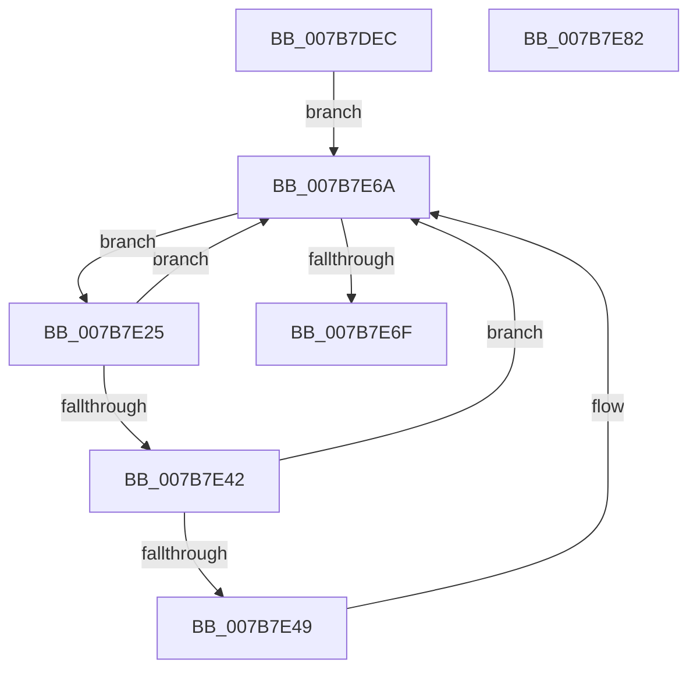

# EtwKernelMemoryRundown

- RVA: `0x007B7DEC`–`0x007B7E83` (길이 `151` bytes)
- VA: `0x00000001407B7DEC`
- 실행 섹션: `PAGE`
- PDB 이름 있음: `예`; PDB Function 태그: `아니요`
- unwind 정보 RVA: `0x0009EA50`
- 디코드: `38`개 명령, `151/151` bytes 표시
- 미해석 바이트: `0` (있으면 어셈블리에 `.byte`로 보존)

> 이 문서는 커널 이미지의 기계어와 PDB 기호를 분석해 생성했습니다. 4번과 5번은 함수 원형과 자료형을 바이너리 사용 방식에서 추정한 C 해석이며 원본 소스 복구 결과는 아닙니다.

## 1. Dependencies

- 직접 호출 지점: **2**; 고유 호출 대상: **2**
- 직접 호출자로 확인된 함수: **1**
- RIP 상대 이미지 참조: **2**

### Outgoing calls
- `0x007B7E65` → [EtwpKernelTraceRundown](../9E/EtwpKernelTraceRundown_function_009E4080.md) (function, `0x009E4080`)
- `0x007B7E77` → [_security_check_cookie](../../text/6A/_security_check_cookie_function_006AC640.md) (function, `0x006AC640`)

### Direct callers
- [PopEndMirroring](../../pagelk/B7/PopEndMirroring_function_00B75E50.md) at `0x00B760F3`

### Static image references
- `0x007B7DF2` → RVA `0x00E0A740` (`.data`; read)
- `0x007B7E01` → RVA `0x00FC6AA8` (`ALMOSTRO`; read)

## 2. Other-region calls and transfers

- 다른 실행 섹션으로 향하는 call: **1**
  - `0x007B7E77` → [_security_check_cookie](../../text/6A/_security_check_cookie_function_006AC640.md) (`PAGE` → `.text`)
- 별도 외부 분기/꼬리 이동을 확인하지 못했습니다.

## 3. Assembly (complete function range)

```asm
007B7DEC  40 53                           push rbx
007B7DEE  48 83 EC 60                     sub rsp, 0x60
007B7DF2  48 8B 05 47 29 65 00            mov rax, qword ptr [rip + 0x652947]
007B7DF9  48 33 C4                        xor rax, rsp
007B7DFC  48 89 44 24 58                  mov qword ptr [rsp + 0x58], rax
007B7E01  48 8B 05 A0 EC 80 00            mov rax, qword ptr [rip + 0x80eca0]
007B7E08  0F 57 C0                        xorps xmm0, xmm0
007B7E0B  0F 11 44 24 38                  movups xmmword ptr [rsp + 0x38], xmm0
007B7E10  C7 44 24 3C 08 00 00 00         mov dword ptr [rsp + 0x3c], 8
007B7E18  0F 11 44 24 48                  movups xmmword ptr [rsp + 0x48], xmm0
007B7E1D  8B 98 A8 11 00 00               mov ebx, dword ptr [rax + 0x11a8]
007B7E23  EB 45                           jmp 0x1407b7e6a
007B7E25  48 8B 15 7C EC 80 00            mov rdx, qword ptr [rip + 0x80ec7c]
007B7E2C  8D 43 FF                        lea eax, [rbx - 1]
007B7E2F  23 D8                           and ebx, eax
007B7E31  8B C1                           mov eax, ecx
007B7E33  48 C1 E0 05                     shl rax, 5
007B7E37  48 05 CC 11 00 00               add rax, 0x11cc
007B7E3D  48 03 C2                        add rax, rdx
007B7E40  74 28                           je 0x1407b7e6a
007B7E42  8B 40 14                        mov eax, dword ptr [rax + 0x14]
007B7E45  A8 01                           test al, 1
007B7E47  74 21                           je 0x1407b7e6a
007B7E49  44 0F B6 84 4A 98 11 00 00      movzx r8d, byte ptr [rdx + rcx*2 + 0x1198]
007B7E52  45 33 C9                        xor r9d, r9d
007B7E55  83 64 24 28 00                  and dword ptr [rsp + 0x28], 0
007B7E5A  48 8D 4C 24 38                  lea rcx, [rsp + 0x38]
007B7E5F  48 83 64 24 20 00               and qword ptr [rsp + 0x20], 0
007B7E65  E8 16 C2 22 00                  call 0x1409e4080
007B7E6A  0F BC CB                        bsf ecx, ebx
007B7E6D  75 B6                           jne 0x1407b7e25
007B7E6F  48 8B 4C 24 58                  mov rcx, qword ptr [rsp + 0x58]
007B7E74  48 33 CC                        xor rcx, rsp
007B7E77  E8 C4 47 EF FF                  call 0x1406ac640
007B7E7C  48 83 C4 60                     add rsp, 0x60
007B7E80  5B                              pop rbx
007B7E81  C3                              ret
007B7E82  CC                              int3
```

## 4. C-style interpretation (structured pseudocode)

```c
__int64 __fastcall EtwKernelMemoryRundown(__int64 a1, __int64 a2, __int64 a3, int a4)
{
    __int64 result;
    __int64 v_rbx;
    __int64 v_rsp;
    unsigned __int64 v_stack_m10;
    unsigned __int64 v_stack_m20;
    unsigned int v_stack_m2C;
    unsigned __int64 v_stack_m30;
    unsigned int v_stack_m40;
    unsigned __int64 v_stack_m48;

    v_rsp = (v_rsp) - (96);
    result = (*(unsigned __int64 *)(v_rip + 6629703)) ^ (v_rsp);
    v_stack_m10 = result;
    v_stack_m30 = v_xmm0;
    v_stack_m2C = 8;
    v_stack_m20 = v_xmm0;
    goto loc_007B7E6A;
loc_007B7E25:
    v_rbx = (unsigned int)(((unsigned int)(*(unsigned int *)(*(unsigned __int64 *)(v_rip + 8449184) + 4520))) & ((unsigned int)((unsigned int)(*(unsigned int *)(*(unsigned __int64 *)(v_rip + 8449184) + 4520)) - 1)));
    result = ((unsigned int)((unsigned int)(a1))) << (5);
    result = (result) + (0x11CCULL);
    result = (result) + (*(unsigned __int64 *)(v_rip + 8449148));
    if (condition_is_equal) goto loc_007B7E6A;
    result = (unsigned int)(*(unsigned int *)(result + 20));
    if ((((unsigned __int8)((unsigned int)(*(unsigned int *)(result + 20)))) & (1)) != 0) {
        a3 = *(unsigned __int8 *)(*(unsigned __int64 *)(v_rip + 8449148) + a1 * 2 + 4504);
        a4 = 0;
        a1 = v_stack_m30;
        result = EtwpKernelTraceRundown(a1, *(unsigned __int64 *)(v_rip + 8449148), a3, a4);
    }
    if (condition_is_not_equal) goto loc_007B7E25;
    a1 = (v_stack_m10) ^ (v_rsp);
    result = _security_check_cookie(a1, *(unsigned __int64 *)(v_rip + 8449148), a3, a4);
    v_rsp = (v_rsp) + (96);
    return result;
}
```

## 5. (Beta) C Style

```c
int64_t EtwKernelMemoryRundown(int64_t Arg1, int64_t Arg2, int64_t Arg3, int32_t Arg4)
{
    int64_t result;
    int64_t local_rbx;
    int64_t local_rsp;
    uint64_t v_stack_m10;
    uint64_t v_stack_m20;
    uint32_t v_stack_m2C;
    uint64_t v_stack_m30;
    uint32_t v_stack_m40;
    uint64_t v_stack_m48;

    local_rsp = (local_rsp) - (96);
    result = (*(uint64_t *)(v_rip + 0x652947)) ^ (local_rsp);
    v_stack_m10 = result;
    v_stack_m30 = v_xmm0;
    v_stack_m2C = 8;
    v_stack_m20 = v_xmm0;
    goto loc_007B7E6A;
loc_007B7E25:
    local_rbx = (uint32_t)(((uint32_t)(*(uint32_t *)(*(uint64_t *)(v_rip + 0x80ECA0) + 0x11A8))) & ((uint32_t)((uint32_t)(*(uint32_t *)(*(uint64_t *)(v_rip + 0x80ECA0) + 0x11A8)) - 1)));
    result = ((uint32_t)((uint32_t)(Arg1))) << (5);
    result = (result) + (0x11CCULL);
    result = (result) + (*(uint64_t *)(v_rip + 0x80EC7C));
    if (condition_is_equal) goto loc_007B7E6A;
    result = (uint32_t)(*(uint32_t *)(result + 0x14));
    if ((((uint8_t)((uint32_t)(*(uint32_t *)(result + 0x14)))) & (1)) != 0) {
        Arg3 = *(uint8_t *)(*(uint64_t *)(v_rip + 0x80EC7C) + Arg1 * 2 + 0x1198);
        Arg4 = 0;
        Arg1 = v_stack_m30;
        result = EtwpKernelTraceRundown(Arg1, *(uint64_t *)(v_rip + 0x80EC7C), Arg3, Arg4);
    }
    if (condition_is_not_equal) goto loc_007B7E25;
    Arg1 = (v_stack_m10) ^ (local_rsp);
    result = _security_check_cookie(Arg1, *(uint64_t *)(v_rip + 0x80EC7C), Arg3, Arg4);
    local_rsp = (local_rsp) + (96);
    return result;
}
```

## 6. Execution-region graph

[열기: 2D/3D 그래프와 함수 탐색 컨트롤 패널](../../../control-panel.html?section=page&rva=0x007B7DEC&view=graph)

- 2D 그래프는 위에서 아래로 흐르고, 3D 그래프는 빈 공간을 드래그해 회전합니다. Shift+드래그는 이동, 휠은 확대·축소, 함수 노드 선택은 대상 보고서 이동입니다.

### Static fallback


