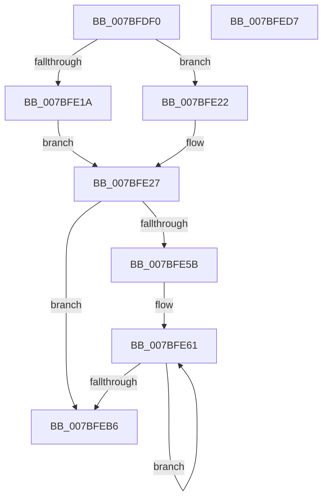

# EtwLogPfnInfoRundown

- RVA: `0x007BFDF0`–`0x007BFED8` (길이 `232` bytes)
- VA: `0x00000001407BFDF0`
- 실행 섹션: `PAGE`
- PDB 이름 있음: `예`; PDB Function 태그: `아니요`
- unwind 정보 RVA: `0x000D3E54`
- 디코드: `64`개 명령, `232/232` bytes 표시
- 미해석 바이트: `0` (있으면 어셈블리에 `.byte`로 보존)

> 이 문서는 커널 이미지의 기계어와 PDB 기호를 분석해 생성했습니다. 4번과 5번은 함수 원형과 자료형을 바이너리 사용 방식에서 추정한 C 해석이며 원본 소스 복구 결과는 아닙니다.

## 1. Dependencies

- 직접 호출 지점: **2**; 고유 호출 대상: **2**
- 직접 호출자로 확인된 함수: **2**
- RIP 상대 이미지 참조: **1**

### Outgoing calls
- `0x007BFE9F` → [EtwpLogKernelEvent](../../text/25/EtwpLogKernelEvent_function_0025CC00.md) (function, `0x0025CC00`)
- `0x007BFEBE` → [_security_check_cookie](../../text/6A/_security_check_cookie_function_006AC640.md) (function, `0x006AC640`)

### Direct callers
- [EtwpEnumerateWorkingSet](EtwpEnumerateWorkingSet_function_007BFFA4.md) at `0x007C003F`
- [MmLogSystemShareablePfnInfo](../80/MmLogSystemShareablePfnInfo_function_008093F4.md) at `0x008094D2`

### Static image references
- `0x007BFE00` → RVA `0x00E0A740` (`.data`; read)

## 2. Other-region calls and transfers

- 다른 실행 섹션으로 향하는 call: **2**
  - `0x007BFE9F` → [EtwpLogKernelEvent](../../text/25/EtwpLogKernelEvent_function_0025CC00.md) (`PAGE` → `.text`)
  - `0x007BFEBE` → [_security_check_cookie](../../text/6A/_security_check_cookie_function_006AC640.md) (`PAGE` → `.text`)
- 별도 외부 분기/꼬리 이동을 확인하지 못했습니다.

## 3. Assembly (complete function range)

```asm
007BFDF0  48 89 5C 24 08                  mov qword ptr [rsp + 8], rbx
007BFDF5  55                              push rbp
007BFDF6  56                              push rsi
007BFDF7  57                              push rdi
007BFDF8  41 54                           push r12
007BFDFA  41 56                           push r14
007BFDFC  48 83 EC 70                     sub rsp, 0x70
007BFE00  48 8B 05 39 A9 64 00            mov rax, qword ptr [rip + 0x64a939]
007BFE07  48 33 C4                        xor rax, rsp
007BFE0A  48 89 44 24 60                  mov qword ptr [rsp + 0x60], rax
007BFE0F  45 8B F0                        mov r14d, r8d
007BFE12  48 8B EA                        mov rbp, rdx
007BFE15  48 85 C9                        test rcx, rcx
007BFE18  74 08                           je 0x1407bfe22
007BFE1A  8B 81 D0 01 00 00               mov eax, dword ptr [rcx + 0x1d0]
007BFE20  EB 05                           jmp 0x1407bfe27
007BFE22  B8 FF FF FF FF                  mov eax, 0xffffffff
007BFE27  49 89 01                        mov qword ptr [r9], rax
007BFE2A  49 8D 59 08                     lea rbx, [r9 + 8]
007BFE2E  48 8B 3B                        mov rdi, qword ptr [rbx]
007BFE31  49 8D 71 10                     lea rsi, [r9 + 0x10]
007BFE35  83 64 24 3C 00                  and dword ptr [rsp + 0x3c], 0
007BFE3A  B8 08 00 00 00                  mov eax, 8
007BFE3F  83 64 24 4C 00                  and dword ptr [rsp + 0x4c], 0
007BFE44  4C 89 4C 24 30                  mov qword ptr [rsp + 0x30], r9
007BFE49  89 44 24 38                     mov dword ptr [rsp + 0x38], eax
007BFE4D  48 89 5C 24 40                  mov qword ptr [rsp + 0x40], rbx
007BFE52  89 44 24 48                     mov dword ptr [rsp + 0x48], eax
007BFE56  48 85 FF                        test rdi, rdi
007BFE59  74 5B                           je 0x1407bfeb6
007BFE5B  41 BC FC 07 00 00               mov r12d, 0x7fc
007BFE61  49 3B FC                        cmp rdi, r12
007BFE64  C7 44 24 28 02 18 50 00         mov dword ptr [rsp + 0x28], 0x501802
007BFE6C  48 8B C7                        mov rax, rdi
007BFE6F  48 89 74 24 50                  mov qword ptr [rsp + 0x50], rsi
007BFE74  49 0F 47 C4                     cmova rax, r12
007BFE78  66 C7 44 24 20 84 02            mov word ptr [rsp + 0x20], 0x284
007BFE7F  83 64 24 5C 00                  and dword ptr [rsp + 0x5c], 0
007BFE84  48 8D 4C 24 30                  lea rcx, [rsp + 0x30]
007BFE89  48 89 03                        mov qword ptr [rbx], rax
007BFE8C  41 B9 03 00 00 00               mov r9d, 3
007BFE92  C1 E0 05                        shl eax, 5
007BFE95  45 8B C6                        mov r8d, r14d
007BFE98  48 8B D5                        mov rdx, rbp
007BFE9B  89 44 24 58                     mov dword ptr [rsp + 0x58], eax
007BFE9F  E8 5C CD A9 FF                  call 0x14025cc00
007BFEA4  48 8B 0B                        mov rcx, qword ptr [rbx]
007BFEA7  48 8B C1                        mov rax, rcx
007BFEAA  48 C1 E0 05                     shl rax, 5
007BFEAE  48 03 F0                        add rsi, rax
007BFEB1  48 2B F9                        sub rdi, rcx
007BFEB4  75 AB                           jne 0x1407bfe61
007BFEB6  48 8B 4C 24 60                  mov rcx, qword ptr [rsp + 0x60]
007BFEBB  48 33 CC                        xor rcx, rsp
007BFEBE  E8 7D C7 EE FF                  call 0x1406ac640
007BFEC3  48 8B 9C 24 A0 00 00 00         mov rbx, qword ptr [rsp + 0xa0]
007BFECB  48 83 C4 70                     add rsp, 0x70
007BFECF  41 5E                           pop r14
007BFED1  41 5C                           pop r12
007BFED3  5F                              pop rdi
007BFED4  5E                              pop rsi
007BFED5  5D                              pop rbp
007BFED6  C3                              ret
007BFED7  CC                              int3
```

## 4. C-style interpretation (structured pseudocode)

```c
__int64 __fastcall EtwLogPfnInfoRundown(__int64 a1, __int64 a2, int a3, __int64 a4)
{
    __int64 result;
    __int64 v_rdi;
    __int64 v_rsi;
    __int64 v_rsp;
    unsigned __int64 v_stack_m38;
    unsigned int v_stack_m3C;
    unsigned int v_stack_m40;
    unsigned __int64 v_stack_m48;
    unsigned int v_stack_m4C;
    unsigned int v_stack_m50;
    unsigned __int64 v_stack_m58;
    unsigned int v_stack_m5C;
    unsigned int v_stack_m60;
    unsigned __int64 v_stack_m68;
    unsigned int v_stack_m70;
    unsigned __int16 v_stack_m78;
    unsigned __int64 v_stack_p8;

    v_stack_p8 = v_rbx;
    v_rsp = (v_rsp) - (112);
    result = (*(unsigned __int64 *)(v_rip + 6596921)) ^ (v_rsp);
    v_stack_m38 = result;
    if (a1 == 0) goto loc_007BFE22;
    goto loc_007BFE27;
loc_007BFE22:
loc_007BFE27:
    *(unsigned __int64 *)(a4) = (unsigned int)(0xFFFFFFFFULL);
    v_stack_m68 = a4;
    v_stack_m60 = 8;
    v_stack_m58 = a4 + 8;
    v_stack_m50 = 8;
    if (*(unsigned __int64 *)(a4 + 8) == 0) goto loc_007BFEB6;
loc_007BFE61:
    v_stack_m70 = 0x501802ULL;
    v_stack_m48 = a4 + 16;
    result = *(unsigned __int64 *)(a4 + 8);
    if ((*(unsigned __int64 *)(a4 + 8)) > ((unsigned int)(0x7FCULL))) { result = (unsigned int)(0x7FCULL); }
    v_stack_m78 = 644;
    *(unsigned __int64 *)(a4 + 8) = result;
    result = (unsigned int)((result) << (5));
    v_stack_m40 = (unsigned int)(result);
    result = EtwpLogKernelEvent(v_stack_m68, a2, (unsigned int)((unsigned int)((unsigned int)(a3))), 3);
    result = (*(unsigned __int64 *)(a4 + 8)) << (5);
    v_rsi = (a4 + 16) + (result);
    v_rdi = (*(unsigned __int64 *)(a4 + 8)) - (*(unsigned __int64 *)(a4 + 8));
    if (condition_is_not_equal) goto loc_007BFE61;
loc_007BFEB6:
    a1 = (v_stack_m38) ^ (v_rsp);
    result = _security_check_cookie(a1, a2, (unsigned int)((unsigned int)((unsigned int)(a3))), 3);
    v_rsp = (v_rsp) + (112);
    return result;
}
```

## 5. (Beta) C Style

```c
int64_t EtwLogPfnInfoRundown(int64_t Arg1, int64_t Arg2, int32_t Arg3, void *Arg4)
{
    uint8_t *arg4 = (uint8_t *)Arg4;

    int64_t result;
    int64_t local_rdi;
    int64_t local_rsi;
    int64_t local_rsp;
    uint64_t v_stack_m38;
    uint32_t v_stack_m3C;
    uint32_t v_stack_m40;
    uint64_t v_stack_m48;
    uint32_t v_stack_m4C;
    uint32_t v_stack_m50;
    uint64_t v_stack_m58;
    uint32_t v_stack_m5C;
    uint32_t v_stack_m60;
    uint64_t v_stack_m68;
    uint32_t v_stack_m70;
    uint16_t v_stack_m78;
    uint64_t v_stack_p8;

    v_stack_p8 = local_rbx;
    local_rsp = (local_rsp) - (112);
    result = (*(uint64_t *)(v_rip + 0x64A939)) ^ (local_rsp);
    v_stack_m38 = result;
    if (Arg1 == 0) goto loc_007BFE22;
    goto loc_007BFE27;
loc_007BFE22:
loc_007BFE27:
    *(uint64_t *)(arg4) = (uint32_t)(0xFFFFFFFFULL);
    v_stack_m68 = Arg4;
    v_stack_m60 = 8;
    v_stack_m58 = Arg4 + 8;
    v_stack_m50 = 8;
    if (*(uint64_t *)(arg4 + 0x8) == 0) goto loc_007BFEB6;
loc_007BFE61:
    v_stack_m70 = 0x501802ULL;
    v_stack_m48 = Arg4 + 16;
    result = *(uint64_t *)(arg4 + 0x8);
    if ((*(uint64_t *)(arg4 + 0x8)) > ((uint32_t)(0x7FCULL))) { result = (uint32_t)(0x7FCULL); }
    v_stack_m78 = 644;
    *(uint64_t *)(arg4 + 0x8) = result;
    result = (uint32_t)((result) << (5));
    v_stack_m40 = (uint32_t)(result);
    result = EtwpLogKernelEvent(v_stack_m68, Arg2, (uint32_t)((uint32_t)((uint32_t)(Arg3))), 3);
    result = (*(uint64_t *)(arg4 + 0x8)) << (5);
    local_rsi = (Arg4 + 16) + (result);
    local_rdi = (*(uint64_t *)(arg4 + 0x8)) - (*(uint64_t *)(arg4 + 0x8));
    if (condition_is_not_equal) goto loc_007BFE61;
loc_007BFEB6:
    Arg1 = (v_stack_m38) ^ (local_rsp);
    result = _security_check_cookie(Arg1, Arg2, (uint32_t)((uint32_t)((uint32_t)(Arg3))), 3);
    local_rsp = (local_rsp) + (112);
    return result;
}
```

### 관측된 메모리 오프셋

구조체 형식이 확인되지 않은 접근은 인자 기준의 오프셋으로만 기록했습니다.

| 기준 인자 | 오프셋 표현 | 폭 (bit) | 접근 |
|---|---:|---:|---|
| `Arg4` | `+ 0x0` | `64` | `R` |
| `Arg4` | `+ 0x0` | `64` | `W` |
| `Arg4` | `+ 0x8` | `64` | `R` |
| `Arg4` | `+ 0x10` | `64` | `R` |

## 6. Execution-region graph

[열기: 2D/3D 그래프와 함수 탐색 컨트롤 패널](../../../control-panel.html?section=page&rva=0x007BFDF0&view=graph)

- 2D 그래프는 위에서 아래로 흐르고, 3D 그래프는 빈 공간을 드래그해 회전합니다. Shift+드래그는 이동, 휠은 확대·축소, 함수 노드 선택은 대상 보고서 이동입니다.

### Static fallback


