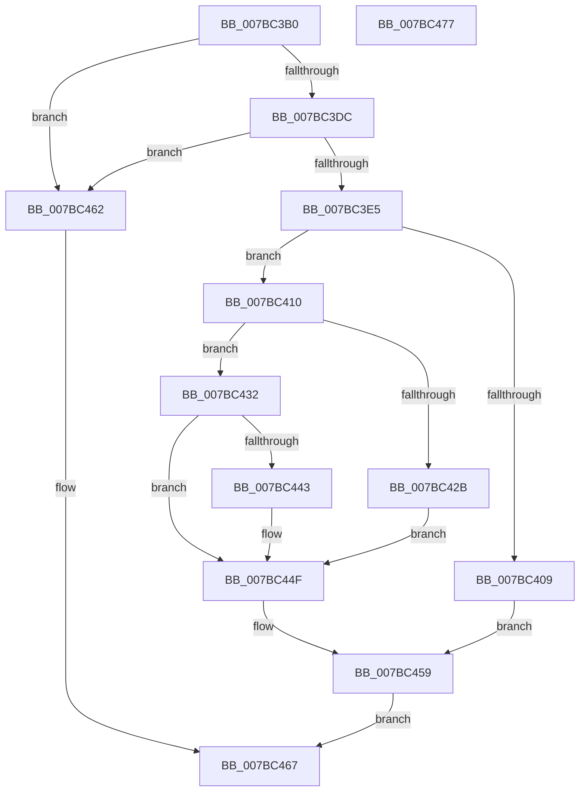

# EtwRegisterEventCallback

- RVA: `0x007BC3B0`–`0x007BC478` (길이 `200` bytes)
- VA: `0x00000001407BC3B0`
- 실행 섹션: `PAGE`
- PDB 이름 있음: `예`; PDB Function 태그: `아니요`
- unwind 정보 RVA: `0x00060BC4`
- 디코드: `53`개 명령, `200/200` bytes 표시
- 미해석 바이트: `0` (있으면 어셈블리에 `.byte`로 보존)

> 이 문서는 커널 이미지의 기계어와 PDB 기호를 분석해 생성했습니다. 4번과 5번은 함수 원형과 자료형을 바이너리 사용 방식에서 추정한 C 해석이며 원본 소스 복구 결과는 아닙니다.

## 1. Dependencies

- 직접 호출 지점: **6**; 고유 호출 대상: **6**
- 직접 호출자로 확인된 함수: **0**
- RIP 상대 이미지 참조: **1**

### Outgoing calls
- `0x007BC3C5` → [PsGetCurrentServerSiloGlobals](../../text/2F/PsGetCurrentServerSiloGlobals_function_002FE1F0.md) (function, `0x002FE1F0`)
- `0x007BC3FC` → [EtwpAcquireLoggerContextByLoggerId](../93/EtwpAcquireLoggerContextByLoggerId_function_00932920.md) (function, `0x00932920`)
- `0x007BC41E` → [ExAllocatePool2](../../poolcode/B8/ExAllocatePool2_function_00B820F0.md) (function, `0x00B820F0`)
- `0x007BC44A` → [ExFreePoolWithTag](../../poolcode/B8/ExFreePoolWithTag_function_00B82870.md) (function, `0x00B82870`)
- `0x007BC454` → [EtwpReleaseLoggerContext](../A0/EtwpReleaseLoggerContext_function_00A04160.md) (function, `0x00A04160`)
- `0x007BC459` → [KeLeaveCriticalRegion](../../text/25/KeLeaveCriticalRegion_function_0025D8B0.md) (function, `0x0025D8B0`)

### Direct callers
- 이 함수 시작 RVA로 연결되는 직접 call은 확인되지 않았습니다. 간접 호출은 완전히 역산할 수 없습니다.

### Static image references
- `0x007BC3DC` → RVA `0x00FC7408` (`ALMOSTRO`; read)

## 2. Other-region calls and transfers

- 다른 실행 섹션으로 향하는 call: **4**
  - `0x007BC3C5` → [PsGetCurrentServerSiloGlobals](../../text/2F/PsGetCurrentServerSiloGlobals_function_002FE1F0.md) (`PAGE` → `.text`)
  - `0x007BC41E` → [ExAllocatePool2](../../poolcode/B8/ExAllocatePool2_function_00B820F0.md) (`PAGE` → `POOLCODE`)
  - `0x007BC44A` → [ExFreePoolWithTag](../../poolcode/B8/ExFreePoolWithTag_function_00B82870.md) (`PAGE` → `POOLCODE`)
  - `0x007BC459` → [KeLeaveCriticalRegion](../../text/25/KeLeaveCriticalRegion_function_0025D8B0.md) (`PAGE` → `.text`)
- 별도 외부 분기/꼬리 이동을 확인하지 못했습니다.

## 3. Assembly (complete function range)

```asm
007BC3B0  48 89 5C 24 08                  mov qword ptr [rsp + 8], rbx
007BC3B5  48 89 74 24 10                  mov qword ptr [rsp + 0x10], rsi
007BC3BA  57                              push rdi
007BC3BB  48 83 EC 20                     sub rsp, 0x20
007BC3BF  49 8B F0                        mov rsi, r8
007BC3C2  44 8B C9                        mov r9d, ecx
007BC3C5  E8 26 1E B4 FF                  call 0x1402fe1f0
007BC3CA  33 DB                           xor ebx, ebx
007BC3CC  48 8B 88 40 03 00 00            mov rcx, qword ptr [rax + 0x340]
007BC3D3  48 85 D2                        test rdx, rdx
007BC3D6  0F 84 86 00 00 00               je 0x1407bc462
007BC3DC  48 3B 15 25 B0 80 00            cmp rdx, qword ptr [rip + 0x80b025]
007BC3E3  75 7D                           jne 0x1407bc462
007BC3E5  65 48 8B 04 25 88 01 00 00      mov rax, qword ptr gs:[0x188]
007BC3EE  45 33 C0                        xor r8d, r8d
007BC3F1  41 8B D1                        mov edx, r9d
007BC3F4  66 FF 88 E4 01 00 00            dec word ptr [rax + 0x1e4]
007BC3FB  90                              nop
007BC3FC  E8 1F 65 17 00                  call 0x140932920
007BC401  48 8B F8                        mov rdi, rax
007BC404  48 85 C0                        test rax, rax
007BC407  75 07                           jne 0x1407bc410
007BC409  BB 96 02 00 C0                  mov ebx, 0xc0000296
007BC40E  EB 49                           jmp 0x1407bc459
007BC410  BA 10 00 00 00                  mov edx, 0x10
007BC415  41 B8 45 74 77 43               mov r8d, 0x43777445
007BC41B  8D 4A 30                        lea ecx, [rdx + 0x30]
007BC41E  E8 CD 5C 3C 00                  call 0x140b820f0
007BC423  48 8B C8                        mov rcx, rax
007BC426  48 85 C0                        test rax, rax
007BC429  75 07                           jne 0x1407bc432
007BC42B  BB 9A 00 00 C0                  mov ebx, 0xc000009a
007BC430  EB 1D                           jmp 0x1407bc44f
007BC432  48 89 70 08                     mov qword ptr [rax + 8], rsi
007BC436  33 C0                           xor eax, eax
007BC438  F0 48 0F B1 8F 20 06 00 00      lock cmpxchg qword ptr [rdi + 0x620], rcx
007BC441  74 0C                           je 0x1407bc44f
007BC443  33 D2                           xor edx, edx
007BC445  BB 0D 00 00 C0                  mov ebx, 0xc000000d
007BC44A  E8 21 64 3C 00                  call 0x140b82870
007BC44F  33 D2                           xor edx, edx
007BC451  48 8B CF                        mov rcx, rdi
007BC454  E8 07 7D 24 00                  call 0x140a04160
007BC459  E8 52 14 AA FF                  call 0x14025d8b0
007BC45E  8B C3                           mov eax, ebx
007BC460  EB 05                           jmp 0x1407bc467
007BC462  B8 22 00 00 C0                  mov eax, 0xc0000022
007BC467  48 8B 5C 24 30                  mov rbx, qword ptr [rsp + 0x30]
007BC46C  48 8B 74 24 38                  mov rsi, qword ptr [rsp + 0x38]
007BC471  48 83 C4 20                     add rsp, 0x20
007BC475  5F                              pop rdi
007BC476  C3                              ret
007BC477  CC                              int3
```

## 4. C-style interpretation (structured pseudocode)

```c
__int64 __fastcall EtwRegisterEventCallback(int a1, __int64 a2, __int64 a3)
{
    __int64 result;
    __int64 v_rbx;
    __int64 v_rsp;
    unsigned __int64 v_stack_p10;
    unsigned __int64 v_stack_p8;

    v_stack_p8 = v_rbx;
    v_stack_p10 = v_rsi;
    v_rsp = (v_rsp) - (32);
    result = PsGetCurrentServerSiloGlobals(a1, a2, a3, (unsigned int)(a1));
    v_rbx = 0;
    if (a2 == 0) goto loc_007BC462;
    if (a2 != (*(unsigned __int64 *)(v_rip + 8433701))) goto loc_007BC462;
    a3 = 0;
    result = EtwpAcquireLoggerContextByLoggerId(*(unsigned __int64 *)(result + 832), (unsigned int)((unsigned int)((unsigned int)(a1))), a3, (unsigned int)(a1));
    if (result != 0) goto loc_007BC410;
    goto loc_007BC459;
loc_007BC410:
    result = ExAllocatePool2(16 + 48, 16, (unsigned int)(0x43777445ULL), (unsigned int)(a1));
    if (result != 0) goto loc_007BC432;
    goto loc_007BC44F;
loc_007BC432:
    *(unsigned __int64 *)(result + 8) = 0;
    result = 0;
    v_rbx = (unsigned int)(0xC000009AULL);
    if (!(condition_is_equal)) {
        a2 = 0;
        v_rbx = 0xC000000DULL;
        result = ExFreePoolWithTag(result, a2, (unsigned int)(0x43777445ULL), (unsigned int)(a1));
    }
    a2 = 0;
    result = EtwpReleaseLoggerContext(result, a2, (unsigned int)(0x43777445ULL), (unsigned int)(a1));
loc_007BC459:
    result = KeLeaveCriticalRegion(result, a2, (unsigned int)(0x43777445ULL), (unsigned int)(a1));
    goto loc_007BC467;
loc_007BC462:
loc_007BC467:
    v_rsp = (v_rsp) + (32);
    return (unsigned int)(0xC0000022ULL);
}
```

## 5. (Beta) C Style

```c
int64_t EtwRegisterEventCallback(int32_t Arg1, int64_t Arg2, int64_t Arg3)
{
    int64_t result;
    int64_t local_rbx;
    int64_t local_rsp;
    uint64_t v_stack_p10;
    uint64_t v_stack_p8;

    v_stack_p8 = local_rbx;
    v_stack_p10 = local_rsi;
    local_rsp = (local_rsp) - (32);
    result = PsGetCurrentServerSiloGlobals(Arg1, Arg2, Arg3, (uint32_t)(Arg1));
    local_rbx = 0;
    if (Arg2 == 0) goto loc_007BC462;
    if (Arg2 != (*(uint64_t *)(v_rip + 0x80B025))) goto loc_007BC462;
    Arg3 = 0;
    result = EtwpAcquireLoggerContextByLoggerId(*(uint64_t *)(result + 0x340), (uint32_t)((uint32_t)((uint32_t)(Arg1))), Arg3, (uint32_t)(Arg1));
    if (result != 0) goto loc_007BC410;
    goto loc_007BC459;
loc_007BC410:
    result = ExAllocatePool2(16 + 48, 16, (uint32_t)(0x43777445ULL), (uint32_t)(Arg1));
    if (result != 0) goto loc_007BC432;
    goto loc_007BC44F;
loc_007BC432:
    *(uint64_t *)(result + 0x8) = 0;
    result = 0;
    local_rbx = (uint32_t)(0xC000009AULL);
    if (!(condition_is_equal)) {
        Arg2 = 0;
        local_rbx = 0xC000000DULL;
        result = ExFreePoolWithTag(result, Arg2, (uint32_t)(0x43777445ULL), (uint32_t)(Arg1));
    }
    Arg2 = 0;
    result = EtwpReleaseLoggerContext(result, Arg2, (uint32_t)(0x43777445ULL), (uint32_t)(Arg1));
loc_007BC459:
    result = KeLeaveCriticalRegion(result, Arg2, (uint32_t)(0x43777445ULL), (uint32_t)(Arg1));
    goto loc_007BC467;
loc_007BC462:
loc_007BC467:
    local_rsp = (local_rsp) + (32);
    return (uint32_t)(0xC0000022ULL);
}
```

## 6. Execution-region graph

[열기: 2D/3D 그래프와 함수 탐색 컨트롤 패널](../../../control-panel.html?section=page&rva=0x007BC3B0&view=graph)

- 2D 그래프는 위에서 아래로 흐르고, 3D 그래프는 빈 공간을 드래그해 회전합니다. Shift+드래그는 이동, 휠은 확대·축소, 함수 노드 선택은 대상 보고서 이동입니다.

### Static fallback


