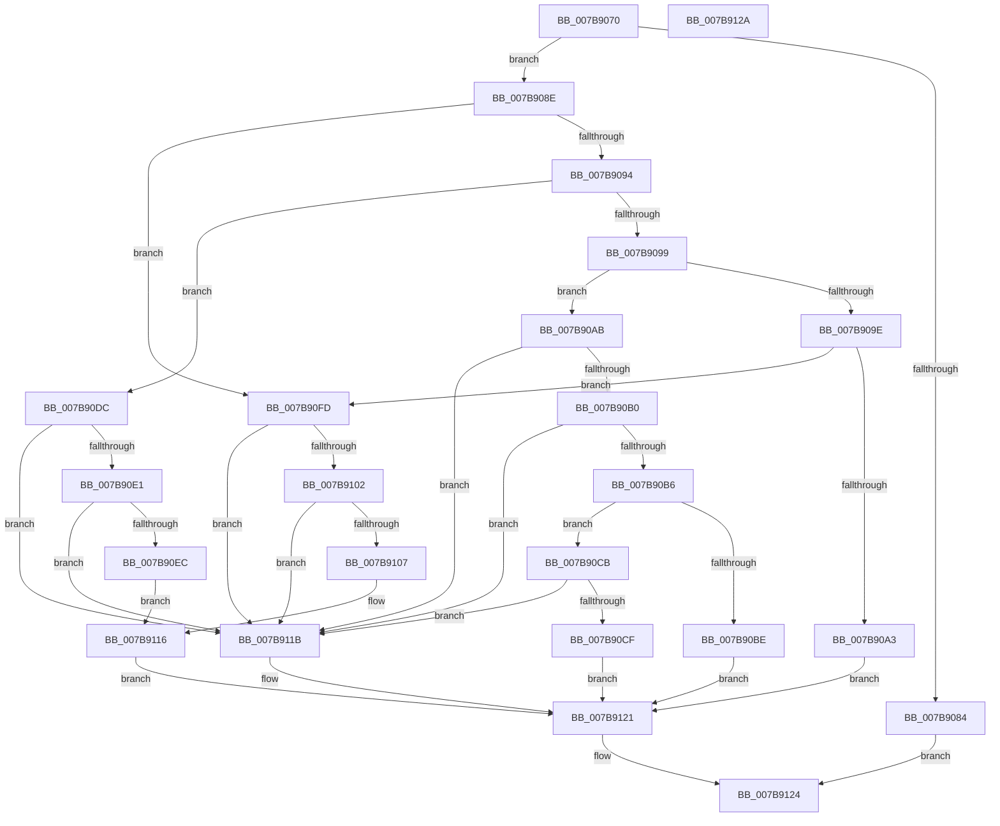

# EtwSetInformation

- RVA: `0x007B9070`–`0x007B912B` (길이 `187` bytes)
- VA: `0x00000001407B9070`
- 실행 섹션: `PAGE`
- PDB 이름 있음: `예`; PDB Function 태그: `아니요`
- unwind 정보 RVA: `0x0005CF00`
- 디코드: `61`개 명령, `187/187` bytes 표시
- 미해석 바이트: `0` (있으면 어셈블리에 `.byte`로 보존)

> 이 문서는 커널 이미지의 기계어와 PDB 기호를 분석해 생성했습니다. 4번과 5번은 함수 원형과 자료형을 바이너리 사용 방식에서 추정한 C 해석이며 원본 소스 복구 결과는 아닙니다.

## 1. Dependencies

- 직접 호출 지점: **2**; 고유 호출 대상: **2**
- 직접 호출자로 확인된 함수: **6**
- RIP 상대 이미지 참조: **0**

### Outgoing calls
- `0x007B90F6` → [EtwpSetProviderTraitsKm](../9F/EtwpSetProviderTraitsKm_function_009F3424.md) (function, `0x009F3424`)
- `0x007B9111` → [EtwpTrackProviderBinaryKm](../6F/EtwpTrackProviderBinaryKm_function_006FD8E8.md) (function, `0x006FD8E8`)

### Direct callers
- [BapdWriteEtwEvents](../../text/4A/BapdWriteEtwEvents_function_004AE884.md) at `0x004AEB54`
- [BapdWriteEtwEvents](../../text/4A/BapdWriteEtwEvents_function_004AE884.md) at `0x004AEBC9`
- [BapdWriteEtwEvents](../../text/4A/BapdWriteEtwEvents_function_004AE884.md) at `0x004AEC25`
- [BapdRegisterEtwProvider](../../text/4A/BapdRegisterEtwProvider_function_004AECF8.md) at `0x004AED3B`
- [HvlpEtwRegister](../../text/58/HvlpEtwRegister_function_0058C444.md) at `0x0058C47B`
- [sub_006F88AE](../../text/6F/Unknown_function_006F88AE.md) at `0x006F8A48`
- [TraceLoggingRegisterEx_EtwRegister_EtwSetInformation](../92/TraceLoggingRegisterEx_EtwRegister_EtwSetInformation_function_009208A0.md) at `0x00920933`
- [PopDiagInitialize](../../init/C3/PopDiagInitialize_function_00C3F2C0.md) at `0x00C3F330`

### Static image references
- 디코드된 RIP-relative 메모리 참조가 없습니다.

## 2. Other-region calls and transfers

- 다른 실행 섹션으로 향하는 call: **0**
- 별도 외부 분기/꼬리 이동을 확인하지 못했습니다.

## 3. Assembly (complete function range)

```asm
007B9070  40 53                           push rbx
007B9072  48 83 EC 20                     sub rsp, 0x20
007B9076  45 33 D2                        xor r10d, r10d
007B9079  49 8B D8                        mov rbx, r8
007B907C  4C 8B D9                        mov r11, rcx
007B907F  48 85 C9                        test rcx, rcx
007B9082  75 0A                           jne 0x1407b908e
007B9084  B8 08 00 00 C0                  mov eax, 0xc0000008
007B9089  E9 96 00 00 00                  jmp 0x1407b9124
007B908E  8B CA                           mov ecx, edx
007B9090  85 D2                           test edx, edx
007B9092  74 69                           je 0x1407b90fd
007B9094  83 E9 02                        sub ecx, 2
007B9097  74 43                           je 0x1407b90dc
007B9099  83 E9 01                        sub ecx, 1
007B909C  74 0D                           je 0x1407b90ab
007B909E  83 F9 01                        cmp ecx, 1
007B90A1  74 5A                           je 0x1407b90fd
007B90A3  41 BA 10 00 00 C0               mov r10d, 0xc0000010
007B90A9  EB 76                           jmp 0x1407b9121
007B90AB  48 85 DB                        test rbx, rbx
007B90AE  74 6B                           je 0x1407b911b
007B90B0  41 83 F9 01                     cmp r9d, 1
007B90B4  75 65                           jne 0x1407b911b
007B90B6  41 8A 00                        mov al, byte ptr [r8]
007B90B9  41 3A C1                        cmp al, r9b
007B90BC  75 0D                           jne 0x1407b90cb
007B90BE  B8 00 01 00 00                  mov eax, 0x100
007B90C3  66 F0 41 09 43 62               lock or word ptr [r11 + 0x62], ax
007B90C9  EB 56                           jmp 0x1407b9121
007B90CB  84 C0                           test al, al
007B90CD  75 4C                           jne 0x1407b911b
007B90CF  B8 FF FE FF FF                  mov eax, 0xfffffeff
007B90D4  66 F0 41 21 43 62               lock and word ptr [r11 + 0x62], ax
007B90DA  EB 45                           jmp 0x1407b9121
007B90DC  48 85 DB                        test rbx, rbx
007B90DF  74 3A                           je 0x1407b911b
007B90E1  41 8D 41 FD                     lea eax, [r9 - 3]
007B90E5  3D FC 7F 00 00                  cmp eax, 0x7ffc
007B90EA  77 2F                           ja 0x1407b911b
007B90EC  45 0F B7 C1                     movzx r8d, r9w
007B90F0  48 8B D3                        mov rdx, rbx
007B90F3  49 8B CB                        mov rcx, r11
007B90F6  E8 29 A3 23 00                  call 0x1409f3424
007B90FB  EB 19                           jmp 0x1407b9116
007B90FD  48 85 DB                        test rbx, rbx
007B9100  75 19                           jne 0x1407b911b
007B9102  45 85 C9                        test r9d, r9d
007B9105  75 14                           jne 0x1407b911b
007B9107  83 FA 04                        cmp edx, 4
007B910A  49 8B CB                        mov rcx, r11
007B910D  41 0F 94 C0                     sete r8b
007B9111  E8 D2 47 F4 FF                  call 0x1406fd8e8
007B9116  44 8B D0                        mov r10d, eax
007B9119  EB 06                           jmp 0x1407b9121
007B911B  41 BA 0D 00 00 C0               mov r10d, 0xc000000d
007B9121  41 8B C2                        mov eax, r10d
007B9124  48 83 C4 20                     add rsp, 0x20
007B9128  5B                              pop rbx
007B9129  C3                              ret
007B912A  CC                              int3
```

## 4. C-style interpretation (structured pseudocode)

```c
__int64 __fastcall EtwSetInformation(__int64 a1, int a2, __int64 a3, __int64 a4)
{
    __int64 result;
    __int64 v_r10;
    __int64 v_rsp;

    v_rsp = (v_rsp) - (32);
    v_r10 = 0;
    if (a1 != 0) goto loc_007B908E;
    goto loc_007B9124;
loc_007B908E:
    if (a2 == 0) goto loc_007B90FD;
    a1 = (unsigned int)(((unsigned int)(a2)) - (2));
    if (condition_is_equal) goto loc_007B90DC;
    a1 = (unsigned int)((a1) - (1));
    if (condition_is_equal) goto loc_007B90AB;
    if (((unsigned int)(a1)) == 1) goto loc_007B90FD;
    goto loc_007B9121;
loc_007B90AB:
    if (a3 == 0) goto loc_007B911B;
    if (((unsigned int)(a4)) != 1) goto loc_007B911B;
    if (((unsigned __int8)(*(unsigned __int8 *)(a3))) != ((unsigned __int8)(a4))) goto loc_007B90CB;
    goto loc_007B9121;
loc_007B90CB:
    if (256 != 0) goto loc_007B911B;
    goto loc_007B9121;
loc_007B90DC:
    if (a3 == 0) goto loc_007B911B;
    if (((unsigned int)(a4 - 3)) > 0x7FFCULL) goto loc_007B911B;
    result = EtwpSetProviderTraitsKm(a1, a3, (unsigned __int16)(a4), a4);
    goto loc_007B9116;
loc_007B90FD:
    if (a3 != 0) goto loc_007B911B;
    if ((unsigned int)(a4) != 0) goto loc_007B911B;
    a3 = (((unsigned int)(a3)) == 4) ? 1 : 0;
    result = EtwpTrackProviderBinaryKm(a1, a3, a3, a4);
loc_007B9116:
    goto loc_007B9121;
loc_007B911B:
loc_007B9121:
loc_007B9124:
    v_rsp = (v_rsp) + (32);
    return (unsigned int)((unsigned int)((unsigned int)(0xC000000DULL)));
}
```

## 5. (Beta) C Style

```c
int64_t EtwSetInformation(void *Arg1, int32_t Arg2, void *Arg3, void *Arg4)
{
    uint8_t *arg1 = (uint8_t *)Arg1;
    uint8_t *arg3 = (uint8_t *)Arg3;
    uint8_t *arg4 = (uint8_t *)Arg4;

    int64_t result;
    int64_t local_r10;
    int64_t local_rsp;

    local_rsp = (local_rsp) - (32);
    local_r10 = 0;
    if (Arg1 != NULL) goto loc_007B908E;
    goto loc_007B9124;
loc_007B908E:
    if (Arg2 == 0) goto loc_007B90FD;
    Arg1 = (uint32_t)(((uint32_t)(Arg2)) - (2));
    if (condition_is_equal) goto loc_007B90DC;
    Arg1 = (uint32_t)((Arg1) - (1));
    if (condition_is_equal) goto loc_007B90AB;
    if (((uint32_t)(Arg1)) == 1) goto loc_007B90FD;
    goto loc_007B9121;
loc_007B90AB:
    if (Arg3 == NULL) goto loc_007B911B;
    if (((uint32_t)(Arg4)) != 1) goto loc_007B911B;
    if (((uint8_t)(*(uint8_t *)(arg3))) != ((uint8_t)(Arg4))) goto loc_007B90CB;
    goto loc_007B9121;
loc_007B90CB:
    if (256 != 0) goto loc_007B911B;
    goto loc_007B9121;
loc_007B90DC:
    if (Arg3 == NULL) goto loc_007B911B;
    if (((uint32_t)(Arg4 - 3)) > 0x7FFCULL) goto loc_007B911B;
    result = EtwpSetProviderTraitsKm(Arg1, Arg3, (uint16_t)(Arg4), Arg4);
    goto loc_007B9116;
loc_007B90FD:
    if (Arg3 != NULL) goto loc_007B911B;
    if ((uint32_t)(Arg4) != 0) goto loc_007B911B;
    Arg3 = (((uint32_t)(Arg3)) == 4) ? 1 : 0;
    result = EtwpTrackProviderBinaryKm(Arg1, Arg3, Arg3, Arg4);
loc_007B9116:
    goto loc_007B9121;
loc_007B911B:
loc_007B9121:
loc_007B9124:
    local_rsp = (local_rsp) + (32);
    return (uint32_t)((uint32_t)((uint32_t)(0xC000000DULL)));
}
```

### 관측된 메모리 오프셋

구조체 형식이 확인되지 않은 접근은 인자 기준의 오프셋으로만 기록했습니다.

| 기준 인자 | 오프셋 표현 | 폭 (bit) | 접근 |
|---|---:|---:|---|
| `Arg1` | `+ 0x62` | `16` | `R/W` |
| `Arg3` | `+ 0x0` | `8` | `R` |
| `Arg4` | `- 0x3` | `32` | `R` |

## 6. Execution-region graph

[열기: 2D/3D 그래프와 함수 탐색 컨트롤 패널](../../../control-panel.html?section=page&rva=0x007B9070&view=graph)

- 2D 그래프는 위에서 아래로 흐르고, 3D 그래프는 빈 공간을 드래그해 회전합니다. Shift+드래그는 이동, 휠은 확대·축소, 함수 노드 선택은 대상 보고서 이동입니다.

### Static fallback


