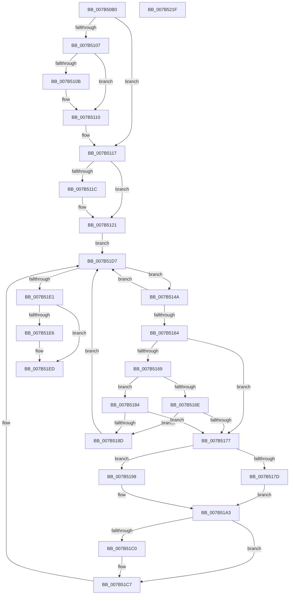

# EtwShutdown

- RVA: `0x007B50B0`–`0x007B5220` (길이 `368` bytes)
- VA: `0x00000001407B50B0`
- 실행 섹션: `PAGE`
- PDB 이름 있음: `예`; PDB Function 태그: `아니요`
- unwind 정보 RVA: `0x000D36E8`
- 디코드: `94`개 명령, `368/368` bytes 표시
- 미해석 바이트: `0` (있으면 어셈블리에 `.byte`로 보존)

> 이 문서는 커널 이미지의 기계어와 PDB 기호를 분석해 생성했습니다. 4번과 5번은 함수 원형과 자료형을 바이너리 사용 방식에서 추정한 C 해석이며 원본 소스 복구 결과는 아닙니다.

## 1. Dependencies

- 직접 호출 지점: **10**; 고유 호출 대상: **9**
- 직접 호출자로 확인된 함수: **3**
- RIP 상대 이미지 참조: **3**

### Outgoing calls
- `0x007B50E5` → [PsGetCurrentServerSiloGlobals](../../text/2F/PsGetCurrentServerSiloGlobals_function_002FE1F0.md) (function, `0x002FE1F0`)
- `0x007B50F1` → [PsIsCurrentThreadInServerSilo](../../text/43/PsIsCurrentThreadInServerSilo_function_004362E0.md) (function, `0x004362E0`)
- `0x007B510B` → [EtwpTraceSystemShutdown](EtwpTraceSystemShutdown_function_007B8A18.md) (function, `0x007B8A18`)
- `0x007B511C` → [EtwpFlushCoverage](EtwpFlushCoverage_function_007BA478.md) (function, `0x007BA478`)
- `0x007B5130` → [memset](../../text/6C/memset_function_006C6C40.md) (function, `0x006C6C40`)
- `0x007B5157` → [EtwpAcquireLoggerContextByLoggerId](../93/EtwpAcquireLoggerContextByLoggerId_function_00932920.md) (function, `0x00932920`)
- `0x007B5192` → [EtwpReleaseLoggerContext](../A0/EtwpReleaseLoggerContext_function_00A04160.md) (function, `0x00A04160`)
- `0x007B51B6` → [EtwpReleaseLoggerContext](../A0/EtwpReleaseLoggerContext_function_00A04160.md) (function, `0x00A04160`)
- `0x007B51D2` → [EtwpStopTrace](../9B/EtwpStopTrace_function_009BCE84.md) (function, `0x009BCE84`)
- `0x007B51F8` → [_security_check_cookie](../../text/6A/_security_check_cookie_function_006AC640.md) (function, `0x006AC640`)

### Direct callers
- [PspDeleteExternalServerSiloState](../77/PspDeleteExternalServerSiloState_function_0077FB88.md) at `0x0077FBB6`
- [PopIssueActionRequest](../A9/PopIssueActionRequest_function_00A9CE54.md) at `0x00A9D175`
- [PopGracefulShutdown](../../pagelk/B6/PopGracefulShutdown_function_00B6BEC8.md) at `0x00B6C0CE`

### Static image references
- `0x007B50D0` → RVA `0x00E0A740` (`.data`; read)
- `0x007B51C0` → RVA `0x00EFF3B0` (`.data`; read/write)
- `0x007B51E6` → RVA `0x00EFF3B0` (`.data`; write)

## 2. Other-region calls and transfers

- 다른 실행 섹션으로 향하는 call: **4**
  - `0x007B50E5` → [PsGetCurrentServerSiloGlobals](../../text/2F/PsGetCurrentServerSiloGlobals_function_002FE1F0.md) (`PAGE` → `.text`)
  - `0x007B50F1` → [PsIsCurrentThreadInServerSilo](../../text/43/PsIsCurrentThreadInServerSilo_function_004362E0.md) (`PAGE` → `.text`)
  - `0x007B5130` → [memset](../../text/6C/memset_function_006C6C40.md) (`PAGE` → `.text`)
  - `0x007B51F8` → [_security_check_cookie](../../text/6A/_security_check_cookie_function_006AC640.md) (`PAGE` → `.text`)
- 별도 외부 분기/꼬리 이동을 확인하지 못했습니다.

## 3. Assembly (complete function range)

```asm
007B50B0  48 8B C4                        mov rax, rsp
007B50B3  48 89 58 08                     mov qword ptr [rax + 8], rbx
007B50B7  48 89 68 10                     mov qword ptr [rax + 0x10], rbp
007B50BB  48 89 70 18                     mov qword ptr [rax + 0x18], rsi
007B50BF  48 89 78 20                     mov qword ptr [rax + 0x20], rdi
007B50C3  41 54                           push r12
007B50C5  41 56                           push r14
007B50C7  41 57                           push r15
007B50C9  48 81 EC E0 00 00 00            sub rsp, 0xe0
007B50D0  48 8B 05 69 56 65 00            mov rax, qword ptr [rip + 0x655669]
007B50D7  48 33 C4                        xor rax, rsp
007B50DA  48 89 84 24 D0 00 00 00         mov qword ptr [rsp + 0xd0], rax
007B50E2  40 8A F9                        mov dil, cl
007B50E5  E8 06 91 B4 FF                  call 0x1402fe1f0
007B50EA  48 8B B0 40 03 00 00            mov rsi, qword ptr [rax + 0x340]
007B50F1  E8 EA 11 C8 FF                  call 0x1404362e0
007B50F6  45 33 FF                        xor r15d, r15d
007B50F9  40 8A E8                        mov bpl, al
007B50FC  41 BC 01 00 00 00               mov r12d, 1
007B5102  40 84 FF                        test dil, dil
007B5105  75 10                           jne 0x1407b5117
007B5107  84 C0                           test al, al
007B5109  75 05                           jne 0x1407b5110
007B510B  E8 08 39 00 00                  call 0x1407b8a18
007B5110  44 89 A6 F4 10 00 00            mov dword ptr [rsi + 0x10f4], r12d
007B5117  40 84 ED                        test bpl, bpl
007B511A  75 05                           jne 0x1407b5121
007B511C  E8 57 53 00 00                  call 0x1407ba478
007B5121  BB B0 00 00 00                  mov ebx, 0xb0
007B5126  48 8D 4C 24 20                  lea rcx, [rsp + 0x20]
007B512B  44 8B C3                        mov r8d, ebx
007B512E  33 D2                           xor edx, edx
007B5130  E8 0B 1B F1 FF                  call 0x1406c6c40
007B5135  89 5C 24 20                     mov dword ptr [rsp + 0x20], ebx
007B5139  0F B7 5E 10                     movzx ebx, word ptr [rsi + 0x10]
007B513D  C7 44 24 4C 00 00 02 00         mov dword ptr [rsp + 0x4c], 0x20000
007B5145  E9 8D 00 00 00                  jmp 0x1407b51d7
007B514A  44 0F B7 F3                     movzx r14d, bx
007B514E  45 33 C0                        xor r8d, r8d
007B5151  41 8B D6                        mov edx, r14d
007B5154  48 8B CE                        mov rcx, rsi
007B5157  E8 C4 D7 17 00                  call 0x140932920
007B515C  4C 8B C0                        mov r8, rax
007B515F  48 85 C0                        test rax, rax
007B5162  74 73                           je 0x1407b51d7
007B5164  40 84 ED                        test bpl, bpl
007B5167  75 0E                           jne 0x1407b5177
007B5169  40 84 FF                        test dil, dil
007B516C  75 16                           jne 0x1407b5184
007B516E  F7 40 0C 00 04 00 00            test dword ptr [rax + 0xc], 0x400
007B5175  75 16                           jne 0x1407b518d
007B5177  66 45 85 F6                     test r14w, r14w
007B517B  74 1C                           je 0x1407b5199
007B517D  66 89 5C 24 28                  mov word ptr [rsp + 0x28], bx
007B5182  EB 1F                           jmp 0x1407b51a3
007B5184  F7 40 0C 00 00 40 00            test dword ptr [rax + 0xc], 0x400000
007B518B  75 EA                           jne 0x1407b5177
007B518D  33 D2                           xor edx, edx
007B518F  49 8B C8                        mov rcx, r8
007B5192  E8 C9 EF 24 00                  call 0x140a04160
007B5197  EB 3E                           jmp 0x1407b51d7
007B5199  B8 FF FF 00 00                  mov eax, 0xffff
007B519E  66 89 44 24 28                  mov word ptr [rsp + 0x28], ax
007B51A3  41 0F 10 80 14 01 00 00         movups xmm0, xmmword ptr [r8 + 0x114]
007B51AB  33 D2                           xor edx, edx
007B51AD  49 8B C8                        mov rcx, r8
007B51B0  F3 0F 7F 44 24 38               movdqu xmmword ptr [rsp + 0x38], xmm0
007B51B6  E8 A5 EF 24 00                  call 0x140a04160
007B51BB  40 84 FF                        test dil, dil
007B51BE  75 07                           jne 0x1407b51c7
007B51C0  44 01 25 E9 A1 74 00            add dword ptr [rip + 0x74a1e9], r12d
007B51C7  45 8A C4                        mov r8b, r12b
007B51CA  48 8D 54 24 20                  lea rdx, [rsp + 0x20]
007B51CF  48 8B CE                        mov rcx, rsi
007B51D2  E8 AD 7C 20 00                  call 0x1409bce84
007B51D7  66 41 2B DC                     sub bx, r12w
007B51DB  0F 89 69 FF FF FF               jns 0x1407b514a
007B51E1  40 84 FF                        test dil, dil
007B51E4  75 07                           jne 0x1407b51ed
007B51E6  44 89 3D C3 A1 74 00            mov dword ptr [rip + 0x74a1c3], r15d
007B51ED  48 8B 8C 24 D0 00 00 00         mov rcx, qword ptr [rsp + 0xd0]
007B51F5  48 33 CC                        xor rcx, rsp
007B51F8  E8 43 74 EF FF                  call 0x1406ac640
007B51FD  4C 8D 9C 24 E0 00 00 00         lea r11, [rsp + 0xe0]
007B5205  49 8B 5B 20                     mov rbx, qword ptr [r11 + 0x20]
007B5209  49 8B 6B 28                     mov rbp, qword ptr [r11 + 0x28]
007B520D  49 8B 73 30                     mov rsi, qword ptr [r11 + 0x30]
007B5211  49 8B 7B 38                     mov rdi, qword ptr [r11 + 0x38]
007B5215  49 8B E3                        mov rsp, r11
007B5218  41 5F                           pop r15
007B521A  41 5E                           pop r14
007B521C  41 5C                           pop r12
007B521E  C3                              ret
007B521F  CC                              int3
```

## 4. C-style interpretation (structured pseudocode)

```c
__int64 __fastcall EtwShutdown(unsigned __int8 a1, int a2)
{
    __int64 result;
    __int64 v_r15;
    __int64 v_rbx;
    __int64 v_rsp;
    unsigned __int64 v_stack_m18;
    unsigned __int64 v_stack_m28;
    unsigned int v_stack_mAC;
    unsigned __int64 v_stack_mC0;
    unsigned __int16 v_stack_mD0;
    unsigned __int64 v_stack_mD8;

    *(unsigned __int64 *)(v_rsp + 8) = v_rbx;
    *(unsigned __int64 *)(v_rsp + 16) = v_rbp;
    *(unsigned __int64 *)(v_rsp + 24) = v_rsi;
    *(unsigned __int64 *)(v_rsp + 32) = v_rdi;
    v_rsp = (v_rsp) - (224);
    result = (*(unsigned __int64 *)(v_rip + 6641257)) ^ (v_rsp);
    v_stack_m28 = result;
    result = PsGetCurrentServerSiloGlobals(a1, a2, a3, a4);
    result = PsIsCurrentThreadInServerSilo(a1, a2, a3, a4);
    v_r15 = 0;
    if (a1 != 0) goto loc_007B5117;
    if ((unsigned __int8)(result) == 0) {
        result = EtwpTraceSystemShutdown(a1, a2, a3, a4);
    }
    *(unsigned int *)(*(unsigned __int64 *)(result + 832) + 4340) = 1;
loc_007B5117:
    if ((unsigned __int8)((unsigned __int8)(result)) == 0) {
        result = EtwpFlushCoverage(a1, a2, a3, a4);
    }
    a2 = 0;
    result = memset(v_stack_mD8, a2, 176, a4);
    v_stack_mD8 = 176;
    v_stack_mAC = 0x20000ULL;
    goto loc_007B51D7;
loc_007B514A:
    a3 = 0;
    result = EtwpAcquireLoggerContextByLoggerId(*(unsigned __int64 *)(result + 832), (unsigned int)((unsigned int)((unsigned __int16)(*(unsigned __int16 *)(*(unsigned __int64 *)(result + 832) + 16)))), a3, a4);
    if (result == 0) goto loc_007B51D7;
    if ((unsigned __int8)((unsigned __int8)(result)) != 0) goto loc_007B5177;
    if (a1 != 0) goto loc_007B5184;
    if (((*(unsigned int *)(result + 12)) & (0x400ULL)) != 0) goto loc_007B518D;
loc_007B5177:
    if ((unsigned __int16)((unsigned __int16)(*(unsigned __int16 *)(*(unsigned __int64 *)(result + 832) + 16))) == 0) goto loc_007B5199;
    v_stack_mD0 = (unsigned __int16)(*(unsigned __int16 *)(*(unsigned __int64 *)(result + 832) + 16));
    goto loc_007B51A3;
loc_007B5184:
    if (((*(unsigned int *)(result + 12)) & (0x400000ULL)) != 0) goto loc_007B5177;
loc_007B518D:
    a2 = 0;
    result = EtwpReleaseLoggerContext(result, a2, result, a4);
    goto loc_007B51D7;
loc_007B5199:
    v_stack_mD0 = (unsigned __int16)((unsigned int)(0xFFFFULL));
loc_007B51A3:
    a2 = 0;
    v_stack_mC0 = v_xmm0;
    result = EtwpReleaseLoggerContext(result, a2, result, a4);
    if (a1 == 0) {
    }
    result = EtwpStopTrace(*(unsigned __int64 *)(result + 832), v_stack_mD8, 1, a4);
loc_007B51D7:
    v_rbx = (unsigned __int16)((*(unsigned __int16 *)(*(unsigned __int64 *)(result + 832) + 16)) - (1));
    if (!sign_flag) goto loc_007B514A;
    if (a1 == 0) {
        *(unsigned int *)(v_rip + 7643587) = 0;
    }
    a1 = (v_stack_m28) ^ (v_rsp);
    result = _security_check_cookie(a1, v_stack_mD8, 1, a4);
    return result;
}
```

## 5. (Beta) C Style

```c
int64_t EtwShutdown(uint8_t Arg1, int32_t Arg2)
{
    int64_t result;
    int64_t local_r15;
    int64_t local_rbx;
    int64_t local_rsp;
    uint64_t v_stack_m18;
    uint64_t v_stack_m28;
    uint32_t v_stack_mAC;
    uint64_t v_stack_mC0;
    uint16_t v_stack_mD0;
    uint64_t v_stack_mD8;

    *(uint64_t *)(local_rsp + 0x8) = local_rbx;
    *(uint64_t *)(local_rsp + 0x10) = local_rbp;
    *(uint64_t *)(local_rsp + 0x18) = local_rsi;
    *(uint64_t *)(local_rsp + 0x20) = local_rdi;
    local_rsp = (local_rsp) - (224);
    result = (*(uint64_t *)(v_rip + 0x655669)) ^ (local_rsp);
    v_stack_m28 = result;
    result = PsGetCurrentServerSiloGlobals(Arg1, Arg2, a3, a4);
    result = PsIsCurrentThreadInServerSilo(Arg1, Arg2, a3, a4);
    local_r15 = 0;
    if (Arg1 != 0) goto loc_007B5117;
    if ((uint8_t)(result) == 0) {
        result = EtwpTraceSystemShutdown(Arg1, Arg2, a3, a4);
    }
    *(uint32_t *)(*(uint64_t *)(result + 0x340) + 0x10F4) = 1;
loc_007B5117:
    if ((uint8_t)((uint8_t)(result)) == 0) {
        result = EtwpFlushCoverage(Arg1, Arg2, a3, a4);
    }
    Arg2 = 0;
    result = memset(v_stack_mD8, Arg2, 176, a4);
    v_stack_mD8 = 176;
    v_stack_mAC = 0x20000ULL;
    goto loc_007B51D7;
loc_007B514A:
    a3 = 0;
    result = EtwpAcquireLoggerContextByLoggerId(*(uint64_t *)(result + 0x340), (uint32_t)((uint32_t)((uint16_t)(*(uint16_t *)(*(uint64_t *)(result + 0x340) + 0x10)))), a3, a4);
    if (result == 0) goto loc_007B51D7;
    if ((uint8_t)((uint8_t)(result)) != 0) goto loc_007B5177;
    if (Arg1 != 0) goto loc_007B5184;
    if (((*(uint32_t *)(result + 0xC)) & (0x400ULL)) != 0) goto loc_007B518D;
loc_007B5177:
    if ((uint16_t)((uint16_t)(*(uint16_t *)(*(uint64_t *)(result + 0x340) + 0x10))) == 0) goto loc_007B5199;
    v_stack_mD0 = (uint16_t)(*(uint16_t *)(*(uint64_t *)(result + 0x340) + 0x10));
    goto loc_007B51A3;
loc_007B5184:
    if (((*(uint32_t *)(result + 0xC)) & (0x400000ULL)) != 0) goto loc_007B5177;
loc_007B518D:
    Arg2 = 0;
    result = EtwpReleaseLoggerContext(result, Arg2, result, a4);
    goto loc_007B51D7;
loc_007B5199:
    v_stack_mD0 = (uint16_t)((uint32_t)(0xFFFFULL));
loc_007B51A3:
    Arg2 = 0;
    v_stack_mC0 = v_xmm0;
    result = EtwpReleaseLoggerContext(result, Arg2, result, a4);
    if (Arg1 == 0) {
    }
    result = EtwpStopTrace(*(uint64_t *)(result + 0x340), v_stack_mD8, 1, a4);
loc_007B51D7:
    local_rbx = (uint16_t)((*(uint16_t *)(*(uint64_t *)(result + 0x340) + 0x10)) - (1));
    if (!sign_flag) goto loc_007B514A;
    if (Arg1 == 0) {
        *(uint32_t *)(v_rip + 0x74A1C3) = 0;
    }
    Arg1 = (v_stack_m28) ^ (local_rsp);
    result = _security_check_cookie(Arg1, v_stack_mD8, 1, a4);
    return result;
}
```

## 6. Execution-region graph

[열기: 2D/3D 그래프와 함수 탐색 컨트롤 패널](../../../control-panel.html?section=page&rva=0x007B50B0&view=graph)

- 2D 그래프는 위에서 아래로 흐르고, 3D 그래프는 빈 공간을 드래그해 회전합니다. Shift+드래그는 이동, 휠은 확대·축소, 함수 노드 선택은 대상 보고서 이동입니다.

### Static fallback


