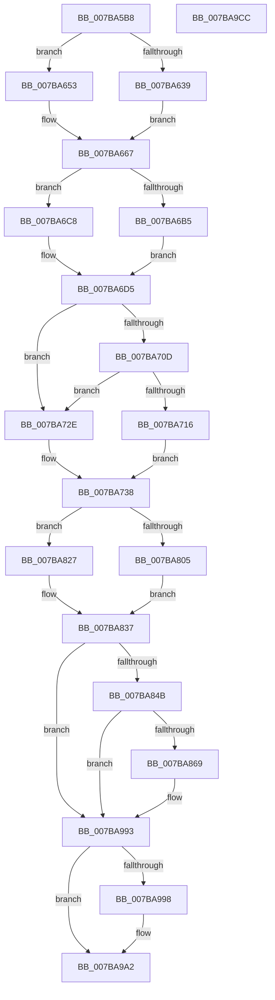

# EtwTimLogBlockNonCetBinaries

- RVA: `0x007BA5B8`–`0x007BA9CD` (길이 `1,045` bytes)
- VA: `0x00000001407BA5B8`
- 실행 섹션: `PAGE`
- PDB 이름 있음: `예`; PDB Function 태그: `아니요`
- unwind 정보 RVA: `0x000D3B2C`
- 디코드: `237`개 명령, `1,045/1,045` bytes 표시
- 미해석 바이트: `0` (있으면 어셈블리에 `.byte`로 보존)

> 이 문서는 커널 이미지의 기계어와 PDB 기호를 분석해 생성했습니다. 4번과 5번은 함수 원형과 자료형을 바이너리 사용 방식에서 추정한 C 해석이며 원본 소스 복구 결과는 아닙니다.

## 1. Dependencies

- 직접 호출 지점: **9**; 고유 호출 대상: **9**
- 직접 호출자로 확인된 함수: **1**
- RIP 상대 이미지 참조: **8**

### Outgoing calls
- `0x007BA682` → [EtwpQueryProcessCommandLine](../8A/EtwpQueryProcessCommandLine_function_008A5C20.md) (function, `0x008A5C20`)
- `0x007BA6F6` → [EtwpTiFillProcessIdentity](../../text/3B/EtwpTiFillProcessIdentity_function_003B8F30.md) (function, `0x003B8F30`)
- `0x007BA7EB` → [Feature_ThreatintDeadlockFix__private_IsEnabledDeviceUsageNoInline](../../text/4F/Feature_ThreatintDeadlockFix__private_IsEnabledDeviceUsageNoInline_function_004F77F4.md) (function, `0x004F77F4`)
- `0x007BA820` → [EtwWriteEx](../../text/25/EtwWriteEx_function_0025F0D0.md) (function, `0x0025F0D0`)
- `0x007BA82F` → [EtwWrite](../../text/41/EtwWrite_function_0041C720.md) (function, `0x0041C720`)
- `0x007BA85C` → [tlgKeywordOn](../../text/42/tlgKeywordOn_function_0042EAA0.md) (function, `0x0042EAA0`)
- `0x007BA98E` → [tlgWriteTransfer_EtwWriteTransfer](../../text/42/tlgWriteTransfer_EtwWriteTransfer_function_004260E0.md) (function, `0x004260E0`)
- `0x007BA99D` → [ExFreePoolWithTag](../../poolcode/B8/ExFreePoolWithTag_function_00B82870.md) (function, `0x00B82870`)
- `0x007BA9AC` → [_security_check_cookie](../../text/6A/_security_check_cookie_function_006AC640.md) (function, `0x006AC640`)

### Direct callers
- [PsBlockNonCetBinaries](../78/PsBlockNonCetBinaries_function_00781140.md) at `0x0078119B`

### Static image references
- `0x007BA5E0` → RVA `0x00E0A740` (`.data`; read)
- `0x007BA5FA` → RVA `0x00002F28` (`.rdata`; read)
- `0x007BA606` → RVA `0x00B076E0` (` ?? ::NNGAKEGL::`string'`; read)
- `0x007BA770` → RVA `0x00020C00` (`.rdata`; read)
- `0x007BA7E0` → RVA `0x00021120` (`.rdata`; read)
- `0x007BA7F0` → RVA `0x00EFF828` (`.data`; read)
- `0x007BA837` → RVA `0x00E09168` (`.data`; read)
- `0x007BA86D` → RVA `0x0005523D` (`.rdata`; read)

## 2. Other-region calls and transfers

- 다른 실행 섹션으로 향하는 call: **8**
  - `0x007BA6F6` → [EtwpTiFillProcessIdentity](../../text/3B/EtwpTiFillProcessIdentity_function_003B8F30.md) (`PAGE` → `.text`)
  - `0x007BA7EB` → [Feature_ThreatintDeadlockFix__private_IsEnabledDeviceUsageNoInline](../../text/4F/Feature_ThreatintDeadlockFix__private_IsEnabledDeviceUsageNoInline_function_004F77F4.md) (`PAGE` → `.text`)
  - `0x007BA820` → [EtwWriteEx](../../text/25/EtwWriteEx_function_0025F0D0.md) (`PAGE` → `.text`)
  - `0x007BA82F` → [EtwWrite](../../text/41/EtwWrite_function_0041C720.md) (`PAGE` → `.text`)
  - `0x007BA85C` → [tlgKeywordOn](../../text/42/tlgKeywordOn_function_0042EAA0.md) (`PAGE` → `.text`)
  - `0x007BA98E` → [tlgWriteTransfer_EtwWriteTransfer](../../text/42/tlgWriteTransfer_EtwWriteTransfer_function_004260E0.md) (`PAGE` → `.text`)
  - `0x007BA99D` → [ExFreePoolWithTag](../../poolcode/B8/ExFreePoolWithTag_function_00B82870.md) (`PAGE` → `POOLCODE`)
  - `0x007BA9AC` → [_security_check_cookie](../../text/6A/_security_check_cookie_function_006AC640.md) (`PAGE` → `.text`)
- 별도 외부 분기/꼬리 이동을 확인하지 못했습니다.

## 3. Assembly (complete function range)

```asm
007BA5B8  48 8B C4                        mov rax, rsp
007BA5BB  48 89 58 08                     mov qword ptr [rax + 8], rbx
007BA5BF  44 89 48 20                     mov dword ptr [rax + 0x20], r9d
007BA5C3  44 89 40 18                     mov dword ptr [rax + 0x18], r8d
007BA5C7  55                              push rbp
007BA5C8  56                              push rsi
007BA5C9  57                              push rdi
007BA5CA  41 54                           push r12
007BA5CC  41 55                           push r13
007BA5CE  41 56                           push r14
007BA5D0  41 57                           push r15
007BA5D2  48 8D A8 58 FE FF FF            lea rbp, [rax - 0x1a8]
007BA5D9  48 81 EC 70 02 00 00            sub rsp, 0x270
007BA5E0  48 8B 05 59 01 65 00            mov rax, qword ptr [rip + 0x650159]
007BA5E7  48 33 C4                        xor rax, rsp
007BA5EA  48 89 85 60 01 00 00            mov qword ptr [rbp + 0x160], rax
007BA5F1  4C 8B F2                        mov r14, rdx
007BA5F4  89 4C 24 4C                     mov dword ptr [rsp + 0x4c], ecx
007BA5F8  33 D2                           xor edx, edx
007BA5FA  48 8D 3D 27 89 84 FF            lea rdi, [rip - 0x7b76d9]
007BA601  48 89 54 24 60                  mov qword ptr [rsp + 0x60], rdx
007BA606  4C 8D 2D D3 D0 34 00            lea r13, [rip + 0x34d0d3]
007BA60D  0F 57 C0                        xorps xmm0, xmm0
007BA610  49 8B 86 50 03 00 00            mov rax, qword ptr [r14 + 0x350]
007BA617  48 85 C0                        test rax, rax
007BA61A  8D 5A 02                        lea ebx, [rdx + 2]
007BA61D  0F 11 44 24 78                  movups xmmword ptr [rsp + 0x78], xmm0
007BA622  48 0F 45 F8                     cmovne rdi, rax
007BA626  8D 4A 06                        lea ecx, [rdx + 6]
007BA629  44 8D 62 0C                     lea r12d, [rdx + 0xc]
007BA62D  0F B7 07                        movzx eax, word ptr [rdi]
007BA630  48 89 5D 78                     mov qword ptr [rbp + 0x78], rbx
007BA634  66 85 C0                        test ax, ax
007BA637  74 1A                           je 0x1407ba653
007BA639  66 D1 E8                        shr ax, 1
007BA63C  66 89 44 24 40                  mov word ptr [rsp + 0x40], ax
007BA641  48 8D 44 24 40                  lea rax, [rsp + 0x40]
007BA646  48 89 45 70                     mov qword ptr [rbp + 0x70], rax
007BA64A  0F B7 07                        movzx eax, word ptr [rdi]
007BA64D  48 8B 4F 08                     mov rcx, qword ptr [rdi + 8]
007BA651  EB 14                           jmp 0x1407ba667
007BA653  48 8D 44 24 40                  lea rax, [rsp + 0x40]
007BA658  66 89 4C 24 40                  mov word ptr [rsp + 0x40], cx
007BA65D  48 89 45 70                     mov qword ptr [rbp + 0x70], rax
007BA661  49 8B CD                        mov rcx, r13
007BA664  41 8B C4                        mov eax, r12d
007BA667  48 89 8D 80 00 00 00            mov qword ptr [rbp + 0x80], rcx
007BA66E  49 8B CE                        mov rcx, r14
007BA671  89 95 8C 00 00 00               mov dword ptr [rbp + 0x8c], edx
007BA677  48 8D 54 24 78                  lea rdx, [rsp + 0x78]
007BA67C  89 85 88 00 00 00               mov dword ptr [rbp + 0x88], eax
007BA682  E8 99 B5 0E 00                  call 0x1408a5c20
007BA687  44 0F B7 7C 24 78               movzx r15d, word ptr [rsp + 0x78]
007BA68D  48 8D 44 24 44                  lea rax, [rsp + 0x44]
007BA692  48 8B 75 80                     mov rsi, qword ptr [rbp - 0x80]
007BA696  45 33 C9                        xor r9d, r9d
007BA699  48 C7 85 98 00 00 00 02 00 00 00  mov qword ptr [rbp + 0x98], 2
007BA6A4  48 89 85 90 00 00 00            mov qword ptr [rbp + 0x90], rax
007BA6AB  45 8D 51 06                     lea r10d, [r9 + 6]
007BA6AF  66 45 85 FF                     test r15w, r15w
007BA6B3  74 13                           je 0x1407ba6c8
007BA6B5  41 0F B7 C7                     movzx eax, r15w
007BA6B9  48 89 B5 A0 00 00 00            mov qword ptr [rbp + 0xa0], rsi
007BA6C0  66 D1 E8                        shr ax, 1
007BA6C3  41 8B CF                        mov ecx, r15d
007BA6C6  EB 0D                           jmp 0x1407ba6d5
007BA6C8  4C 89 AD A0 00 00 00            mov qword ptr [rbp + 0xa0], r13
007BA6CF  41 8B CC                        mov ecx, r12d
007BA6D2  41 8B C2                        mov eax, r10d
007BA6D5  89 8D A8 00 00 00               mov dword ptr [rbp + 0xa8], ecx
007BA6DB  4C 8D 44 24 60                  lea r8, [rsp + 0x60]
007BA6E0  48 8D 8D B0 00 00 00            lea rcx, [rbp + 0xb0]
007BA6E7  66 89 44 24 44                  mov word ptr [rsp + 0x44], ax
007BA6EC  49 8B D6                        mov rdx, r14
007BA6EF  44 89 8D AC 00 00 00            mov dword ptr [rbp + 0xac], r9d
007BA6F6  E8 35 E8 BF FF                  call 0x1403b8f30
007BA6FB  4C 8B B5 D0 01 00 00            mov r14, qword ptr [rbp + 0x1d0]
007BA702  44 8B C0                        mov r8d, eax
007BA705  8D 50 04                        lea edx, [rax + 4]
007BA708  4D 85 F6                        test r14, r14
007BA70B  74 21                           je 0x1407ba72e
007BA70D  41 0F B7 0E                     movzx ecx, word ptr [r14]
007BA711  66 85 C9                        test cx, cx
007BA714  74 18                           je 0x1407ba72e
007BA716  4D 8B 6E 08                     mov r13, qword ptr [r14 + 8]
007BA71A  44 8D 42 01                     lea r8d, [rdx + 1]
007BA71E  0F B7 C1                        movzx eax, cx
007BA721  44 8B E1                        mov r12d, ecx
007BA724  66 D1 E8                        shr ax, 1
007BA727  66 89 44 24 48                  mov word ptr [rsp + 0x48], ax
007BA72C  EB 0A                           jmp 0x1407ba738
007BA72E  66 44 89 54 24 48               mov word ptr [rsp + 0x48], r10w
007BA734  41 83 C0 05                     add r8d, 5
007BA738  8B C2                           mov eax, edx
007BA73A  41 8D 48 01                     lea ecx, [r8 + 1]
007BA73E  48 C1 E0 04                     shl rax, 4
007BA742  4C 8D 74 24 48                  lea r14, [rsp + 0x48]
007BA747  4C 8B D8                        mov r11, rax
007BA74A  41 8B D0                        mov edx, r8d
007BA74D  48 C1 E2 04                     shl rdx, 4
007BA751  4C 8D 45 70                     lea r8, [rbp + 0x70]
007BA755  4C 8D 55 70                     lea r10, [rbp + 0x70]
007BA759  4C 8B CA                        mov r9, rdx
007BA75C  4D 89 34 00                     mov qword ptr [r8 + rax], r14
007BA760  45 33 F6                        xor r14d, r14d
007BA763  89 5C 05 78                     mov dword ptr [rbp + rax + 0x78], ebx
007BA767  45 89 74 00 0C                  mov dword ptr [r8 + rax + 0xc], r14d
007BA76C  4D 89 2C 12                     mov qword ptr [r10 + rdx], r13
007BA770  4C 8D 2D 89 64 86 FF            lea r13, [rip - 0x799b77]
007BA777  44 89 64 15 78                  mov dword ptr [rbp + rdx + 0x78], r12d
007BA77C  44 8D 61 01                     lea r12d, [rcx + 1]
007BA780  45 89 74 12 0C                  mov dword ptr [r10 + rdx + 0xc], r14d
007BA785  48 8D 95 C0 01 00 00            lea rdx, [rbp + 0x1c0]
007BA78C  8B C1                           mov eax, ecx
007BA78E  48 8D 8D C8 01 00 00            lea rcx, [rbp + 0x1c8]
007BA795  48 03 C0                        add rax, rax
007BA798  48 89 54 C5 70                  mov qword ptr [rbp + rax*8 + 0x70], rdx
007BA79D  48 C7 44 C5 78 04 00 00 00      mov qword ptr [rbp + rax*8 + 0x78], 4
007BA7A6  41 8B C4                        mov eax, r12d
007BA7A9  41 FF C4                        inc r12d
007BA7AC  48 03 C0                        add rax, rax
007BA7AF  48 89 4C C5 70                  mov qword ptr [rbp + rax*8 + 0x70], rcx
007BA7B4  48 8D 8D D8 01 00 00            lea rcx, [rbp + 0x1d8]
007BA7BB  48 C7 44 C5 78 04 00 00 00      mov qword ptr [rbp + rax*8 + 0x78], 4
007BA7C4  41 8B C4                        mov eax, r12d
007BA7C7  41 FF C4                        inc r12d
007BA7CA  48 03 C0                        add rax, rax
007BA7CD  83 7C 24 4C 01                  cmp dword ptr [rsp + 0x4c], 1
007BA7D2  48 89 4C C5 70                  mov qword ptr [rbp + rax*8 + 0x70], rcx
007BA7D7  48 C7 44 C5 78 04 00 00 00      mov qword ptr [rbp + rax*8 + 0x78], 4
007BA7E0  48 8D 05 39 69 86 FF            lea rax, [rip - 0x7996c7]
007BA7E7  4C 0F 45 E8                     cmovne r13, rax
007BA7EB  E8 04 D0 D3 FF                  call 0x1404f77f4
007BA7F0  48 8B 0D 31 50 74 00            mov rcx, qword ptr [rip + 0x745031]
007BA7F7  45 33 C0                        xor r8d, r8d
007BA7FA  85 C0                           test eax, eax
007BA7FC  49 8B D5                        mov rdx, r13
007BA7FF  48 8D 45 70                     lea rax, [rbp + 0x70]
007BA803  74 22                           je 0x1407ba827
007BA805  48 89 44 24 38                  mov qword ptr [rsp + 0x38], rax
007BA80A  45 8D 4E 01                     lea r9d, [r14 + 1]
007BA80E  44 89 64 24 30                  mov dword ptr [rsp + 0x30], r12d
007BA813  45 33 E4                        xor r12d, r12d
007BA816  4C 89 64 24 28                  mov qword ptr [rsp + 0x28], r12
007BA81B  4C 89 64 24 20                  mov qword ptr [rsp + 0x20], r12
007BA820  E8 AB 48 AA FF                  call 0x14025f0d0
007BA825  EB 10                           jmp 0x1407ba837
007BA827  45 8B CC                        mov r9d, r12d
007BA82A  48 89 44 24 20                  mov qword ptr [rsp + 0x20], rax
007BA82F  E8 EC 1E C6 FF                  call 0x14041c720
007BA834  45 33 E4                        xor r12d, r12d
007BA837  83 3D 2A E9 64 00 05            cmp dword ptr [rip + 0x64e92a], 5
007BA83E  4C 8B B5 D0 01 00 00            mov r14, qword ptr [rbp + 0x1d0]
007BA845  0F 86 48 01 00 00               jbe 0x1407ba993
007BA84B  48 BA 00 00 00 00 00 40 00 00   movabs rdx, 0x400000000000
007BA855  48 8D 0D 0C E9 64 00            lea rcx, [rip + 0x64e90c]
007BA85C  E8 3F 42 C7 FF                  call 0x14042eaa0
007BA861  84 C0                           test al, al
007BA863  0F 84 2A 01 00 00               je 0x1407ba993
007BA869  8B 44 24 4C                     mov eax, dword ptr [rsp + 0x4c]
007BA86D  48 8D 15 C9 A9 89 FF            lea rdx, [rip - 0x765637]
007BA874  89 44 24 4C                     mov dword ptr [rsp + 0x4c], eax
007BA878  48 8D 0D E9 E8 64 00            lea rcx, [rip + 0x64e8e9]
007BA87F  48 8D 44 24 4C                  lea rax, [rsp + 0x4c]
007BA884  48 C7 45 B8 04 00 00 00         mov qword ptr [rbp - 0x48], 4
007BA88C  48 89 45 B0                     mov qword ptr [rbp - 0x50], rax
007BA890  45 33 C9                        xor r9d, r9d
007BA893  48 8D 45 D8                     lea rax, [rbp - 0x28]
007BA897  48 C7 45 C8 02 00 00 00         mov qword ptr [rbp - 0x38], 2
007BA89F  48 89 45 C0                     mov qword ptr [rbp - 0x40], rax
007BA8A3  45 33 C0                        xor r8d, r8d
007BA8A6  48 8B 47 08                     mov rax, qword ptr [rdi + 8]
007BA8AA  48 89 45 D0                     mov qword ptr [rbp - 0x30], rax
007BA8AE  0F B7 07                        movzx eax, word ptr [rdi]
007BA8B1  89 45 D8                        mov dword ptr [rbp - 0x28], eax
007BA8B4  48 8D 45 F8                     lea rax, [rbp - 8]
007BA8B8  48 89 45 E0                     mov qword ptr [rbp - 0x20], rax
007BA8BC  48 8B 44 24 60                  mov rax, qword ptr [rsp + 0x60]
007BA8C1  48 89 44 24 68                  mov qword ptr [rsp + 0x68], rax
007BA8C6  48 8D 44 24 68                  lea rax, [rsp + 0x68]
007BA8CB  48 89 45 00                     mov qword ptr [rbp], rax
007BA8CF  48 8D 45 28                     lea rax, [rbp + 0x28]
007BA8D3  48 89 45 10                     mov qword ptr [rbp + 0x10], rax
007BA8D7  49 8B 46 08                     mov rax, qword ptr [r14 + 8]
007BA8DB  48 89 45 20                     mov qword ptr [rbp + 0x20], rax
007BA8DF  41 0F B7 06                     movzx eax, word ptr [r14]
007BA8E3  89 45 28                        mov dword ptr [rbp + 0x28], eax
007BA8E6  8B 85 C0 01 00 00               mov eax, dword ptr [rbp + 0x1c0]
007BA8EC  89 44 24 50                     mov dword ptr [rsp + 0x50], eax
007BA8F0  48 8D 44 24 50                  lea rax, [rsp + 0x50]
007BA8F5  48 89 45 30                     mov qword ptr [rbp + 0x30], rax
007BA8F9  8B 85 C8 01 00 00               mov eax, dword ptr [rbp + 0x1c8]
007BA8FF  89 44 24 54                     mov dword ptr [rsp + 0x54], eax
007BA903  48 8D 44 24 54                  lea rax, [rsp + 0x54]
007BA908  48 89 45 40                     mov qword ptr [rbp + 0x40], rax
007BA90C  8B 85 D8 01 00 00               mov eax, dword ptr [rbp + 0x1d8]
007BA912  89 44 24 58                     mov dword ptr [rsp + 0x58], eax
007BA916  48 8D 44 24 58                  lea rax, [rsp + 0x58]
007BA91B  48 89 45 50                     mov qword ptr [rbp + 0x50], rax
007BA91F  48 8D 44 24 70                  lea rax, [rsp + 0x70]
007BA924  48 89 45 60                     mov qword ptr [rbp + 0x60], rax
007BA928  48 8D 45 90                     lea rax, [rbp - 0x70]
007BA92C  48 89 44 24 28                  mov qword ptr [rsp + 0x28], rax
007BA931  C7 44 24 20 0E 00 00 00         mov dword ptr [rsp + 0x20], 0xe
007BA939  44 89 65 DC                     mov dword ptr [rbp - 0x24], r12d
007BA93D  48 C7 45 E8 02 00 00 00         mov qword ptr [rbp - 0x18], 2
007BA945  48 89 75 F0                     mov qword ptr [rbp - 0x10], rsi
007BA949  44 89 7D F8                     mov dword ptr [rbp - 8], r15d
007BA94D  44 89 65 FC                     mov dword ptr [rbp - 4], r12d
007BA951  48 C7 45 08 08 00 00 00         mov qword ptr [rbp + 8], 8
007BA959  48 C7 45 18 02 00 00 00         mov qword ptr [rbp + 0x18], 2
007BA961  44 89 65 2C                     mov dword ptr [rbp + 0x2c], r12d
007BA965  48 C7 45 38 04 00 00 00         mov qword ptr [rbp + 0x38], 4
007BA96D  48 C7 45 48 04 00 00 00         mov qword ptr [rbp + 0x48], 4
007BA975  48 C7 45 58 04 00 00 00         mov qword ptr [rbp + 0x58], 4
007BA97D  48 C7 44 24 70 00 00 00 01      mov qword ptr [rsp + 0x70], 0x1000000
007BA986  48 C7 45 68 08 00 00 00         mov qword ptr [rbp + 0x68], 8
007BA98E  E8 4D B7 C6 FF                  call 0x1404260e0
007BA993  48 85 F6                        test rsi, rsi
007BA996  74 0A                           je 0x1407ba9a2
007BA998  33 D2                           xor edx, edx
007BA99A  48 8B CE                        mov rcx, rsi
007BA99D  E8 CE 7E 3C 00                  call 0x140b82870
007BA9A2  48 8B 8D 60 01 00 00            mov rcx, qword ptr [rbp + 0x160]
007BA9A9  48 33 CC                        xor rcx, rsp
007BA9AC  E8 8F 1C EF FF                  call 0x1406ac640
007BA9B1  48 8B 9C 24 B0 02 00 00         mov rbx, qword ptr [rsp + 0x2b0]
007BA9B9  48 81 C4 70 02 00 00            add rsp, 0x270
007BA9C0  41 5F                           pop r15
007BA9C2  41 5E                           pop r14
007BA9C4  41 5D                           pop r13
007BA9C6  41 5C                           pop r12
007BA9C8  5F                              pop rdi
007BA9C9  5E                              pop rsi
007BA9CA  5D                              pop rbp
007BA9CB  C3                              ret
007BA9CC  CC                              int3
```

## 4. C-style interpretation (structured pseudocode)

```c
__int64 __fastcall EtwTimLogBlockNonCetBinaries(int a1, __int64 a2, int a3, int a4)
{
    __int64 result;
    __int64 v_r12;
    __int64 v_r13;
    __int64 v_r14;
    __int64 v_rdi;
    __int64 v_rsp;
    unsigned __int64 v_stack_m230;
    unsigned __int64 v_stack_m238;
    unsigned __int64 v_stack_m240;
    unsigned __int64 v_stack_m248;
    unsigned int v_stack_m250;
    unsigned int v_stack_m254;
    unsigned int v_stack_m258;
    unsigned int v_stack_m25C;
    unsigned __int16 v_stack_m260;
    unsigned __int64 v_stack_m264;
    unsigned __int16 v_stack_m268;
    unsigned __int64 v_stack_m270;
    unsigned int v_stack_m278;
    unsigned __int64 v_stack_m280;
    unsigned __int64 v_stack_m288;
    unsigned __int64 v_stack_p8;

    *(unsigned __int64 *)(v_rsp + 8) = v_rbx;
    *(unsigned int *)(v_rsp + 32) = a4;
    *(unsigned int *)(v_rsp + 24) = a3;
    v_rsp = (v_rsp) - (624);
    result = (*(unsigned __int64 *)(v_rip + 6619481)) ^ (v_rsp);
    *(unsigned __int64 *)(v_rsp - 424 + 352) = result;
    v_stack_m25C = a1;
    a2 = 0;
    v_stack_m248 = 0;
    v_stack_m230 = v_xmm0;
    v_rdi = v_rip - 8091353;
    if (*(unsigned __int64 *)(a2 + 848) != 0) { v_rdi = *(unsigned __int64 *)(a2 + 848); }
    *(unsigned __int64 *)(v_rsp - 424 + 120) = a2 + 2;
    if ((unsigned __int16)(*(unsigned __int16 *)(v_rdi)) == 0) goto loc_007BA653;
    result = (unsigned __int16)((*(unsigned __int16 *)(v_rdi)) >> (1));
    v_stack_m268 = (unsigned __int16)(result);
    *(unsigned __int64 *)(v_rsp - 424 + 112) = v_stack_m268;
    goto loc_007BA667;
loc_007BA653:
    v_stack_m268 = (unsigned __int16)(*(unsigned __int64 *)(v_rdi + 8));
    *(unsigned __int64 *)(v_rsp - 424 + 112) = v_stack_m268;
loc_007BA667:
    *(unsigned __int64 *)(v_rsp - 424 + 128) = v_rip + 3461331;
    *(unsigned int *)(v_rsp - 424 + 140) = 0;
    *(unsigned int *)(v_rsp - 424 + 136) = (unsigned int)((unsigned int)((unsigned int)(a2 + 12)));
    result = EtwpQueryProcessCommandLine(0, v_stack_m230, a3, a4);
    a4 = 0;
    *(unsigned __int64 *)(v_rsp - 424 + 152) = 2;
    *(unsigned __int64 *)(v_rsp - 424 + 144) = v_stack_m264;
    if ((unsigned __int16)(v_stack_m230) == 0) goto loc_007BA6C8;
    *(unsigned __int64 *)(v_rsp - 424 + 160) = *(unsigned __int64 *)(v_rsp - 424 - 128);
    result = (unsigned __int16)(((unsigned __int16)(v_stack_m230)) >> (1));
    goto loc_007BA6D5;
loc_007BA6C8:
    *(unsigned __int64 *)(v_rsp - 424 + 160) = v_rip + 3461331;
loc_007BA6D5:
    *(unsigned int *)(v_rsp - 424 + 168) = (unsigned int)((unsigned int)((unsigned int)(a2 + 12)));
    v_stack_m264 = (unsigned __int16)((unsigned int)((unsigned int)(a4 + 6)));
    *(unsigned int *)(v_rsp - 424 + 172) = 0;
    result = EtwpTiFillProcessIdentity(v_rsp - 424 + 176, 0, v_stack_m248, a4);
    if (*(unsigned __int64 *)(v_rsp - 424 + 464) == 0) goto loc_007BA72E;
    if ((unsigned __int16)(*(unsigned __int16 *)(*(unsigned __int64 *)(v_rsp - 424 + 464))) == 0) goto loc_007BA72E;
    result = (unsigned __int16)(((unsigned __int16)(*(unsigned __int16 *)(*(unsigned __int64 *)(v_rsp - 424 + 464)))) >> (1));
    v_stack_m260 = (unsigned __int16)(result);
    goto loc_007BA738;
loc_007BA72E:
    v_stack_m260 = (unsigned __int16)(a4 + 6);
    a3 = (unsigned int)((result + 4 + 1) + (5));
loc_007BA738:
    result = ((unsigned int)((unsigned int)(result + 4))) << (4);
    a2 = ((unsigned int)(a3)) << (4);
    *(unsigned __int64 *)(v_rsp - 424 + 112 + result * 1) = v_stack_m260;
    v_r14 = 0;
    *(unsigned int *)(v_rsp - 424 + result * 1 + 120) = (unsigned int)(a2 + 2);
    *(unsigned int *)(v_rsp - 424 + 112 + result * 1 + 12) = 0;
    *(unsigned __int64 *)(v_rsp - 424 + 112 + a2 * 1) = *(unsigned __int64 *)(*(unsigned __int64 *)(v_rsp - 424 + 464) + 8);
    *(unsigned int *)(v_rsp - 424 + a2 * 1 + 120) = (unsigned int)((unsigned int)((unsigned int)(*(unsigned __int16 *)(*(unsigned __int64 *)(v_rsp - 424 + 464)))));
    *(unsigned int *)(v_rsp - 424 + 112 + a2 * 1 + 12) = 0;
    result = ((unsigned int)((unsigned int)(a3 + 1))) + ((unsigned int)((unsigned int)(a3 + 1)));
    *(unsigned __int64 *)(v_rsp - 424 + result * 8 + 112) = v_rsp - 424 + 448;
    *(unsigned __int64 *)(v_rsp - 424 + result * 8 + 120) = 4;
    v_r12 = (unsigned int)((a3 + 1 + 1) + 1);
    result = ((unsigned int)((unsigned int)(a3 + 1 + 1))) + ((unsigned int)((unsigned int)(a3 + 1 + 1)));
    *(unsigned __int64 *)(v_rsp - 424 + result * 8 + 112) = v_rsp - 424 + 456;
    *(unsigned __int64 *)(v_rsp - 424 + result * 8 + 120) = 4;
    v_r12 = (unsigned int)((v_r12) + 1);
    result = ((unsigned int)((unsigned int)(v_r12))) + ((unsigned int)((unsigned int)(v_r12)));
    *(unsigned __int64 *)(v_rsp - 424 + result * 8 + 112) = v_rsp - 424 + 472;
    *(unsigned __int64 *)(v_rsp - 424 + result * 8 + 120) = 4;
    v_r13 = v_rip - 7969655;
    if (v_stack_m25C != 1) { v_r13 = v_rip - 7968455; }
    result = Feature_ThreatintDeadlockFix__private_IsEnabledDeviceUsageNoInline(v_rsp - 424 + 472, v_rsp - 424 + 448, v_rsp - 424 + 112, a2);
    a3 = 0;
    if ((unsigned int)(result) == 0) goto loc_007BA827;
    v_stack_m270 = v_rsp - 424 + 112;
    v_stack_m278 = (unsigned int)(v_r12);
    v_r12 = 0;
    v_stack_m280 = 0;
    v_stack_m288 = 0;
    result = EtwWriteEx(*(unsigned __int64 *)(v_rip + 7622705), v_r13, a3, v_r14 + 1);
    goto loc_007BA837;
loc_007BA827:
    v_stack_m288 = result;
    result = EtwWrite(*(unsigned __int64 *)(v_rip + 7622705), v_r13, a3, 0);
    v_r12 = 0;
loc_007BA837:
    if ((*(unsigned int *)(v_rip + 6613290)) <= 5) goto loc_007BA993;
    result = tlgKeywordOn(v_rip + 6613260, v_r13, a3, 0);
    if ((unsigned __int8)(result) != 0) {
        result = v_stack_m25C;
        a2 = v_rip - 7755319;
        v_stack_m25C = (unsigned int)(result);
        a1 = v_rip + 6613225;
        result = v_stack_m25C;
        *(unsigned __int64 *)(v_rsp - 424 - 72) = 4;
        *(unsigned __int64 *)(v_rsp - 424 - 80) = result;
        a4 = 0;
        result = v_rsp - 424 - 40;
        *(unsigned __int64 *)(v_rsp - 424 - 56) = 2;
        *(unsigned __int64 *)(v_rsp - 424 - 64) = result;
        a3 = 0;
        result = *(unsigned __int64 *)(v_rdi + 8);
        *(unsigned __int64 *)(v_rsp - 424 - 48) = result;
        result = *(unsigned __int16 *)(v_rdi);
        *(unsigned int *)(v_rsp - 424 - 40) = (unsigned int)(result);
        result = v_rsp - 424 - 8;
        *(unsigned __int64 *)(v_rsp - 424 - 32) = result;
        result = v_stack_m248;
        v_stack_m240 = result;
        result = v_stack_m240;
        *(unsigned __int64 *)(v_rsp - 424) = result;
        result = v_rsp - 424 + 40;
        *(unsigned __int64 *)(v_rsp - 424 + 16) = result;
        result = *(unsigned __int64 *)(*(unsigned __int64 *)(v_rsp - 424 + 464) + 8);
        *(unsigned __int64 *)(v_rsp - 424 + 32) = result;
        result = *(unsigned __int16 *)(*(unsigned __int64 *)(v_rsp - 424 + 464));
        *(unsigned int *)(v_rsp - 424 + 40) = (unsigned int)(result);
        result = *(unsigned int *)(v_rsp - 424 + 448);
        v_stack_m258 = (unsigned int)(result);
        result = v_stack_m258;
        *(unsigned __int64 *)(v_rsp - 424 + 48) = result;
        result = *(unsigned int *)(v_rsp - 424 + 456);
        v_stack_m254 = (unsigned int)(result);
        result = v_stack_m254;
        *(unsigned __int64 *)(v_rsp - 424 + 64) = result;
        result = *(unsigned int *)(v_rsp - 424 + 472);
        v_stack_m250 = (unsigned int)(result);
        result = v_stack_m250;
        *(unsigned __int64 *)(v_rsp - 424 + 80) = result;
        result = v_stack_m238;
        *(unsigned __int64 *)(v_rsp - 424 + 96) = result;
        result = v_rsp - 424 - 112;
        v_stack_m280 = result;
        v_stack_m288 = 14;
        *(unsigned int *)(v_rsp - 424 - 36) = 0;
        *(unsigned __int64 *)(v_rsp - 424 - 24) = 2;
        *(unsigned __int64 *)(v_rsp - 424 - 16) = *(unsigned __int64 *)(v_rsp - 424 - 128);
        *(unsigned int *)(v_rsp - 424 - 8) = (unsigned int)(v_stack_m230);
        *(unsigned int *)(v_rsp - 424 - 4) = 0;
        *(unsigned __int64 *)(v_rsp - 424 + 8) = 8;
        *(unsigned __int64 *)(v_rsp - 424 + 24) = 2;
        *(unsigned int *)(v_rsp - 424 + 44) = 0;
        *(unsigned __int64 *)(v_rsp - 424 + 56) = 4;
        *(unsigned __int64 *)(v_rsp - 424 + 72) = 4;
        *(unsigned __int64 *)(v_rsp - 424 + 88) = 4;
        v_stack_m238 = 0x1000000ULL;
        *(unsigned __int64 *)(v_rsp - 424 + 104) = 8;
        result = tlgWriteTransfer_EtwWriteTransfer(a1, a2, a3, a4);
    }
    if (*(unsigned __int64 *)(v_rsp - 424 - 128) != 0) {
        a2 = 0;
        a1 = *(unsigned __int64 *)(v_rsp - 424 - 128);
        result = ExFreePoolWithTag(a1, a2, a3, a4);
    }
    a1 = (*(unsigned __int64 *)(v_rsp - 424 + 352)) ^ (v_rsp);
    result = _security_check_cookie(a1, a2, a3, a4);
    v_rsp = (v_rsp) + (624);
    return result;
}
```

## 5. (Beta) C Style

```c
int64_t EtwTimLogBlockNonCetBinaries(int32_t Arg1, void *Arg2, int32_t Arg3, int32_t Arg4)
{
    uint8_t *arg2 = (uint8_t *)Arg2;

    int64_t result;
    int64_t local_r12;
    int64_t local_r13;
    int64_t local_r14;
    int64_t local_rdi;
    int64_t local_rsp;
    uint64_t v_stack_m230;
    uint64_t v_stack_m238;
    uint64_t v_stack_m240;
    uint64_t v_stack_m248;
    uint32_t v_stack_m250;
    uint32_t v_stack_m254;
    uint32_t v_stack_m258;
    uint32_t v_stack_m25C;
    uint16_t v_stack_m260;
    uint64_t v_stack_m264;
    uint16_t v_stack_m268;
    uint64_t v_stack_m270;
    uint32_t v_stack_m278;
    uint64_t v_stack_m280;
    uint64_t v_stack_m288;
    uint64_t v_stack_p8;

    *(uint64_t *)(local_rsp + 0x8) = local_rbx;
    *(uint32_t *)(local_rsp + 0x20) = Arg4;
    *(uint32_t *)(local_rsp + 0x18) = Arg3;
    local_rsp = (local_rsp) - (624);
    result = (*(uint64_t *)(v_rip + 0x650159)) ^ (local_rsp);
    *(uint64_t *)(local_rsp - 0x1A8 + 0x160) = result;
    v_stack_m25C = Arg1;
    Arg2 = 0;
    v_stack_m248 = 0;
    v_stack_m230 = v_xmm0;
    local_rdi = v_rip - 8091353;
    if (*(uint64_t *)(arg2 + 0x350) != 0) { local_rdi = *(uint64_t *)(arg2 + 0x350); }
    *(void **)(local_rsp - 0x1A8 + 0x78) = Arg2 + 2;
    if ((uint16_t)(*(uint16_t *)(local_rdi)) == 0) goto loc_007BA653;
    result = (uint16_t)((*(uint16_t *)(local_rdi)) >> (1));
    v_stack_m268 = (uint16_t)(result);
    *(uint64_t *)(local_rsp - 0x1A8 + 0x70) = v_stack_m268;
    goto loc_007BA667;
loc_007BA653:
    v_stack_m268 = (uint16_t)(*(uint64_t *)(local_rdi + 0x8));
    *(uint64_t *)(local_rsp - 0x1A8 + 0x70) = v_stack_m268;
loc_007BA667:
    *(uint64_t *)(local_rsp - 0x1A8 + 0x80) = v_rip + 3461331;
    *(uint32_t *)(local_rsp - 0x1A8 + 0x8C) = 0;
    *(uint32_t *)(local_rsp - 0x1A8 + 0x88) = (uint32_t)((uint32_t)((uint32_t)(Arg2 + 12)));
    result = EtwpQueryProcessCommandLine(0, v_stack_m230, Arg3, Arg4);
    Arg4 = 0;
    *(uint64_t *)(local_rsp - 0x1A8 + 0x98) = 2;
    *(uint64_t *)(local_rsp - 0x1A8 + 0x90) = v_stack_m264;
    if ((uint16_t)(v_stack_m230) == 0) goto loc_007BA6C8;
    *(uint64_t *)(local_rsp - 0x1A8 + 0xA0) = *(uint64_t *)(local_rsp - 0x1A8 - 0x80);
    result = (uint16_t)(((uint16_t)(v_stack_m230)) >> (1));
    goto loc_007BA6D5;
loc_007BA6C8:
    *(uint64_t *)(local_rsp - 0x1A8 + 0xA0) = v_rip + 3461331;
loc_007BA6D5:
    *(uint32_t *)(local_rsp - 0x1A8 + 0xA8) = (uint32_t)((uint32_t)((uint32_t)(Arg2 + 12)));
    v_stack_m264 = (uint16_t)((uint32_t)((uint32_t)(Arg4 + 6)));
    *(uint32_t *)(local_rsp - 0x1A8 + 0xAC) = 0;
    result = EtwpTiFillProcessIdentity(local_rsp - 424 + 176, 0, v_stack_m248, Arg4);
    if (*(uint64_t *)(local_rsp - 0x1A8 + 0x1D0) == 0) goto loc_007BA72E;
    if ((uint16_t)(*(uint16_t *)(*(uint64_t *)(local_rsp - 0x1A8 + 0x1D0))) == 0) goto loc_007BA72E;
    result = (uint16_t)(((uint16_t)(*(uint16_t *)(*(uint64_t *)(local_rsp - 0x1A8 + 0x1D0)))) >> (1));
    v_stack_m260 = (uint16_t)(result);
    goto loc_007BA738;
loc_007BA72E:
    v_stack_m260 = (uint16_t)(Arg4 + 6);
    Arg3 = (uint32_t)((result + 4 + 1) + (5));
loc_007BA738:
    result = ((uint32_t)((uint32_t)(result + 4))) << (4);
    Arg2 = ((uint32_t)(Arg3)) << (4);
    *(uint64_t *)(local_rsp - 0x1A8 + 0x70 + result * 1) = v_stack_m260;
    local_r14 = 0;
    *(uint32_t *)(local_rsp - 0x1A8 + result * 1 + 0x78) = (uint32_t)(Arg2 + 2);
    *(uint32_t *)(local_rsp - 0x1A8 + 0x70 + result * 1 + 0xC) = 0;
    *(uint64_t *)(local_rsp - 0x1A8 + 0x70 + arg2 * 1) = *(uint64_t *)(*(uint64_t *)(local_rsp - 0x1A8 + 0x1D0) + 0x8);
    *(uint32_t *)(local_rsp - 0x1A8 + arg2 * 1 + 0x78) = (uint32_t)((uint32_t)((uint32_t)(*(uint16_t *)(*(uint64_t *)(local_rsp - 0x1A8 + 0x1D0)))));
    *(uint32_t *)(local_rsp - 0x1A8 + 0x70 + arg2 * 1 + 0xC) = 0;
    result = ((uint32_t)((uint32_t)(Arg3 + 1))) + ((uint32_t)((uint32_t)(Arg3 + 1)));
    *(uint64_t *)(local_rsp - 0x1A8 + result * 8 + 0x70) = local_rsp - 424 + 448;
    *(uint64_t *)(local_rsp - 0x1A8 + result * 8 + 0x78) = 4;
    local_r12 = (uint32_t)((Arg3 + 1 + 1) + 1);
    result = ((uint32_t)((uint32_t)(Arg3 + 1 + 1))) + ((uint32_t)((uint32_t)(Arg3 + 1 + 1)));
    *(uint64_t *)(local_rsp - 0x1A8 + result * 8 + 0x70) = local_rsp - 424 + 456;
    *(uint64_t *)(local_rsp - 0x1A8 + result * 8 + 0x78) = 4;
    local_r12 = (uint32_t)((local_r12) + 1);
    result = ((uint32_t)((uint32_t)(local_r12))) + ((uint32_t)((uint32_t)(local_r12)));
    *(uint64_t *)(local_rsp - 0x1A8 + result * 8 + 0x70) = local_rsp - 424 + 472;
    *(uint64_t *)(local_rsp - 0x1A8 + result * 8 + 0x78) = 4;
    local_r13 = v_rip - 7969655;
    if (v_stack_m25C != 1) { local_r13 = v_rip - 7968455; }
    result = Feature_ThreatintDeadlockFix__private_IsEnabledDeviceUsageNoInline(local_rsp - 424 + 472, local_rsp - 424 + 448, local_rsp - 424 + 112, Arg2);
    Arg3 = 0;
    if ((uint32_t)(result) == 0) goto loc_007BA827;
    v_stack_m270 = local_rsp - 424 + 112;
    v_stack_m278 = (uint32_t)(local_r12);
    local_r12 = 0;
    v_stack_m280 = 0;
    v_stack_m288 = 0;
    result = EtwWriteEx(*(uint64_t *)(v_rip + 0x745031), local_r13, Arg3, local_r14 + 1);
    goto loc_007BA837;
loc_007BA827:
    v_stack_m288 = result;
    result = EtwWrite(*(uint64_t *)(v_rip + 0x745031), local_r13, Arg3, 0);
    local_r12 = 0;
loc_007BA837:
    if ((*(uint32_t *)(v_rip + 0x64E92A)) <= 5) goto loc_007BA993;
    result = tlgKeywordOn(v_rip + 6613260, local_r13, Arg3, 0);
    if ((uint8_t)(result) != 0) {
        result = v_stack_m25C;
        Arg2 = v_rip - 7755319;
        v_stack_m25C = (uint32_t)(result);
        Arg1 = v_rip + 6613225;
        result = v_stack_m25C;
        *(uint64_t *)(local_rsp - 0x1A8 - 0x48) = 4;
        *(uint64_t *)(local_rsp - 0x1A8 - 0x50) = result;
        Arg4 = 0;
        result = local_rsp - 424 - 40;
        *(uint64_t *)(local_rsp - 0x1A8 - 0x38) = 2;
        *(uint64_t *)(local_rsp - 0x1A8 - 0x40) = result;
        Arg3 = 0;
        result = *(uint64_t *)(local_rdi + 0x8);
        *(uint64_t *)(local_rsp - 0x1A8 - 0x30) = result;
        result = *(uint16_t *)(local_rdi);
        *(uint32_t *)(local_rsp - 0x1A8 - 0x28) = (uint32_t)(result);
        result = local_rsp - 424 - 8;
        *(uint64_t *)(local_rsp - 0x1A8 - 0x20) = result;
        result = v_stack_m248;
        v_stack_m240 = result;
        result = v_stack_m240;
        *(uint64_t *)(local_rsp - 0x1A8) = result;
        result = local_rsp - 424 + 40;
        *(uint64_t *)(local_rsp - 0x1A8 + 0x10) = result;
        result = *(uint64_t *)(*(uint64_t *)(local_rsp - 0x1A8 + 0x1D0) + 0x8);
        *(uint64_t *)(local_rsp - 0x1A8 + 0x20) = result;
        result = *(uint16_t *)(*(uint64_t *)(local_rsp - 0x1A8 + 0x1D0));
        *(uint32_t *)(local_rsp - 0x1A8 + 0x28) = (uint32_t)(result);
        result = *(uint32_t *)(local_rsp - 0x1A8 + 0x1C0);
        v_stack_m258 = (uint32_t)(result);
        result = v_stack_m258;
        *(uint64_t *)(local_rsp - 0x1A8 + 0x30) = result;
        result = *(uint32_t *)(local_rsp - 0x1A8 + 0x1C8);
        v_stack_m254 = (uint32_t)(result);
        result = v_stack_m254;
        *(uint64_t *)(local_rsp - 0x1A8 + 0x40) = result;
        result = *(uint32_t *)(local_rsp - 0x1A8 + 0x1D8);
        v_stack_m250 = (uint32_t)(result);
        result = v_stack_m250;
        *(uint64_t *)(local_rsp - 0x1A8 + 0x50) = result;
        result = v_stack_m238;
        *(uint64_t *)(local_rsp - 0x1A8 + 0x60) = result;
        result = local_rsp - 424 - 112;
        v_stack_m280 = result;
        v_stack_m288 = 14;
        *(uint32_t *)(local_rsp - 0x1A8 - 0x24) = 0;
        *(uint64_t *)(local_rsp - 0x1A8 - 0x18) = 2;
        *(uint64_t *)(local_rsp - 0x1A8 - 0x10) = *(uint64_t *)(local_rsp - 0x1A8 - 0x80);
        *(uint32_t *)(local_rsp - 0x1A8 - 0x8) = (uint32_t)(v_stack_m230);
        *(uint32_t *)(local_rsp - 0x1A8 - 0x4) = 0;
        *(uint64_t *)(local_rsp - 0x1A8 + 0x8) = 8;
        *(uint64_t *)(local_rsp - 0x1A8 + 0x18) = 2;
        *(uint32_t *)(local_rsp - 0x1A8 + 0x2C) = 0;
        *(uint64_t *)(local_rsp - 0x1A8 + 0x38) = 4;
        *(uint64_t *)(local_rsp - 0x1A8 + 0x48) = 4;
        *(uint64_t *)(local_rsp - 0x1A8 + 0x58) = 4;
        v_stack_m238 = 0x1000000ULL;
        *(uint64_t *)(local_rsp - 0x1A8 + 0x68) = 8;
        result = tlgWriteTransfer_EtwWriteTransfer(Arg1, Arg2, Arg3, Arg4);
    }
    if (*(uint64_t *)(local_rsp - 0x1A8 - 0x80) != 0) {
        Arg2 = 0;
        Arg1 = *(uint64_t *)(local_rsp - 0x1A8 - 0x80);
        result = ExFreePoolWithTag(Arg1, Arg2, Arg3, Arg4);
    }
    Arg1 = (*(uint64_t *)(local_rsp - 0x1A8 + 0x160)) ^ (local_rsp);
    result = _security_check_cookie(Arg1, Arg2, Arg3, Arg4);
    local_rsp = (local_rsp) + (624);
    return result;
}
```

### 관측된 메모리 오프셋

구조체 형식이 확인되지 않은 접근은 인자 기준의 오프셋으로만 기록했습니다.

| 기준 인자 | 오프셋 표현 | 폭 (bit) | 접근 |
|---|---:|---:|---|
| `Arg2` | `+ 0x350` | `64` | `R` |

## 6. Execution-region graph

[열기: 2D/3D 그래프와 함수 탐색 컨트롤 패널](../../../control-panel.html?section=page&rva=0x007BA5B8&view=graph)

- 2D 그래프는 위에서 아래로 흐르고, 3D 그래프는 빈 공간을 드래그해 회전합니다. Shift+드래그는 이동, 휠은 확대·축소, 함수 노드 선택은 대상 보고서 이동입니다.

### Static fallback


