# EtwTimLogControlProtectionUserModeReturnMismatch

- RVA: `0x007BA9D4`–`0x007BB1EE` (길이 `2,074` bytes)
- VA: `0x00000001407BA9D4`
- 실행 섹션: `PAGE`
- PDB 이름 있음: `예`; PDB Function 태그: `아니요`
- unwind 정보 RVA: `0x000D3B7C`
- 디코드: `447`개 명령, `2,074/2,074` bytes 표시
- 미해석 바이트: `0` (있으면 어셈블리에 `.byte`로 보존)

> 이 문서는 커널 이미지의 기계어와 PDB 기호를 분석해 생성했습니다. 4번과 5번은 함수 원형과 자료형을 바이너리 사용 방식에서 추정한 C 해석이며 원본 소스 복구 결과는 아닙니다.

## 1. Dependencies

- 직접 호출 지점: **15**; 고유 호출 대상: **10**
- 직접 호출자로 확인된 함수: **1**
- RIP 상대 이미지 참조: **8**

### Outgoing calls
- `0x007BAB35` → [EtwpQueryProcessCommandLine](../8A/EtwpQueryProcessCommandLine_function_008A5C20.md) (function, `0x008A5C20`)
- `0x007BABB2` → [EtwpTiFillProcessIdentity](../../text/3B/EtwpTiFillProcessIdentity_function_003B8F30.md) (function, `0x003B8F30`)
- `0x007BABCE` → [ExAllocatePool2](../../poolcode/B8/ExAllocatePool2_function_00B820F0.md) (function, `0x00B820F0`)
- `0x007BABFB` → [ZwQueryVirtualMemory](../../text/6A/ZwQueryVirtualMemory_function_006AD530.md) (function, `0x006AD530`)
- `0x007BACB7` → [ExAllocatePool2](../../poolcode/B8/ExAllocatePool2_function_00B820F0.md) (function, `0x00B820F0`)
- `0x007BACE4` → [ZwQueryVirtualMemory](../../text/6A/ZwQueryVirtualMemory_function_006AD530.md) (function, `0x006AD530`)
- `0x007BADFC` → [MmGetImageInformation](../8D/MmGetImageInformation_function_008D9C68.md) (function, `0x008D9C68`)
- `0x007BAE8B` → [MmGetImageInformation](../8D/MmGetImageInformation_function_008D9C68.md) (function, `0x008D9C68`)
- `0x007BAF21` → [EtwWrite](../../text/41/EtwWrite_function_0041C720.md) (function, `0x0041C720`)
- `0x007BAF73` → [tlgKeywordOn](../../text/42/tlgKeywordOn_function_0042EAA0.md) (function, `0x0042EAA0`)
- `0x007BB18B` → [tlgWriteTransfer_EtwWriteTransfer](../../text/42/tlgWriteTransfer_EtwWriteTransfer_function_004260E0.md) (function, `0x004260E0`)
- `0x007BB1A0` → [ExFreePoolWithTag](../../poolcode/B8/ExFreePoolWithTag_function_00B82870.md) (function, `0x00B82870`)
- `0x007BB1AF` → [ExFreePoolWithTag](../../poolcode/B8/ExFreePoolWithTag_function_00B82870.md) (function, `0x00B82870`)
- `0x007BB1BE` → [ExFreePoolWithTag](../../poolcode/B8/ExFreePoolWithTag_function_00B82870.md) (function, `0x00B82870`)
- `0x007BB1CD` → [_security_check_cookie](../../text/6A/_security_check_cookie_function_006AC640.md) (function, `0x006AC640`)

### Direct callers
- [KiLogControlProtectionUserModeReturnMismatch](../../text/44/KiLogControlProtectionUserModeReturnMismatch_function_00444AD0.md) at `0x00444B1F`

### Static image references
- `0x007BA9F3` → RVA `0x00E0A740` (`.data`; read)
- `0x007BAA8D` → RVA `0x000232E8` (`.rdata`; read)
- `0x007BAAA5` → RVA `0x000228D0` (`.rdata`; read)
- `0x007BAAB3` → RVA `0x00002F28` (`.rdata`; read)
- `0x007BAABD` → RVA `0x00B076E0` (` ?? ::NNGAKEGL::`string'`; read)
- `0x007BAF02` → RVA `0x00EFF828` (`.data`; read)
- `0x007BAF55` → RVA `0x00E09168` (`.data`; read)
- `0x007BB153` → RVA `0x00054E4A` (`.rdata`; read)

## 2. Other-region calls and transfers

- 다른 실행 섹션으로 향하는 call: **12**
  - `0x007BABB2` → [EtwpTiFillProcessIdentity](../../text/3B/EtwpTiFillProcessIdentity_function_003B8F30.md) (`PAGE` → `.text`)
  - `0x007BABCE` → [ExAllocatePool2](../../poolcode/B8/ExAllocatePool2_function_00B820F0.md) (`PAGE` → `POOLCODE`)
  - `0x007BABFB` → [ZwQueryVirtualMemory](../../text/6A/ZwQueryVirtualMemory_function_006AD530.md) (`PAGE` → `.text`)
  - `0x007BACB7` → [ExAllocatePool2](../../poolcode/B8/ExAllocatePool2_function_00B820F0.md) (`PAGE` → `POOLCODE`)
  - `0x007BACE4` → [ZwQueryVirtualMemory](../../text/6A/ZwQueryVirtualMemory_function_006AD530.md) (`PAGE` → `.text`)
  - `0x007BAF21` → [EtwWrite](../../text/41/EtwWrite_function_0041C720.md) (`PAGE` → `.text`)
  - `0x007BAF73` → [tlgKeywordOn](../../text/42/tlgKeywordOn_function_0042EAA0.md) (`PAGE` → `.text`)
  - `0x007BB18B` → [tlgWriteTransfer_EtwWriteTransfer](../../text/42/tlgWriteTransfer_EtwWriteTransfer_function_004260E0.md) (`PAGE` → `.text`)
  - `0x007BB1A0` → [ExFreePoolWithTag](../../poolcode/B8/ExFreePoolWithTag_function_00B82870.md) (`PAGE` → `POOLCODE`)
  - `0x007BB1AF` → [ExFreePoolWithTag](../../poolcode/B8/ExFreePoolWithTag_function_00B82870.md) (`PAGE` → `POOLCODE`)
  - `0x007BB1BE` → [ExFreePoolWithTag](../../poolcode/B8/ExFreePoolWithTag_function_00B82870.md) (`PAGE` → `POOLCODE`)
  - `0x007BB1CD` → [_security_check_cookie](../../text/6A/_security_check_cookie_function_006AC640.md) (`PAGE` → `.text`)
- 별도 외부 분기/꼬리 이동을 확인하지 못했습니다.

## 3. Assembly (complete function range)

```asm
007BA9D4  48 89 5C 24 08                  mov qword ptr [rsp + 8], rbx
007BA9D9  55                              push rbp
007BA9DA  56                              push rsi
007BA9DB  57                              push rdi
007BA9DC  41 54                           push r12
007BA9DE  41 55                           push r13
007BA9E0  41 56                           push r14
007BA9E2  41 57                           push r15
007BA9E4  48 8D AC 24 50 FD FF FF         lea rbp, [rsp - 0x2b0]
007BA9EC  48 81 EC B0 03 00 00            sub rsp, 0x3b0
007BA9F3  48 8B 05 46 FD 64 00            mov rax, qword ptr [rip + 0x64fd46]
007BA9FA  48 33 C4                        xor rax, rsp
007BA9FD  48 89 85 A0 02 00 00            mov qword ptr [rbp + 0x2a0], rax
007BAA04  41 8B 00                        mov eax, dword ptr [r8]
007BAA07  45 33 F6                        xor r14d, r14d
007BAA0A  C1 E8 14                        shr eax, 0x14
007BAA0D  0F 57 C0                        xorps xmm0, xmm0
007BAA10  83 E0 01                        and eax, 1
007BAA13  89 4C 24 4C                     mov dword ptr [rsp + 0x4c], ecx
007BAA17  89 44 24 60                     mov dword ptr [rsp + 0x60], eax
007BAA1B  48 8B FA                        mov rdi, rdx
007BAA1E  41 8B 40 04                     mov eax, dword ptr [r8 + 4]
007BAA22  89 44 24 64                     mov dword ptr [rsp + 0x64], eax
007BAA26  49 8B 40 08                     mov rax, qword ptr [r8 + 8]
007BAA2A  48 89 44 24 70                  mov qword ptr [rsp + 0x70], rax
007BAA2F  49 8B 40 10                     mov rax, qword ptr [r8 + 0x10]
007BAA33  48 89 44 24 78                  mov qword ptr [rsp + 0x78], rax
007BAA38  41 8B 40 18                     mov eax, dword ptr [r8 + 0x18]
007BAA3C  89 44 24 68                     mov dword ptr [rsp + 0x68], eax
007BAA40  41 8B 40 1C                     mov eax, dword ptr [r8 + 0x1c]
007BAA44  89 44 24 6C                     mov dword ptr [rsp + 0x6c], eax
007BAA48  66 44 89 74 24 40               mov word ptr [rsp + 0x40], r14w
007BAA4E  66 44 89 74 24 34               mov word ptr [rsp + 0x34], r14w
007BAA54  4C 89 75 88                     mov qword ptr [rbp - 0x78], r14
007BAA58  4C 89 74 24 58                  mov qword ptr [rsp + 0x58], r14
007BAA5D  66 44 89 74 24 30               mov word ptr [rsp + 0x30], r14w
007BAA63  66 44 89 74 24 38               mov word ptr [rsp + 0x38], r14w
007BAA69  4C 89 75 90                     mov qword ptr [rbp - 0x70], r14
007BAA6D  4C 89 75 98                     mov qword ptr [rbp - 0x68], r14
007BAA71  0F 11 45 C8                     movups xmmword ptr [rbp - 0x38], xmm0
007BAA75  83 E9 01                        sub ecx, 1
007BAA78  74 26                           je 0x1407baaa0
007BAA7A  83 E9 01                        sub ecx, 1
007BAA7D  74 17                           je 0x1407baa96
007BAA7F  83 F9 01                        cmp ecx, 1
007BAA82  0F 85 3B 07 00 00               jne 0x1407bb1c3
007BAA88  83 4C 24 48 FF                  or dword ptr [rsp + 0x48], 0xffffffff
007BAA8D  4C 8D 3D 54 88 86 FF            lea r15, [rip - 0x7977ac]
007BAA94  EB 16                           jmp 0x1407baaac
007BAA96  C7 44 24 48 01 00 00 00         mov dword ptr [rsp + 0x48], 1
007BAA9E  EB 05                           jmp 0x1407baaa5
007BAAA0  44 89 74 24 48                  mov dword ptr [rsp + 0x48], r14d
007BAAA5  4C 8D 3D 24 7E 86 FF            lea r15, [rip - 0x7981dc]
007BAAAC  48 8B 82 50 03 00 00            mov rax, qword ptr [rdx + 0x350]
007BAAB3  4C 8D 25 6E 84 84 FF            lea r12, [rip - 0x7b7b92]
007BAABA  48 85 C0                        test rax, rax
007BAABD  4C 8D 2D 1C CC 34 00            lea r13, [rip + 0x34cc1c]
007BAAC4  B9 06 00 00 00                  mov ecx, 6
007BAAC9  4C 0F 45 E0                     cmovne r12, rax
007BAACD  8D 71 FC                        lea esi, [rcx - 4]
007BAAD0  41 0F B7 04 24                  movzx eax, word ptr [r12]
007BAAD5  8D 59 06                        lea ebx, [rcx + 6]
007BAAD8  48 89 B5 38 01 00 00            mov qword ptr [rbp + 0x138], rsi
007BAADF  66 85 C0                        test ax, ax
007BAAE2  74 20                           je 0x1407bab04
007BAAE4  66 D1 E8                        shr ax, 1
007BAAE7  66 89 44 24 30                  mov word ptr [rsp + 0x30], ax
007BAAEC  48 8D 44 24 30                  lea rax, [rsp + 0x30]
007BAAF1  48 89 85 30 01 00 00            mov qword ptr [rbp + 0x130], rax
007BAAF8  41 0F B7 04 24                  movzx eax, word ptr [r12]
007BAAFD  49 8B 4C 24 08                  mov rcx, qword ptr [r12 + 8]
007BAB02  EB 16                           jmp 0x1407bab1a
007BAB04  48 8D 44 24 30                  lea rax, [rsp + 0x30]
007BAB09  66 89 4C 24 30                  mov word ptr [rsp + 0x30], cx
007BAB0E  48 89 85 30 01 00 00            mov qword ptr [rbp + 0x130], rax
007BAB15  49 8B CD                        mov rcx, r13
007BAB18  8B C3                           mov eax, ebx
007BAB1A  48 89 8D 40 01 00 00            mov qword ptr [rbp + 0x140], rcx
007BAB21  48 8D 55 C8                     lea rdx, [rbp - 0x38]
007BAB25  48 8B CF                        mov rcx, rdi
007BAB28  89 85 48 01 00 00               mov dword ptr [rbp + 0x148], eax
007BAB2E  44 89 B5 4C 01 00 00            mov dword ptr [rbp + 0x14c], r14d
007BAB35  E8 E6 B0 0E 00                  call 0x1408a5c20
007BAB3A  0F B7 55 C8                     movzx edx, word ptr [rbp - 0x38]
007BAB3E  48 8B 45 D0                     mov rax, qword ptr [rbp - 0x30]
007BAB42  48 89 45 80                     mov qword ptr [rbp - 0x80], rax
007BAB46  66 89 54 24 44                  mov word ptr [rsp + 0x44], dx
007BAB4B  48 C7 85 58 01 00 00 02 00 00 00  mov qword ptr [rbp + 0x158], 2
007BAB56  66 85 D2                        test dx, dx
007BAB59  74 1D                           je 0x1407bab78
007BAB5B  48 8D 4C 24 40                  lea rcx, [rsp + 0x40]
007BAB60  48 89 85 60 01 00 00            mov qword ptr [rbp + 0x160], rax
007BAB67  0F B7 C2                        movzx eax, dx
007BAB6A  48 89 8D 50 01 00 00            mov qword ptr [rbp + 0x150], rcx
007BAB71  8B CA                           mov ecx, edx
007BAB73  66 D1 E8                        shr ax, 1
007BAB76  EB 1A                           jmp 0x1407bab92
007BAB78  48 8D 44 24 40                  lea rax, [rsp + 0x40]
007BAB7D  4C 89 AD 60 01 00 00            mov qword ptr [rbp + 0x160], r13
007BAB84  48 89 85 50 01 00 00            mov qword ptr [rbp + 0x150], rax
007BAB8B  8B CB                           mov ecx, ebx
007BAB8D  B8 06 00 00 00                  mov eax, 6
007BAB92  89 8D 68 01 00 00               mov dword ptr [rbp + 0x168], ecx
007BAB98  4C 8D 45 98                     lea r8, [rbp - 0x68]
007BAB9C  48 8D 8D 70 01 00 00            lea rcx, [rbp + 0x170]
007BABA3  66 89 44 24 40                  mov word ptr [rsp + 0x40], ax
007BABA8  48 8B D7                        mov rdx, rdi
007BABAB  44 89 B5 6C 01 00 00            mov dword ptr [rbp + 0x16c], r14d
007BABB2  E8 79 E3 BF FF                  call 0x1403b8f30
007BABB7  BA 00 02 00 00                  mov edx, 0x200
007BABBC  89 44 24 3C                     mov dword ptr [rsp + 0x3c], eax
007BABC0  B9 00 01 00 00                  mov ecx, 0x100
007BABC5  41 B8 54 49 73 6E               mov r8d, 0x6e734954
007BABCB  8D 78 04                        lea edi, [rax + 4]
007BABCE  E8 1D 75 3C 00                  call 0x140b820f0
007BABD3  45 33 DB                        xor r11d, r11d
007BABD6  4C 8B F0                        mov r14, rax
007BABD9  48 85 C0                        test rax, rax
007BABDC  74 69                           je 0x1407bac47
007BABDE  48 8B 54 24 70                  mov rdx, qword ptr [rsp + 0x70]
007BABE3  4C 8B C8                        mov r9, rax
007BABE6  4C 89 5C 24 28                  mov qword ptr [rsp + 0x28], r11
007BABEB  44 8B C6                        mov r8d, esi
007BABEE  48 83 C9 FF                     or rcx, 0xffffffffffffffff
007BABF2  48 C7 44 24 20 00 02 00 00      mov qword ptr [rsp + 0x20], 0x200
007BABFB  E8 30 29 EF FF                  call 0x1406ad530
007BAC00  45 33 DB                        xor r11d, r11d
007BAC03  85 C0                           test eax, eax
007BAC05  79 04                           jns 0x1407bac0b
007BAC07  66 45 89 1E                     mov word ptr [r14], r11w
007BAC0B  41 0F B7 06                     movzx eax, word ptr [r14]
007BAC0F  66 85 C0                        test ax, ax
007BAC12  74 33                           je 0x1407bac47
007BAC14  66 D1 E8                        shr ax, 1
007BAC17  48 8D 4C 24 34                  lea rcx, [rsp + 0x34]
007BAC1C  66 89 44 24 34                  mov word ptr [rsp + 0x34], ax
007BAC21  8B C7                           mov eax, edi
007BAC23  48 03 C0                        add rax, rax
007BAC26  48 89 8C C5 30 01 00 00         mov qword ptr [rbp + rax*8 + 0x130], rcx
007BAC2E  8D 4F 01                        lea ecx, [rdi + 1]
007BAC31  48 C7 84 C5 38 01 00 00 02 00 00 00  mov qword ptr [rbp + rax*8 + 0x138], 2
007BAC3D  45 0F B7 0E                     movzx r9d, word ptr [r14]
007BAC41  4D 8B 56 08                     mov r10, qword ptr [r14 + 8]
007BAC45  EB 35                           jmp 0x1407bac7c
007BAC47  B8 06 00 00 00                  mov eax, 6
007BAC4C  48 8D 4C 24 34                  lea rcx, [rsp + 0x34]
007BAC51  66 89 44 24 34                  mov word ptr [rsp + 0x34], ax
007BAC56  44 8B CB                        mov r9d, ebx
007BAC59  8B C7                           mov eax, edi
007BAC5B  4D 8B D5                        mov r10, r13
007BAC5E  48 03 C0                        add rax, rax
007BAC61  48 89 8C C5 30 01 00 00         mov qword ptr [rbp + rax*8 + 0x130], rcx
007BAC69  8B 4C 24 3C                     mov ecx, dword ptr [rsp + 0x3c]
007BAC6D  83 C1 05                        add ecx, 5
007BAC70  48 C7 84 C5 38 01 00 00 02 00 00 00  mov qword ptr [rbp + rax*8 + 0x138], 2
007BAC7C  89 4C 24 3C                     mov dword ptr [rsp + 0x3c], ecx
007BAC80  4C 8D 85 30 01 00 00            lea r8, [rbp + 0x130]
007BAC87  8B C1                           mov eax, ecx
007BAC89  48 C1 E0 04                     shl rax, 4
007BAC8D  FF C1                           inc ecx
007BAC8F  48 8B D0                        mov rdx, rax
007BAC92  89 4C 24 50                     mov dword ptr [rsp + 0x50], ecx
007BAC96  BA 00 02 00 00                  mov edx, 0x200
007BAC9B  B9 00 01 00 00                  mov ecx, 0x100
007BACA0  4E 89 14 00                     mov qword ptr [rax + r8], r10
007BACA4  44 89 8C 05 38 01 00 00         mov dword ptr [rbp + rax + 0x138], r9d
007BACAC  46 89 5C 00 0C                  mov dword ptr [rax + r8 + 0xc], r11d
007BACB1  41 B8 54 49 73 6E               mov r8d, 0x6e734954
007BACB7  E8 34 74 3C 00                  call 0x140b820f0
007BACBC  45 33 C0                        xor r8d, r8d
007BACBF  48 8B F8                        mov rdi, rax
007BACC2  48 85 C0                        test rax, rax
007BACC5  74 6A                           je 0x1407bad31
007BACC7  48 8B 54 24 78                  mov rdx, qword ptr [rsp + 0x78]
007BACCC  4C 8B C8                        mov r9, rax
007BACCF  4C 89 44 24 28                  mov qword ptr [rsp + 0x28], r8
007BACD4  48 83 C9 FF                     or rcx, 0xffffffffffffffff
007BACD8  44 8B C6                        mov r8d, esi
007BACDB  48 C7 44 24 20 00 02 00 00      mov qword ptr [rsp + 0x20], 0x200
007BACE4  E8 47 28 EF FF                  call 0x1406ad530
007BACE9  45 33 C0                        xor r8d, r8d
007BACEC  85 C0                           test eax, eax
007BACEE  79 04                           jns 0x1407bacf4
007BACF0  66 44 89 07                     mov word ptr [rdi], r8w
007BACF4  0F B7 07                        movzx eax, word ptr [rdi]
007BACF7  66 85 C0                        test ax, ax
007BACFA  74 35                           je 0x1407bad31
007BACFC  8B 4C 24 50                     mov ecx, dword ptr [rsp + 0x50]
007BAD00  48 8D 54 24 38                  lea rdx, [rsp + 0x38]
007BAD05  66 D1 E8                        shr ax, 1
007BAD08  66 89 44 24 38                  mov word ptr [rsp + 0x38], ax
007BAD0D  8B C1                           mov eax, ecx
007BAD0F  48 03 C0                        add rax, rax
007BAD12  FF C1                           inc ecx
007BAD14  48 89 94 C5 30 01 00 00         mov qword ptr [rbp + rax*8 + 0x130], rdx
007BAD1C  48 C7 84 C5 38 01 00 00 02 00 00 00  mov qword ptr [rbp + rax*8 + 0x138], 2
007BAD28  0F B7 1F                        movzx ebx, word ptr [rdi]
007BAD2B  4C 8B 6F 08                     mov r13, qword ptr [rdi + 8]
007BAD2F  EB 31                           jmp 0x1407bad62
007BAD31  B8 06 00 00 00                  mov eax, 6
007BAD36  48 8D 4C 24 38                  lea rcx, [rsp + 0x38]
007BAD3B  66 89 44 24 38                  mov word ptr [rsp + 0x38], ax
007BAD40  8B 44 24 50                     mov eax, dword ptr [rsp + 0x50]
007BAD44  48 03 C0                        add rax, rax
007BAD47  48 89 8C C5 30 01 00 00         mov qword ptr [rbp + rax*8 + 0x130], rcx
007BAD4F  8B 4C 24 3C                     mov ecx, dword ptr [rsp + 0x3c]
007BAD53  83 C1 02                        add ecx, 2
007BAD56  48 C7 84 C5 38 01 00 00 02 00 00 00  mov qword ptr [rbp + rax*8 + 0x138], 2
007BAD62  8B C1                           mov eax, ecx
007BAD64  4C 8D 85 30 01 00 00            lea r8, [rbp + 0x130]
007BAD6B  48 C1 E0 04                     shl rax, 4
007BAD6F  4C 8D 4C 24 3C                  lea r9, [rsp + 0x3c]
007BAD74  48 8B D0                        mov rdx, rax
007BAD77  FF C1                           inc ecx
007BAD79  48 8D 54 24 60                  lea rdx, [rsp + 0x60]
007BAD7E  4D 89 2C 00                     mov qword ptr [r8 + rax], r13
007BAD82  45 33 ED                        xor r13d, r13d
007BAD85  89 9C 05 38 01 00 00            mov dword ptr [rbp + rax + 0x138], ebx
007BAD8C  8D 59 01                        lea ebx, [rcx + 1]
007BAD8F  45 89 6C 00 0C                  mov dword ptr [r8 + rax + 0xc], r13d
007BAD94  4C 8D 44 24 50                  lea r8, [rsp + 0x50]
007BAD99  8B C1                           mov eax, ecx
007BAD9B  48 8D 4C 24 64                  lea rcx, [rsp + 0x64]
007BADA0  48 03 C0                        add rax, rax
007BADA3  48 89 94 C5 30 01 00 00         mov qword ptr [rbp + rax*8 + 0x130], rdx
007BADAB  48 8D 54 24 58                  lea rdx, [rsp + 0x58]
007BADB0  48 C7 84 C5 38 01 00 00 04 00 00 00  mov qword ptr [rbp + rax*8 + 0x138], 4
007BADBC  8B C3                           mov eax, ebx
007BADBE  FF C3                           inc ebx
007BADC0  48 03 C0                        add rax, rax
007BADC3  48 89 8C C5 30 01 00 00         mov qword ptr [rbp + rax*8 + 0x130], rcx
007BADCB  48 8D 4C 24 48                  lea rcx, [rsp + 0x48]
007BADD0  48 C7 84 C5 38 01 00 00 04 00 00 00  mov qword ptr [rbp + rax*8 + 0x138], 4
007BADDC  8B C3                           mov eax, ebx
007BADDE  FF C3                           inc ebx
007BADE0  48 03 C0                        add rax, rax
007BADE3  48 89 8C C5 30 01 00 00         mov qword ptr [rbp + rax*8 + 0x130], rcx
007BADEB  48 8B 4C 24 70                  mov rcx, qword ptr [rsp + 0x70]
007BADF0  48 C7 84 C5 38 01 00 00 04 00 00 00  mov qword ptr [rbp + rax*8 + 0x138], 4
007BADFC  E8 67 EE 11 00                  call 0x1408d9c68
007BAE01  85 C0                           test eax, eax
007BAE03  78 0C                           js 0x1407bae11
007BAE05  48 8B 44 24 70                  mov rax, qword ptr [rsp + 0x70]
007BAE0A  48 2B 44 24 58                  sub rax, qword ptr [rsp + 0x58]
007BAE0F  EB 03                           jmp 0x1407bae14
007BAE11  49 8B C5                        mov rax, r13
007BAE14  48 89 45 88                     mov qword ptr [rbp - 0x78], rax
007BAE18  48 8D 4C 24 70                  lea rcx, [rsp + 0x70]
007BAE1D  8B C3                           mov eax, ebx
007BAE1F  4C 8D 4C 24 3C                  lea r9, [rsp + 0x3c]
007BAE24  48 03 C0                        add rax, rax
007BAE27  4C 8D 44 24 50                  lea r8, [rsp + 0x50]
007BAE2C  FF C3                           inc ebx
007BAE2E  48 8D 54 24 58                  lea rdx, [rsp + 0x58]
007BAE33  48 89 8C C5 30 01 00 00         mov qword ptr [rbp + rax*8 + 0x130], rcx
007BAE3B  48 8D 4D 88                     lea rcx, [rbp - 0x78]
007BAE3F  48 C7 84 C5 38 01 00 00 08 00 00 00  mov qword ptr [rbp + rax*8 + 0x138], 8
007BAE4B  8B C3                           mov eax, ebx
007BAE4D  FF C3                           inc ebx
007BAE4F  48 03 C0                        add rax, rax
007BAE52  48 89 8C C5 30 01 00 00         mov qword ptr [rbp + rax*8 + 0x130], rcx
007BAE5A  48 8D 4C 24 68                  lea rcx, [rsp + 0x68]
007BAE5F  48 C7 84 C5 38 01 00 00 08 00 00 00  mov qword ptr [rbp + rax*8 + 0x138], 8
007BAE6B  8B C3                           mov eax, ebx
007BAE6D  FF C3                           inc ebx
007BAE6F  48 03 C0                        add rax, rax
007BAE72  48 89 8C C5 30 01 00 00         mov qword ptr [rbp + rax*8 + 0x130], rcx
007BAE7A  48 8B 4C 24 78                  mov rcx, qword ptr [rsp + 0x78]
007BAE7F  48 C7 84 C5 38 01 00 00 04 00 00 00  mov qword ptr [rbp + rax*8 + 0x138], 4
007BAE8B  E8 D8 ED 11 00                  call 0x1408d9c68
007BAE90  85 C0                           test eax, eax
007BAE92  78 0C                           js 0x1407baea0
007BAE94  48 8B 44 24 78                  mov rax, qword ptr [rsp + 0x78]
007BAE99  48 2B 44 24 58                  sub rax, qword ptr [rsp + 0x58]
007BAE9E  EB 03                           jmp 0x1407baea3
007BAEA0  49 8B C5                        mov rax, r13
007BAEA3  48 89 45 90                     mov qword ptr [rbp - 0x70], rax
007BAEA7  48 8D 4C 24 78                  lea rcx, [rsp + 0x78]
007BAEAC  8B C3                           mov eax, ebx
007BAEAE  45 33 C0                        xor r8d, r8d
007BAEB1  48 03 C0                        add rax, rax
007BAEB4  FF C3                           inc ebx
007BAEB6  49 8B D7                        mov rdx, r15
007BAEB9  48 89 8C C5 30 01 00 00         mov qword ptr [rbp + rax*8 + 0x130], rcx
007BAEC1  48 8D 4D 90                     lea rcx, [rbp - 0x70]
007BAEC5  48 C7 84 C5 38 01 00 00 08 00 00 00  mov qword ptr [rbp + rax*8 + 0x138], 8
007BAED1  8B C3                           mov eax, ebx
007BAED3  FF C3                           inc ebx
007BAED5  48 03 C0                        add rax, rax
007BAED8  44 8D 4B 01                     lea r9d, [rbx + 1]
007BAEDC  48 89 8C C5 30 01 00 00         mov qword ptr [rbp + rax*8 + 0x130], rcx
007BAEE4  48 8D 4C 24 6C                  lea rcx, [rsp + 0x6c]
007BAEE9  48 C7 84 C5 38 01 00 00 08 00 00 00  mov qword ptr [rbp + rax*8 + 0x138], 8
007BAEF5  8B C3                           mov eax, ebx
007BAEF7  48 03 C0                        add rax, rax
007BAEFA  48 89 8C C5 30 01 00 00         mov qword ptr [rbp + rax*8 + 0x130], rcx
007BAF02  48 8B 0D 1F 49 74 00            mov rcx, qword ptr [rip + 0x74491f]
007BAF09  48 C7 84 C5 38 01 00 00 04 00 00 00  mov qword ptr [rbp + rax*8 + 0x138], 4
007BAF15  48 8D 85 30 01 00 00            lea rax, [rbp + 0x130]
007BAF1C  48 89 44 24 20                  mov qword ptr [rsp + 0x20], rax
007BAF21  E8 FA 17 C6 FF                  call 0x14041c720
007BAF26  4D 85 F6                        test r14, r14
007BAF29  74 12                           je 0x1407baf3d
007BAF2B  66 45 39 2E                     cmp word ptr [r14], r13w
007BAF2F  74 0C                           je 0x1407baf3d
007BAF31  4D 8B CE                        mov r9, r14
007BAF34  4C 8D 05 ED 7F 84 FF            lea r8, [rip - 0x7b8013]
007BAF3B  EB 0A                           jmp 0x1407baf47
007BAF3D  4C 8D 05 E4 7F 84 FF            lea r8, [rip - 0x7b801c]
007BAF44  4D 8B C8                        mov r9, r8
007BAF47  48 85 FF                        test rdi, rdi
007BAF4A  74 09                           je 0x1407baf55
007BAF4C  66 44 39 2F                     cmp word ptr [rdi], r13w
007BAF50  74 03                           je 0x1407baf55
007BAF52  4C 8B C7                        mov r8, rdi
007BAF55  83 3D 0C E2 64 00 05            cmp dword ptr [rip + 0x64e20c], 5
007BAF5C  0F 86 30 02 00 00               jbe 0x1407bb192
007BAF62  48 BA 00 00 00 00 00 40 00 00   movabs rdx, 0x400000000000
007BAF6C  48 8D 0D F5 E1 64 00            lea rcx, [rip + 0x64e1f5]
007BAF73  E8 28 3B C7 FF                  call 0x14042eaa0
007BAF78  84 C0                           test al, al
007BAF7A  0F 84 12 02 00 00               je 0x1407bb192
007BAF80  8B 44 24 4C                     mov eax, dword ptr [rsp + 0x4c]
007BAF84  48 8B 5D 80                     mov rbx, qword ptr [rbp - 0x80]
007BAF88  89 44 24 4C                     mov dword ptr [rsp + 0x4c], eax
007BAF8C  48 8D 44 24 4C                  lea rax, [rsp + 0x4c]
007BAF91  48 89 45 00                     mov qword ptr [rbp], rax
007BAF95  48 8D 45 28                     lea rax, [rbp + 0x28]
007BAF99  48 89 45 10                     mov qword ptr [rbp + 0x10], rax
007BAF9D  49 8B 44 24 08                  mov rax, qword ptr [r12 + 8]
007BAFA2  48 89 45 20                     mov qword ptr [rbp + 0x20], rax
007BAFA6  41 0F B7 04 24                  movzx eax, word ptr [r12]
007BAFAB  89 45 28                        mov dword ptr [rbp + 0x28], eax
007BAFAE  48 8D 45 48                     lea rax, [rbp + 0x48]
007BAFB2  48 89 45 30                     mov qword ptr [rbp + 0x30], rax
007BAFB6  0F B7 44 24 44                  movzx eax, word ptr [rsp + 0x44]
007BAFBB  89 45 48                        mov dword ptr [rbp + 0x48], eax
007BAFBE  48 8B 45 98                     mov rax, qword ptr [rbp - 0x68]
007BAFC2  48 89 45 80                     mov qword ptr [rbp - 0x80], rax
007BAFC6  48 8D 45 80                     lea rax, [rbp - 0x80]
007BAFCA  48 89 45 50                     mov qword ptr [rbp + 0x50], rax
007BAFCE  48 8D 45 78                     lea rax, [rbp + 0x78]
007BAFD2  48 89 45 60                     mov qword ptr [rbp + 0x60], rax
007BAFD6  49 8B 41 08                     mov rax, qword ptr [r9 + 8]
007BAFDA  48 89 45 70                     mov qword ptr [rbp + 0x70], rax
007BAFDE  41 0F B7 01                     movzx eax, word ptr [r9]
007BAFE2  89 45 78                        mov dword ptr [rbp + 0x78], eax
007BAFE5  48 8D 85 98 00 00 00            lea rax, [rbp + 0x98]
007BAFEC  48 89 85 80 00 00 00            mov qword ptr [rbp + 0x80], rax
007BAFF3  49 8B 40 08                     mov rax, qword ptr [r8 + 8]
007BAFF7  48 89 85 90 00 00 00            mov qword ptr [rbp + 0x90], rax
007BAFFE  41 0F B7 00                     movzx eax, word ptr [r8]
007BB002  89 85 98 00 00 00               mov dword ptr [rbp + 0x98], eax
007BB008  8B 44 24 60                     mov eax, dword ptr [rsp + 0x60]
007BB00C  89 44 24 3C                     mov dword ptr [rsp + 0x3c], eax
007BB010  48 8D 44 24 3C                  lea rax, [rsp + 0x3c]
007BB015  48 89 85 A0 00 00 00            mov qword ptr [rbp + 0xa0], rax
007BB01C  8B 44 24 64                     mov eax, dword ptr [rsp + 0x64]
007BB020  89 44 24 50                     mov dword ptr [rsp + 0x50], eax
007BB024  48 8D 44 24 50                  lea rax, [rsp + 0x50]
007BB029  48 89 85 B0 00 00 00            mov qword ptr [rbp + 0xb0], rax
007BB030  48 8B 44 24 70                  mov rax, qword ptr [rsp + 0x70]
007BB035  48 89 45 A0                     mov qword ptr [rbp - 0x60], rax
007BB039  48 8D 45 A0                     lea rax, [rbp - 0x60]
007BB03D  48 89 85 C0 00 00 00            mov qword ptr [rbp + 0xc0], rax
007BB044  48 8B 45 88                     mov rax, qword ptr [rbp - 0x78]
007BB048  48 89 45 A8                     mov qword ptr [rbp - 0x58], rax
007BB04C  48 8D 45 A8                     lea rax, [rbp - 0x58]
007BB050  48 89 85 D0 00 00 00            mov qword ptr [rbp + 0xd0], rax
007BB057  8B 44 24 68                     mov eax, dword ptr [rsp + 0x68]
007BB05B  89 44 24 44                     mov dword ptr [rsp + 0x44], eax
007BB05F  48 8D 44 24 44                  lea rax, [rsp + 0x44]
007BB064  48 89 85 E0 00 00 00            mov qword ptr [rbp + 0xe0], rax
007BB06B  48 8B 44 24 78                  mov rax, qword ptr [rsp + 0x78]
007BB070  48 89 45 B0                     mov qword ptr [rbp - 0x50], rax
007BB074  48 8D 45 B0                     lea rax, [rbp - 0x50]
007BB078  48 89 85 F0 00 00 00            mov qword ptr [rbp + 0xf0], rax
007BB07F  48 8B 45 90                     mov rax, qword ptr [rbp - 0x70]
007BB083  48 89 45 B8                     mov qword ptr [rbp - 0x48], rax
007BB087  48 8D 45 B8                     lea rax, [rbp - 0x48]
007BB08B  48 89 85 00 01 00 00            mov qword ptr [rbp + 0x100], rax
007BB092  8B 44 24 6C                     mov eax, dword ptr [rsp + 0x6c]
007BB096  89 44 24 58                     mov dword ptr [rsp + 0x58], eax
007BB09A  48 8D 44 24 58                  lea rax, [rsp + 0x58]
007BB09F  48 89 85 10 01 00 00            mov qword ptr [rbp + 0x110], rax
007BB0A6  48 C7 45 08 04 00 00 00         mov qword ptr [rbp + 8], 4
007BB0AE  48 C7 45 18 02 00 00 00         mov qword ptr [rbp + 0x18], 2
007BB0B6  44 89 6D 2C                     mov dword ptr [rbp + 0x2c], r13d
007BB0BA  48 C7 45 38 02 00 00 00         mov qword ptr [rbp + 0x38], 2
007BB0C2  48 89 5D 40                     mov qword ptr [rbp + 0x40], rbx
007BB0C6  44 89 6D 4C                     mov dword ptr [rbp + 0x4c], r13d
007BB0CA  48 C7 45 58 08 00 00 00         mov qword ptr [rbp + 0x58], 8
007BB0D2  48 C7 45 68 02 00 00 00         mov qword ptr [rbp + 0x68], 2
007BB0DA  44 89 6D 7C                     mov dword ptr [rbp + 0x7c], r13d
007BB0DE  48 C7 85 88 00 00 00 02 00 00 00  mov qword ptr [rbp + 0x88], 2
007BB0E9  44 89 AD 9C 00 00 00            mov dword ptr [rbp + 0x9c], r13d
007BB0F0  48 C7 85 A8 00 00 00 04 00 00 00  mov qword ptr [rbp + 0xa8], 4
007BB0FB  48 C7 85 B8 00 00 00 04 00 00 00  mov qword ptr [rbp + 0xb8], 4
007BB106  48 C7 85 C8 00 00 00 08 00 00 00  mov qword ptr [rbp + 0xc8], 8
007BB111  48 C7 85 D8 00 00 00 08 00 00 00  mov qword ptr [rbp + 0xd8], 8
007BB11C  48 C7 85 E8 00 00 00 04 00 00 00  mov qword ptr [rbp + 0xe8], 4
007BB127  48 C7 85 F8 00 00 00 08 00 00 00  mov qword ptr [rbp + 0xf8], 8
007BB132  48 C7 85 08 01 00 00 08 00 00 00  mov qword ptr [rbp + 0x108], 8
007BB13D  48 8D 45 C0                     lea rax, [rbp - 0x40]
007BB141  48 C7 85 18 01 00 00 04 00 00 00  mov qword ptr [rbp + 0x118], 4
007BB14C  48 89 85 20 01 00 00            mov qword ptr [rbp + 0x120], rax
007BB153  48 8D 15 F0 9C 89 FF            lea rdx, [rip - 0x766310]
007BB15A  48 8D 45 E0                     lea rax, [rbp - 0x20]
007BB15E  48 C7 45 C0 00 00 00 01         mov qword ptr [rbp - 0x40], 0x1000000
007BB166  48 89 44 24 28                  mov qword ptr [rsp + 0x28], rax
007BB16B  48 8D 0D F6 DF 64 00            lea rcx, [rip + 0x64dff6]
007BB172  45 33 C9                        xor r9d, r9d
007BB175  C7 44 24 20 15 00 00 00         mov dword ptr [rsp + 0x20], 0x15
007BB17D  45 33 C0                        xor r8d, r8d
007BB180  48 C7 85 28 01 00 00 08 00 00 00  mov qword ptr [rbp + 0x128], 8
007BB18B  E8 50 AF C6 FF                  call 0x1404260e0
007BB190  EB 04                           jmp 0x1407bb196
007BB192  48 8B 5D 80                     mov rbx, qword ptr [rbp - 0x80]
007BB196  48 85 DB                        test rbx, rbx
007BB199  74 0A                           je 0x1407bb1a5
007BB19B  33 D2                           xor edx, edx
007BB19D  48 8B CB                        mov rcx, rbx
007BB1A0  E8 CB 76 3C 00                  call 0x140b82870
007BB1A5  4D 85 F6                        test r14, r14
007BB1A8  74 0A                           je 0x1407bb1b4
007BB1AA  33 D2                           xor edx, edx
007BB1AC  49 8B CE                        mov rcx, r14
007BB1AF  E8 BC 76 3C 00                  call 0x140b82870
007BB1B4  48 85 FF                        test rdi, rdi
007BB1B7  74 0A                           je 0x1407bb1c3
007BB1B9  33 D2                           xor edx, edx
007BB1BB  48 8B CF                        mov rcx, rdi
007BB1BE  E8 AD 76 3C 00                  call 0x140b82870
007BB1C3  48 8B 8D A0 02 00 00            mov rcx, qword ptr [rbp + 0x2a0]
007BB1CA  48 33 CC                        xor rcx, rsp
007BB1CD  E8 6E 14 EF FF                  call 0x1406ac640
007BB1D2  48 8B 9C 24 F0 03 00 00         mov rbx, qword ptr [rsp + 0x3f0]
007BB1DA  48 81 C4 B0 03 00 00            add rsp, 0x3b0
007BB1E1  41 5F                           pop r15
007BB1E3  41 5E                           pop r14
007BB1E5  41 5D                           pop r13
007BB1E7  41 5C                           pop r12
007BB1E9  5F                              pop rdi
007BB1EA  5E                              pop rsi
007BB1EB  5D                              pop rbp
007BB1EC  C3                              ret
007BB1ED  CC                              int3
```

## 4. C-style interpretation (structured pseudocode)

```c
__int64 __fastcall EtwTimLogControlProtectionUserModeReturnMismatch(int a1, __int64 a2, __int64 a3)
{
    __int64 result;
    __int64 v_r11;
    __int64 v_r12;
    __int64 v_r13;
    __int64 v_r14;
    __int64 v_rbx;
    __int64 v_rsp;
    unsigned __int64 v_stack_m178;
    unsigned int v_stack_m17C;
    unsigned int v_stack_m180;
    unsigned __int64 v_stack_m188;
    unsigned __int64 v_stack_m190;
    unsigned __int64 v_stack_m198;
    unsigned int v_stack_m19C;
    unsigned int v_stack_m1A0;
    unsigned __int64 v_stack_m1A8;
    unsigned __int64 v_stack_m1B0;
    unsigned __int64 v_stack_m1B8;
    unsigned __int64 v_stack_m1C0;
    unsigned __int64 v_stack_m1C8;
    unsigned __int64 v_stack_m1D0;
    unsigned __int64 v_stack_m1D8;
    unsigned __int64 v_stack_m1E0;
    unsigned __int64 v_stack_m1E8;
    unsigned __int64 v_stack_m1F0;
    unsigned __int64 v_stack_m1F8;
    unsigned __int64 v_stack_m200;
    unsigned __int64 v_stack_m208;
    unsigned __int64 v_stack_m210;
    unsigned __int64 v_stack_m218;
    unsigned __int64 v_stack_m220;
    unsigned __int64 v_stack_m228;
    unsigned __int64 v_stack_m230;
    unsigned __int64 v_stack_m238;
    unsigned __int64 v_stack_m240;
    unsigned __int64 v_stack_m248;
    unsigned int v_stack_m24C;
    unsigned __int64 v_stack_m250;
    unsigned __int64 v_stack_m258;
    unsigned __int64 v_stack_m260;
    unsigned __int64 v_stack_m268;
    unsigned int v_stack_m26C;
    unsigned __int64 v_stack_m270;
    unsigned __int64 v_stack_m278;
    unsigned __int64 v_stack_m280;
    unsigned __int64 v_stack_m288;
    unsigned __int64 v_stack_m290;
    unsigned __int64 v_stack_m298;
    unsigned int v_stack_m29C;
    unsigned __int64 v_stack_m2A0;
    unsigned __int64 v_stack_m2A8;
    unsigned __int64 v_stack_m2B0;
    unsigned __int64 v_stack_m2B8;
    unsigned int v_stack_m2BC;
    unsigned __int64 v_stack_m2C0;
    unsigned __int64 v_stack_m2C8;
    unsigned __int64 v_stack_m2D0;
    unsigned __int64 v_stack_m2D8;
    unsigned __int64 v_stack_m2E0;
    unsigned __int64 v_stack_m2E8;
    unsigned __int64 v_stack_m308;
    unsigned __int64 v_stack_m318;
    unsigned __int64 v_stack_m320;
    unsigned __int64 v_stack_m328;
    unsigned __int64 v_stack_m330;
    unsigned __int64 v_stack_m338;
    unsigned __int64 v_stack_m340;
    unsigned __int64 v_stack_m348;
    unsigned __int64 v_stack_m350;
    unsigned __int64 v_stack_m358;
    unsigned __int64 v_stack_m360;
    unsigned __int64 v_stack_m368;
    unsigned __int64 v_stack_m370;
    unsigned __int64 v_stack_m378;
    unsigned int v_stack_m37C;
    unsigned int v_stack_m380;
    unsigned int v_stack_m384;
    unsigned int v_stack_m388;
    unsigned __int64 v_stack_m390;
    unsigned int v_stack_m398;
    unsigned int v_stack_m39C;
    unsigned int v_stack_m3A0;
    unsigned __int16 v_stack_m3A4;
    unsigned __int16 v_stack_m3A8;
    unsigned int v_stack_m3AC;
    unsigned __int16 v_stack_m3B0;
    unsigned __int16 v_stack_m3B4;
    unsigned __int16 v_stack_m3B8;
    unsigned __int64 v_stack_m3C0;
    unsigned __int64 v_stack_m3C8;
    unsigned __int64 v_stack_m48;
    unsigned __int64 v_stack_p8;

    v_stack_p8 = v_rbx;
    v_rsp = (v_rsp) - (944);
    result = (*(unsigned __int64 *)(v_rip + 6618438)) ^ (v_rsp);
    v_stack_m48 = result;
    v_r14 = 0;
    result = (unsigned int)(((unsigned int)(*(unsigned int *)(a3))) >> (20));
    result = (unsigned int)((result) & (1));
    v_stack_m39C = a1;
    v_stack_m388 = (unsigned int)(result);
    v_stack_m384 = (unsigned int)((unsigned int)(*(unsigned int *)(a3 + 4)));
    v_stack_m378 = *(unsigned __int64 *)(a3 + 8);
    v_stack_m370 = *(unsigned __int64 *)(a3 + 16);
    v_stack_m380 = (unsigned int)((unsigned int)(*(unsigned int *)(a3 + 24)));
    v_stack_m37C = (unsigned int)((unsigned int)(*(unsigned int *)(a3 + 28)));
    v_stack_m3A8 = 0;
    v_stack_m3B4 = 0;
    v_stack_m360 = 0;
    v_stack_m390 = 0;
    v_stack_m3B8 = 0;
    v_stack_m3B0 = 0;
    v_stack_m358 = 0;
    v_stack_m350 = 0;
    v_stack_m320 = v_xmm0;
    a1 = (unsigned int)((a1) - (1));
    if (condition_is_equal) goto loc_007BAAA0;
    a1 = (unsigned int)((a1) - (1));
    if (condition_is_equal) goto loc_007BAA96;
    if (a1 != 1) goto loc_007BB1C3;
    goto loc_007BAAAC;
loc_007BAA96:
    v_stack_m3A0 = 1;
    goto loc_007BAAA5;
loc_007BAAA0:
    v_stack_m3A0 = 0;
loc_007BAAA5:
loc_007BAAAC:
    v_r12 = v_rip - 8092562;
    if (*(unsigned __int64 *)(a2 + 848) != 0) { v_r12 = *(unsigned __int64 *)(a2 + 848); }
    v_stack_m1B0 = 6 - 4;
    if ((unsigned __int16)(*(unsigned __int16 *)(v_r12)) == 0) goto loc_007BAB04;
    result = (unsigned __int16)((*(unsigned __int16 *)(v_r12)) >> (1));
    v_stack_m3B8 = (unsigned __int16)(result);
    v_stack_m1B8 = v_stack_m3B8;
    goto loc_007BAB1A;
loc_007BAB04:
    v_stack_m3B8 = (unsigned __int16)(*(unsigned __int64 *)(v_r12 + 8));
    v_stack_m1B8 = v_stack_m3B8;
loc_007BAB1A:
    v_stack_m1A8 = v_rip + 3460124;
    v_stack_m1A0 = (unsigned int)((unsigned int)((unsigned int)(6 + 6)));
    v_stack_m19C = 0;
    result = EtwpQueryProcessCommandLine(a2, v_stack_m320, a3, a4);
    v_stack_m368 = v_stack_m318;
    v_stack_m3A4 = (unsigned __int16)(v_stack_m320);
    v_stack_m190 = 2;
    if ((unsigned __int16)(v_stack_m320) == 0) goto loc_007BAB78;
    v_stack_m188 = v_stack_m318;
    v_stack_m198 = v_stack_m3A8;
    result = (unsigned __int16)(((unsigned __int16)(v_stack_m320)) >> (1));
    goto loc_007BAB92;
loc_007BAB78:
    v_stack_m188 = v_rip + 3460124;
    v_stack_m198 = v_stack_m3A8;
loc_007BAB92:
    v_stack_m180 = (unsigned int)((unsigned int)((unsigned int)(6 + 6)));
    v_stack_m3A8 = 6;
    v_stack_m17C = 0;
    result = EtwpTiFillProcessIdentity(v_stack_m178, a2, v_stack_m350, a4);
    v_stack_m3AC = (unsigned int)(result);
    result = ExAllocatePool2(256, 512, (unsigned int)(0x6E734954ULL), a4);
    v_r11 = 0;
    if (result == 0) goto loc_007BAC47;
    v_stack_m3C0 = 0;
    a1 = (256) | (-1);
    v_stack_m3C8 = 512;
    result = ZwQueryVirtualMemory(a1, v_stack_m378, (unsigned int)((unsigned int)(6 - 4)), result);
    v_r11 = 0;
    if (sign_flag) {
        *(unsigned __int16 *)(result) = 0;
    }
    if ((unsigned __int16)(*(unsigned __int16 *)(result)) == 0) goto loc_007BAC47;
    result = (unsigned __int16)((*(unsigned __int16 *)(result)) >> (1));
    v_stack_m3B4 = (unsigned __int16)(result);
    result = ((unsigned int)((unsigned int)(result + 4))) + ((unsigned int)((unsigned int)(result + 4)));
    *(unsigned __int64 *)(v_stack_m2E8 + result * 8 + 304) = v_stack_m3B4;
    *(unsigned __int64 *)(v_stack_m2E8 + result * 8 + 312) = 2;
    goto loc_007BAC7C;
loc_007BAC47:
    v_stack_m3B4 = 6;
    result = ((unsigned int)((unsigned int)(result + 4))) + ((unsigned int)((unsigned int)(result + 4)));
    *(unsigned __int64 *)(v_stack_m2E8 + result * 8 + 304) = v_stack_m3B4;
    a1 = (unsigned int)(((unsigned int)(v_stack_m3AC)) + (5));
    *(unsigned __int64 *)(v_stack_m2E8 + result * 8 + 312) = 2;
loc_007BAC7C:
    v_stack_m3AC = a1;
    result = ((unsigned int)(a1)) << (4);
    a1 = (unsigned int)((a1) + 1);
    v_stack_m398 = a1;
    *(unsigned __int64 *)(result + v_stack_m1B8 * 1) = v_rip + 3460124;
    *(unsigned int *)(v_stack_m2E8 + result * 1 + 312) = (unsigned int)((unsigned int)((unsigned int)(6 + 6)));
    *(unsigned int *)(result + v_stack_m1B8 * 1 + 12) = 0;
    result = ExAllocatePool2(256, 512, (unsigned int)(0x6E734954ULL), (unsigned int)((unsigned int)(6 + 6)));
    a3 = 0;
    if (result == 0) goto loc_007BAD31;
    v_stack_m3C0 = 0;
    a1 = (256) | (-1);
    v_stack_m3C8 = 512;
    result = ZwQueryVirtualMemory(a1, v_stack_m370, (unsigned int)((unsigned int)(6 - 4)), result);
    a3 = 0;
    if (sign_flag) {
        *(unsigned __int16 *)(result) = 0;
    }
    if ((unsigned __int16)(*(unsigned __int16 *)(result)) == 0) goto loc_007BAD31;
    result = (unsigned __int16)((*(unsigned __int16 *)(result)) >> (1));
    v_stack_m3B0 = (unsigned __int16)(result);
    result = ((unsigned int)((unsigned int)((unsigned int)(v_stack_m398)))) + ((unsigned int)((unsigned int)((unsigned int)(v_stack_m398))));
    a1 = (unsigned int)(((unsigned int)(v_stack_m398)) + 1);
    *(unsigned __int64 *)(v_stack_m2E8 + result * 8 + 304) = v_stack_m3B0;
    *(unsigned __int64 *)(v_stack_m2E8 + result * 8 + 312) = 2;
    goto loc_007BAD62;
loc_007BAD31:
    v_stack_m3B0 = 6;
    result = ((unsigned int)(v_stack_m398)) + ((unsigned int)(v_stack_m398));
    *(unsigned __int64 *)(v_stack_m2E8 + result * 8 + 304) = v_stack_m3B0;
    a1 = (unsigned int)(((unsigned int)(v_stack_m3AC)) + (2));
    *(unsigned __int64 *)(v_stack_m2E8 + result * 8 + 312) = 2;
loc_007BAD62:
    result = ((unsigned int)(a1)) << (4);
    a1 = (unsigned int)((a1) + 1);
    *(unsigned __int64 *)(v_stack_m1B8 + result * 1) = *(unsigned __int64 *)(result + 8);
    v_r13 = 0;
    *(unsigned int *)(v_stack_m2E8 + result * 1 + 312) = (unsigned int)(*(unsigned __int16 *)(result));
    *(unsigned int *)(v_stack_m1B8 + result * 1 + 12) = 0;
    result = ((unsigned int)(a1)) + ((unsigned int)(a1));
    *(unsigned __int64 *)(v_stack_m2E8 + result * 8 + 304) = v_stack_m388;
    *(unsigned __int64 *)(v_stack_m2E8 + result * 8 + 312) = 4;
    v_rbx = (unsigned int)((a1 + 1) + 1);
    result = ((unsigned int)((unsigned int)(a1 + 1))) + ((unsigned int)((unsigned int)(a1 + 1)));
    *(unsigned __int64 *)(v_stack_m2E8 + result * 8 + 304) = v_stack_m384;
    *(unsigned __int64 *)(v_stack_m2E8 + result * 8 + 312) = 4;
    v_rbx = (unsigned int)((v_rbx) + 1);
    result = ((unsigned int)((unsigned int)(v_rbx))) + ((unsigned int)((unsigned int)(v_rbx)));
    *(unsigned __int64 *)(v_stack_m2E8 + result * 8 + 304) = v_stack_m3A0;
    *(unsigned __int64 *)(v_stack_m2E8 + result * 8 + 312) = 4;
    result = MmGetImageInformation(v_stack_m378, v_stack_m390, v_stack_m398, v_stack_m3AC);
    if (sign_flag) goto loc_007BAE11;
    result = (v_stack_m378) - (v_stack_m390);
    goto loc_007BAE14;
loc_007BAE11:
loc_007BAE14:
    v_stack_m360 = 0;
    result = ((unsigned int)((unsigned int)(v_rbx))) + ((unsigned int)((unsigned int)(v_rbx)));
    v_rbx = (unsigned int)((v_rbx) + 1);
    *(unsigned __int64 *)(v_stack_m2E8 + result * 8 + 304) = v_stack_m378;
    *(unsigned __int64 *)(v_stack_m2E8 + result * 8 + 312) = 8;
    v_rbx = (unsigned int)((v_rbx) + 1);
    result = ((unsigned int)((unsigned int)(v_rbx))) + ((unsigned int)((unsigned int)(v_rbx)));
    *(unsigned __int64 *)(v_stack_m2E8 + result * 8 + 304) = v_stack_m360;
    *(unsigned __int64 *)(v_stack_m2E8 + result * 8 + 312) = 8;
    v_rbx = (unsigned int)((v_rbx) + 1);
    result = ((unsigned int)((unsigned int)(v_rbx))) + ((unsigned int)((unsigned int)(v_rbx)));
    *(unsigned __int64 *)(v_stack_m2E8 + result * 8 + 304) = v_stack_m380;
    *(unsigned __int64 *)(v_stack_m2E8 + result * 8 + 312) = 4;
    result = MmGetImageInformation(v_stack_m370, v_stack_m390, v_stack_m398, v_stack_m3AC);
    if (sign_flag) goto loc_007BAEA0;
    result = (v_stack_m370) - (v_stack_m390);
    goto loc_007BAEA3;
loc_007BAEA0:
loc_007BAEA3:
    v_stack_m358 = 0;
    a3 = 0;
    result = ((unsigned int)((unsigned int)(v_rbx))) + ((unsigned int)((unsigned int)(v_rbx)));
    v_rbx = (unsigned int)((v_rbx) + 1);
    *(unsigned __int64 *)(v_stack_m2E8 + result * 8 + 304) = v_stack_m370;
    *(unsigned __int64 *)(v_stack_m2E8 + result * 8 + 312) = 8;
    v_rbx = (unsigned int)((v_rbx) + 1);
    result = ((unsigned int)((unsigned int)(v_rbx))) + ((unsigned int)((unsigned int)(v_rbx)));
    *(unsigned __int64 *)(v_stack_m2E8 + result * 8 + 304) = v_stack_m358;
    *(unsigned __int64 *)(v_stack_m2E8 + result * 8 + 312) = 8;
    result = ((unsigned int)((unsigned int)(v_rbx))) + ((unsigned int)((unsigned int)(v_rbx)));
    *(unsigned __int64 *)(v_stack_m2E8 + result * 8 + 304) = v_stack_m37C;
    *(unsigned __int64 *)(v_stack_m2E8 + result * 8 + 312) = 4;
    v_stack_m3C8 = v_stack_m1B8;
    result = EtwWrite(*(unsigned __int64 *)(v_rip + 7620895), v_rip - 7963100, a3, v_rbx + 1);
    if (result == 0) goto loc_007BAF3D;
    if ((*(unsigned __int16 *)(result)) == 0) goto loc_007BAF3D;
    goto loc_007BAF47;
loc_007BAF3D:
loc_007BAF47:
    if (result == 0) goto loc_007BAF55;
    if ((*(unsigned __int16 *)(result)) != 0) {
        a3 = result;
    }
    if ((*(unsigned int *)(v_rip + 6611468)) <= 5) goto loc_007BB192;
    result = tlgKeywordOn(v_rip + 6611445, v_rip - 7963100, a3, v_rip - 8093724);
    if ((unsigned __int8)(result) == 0) goto loc_007BB192;
    v_stack_m39C = (unsigned int)((unsigned int)(v_stack_m39C));
    v_stack_m2E8 = v_stack_m39C;
    v_stack_m2D8 = v_stack_m2C0;
    v_stack_m2C8 = *(unsigned __int64 *)(v_r12 + 8);
    v_stack_m2C0 = (unsigned int)(*(unsigned __int16 *)(v_r12));
    v_stack_m2B8 = v_stack_m2A0;
    v_stack_m2A0 = (unsigned int)(v_stack_m3A4);
    v_stack_m368 = v_stack_m350;
    v_stack_m298 = v_stack_m368;
    v_stack_m288 = v_stack_m270;
    v_stack_m278 = *(unsigned __int64 *)(v_rip - 8093724 + 8);
    v_stack_m270 = (unsigned int)(*(unsigned __int16 *)(v_rip - 8093724));
    v_stack_m268 = v_stack_m250;
    v_stack_m258 = *(unsigned __int64 *)(a3 + 8);
    v_stack_m250 = (unsigned int)(*(unsigned __int16 *)(a3));
    v_stack_m3AC = (unsigned int)((unsigned int)(v_stack_m388));
    v_stack_m248 = v_stack_m3AC;
    v_stack_m398 = (unsigned int)((unsigned int)(v_stack_m384));
    v_stack_m238 = v_stack_m398;
    v_stack_m348 = v_stack_m378;
    v_stack_m228 = v_stack_m348;
    v_stack_m340 = v_stack_m360;
    v_stack_m218 = v_stack_m340;
    v_stack_m3A4 = (unsigned int)((unsigned int)(v_stack_m380));
    v_stack_m208 = v_stack_m3A4;
    v_stack_m338 = v_stack_m370;
    v_stack_m1F8 = v_stack_m338;
    v_stack_m330 = v_stack_m358;
    v_stack_m1E8 = v_stack_m330;
    v_stack_m390 = (unsigned int)((unsigned int)(v_stack_m37C));
    v_stack_m1D8 = v_stack_m390;
    v_stack_m2E0 = 4;
    v_stack_m2D0 = 2;
    v_stack_m2BC = 0;
    v_stack_m2B0 = 2;
    v_stack_m2A8 = v_stack_m368;
    v_stack_m29C = 0;
    v_stack_m290 = 8;
    v_stack_m280 = 2;
    v_stack_m26C = 0;
    v_stack_m260 = 2;
    v_stack_m24C = 0;
    v_stack_m240 = 4;
    v_stack_m230 = 4;
    v_stack_m220 = 8;
    v_stack_m210 = 8;
    v_stack_m200 = 4;
    v_stack_m1F0 = 8;
    v_stack_m1E0 = 8;
    v_stack_m1D0 = 4;
    v_stack_m1C8 = v_stack_m328;
    v_stack_m328 = 0x1000000ULL;
    v_stack_m3C0 = v_stack_m308;
    a4 = 0;
    v_stack_m3C8 = 21;
    a3 = 0;
    v_stack_m1C0 = 8;
    result = tlgWriteTransfer_EtwWriteTransfer(v_rip + 6610934, v_rip - 7758608, a3, a4);
    goto loc_007BB196;
loc_007BB192:
loc_007BB196:
    if (v_stack_m368 != 0) {
        a2 = 0;
        a1 = v_stack_m368;
        result = ExFreePoolWithTag(a1, a2, a3, a4);
    }
    if (result != 0) {
        a2 = 0;
        a1 = result;
        result = ExFreePoolWithTag(a1, a2, a3, a4);
    }
    if (result != 0) {
        a2 = 0;
        a1 = result;
        result = ExFreePoolWithTag(a1, a2, a3, a4);
    }
    a1 = (v_stack_m48) ^ (v_rsp);
    result = _security_check_cookie(a1, a2, a3, a4);
    v_rsp = (v_rsp) + (944);
    return result;
}
```

## 5. (Beta) C Style

```c
int64_t EtwTimLogControlProtectionUserModeReturnMismatch(int32_t Arg1, void *Arg2, void *Arg3)
{
    uint8_t *arg2 = (uint8_t *)Arg2;
    uint8_t *arg3 = (uint8_t *)Arg3;

    int64_t result;
    int64_t local_r11;
    int64_t local_r12;
    int64_t local_r13;
    int64_t local_r14;
    int64_t local_rbx;
    int64_t local_rsp;
    uint64_t v_stack_m178;
    uint32_t v_stack_m17C;
    uint32_t v_stack_m180;
    uint64_t v_stack_m188;
    uint64_t v_stack_m190;
    uint64_t v_stack_m198;
    uint32_t v_stack_m19C;
    uint32_t v_stack_m1A0;
    uint64_t v_stack_m1A8;
    uint64_t v_stack_m1B0;
    uint64_t v_stack_m1B8;
    uint64_t v_stack_m1C0;
    uint64_t v_stack_m1C8;
    uint64_t v_stack_m1D0;
    uint64_t v_stack_m1D8;
    uint64_t v_stack_m1E0;
    uint64_t v_stack_m1E8;
    uint64_t v_stack_m1F0;
    uint64_t v_stack_m1F8;
    uint64_t v_stack_m200;
    uint64_t v_stack_m208;
    uint64_t v_stack_m210;
    uint64_t v_stack_m218;
    uint64_t v_stack_m220;
    uint64_t v_stack_m228;
    uint64_t v_stack_m230;
    uint64_t v_stack_m238;
    uint64_t v_stack_m240;
    uint64_t v_stack_m248;
    uint32_t v_stack_m24C;
    uint64_t v_stack_m250;
    uint64_t v_stack_m258;
    uint64_t v_stack_m260;
    uint64_t v_stack_m268;
    uint32_t v_stack_m26C;
    uint64_t v_stack_m270;
    uint64_t v_stack_m278;
    uint64_t v_stack_m280;
    uint64_t v_stack_m288;
    uint64_t v_stack_m290;
    uint64_t v_stack_m298;
    uint32_t v_stack_m29C;
    uint64_t v_stack_m2A0;
    uint64_t v_stack_m2A8;
    uint64_t v_stack_m2B0;
    uint64_t v_stack_m2B8;
    uint32_t v_stack_m2BC;
    uint64_t v_stack_m2C0;
    uint64_t v_stack_m2C8;
    uint64_t v_stack_m2D0;
    uint64_t v_stack_m2D8;
    uint64_t v_stack_m2E0;
    uint64_t v_stack_m2E8;
    uint64_t v_stack_m308;
    uint64_t v_stack_m318;
    uint64_t v_stack_m320;
    uint64_t v_stack_m328;
    uint64_t v_stack_m330;
    uint64_t v_stack_m338;
    uint64_t v_stack_m340;
    uint64_t v_stack_m348;
    uint64_t v_stack_m350;
    uint64_t v_stack_m358;
    uint64_t v_stack_m360;
    uint64_t v_stack_m368;
    uint64_t v_stack_m370;
    uint64_t v_stack_m378;
    uint32_t v_stack_m37C;
    uint32_t v_stack_m380;
    uint32_t v_stack_m384;
    uint32_t v_stack_m388;
    uint64_t v_stack_m390;
    uint32_t v_stack_m398;
    uint32_t v_stack_m39C;
    uint32_t v_stack_m3A0;
    uint16_t v_stack_m3A4;
    uint16_t v_stack_m3A8;
    uint32_t v_stack_m3AC;
    uint16_t v_stack_m3B0;
    uint16_t v_stack_m3B4;
    uint16_t v_stack_m3B8;
    uint64_t v_stack_m3C0;
    uint64_t v_stack_m3C8;
    uint64_t v_stack_m48;
    uint64_t v_stack_p8;

    v_stack_p8 = local_rbx;
    local_rsp = (local_rsp) - (944);
    result = (*(uint64_t *)(v_rip + 0x64FD46)) ^ (local_rsp);
    v_stack_m48 = result;
    local_r14 = 0;
    result = (uint32_t)(((uint32_t)(*(uint32_t *)(arg3))) >> (20));
    result = (uint32_t)((result) & (1));
    v_stack_m39C = Arg1;
    v_stack_m388 = (uint32_t)(result);
    v_stack_m384 = (uint32_t)((uint32_t)(*(uint32_t *)(arg3 + 0x4)));
    v_stack_m378 = *(uint64_t *)(arg3 + 0x8);
    v_stack_m370 = *(uint64_t *)(arg3 + 0x10);
    v_stack_m380 = (uint32_t)((uint32_t)(*(uint32_t *)(arg3 + 0x18)));
    v_stack_m37C = (uint32_t)((uint32_t)(*(uint32_t *)(arg3 + 0x1C)));
    v_stack_m3A8 = 0;
    v_stack_m3B4 = 0;
    v_stack_m360 = 0;
    v_stack_m390 = 0;
    v_stack_m3B8 = 0;
    v_stack_m3B0 = 0;
    v_stack_m358 = 0;
    v_stack_m350 = 0;
    v_stack_m320 = v_xmm0;
    Arg1 = (uint32_t)((Arg1) - (1));
    if (condition_is_equal) goto loc_007BAAA0;
    Arg1 = (uint32_t)((Arg1) - (1));
    if (condition_is_equal) goto loc_007BAA96;
    if (Arg1 != 1) goto loc_007BB1C3;
    goto loc_007BAAAC;
loc_007BAA96:
    v_stack_m3A0 = 1;
    goto loc_007BAAA5;
loc_007BAAA0:
    v_stack_m3A0 = 0;
loc_007BAAA5:
loc_007BAAAC:
    local_r12 = v_rip - 8092562;
    if (*(uint64_t *)(arg2 + 0x350) != 0) { local_r12 = *(uint64_t *)(arg2 + 0x350); }
    v_stack_m1B0 = 6 - 4;
    if ((uint16_t)(*(uint16_t *)(local_r12)) == 0) goto loc_007BAB04;
    result = (uint16_t)((*(uint16_t *)(local_r12)) >> (1));
    v_stack_m3B8 = (uint16_t)(result);
    v_stack_m1B8 = v_stack_m3B8;
    goto loc_007BAB1A;
loc_007BAB04:
    v_stack_m3B8 = (uint16_t)(*(uint64_t *)(local_r12 + 0x8));
    v_stack_m1B8 = v_stack_m3B8;
loc_007BAB1A:
    v_stack_m1A8 = v_rip + 3460124;
    v_stack_m1A0 = (uint32_t)((uint32_t)((uint32_t)(6 + 6)));
    v_stack_m19C = 0;
    result = EtwpQueryProcessCommandLine(Arg2, v_stack_m320, Arg3, a4);
    v_stack_m368 = v_stack_m318;
    v_stack_m3A4 = (uint16_t)(v_stack_m320);
    v_stack_m190 = 2;
    if ((uint16_t)(v_stack_m320) == 0) goto loc_007BAB78;
    v_stack_m188 = v_stack_m318;
    v_stack_m198 = v_stack_m3A8;
    result = (uint16_t)(((uint16_t)(v_stack_m320)) >> (1));
    goto loc_007BAB92;
loc_007BAB78:
    v_stack_m188 = v_rip + 3460124;
    v_stack_m198 = v_stack_m3A8;
loc_007BAB92:
    v_stack_m180 = (uint32_t)((uint32_t)((uint32_t)(6 + 6)));
    v_stack_m3A8 = 6;
    v_stack_m17C = 0;
    result = EtwpTiFillProcessIdentity(v_stack_m178, Arg2, v_stack_m350, a4);
    v_stack_m3AC = (uint32_t)(result);
    result = ExAllocatePool2(256, 512, (uint32_t)(0x6E734954ULL), a4);
    local_r11 = 0;
    if (result == 0) goto loc_007BAC47;
    v_stack_m3C0 = 0;
    Arg1 = (256) | (-1);
    v_stack_m3C8 = 512;
    result = ZwQueryVirtualMemory(Arg1, v_stack_m378, (uint32_t)((uint32_t)(6 - 4)), result);
    local_r11 = 0;
    if (sign_flag) {
        *(uint16_t *)(result) = 0;
    }
    if ((uint16_t)(*(uint16_t *)(result)) == 0) goto loc_007BAC47;
    result = (uint16_t)((*(uint16_t *)(result)) >> (1));
    v_stack_m3B4 = (uint16_t)(result);
    result = ((uint32_t)((uint32_t)(result + 4))) + ((uint32_t)((uint32_t)(result + 4)));
    *(uint64_t *)(v_stack_m2E8 + result * 8 + 0x130) = v_stack_m3B4;
    *(uint64_t *)(v_stack_m2E8 + result * 8 + 0x138) = 2;
    goto loc_007BAC7C;
loc_007BAC47:
    v_stack_m3B4 = 6;
    result = ((uint32_t)((uint32_t)(result + 4))) + ((uint32_t)((uint32_t)(result + 4)));
    *(uint64_t *)(v_stack_m2E8 + result * 8 + 0x130) = v_stack_m3B4;
    Arg1 = (uint32_t)(((uint32_t)(v_stack_m3AC)) + (5));
    *(uint64_t *)(v_stack_m2E8 + result * 8 + 0x138) = 2;
loc_007BAC7C:
    v_stack_m3AC = Arg1;
    result = ((uint32_t)(Arg1)) << (4);
    Arg1 = (uint32_t)((Arg1) + 1);
    v_stack_m398 = Arg1;
    *(uint64_t *)(result + v_stack_m1B8 * 1) = v_rip + 3460124;
    *(uint32_t *)(v_stack_m2E8 + result * 1 + 0x138) = (uint32_t)((uint32_t)((uint32_t)(6 + 6)));
    *(uint32_t *)(result + v_stack_m1B8 * 1 + 0xC) = 0;
    result = ExAllocatePool2(256, 512, (uint32_t)(0x6E734954ULL), (uint32_t)((uint32_t)(6 + 6)));
    Arg3 = 0;
    if (result == 0) goto loc_007BAD31;
    v_stack_m3C0 = 0;
    Arg1 = (256) | (-1);
    v_stack_m3C8 = 512;
    result = ZwQueryVirtualMemory(Arg1, v_stack_m370, (uint32_t)((uint32_t)(6 - 4)), result);
    Arg3 = 0;
    if (sign_flag) {
        *(uint16_t *)(result) = 0;
    }
    if ((uint16_t)(*(uint16_t *)(result)) == 0) goto loc_007BAD31;
    result = (uint16_t)((*(uint16_t *)(result)) >> (1));
    v_stack_m3B0 = (uint16_t)(result);
    result = ((uint32_t)((uint32_t)((uint32_t)(v_stack_m398)))) + ((uint32_t)((uint32_t)((uint32_t)(v_stack_m398))));
    Arg1 = (uint32_t)(((uint32_t)(v_stack_m398)) + 1);
    *(uint64_t *)(v_stack_m2E8 + result * 8 + 0x130) = v_stack_m3B0;
    *(uint64_t *)(v_stack_m2E8 + result * 8 + 0x138) = 2;
    goto loc_007BAD62;
loc_007BAD31:
    v_stack_m3B0 = 6;
    result = ((uint32_t)(v_stack_m398)) + ((uint32_t)(v_stack_m398));
    *(uint64_t *)(v_stack_m2E8 + result * 8 + 0x130) = v_stack_m3B0;
    Arg1 = (uint32_t)(((uint32_t)(v_stack_m3AC)) + (2));
    *(uint64_t *)(v_stack_m2E8 + result * 8 + 0x138) = 2;
loc_007BAD62:
    result = ((uint32_t)(Arg1)) << (4);
    Arg1 = (uint32_t)((Arg1) + 1);
    *(uint64_t *)(v_stack_m1B8 + result * 1) = *(uint64_t *)(result + 0x8);
    local_r13 = 0;
    *(uint32_t *)(v_stack_m2E8 + result * 1 + 0x138) = (uint32_t)(*(uint16_t *)(result));
    *(uint32_t *)(v_stack_m1B8 + result * 1 + 0xC) = 0;
    result = ((uint32_t)(Arg1)) + ((uint32_t)(Arg1));
    *(uint64_t *)(v_stack_m2E8 + result * 8 + 0x130) = v_stack_m388;
    *(uint64_t *)(v_stack_m2E8 + result * 8 + 0x138) = 4;
    local_rbx = (uint32_t)((Arg1 + 1) + 1);
    result = ((uint32_t)((uint32_t)(Arg1 + 1))) + ((uint32_t)((uint32_t)(Arg1 + 1)));
    *(uint64_t *)(v_stack_m2E8 + result * 8 + 0x130) = v_stack_m384;
    *(uint64_t *)(v_stack_m2E8 + result * 8 + 0x138) = 4;
    local_rbx = (uint32_t)((local_rbx) + 1);
    result = ((uint32_t)((uint32_t)(local_rbx))) + ((uint32_t)((uint32_t)(local_rbx)));
    *(uint64_t *)(v_stack_m2E8 + result * 8 + 0x130) = v_stack_m3A0;
    *(uint64_t *)(v_stack_m2E8 + result * 8 + 0x138) = 4;
    result = MmGetImageInformation(v_stack_m378, v_stack_m390, v_stack_m398, v_stack_m3AC);
    if (sign_flag) goto loc_007BAE11;
    result = (v_stack_m378) - (v_stack_m390);
    goto loc_007BAE14;
loc_007BAE11:
loc_007BAE14:
    v_stack_m360 = 0;
    result = ((uint32_t)((uint32_t)(local_rbx))) + ((uint32_t)((uint32_t)(local_rbx)));
    local_rbx = (uint32_t)((local_rbx) + 1);
    *(uint64_t *)(v_stack_m2E8 + result * 8 + 0x130) = v_stack_m378;
    *(uint64_t *)(v_stack_m2E8 + result * 8 + 0x138) = 8;
    local_rbx = (uint32_t)((local_rbx) + 1);
    result = ((uint32_t)((uint32_t)(local_rbx))) + ((uint32_t)((uint32_t)(local_rbx)));
    *(uint64_t *)(v_stack_m2E8 + result * 8 + 0x130) = v_stack_m360;
    *(uint64_t *)(v_stack_m2E8 + result * 8 + 0x138) = 8;
    local_rbx = (uint32_t)((local_rbx) + 1);
    result = ((uint32_t)((uint32_t)(local_rbx))) + ((uint32_t)((uint32_t)(local_rbx)));
    *(uint64_t *)(v_stack_m2E8 + result * 8 + 0x130) = v_stack_m380;
    *(uint64_t *)(v_stack_m2E8 + result * 8 + 0x138) = 4;
    result = MmGetImageInformation(v_stack_m370, v_stack_m390, v_stack_m398, v_stack_m3AC);
    if (sign_flag) goto loc_007BAEA0;
    result = (v_stack_m370) - (v_stack_m390);
    goto loc_007BAEA3;
loc_007BAEA0:
loc_007BAEA3:
    v_stack_m358 = 0;
    Arg3 = 0;
    result = ((uint32_t)((uint32_t)(local_rbx))) + ((uint32_t)((uint32_t)(local_rbx)));
    local_rbx = (uint32_t)((local_rbx) + 1);
    *(uint64_t *)(v_stack_m2E8 + result * 8 + 0x130) = v_stack_m370;
    *(uint64_t *)(v_stack_m2E8 + result * 8 + 0x138) = 8;
    local_rbx = (uint32_t)((local_rbx) + 1);
    result = ((uint32_t)((uint32_t)(local_rbx))) + ((uint32_t)((uint32_t)(local_rbx)));
    *(uint64_t *)(v_stack_m2E8 + result * 8 + 0x130) = v_stack_m358;
    *(uint64_t *)(v_stack_m2E8 + result * 8 + 0x138) = 8;
    result = ((uint32_t)((uint32_t)(local_rbx))) + ((uint32_t)((uint32_t)(local_rbx)));
    *(uint64_t *)(v_stack_m2E8 + result * 8 + 0x130) = v_stack_m37C;
    *(uint64_t *)(v_stack_m2E8 + result * 8 + 0x138) = 4;
    v_stack_m3C8 = v_stack_m1B8;
    result = EtwWrite(*(uint64_t *)(v_rip + 0x74491F), v_rip - 7963100, Arg3, local_rbx + 1);
    if (result == 0) goto loc_007BAF3D;
    if ((*(uint16_t *)(result)) == 0) goto loc_007BAF3D;
    goto loc_007BAF47;
loc_007BAF3D:
loc_007BAF47:
    if (result == 0) goto loc_007BAF55;
    if ((*(uint16_t *)(result)) != 0) {
        Arg3 = result;
    }
    if ((*(uint32_t *)(v_rip + 0x64E20C)) <= 5) goto loc_007BB192;
    result = tlgKeywordOn(v_rip + 6611445, v_rip - 7963100, Arg3, v_rip - 8093724);
    if ((uint8_t)(result) == 0) goto loc_007BB192;
    v_stack_m39C = (uint32_t)((uint32_t)(v_stack_m39C));
    v_stack_m2E8 = v_stack_m39C;
    v_stack_m2D8 = v_stack_m2C0;
    v_stack_m2C8 = *(uint64_t *)(local_r12 + 0x8);
    v_stack_m2C0 = (uint32_t)(*(uint16_t *)(local_r12));
    v_stack_m2B8 = v_stack_m2A0;
    v_stack_m2A0 = (uint32_t)(v_stack_m3A4);
    v_stack_m368 = v_stack_m350;
    v_stack_m298 = v_stack_m368;
    v_stack_m288 = v_stack_m270;
    v_stack_m278 = *(uint64_t *)(v_rip - 0x7B801C + 0x8);
    v_stack_m270 = (uint32_t)(*(uint16_t *)(v_rip - 0x7B801C));
    v_stack_m268 = v_stack_m250;
    v_stack_m258 = *(uint64_t *)(arg3 + 0x8);
    v_stack_m250 = (uint32_t)(*(uint16_t *)(arg3));
    v_stack_m3AC = (uint32_t)((uint32_t)(v_stack_m388));
    v_stack_m248 = v_stack_m3AC;
    v_stack_m398 = (uint32_t)((uint32_t)(v_stack_m384));
    v_stack_m238 = v_stack_m398;
    v_stack_m348 = v_stack_m378;
    v_stack_m228 = v_stack_m348;
    v_stack_m340 = v_stack_m360;
    v_stack_m218 = v_stack_m340;
    v_stack_m3A4 = (uint32_t)((uint32_t)(v_stack_m380));
    v_stack_m208 = v_stack_m3A4;
    v_stack_m338 = v_stack_m370;
    v_stack_m1F8 = v_stack_m338;
    v_stack_m330 = v_stack_m358;
    v_stack_m1E8 = v_stack_m330;
    v_stack_m390 = (uint32_t)((uint32_t)(v_stack_m37C));
    v_stack_m1D8 = v_stack_m390;
    v_stack_m2E0 = 4;
    v_stack_m2D0 = 2;
    v_stack_m2BC = 0;
    v_stack_m2B0 = 2;
    v_stack_m2A8 = v_stack_m368;
    v_stack_m29C = 0;
    v_stack_m290 = 8;
    v_stack_m280 = 2;
    v_stack_m26C = 0;
    v_stack_m260 = 2;
    v_stack_m24C = 0;
    v_stack_m240 = 4;
    v_stack_m230 = 4;
    v_stack_m220 = 8;
    v_stack_m210 = 8;
    v_stack_m200 = 4;
    v_stack_m1F0 = 8;
    v_stack_m1E0 = 8;
    v_stack_m1D0 = 4;
    v_stack_m1C8 = v_stack_m328;
    v_stack_m328 = 0x1000000ULL;
    v_stack_m3C0 = v_stack_m308;
    a4 = 0;
    v_stack_m3C8 = 21;
    Arg3 = 0;
    v_stack_m1C0 = 8;
    result = tlgWriteTransfer_EtwWriteTransfer(v_rip + 6610934, v_rip - 7758608, Arg3, a4);
    goto loc_007BB196;
loc_007BB192:
loc_007BB196:
    if (v_stack_m368 != 0) {
        Arg2 = 0;
        Arg1 = v_stack_m368;
        result = ExFreePoolWithTag(Arg1, Arg2, Arg3, a4);
    }
    if (result != 0) {
        Arg2 = 0;
        Arg1 = result;
        result = ExFreePoolWithTag(Arg1, Arg2, Arg3, a4);
    }
    if (result != 0) {
        Arg2 = 0;
        Arg1 = result;
        result = ExFreePoolWithTag(Arg1, Arg2, Arg3, a4);
    }
    Arg1 = (v_stack_m48) ^ (local_rsp);
    result = _security_check_cookie(Arg1, Arg2, Arg3, a4);
    local_rsp = (local_rsp) + (944);
    return result;
}
```

### 관측된 메모리 오프셋

구조체 형식이 확인되지 않은 접근은 인자 기준의 오프셋으로만 기록했습니다.

| 기준 인자 | 오프셋 표현 | 폭 (bit) | 접근 |
|---|---:|---:|---|
| `Arg2` | `+ 0x350` | `64` | `R` |
| `Arg3` | `+ 0x0` | `32` | `R` |
| `Arg3` | `+ 0x4` | `32` | `R` |
| `Arg3` | `+ 0x8` | `64` | `R` |
| `Arg3` | `+ 0x10` | `64` | `R` |
| `Arg3` | `+ 0x18` | `32` | `R` |
| `Arg3` | `+ 0x1C` | `32` | `R` |

## 6. Execution-region graph

[열기: 2D/3D 그래프와 함수 탐색 컨트롤 패널](../../../control-panel.html?section=page&rva=0x007BA9D4&view=graph)

- 2D 그래프는 위에서 아래로 흐르고, 3D 그래프는 빈 공간을 드래그해 회전합니다. Shift+드래그는 이동, 휠은 확대·축소, 함수 노드 선택은 대상 보고서 이동입니다.

### Static fallback

```mermaid
flowchart TD
  bb_007BA9D4[BB_007BA9D4]
  bb_007BAA7A[BB_007BAA7A]
  bb_007BAA7F[BB_007BAA7F]
  bb_007BAA88[BB_007BAA88]
  bb_007BAA96[BB_007BAA96]
  bb_007BAAA0[BB_007BAAA0]
  bb_007BAAA5[BB_007BAAA5]
  bb_007BAAAC[BB_007BAAAC]
  bb_007BAAE4[BB_007BAAE4]
  bb_007BAB04[BB_007BAB04]
  bb_007BAB1A[BB_007BAB1A]
  bb_007BAB5B[BB_007BAB5B]
  bb_007BAB78[BB_007BAB78]
  bb_007BAB92[BB_007BAB92]
  bb_007BABDE[BB_007BABDE]
  bb_007BAC07[BB_007BAC07]
  bb_007BAC0B[BB_007BAC0B]
  bb_007BAC14[BB_007BAC14]
  bb_007BAC47[BB_007BAC47]
  bb_007BAC7C[BB_007BAC7C]
  bb_007BACC7[BB_007BACC7]
  bb_007BACF0[BB_007BACF0]
  bb_007BACF4[BB_007BACF4]
  bb_007BACFC[BB_007BACFC]
  bb_007BAD31[BB_007BAD31]
  bb_007BAD62[BB_007BAD62]
  bb_007BAE05[BB_007BAE05]
  bb_007BAE11[BB_007BAE11]
  bb_007BAE14[BB_007BAE14]
  bb_007BAE94[BB_007BAE94]
  bb_007BAEA0[BB_007BAEA0]
  bb_007BAEA3[BB_007BAEA3]
  bb_007BAF2B[BB_007BAF2B]
  bb_007BAF31[BB_007BAF31]
  bb_007BAF3D[BB_007BAF3D]
  bb_007BAF47[BB_007BAF47]
  bb_007BAF4C[BB_007BAF4C]
  bb_007BAF52[BB_007BAF52]
  bb_007BAF55[BB_007BAF55]
  bb_007BAF62[BB_007BAF62]
  bb_007BAF80[BB_007BAF80]
  bb_007BB192[BB_007BB192]
  bb_007BB196[BB_007BB196]
  bb_007BB19B[BB_007BB19B]
  bb_007BB1A5[BB_007BB1A5]
  bb_007BB1AA[BB_007BB1AA]
  bb_007BB1B4[BB_007BB1B4]
  bb_007BB1B9[BB_007BB1B9]
  bb_007BB1C3[BB_007BB1C3]
  bb_007BB1ED[BB_007BB1ED]
  bb_007BA9D4 -->|branch| bb_007BAAA0
  bb_007BA9D4 -->|fallthrough| bb_007BAA7A
  bb_007BAA7A -->|branch| bb_007BAA96
  bb_007BAA7A -->|fallthrough| bb_007BAA7F
  bb_007BAA7F -->|branch| bb_007BB1C3
  bb_007BAA7F -->|fallthrough| bb_007BAA88
  bb_007BAA88 -->|branch| bb_007BAAAC
  bb_007BAA96 -->|branch| bb_007BAAA5
  bb_007BAAA0 -->|flow| bb_007BAAA5
  bb_007BAAA5 -->|flow| bb_007BAAAC
  bb_007BAAAC -->|branch| bb_007BAB04
  bb_007BAAAC -->|fallthrough| bb_007BAAE4
  bb_007BAAE4 -->|branch| bb_007BAB1A
  bb_007BAB04 -->|flow| bb_007BAB1A
  bb_007BAB1A -->|branch| bb_007BAB78
  bb_007BAB1A -->|fallthrough| bb_007BAB5B
  bb_007BAB5B -->|branch| bb_007BAB92
  bb_007BAB78 -->|flow| bb_007BAB92
  bb_007BAB92 -->|branch| bb_007BAC47
  bb_007BAB92 -->|fallthrough| bb_007BABDE
  bb_007BABDE -->|branch| bb_007BAC0B
  bb_007BABDE -->|fallthrough| bb_007BAC07
  bb_007BAC07 -->|flow| bb_007BAC0B
  bb_007BAC0B -->|branch| bb_007BAC47
  bb_007BAC0B -->|fallthrough| bb_007BAC14
  bb_007BAC14 -->|branch| bb_007BAC7C
  bb_007BAC47 -->|flow| bb_007BAC7C
  bb_007BAC7C -->|branch| bb_007BAD31
  bb_007BAC7C -->|fallthrough| bb_007BACC7
  bb_007BACC7 -->|branch| bb_007BACF4
  bb_007BACC7 -->|fallthrough| bb_007BACF0
  bb_007BACF0 -->|flow| bb_007BACF4
  bb_007BACF4 -->|branch| bb_007BAD31
  bb_007BACF4 -->|fallthrough| bb_007BACFC
  bb_007BACFC -->|branch| bb_007BAD62
  bb_007BAD31 -->|flow| bb_007BAD62
  bb_007BAD62 -->|branch| bb_007BAE11
  bb_007BAD62 -->|fallthrough| bb_007BAE05
  bb_007BAE05 -->|branch| bb_007BAE14
  bb_007BAE11 -->|flow| bb_007BAE14
  bb_007BAE14 -->|branch| bb_007BAEA0
  bb_007BAE14 -->|fallthrough| bb_007BAE94
  bb_007BAE94 -->|branch| bb_007BAEA3
  bb_007BAEA0 -->|flow| bb_007BAEA3
  bb_007BAEA3 -->|branch| bb_007BAF3D
  bb_007BAEA3 -->|fallthrough| bb_007BAF2B
  bb_007BAF2B -->|branch| bb_007BAF3D
  bb_007BAF2B -->|fallthrough| bb_007BAF31
  bb_007BAF31 -->|branch| bb_007BAF47
  bb_007BAF3D -->|flow| bb_007BAF47
  bb_007BAF47 -->|branch| bb_007BAF55
  bb_007BAF47 -->|fallthrough| bb_007BAF4C
  bb_007BAF4C -->|branch| bb_007BAF55
  bb_007BAF4C -->|fallthrough| bb_007BAF52
  bb_007BAF52 -->|flow| bb_007BAF55
  bb_007BAF55 -->|branch| bb_007BB192
  bb_007BAF55 -->|fallthrough| bb_007BAF62
  bb_007BAF62 -->|branch| bb_007BB192
  bb_007BAF62 -->|fallthrough| bb_007BAF80
  bb_007BAF80 -->|branch| bb_007BB196
  bb_007BB192 -->|flow| bb_007BB196
  bb_007BB196 -->|branch| bb_007BB1A5
  bb_007BB196 -->|fallthrough| bb_007BB19B
  bb_007BB19B -->|flow| bb_007BB1A5
  bb_007BB1A5 -->|branch| bb_007BB1B4
  bb_007BB1A5 -->|fallthrough| bb_007BB1AA
  bb_007BB1AA -->|flow| bb_007BB1B4
  bb_007BB1B4 -->|branch| bb_007BB1C3
  bb_007BB1B4 -->|fallthrough| bb_007BB1B9
  bb_007BB1B9 -->|flow| bb_007BB1C3
```


