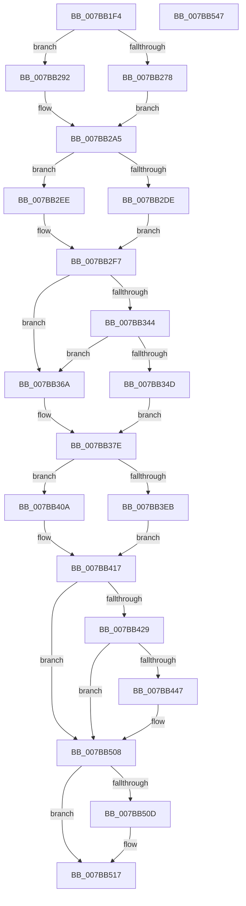

# EtwTimLogProhibitLowILImageMap

- RVA: `0x007BB1F4`–`0x007BB548` (길이 `852` bytes)
- VA: `0x00000001407BB1F4`
- 실행 섹션: `PAGE`
- PDB 이름 있음: `예`; PDB Function 태그: `아니요`
- unwind 정보 RVA: `0x000D3B00`
- 디코드: `207`개 명령, `852/852` bytes 표시
- 미해석 바이트: `0` (있으면 어셈블리에 `.byte`로 보존)

> 이 문서는 커널 이미지의 기계어와 PDB 기호를 분석해 생성했습니다. 4번과 5번은 함수 원형과 자료형을 바이너리 사용 방식에서 추정한 C 해석이며 원본 소스 복구 결과는 아닙니다.

## 1. Dependencies

- 직접 호출 지점: **10**; 고유 호출 대상: **10**
- 직접 호출자로 확인된 함수: **1**
- RIP 상대 이미지 참조: **8**

### Outgoing calls
- `0x007BB2B8` → [EtwpQueryProcessCommandLine](../8A/EtwpQueryProcessCommandLine_function_008A5C20.md) (function, `0x008A5C20`)
- `0x007BB30F` → [EtwpTiFillProcessIdentity](../../text/3B/EtwpTiFillProcessIdentity_function_003B8F30.md) (function, `0x003B8F30`)
- `0x007BB332` → [EtwpTiFillThreadIdentity](../../text/47/EtwpTiFillThreadIdentity_function_00471C1C.md) (function, `0x00471C1C`)
- `0x007BB3D1` → [Feature_ThreatintDeadlockFix__private_IsEnabledDeviceUsageNoInline](../../text/4F/Feature_ThreatintDeadlockFix__private_IsEnabledDeviceUsageNoInline_function_004F77F4.md) (function, `0x004F77F4`)
- `0x007BB403` → [EtwWriteEx](../../text/25/EtwWriteEx_function_0025F0D0.md) (function, `0x0025F0D0`)
- `0x007BB412` → [EtwWrite](../../text/41/EtwWrite_function_0041C720.md) (function, `0x0041C720`)
- `0x007BB43A` → [tlgKeywordOn](../../text/42/tlgKeywordOn_function_0042EAA0.md) (function, `0x0042EAA0`)
- `0x007BB503` → [tlgWriteTransfer_EtwWriteTransfer](../../text/42/tlgWriteTransfer_EtwWriteTransfer_function_004260E0.md) (function, `0x004260E0`)
- `0x007BB512` → [ExFreePoolWithTag](../../poolcode/B8/ExFreePoolWithTag_function_00B82870.md) (function, `0x00B82870`)
- `0x007BB521` → [_security_check_cookie](../../text/6A/_security_check_cookie_function_006AC640.md) (function, `0x006AC640`)

### Direct callers
- [MiAllowImageMap](../8C/MiAllowImageMap_function_008C8B10.md) at `0x008C8CDE`

### Static image references
- `0x007BB21A` → RVA `0x00E0A740` (`.data`; read)
- `0x007BB232` → RVA `0x00002F28` (`.rdata`; read)
- `0x007BB24B` → RVA `0x00B076E0` (` ?? ::NNGAKEGL::`string'`; read)
- `0x007BB3A9` → RVA `0x00021FF8` (`.rdata`; read)
- `0x007BB3B8` → RVA `0x00021868` (`.rdata`; read)
- `0x007BB3D6` → RVA `0x00EFF828` (`.data`; read)
- `0x007BB417` → RVA `0x00E09168` (`.data`; read)
- `0x007BB455` → RVA `0x00054CD9` (`.rdata`; read)

## 2. Other-region calls and transfers

- 다른 실행 섹션으로 향하는 call: **9**
  - `0x007BB30F` → [EtwpTiFillProcessIdentity](../../text/3B/EtwpTiFillProcessIdentity_function_003B8F30.md) (`PAGE` → `.text`)
  - `0x007BB332` → [EtwpTiFillThreadIdentity](../../text/47/EtwpTiFillThreadIdentity_function_00471C1C.md) (`PAGE` → `.text`)
  - `0x007BB3D1` → [Feature_ThreatintDeadlockFix__private_IsEnabledDeviceUsageNoInline](../../text/4F/Feature_ThreatintDeadlockFix__private_IsEnabledDeviceUsageNoInline_function_004F77F4.md) (`PAGE` → `.text`)
  - `0x007BB403` → [EtwWriteEx](../../text/25/EtwWriteEx_function_0025F0D0.md) (`PAGE` → `.text`)
  - `0x007BB412` → [EtwWrite](../../text/41/EtwWrite_function_0041C720.md) (`PAGE` → `.text`)
  - `0x007BB43A` → [tlgKeywordOn](../../text/42/tlgKeywordOn_function_0042EAA0.md) (`PAGE` → `.text`)
  - `0x007BB503` → [tlgWriteTransfer_EtwWriteTransfer](../../text/42/tlgWriteTransfer_EtwWriteTransfer_function_004260E0.md) (`PAGE` → `.text`)
  - `0x007BB512` → [ExFreePoolWithTag](../../poolcode/B8/ExFreePoolWithTag_function_00B82870.md) (`PAGE` → `POOLCODE`)
  - `0x007BB521` → [_security_check_cookie](../../text/6A/_security_check_cookie_function_006AC640.md) (`PAGE` → `.text`)
- 별도 외부 분기/꼬리 이동을 확인하지 못했습니다.

## 3. Assembly (complete function range)

```asm
007BB1F4  48 8B C4                        mov rax, rsp
007BB1F7  48 89 58 08                     mov qword ptr [rax + 8], rbx
007BB1FB  48 89 70 18                     mov qword ptr [rax + 0x18], rsi
007BB1FF  48 89 78 20                     mov qword ptr [rax + 0x20], rdi
007BB203  55                              push rbp
007BB204  41 54                           push r12
007BB206  41 55                           push r13
007BB208  41 56                           push r14
007BB20A  41 57                           push r15
007BB20C  48 8D A8 D8 FE FF FF            lea rbp, [rax - 0x128]
007BB213  48 81 EC 00 02 00 00            sub rsp, 0x200
007BB21A  48 8B 05 1F F5 64 00            mov rax, qword ptr [rip + 0x64f51f]
007BB221  48 33 C4                        xor rax, rsp
007BB224  48 89 85 F0 00 00 00            mov qword ptr [rbp + 0xf0], rax
007BB22B  48 8B 82 50 03 00 00            mov rax, qword ptr [rdx + 0x350]
007BB232  48 8D 35 EF 7C 84 FF            lea rsi, [rip - 0x7b8311]
007BB239  45 33 E4                        xor r12d, r12d
007BB23C  89 4C 24 4C                     mov dword ptr [rsp + 0x4c], ecx
007BB240  48 85 C0                        test rax, rax
007BB243  4C 89 64 24 50                  mov qword ptr [rsp + 0x50], r12
007BB248  0F 57 C0                        xorps xmm0, xmm0
007BB24B  4C 8D 35 8E C4 34 00            lea r14, [rip + 0x34c48e]
007BB252  48 0F 45 F0                     cmovne rsi, rax
007BB256  4D 8B F8                        mov r15, r8
007BB259  41 8D 4C 24 06                  lea ecx, [r12 + 6]
007BB25E  4C 8B EA                        mov r13, rdx
007BB261  8D 59 FC                        lea ebx, [rcx - 4]
007BB264  0F 11 44 24 58                  movups xmmword ptr [rsp + 0x58], xmm0
007BB269  0F B7 06                        movzx eax, word ptr [rsi]
007BB26C  8D 79 06                        lea edi, [rcx + 6]
007BB26F  48 89 5D 18                     mov qword ptr [rbp + 0x18], rbx
007BB273  66 85 C0                        test ax, ax
007BB276  74 1A                           je 0x1407bb292
007BB278  66 D1 E8                        shr ax, 1
007BB27B  66 89 44 24 40                  mov word ptr [rsp + 0x40], ax
007BB280  48 8D 44 24 40                  lea rax, [rsp + 0x40]
007BB285  48 89 45 10                     mov qword ptr [rbp + 0x10], rax
007BB289  0F B7 06                        movzx eax, word ptr [rsi]
007BB28C  48 8B 4E 08                     mov rcx, qword ptr [rsi + 8]
007BB290  EB 13                           jmp 0x1407bb2a5
007BB292  48 8D 44 24 40                  lea rax, [rsp + 0x40]
007BB297  66 89 4C 24 40                  mov word ptr [rsp + 0x40], cx
007BB29C  48 89 45 10                     mov qword ptr [rbp + 0x10], rax
007BB2A0  49 8B CE                        mov rcx, r14
007BB2A3  8B C7                           mov eax, edi
007BB2A5  48 89 4D 20                     mov qword ptr [rbp + 0x20], rcx
007BB2A9  48 8D 54 24 58                  lea rdx, [rsp + 0x58]
007BB2AE  49 8B CD                        mov rcx, r13
007BB2B1  89 45 28                        mov dword ptr [rbp + 0x28], eax
007BB2B4  44 89 65 2C                     mov dword ptr [rbp + 0x2c], r12d
007BB2B8  E8 63 A9 0E 00                  call 0x1408a5c20
007BB2BD  0F B7 4C 24 58                  movzx ecx, word ptr [rsp + 0x58]
007BB2C2  48 8D 44 24 44                  lea rax, [rsp + 0x44]
007BB2C7  48 C7 45 38 02 00 00 00         mov qword ptr [rbp + 0x38], 2
007BB2CF  41 BA 06 00 00 00               mov r10d, 6
007BB2D5  48 89 45 30                     mov qword ptr [rbp + 0x30], rax
007BB2D9  66 85 C9                        test cx, cx
007BB2DC  74 10                           je 0x1407bb2ee
007BB2DE  48 8B 44 24 60                  mov rax, qword ptr [rsp + 0x60]
007BB2E3  48 89 45 40                     mov qword ptr [rbp + 0x40], rax
007BB2E7  8B C1                           mov eax, ecx
007BB2E9  66 D1 E9                        shr cx, 1
007BB2EC  EB 09                           jmp 0x1407bb2f7
007BB2EE  4C 89 75 40                     mov qword ptr [rbp + 0x40], r14
007BB2F2  8B C7                           mov eax, edi
007BB2F4  41 8B CA                        mov ecx, r10d
007BB2F7  66 89 4C 24 44                  mov word ptr [rsp + 0x44], cx
007BB2FC  4C 8D 44 24 50                  lea r8, [rsp + 0x50]
007BB301  48 8D 4D 50                     lea rcx, [rbp + 0x50]
007BB305  89 45 48                        mov dword ptr [rbp + 0x48], eax
007BB308  49 8B D5                        mov rdx, r13
007BB30B  44 89 65 4C                     mov dword ptr [rbp + 0x4c], r12d
007BB30F  E8 1C DC BF FF                  call 0x1403b8f30
007BB314  65 48 8B 14 25 88 01 00 00      mov rdx, qword ptr gs:[0x188]
007BB31D  44 8B C8                        mov r9d, eax
007BB320  44 8D 40 04                     lea r8d, [rax + 4]
007BB324  48 8D 45 10                     lea rax, [rbp + 0x10]
007BB328  41 8B C8                        mov ecx, r8d
007BB32B  48 C1 E1 04                     shl rcx, 4
007BB32F  48 03 C8                        add rcx, rax
007BB332  E8 E5 68 CB FF                  call 0x140471c1c
007BB337  44 03 C0                        add r8d, eax
007BB33A  45 33 ED                        xor r13d, r13d
007BB33D  8B C8                           mov ecx, eax
007BB33F  4D 85 FF                        test r15, r15
007BB342  74 26                           je 0x1407bb36a
007BB344  41 0F B7 17                     movzx edx, word ptr [r15]
007BB348  66 85 D2                        test dx, dx
007BB34B  74 1D                           je 0x1407bb36a
007BB34D  4D 8B 77 08                     mov r14, qword ptr [r15 + 8]
007BB351  0F B7 C2                        movzx eax, dx
007BB354  66 D1 E8                        shr ax, 1
007BB357  8B FA                           mov edi, edx
007BB359  66 89 44 24 48                  mov word ptr [rsp + 0x48], ax
007BB35E  41 8B C0                        mov eax, r8d
007BB361  48 C1 E0 04                     shl rax, 4
007BB365  41 FF C0                        inc r8d
007BB368  EB 14                           jmp 0x1407bb37e
007BB36A  41 8B C0                        mov eax, r8d
007BB36D  45 8D 41 05                     lea r8d, [r9 + 5]
007BB371  48 C1 E0 04                     shl rax, 4
007BB375  44 03 C1                        add r8d, ecx
007BB378  66 44 89 54 24 48               mov word ptr [rsp + 0x48], r10w
007BB37E  41 8B C8                        mov ecx, r8d
007BB381  4C 8D 5D 10                     lea r11, [rbp + 0x10]
007BB385  48 C1 E1 04                     shl rcx, 4
007BB389  4C 8D 4D 10                     lea r9, [rbp + 0x10]
007BB38D  45 8D 60 01                     lea r12d, [r8 + 1]
007BB391  4C 8B D0                        mov r10, rax
007BB394  4C 8D 44 24 48                  lea r8, [rsp + 0x48]
007BB399  48 8B D1                        mov rdx, rcx
007BB39C  4D 89 04 03                     mov qword ptr [r11 + rax], r8
007BB3A0  89 5C 05 18                     mov dword ptr [rbp + rax + 0x18], ebx
007BB3A4  45 89 6C 03 0C                  mov dword ptr [r11 + rax + 0xc], r13d
007BB3A9  48 8D 05 48 6C 86 FF            lea rax, [rip - 0x7993b8]
007BB3B0  4D 89 34 09                     mov qword ptr [r9 + rcx], r14
007BB3B4  89 7C 0D 18                     mov dword ptr [rbp + rcx + 0x18], edi
007BB3B8  48 8D 3D A9 64 86 FF            lea rdi, [rip - 0x799b57]
007BB3BF  45 89 6C 09 0C                  mov dword ptr [r9 + rcx + 0xc], r13d
007BB3C4  44 8B 74 24 4C                  mov r14d, dword ptr [rsp + 0x4c]
007BB3C9  41 83 FE 01                     cmp r14d, 1
007BB3CD  48 0F 45 F8                     cmovne rdi, rax
007BB3D1  E8 1E C4 D3 FF                  call 0x1404f77f4
007BB3D6  48 8B 0D 4B 44 74 00            mov rcx, qword ptr [rip + 0x74444b]
007BB3DD  45 33 C0                        xor r8d, r8d
007BB3E0  85 C0                           test eax, eax
007BB3E2  48 8B D7                        mov rdx, rdi
007BB3E5  48 8D 45 10                     lea rax, [rbp + 0x10]
007BB3E9  74 1F                           je 0x1407bb40a
007BB3EB  48 89 44 24 38                  mov qword ptr [rsp + 0x38], rax
007BB3F0  45 8D 48 01                     lea r9d, [r8 + 1]
007BB3F4  44 89 64 24 30                  mov dword ptr [rsp + 0x30], r12d
007BB3F9  4C 89 6C 24 28                  mov qword ptr [rsp + 0x28], r13
007BB3FE  4C 89 6C 24 20                  mov qword ptr [rsp + 0x20], r13
007BB403  E8 C8 3C AA FF                  call 0x14025f0d0
007BB408  EB 0D                           jmp 0x1407bb417
007BB40A  45 8B CC                        mov r9d, r12d
007BB40D  48 89 44 24 20                  mov qword ptr [rsp + 0x20], rax
007BB412  E8 09 13 C6 FF                  call 0x14041c720
007BB417  83 3D 4A DD 64 00 05            cmp dword ptr [rip + 0x64dd4a], 5
007BB41E  48 8B 7C 24 60                  mov rdi, qword ptr [rsp + 0x60]
007BB423  0F 86 DF 00 00 00               jbe 0x1407bb508
007BB429  48 BA 00 00 00 00 00 40 00 00   movabs rdx, 0x400000000000
007BB433  48 8D 0D 2E DD 64 00            lea rcx, [rip + 0x64dd2e]
007BB43A  E8 61 36 C7 FF                  call 0x14042eaa0
007BB43F  84 C0                           test al, al
007BB441  0F 84 C1 00 00 00               je 0x1407bb508
007BB447  48 8D 44 24 4C                  lea rax, [rsp + 0x4c]
007BB44C  44 89 74 24 4C                  mov dword ptr [rsp + 0x4c], r14d
007BB451  48 89 45 90                     mov qword ptr [rbp - 0x70], rax
007BB455  48 8D 15 7D 98 89 FF            lea rdx, [rip - 0x766783]
007BB45C  48 8D 45 B8                     lea rax, [rbp - 0x48]
007BB460  48 C7 45 98 04 00 00 00         mov qword ptr [rbp - 0x68], 4
007BB468  48 89 45 A0                     mov qword ptr [rbp - 0x60], rax
007BB46C  48 8D 0D F5 DC 64 00            lea rcx, [rip + 0x64dcf5]
007BB473  48 8B 46 08                     mov rax, qword ptr [rsi + 8]
007BB477  45 33 C9                        xor r9d, r9d
007BB47A  48 89 45 B0                     mov qword ptr [rbp - 0x50], rax
007BB47E  45 33 C0                        xor r8d, r8d
007BB481  0F B7 06                        movzx eax, word ptr [rsi]
007BB484  89 45 B8                        mov dword ptr [rbp - 0x48], eax
007BB487  48 8D 45 D8                     lea rax, [rbp - 0x28]
007BB48B  48 89 45 C0                     mov qword ptr [rbp - 0x40], rax
007BB48F  0F B7 44 24 58                  movzx eax, word ptr [rsp + 0x58]
007BB494  89 45 D8                        mov dword ptr [rbp - 0x28], eax
007BB497  48 8B 44 24 50                  mov rax, qword ptr [rsp + 0x50]
007BB49C  48 89 44 24 68                  mov qword ptr [rsp + 0x68], rax
007BB4A1  48 8D 44 24 68                  lea rax, [rsp + 0x68]
007BB4A6  48 89 45 E0                     mov qword ptr [rbp - 0x20], rax
007BB4AA  48 8D 45 08                     lea rax, [rbp + 8]
007BB4AE  48 89 45 F0                     mov qword ptr [rbp - 0x10], rax
007BB4B2  49 8B 47 08                     mov rax, qword ptr [r15 + 8]
007BB4B6  48 89 45 00                     mov qword ptr [rbp], rax
007BB4BA  41 0F B7 07                     movzx eax, word ptr [r15]
007BB4BE  89 45 08                        mov dword ptr [rbp + 8], eax
007BB4C1  48 8D 44 24 70                  lea rax, [rsp + 0x70]
007BB4C6  48 89 44 24 28                  mov qword ptr [rsp + 0x28], rax
007BB4CB  C7 44 24 20 0A 00 00 00         mov dword ptr [rsp + 0x20], 0xa
007BB4D3  48 C7 45 A8 02 00 00 00         mov qword ptr [rbp - 0x58], 2
007BB4DB  44 89 6D BC                     mov dword ptr [rbp - 0x44], r13d
007BB4DF  48 C7 45 C8 02 00 00 00         mov qword ptr [rbp - 0x38], 2
007BB4E7  48 89 7D D0                     mov qword ptr [rbp - 0x30], rdi
007BB4EB  44 89 6D DC                     mov dword ptr [rbp - 0x24], r13d
007BB4EF  48 C7 45 E8 08 00 00 00         mov qword ptr [rbp - 0x18], 8
007BB4F7  48 C7 45 F8 02 00 00 00         mov qword ptr [rbp - 8], 2
007BB4FF  44 89 6D 0C                     mov dword ptr [rbp + 0xc], r13d
007BB503  E8 D8 AB C6 FF                  call 0x1404260e0
007BB508  48 85 FF                        test rdi, rdi
007BB50B  74 0A                           je 0x1407bb517
007BB50D  33 D2                           xor edx, edx
007BB50F  48 8B CF                        mov rcx, rdi
007BB512  E8 59 73 3C 00                  call 0x140b82870
007BB517  48 8B 8D F0 00 00 00            mov rcx, qword ptr [rbp + 0xf0]
007BB51E  48 33 CC                        xor rcx, rsp
007BB521  E8 1A 11 EF FF                  call 0x1406ac640
007BB526  4C 8D 9C 24 00 02 00 00         lea r11, [rsp + 0x200]
007BB52E  49 8B 5B 30                     mov rbx, qword ptr [r11 + 0x30]
007BB532  49 8B 73 40                     mov rsi, qword ptr [r11 + 0x40]
007BB536  49 8B 7B 48                     mov rdi, qword ptr [r11 + 0x48]
007BB53A  49 8B E3                        mov rsp, r11
007BB53D  41 5F                           pop r15
007BB53F  41 5E                           pop r14
007BB541  41 5D                           pop r13
007BB543  41 5C                           pop r12
007BB545  5D                              pop rbp
007BB546  C3                              ret
007BB547  CC                              int3
```

## 4. C-style interpretation (structured pseudocode)

```c
__int64 __fastcall EtwTimLogProhibitLowILImageMap(int a1, __int64 a2, __int64 a3)
{
    __int64 result;
    __int64 v_r12;
    __int64 v_r13;
    __int64 v_rdi;
    __int64 v_rsi;
    __int64 v_rsp;
    unsigned __int64 v_stack_m1B8;
    unsigned __int64 v_stack_m1C0;
    unsigned __int64 v_stack_m1C8;
    unsigned __int64 v_stack_m1D0;
    unsigned __int64 v_stack_m1D8;
    unsigned int v_stack_m1DC;
    unsigned __int16 v_stack_m1E0;
    unsigned __int64 v_stack_m1E4;
    unsigned __int16 v_stack_m1E8;
    unsigned __int64 v_stack_m1F0;
    unsigned int v_stack_m1F8;
    unsigned __int64 v_stack_m200;
    unsigned __int64 v_stack_m208;
    unsigned __int64 v_stack_m28;

    *(unsigned __int64 *)(v_rsp + 8) = v_rbx;
    *(unsigned __int64 *)(v_rsp + 24) = v_rsi;
    *(unsigned __int64 *)(v_rsp + 32) = v_rdi;
    v_rsp = (v_rsp) - (512);
    result = (*(unsigned __int64 *)(v_rip + 6616351)) ^ (v_rsp);
    *(unsigned __int64 *)(v_rsp - 296 + 240) = result;
    v_r12 = 0;
    v_stack_m1DC = a1;
    v_stack_m1D8 = 0;
    v_rsi = v_rip - 8094481;
    if (*(unsigned __int64 *)(a2 + 848) != 0) { v_rsi = *(unsigned __int64 *)(a2 + 848); }
    v_stack_m1D0 = v_xmm0;
    *(unsigned __int64 *)(v_rsp - 296 + 24) = v_r12 + 6 - 4;
    if ((unsigned __int16)(*(unsigned __int16 *)(v_rsi)) == 0) goto loc_007BB292;
    result = (unsigned __int16)((*(unsigned __int16 *)(v_rsi)) >> (1));
    v_stack_m1E8 = (unsigned __int16)(result);
    *(unsigned __int64 *)(v_rsp - 296 + 16) = v_stack_m1E8;
    goto loc_007BB2A5;
loc_007BB292:
    v_stack_m1E8 = (unsigned __int16)(*(unsigned __int64 *)(v_rsi + 8));
    *(unsigned __int64 *)(v_rsp - 296 + 16) = v_stack_m1E8;
loc_007BB2A5:
    *(unsigned __int64 *)(v_rsp - 296 + 32) = v_rip + 3458190;
    *(unsigned int *)(v_rsp - 296 + 40) = (unsigned int)((unsigned int)((unsigned int)(v_r12 + 6 + 6)));
    *(unsigned int *)(v_rsp - 296 + 44) = 0;
    result = EtwpQueryProcessCommandLine(a2, v_stack_m1D0, a3, a4);
    *(unsigned __int64 *)(v_rsp - 296 + 56) = 2;
    *(unsigned __int64 *)(v_rsp - 296 + 48) = v_stack_m1E4;
    if ((unsigned __int16)(v_stack_m1D0) == 0) goto loc_007BB2EE;
    *(unsigned __int64 *)(v_rsp - 296 + 64) = v_stack_m1C8;
    a1 = (unsigned __int16)((v_stack_m1D0) >> (1));
    goto loc_007BB2F7;
loc_007BB2EE:
    *(unsigned __int64 *)(v_rsp - 296 + 64) = v_rip + 3458190;
loc_007BB2F7:
    v_stack_m1E4 = 6;
    *(unsigned int *)(v_rsp - 296 + 72) = (unsigned int)((unsigned int)((unsigned int)(v_r12 + 6 + 6)));
    *(unsigned int *)(v_rsp - 296 + 76) = 0;
    result = EtwpTiFillProcessIdentity(v_rsp - 296 + 80, a2, v_stack_m1D8, a4);
    a1 = ((unsigned int)((unsigned int)(result + 4))) << (4);
    a1 = (a1) + (v_rsp - 296 + 16);
    result = EtwpTiFillThreadIdentity(a1, *(unsigned __int64 *)(gs_base + (0 + 392)), result + 4, (unsigned int)((unsigned int)(result)));
    a3 = (unsigned int)((result + 4) + ((unsigned int)(result)));
    v_r13 = 0;
    if (a3 == 0) goto loc_007BB36A;
    if ((unsigned __int16)(*(unsigned __int16 *)(a3)) == 0) goto loc_007BB36A;
    result = (unsigned __int16)(((unsigned __int16)(*(unsigned __int16 *)(a3))) >> (1));
    v_stack_m1E0 = (unsigned __int16)(result);
    result = ((unsigned int)((unsigned int)(a3))) << (4);
    a3 = (unsigned int)((a3) + 1);
    goto loc_007BB37E;
loc_007BB36A:
    result = ((unsigned int)((unsigned int)(a3))) << (4);
    a3 = (unsigned int)(((unsigned int)((unsigned int)(result)) + 5) + ((unsigned int)((unsigned int)((unsigned int)(result)))));
    v_stack_m1E0 = 6;
loc_007BB37E:
    a1 = ((unsigned int)((unsigned int)(a3))) << (4);
    *(unsigned __int64 *)(v_rsp - 296 + 16 + result * 1) = v_stack_m1E0;
    *(unsigned int *)(v_rsp - 296 + result * 1 + 24) = (unsigned int)(v_r12 + 6 - 4);
    *(unsigned int *)(v_rsp - 296 + 16 + result * 1 + 12) = 0;
    *(unsigned __int64 *)(v_rsp - 296 + 16 + a1 * 1) = *(unsigned __int64 *)(a3 + 8);
    *(unsigned int *)(v_rsp - 296 + a1 * 1 + 24) = (unsigned int)((unsigned int)((unsigned int)(*(unsigned __int16 *)(a3))));
    *(unsigned int *)(v_rsp - 296 + 16 + a1 * 1 + 12) = 0;
    v_rdi = v_rip - 7969623;
    if (((unsigned int)((unsigned int)(v_stack_m1DC))) != 1) { v_rdi = v_rip - 7967672; }
    result = Feature_ThreatintDeadlockFix__private_IsEnabledDeviceUsageNoInline(a1, a1, v_stack_m1E0, v_rsp - 296 + 16);
    a3 = 0;
    if ((unsigned int)(result) == 0) goto loc_007BB40A;
    v_stack_m1F0 = v_rsp - 296 + 16;
    v_stack_m1F8 = (unsigned int)(a3 + 1);
    v_stack_m200 = 0;
    v_stack_m208 = 0;
    result = EtwWriteEx(*(unsigned __int64 *)(v_rip + 7619659), v_rdi, a3, a3 + 1);
    goto loc_007BB417;
loc_007BB40A:
    v_stack_m208 = result;
    result = EtwWrite(*(unsigned __int64 *)(v_rip + 7619659), v_rdi, a3, (unsigned int)((unsigned int)(a3 + 1)));
loc_007BB417:
    if ((*(unsigned int *)(v_rip + 6610250)) <= 5) goto loc_007BB508;
    result = tlgKeywordOn(v_rip + 6610222, v_rdi, a3, (unsigned int)((unsigned int)(a3 + 1)));
    if ((unsigned __int8)(result) != 0) {
        result = v_stack_m1DC;
        v_stack_m1DC = (unsigned int)((unsigned int)(v_stack_m1DC));
        *(unsigned __int64 *)(v_rsp - 296 - 112) = result;
        a2 = v_rip - 7759747;
        result = v_rsp - 296 - 72;
        *(unsigned __int64 *)(v_rsp - 296 - 104) = 4;
        *(unsigned __int64 *)(v_rsp - 296 - 96) = result;
        a1 = v_rip + 6610165;
        result = *(unsigned __int64 *)(v_rsi + 8);
        a4 = 0;
        *(unsigned __int64 *)(v_rsp - 296 - 80) = result;
        a3 = 0;
        result = *(unsigned __int16 *)(v_rsi);
        *(unsigned int *)(v_rsp - 296 - 72) = (unsigned int)(result);
        result = v_rsp - 296 - 40;
        *(unsigned __int64 *)(v_rsp - 296 - 64) = result;
        result = v_stack_m1D0;
        *(unsigned int *)(v_rsp - 296 - 40) = (unsigned int)(result);
        result = v_stack_m1D8;
        v_stack_m1C0 = result;
        result = v_stack_m1C0;
        *(unsigned __int64 *)(v_rsp - 296 - 32) = result;
        result = v_rsp - 296 + 8;
        *(unsigned __int64 *)(v_rsp - 296 - 16) = result;
        result = *(unsigned __int64 *)(a3 + 8);
        *(unsigned __int64 *)(v_rsp - 296) = result;
        result = *(unsigned __int16 *)(a3);
        *(unsigned int *)(v_rsp - 296 + 8) = (unsigned int)(result);
        result = v_stack_m1B8;
        v_stack_m200 = result;
        v_stack_m208 = 10;
        *(unsigned __int64 *)(v_rsp - 296 - 88) = 2;
        *(unsigned int *)(v_rsp - 296 - 68) = 0;
        *(unsigned __int64 *)(v_rsp - 296 - 56) = 2;
        *(unsigned __int64 *)(v_rsp - 296 - 48) = v_stack_m1C8;
        *(unsigned int *)(v_rsp - 296 - 36) = 0;
        *(unsigned __int64 *)(v_rsp - 296 - 24) = 8;
        *(unsigned __int64 *)(v_rsp - 296 - 8) = 2;
        *(unsigned int *)(v_rsp - 296 + 12) = 0;
        result = tlgWriteTransfer_EtwWriteTransfer(a1, a2, a3, a4);
    }
    if (v_stack_m1C8 != 0) {
        a2 = 0;
        a1 = v_stack_m1C8;
        result = ExFreePoolWithTag(a1, a2, a3, a4);
    }
    a1 = (*(unsigned __int64 *)(v_rsp - 296 + 240)) ^ (v_rsp);
    result = _security_check_cookie(a1, a2, a3, a4);
    return result;
}
```

## 5. (Beta) C Style

```c
int64_t EtwTimLogProhibitLowILImageMap(int32_t Arg1, void *Arg2, int64_t Arg3)
{
    uint8_t *arg2 = (uint8_t *)Arg2;

    int64_t result;
    int64_t local_r12;
    int64_t local_r13;
    int64_t local_rdi;
    int64_t local_rsi;
    int64_t local_rsp;
    uint64_t v_stack_m1B8;
    uint64_t v_stack_m1C0;
    uint64_t v_stack_m1C8;
    uint64_t v_stack_m1D0;
    uint64_t v_stack_m1D8;
    uint32_t v_stack_m1DC;
    uint16_t v_stack_m1E0;
    uint64_t v_stack_m1E4;
    uint16_t v_stack_m1E8;
    uint64_t v_stack_m1F0;
    uint32_t v_stack_m1F8;
    uint64_t v_stack_m200;
    uint64_t v_stack_m208;
    uint64_t v_stack_m28;

    *(uint64_t *)(local_rsp + 0x8) = local_rbx;
    *(uint64_t *)(local_rsp + 0x18) = local_rsi;
    *(uint64_t *)(local_rsp + 0x20) = local_rdi;
    local_rsp = (local_rsp) - (512);
    result = (*(uint64_t *)(v_rip + 0x64F51F)) ^ (local_rsp);
    *(uint64_t *)(local_rsp - 0x128 + 0xF0) = result;
    local_r12 = 0;
    v_stack_m1DC = Arg1;
    v_stack_m1D8 = 0;
    local_rsi = v_rip - 8094481;
    if (*(uint64_t *)(arg2 + 0x350) != 0) { local_rsi = *(uint64_t *)(arg2 + 0x350); }
    v_stack_m1D0 = v_xmm0;
    *(uint64_t *)(local_rsp - 0x128 + 0x18) = local_r12 + 6 - 4;
    if ((uint16_t)(*(uint16_t *)(local_rsi)) == 0) goto loc_007BB292;
    result = (uint16_t)((*(uint16_t *)(local_rsi)) >> (1));
    v_stack_m1E8 = (uint16_t)(result);
    *(uint64_t *)(local_rsp - 0x128 + 0x10) = v_stack_m1E8;
    goto loc_007BB2A5;
loc_007BB292:
    v_stack_m1E8 = (uint16_t)(*(uint64_t *)(local_rsi + 0x8));
    *(uint64_t *)(local_rsp - 0x128 + 0x10) = v_stack_m1E8;
loc_007BB2A5:
    *(uint64_t *)(local_rsp - 0x128 + 0x20) = v_rip + 3458190;
    *(uint32_t *)(local_rsp - 0x128 + 0x28) = (uint32_t)((uint32_t)((uint32_t)(local_r12 + 6 + 6)));
    *(uint32_t *)(local_rsp - 0x128 + 0x2C) = 0;
    result = EtwpQueryProcessCommandLine(Arg2, v_stack_m1D0, Arg3, a4);
    *(uint64_t *)(local_rsp - 0x128 + 0x38) = 2;
    *(uint64_t *)(local_rsp - 0x128 + 0x30) = v_stack_m1E4;
    if ((uint16_t)(v_stack_m1D0) == 0) goto loc_007BB2EE;
    *(uint64_t *)(local_rsp - 0x128 + 0x40) = v_stack_m1C8;
    Arg1 = (uint16_t)((v_stack_m1D0) >> (1));
    goto loc_007BB2F7;
loc_007BB2EE:
    *(uint64_t *)(local_rsp - 0x128 + 0x40) = v_rip + 3458190;
loc_007BB2F7:
    v_stack_m1E4 = 6;
    *(uint32_t *)(local_rsp - 0x128 + 0x48) = (uint32_t)((uint32_t)((uint32_t)(local_r12 + 6 + 6)));
    *(uint32_t *)(local_rsp - 0x128 + 0x4C) = 0;
    result = EtwpTiFillProcessIdentity(local_rsp - 296 + 80, Arg2, v_stack_m1D8, a4);
    Arg1 = ((uint32_t)((uint32_t)(result + 4))) << (4);
    Arg1 = (Arg1) + (local_rsp - 296 + 16);
    result = EtwpTiFillThreadIdentity(Arg1, *(uint64_t *)(gs_base + (0 + 0x188)), result + 4, (uint32_t)((uint32_t)(result)));
    Arg3 = (uint32_t)((result + 4) + ((uint32_t)(result)));
    local_r13 = 0;
    if (Arg3 == 0) goto loc_007BB36A;
    if ((uint16_t)(*(uint16_t *)(Arg3)) == 0) goto loc_007BB36A;
    result = (uint16_t)(((uint16_t)(*(uint16_t *)(Arg3))) >> (1));
    v_stack_m1E0 = (uint16_t)(result);
    result = ((uint32_t)((uint32_t)(Arg3))) << (4);
    Arg3 = (uint32_t)((Arg3) + 1);
    goto loc_007BB37E;
loc_007BB36A:
    result = ((uint32_t)((uint32_t)(Arg3))) << (4);
    Arg3 = (uint32_t)(((uint32_t)((uint32_t)(result)) + 5) + ((uint32_t)((uint32_t)((uint32_t)(result)))));
    v_stack_m1E0 = 6;
loc_007BB37E:
    Arg1 = ((uint32_t)((uint32_t)(Arg3))) << (4);
    *(uint64_t *)(local_rsp - 0x128 + 0x10 + result * 1) = v_stack_m1E0;
    *(uint32_t *)(local_rsp - 0x128 + result * 1 + 0x18) = (uint32_t)(local_r12 + 6 - 4);
    *(uint32_t *)(local_rsp - 0x128 + 0x10 + result * 1 + 0xC) = 0;
    *(uint64_t *)(local_rsp - 0x128 + 0x10 + Arg1 * 1) = *(uint64_t *)(Arg3 + 0x8);
    *(uint32_t *)(local_rsp - 0x128 + Arg1 * 1 + 0x18) = (uint32_t)((uint32_t)((uint32_t)(*(uint16_t *)(Arg3))));
    *(uint32_t *)(local_rsp - 0x128 + 0x10 + Arg1 * 1 + 0xC) = 0;
    local_rdi = v_rip - 7969623;
    if (((uint32_t)((uint32_t)(v_stack_m1DC))) != 1) { local_rdi = v_rip - 7967672; }
    result = Feature_ThreatintDeadlockFix__private_IsEnabledDeviceUsageNoInline(Arg1, Arg1, v_stack_m1E0, local_rsp - 296 + 16);
    Arg3 = 0;
    if ((uint32_t)(result) == 0) goto loc_007BB40A;
    v_stack_m1F0 = local_rsp - 296 + 16;
    v_stack_m1F8 = (uint32_t)(Arg3 + 1);
    v_stack_m200 = 0;
    v_stack_m208 = 0;
    result = EtwWriteEx(*(uint64_t *)(v_rip + 0x74444B), local_rdi, Arg3, Arg3 + 1);
    goto loc_007BB417;
loc_007BB40A:
    v_stack_m208 = result;
    result = EtwWrite(*(uint64_t *)(v_rip + 0x74444B), local_rdi, Arg3, (uint32_t)((uint32_t)(Arg3 + 1)));
loc_007BB417:
    if ((*(uint32_t *)(v_rip + 0x64DD4A)) <= 5) goto loc_007BB508;
    result = tlgKeywordOn(v_rip + 6610222, local_rdi, Arg3, (uint32_t)((uint32_t)(Arg3 + 1)));
    if ((uint8_t)(result) != 0) {
        result = v_stack_m1DC;
        v_stack_m1DC = (uint32_t)((uint32_t)(v_stack_m1DC));
        *(uint64_t *)(local_rsp - 0x128 - 0x70) = result;
        Arg2 = v_rip - 7759747;
        result = local_rsp - 296 - 72;
        *(uint64_t *)(local_rsp - 0x128 - 0x68) = 4;
        *(uint64_t *)(local_rsp - 0x128 - 0x60) = result;
        Arg1 = v_rip + 6610165;
        result = *(uint64_t *)(local_rsi + 0x8);
        a4 = 0;
        *(uint64_t *)(local_rsp - 0x128 - 0x50) = result;
        Arg3 = 0;
        result = *(uint16_t *)(local_rsi);
        *(uint32_t *)(local_rsp - 0x128 - 0x48) = (uint32_t)(result);
        result = local_rsp - 296 - 40;
        *(uint64_t *)(local_rsp - 0x128 - 0x40) = result;
        result = v_stack_m1D0;
        *(uint32_t *)(local_rsp - 0x128 - 0x28) = (uint32_t)(result);
        result = v_stack_m1D8;
        v_stack_m1C0 = result;
        result = v_stack_m1C0;
        *(uint64_t *)(local_rsp - 0x128 - 0x20) = result;
        result = local_rsp - 296 + 8;
        *(uint64_t *)(local_rsp - 0x128 - 0x10) = result;
        result = *(uint64_t *)(Arg3 + 0x8);
        *(uint64_t *)(local_rsp - 0x128) = result;
        result = *(uint16_t *)(Arg3);
        *(uint32_t *)(local_rsp - 0x128 + 0x8) = (uint32_t)(result);
        result = v_stack_m1B8;
        v_stack_m200 = result;
        v_stack_m208 = 10;
        *(uint64_t *)(local_rsp - 0x128 - 0x58) = 2;
        *(uint32_t *)(local_rsp - 0x128 - 0x44) = 0;
        *(uint64_t *)(local_rsp - 0x128 - 0x38) = 2;
        *(uint64_t *)(local_rsp - 0x128 - 0x30) = v_stack_m1C8;
        *(uint32_t *)(local_rsp - 0x128 - 0x24) = 0;
        *(uint64_t *)(local_rsp - 0x128 - 0x18) = 8;
        *(uint64_t *)(local_rsp - 0x128 - 0x8) = 2;
        *(uint32_t *)(local_rsp - 0x128 + 0xC) = 0;
        result = tlgWriteTransfer_EtwWriteTransfer(Arg1, Arg2, Arg3, a4);
    }
    if (v_stack_m1C8 != 0) {
        Arg2 = 0;
        Arg1 = v_stack_m1C8;
        result = ExFreePoolWithTag(Arg1, Arg2, Arg3, a4);
    }
    Arg1 = (*(uint64_t *)(local_rsp - 0x128 + 0xF0)) ^ (local_rsp);
    result = _security_check_cookie(Arg1, Arg2, Arg3, a4);
    return result;
}
```

### 관측된 메모리 오프셋

구조체 형식이 확인되지 않은 접근은 인자 기준의 오프셋으로만 기록했습니다.

| 기준 인자 | 오프셋 표현 | 폭 (bit) | 접근 |
|---|---:|---:|---|
| `Arg2` | `+ 0x350` | `64` | `R` |

## 6. Execution-region graph

[열기: 2D/3D 그래프와 함수 탐색 컨트롤 패널](../../../control-panel.html?section=page&rva=0x007BB1F4&view=graph)

- 2D 그래프는 위에서 아래로 흐르고, 3D 그래프는 빈 공간을 드래그해 회전합니다. Shift+드래그는 이동, 휠은 확대·축소, 함수 노드 선택은 대상 보고서 이동입니다.

### Static fallback


