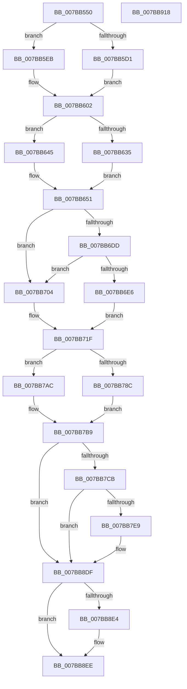

# EtwTimLogProhibitNonMicrosoftBinaries

- RVA: `0x007BB550`–`0x007BB919` (길이 `969` bytes)
- VA: `0x00000001407BB550`
- 실행 섹션: `PAGE`
- PDB 이름 있음: `예`; PDB Function 태그: `아니요`
- unwind 정보 RVA: `0x000D3AD8`
- 디코드: `228`개 명령, `969/969` bytes 표시
- 미해석 바이트: `0` (있으면 어셈블리에 `.byte`로 보존)

> 이 문서는 커널 이미지의 기계어와 PDB 기호를 분석해 생성했습니다. 4번과 5번은 함수 원형과 자료형을 바이너리 사용 방식에서 추정한 C 해석이며 원본 소스 복구 결과는 아닙니다.

## 1. Dependencies

- 직접 호출 지점: **10**; 고유 호출 대상: **10**
- 직접 호출자로 확인된 함수: **1**
- RIP 상대 이미지 참조: **8**

### Outgoing calls
- `0x007BB615` → [EtwpQueryProcessCommandLine](../8A/EtwpQueryProcessCommandLine_function_008A5C20.md) (function, `0x008A5C20`)
- `0x007BB66C` → [EtwpTiFillProcessIdentity](../../text/3B/EtwpTiFillProcessIdentity_function_003B8F30.md) (function, `0x003B8F30`)
- `0x007BB68C` → [EtwpTiFillThreadIdentity](../../text/47/EtwpTiFillThreadIdentity_function_00471C1C.md) (function, `0x00471C1C`)
- `0x007BB772` → [Feature_ThreatintDeadlockFix__private_IsEnabledDeviceUsageNoInline](../../text/4F/Feature_ThreatintDeadlockFix__private_IsEnabledDeviceUsageNoInline_function_004F77F4.md) (function, `0x004F77F4`)
- `0x007BB7A5` → [EtwWriteEx](../../text/25/EtwWriteEx_function_0025F0D0.md) (function, `0x0025F0D0`)
- `0x007BB7B4` → [EtwWrite](../../text/41/EtwWrite_function_0041C720.md) (function, `0x0041C720`)
- `0x007BB7DC` → [tlgKeywordOn](../../text/42/tlgKeywordOn_function_0042EAA0.md) (function, `0x0042EAA0`)
- `0x007BB8DA` → [tlgWriteTransfer_EtwWriteTransfer](../../text/42/tlgWriteTransfer_EtwWriteTransfer_function_004260E0.md) (function, `0x004260E0`)
- `0x007BB8E9` → [ExFreePoolWithTag](../../poolcode/B8/ExFreePoolWithTag_function_00B82870.md) (function, `0x00B82870`)
- `0x007BB8F8` → [_security_check_cookie](../../text/6A/_security_check_cookie_function_006AC640.md) (function, `0x006AC640`)

### Direct callers
- [sub_00B2540A](../B2/Unknown_function_00B2540A.md) at `0x00B25419`

### Static image references
- `0x007BB578` → RVA `0x00E0A740` (`.data`; read)
- `0x007BB590` → RVA `0x00002F28` (`.rdata`; read)
- `0x007BB59A` → RVA `0x00B076E0` (` ?? ::NNGAKEGL::`string'`; read)
- `0x007BB74B` → RVA `0x00023160` (`.rdata`; read)
- `0x007BB756` → RVA `0x00021198` (`.rdata`; read)
- `0x007BB777` → RVA `0x00EFF828` (`.data`; read)
- `0x007BB7B9` → RVA `0x00E09168` (`.data`; read)
- `0x007BB7F7` → RVA `0x00054F86` (`.rdata`; read)

## 2. Other-region calls and transfers

- 다른 실행 섹션으로 향하는 call: **9**
  - `0x007BB66C` → [EtwpTiFillProcessIdentity](../../text/3B/EtwpTiFillProcessIdentity_function_003B8F30.md) (`PAGE` → `.text`)
  - `0x007BB68C` → [EtwpTiFillThreadIdentity](../../text/47/EtwpTiFillThreadIdentity_function_00471C1C.md) (`PAGE` → `.text`)
  - `0x007BB772` → [Feature_ThreatintDeadlockFix__private_IsEnabledDeviceUsageNoInline](../../text/4F/Feature_ThreatintDeadlockFix__private_IsEnabledDeviceUsageNoInline_function_004F77F4.md) (`PAGE` → `.text`)
  - `0x007BB7A5` → [EtwWriteEx](../../text/25/EtwWriteEx_function_0025F0D0.md) (`PAGE` → `.text`)
  - `0x007BB7B4` → [EtwWrite](../../text/41/EtwWrite_function_0041C720.md) (`PAGE` → `.text`)
  - `0x007BB7DC` → [tlgKeywordOn](../../text/42/tlgKeywordOn_function_0042EAA0.md) (`PAGE` → `.text`)
  - `0x007BB8DA` → [tlgWriteTransfer_EtwWriteTransfer](../../text/42/tlgWriteTransfer_EtwWriteTransfer_function_004260E0.md) (`PAGE` → `.text`)
  - `0x007BB8E9` → [ExFreePoolWithTag](../../poolcode/B8/ExFreePoolWithTag_function_00B82870.md) (`PAGE` → `POOLCODE`)
  - `0x007BB8F8` → [_security_check_cookie](../../text/6A/_security_check_cookie_function_006AC640.md) (`PAGE` → `.text`)
- 별도 외부 분기/꼬리 이동을 확인하지 못했습니다.

## 3. Assembly (complete function range)

```asm
007BB550  48 8B C4                        mov rax, rsp
007BB553  48 89 58 08                     mov qword ptr [rax + 8], rbx
007BB557  44 88 48 20                     mov byte ptr [rax + 0x20], r9b
007BB55B  44 88 40 18                     mov byte ptr [rax + 0x18], r8b
007BB55F  55                              push rbp
007BB560  56                              push rsi
007BB561  57                              push rdi
007BB562  41 54                           push r12
007BB564  41 55                           push r13
007BB566  41 56                           push r14
007BB568  41 57                           push r15
007BB56A  48 8D A8 78 FE FF FF            lea rbp, [rax - 0x188]
007BB571  48 81 EC 50 02 00 00            sub rsp, 0x250
007BB578  48 8B 05 C1 F1 64 00            mov rax, qword ptr [rip + 0x64f1c1]
007BB57F  48 33 C4                        xor rax, rsp
007BB582  48 89 85 40 01 00 00            mov qword ptr [rbp + 0x140], rax
007BB589  48 8B 82 50 03 00 00            mov rax, qword ptr [rdx + 0x350]
007BB590  48 8D 3D 91 79 84 FF            lea rdi, [rip - 0x7b866f]
007BB597  45 33 E4                        xor r12d, r12d
007BB59A  48 8D 35 3F C1 34 00            lea rsi, [rip + 0x34c13f]
007BB5A1  48 85 C0                        test rax, rax
007BB5A4  4C 89 64 24 58                  mov qword ptr [rsp + 0x58], r12
007BB5A9  0F 57 C0                        xorps xmm0, xmm0
007BB5AC  4C 8B F2                        mov r14, rdx
007BB5AF  48 0F 45 F8                     cmovne rdi, rax
007BB5B3  44 8B E9                        mov r13d, ecx
007BB5B6  41 8D 5C 24 02                  lea ebx, [r12 + 2]
007BB5BB  0F 11 44 24 60                  movups xmmword ptr [rsp + 0x60], xmm0
007BB5C0  45 8D 7C 24 06                  lea r15d, [r12 + 6]
007BB5C5  0F B7 07                        movzx eax, word ptr [rdi]
007BB5C8  48 89 5D 48                     mov qword ptr [rbp + 0x48], rbx
007BB5CC  66 85 C0                        test ax, ax
007BB5CF  74 1A                           je 0x1407bb5eb
007BB5D1  66 D1 E8                        shr ax, 1
007BB5D4  66 89 44 24 44                  mov word ptr [rsp + 0x44], ax
007BB5D9  48 8D 44 24 44                  lea rax, [rsp + 0x44]
007BB5DE  48 89 45 40                     mov qword ptr [rbp + 0x40], rax
007BB5E2  0F B7 07                        movzx eax, word ptr [rdi]
007BB5E5  48 8B 4F 08                     mov rcx, qword ptr [rdi + 8]
007BB5E9  EB 17                           jmp 0x1407bb602
007BB5EB  48 8D 44 24 44                  lea rax, [rsp + 0x44]
007BB5F0  66 44 89 7C 24 44               mov word ptr [rsp + 0x44], r15w
007BB5F6  48 89 45 40                     mov qword ptr [rbp + 0x40], rax
007BB5FA  48 8B CE                        mov rcx, rsi
007BB5FD  B8 0C 00 00 00                  mov eax, 0xc
007BB602  48 89 4D 50                     mov qword ptr [rbp + 0x50], rcx
007BB606  48 8D 54 24 60                  lea rdx, [rsp + 0x60]
007BB60B  49 8B CE                        mov rcx, r14
007BB60E  89 45 58                        mov dword ptr [rbp + 0x58], eax
007BB611  44 89 65 5C                     mov dword ptr [rbp + 0x5c], r12d
007BB615  E8 06 A6 0E 00                  call 0x1408a5c20
007BB61A  0F B7 4C 24 60                  movzx ecx, word ptr [rsp + 0x60]
007BB61F  48 8D 44 24 48                  lea rax, [rsp + 0x48]
007BB624  48 C7 45 68 02 00 00 00         mov qword ptr [rbp + 0x68], 2
007BB62C  48 89 45 60                     mov qword ptr [rbp + 0x60], rax
007BB630  66 85 C9                        test cx, cx
007BB633  74 10                           je 0x1407bb645
007BB635  48 8B 44 24 68                  mov rax, qword ptr [rsp + 0x68]
007BB63A  48 89 45 70                     mov qword ptr [rbp + 0x70], rax
007BB63E  8B C1                           mov eax, ecx
007BB640  66 D1 E9                        shr cx, 1
007BB643  EB 0C                           jmp 0x1407bb651
007BB645  48 89 75 70                     mov qword ptr [rbp + 0x70], rsi
007BB649  B8 0C 00 00 00                  mov eax, 0xc
007BB64E  41 8B CF                        mov ecx, r15d
007BB651  66 89 4C 24 48                  mov word ptr [rsp + 0x48], cx
007BB656  4C 8D 44 24 58                  lea r8, [rsp + 0x58]
007BB65B  48 8D 8D 80 00 00 00            lea rcx, [rbp + 0x80]
007BB662  89 45 78                        mov dword ptr [rbp + 0x78], eax
007BB665  49 8B D6                        mov rdx, r14
007BB668  44 89 65 7C                     mov dword ptr [rbp + 0x7c], r12d
007BB66C  E8 BF D8 BF FF                  call 0x1403b8f30
007BB671  65 48 8B 14 25 88 01 00 00      mov rdx, qword ptr gs:[0x188]
007BB67A  44 8D 40 04                     lea r8d, [rax + 4]
007BB67E  48 8D 45 40                     lea rax, [rbp + 0x40]
007BB682  41 8B C8                        mov ecx, r8d
007BB685  48 C1 E1 04                     shl rcx, 4
007BB689  48 03 C8                        add rcx, rax
007BB68C  E8 8B 65 CB FF                  call 0x140471c1c
007BB691  4C 8B BD B0 01 00 00            mov r15, qword ptr [rbp + 0x1b0]
007BB698  48 8D 95 A8 01 00 00            lea rdx, [rbp + 0x1a8]
007BB69F  44 03 C0                        add r8d, eax
007BB6A2  41 B9 01 00 00 00               mov r9d, 1
007BB6A8  41 8B C8                        mov ecx, r8d
007BB6AB  48 8D 85 A0 01 00 00            lea rax, [rbp + 0x1a0]
007BB6B2  48 03 C9                        add rcx, rcx
007BB6B5  45 03 C1                        add r8d, r9d
007BB6B8  48 89 44 CD 40                  mov qword ptr [rbp + rcx*8 + 0x40], rax
007BB6BD  4C 89 4C CD 48                  mov qword ptr [rbp + rcx*8 + 0x48], r9
007BB6C2  41 8B C8                        mov ecx, r8d
007BB6C5  41 8B C0                        mov eax, r8d
007BB6C8  45 03 C1                        add r8d, r9d
007BB6CB  48 03 C0                        add rax, rax
007BB6CE  48 89 54 C5 40                  mov qword ptr [rbp + rax*8 + 0x40], rdx
007BB6D3  4C 89 4C C5 48                  mov qword ptr [rbp + rax*8 + 0x48], r9
007BB6D8  4D 85 FF                        test r15, r15
007BB6DB  74 27                           je 0x1407bb704
007BB6DD  41 0F B7 17                     movzx edx, word ptr [r15]
007BB6E1  66 85 D2                        test dx, dx
007BB6E4  74 1E                           je 0x1407bb704
007BB6E6  49 8B 77 08                     mov rsi, qword ptr [r15 + 8]
007BB6EA  0F B7 C2                        movzx eax, dx
007BB6ED  66 D1 E8                        shr ax, 1
007BB6F0  44 8B E2                        mov r12d, edx
007BB6F3  66 89 44 24 4C                  mov word ptr [rsp + 0x4c], ax
007BB6F8  41 8B C0                        mov eax, r8d
007BB6FB  48 C1 E0 04                     shl rax, 4
007BB6FF  41 FF C0                        inc r8d
007BB702  EB 1B                           jmp 0x1407bb71f
007BB704  B8 06 00 00 00                  mov eax, 6
007BB709  41 BC 0C 00 00 00               mov r12d, 0xc
007BB70F  66 89 44 24 4C                  mov word ptr [rsp + 0x4c], ax
007BB714  41 8B C0                        mov eax, r8d
007BB717  44 8D 41 02                     lea r8d, [rcx + 2]
007BB71B  48 C1 E0 04                     shl rax, 4
007BB71F  41 8B C8                        mov ecx, r8d
007BB722  4C 8D 5D 40                     lea r11, [rbp + 0x40]
007BB726  48 C1 E1 04                     shl rcx, 4
007BB72A  4C 8D 4D 40                     lea r9, [rbp + 0x40]
007BB72E  45 8D 70 01                     lea r14d, [r8 + 1]
007BB732  4C 8B D0                        mov r10, rax
007BB735  4C 8D 44 24 4C                  lea r8, [rsp + 0x4c]
007BB73A  48 8B D1                        mov rdx, rcx
007BB73D  4D 89 04 03                     mov qword ptr [r11 + rax], r8
007BB741  89 5C 05 48                     mov dword ptr [rbp + rax + 0x48], ebx
007BB745  41 83 64 03 0C 00               and dword ptr [r11 + rax + 0xc], 0
007BB74B  48 8D 05 0E 7A 86 FF            lea rax, [rip - 0x7985f2]
007BB752  49 89 34 09                     mov qword ptr [r9 + rcx], rsi
007BB756  48 8D 35 3B 5A 86 FF            lea rsi, [rip - 0x79a5c5]
007BB75D  44 89 64 0D 48                  mov dword ptr [rbp + rcx + 0x48], r12d
007BB762  45 33 E4                        xor r12d, r12d
007BB765  41 83 FD 01                     cmp r13d, 1
007BB769  45 89 64 09 0C                  mov dword ptr [r9 + rcx + 0xc], r12d
007BB76E  48 0F 45 F0                     cmovne rsi, rax
007BB772  E8 7D C0 D3 FF                  call 0x1404f77f4
007BB777  48 8B 0D AA 40 74 00            mov rcx, qword ptr [rip + 0x7440aa]
007BB77E  45 33 C0                        xor r8d, r8d
007BB781  85 C0                           test eax, eax
007BB783  48 8B D6                        mov rdx, rsi
007BB786  48 8D 45 40                     lea rax, [rbp + 0x40]
007BB78A  74 20                           je 0x1407bb7ac
007BB78C  48 89 44 24 38                  mov qword ptr [rsp + 0x38], rax
007BB791  45 8D 4C 24 01                  lea r9d, [r12 + 1]
007BB796  44 89 74 24 30                  mov dword ptr [rsp + 0x30], r14d
007BB79B  4C 89 64 24 28                  mov qword ptr [rsp + 0x28], r12
007BB7A0  4C 89 64 24 20                  mov qword ptr [rsp + 0x20], r12
007BB7A5  E8 26 39 AA FF                  call 0x14025f0d0
007BB7AA  EB 0D                           jmp 0x1407bb7b9
007BB7AC  45 8B CE                        mov r9d, r14d
007BB7AF  48 89 44 24 20                  mov qword ptr [rsp + 0x20], rax
007BB7B4  E8 67 0F C6 FF                  call 0x14041c720
007BB7B9  83 3D A8 D9 64 00 05            cmp dword ptr [rip + 0x64d9a8], 5
007BB7C0  48 8B 74 24 68                  mov rsi, qword ptr [rsp + 0x68]
007BB7C5  0F 86 14 01 00 00               jbe 0x1407bb8df
007BB7CB  48 BA 00 00 00 00 00 40 00 00   movabs rdx, 0x400000000000
007BB7D5  48 8D 0D 8C D9 64 00            lea rcx, [rip + 0x64d98c]
007BB7DC  E8 BF 32 C7 FF                  call 0x14042eaa0
007BB7E1  84 C0                           test al, al
007BB7E3  0F 84 F6 00 00 00               je 0x1407bb8df
007BB7E9  48 8D 44 24 50                  lea rax, [rsp + 0x50]
007BB7EE  44 89 6C 24 50                  mov dword ptr [rsp + 0x50], r13d
007BB7F3  48 89 45 A0                     mov qword ptr [rbp - 0x60], rax
007BB7F7  48 8D 15 88 97 89 FF            lea rdx, [rip - 0x766878]
007BB7FE  48 8D 45 C8                     lea rax, [rbp - 0x38]
007BB802  48 C7 45 A8 04 00 00 00         mov qword ptr [rbp - 0x58], 4
007BB80A  48 89 45 B0                     mov qword ptr [rbp - 0x50], rax
007BB80E  48 8D 0D 53 D9 64 00            lea rcx, [rip + 0x64d953]
007BB815  48 8B 47 08                     mov rax, qword ptr [rdi + 8]
007BB819  45 33 C9                        xor r9d, r9d
007BB81C  48 89 45 C0                     mov qword ptr [rbp - 0x40], rax
007BB820  45 33 C0                        xor r8d, r8d
007BB823  0F B7 07                        movzx eax, word ptr [rdi]
007BB826  89 45 C8                        mov dword ptr [rbp - 0x38], eax
007BB829  48 8D 45 E8                     lea rax, [rbp - 0x18]
007BB82D  48 89 45 D0                     mov qword ptr [rbp - 0x30], rax
007BB831  0F B7 44 24 60                  movzx eax, word ptr [rsp + 0x60]
007BB836  89 45 E8                        mov dword ptr [rbp - 0x18], eax
007BB839  48 8B 44 24 58                  mov rax, qword ptr [rsp + 0x58]
007BB83E  48 89 44 24 70                  mov qword ptr [rsp + 0x70], rax
007BB843  48 8D 44 24 70                  lea rax, [rsp + 0x70]
007BB848  48 89 45 F0                     mov qword ptr [rbp - 0x10], rax
007BB84C  48 8D 45 18                     lea rax, [rbp + 0x18]
007BB850  48 89 45 00                     mov qword ptr [rbp], rax
007BB854  49 8B 47 08                     mov rax, qword ptr [r15 + 8]
007BB858  48 89 45 10                     mov qword ptr [rbp + 0x10], rax
007BB85C  41 0F B7 07                     movzx eax, word ptr [r15]
007BB860  89 45 18                        mov dword ptr [rbp + 0x18], eax
007BB863  8A 85 A0 01 00 00               mov al, byte ptr [rbp + 0x1a0]
007BB869  88 44 24 40                     mov byte ptr [rsp + 0x40], al
007BB86D  48 8D 44 24 40                  lea rax, [rsp + 0x40]
007BB872  48 89 45 20                     mov qword ptr [rbp + 0x20], rax
007BB876  8A 85 A8 01 00 00               mov al, byte ptr [rbp + 0x1a8]
007BB87C  88 44 24 41                     mov byte ptr [rsp + 0x41], al
007BB880  48 8D 44 24 41                  lea rax, [rsp + 0x41]
007BB885  48 89 45 30                     mov qword ptr [rbp + 0x30], rax
007BB889  48 8D 45 80                     lea rax, [rbp - 0x80]
007BB88D  48 89 44 24 28                  mov qword ptr [rsp + 0x28], rax
007BB892  C7 44 24 20 0C 00 00 00         mov dword ptr [rsp + 0x20], 0xc
007BB89A  48 C7 45 B8 02 00 00 00         mov qword ptr [rbp - 0x48], 2
007BB8A2  44 89 65 CC                     mov dword ptr [rbp - 0x34], r12d
007BB8A6  48 C7 45 D8 02 00 00 00         mov qword ptr [rbp - 0x28], 2
007BB8AE  48 89 75 E0                     mov qword ptr [rbp - 0x20], rsi
007BB8B2  44 89 65 EC                     mov dword ptr [rbp - 0x14], r12d
007BB8B6  48 C7 45 F8 08 00 00 00         mov qword ptr [rbp - 8], 8
007BB8BE  48 C7 45 08 02 00 00 00         mov qword ptr [rbp + 8], 2
007BB8C6  44 89 65 1C                     mov dword ptr [rbp + 0x1c], r12d
007BB8CA  48 C7 45 28 01 00 00 00         mov qword ptr [rbp + 0x28], 1
007BB8D2  48 C7 45 38 01 00 00 00         mov qword ptr [rbp + 0x38], 1
007BB8DA  E8 01 A8 C6 FF                  call 0x1404260e0
007BB8DF  48 85 F6                        test rsi, rsi
007BB8E2  74 0A                           je 0x1407bb8ee
007BB8E4  33 D2                           xor edx, edx
007BB8E6  48 8B CE                        mov rcx, rsi
007BB8E9  E8 82 6F 3C 00                  call 0x140b82870
007BB8EE  48 8B 8D 40 01 00 00            mov rcx, qword ptr [rbp + 0x140]
007BB8F5  48 33 CC                        xor rcx, rsp
007BB8F8  E8 43 0D EF FF                  call 0x1406ac640
007BB8FD  48 8B 9C 24 90 02 00 00         mov rbx, qword ptr [rsp + 0x290]
007BB905  48 81 C4 50 02 00 00            add rsp, 0x250
007BB90C  41 5F                           pop r15
007BB90E  41 5E                           pop r14
007BB910  41 5D                           pop r13
007BB912  41 5C                           pop r12
007BB914  5F                              pop rdi
007BB915  5E                              pop rsi
007BB916  5D                              pop rbp
007BB917  C3                              ret
007BB918  CC                              int3
```

## 4. C-style interpretation (structured pseudocode)

```c
__int64 __fastcall EtwTimLogProhibitNonMicrosoftBinaries(int a1, __int64 a2, unsigned __int8 a3, unsigned __int8 a4)
{
    __int64 result;
    __int64 v_r12;
    __int64 v_rdi;
    __int64 v_rsi;
    __int64 v_rsp;
    unsigned __int64 v_stack_m218;
    unsigned __int64 v_stack_m220;
    unsigned __int64 v_stack_m228;
    unsigned __int64 v_stack_m230;
    unsigned __int64 v_stack_m238;
    unsigned __int16 v_stack_m23C;
    unsigned __int64 v_stack_m240;
    unsigned __int16 v_stack_m244;
    unsigned __int8 v_stack_m247;
    unsigned __int8 v_stack_m248;
    unsigned __int64 v_stack_m250;
    unsigned int v_stack_m258;
    unsigned __int64 v_stack_m260;
    unsigned __int64 v_stack_m268;
    unsigned __int64 v_stack_p8;

    *(unsigned __int64 *)(v_rsp + 8) = v_rbx;
    *(unsigned __int8 *)(v_rsp + 32) = a4;
    *(unsigned __int8 *)(v_rsp + 24) = a3;
    v_rsp = (v_rsp) - (592);
    result = (*(unsigned __int64 *)(v_rip + 6615489)) ^ (v_rsp);
    *(unsigned __int64 *)(v_rsp - 392 + 320) = result;
    v_r12 = 0;
    v_stack_m230 = 0;
    v_rdi = v_rip - 8095343;
    if (*(unsigned __int64 *)(a2 + 848) != 0) { v_rdi = *(unsigned __int64 *)(a2 + 848); }
    v_stack_m228 = v_xmm0;
    *(unsigned __int64 *)(v_rsp - 392 + 72) = v_r12 + 2;
    if ((unsigned __int16)(*(unsigned __int16 *)(v_rdi)) == 0) goto loc_007BB5EB;
    result = (unsigned __int16)((*(unsigned __int16 *)(v_rdi)) >> (1));
    v_stack_m244 = (unsigned __int16)(result);
    *(unsigned __int64 *)(v_rsp - 392 + 64) = v_stack_m244;
    goto loc_007BB602;
loc_007BB5EB:
    v_stack_m244 = (unsigned __int16)(v_r12 + 6);
    *(unsigned __int64 *)(v_rsp - 392 + 64) = v_stack_m244;
loc_007BB602:
    *(unsigned __int64 *)(v_rsp - 392 + 80) = v_rip + 3457343;
    *(unsigned int *)(v_rsp - 392 + 88) = 12;
    *(unsigned int *)(v_rsp - 392 + 92) = 0;
    result = EtwpQueryProcessCommandLine(a2, v_stack_m228, a3, a4);
    *(unsigned __int64 *)(v_rsp - 392 + 104) = 2;
    *(unsigned __int64 *)(v_rsp - 392 + 96) = v_stack_m240;
    if ((unsigned __int16)(v_stack_m228) == 0) goto loc_007BB645;
    *(unsigned __int64 *)(v_rsp - 392 + 112) = v_stack_m220;
    a1 = (unsigned __int16)((v_stack_m228) >> (1));
    goto loc_007BB651;
loc_007BB645:
    *(unsigned __int64 *)(v_rsp - 392 + 112) = v_rip + 3457343;
loc_007BB651:
    v_stack_m240 = (unsigned __int16)((unsigned int)((unsigned int)(v_r12 + 6)));
    *(unsigned int *)(v_rsp - 392 + 120) = 12;
    *(unsigned int *)(v_rsp - 392 + 124) = 0;
    result = EtwpTiFillProcessIdentity(v_rsp - 392 + 128, a2, v_stack_m230, a4);
    a1 = ((unsigned int)((unsigned int)(result + 4))) << (4);
    a1 = (a1) + (v_rsp - 392 + 64);
    result = EtwpTiFillThreadIdentity(a1, *(unsigned __int64 *)(gs_base + (0 + 392)), result + 4, a4);
    a3 = (unsigned int)((result + 4) + ((unsigned int)(result)));
    a1 = ((unsigned int)(a3)) + ((unsigned int)(a3));
    a3 = (unsigned int)((a3) + (1));
    *(unsigned __int64 *)(v_rsp - 392 + a1 * 8 + 64) = v_rsp - 392 + 416;
    *(unsigned __int64 *)(v_rsp - 392 + a1 * 8 + 72) = 1;
    a3 = (unsigned int)((a3) + (1));
    result = ((unsigned int)(a3)) + ((unsigned int)(a3));
    *(unsigned __int64 *)(v_rsp - 392 + result * 8 + 64) = v_rsp - 392 + 424;
    *(unsigned __int64 *)(v_rsp - 392 + result * 8 + 72) = 1;
    if (*(unsigned __int64 *)(v_rsp - 392 + 432) == 0) goto loc_007BB704;
    if ((unsigned __int16)(*(unsigned __int16 *)(*(unsigned __int64 *)(v_rsp - 392 + 432))) == 0) goto loc_007BB704;
    result = (unsigned __int16)(((unsigned __int16)(*(unsigned __int16 *)(*(unsigned __int64 *)(v_rsp - 392 + 432)))) >> (1));
    v_stack_m23C = (unsigned __int16)(result);
    result = ((unsigned int)(a3)) << (4);
    a3 = (unsigned int)((a3) + 1);
    goto loc_007BB71F;
loc_007BB704:
    v_stack_m23C = 6;
    result = ((unsigned int)(a3)) << (4);
loc_007BB71F:
    a1 = ((unsigned int)((unsigned int)((unsigned int)(a3) + 2))) << (4);
    *(unsigned __int64 *)(v_rsp - 392 + 64 + result * 1) = v_stack_m23C;
    *(unsigned int *)(v_rsp - 392 + result * 1 + 72) = (unsigned int)(v_r12 + 2);
    *(unsigned __int64 *)(v_rsp - 392 + 64 + a1 * 1) = *(unsigned __int64 *)(*(unsigned __int64 *)(v_rsp - 392 + 432) + 8);
    *(unsigned int *)(v_rsp - 392 + a1 * 1 + 72) = 12;
    v_r12 = 0;
    *(unsigned int *)(v_rsp - 392 + 64 + a1 * 1 + 12) = 0;
    v_rsi = v_rip - 7972293;
    if (((unsigned int)((unsigned int)(a1))) != 1) { v_rsi = v_rip - 7964146; }
    result = Feature_ThreatintDeadlockFix__private_IsEnabledDeviceUsageNoInline(a1, a1, v_stack_m23C, v_rsp - 392 + 64);
    a3 = 0;
    if ((unsigned int)(result) == 0) goto loc_007BB7AC;
    v_stack_m250 = v_rsp - 392 + 64;
    v_stack_m258 = (unsigned int)((unsigned int)(a3) + 2 + 1);
    v_stack_m260 = 0;
    v_stack_m268 = 0;
    result = EtwWriteEx(*(unsigned __int64 *)(v_rip + 7618730), v_rsi, a3, v_r12 + 1);
    goto loc_007BB7B9;
loc_007BB7AC:
    v_stack_m268 = result;
    result = EtwWrite(*(unsigned __int64 *)(v_rip + 7618730), v_rsi, a3, (unsigned int)((unsigned int)((unsigned int)(a3) + 2 + 1)));
loc_007BB7B9:
    if ((*(unsigned int *)(v_rip + 6609320)) <= 5) goto loc_007BB8DF;
    result = tlgKeywordOn(v_rip + 6609292, v_rsi, a3, (unsigned int)((unsigned int)((unsigned int)(a3) + 2 + 1)));
    if ((unsigned __int8)(result) != 0) {
        result = v_stack_m238;
        v_stack_m238 = (unsigned int)((unsigned int)(a1));
        *(unsigned __int64 *)(v_rsp - 392 - 96) = result;
        a2 = v_rip - 7759992;
        result = v_rsp - 392 - 56;
        *(unsigned __int64 *)(v_rsp - 392 - 88) = 4;
        *(unsigned __int64 *)(v_rsp - 392 - 80) = result;
        a1 = v_rip + 6609235;
        result = *(unsigned __int64 *)(v_rdi + 8);
        a4 = 0;
        *(unsigned __int64 *)(v_rsp - 392 - 64) = result;
        a3 = 0;
        result = *(unsigned __int16 *)(v_rdi);
        *(unsigned int *)(v_rsp - 392 - 56) = (unsigned int)(result);
        result = v_rsp - 392 - 24;
        *(unsigned __int64 *)(v_rsp - 392 - 48) = result;
        result = v_stack_m228;
        *(unsigned int *)(v_rsp - 392 - 24) = (unsigned int)(result);
        result = v_stack_m230;
        v_stack_m218 = result;
        result = v_stack_m218;
        *(unsigned __int64 *)(v_rsp - 392 - 16) = result;
        result = v_rsp - 392 + 24;
        *(unsigned __int64 *)(v_rsp - 392) = result;
        result = *(unsigned __int64 *)(*(unsigned __int64 *)(v_rsp - 392 + 432) + 8);
        *(unsigned __int64 *)(v_rsp - 392 + 16) = result;
        result = *(unsigned __int16 *)(*(unsigned __int64 *)(v_rsp - 392 + 432));
        *(unsigned int *)(v_rsp - 392 + 24) = (unsigned int)(result);
        result = *(unsigned __int8 *)(v_rsp - 392 + 416);
        v_stack_m248 = (unsigned __int8)(result);
        result = v_stack_m248;
        *(unsigned __int64 *)(v_rsp - 392 + 32) = result;
        result = *(unsigned __int8 *)(v_rsp - 392 + 424);
        v_stack_m247 = (unsigned __int8)(result);
        result = v_stack_m247;
        *(unsigned __int64 *)(v_rsp - 392 + 48) = result;
        result = v_rsp - 392 - 128;
        v_stack_m260 = result;
        v_stack_m268 = 12;
        *(unsigned __int64 *)(v_rsp - 392 - 72) = 2;
        *(unsigned int *)(v_rsp - 392 - 52) = 0;
        *(unsigned __int64 *)(v_rsp - 392 - 40) = 2;
        *(unsigned __int64 *)(v_rsp - 392 - 32) = v_stack_m220;
        *(unsigned int *)(v_rsp - 392 - 20) = 0;
        *(unsigned __int64 *)(v_rsp - 392 - 8) = 8;
        *(unsigned __int64 *)(v_rsp - 392 + 8) = 2;
        *(unsigned int *)(v_rsp - 392 + 28) = 0;
        *(unsigned __int64 *)(v_rsp - 392 + 40) = 1;
        *(unsigned __int64 *)(v_rsp - 392 + 56) = 1;
        result = tlgWriteTransfer_EtwWriteTransfer(a1, a2, a3, a4);
    }
    if (v_stack_m220 != 0) {
        a2 = 0;
        a1 = v_stack_m220;
        result = ExFreePoolWithTag(a1, a2, a3, a4);
    }
    a1 = (*(unsigned __int64 *)(v_rsp - 392 + 320)) ^ (v_rsp);
    result = _security_check_cookie(a1, a2, a3, a4);
    v_rsp = (v_rsp) + (592);
    return result;
}
```

## 5. (Beta) C Style

```c
int64_t EtwTimLogProhibitNonMicrosoftBinaries(int32_t Arg1, void *Arg2, uint8_t Arg3, uint8_t Arg4)
{
    uint8_t *arg2 = (uint8_t *)Arg2;

    int64_t result;
    int64_t local_r12;
    int64_t local_rdi;
    int64_t local_rsi;
    int64_t local_rsp;
    uint64_t v_stack_m218;
    uint64_t v_stack_m220;
    uint64_t v_stack_m228;
    uint64_t v_stack_m230;
    uint64_t v_stack_m238;
    uint16_t v_stack_m23C;
    uint64_t v_stack_m240;
    uint16_t v_stack_m244;
    uint8_t v_stack_m247;
    uint8_t v_stack_m248;
    uint64_t v_stack_m250;
    uint32_t v_stack_m258;
    uint64_t v_stack_m260;
    uint64_t v_stack_m268;
    uint64_t v_stack_p8;

    *(uint64_t *)(local_rsp + 0x8) = local_rbx;
    *(uint8_t *)(local_rsp + 0x20) = Arg4;
    *(uint8_t *)(local_rsp + 0x18) = Arg3;
    local_rsp = (local_rsp) - (592);
    result = (*(uint64_t *)(v_rip + 0x64F1C1)) ^ (local_rsp);
    *(uint64_t *)(local_rsp - 0x188 + 0x140) = result;
    local_r12 = 0;
    v_stack_m230 = 0;
    local_rdi = v_rip - 8095343;
    if (*(uint64_t *)(arg2 + 0x350) != 0) { local_rdi = *(uint64_t *)(arg2 + 0x350); }
    v_stack_m228 = v_xmm0;
    *(uint64_t *)(local_rsp - 0x188 + 0x48) = local_r12 + 2;
    if ((uint16_t)(*(uint16_t *)(local_rdi)) == 0) goto loc_007BB5EB;
    result = (uint16_t)((*(uint16_t *)(local_rdi)) >> (1));
    v_stack_m244 = (uint16_t)(result);
    *(uint64_t *)(local_rsp - 0x188 + 0x40) = v_stack_m244;
    goto loc_007BB602;
loc_007BB5EB:
    v_stack_m244 = (uint16_t)(local_r12 + 6);
    *(uint64_t *)(local_rsp - 0x188 + 0x40) = v_stack_m244;
loc_007BB602:
    *(uint64_t *)(local_rsp - 0x188 + 0x50) = v_rip + 3457343;
    *(uint32_t *)(local_rsp - 0x188 + 0x58) = 12;
    *(uint32_t *)(local_rsp - 0x188 + 0x5C) = 0;
    result = EtwpQueryProcessCommandLine(Arg2, v_stack_m228, Arg3, Arg4);
    *(uint64_t *)(local_rsp - 0x188 + 0x68) = 2;
    *(uint64_t *)(local_rsp - 0x188 + 0x60) = v_stack_m240;
    if ((uint16_t)(v_stack_m228) == 0) goto loc_007BB645;
    *(uint64_t *)(local_rsp - 0x188 + 0x70) = v_stack_m220;
    Arg1 = (uint16_t)((v_stack_m228) >> (1));
    goto loc_007BB651;
loc_007BB645:
    *(uint64_t *)(local_rsp - 0x188 + 0x70) = v_rip + 3457343;
loc_007BB651:
    v_stack_m240 = (uint16_t)((uint32_t)((uint32_t)(local_r12 + 6)));
    *(uint32_t *)(local_rsp - 0x188 + 0x78) = 12;
    *(uint32_t *)(local_rsp - 0x188 + 0x7C) = 0;
    result = EtwpTiFillProcessIdentity(local_rsp - 392 + 128, Arg2, v_stack_m230, Arg4);
    Arg1 = ((uint32_t)((uint32_t)(result + 4))) << (4);
    Arg1 = (Arg1) + (local_rsp - 392 + 64);
    result = EtwpTiFillThreadIdentity(Arg1, *(uint64_t *)(gs_base + (0 + 0x188)), result + 4, Arg4);
    Arg3 = (uint32_t)((result + 4) + ((uint32_t)(result)));
    Arg1 = ((uint32_t)(Arg3)) + ((uint32_t)(Arg3));
    Arg3 = (uint32_t)((Arg3) + (1));
    *(uint64_t *)(local_rsp - 0x188 + Arg1 * 8 + 0x40) = local_rsp - 392 + 416;
    *(uint64_t *)(local_rsp - 0x188 + Arg1 * 8 + 0x48) = 1;
    Arg3 = (uint32_t)((Arg3) + (1));
    result = ((uint32_t)(Arg3)) + ((uint32_t)(Arg3));
    *(uint64_t *)(local_rsp - 0x188 + result * 8 + 0x40) = local_rsp - 392 + 424;
    *(uint64_t *)(local_rsp - 0x188 + result * 8 + 0x48) = 1;
    if (*(uint64_t *)(local_rsp - 0x188 + 0x1B0) == 0) goto loc_007BB704;
    if ((uint16_t)(*(uint16_t *)(*(uint64_t *)(local_rsp - 0x188 + 0x1B0))) == 0) goto loc_007BB704;
    result = (uint16_t)(((uint16_t)(*(uint16_t *)(*(uint64_t *)(local_rsp - 0x188 + 0x1B0)))) >> (1));
    v_stack_m23C = (uint16_t)(result);
    result = ((uint32_t)(Arg3)) << (4);
    Arg3 = (uint32_t)((Arg3) + 1);
    goto loc_007BB71F;
loc_007BB704:
    v_stack_m23C = 6;
    result = ((uint32_t)(Arg3)) << (4);
loc_007BB71F:
    Arg1 = ((uint32_t)((uint32_t)((uint32_t)(Arg3) + 2))) << (4);
    *(uint64_t *)(local_rsp - 0x188 + 0x40 + result * 1) = v_stack_m23C;
    *(uint32_t *)(local_rsp - 0x188 + result * 1 + 0x48) = (uint32_t)(local_r12 + 2);
    *(uint64_t *)(local_rsp - 0x188 + 0x40 + Arg1 * 1) = *(uint64_t *)(*(uint64_t *)(local_rsp - 0x188 + 0x1B0) + 0x8);
    *(uint32_t *)(local_rsp - 0x188 + Arg1 * 1 + 0x48) = 12;
    local_r12 = 0;
    *(uint32_t *)(local_rsp - 0x188 + 0x40 + Arg1 * 1 + 0xC) = 0;
    local_rsi = v_rip - 7972293;
    if (((uint32_t)((uint32_t)(Arg1))) != 1) { local_rsi = v_rip - 7964146; }
    result = Feature_ThreatintDeadlockFix__private_IsEnabledDeviceUsageNoInline(Arg1, Arg1, v_stack_m23C, local_rsp - 392 + 64);
    Arg3 = 0;
    if ((uint32_t)(result) == 0) goto loc_007BB7AC;
    v_stack_m250 = local_rsp - 392 + 64;
    v_stack_m258 = (uint32_t)((uint32_t)(Arg3) + 2 + 1);
    v_stack_m260 = 0;
    v_stack_m268 = 0;
    result = EtwWriteEx(*(uint64_t *)(v_rip + 0x7440AA), local_rsi, Arg3, local_r12 + 1);
    goto loc_007BB7B9;
loc_007BB7AC:
    v_stack_m268 = result;
    result = EtwWrite(*(uint64_t *)(v_rip + 0x7440AA), local_rsi, Arg3, (uint32_t)((uint32_t)((uint32_t)(Arg3) + 2 + 1)));
loc_007BB7B9:
    if ((*(uint32_t *)(v_rip + 0x64D9A8)) <= 5) goto loc_007BB8DF;
    result = tlgKeywordOn(v_rip + 6609292, local_rsi, Arg3, (uint32_t)((uint32_t)((uint32_t)(Arg3) + 2 + 1)));
    if ((uint8_t)(result) != 0) {
        result = v_stack_m238;
        v_stack_m238 = (uint32_t)((uint32_t)(Arg1));
        *(uint64_t *)(local_rsp - 0x188 - 0x60) = result;
        Arg2 = v_rip - 7759992;
        result = local_rsp - 392 - 56;
        *(uint64_t *)(local_rsp - 0x188 - 0x58) = 4;
        *(uint64_t *)(local_rsp - 0x188 - 0x50) = result;
        Arg1 = v_rip + 6609235;
        result = *(uint64_t *)(local_rdi + 0x8);
        Arg4 = 0;
        *(uint64_t *)(local_rsp - 0x188 - 0x40) = result;
        Arg3 = 0;
        result = *(uint16_t *)(local_rdi);
        *(uint32_t *)(local_rsp - 0x188 - 0x38) = (uint32_t)(result);
        result = local_rsp - 392 - 24;
        *(uint64_t *)(local_rsp - 0x188 - 0x30) = result;
        result = v_stack_m228;
        *(uint32_t *)(local_rsp - 0x188 - 0x18) = (uint32_t)(result);
        result = v_stack_m230;
        v_stack_m218 = result;
        result = v_stack_m218;
        *(uint64_t *)(local_rsp - 0x188 - 0x10) = result;
        result = local_rsp - 392 + 24;
        *(uint64_t *)(local_rsp - 0x188) = result;
        result = *(uint64_t *)(*(uint64_t *)(local_rsp - 0x188 + 0x1B0) + 0x8);
        *(uint64_t *)(local_rsp - 0x188 + 0x10) = result;
        result = *(uint16_t *)(*(uint64_t *)(local_rsp - 0x188 + 0x1B0));
        *(uint32_t *)(local_rsp - 0x188 + 0x18) = (uint32_t)(result);
        result = *(uint8_t *)(local_rsp - 0x188 + 0x1A0);
        v_stack_m248 = (uint8_t)(result);
        result = v_stack_m248;
        *(uint64_t *)(local_rsp - 0x188 + 0x20) = result;
        result = *(uint8_t *)(local_rsp - 0x188 + 0x1A8);
        v_stack_m247 = (uint8_t)(result);
        result = v_stack_m247;
        *(uint64_t *)(local_rsp - 0x188 + 0x30) = result;
        result = local_rsp - 392 - 128;
        v_stack_m260 = result;
        v_stack_m268 = 12;
        *(uint64_t *)(local_rsp - 0x188 - 0x48) = 2;
        *(uint32_t *)(local_rsp - 0x188 - 0x34) = 0;
        *(uint64_t *)(local_rsp - 0x188 - 0x28) = 2;
        *(uint64_t *)(local_rsp - 0x188 - 0x20) = v_stack_m220;
        *(uint32_t *)(local_rsp - 0x188 - 0x14) = 0;
        *(uint64_t *)(local_rsp - 0x188 - 0x8) = 8;
        *(uint64_t *)(local_rsp - 0x188 + 0x8) = 2;
        *(uint32_t *)(local_rsp - 0x188 + 0x1C) = 0;
        *(uint64_t *)(local_rsp - 0x188 + 0x28) = 1;
        *(uint64_t *)(local_rsp - 0x188 + 0x38) = 1;
        result = tlgWriteTransfer_EtwWriteTransfer(Arg1, Arg2, Arg3, Arg4);
    }
    if (v_stack_m220 != 0) {
        Arg2 = 0;
        Arg1 = v_stack_m220;
        result = ExFreePoolWithTag(Arg1, Arg2, Arg3, Arg4);
    }
    Arg1 = (*(uint64_t *)(local_rsp - 0x188 + 0x140)) ^ (local_rsp);
    result = _security_check_cookie(Arg1, Arg2, Arg3, Arg4);
    local_rsp = (local_rsp) + (592);
    return result;
}
```

### 관측된 메모리 오프셋

구조체 형식이 확인되지 않은 접근은 인자 기준의 오프셋으로만 기록했습니다.

| 기준 인자 | 오프셋 표현 | 폭 (bit) | 접근 |
|---|---:|---:|---|
| `Arg2` | `+ 0x350` | `64` | `R` |

## 6. Execution-region graph

[열기: 2D/3D 그래프와 함수 탐색 컨트롤 패널](../../../control-panel.html?section=page&rva=0x007BB550&view=graph)

- 2D 그래프는 위에서 아래로 흐르고, 3D 그래프는 빈 공간을 드래그해 회전합니다. Shift+드래그는 이동, 휠은 확대·축소, 함수 노드 선택은 대상 보고서 이동입니다.

### Static fallback


