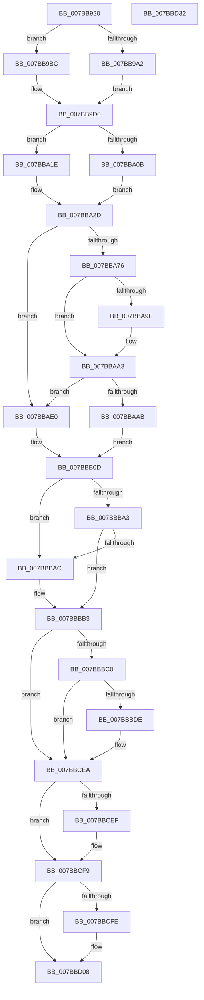

# EtwTimLogUserCetSetContextIpValidationFailure

- RVA: `0x007BB920`–`0x007BBD33` (길이 `1,043` bytes)
- VA: `0x00000001407BB920`
- 실행 섹션: `PAGE`
- PDB 이름 있음: `예`; PDB Function 태그: `아니요`
- unwind 정보 RVA: `0x000D3B54`
- 디코드: `240`개 명령, `1,043/1,043` bytes 표시
- 미해석 바이트: `0` (있으면 어셈블리에 `.byte`로 보존)

> 이 문서는 커널 이미지의 기계어와 PDB 기호를 분석해 생성했습니다. 4번과 5번은 함수 원형과 자료형을 바이너리 사용 방식에서 추정한 C 해석이며 원본 소스 복구 결과는 아닙니다.

## 1. Dependencies

- 직접 호출 지점: **10**; 고유 호출 대상: **9**
- 직접 호출자로 확인된 함수: **1**
- RIP 상대 이미지 참조: **8**

### Outgoing calls
- `0x007BB9E2` → [EtwpQueryProcessCommandLine](../8A/EtwpQueryProcessCommandLine_function_008A5C20.md) (function, `0x008A5C20`)
- `0x007BBA4D` → [EtwpTiFillProcessIdentity](../../text/3B/EtwpTiFillProcessIdentity_function_003B8F30.md) (function, `0x003B8F30`)
- `0x007BBA66` → [ExAllocatePool2](../../poolcode/B8/ExAllocatePool2_function_00B820F0.md) (function, `0x00B820F0`)
- `0x007BBA93` → [ZwQueryVirtualMemory](../../text/6A/ZwQueryVirtualMemory_function_006AD530.md) (function, `0x006AD530`)
- `0x007BBB99` → [EtwWrite](../../text/41/EtwWrite_function_0041C720.md) (function, `0x0041C720`)
- `0x007BBBD1` → [tlgKeywordOn](../../text/42/tlgKeywordOn_function_0042EAA0.md) (function, `0x0042EAA0`)
- `0x007BBCE5` → [tlgWriteTransfer_EtwWriteTransfer](../../text/42/tlgWriteTransfer_EtwWriteTransfer_function_004260E0.md) (function, `0x004260E0`)
- `0x007BBCF4` → [ExFreePoolWithTag](../../poolcode/B8/ExFreePoolWithTag_function_00B82870.md) (function, `0x00B82870`)
- `0x007BBD03` → [ExFreePoolWithTag](../../poolcode/B8/ExFreePoolWithTag_function_00B82870.md) (function, `0x00B82870`)
- `0x007BBD12` → [_security_check_cookie](../../text/6A/_security_check_cookie_function_006AC640.md) (function, `0x006AC640`)

### Direct callers
- [KiLogUserCetSetContextIpValidationFailureWorker](../74/KiLogUserCetSetContextIpValidationFailureWorker_function_00747760.md) at `0x007477B6`

### Static image references
- `0x007BB944` → RVA `0x00E0A740` (`.data`; read)
- `0x007BB963` → RVA `0x00002F28` (`.rdata`; read)
- `0x007BB972` → RVA `0x00B076E0` (` ?? ::NNGAKEGL::`string'`; read)
- `0x007BBB36` → RVA `0x00021158` (`.rdata`; read)
- `0x007BBB72` → RVA `0x00EFF828` (`.data`; read)
- `0x007BBB82` → RVA `0x000225A0` (`.rdata`; read)
- `0x007BBBB3` → RVA `0x00E09168` (`.data`; read)
- `0x007BBBEC` → RVA `0x00055308` (`.rdata`; read)

## 2. Other-region calls and transfers

- 다른 실행 섹션으로 향하는 call: **9**
  - `0x007BBA4D` → [EtwpTiFillProcessIdentity](../../text/3B/EtwpTiFillProcessIdentity_function_003B8F30.md) (`PAGE` → `.text`)
  - `0x007BBA66` → [ExAllocatePool2](../../poolcode/B8/ExAllocatePool2_function_00B820F0.md) (`PAGE` → `POOLCODE`)
  - `0x007BBA93` → [ZwQueryVirtualMemory](../../text/6A/ZwQueryVirtualMemory_function_006AD530.md) (`PAGE` → `.text`)
  - `0x007BBB99` → [EtwWrite](../../text/41/EtwWrite_function_0041C720.md) (`PAGE` → `.text`)
  - `0x007BBBD1` → [tlgKeywordOn](../../text/42/tlgKeywordOn_function_0042EAA0.md) (`PAGE` → `.text`)
  - `0x007BBCE5` → [tlgWriteTransfer_EtwWriteTransfer](../../text/42/tlgWriteTransfer_EtwWriteTransfer_function_004260E0.md) (`PAGE` → `.text`)
  - `0x007BBCF4` → [ExFreePoolWithTag](../../poolcode/B8/ExFreePoolWithTag_function_00B82870.md) (`PAGE` → `POOLCODE`)
  - `0x007BBD03` → [ExFreePoolWithTag](../../poolcode/B8/ExFreePoolWithTag_function_00B82870.md) (`PAGE` → `POOLCODE`)
  - `0x007BBD12` → [_security_check_cookie](../../text/6A/_security_check_cookie_function_006AC640.md) (`PAGE` → `.text`)
- 별도 외부 분기/꼬리 이동을 확인하지 못했습니다.

## 3. Assembly (complete function range)

```asm
007BB920  48 89 5C 24 08                  mov qword ptr [rsp + 8], rbx
007BB925  44 89 4C 24 20                  mov dword ptr [rsp + 0x20], r9d
007BB92A  55                              push rbp
007BB92B  56                              push rsi
007BB92C  57                              push rdi
007BB92D  41 54                           push r12
007BB92F  41 55                           push r13
007BB931  41 56                           push r14
007BB933  41 57                           push r15
007BB935  48 8D AC 24 C0 FE FF FF         lea rbp, [rsp - 0x140]
007BB93D  48 81 EC 40 02 00 00            sub rsp, 0x240
007BB944  48 8B 05 F5 ED 64 00            mov rax, qword ptr [rip + 0x64edf5]
007BB94B  48 33 C4                        xor rax, rsp
007BB94E  48 89 85 30 01 00 00            mov qword ptr [rbp + 0x130], rax
007BB955  48 8B DA                        mov rbx, rdx
007BB958  89 4C 24 40                     mov dword ptr [rsp + 0x40], ecx
007BB95C  33 D2                           xor edx, edx
007BB95E  4C 89 44 24 48                  mov qword ptr [rsp + 0x48], r8
007BB963  48 8D 35 BE 75 84 FF            lea rsi, [rip - 0x7b8a42]
007BB96A  48 89 54 24 50                  mov qword ptr [rsp + 0x50], rdx
007BB96F  0F 57 C0                        xorps xmm0, xmm0
007BB972  4C 8D 25 67 BD 34 00            lea r12, [rip + 0x34bd67]
007BB979  48 8B 83 50 03 00 00            mov rax, qword ptr [rbx + 0x350]
007BB980  48 85 C0                        test rax, rax
007BB983  8D 7A 02                        lea edi, [rdx + 2]
007BB986  0F 11 44 24 68                  movups xmmword ptr [rsp + 0x68], xmm0
007BB98B  48 0F 45 F0                     cmovne rsi, rax
007BB98F  8D 4A 06                        lea ecx, [rdx + 6]
007BB992  44 8D 7A 0C                     lea r15d, [rdx + 0xc]
007BB996  0F B7 06                        movzx eax, word ptr [rsi]
007BB999  48 89 7D 58                     mov qword ptr [rbp + 0x58], rdi
007BB99D  66 85 C0                        test ax, ax
007BB9A0  74 1A                           je 0x1407bb9bc
007BB9A2  66 D1 E8                        shr ax, 1
007BB9A5  66 89 44 24 30                  mov word ptr [rsp + 0x30], ax
007BB9AA  48 8D 44 24 30                  lea rax, [rsp + 0x30]
007BB9AF  48 89 45 50                     mov qword ptr [rbp + 0x50], rax
007BB9B3  0F B7 06                        movzx eax, word ptr [rsi]
007BB9B6  48 8B 4E 08                     mov rcx, qword ptr [rsi + 8]
007BB9BA  EB 14                           jmp 0x1407bb9d0
007BB9BC  48 8D 44 24 30                  lea rax, [rsp + 0x30]
007BB9C1  66 89 4C 24 30                  mov word ptr [rsp + 0x30], cx
007BB9C6  48 89 45 50                     mov qword ptr [rbp + 0x50], rax
007BB9CA  49 8B CC                        mov rcx, r12
007BB9CD  41 8B C7                        mov eax, r15d
007BB9D0  48 89 4D 60                     mov qword ptr [rbp + 0x60], rcx
007BB9D4  48 8B CB                        mov rcx, rbx
007BB9D7  89 55 6C                        mov dword ptr [rbp + 0x6c], edx
007BB9DA  48 8D 54 24 68                  lea rdx, [rsp + 0x68]
007BB9DF  89 45 68                        mov dword ptr [rbp + 0x68], eax
007BB9E2  E8 39 A2 0E 00                  call 0x1408a5c20
007BB9E7  44 0F B7 6C 24 68               movzx r13d, word ptr [rsp + 0x68]
007BB9ED  48 8D 44 24 38                  lea rax, [rsp + 0x38]
007BB9F2  4C 8B 74 24 70                  mov r14, qword ptr [rsp + 0x70]
007BB9F7  33 D2                           xor edx, edx
007BB9F9  48 C7 45 78 02 00 00 00         mov qword ptr [rbp + 0x78], 2
007BBA01  48 89 45 70                     mov qword ptr [rbp + 0x70], rax
007BBA05  66 45 85 ED                     test r13w, r13w
007BBA09  74 13                           je 0x1407bba1e
007BBA0B  41 0F B7 C5                     movzx eax, r13w
007BBA0F  4C 89 B5 80 00 00 00            mov qword ptr [rbp + 0x80], r14
007BBA16  66 D1 E8                        shr ax, 1
007BBA19  41 8B CD                        mov ecx, r13d
007BBA1C  EB 0F                           jmp 0x1407bba2d
007BBA1E  4C 89 A5 80 00 00 00            mov qword ptr [rbp + 0x80], r12
007BBA25  41 8B CF                        mov ecx, r15d
007BBA28  B8 06 00 00 00                  mov eax, 6
007BBA2D  89 8D 88 00 00 00               mov dword ptr [rbp + 0x88], ecx
007BBA33  4C 8D 44 24 50                  lea r8, [rsp + 0x50]
007BBA38  89 95 8C 00 00 00               mov dword ptr [rbp + 0x8c], edx
007BBA3E  48 8D 8D 90 00 00 00            lea rcx, [rbp + 0x90]
007BBA45  48 8B D3                        mov rdx, rbx
007BBA48  66 89 44 24 38                  mov word ptr [rsp + 0x38], ax
007BBA4D  E8 DE D4 BF FF                  call 0x1403b8f30
007BBA52  BA 00 02 00 00                  mov edx, 0x200
007BBA57  89 44 24 3C                     mov dword ptr [rsp + 0x3c], eax
007BBA5B  B9 00 01 00 00                  mov ecx, 0x100
007BBA60  41 B8 54 49 73 6E               mov r8d, 0x6e734954
007BBA66  E8 85 66 3C 00                  call 0x140b820f0
007BBA6B  45 33 C0                        xor r8d, r8d
007BBA6E  48 8B D8                        mov rbx, rax
007BBA71  48 85 C0                        test rax, rax
007BBA74  74 6A                           je 0x1407bbae0
007BBA76  48 8B 54 24 48                  mov rdx, qword ptr [rsp + 0x48]
007BBA7B  4C 8B C8                        mov r9, rax
007BBA7E  4C 89 44 24 28                  mov qword ptr [rsp + 0x28], r8
007BBA83  48 83 C9 FF                     or rcx, 0xffffffffffffffff
007BBA87  44 8B C7                        mov r8d, edi
007BBA8A  48 C7 44 24 20 00 02 00 00      mov qword ptr [rsp + 0x20], 0x200
007BBA93  E8 98 1A EF FF                  call 0x1406ad530
007BBA98  45 33 C0                        xor r8d, r8d
007BBA9B  85 C0                           test eax, eax
007BBA9D  79 04                           jns 0x1407bbaa3
007BBA9F  66 44 89 03                     mov word ptr [rbx], r8w
007BBAA3  0F B7 03                        movzx eax, word ptr [rbx]
007BBAA6  66 85 C0                        test ax, ax
007BBAA9  74 35                           je 0x1407bbae0
007BBAAB  8B 4C 24 3C                     mov ecx, dword ptr [rsp + 0x3c]
007BBAAF  48 8D 54 24 34                  lea rdx, [rsp + 0x34]
007BBAB4  66 D1 E8                        shr ax, 1
007BBAB7  83 C1 04                        add ecx, 4
007BBABA  66 89 44 24 34                  mov word ptr [rsp + 0x34], ax
007BBABF  8B C1                           mov eax, ecx
007BBAC1  48 03 C0                        add rax, rax
007BBAC4  44 8D 49 01                     lea r9d, [rcx + 1]
007BBAC8  48 89 54 C5 50                  mov qword ptr [rbp + rax*8 + 0x50], rdx
007BBACD  48 C7 44 C5 58 02 00 00 00      mov qword ptr [rbp + rax*8 + 0x58], 2
007BBAD6  44 0F B7 3B                     movzx r15d, word ptr [rbx]
007BBADA  4C 8B 63 08                     mov r12, qword ptr [rbx + 8]
007BBADE  EB 2D                           jmp 0x1407bbb0d
007BBAE0  44 8B 4C 24 3C                  mov r9d, dword ptr [rsp + 0x3c]
007BBAE5  48 8D 4C 24 34                  lea rcx, [rsp + 0x34]
007BBAEA  B8 06 00 00 00                  mov eax, 6
007BBAEF  66 89 44 24 34                  mov word ptr [rsp + 0x34], ax
007BBAF4  41 8D 41 04                     lea eax, [r9 + 4]
007BBAF8  48 03 C0                        add rax, rax
007BBAFB  41 83 C1 05                     add r9d, 5
007BBAFF  48 89 4C C5 50                  mov qword ptr [rbp + rax*8 + 0x50], rcx
007BBB04  48 C7 44 C5 58 02 00 00 00      mov qword ptr [rbp + rax*8 + 0x58], 2
007BBB0D  41 8B C1                        mov eax, r9d
007BBB10  48 8D 55 50                     lea rdx, [rbp + 0x50]
007BBB14  48 C1 E0 04                     shl rax, 4
007BBB18  48 8B C8                        mov rcx, rax
007BBB1B  41 FF C1                        inc r9d
007BBB1E  48 8D 8D 98 01 00 00            lea rcx, [rbp + 0x198]
007BBB25  4C 89 24 02                     mov qword ptr [rdx + rax], r12
007BBB29  45 33 E4                        xor r12d, r12d
007BBB2C  44 89 7C 05 58                  mov dword ptr [rbp + rax + 0x58], r15d
007BBB31  44 89 64 02 0C                  mov dword ptr [rdx + rax + 0xc], r12d
007BBB36  48 8D 15 1B 56 86 FF            lea rdx, [rip - 0x79a9e5]
007BBB3D  44 8B 7C 24 40                  mov r15d, dword ptr [rsp + 0x40]
007BBB42  41 8B C1                        mov eax, r9d
007BBB45  48 03 C0                        add rax, rax
007BBB48  41 FF C1                        inc r9d
007BBB4B  48 89 4C C5 50                  mov qword ptr [rbp + rax*8 + 0x50], rcx
007BBB50  48 8D 8D A0 01 00 00            lea rcx, [rbp + 0x1a0]
007BBB57  48 C7 44 C5 58 04 00 00 00      mov qword ptr [rbp + rax*8 + 0x58], 4
007BBB60  41 8B C1                        mov eax, r9d
007BBB63  48 03 C0                        add rax, rax
007BBB66  41 FF C1                        inc r9d
007BBB69  41 83 FF 01                     cmp r15d, 1
007BBB6D  48 89 4C C5 50                  mov qword ptr [rbp + rax*8 + 0x50], rcx
007BBB72  48 8B 0D AF 3C 74 00            mov rcx, qword ptr [rip + 0x743caf]
007BBB79  48 C7 44 C5 58 04 00 00 00      mov qword ptr [rbp + rax*8 + 0x58], 4
007BBB82  48 8D 05 17 6A 86 FF            lea rax, [rip - 0x7995e9]
007BBB89  48 0F 45 D0                     cmovne rdx, rax
007BBB8D  48 8D 45 50                     lea rax, [rbp + 0x50]
007BBB91  45 33 C0                        xor r8d, r8d
007BBB94  48 89 44 24 20                  mov qword ptr [rsp + 0x20], rax
007BBB99  E8 82 0B C6 FF                  call 0x14041c720
007BBB9E  48 85 DB                        test rbx, rbx
007BBBA1  74 09                           je 0x1407bbbac
007BBBA3  4C 8B C3                        mov r8, rbx
007BBBA6  66 44 39 23                     cmp word ptr [rbx], r12w
007BBBAA  75 07                           jne 0x1407bbbb3
007BBBAC  4C 8D 05 75 73 84 FF            lea r8, [rip - 0x7b8c8b]
007BBBB3  83 3D AE D5 64 00 05            cmp dword ptr [rip + 0x64d5ae], 5
007BBBBA  0F 86 2A 01 00 00               jbe 0x1407bbcea
007BBBC0  48 BA 00 00 00 00 00 40 00 00   movabs rdx, 0x400000000000
007BBBCA  48 8D 0D 97 D5 64 00            lea rcx, [rip + 0x64d597]
007BBBD1  E8 CA 2E C7 FF                  call 0x14042eaa0
007BBBD6  84 C0                           test al, al
007BBBD8  0F 84 0C 01 00 00               je 0x1407bbcea
007BBBDE  48 8D 44 24 40                  lea rax, [rsp + 0x40]
007BBBE3  44 89 7C 24 40                  mov dword ptr [rsp + 0x40], r15d
007BBBE8  48 89 45 A0                     mov qword ptr [rbp - 0x60], rax
007BBBEC  48 8D 15 15 97 89 FF            lea rdx, [rip - 0x7668eb]
007BBBF3  48 8D 45 C8                     lea rax, [rbp - 0x38]
007BBBF7  48 C7 45 A8 04 00 00 00         mov qword ptr [rbp - 0x58], 4
007BBBFF  48 89 45 B0                     mov qword ptr [rbp - 0x50], rax
007BBC03  48 8D 0D 5E D5 64 00            lea rcx, [rip + 0x64d55e]
007BBC0A  48 8B 46 08                     mov rax, qword ptr [rsi + 8]
007BBC0E  45 33 C9                        xor r9d, r9d
007BBC11  48 89 45 C0                     mov qword ptr [rbp - 0x40], rax
007BBC15  0F B7 06                        movzx eax, word ptr [rsi]
007BBC18  89 45 C8                        mov dword ptr [rbp - 0x38], eax
007BBC1B  48 8D 45 E8                     lea rax, [rbp - 0x18]
007BBC1F  48 89 45 D0                     mov qword ptr [rbp - 0x30], rax
007BBC23  48 8B 44 24 50                  mov rax, qword ptr [rsp + 0x50]
007BBC28  48 89 44 24 58                  mov qword ptr [rsp + 0x58], rax
007BBC2D  48 8D 44 24 58                  lea rax, [rsp + 0x58]
007BBC32  48 89 45 F0                     mov qword ptr [rbp - 0x10], rax
007BBC36  48 8D 45 18                     lea rax, [rbp + 0x18]
007BBC3A  48 89 45 00                     mov qword ptr [rbp], rax
007BBC3E  49 8B 40 08                     mov rax, qword ptr [r8 + 8]
007BBC42  48 89 45 10                     mov qword ptr [rbp + 0x10], rax
007BBC46  41 0F B7 00                     movzx eax, word ptr [r8]
007BBC4A  45 33 C0                        xor r8d, r8d
007BBC4D  89 45 18                        mov dword ptr [rbp + 0x18], eax
007BBC50  8B 85 98 01 00 00               mov eax, dword ptr [rbp + 0x198]
007BBC56  89 44 24 3C                     mov dword ptr [rsp + 0x3c], eax
007BBC5A  48 8D 44 24 3C                  lea rax, [rsp + 0x3c]
007BBC5F  48 89 45 20                     mov qword ptr [rbp + 0x20], rax
007BBC63  8B 85 A0 01 00 00               mov eax, dword ptr [rbp + 0x1a0]
007BBC69  89 44 24 48                     mov dword ptr [rsp + 0x48], eax
007BBC6D  48 8D 44 24 48                  lea rax, [rsp + 0x48]
007BBC72  48 89 45 30                     mov qword ptr [rbp + 0x30], rax
007BBC76  48 8D 44 24 60                  lea rax, [rsp + 0x60]
007BBC7B  48 89 45 40                     mov qword ptr [rbp + 0x40], rax
007BBC7F  48 8D 45 80                     lea rax, [rbp - 0x80]
007BBC83  48 89 44 24 28                  mov qword ptr [rsp + 0x28], rax
007BBC88  C7 44 24 20 0D 00 00 00         mov dword ptr [rsp + 0x20], 0xd
007BBC90  48 C7 45 B8 02 00 00 00         mov qword ptr [rbp - 0x48], 2
007BBC98  44 89 65 CC                     mov dword ptr [rbp - 0x34], r12d
007BBC9C  48 C7 45 D8 02 00 00 00         mov qword ptr [rbp - 0x28], 2
007BBCA4  4C 89 75 E0                     mov qword ptr [rbp - 0x20], r14
007BBCA8  44 89 6D E8                     mov dword ptr [rbp - 0x18], r13d
007BBCAC  44 89 65 EC                     mov dword ptr [rbp - 0x14], r12d
007BBCB0  48 C7 45 F8 08 00 00 00         mov qword ptr [rbp - 8], 8
007BBCB8  48 C7 45 08 02 00 00 00         mov qword ptr [rbp + 8], 2
007BBCC0  44 89 65 1C                     mov dword ptr [rbp + 0x1c], r12d
007BBCC4  48 C7 45 28 04 00 00 00         mov qword ptr [rbp + 0x28], 4
007BBCCC  48 C7 45 38 04 00 00 00         mov qword ptr [rbp + 0x38], 4
007BBCD4  48 C7 44 24 60 00 00 00 01      mov qword ptr [rsp + 0x60], 0x1000000
007BBCDD  48 C7 45 48 08 00 00 00         mov qword ptr [rbp + 0x48], 8
007BBCE5  E8 F6 A3 C6 FF                  call 0x1404260e0
007BBCEA  4D 85 F6                        test r14, r14
007BBCED  74 0A                           je 0x1407bbcf9
007BBCEF  33 D2                           xor edx, edx
007BBCF1  49 8B CE                        mov rcx, r14
007BBCF4  E8 77 6B 3C 00                  call 0x140b82870
007BBCF9  48 85 DB                        test rbx, rbx
007BBCFC  74 0A                           je 0x1407bbd08
007BBCFE  33 D2                           xor edx, edx
007BBD00  48 8B CB                        mov rcx, rbx
007BBD03  E8 68 6B 3C 00                  call 0x140b82870
007BBD08  48 8B 8D 30 01 00 00            mov rcx, qword ptr [rbp + 0x130]
007BBD0F  48 33 CC                        xor rcx, rsp
007BBD12  E8 29 09 EF FF                  call 0x1406ac640
007BBD17  48 8B 9C 24 80 02 00 00         mov rbx, qword ptr [rsp + 0x280]
007BBD1F  48 81 C4 40 02 00 00            add rsp, 0x240
007BBD26  41 5F                           pop r15
007BBD28  41 5E                           pop r14
007BBD2A  41 5D                           pop r13
007BBD2C  41 5C                           pop r12
007BBD2E  5F                              pop rdi
007BBD2F  5E                              pop rsi
007BBD30  5D                              pop rbp
007BBD31  C3                              ret
007BBD32  CC                              int3
```

## 4. C-style interpretation (structured pseudocode)

```c
__int64 __fastcall EtwTimLogUserCetSetContextIpValidationFailure(int a1, __int64 a2, __int64 a3, int a4, unsigned int a5)
{
    __int64 result;
    __int64 v_r12;
    __int64 v_rsi;
    __int64 v_rsp;
    unsigned __int64 v_stack_m100;
    unsigned __int64 v_stack_m108;
    unsigned int v_stack_m10C;
    unsigned int v_stack_m110;
    unsigned __int64 v_stack_m118;
    unsigned __int64 v_stack_m120;
    unsigned __int64 v_stack_m128;
    unsigned __int64 v_stack_m130;
    unsigned __int64 v_stack_m138;
    unsigned __int64 v_stack_m140;
    unsigned __int64 v_stack_m148;
    unsigned __int64 v_stack_m150;
    unsigned __int64 v_stack_m158;
    unsigned int v_stack_m15C;
    unsigned __int64 v_stack_m160;
    unsigned __int64 v_stack_m168;
    unsigned __int64 v_stack_m170;
    unsigned __int64 v_stack_m178;
    unsigned __int64 v_stack_m180;
    unsigned __int64 v_stack_m188;
    unsigned int v_stack_m18C;
    unsigned __int64 v_stack_m190;
    unsigned __int64 v_stack_m198;
    unsigned __int64 v_stack_m1A0;
    unsigned __int64 v_stack_m1A8;
    unsigned int v_stack_m1AC;
    unsigned __int64 v_stack_m1B0;
    unsigned __int64 v_stack_m1B8;
    unsigned __int64 v_stack_m1C0;
    unsigned __int64 v_stack_m1C8;
    unsigned __int64 v_stack_m1D0;
    unsigned __int64 v_stack_m1D8;
    unsigned __int64 v_stack_m1F8;
    unsigned __int64 v_stack_m208;
    unsigned __int64 v_stack_m210;
    unsigned __int64 v_stack_m218;
    unsigned __int64 v_stack_m220;
    unsigned __int64 v_stack_m228;
    unsigned __int64 v_stack_m230;
    unsigned int v_stack_m238;
    unsigned int v_stack_m23C;
    unsigned __int64 v_stack_m240;
    unsigned __int64 v_stack_m244;
    unsigned __int16 v_stack_m248;
    unsigned __int64 v_stack_m250;
    unsigned __int64 v_stack_m258;
    unsigned __int64 v_stack_m48;
    unsigned __int64 v_stack_mE8;
    unsigned int v_stack_mEC;
    unsigned int v_stack_mF0;
    unsigned __int64 v_stack_mF8;
    unsigned int v_stack_p20;
    unsigned __int64 v_stack_p8;

    v_stack_p8 = v_rbx;
    v_stack_p20 = a4;
    v_rsp = (v_rsp) - (576);
    result = (*(unsigned __int64 *)(v_rip + 6614517)) ^ (v_rsp);
    v_stack_m48 = result;
    v_stack_m238 = a1;
    a2 = 0;
    v_stack_m230 = a3;
    v_stack_m228 = 0;
    v_stack_m210 = v_xmm0;
    v_rsi = v_rip - 8096322;
    if (*(unsigned __int64 *)(a2 + 848) != 0) { v_rsi = *(unsigned __int64 *)(a2 + 848); }
    v_stack_m120 = a2 + 2;
    if ((unsigned __int16)(*(unsigned __int16 *)(v_rsi)) == 0) goto loc_007BB9BC;
    result = (unsigned __int16)((*(unsigned __int16 *)(v_rsi)) >> (1));
    v_stack_m248 = (unsigned __int16)(result);
    v_stack_m128 = v_stack_m248;
    goto loc_007BB9D0;
loc_007BB9BC:
    v_stack_m248 = (unsigned __int16)(*(unsigned __int64 *)(v_rsi + 8));
    v_stack_m128 = v_stack_m248;
loc_007BB9D0:
    v_stack_m118 = v_rip + 3456359;
    v_stack_m10C = 0;
    v_stack_m110 = (unsigned int)((unsigned int)((unsigned int)(a2 + 12)));
    result = EtwpQueryProcessCommandLine(0, v_stack_m210, a3, a4);
    a2 = 0;
    v_stack_m100 = 2;
    v_stack_m108 = v_stack_m240;
    if ((unsigned __int16)(v_stack_m210) == 0) goto loc_007BBA1E;
    v_stack_mF8 = v_stack_m208;
    result = (unsigned __int16)(((unsigned __int16)(v_stack_m210)) >> (1));
    goto loc_007BBA2D;
loc_007BBA1E:
    v_stack_mF8 = v_rip + 3456359;
loc_007BBA2D:
    v_stack_mF0 = (unsigned int)((unsigned int)((unsigned int)(a2 + 12)));
    v_stack_mEC = 0;
    v_stack_m240 = 6;
    result = EtwpTiFillProcessIdentity(v_stack_mE8, 0, v_stack_m228, a4);
    v_stack_m23C = (unsigned int)(result);
    result = ExAllocatePool2(256, 512, (unsigned int)(0x6E734954ULL), a4);
    a3 = 0;
    if (result == 0) goto loc_007BBAE0;
    v_stack_m250 = 0;
    a1 = (256) | (-1);
    v_stack_m258 = 512;
    result = ZwQueryVirtualMemory(a1, v_stack_m230, (unsigned int)((unsigned int)(a2 + 2)), result);
    a3 = 0;
    if (sign_flag) {
        *(unsigned __int16 *)(result) = 0;
    }
    if ((unsigned __int16)(*(unsigned __int16 *)(result)) == 0) goto loc_007BBAE0;
    result = (unsigned __int16)((*(unsigned __int16 *)(result)) >> (1));
    a1 = (unsigned int)(((unsigned int)(v_stack_m23C)) + (4));
    v_stack_m244 = (unsigned __int16)(result);
    result = ((unsigned int)(a1)) + ((unsigned int)(a1));
    *(unsigned __int64 *)(v_stack_m178 + result * 8 + 80) = v_stack_m244;
    *(unsigned __int64 *)(v_stack_m178 + result * 8 + 88) = 2;
    goto loc_007BBB0D;
loc_007BBAE0:
    v_stack_m244 = 6;
    result = ((unsigned int)(v_stack_m23C) + 4) + ((unsigned int)(v_stack_m23C) + 4);
    a4 = (unsigned int)(((unsigned int)(v_stack_m23C)) + (5));
    *(unsigned __int64 *)(v_stack_m178 + result * 8 + 80) = v_stack_m244;
    *(unsigned __int64 *)(v_stack_m178 + result * 8 + 88) = 2;
loc_007BBB0D:
    result = ((unsigned int)(a4)) << (4);
    a4 = (unsigned int)((a4) + 1);
    *(unsigned __int64 *)(v_stack_m128 + result * 1) = *(unsigned __int64 *)(result + 8);
    v_r12 = 0;
    *(unsigned int *)(v_stack_m178 + result * 1 + 88) = (unsigned int)(*(unsigned __int16 *)(result));
    *(unsigned int *)(v_stack_m128 + result * 1 + 12) = 0;
    result = ((unsigned int)(a4)) + ((unsigned int)(a4));
    a4 = (unsigned int)((a4) + 1);
    *(unsigned __int64 *)(v_stack_m178 + result * 8 + 80) = v_stack_p20;
    *(unsigned __int64 *)(v_stack_m178 + result * 8 + 88) = 4;
    result = ((unsigned int)(a4)) + ((unsigned int)(a4));
    a4 = (unsigned int)((a4) + 1);
    *(unsigned __int64 *)(v_stack_m178 + result * 8 + 80) = a5;
    *(unsigned __int64 *)(v_stack_m178 + result * 8 + 88) = 4;
    a2 = v_rip - 7973349;
    if (((unsigned int)((unsigned int)(v_stack_m238))) != 1) { a2 = v_rip - 7968233; }
    a3 = 0;
    v_stack_m258 = v_stack_m128;
    result = EtwWrite(*(unsigned __int64 *)(v_rip + 7617711), a2, a3, a4);
    if (result == 0) goto loc_007BBBAC;
    if ((*(unsigned __int16 *)(result)) == 0) {
        a3 = v_rip - 8096907;
    }
    if ((*(unsigned int *)(v_rip + 6608302)) <= 5) goto loc_007BBCEA;
    result = tlgKeywordOn(v_rip + 6608279, a2, a3, a4);
    if ((unsigned __int8)(result) != 0) {
        result = v_stack_m238;
        v_stack_m238 = (unsigned int)((unsigned int)(v_stack_m238));
        v_stack_m1D8 = result;
        a2 = v_rip - 7760107;
        result = v_stack_m1B0;
        v_stack_m1D0 = 4;
        v_stack_m1C8 = result;
        a1 = v_rip + 6608222;
        result = *(unsigned __int64 *)(v_rsi + 8);
        a4 = 0;
        v_stack_m1B8 = result;
        result = *(unsigned __int16 *)(v_rsi);
        v_stack_m1B0 = (unsigned int)(result);
        result = v_stack_m190;
        v_stack_m1A8 = result;
        result = v_stack_m228;
        v_stack_m220 = result;
        result = v_stack_m220;
        v_stack_m188 = result;
        result = v_stack_m160;
        v_stack_m178 = result;
        result = *(unsigned __int64 *)(a3 + 8);
        v_stack_m168 = result;
        result = *(unsigned __int16 *)(a3);
        a3 = 0;
        v_stack_m160 = (unsigned int)(result);
        result = v_stack_p20;
        v_stack_m23C = (unsigned int)(result);
        result = v_stack_m23C;
        v_stack_m158 = result;
        result = a5;
        v_stack_m230 = (unsigned int)(result);
        result = v_stack_m230;
        v_stack_m148 = result;
        result = v_stack_m218;
        v_stack_m138 = result;
        result = v_stack_m1F8;
        v_stack_m250 = result;
        v_stack_m258 = 13;
        v_stack_m1C0 = 2;
        v_stack_m1AC = 0;
        v_stack_m1A0 = 2;
        v_stack_m198 = v_stack_m208;
        v_stack_m190 = (unsigned int)(v_stack_m210);
        v_stack_m18C = 0;
        v_stack_m180 = 8;
        v_stack_m170 = 2;
        v_stack_m15C = 0;
        v_stack_m150 = 4;
        v_stack_m140 = 4;
        v_stack_m218 = 0x1000000ULL;
        v_stack_m130 = 8;
        result = tlgWriteTransfer_EtwWriteTransfer(a1, a2, a3, a4);
    }
    if (v_stack_m208 != 0) {
        a2 = 0;
        a1 = v_stack_m208;
        result = ExFreePoolWithTag(a1, a2, a3, a4);
    }
    if (result != 0) {
        a2 = 0;
        a1 = result;
        result = ExFreePoolWithTag(a1, a2, a3, a4);
    }
    a1 = (v_stack_m48) ^ (v_rsp);
    result = _security_check_cookie(a1, a2, a3, a4);
    v_rsp = (v_rsp) + (576);
    return result;
}
```

## 5. (Beta) C Style

```c
int64_t EtwTimLogUserCetSetContextIpValidationFailure(int32_t Arg1, void *Arg2, int64_t Arg3, int32_t Arg4, uint32_t Arg5)
{
    uint8_t *arg2 = (uint8_t *)Arg2;

    int64_t result;
    int64_t local_r12;
    int64_t local_rsi;
    int64_t local_rsp;
    uint64_t v_stack_m100;
    uint64_t v_stack_m108;
    uint32_t v_stack_m10C;
    uint32_t v_stack_m110;
    uint64_t v_stack_m118;
    uint64_t v_stack_m120;
    uint64_t v_stack_m128;
    uint64_t v_stack_m130;
    uint64_t v_stack_m138;
    uint64_t v_stack_m140;
    uint64_t v_stack_m148;
    uint64_t v_stack_m150;
    uint64_t v_stack_m158;
    uint32_t v_stack_m15C;
    uint64_t v_stack_m160;
    uint64_t v_stack_m168;
    uint64_t v_stack_m170;
    uint64_t v_stack_m178;
    uint64_t v_stack_m180;
    uint64_t v_stack_m188;
    uint32_t v_stack_m18C;
    uint64_t v_stack_m190;
    uint64_t v_stack_m198;
    uint64_t v_stack_m1A0;
    uint64_t v_stack_m1A8;
    uint32_t v_stack_m1AC;
    uint64_t v_stack_m1B0;
    uint64_t v_stack_m1B8;
    uint64_t v_stack_m1C0;
    uint64_t v_stack_m1C8;
    uint64_t v_stack_m1D0;
    uint64_t v_stack_m1D8;
    uint64_t v_stack_m1F8;
    uint64_t v_stack_m208;
    uint64_t v_stack_m210;
    uint64_t v_stack_m218;
    uint64_t v_stack_m220;
    uint64_t v_stack_m228;
    uint64_t v_stack_m230;
    uint32_t v_stack_m238;
    uint32_t v_stack_m23C;
    uint64_t v_stack_m240;
    uint64_t v_stack_m244;
    uint16_t v_stack_m248;
    uint64_t v_stack_m250;
    uint64_t v_stack_m258;
    uint64_t v_stack_m48;
    uint64_t v_stack_mE8;
    uint32_t v_stack_mEC;
    uint32_t v_stack_mF0;
    uint64_t v_stack_mF8;
    uint32_t v_stack_p20;
    uint64_t v_stack_p8;

    v_stack_p8 = local_rbx;
    v_stack_p20 = Arg4;
    local_rsp = (local_rsp) - (576);
    result = (*(uint64_t *)(v_rip + 0x64EDF5)) ^ (local_rsp);
    v_stack_m48 = result;
    v_stack_m238 = Arg1;
    Arg2 = 0;
    v_stack_m230 = Arg3;
    v_stack_m228 = 0;
    v_stack_m210 = v_xmm0;
    local_rsi = v_rip - 8096322;
    if (*(uint64_t *)(arg2 + 0x350) != 0) { local_rsi = *(uint64_t *)(arg2 + 0x350); }
    v_stack_m120 = Arg2 + 2;
    if ((uint16_t)(*(uint16_t *)(local_rsi)) == 0) goto loc_007BB9BC;
    result = (uint16_t)((*(uint16_t *)(local_rsi)) >> (1));
    v_stack_m248 = (uint16_t)(result);
    v_stack_m128 = v_stack_m248;
    goto loc_007BB9D0;
loc_007BB9BC:
    v_stack_m248 = (uint16_t)(*(uint64_t *)(local_rsi + 0x8));
    v_stack_m128 = v_stack_m248;
loc_007BB9D0:
    v_stack_m118 = v_rip + 3456359;
    v_stack_m10C = 0;
    v_stack_m110 = (uint32_t)((uint32_t)((uint32_t)(Arg2 + 12)));
    result = EtwpQueryProcessCommandLine(0, v_stack_m210, Arg3, Arg4);
    Arg2 = 0;
    v_stack_m100 = 2;
    v_stack_m108 = v_stack_m240;
    if ((uint16_t)(v_stack_m210) == 0) goto loc_007BBA1E;
    v_stack_mF8 = v_stack_m208;
    result = (uint16_t)(((uint16_t)(v_stack_m210)) >> (1));
    goto loc_007BBA2D;
loc_007BBA1E:
    v_stack_mF8 = v_rip + 3456359;
loc_007BBA2D:
    v_stack_mF0 = (uint32_t)((uint32_t)((uint32_t)(Arg2 + 12)));
    v_stack_mEC = 0;
    v_stack_m240 = 6;
    result = EtwpTiFillProcessIdentity(v_stack_mE8, 0, v_stack_m228, Arg4);
    v_stack_m23C = (uint32_t)(result);
    result = ExAllocatePool2(256, 512, (uint32_t)(0x6E734954ULL), Arg4);
    Arg3 = 0;
    if (result == 0) goto loc_007BBAE0;
    v_stack_m250 = 0;
    Arg1 = (256) | (-1);
    v_stack_m258 = 512;
    result = ZwQueryVirtualMemory(Arg1, v_stack_m230, (uint32_t)((uint32_t)(Arg2 + 2)), result);
    Arg3 = 0;
    if (sign_flag) {
        *(uint16_t *)(result) = 0;
    }
    if ((uint16_t)(*(uint16_t *)(result)) == 0) goto loc_007BBAE0;
    result = (uint16_t)((*(uint16_t *)(result)) >> (1));
    Arg1 = (uint32_t)(((uint32_t)(v_stack_m23C)) + (4));
    v_stack_m244 = (uint16_t)(result);
    result = ((uint32_t)(Arg1)) + ((uint32_t)(Arg1));
    *(uint64_t *)(v_stack_m178 + result * 8 + 0x50) = v_stack_m244;
    *(uint64_t *)(v_stack_m178 + result * 8 + 0x58) = 2;
    goto loc_007BBB0D;
loc_007BBAE0:
    v_stack_m244 = 6;
    result = ((uint32_t)(v_stack_m23C) + 4) + ((uint32_t)(v_stack_m23C) + 4);
    Arg4 = (uint32_t)(((uint32_t)(v_stack_m23C)) + (5));
    *(uint64_t *)(v_stack_m178 + result * 8 + 0x50) = v_stack_m244;
    *(uint64_t *)(v_stack_m178 + result * 8 + 0x58) = 2;
loc_007BBB0D:
    result = ((uint32_t)(Arg4)) << (4);
    Arg4 = (uint32_t)((Arg4) + 1);
    *(uint64_t *)(v_stack_m128 + result * 1) = *(uint64_t *)(result + 0x8);
    local_r12 = 0;
    *(uint32_t *)(v_stack_m178 + result * 1 + 0x58) = (uint32_t)(*(uint16_t *)(result));
    *(uint32_t *)(v_stack_m128 + result * 1 + 0xC) = 0;
    result = ((uint32_t)(Arg4)) + ((uint32_t)(Arg4));
    Arg4 = (uint32_t)((Arg4) + 1);
    *(uint64_t *)(v_stack_m178 + result * 8 + 0x50) = v_stack_p20;
    *(uint64_t *)(v_stack_m178 + result * 8 + 0x58) = 4;
    result = ((uint32_t)(Arg4)) + ((uint32_t)(Arg4));
    Arg4 = (uint32_t)((Arg4) + 1);
    *(uint64_t *)(v_stack_m178 + result * 8 + 0x50) = Arg5;
    *(uint64_t *)(v_stack_m178 + result * 8 + 0x58) = 4;
    Arg2 = v_rip - 7973349;
    if (((uint32_t)((uint32_t)(v_stack_m238))) != 1) { Arg2 = v_rip - 7968233; }
    Arg3 = 0;
    v_stack_m258 = v_stack_m128;
    result = EtwWrite(*(uint64_t *)(v_rip + 0x743CAF), Arg2, Arg3, Arg4);
    if (result == 0) goto loc_007BBBAC;
    if ((*(uint16_t *)(result)) == 0) {
        Arg3 = v_rip - 8096907;
    }
    if ((*(uint32_t *)(v_rip + 0x64D5AE)) <= 5) goto loc_007BBCEA;
    result = tlgKeywordOn(v_rip + 6608279, Arg2, Arg3, Arg4);
    if ((uint8_t)(result) != 0) {
        result = v_stack_m238;
        v_stack_m238 = (uint32_t)((uint32_t)(v_stack_m238));
        v_stack_m1D8 = result;
        Arg2 = v_rip - 7760107;
        result = v_stack_m1B0;
        v_stack_m1D0 = 4;
        v_stack_m1C8 = result;
        Arg1 = v_rip + 6608222;
        result = *(uint64_t *)(local_rsi + 0x8);
        Arg4 = 0;
        v_stack_m1B8 = result;
        result = *(uint16_t *)(local_rsi);
        v_stack_m1B0 = (uint32_t)(result);
        result = v_stack_m190;
        v_stack_m1A8 = result;
        result = v_stack_m228;
        v_stack_m220 = result;
        result = v_stack_m220;
        v_stack_m188 = result;
        result = v_stack_m160;
        v_stack_m178 = result;
        result = *(uint64_t *)(Arg3 + 0x8);
        v_stack_m168 = result;
        result = *(uint16_t *)(Arg3);
        Arg3 = 0;
        v_stack_m160 = (uint32_t)(result);
        result = v_stack_p20;
        v_stack_m23C = (uint32_t)(result);
        result = v_stack_m23C;
        v_stack_m158 = result;
        result = Arg5;
        v_stack_m230 = (uint32_t)(result);
        result = v_stack_m230;
        v_stack_m148 = result;
        result = v_stack_m218;
        v_stack_m138 = result;
        result = v_stack_m1F8;
        v_stack_m250 = result;
        v_stack_m258 = 13;
        v_stack_m1C0 = 2;
        v_stack_m1AC = 0;
        v_stack_m1A0 = 2;
        v_stack_m198 = v_stack_m208;
        v_stack_m190 = (uint32_t)(v_stack_m210);
        v_stack_m18C = 0;
        v_stack_m180 = 8;
        v_stack_m170 = 2;
        v_stack_m15C = 0;
        v_stack_m150 = 4;
        v_stack_m140 = 4;
        v_stack_m218 = 0x1000000ULL;
        v_stack_m130 = 8;
        result = tlgWriteTransfer_EtwWriteTransfer(Arg1, Arg2, Arg3, Arg4);
    }
    if (v_stack_m208 != 0) {
        Arg2 = 0;
        Arg1 = v_stack_m208;
        result = ExFreePoolWithTag(Arg1, Arg2, Arg3, Arg4);
    }
    if (result != 0) {
        Arg2 = 0;
        Arg1 = result;
        result = ExFreePoolWithTag(Arg1, Arg2, Arg3, Arg4);
    }
    Arg1 = (v_stack_m48) ^ (local_rsp);
    result = _security_check_cookie(Arg1, Arg2, Arg3, Arg4);
    local_rsp = (local_rsp) + (576);
    return result;
}
```

### 관측된 메모리 오프셋

구조체 형식이 확인되지 않은 접근은 인자 기준의 오프셋으로만 기록했습니다.

| 기준 인자 | 오프셋 표현 | 폭 (bit) | 접근 |
|---|---:|---:|---|
| `Arg2` | `+ 0x350` | `64` | `R` |

## 6. Execution-region graph

[열기: 2D/3D 그래프와 함수 탐색 컨트롤 패널](../../../control-panel.html?section=page&rva=0x007BB920&view=graph)

- 2D 그래프는 위에서 아래로 흐르고, 3D 그래프는 빈 공간을 드래그해 회전합니다. Shift+드래그는 이동, 휠은 확대·축소, 함수 노드 선택은 대상 보고서 이동입니다.

### Static fallback


