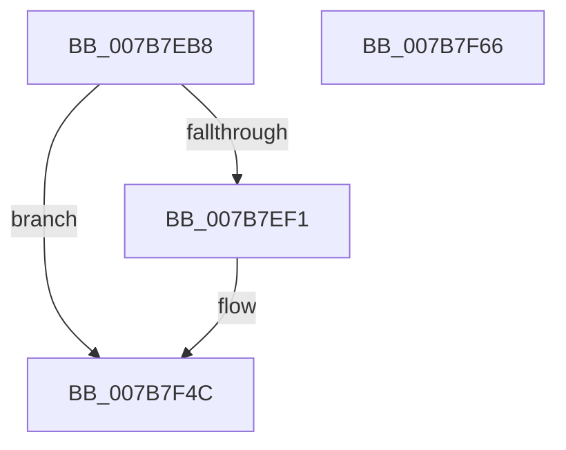

# EtwTraceJobServerSiloStateChange

- RVA: `0x007B7EB8`–`0x007B7F67` (길이 `175` bytes)
- VA: `0x00000001407B7EB8`
- 실행 섹션: `PAGE`
- PDB 이름 있음: `예`; PDB Function 태그: `아니요`
- unwind 정보 RVA: `0x000D3860`
- 디코드: `38`개 명령, `175/175` bytes 표시
- 미해석 바이트: `0` (있으면 어셈블리에 `.byte`로 보존)

> 이 문서는 커널 이미지의 기계어와 PDB 기호를 분석해 생성했습니다. 4번과 5번은 함수 원형과 자료형을 바이너리 사용 방식에서 추정한 C 해석이며 원본 소스 복구 결과는 아닙니다.

## 1. Dependencies

- 직접 호출 지점: **3**; 고유 호출 대상: **3**
- 직접 호출자로 확인된 함수: **4**
- RIP 상대 이미지 참조: **3**

### Outgoing calls
- `0x007B7EE8` → [EtwEventEnabled](../../text/39/EtwEventEnabled_function_00392450.md) (function, `0x00392450`)
- `0x007B7F47` → [EtwWrite](../../text/41/EtwWrite_function_0041C720.md) (function, `0x0041C720`)
- `0x007B7F53` → [_security_check_cookie](../../text/6A/_security_check_cookie_function_006AC640.md) (function, `0x006AC640`)

### Direct callers
- [PspCompleteServerSiloShutdownDeferred](../77/PspCompleteServerSiloShutdownDeferred_function_0077F860.md) at `0x0077F913`
- [PspConvertSiloToServerSilo](../77/PspConvertSiloToServerSilo_function_0077F9B4.md) at `0x0077FB0D`
- [PspNotifyServerSiloCreation](../78/PspNotifyServerSiloCreation_function_00786C58.md) at `0x00786CE6`
- [PspBeginServerSiloShutdown](../AD/PspBeginServerSiloShutdown_function_00AD2B7C.md) at `0x00AD2BBE`

### Static image references
- `0x007B7EC9` → RVA `0x00E0A740` (`.data`; read)
- `0x007B7EDA` → RVA `0x00023270` (`.rdata`; read)
- `0x007B7EE1` → RVA `0x00EFF9E8` (`.data`; read)

## 2. Other-region calls and transfers

- 다른 실행 섹션으로 향하는 call: **3**
  - `0x007B7EE8` → [EtwEventEnabled](../../text/39/EtwEventEnabled_function_00392450.md) (`PAGE` → `.text`)
  - `0x007B7F47` → [EtwWrite](../../text/41/EtwWrite_function_0041C720.md) (`PAGE` → `.text`)
  - `0x007B7F53` → [_security_check_cookie](../../text/6A/_security_check_cookie_function_006AC640.md) (`PAGE` → `.text`)
- 별도 외부 분기/꼬리 이동을 확인하지 못했습니다.

## 3. Assembly (complete function range)

```asm
007B7EB8  48 89 5C 24 08                  mov qword ptr [rsp + 8], rbx
007B7EBD  89 54 24 10                     mov dword ptr [rsp + 0x10], edx
007B7EC1  55                              push rbp
007B7EC2  48 8B EC                        mov rbp, rsp
007B7EC5  48 83 EC 70                     sub rsp, 0x70
007B7EC9  48 8B 05 70 28 65 00            mov rax, qword ptr [rip + 0x652870]
007B7ED0  48 33 C4                        xor rax, rsp
007B7ED3  48 89 45 F0                     mov qword ptr [rbp - 0x10], rax
007B7ED7  48 8B D9                        mov rbx, rcx
007B7EDA  48 8D 15 8F B3 86 FF            lea rdx, [rip - 0x794c71]
007B7EE1  48 8B 0D 00 7B 74 00            mov rcx, qword ptr [rip + 0x747b00]
007B7EE8  E8 63 A5 BD FF                  call 0x140392450
007B7EED  84 C0                           test al, al
007B7EEF  74 5B                           je 0x1407b7f4c
007B7EF1  48 8B 0D F0 7A 74 00            mov rcx, qword ptr [rip + 0x747af0]
007B7EF8  48 8D 83 C0 05 00 00            lea rax, [rbx + 0x5c0]
007B7EFF  48 89 45 C0                     mov qword ptr [rbp - 0x40], rax
007B7F03  48 8D 15 66 B3 86 FF            lea rdx, [rip - 0x794c9a]
007B7F0A  48 8D 83 BC 05 00 00            lea rax, [rbx + 0x5bc]
007B7F11  48 C7 45 C8 10 00 00 00         mov qword ptr [rbp - 0x38], 0x10
007B7F19  48 89 45 D0                     mov qword ptr [rbp - 0x30], rax
007B7F1D  41 B9 03 00 00 00               mov r9d, 3
007B7F23  48 8D 45 18                     lea rax, [rbp + 0x18]
007B7F27  48 C7 45 D8 04 00 00 00         mov qword ptr [rbp - 0x28], 4
007B7F2F  48 89 45 E0                     mov qword ptr [rbp - 0x20], rax
007B7F33  45 33 C0                        xor r8d, r8d
007B7F36  48 8D 45 C0                     lea rax, [rbp - 0x40]
007B7F3A  48 C7 45 E8 04 00 00 00         mov qword ptr [rbp - 0x18], 4
007B7F42  48 89 44 24 20                  mov qword ptr [rsp + 0x20], rax
007B7F47  E8 D4 47 C6 FF                  call 0x14041c720
007B7F4C  48 8B 4D F0                     mov rcx, qword ptr [rbp - 0x10]
007B7F50  48 33 CC                        xor rcx, rsp
007B7F53  E8 E8 46 EF FF                  call 0x1406ac640
007B7F58  48 8B 9C 24 80 00 00 00         mov rbx, qword ptr [rsp + 0x80]
007B7F60  48 83 C4 70                     add rsp, 0x70
007B7F64  5D                              pop rbp
007B7F65  C3                              ret
007B7F66  CC                              int3
```

## 4. C-style interpretation (structured pseudocode)

```c
__int64 __fastcall EtwTraceJobServerSiloStateChange(__int64 a1, int a2, int a3)
{
    __int64 result;
    __int64 v_rsp;
    unsigned __int64 v_stack_m18;
    unsigned __int64 v_stack_m20;
    unsigned __int64 v_stack_m28;
    unsigned __int64 v_stack_m30;
    unsigned __int64 v_stack_m38;
    unsigned __int64 v_stack_m40;
    unsigned __int64 v_stack_m48;
    unsigned __int64 v_stack_m58;
    unsigned int v_stack_p10;
    unsigned __int64 v_stack_p8;

    v_stack_p8 = v_rbx;
    v_stack_p10 = a2;
    v_rsp = (v_rsp) - (112);
    result = (*(unsigned __int64 *)(v_rip + 6629488)) ^ (v_rsp);
    v_stack_m18 = result;
    result = EtwEventEnabled(*(unsigned __int64 *)(v_rip + 7633664), v_rip - 7949425, a3, a4);
    if ((unsigned __int8)(result) != 0) {
        a1 = *(unsigned __int64 *)(v_rip + 7633648);
        result = a1 + 1472;
        v_stack_m48 = result;
        a2 = v_rip - 7949466;
        result = a1 + 1468;
        v_stack_m40 = 16;
        v_stack_m38 = result;
        a4 = 3;
        result = v_stack_p10;
        v_stack_m30 = 4;
        v_stack_m28 = result;
        a3 = 0;
        result = v_stack_m48;
        v_stack_m20 = 4;
        v_stack_m58 = result;
        result = EtwWrite(a1, a2, a3, a4);
    }
    a1 = (v_stack_m18) ^ (v_rsp);
    result = _security_check_cookie(a1, a2, a3, a4);
    v_rsp = (v_rsp) + (112);
    return result;
}
```

## 5. (Beta) C Style

```c
int64_t EtwTraceJobServerSiloStateChange(void *Arg1, int32_t Arg2, int32_t Arg3)
{
    uint8_t *arg1 = (uint8_t *)Arg1;

    int64_t result;
    int64_t local_rsp;
    uint64_t v_stack_m18;
    uint64_t v_stack_m20;
    uint64_t v_stack_m28;
    uint64_t v_stack_m30;
    uint64_t v_stack_m38;
    uint64_t v_stack_m40;
    uint64_t v_stack_m48;
    uint64_t v_stack_m58;
    uint32_t v_stack_p10;
    uint64_t v_stack_p8;

    v_stack_p8 = local_rbx;
    v_stack_p10 = Arg2;
    local_rsp = (local_rsp) - (112);
    result = (*(uint64_t *)(v_rip + 0x652870)) ^ (local_rsp);
    v_stack_m18 = result;
    result = EtwEventEnabled(*(uint64_t *)(v_rip + 0x747B00), v_rip - 7949425, Arg3, a4);
    if ((uint8_t)(result) != 0) {
        Arg1 = *(uint64_t *)(v_rip + 0x747AF0);
        result = Arg1 + 1472;
        v_stack_m48 = result;
        Arg2 = v_rip - 7949466;
        result = Arg1 + 1468;
        v_stack_m40 = 16;
        v_stack_m38 = result;
        a4 = 3;
        result = v_stack_p10;
        v_stack_m30 = 4;
        v_stack_m28 = result;
        Arg3 = 0;
        result = v_stack_m48;
        v_stack_m20 = 4;
        v_stack_m58 = result;
        result = EtwWrite(Arg1, Arg2, Arg3, a4);
    }
    Arg1 = (v_stack_m18) ^ (local_rsp);
    result = _security_check_cookie(Arg1, Arg2, Arg3, a4);
    local_rsp = (local_rsp) + (112);
    return result;
}
```

### 관측된 메모리 오프셋

구조체 형식이 확인되지 않은 접근은 인자 기준의 오프셋으로만 기록했습니다.

| 기준 인자 | 오프셋 표현 | 폭 (bit) | 접근 |
|---|---:|---:|---|
| `Arg1` | `+ 0x5BC` | `64` | `R` |
| `Arg1` | `+ 0x5C0` | `64` | `R` |

## 6. Execution-region graph

[열기: 2D/3D 그래프와 함수 탐색 컨트롤 패널](../../../control-panel.html?section=page&rva=0x007B7EB8&view=graph)

- 2D 그래프는 위에서 아래로 흐르고, 3D 그래프는 빈 공간을 드래그해 회전합니다. Shift+드래그는 이동, 휠은 확대·축소, 함수 노드 선택은 대상 보고서 이동입니다.

### Static fallback


