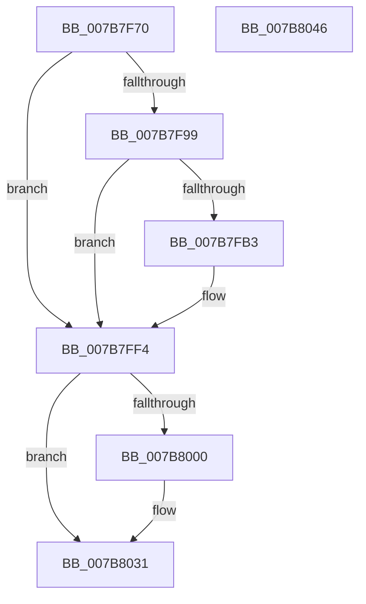

# EtwTraceLeapSecondDataParseFailure

- RVA: `0x007B7F70`–`0x007B8047` (길이 `215` bytes)
- VA: `0x00000001407B7F70`
- 실행 섹션: `PAGE`
- PDB 이름 있음: `예`; PDB Function 태그: `아니요`
- unwind 정보 RVA: `0x000D38C8`
- 디코드: `48`개 명령, `215/215` bytes 표시
- 미해석 바이트: `0` (있으면 어셈블리에 `.byte`로 보존)

> 이 문서는 커널 이미지의 기계어와 PDB 기호를 분석해 생성했습니다. 4번과 5번은 함수 원형과 자료형을 바이너리 사용 방식에서 추정한 C 해석이며 원본 소스 복구 결과는 아닙니다.

## 1. Dependencies

- 직접 호출 지점: **4**; 고유 호출 대상: **4**
- 직접 호출자로 확인된 함수: **2**
- RIP 상대 이미지 참조: **5**

### Outgoing calls
- `0x007B7FAA` → [tlgKeywordOn](../../text/42/tlgKeywordOn_function_0042EAA0.md) (function, `0x0042EAA0`)
- `0x007B7FEF` → [tlgWriteTransfer_EtwWriteTransfer](../../text/42/tlgWriteTransfer_EtwWriteTransfer_function_004260E0.md) (function, `0x004260E0`)
- `0x007B802C` → [EtwWrite](../../text/41/EtwWrite_function_0041C720.md) (function, `0x0041C720`)
- `0x007B8038` → [_security_check_cookie](../../text/6A/_security_check_cookie_function_006AC640.md) (function, `0x006AC640`)

### Direct callers
- [ExpReadLeapSecondData](../7C/ExpReadLeapSecondData_function_007C5EAC.md) at `0x007C60BB`
- [IoInitSystemPreDrivers](../../init/C2/IoInitSystemPreDrivers_function_00C2AC3C.md) at `0x00C2BA5F`

### Static image references
- `0x007B7F7F` → RVA `0x00E0A740` (`.data`; read)
- `0x007B7F8D` → RVA `0x00E09168` (`.data`; read)
- `0x007B7FBF` → RVA `0x000540EA` (`.rdata`; read)
- `0x007B7FF4` → RVA `0x00EFFA28` (`.data`; read)
- `0x007B800C` → RVA `0x000224E0` (`.rdata`; read)

## 2. Other-region calls and transfers

- 다른 실행 섹션으로 향하는 call: **4**
  - `0x007B7FAA` → [tlgKeywordOn](../../text/42/tlgKeywordOn_function_0042EAA0.md) (`PAGE` → `.text`)
  - `0x007B7FEF` → [tlgWriteTransfer_EtwWriteTransfer](../../text/42/tlgWriteTransfer_EtwWriteTransfer_function_004260E0.md) (`PAGE` → `.text`)
  - `0x007B802C` → [EtwWrite](../../text/41/EtwWrite_function_0041C720.md) (`PAGE` → `.text`)
  - `0x007B8038` → [_security_check_cookie](../../text/6A/_security_check_cookie_function_006AC640.md) (`PAGE` → `.text`)
- 별도 외부 분기/꼬리 이동을 확인하지 못했습니다.

## 3. Assembly (complete function range)

```asm
007B7F70  89 4C 24 08                     mov dword ptr [rsp + 8], ecx
007B7F74  55                              push rbp
007B7F75  48 8B EC                        mov rbp, rsp
007B7F78  48 81 EC 80 00 00 00            sub rsp, 0x80
007B7F7F  48 8B 05 BA 27 65 00            mov rax, qword ptr [rip + 0x6527ba]
007B7F86  48 33 C4                        xor rax, rsp
007B7F89  48 89 45 F8                     mov qword ptr [rbp - 8], rax
007B7F8D  83 3D D4 11 65 00 05            cmp dword ptr [rip + 0x6511d4], 5
007B7F94  44 8B C1                        mov r8d, ecx
007B7F97  76 5B                           jbe 0x1407b7ff4
007B7F99  48 BA 00 00 00 00 00 40 00 00   movabs rdx, 0x400000000000
007B7FA3  48 8D 0D BE 11 65 00            lea rcx, [rip + 0x6511be]
007B7FAA  E8 F1 6A C7 FF                  call 0x14042eaa0
007B7FAF  84 C0                           test al, al
007B7FB1  74 41                           je 0x1407b7ff4
007B7FB3  83 65 F4 00                     and dword ptr [rbp - 0xc], 0
007B7FB7  48 8D 45 B0                     lea rax, [rbp - 0x50]
007B7FBB  48 89 45 E8                     mov qword ptr [rbp - 0x18], rax
007B7FBF  48 8D 15 24 C1 89 FF            lea rdx, [rip - 0x763edc]
007B7FC6  48 8D 45 C8                     lea rax, [rbp - 0x38]
007B7FCA  44 89 45 B0                     mov dword ptr [rbp - 0x50], r8d
007B7FCE  48 89 44 24 28                  mov qword ptr [rsp + 0x28], rax
007B7FD3  48 8D 0D 8E 11 65 00            lea rcx, [rip + 0x65118e]
007B7FDA  45 33 C9                        xor r9d, r9d
007B7FDD  C7 44 24 20 03 00 00 00         mov dword ptr [rsp + 0x20], 3
007B7FE5  45 33 C0                        xor r8d, r8d
007B7FE8  C7 45 F0 04 00 00 00            mov dword ptr [rbp - 0x10], 4
007B7FEF  E8 EC E0 C6 FF                  call 0x1404260e0
007B7FF4  48 8B 0D 2D 7A 74 00            mov rcx, qword ptr [rip + 0x747a2d]
007B7FFB  48 85 C9                        test rcx, rcx
007B7FFE  74 31                           je 0x1407b8031
007B8000  83 65 C4 00                     and dword ptr [rbp - 0x3c], 0
007B8004  48 8D 45 10                     lea rax, [rbp + 0x10]
007B8008  48 89 45 B8                     mov qword ptr [rbp - 0x48], rax
007B800C  48 8D 15 CD A4 86 FF            lea rdx, [rip - 0x795b33]
007B8013  48 8D 45 B8                     lea rax, [rbp - 0x48]
007B8017  C7 45 C0 04 00 00 00            mov dword ptr [rbp - 0x40], 4
007B801E  41 B9 01 00 00 00               mov r9d, 1
007B8024  48 89 44 24 20                  mov qword ptr [rsp + 0x20], rax
007B8029  45 33 C0                        xor r8d, r8d
007B802C  E8 EF 46 C6 FF                  call 0x14041c720
007B8031  48 8B 4D F8                     mov rcx, qword ptr [rbp - 8]
007B8035  48 33 CC                        xor rcx, rsp
007B8038  E8 03 46 EF FF                  call 0x1406ac640
007B803D  48 81 C4 80 00 00 00            add rsp, 0x80
007B8044  5D                              pop rbp
007B8045  C3                              ret
007B8046  CC                              int3
```

## 4. C-style interpretation (structured pseudocode)

```c
__int64 __fastcall EtwTraceLeapSecondDataParseFailure(int a1, __int64 a2, __int64 a3, int a4)
{
    __int64 result;
    __int64 v_rsp;
    unsigned __int64 v_stack_m10;
    unsigned int v_stack_m14;
    unsigned int v_stack_m18;
    unsigned __int64 v_stack_m20;
    unsigned __int64 v_stack_m40;
    unsigned int v_stack_m44;
    unsigned int v_stack_m48;
    unsigned __int64 v_stack_m50;
    unsigned __int64 v_stack_m58;
    unsigned __int64 v_stack_m60;
    unsigned int v_stack_m68;
    unsigned int v_stack_p8;

    v_stack_p8 = a1;
    v_rsp = (v_rsp) - (128);
    result = (*(unsigned __int64 *)(v_rip + 6629306)) ^ (v_rsp);
    v_stack_m10 = result;
    if ((*(unsigned int *)(v_rip + 6623700)) <= 5) goto loc_007B7FF4;
    result = tlgKeywordOn(v_rip + 6623678, a2, (unsigned int)(a1), a4);
    if ((unsigned __int8)(result) != 0) {
        result = v_stack_m58;
        v_stack_m20 = result;
        a2 = v_rip - 7749340;
        result = v_stack_m40;
        v_stack_m58 = (unsigned int)((unsigned int)(a1));
        v_stack_m60 = result;
        a1 = v_rip + 6623630;
        a4 = 0;
        v_stack_m68 = 3;
        a3 = 0;
        v_stack_m18 = 4;
        result = tlgWriteTransfer_EtwWriteTransfer(a1, a2, a3, a4);
    }
    if (*(unsigned __int64 *)(v_rip + 7633453) != 0) {
        result = v_stack_p8;
        v_stack_m50 = result;
        a2 = v_rip - 7953203;
        result = v_stack_m50;
        v_stack_m48 = 4;
        a4 = 1;
        v_stack_m68 = result;
        a3 = 0;
        result = EtwWrite(*(unsigned __int64 *)(v_rip + 7633453), a2, a3, a4);
    }
    a1 = (v_stack_m10) ^ (v_rsp);
    result = _security_check_cookie(a1, a2, a3, a4);
    v_rsp = (v_rsp) + (128);
    return result;
}
```

## 5. (Beta) C Style

```c
int64_t EtwTraceLeapSecondDataParseFailure(int32_t Arg1, int64_t Arg2, int64_t Arg3, int32_t Arg4)
{
    int64_t result;
    int64_t local_rsp;
    uint64_t v_stack_m10;
    uint32_t v_stack_m14;
    uint32_t v_stack_m18;
    uint64_t v_stack_m20;
    uint64_t v_stack_m40;
    uint32_t v_stack_m44;
    uint32_t v_stack_m48;
    uint64_t v_stack_m50;
    uint64_t v_stack_m58;
    uint64_t v_stack_m60;
    uint32_t v_stack_m68;
    uint32_t v_stack_p8;

    v_stack_p8 = Arg1;
    local_rsp = (local_rsp) - (128);
    result = (*(uint64_t *)(v_rip + 0x6527BA)) ^ (local_rsp);
    v_stack_m10 = result;
    if ((*(uint32_t *)(v_rip + 0x6511D4)) <= 5) goto loc_007B7FF4;
    result = tlgKeywordOn(v_rip + 6623678, Arg2, (uint32_t)(Arg1), Arg4);
    if ((uint8_t)(result) != 0) {
        result = v_stack_m58;
        v_stack_m20 = result;
        Arg2 = v_rip - 7749340;
        result = v_stack_m40;
        v_stack_m58 = (uint32_t)((uint32_t)(Arg1));
        v_stack_m60 = result;
        Arg1 = v_rip + 6623630;
        Arg4 = 0;
        v_stack_m68 = 3;
        Arg3 = 0;
        v_stack_m18 = 4;
        result = tlgWriteTransfer_EtwWriteTransfer(Arg1, Arg2, Arg3, Arg4);
    }
    if (*(uint64_t *)(v_rip + 0x747A2D) != 0) {
        result = v_stack_p8;
        v_stack_m50 = result;
        Arg2 = v_rip - 7953203;
        result = v_stack_m50;
        v_stack_m48 = 4;
        Arg4 = 1;
        v_stack_m68 = result;
        Arg3 = 0;
        result = EtwWrite(*(uint64_t *)(v_rip + 0x747A2D), Arg2, Arg3, Arg4);
    }
    Arg1 = (v_stack_m10) ^ (local_rsp);
    result = _security_check_cookie(Arg1, Arg2, Arg3, Arg4);
    local_rsp = (local_rsp) + (128);
    return result;
}
```

## 6. Execution-region graph

[열기: 2D/3D 그래프와 함수 탐색 컨트롤 패널](../../../control-panel.html?section=page&rva=0x007B7F70&view=graph)

- 2D 그래프는 위에서 아래로 흐르고, 3D 그래프는 빈 공간을 드래그해 회전합니다. Shift+드래그는 이동, 휠은 확대·축소, 함수 노드 선택은 대상 보고서 이동입니다.

### Static fallback


