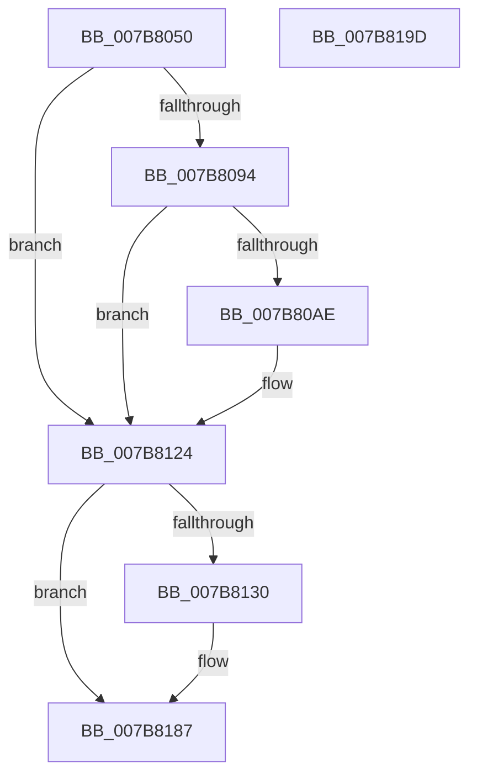

# EtwTraceLeapSecondDataUpdate

- RVA: `0x007B8050`–`0x007B819E` (길이 `334` bytes)
- VA: `0x00000001407B8050`
- 실행 섹션: `PAGE`
- PDB 이름 있음: `예`; PDB Function 태그: `아니요`
- unwind 정보 RVA: `0x000D38DC`
- 디코드: `83`개 명령, `334/334` bytes 표시
- 미해석 바이트: `0` (있으면 어셈블리에 `.byte`로 보존)

> 이 문서는 커널 이미지의 기계어와 PDB 기호를 분석해 생성했습니다. 4번과 5번은 함수 원형과 자료형을 바이너리 사용 방식에서 추정한 C 해석이며 원본 소스 복구 결과는 아닙니다.

## 1. Dependencies

- 직접 호출 지점: **4**; 고유 호출 대상: **4**
- 직접 호출자로 확인된 함수: **2**
- RIP 상대 이미지 참조: **5**

### Outgoing calls
- `0x007B80A5` → [tlgKeywordOn](../../text/42/tlgKeywordOn_function_0042EAA0.md) (function, `0x0042EAA0`)
- `0x007B811F` → [tlgWriteTransfer_EtwWriteTransfer](../../text/42/tlgWriteTransfer_EtwWriteTransfer_function_004260E0.md) (function, `0x004260E0`)
- `0x007B8182` → [EtwWrite](../../text/41/EtwWrite_function_0041C720.md) (function, `0x0041C720`)
- `0x007B818E` → [_security_check_cookie](../../text/6A/_security_check_cookie_function_006AC640.md) (function, `0x006AC640`)

### Direct callers
- [ExpReadLeapSecondData](../7C/ExpReadLeapSecondData_function_007C5EAC.md) at `0x007C60E8`
- [IoInitSystemPreDrivers](../../init/C2/IoInitSystemPreDrivers_function_00C2AC3C.md) at `0x00C2BA78`

### Static image references
- `0x007B806E` → RVA `0x00E0A740` (`.data`; read)
- `0x007B807C` → RVA `0x00E09168` (`.data`; read)
- `0x007B80BA` → RVA `0x00054123` (`.rdata`; read)
- `0x007B8124` → RVA `0x00EFFA28` (`.data`; read)
- `0x007B813C` → RVA `0x000225C0` (`.rdata`; read)

## 2. Other-region calls and transfers

- 다른 실행 섹션으로 향하는 call: **4**
  - `0x007B80A5` → [tlgKeywordOn](../../text/42/tlgKeywordOn_function_0042EAA0.md) (`PAGE` → `.text`)
  - `0x007B811F` → [tlgWriteTransfer_EtwWriteTransfer](../../text/42/tlgWriteTransfer_EtwWriteTransfer_function_004260E0.md) (`PAGE` → `.text`)
  - `0x007B8182` → [EtwWrite](../../text/41/EtwWrite_function_0041C720.md) (`PAGE` → `.text`)
  - `0x007B818E` → [_security_check_cookie](../../text/6A/_security_check_cookie_function_006AC640.md) (`PAGE` → `.text`)
- 별도 외부 분기/꼬리 이동을 확인하지 못했습니다.

## 3. Assembly (complete function range)

```asm
007B8050  48 8B C4                        mov rax, rsp
007B8053  44 89 48 20                     mov dword ptr [rax + 0x20], r9d
007B8057  44 89 40 18                     mov dword ptr [rax + 0x18], r8d
007B805B  89 50 10                        mov dword ptr [rax + 0x10], edx
007B805E  89 48 08                        mov dword ptr [rax + 8], ecx
007B8061  55                              push rbp
007B8062  57                              push rdi
007B8063  48 8D 68 A1                     lea rbp, [rax - 0x5f]
007B8067  48 81 EC F8 00 00 00            sub rsp, 0xf8
007B806E  48 8B 05 CB 26 65 00            mov rax, qword ptr [rip + 0x6526cb]
007B8075  48 33 C4                        xor rax, rsp
007B8078  48 89 45 37                     mov qword ptr [rbp + 0x37], rax
007B807C  83 3D E5 10 65 00 05            cmp dword ptr [rip + 0x6510e5], 5
007B8083  44 8B D2                        mov r10d, edx
007B8086  44 8B D9                        mov r11d, ecx
007B8089  BF 04 00 00 00                  mov edi, 4
007B808E  0F 86 90 00 00 00               jbe 0x1407b8124
007B8094  48 BA 00 00 00 00 00 40 00 00   movabs rdx, 0x400000000000
007B809E  48 8D 0D C3 10 65 00            lea rcx, [rip + 0x6510c3]
007B80A5  E8 F6 69 C7 FF                  call 0x14042eaa0
007B80AA  84 C0                           test al, al
007B80AC  74 76                           je 0x1407b8124
007B80AE  83 65 03 00                     and dword ptr [rbp + 3], 0
007B80B2  48 8D 45 87                     lea rax, [rbp - 0x79]
007B80B6  83 65 13 00                     and dword ptr [rbp + 0x13], 0
007B80BA  48 8D 15 62 C0 89 FF            lea rdx, [rip - 0x763f9e]
007B80C1  83 65 23 00                     and dword ptr [rbp + 0x23], 0
007B80C5  48 8D 0D 9C 10 65 00            lea rcx, [rip + 0x65109c]
007B80CC  83 65 33 00                     and dword ptr [rbp + 0x33], 0
007B80D0  48 89 45 F7                     mov qword ptr [rbp - 9], rax
007B80D4  48 8D 45 8B                     lea rax, [rbp - 0x75]
007B80D8  48 89 45 07                     mov qword ptr [rbp + 7], rax
007B80DC  48 8D 45 8F                     lea rax, [rbp - 0x71]
007B80E0  48 89 45 17                     mov qword ptr [rbp + 0x17], rax
007B80E4  48 8D 45 93                     lea rax, [rbp - 0x6d]
007B80E8  48 89 45 27                     mov qword ptr [rbp + 0x27], rax
007B80EC  48 8D 45 D7                     lea rax, [rbp - 0x29]
007B80F0  44 89 45 8F                     mov dword ptr [rbp - 0x71], r8d
007B80F4  45 33 C0                        xor r8d, r8d
007B80F7  44 89 4D 93                     mov dword ptr [rbp - 0x6d], r9d
007B80FB  45 33 C9                        xor r9d, r9d
007B80FE  48 89 44 24 28                  mov qword ptr [rsp + 0x28], rax
007B8103  C7 44 24 20 06 00 00 00         mov dword ptr [rsp + 0x20], 6
007B810B  44 89 5D 87                     mov dword ptr [rbp - 0x79], r11d
007B810F  89 7D FF                        mov dword ptr [rbp - 1], edi
007B8112  44 89 55 8B                     mov dword ptr [rbp - 0x75], r10d
007B8116  89 7D 0F                        mov dword ptr [rbp + 0xf], edi
007B8119  89 7D 1F                        mov dword ptr [rbp + 0x1f], edi
007B811C  89 7D 2F                        mov dword ptr [rbp + 0x2f], edi
007B811F  E8 BC DF C6 FF                  call 0x1404260e0
007B8124  48 8B 0D FD 78 74 00            mov rcx, qword ptr [rip + 0x7478fd]
007B812B  48 85 C9                        test rcx, rcx
007B812E  74 57                           je 0x1407b8187
007B8130  83 65 A3 00                     and dword ptr [rbp - 0x5d], 0
007B8134  48 8D 45 67                     lea rax, [rbp + 0x67]
007B8138  83 65 B3 00                     and dword ptr [rbp - 0x4d], 0
007B813C  48 8D 15 7D A4 86 FF            lea rdx, [rip - 0x795b83]
007B8143  83 65 C3 00                     and dword ptr [rbp - 0x3d], 0
007B8147  44 8B CF                        mov r9d, edi
007B814A  83 65 D3 00                     and dword ptr [rbp - 0x2d], 0
007B814E  45 33 C0                        xor r8d, r8d
007B8151  48 89 45 97                     mov qword ptr [rbp - 0x69], rax
007B8155  48 8D 45 6F                     lea rax, [rbp + 0x6f]
007B8159  48 89 45 A7                     mov qword ptr [rbp - 0x59], rax
007B815D  48 8D 45 77                     lea rax, [rbp + 0x77]
007B8161  48 89 45 B7                     mov qword ptr [rbp - 0x49], rax
007B8165  48 8D 45 7F                     lea rax, [rbp + 0x7f]
007B8169  48 89 45 C7                     mov qword ptr [rbp - 0x39], rax
007B816D  48 8D 45 97                     lea rax, [rbp - 0x69]
007B8171  48 89 44 24 20                  mov qword ptr [rsp + 0x20], rax
007B8176  89 7D 9F                        mov dword ptr [rbp - 0x61], edi
007B8179  89 7D AF                        mov dword ptr [rbp - 0x51], edi
007B817C  89 7D BF                        mov dword ptr [rbp - 0x41], edi
007B817F  89 7D CF                        mov dword ptr [rbp - 0x31], edi
007B8182  E8 99 45 C6 FF                  call 0x14041c720
007B8187  48 8B 4D 37                     mov rcx, qword ptr [rbp + 0x37]
007B818B  48 33 CC                        xor rcx, rsp
007B818E  E8 AD 44 EF FF                  call 0x1406ac640
007B8193  48 81 C4 F8 00 00 00            add rsp, 0xf8
007B819A  5F                              pop rdi
007B819B  5D                              pop rbp
007B819C  C3                              ret
007B819D  CC                              int3
```

## 4. C-style interpretation (structured pseudocode)

```c
__int64 __fastcall EtwTraceLeapSecondDataUpdate(int a1, int a2, int a3, int a4)
{
    __int64 result;
    __int64 v_rsp;
    unsigned __int64 v_stack_mE0;
    unsigned int v_stack_mE8;

    *(unsigned int *)(v_rsp + 32) = a4;
    *(unsigned int *)(v_rsp + 24) = a3;
    *(unsigned int *)(v_rsp + 16) = a2;
    *(unsigned int *)(v_rsp + 8) = a1;
    v_rsp = (v_rsp) - (248);
    result = (*(unsigned __int64 *)(v_rip + 6629067)) ^ (v_rsp);
    *(unsigned __int64 *)(v_rsp - 95 + 55) = result;
    if ((*(unsigned int *)(v_rip + 6623461)) <= 5) goto loc_007B8124;
    result = tlgKeywordOn(v_rip + 6623427, a2, a3, a4);
    if ((unsigned __int8)(result) != 0) {
        result = v_rsp - 95 - 121;
        a2 = v_rip - 7749534;
        a1 = v_rip + 6623388;
        *(unsigned __int64 *)(v_rsp - 95 - 9) = result;
        result = v_rsp - 95 - 117;
        *(unsigned __int64 *)(v_rsp - 95 + 7) = result;
        result = v_rsp - 95 - 113;
        *(unsigned __int64 *)(v_rsp - 95 + 23) = result;
        result = v_rsp - 95 - 109;
        *(unsigned __int64 *)(v_rsp - 95 + 39) = result;
        result = v_rsp - 95 - 41;
        *(unsigned int *)(v_rsp - 95 - 113) = a3;
        a3 = 0;
        *(unsigned int *)(v_rsp - 95 - 109) = a4;
        a4 = 0;
        v_stack_mE0 = result;
        v_stack_mE8 = 6;
        *(unsigned int *)(v_rsp - 95 - 121) = (unsigned int)((unsigned int)(a1));
        *(unsigned int *)(v_rsp - 95 - 1) = 4;
        *(unsigned int *)(v_rsp - 95 - 117) = (unsigned int)((unsigned int)(a2));
        *(unsigned int *)(v_rsp - 95 + 15) = 4;
        *(unsigned int *)(v_rsp - 95 + 31) = 4;
        *(unsigned int *)(v_rsp - 95 + 47) = 4;
        result = tlgWriteTransfer_EtwWriteTransfer(a1, a2, a3, a4);
    }
    if (*(unsigned __int64 *)(v_rip + 7633149) != 0) {
        result = v_rsp - 95 + 103;
        a2 = v_rip - 7953283;
        a4 = 4;
        a3 = 0;
        *(unsigned __int64 *)(v_rsp - 95 - 105) = result;
        result = v_rsp - 95 + 111;
        *(unsigned __int64 *)(v_rsp - 95 - 89) = result;
        result = v_rsp - 95 + 119;
        *(unsigned __int64 *)(v_rsp - 95 - 73) = result;
        result = v_rsp - 95 + 127;
        *(unsigned __int64 *)(v_rsp - 95 - 57) = result;
        result = v_rsp - 95 - 105;
        v_stack_mE8 = result;
        *(unsigned int *)(v_rsp - 95 - 97) = 4;
        *(unsigned int *)(v_rsp - 95 - 81) = 4;
        *(unsigned int *)(v_rsp - 95 - 65) = 4;
        *(unsigned int *)(v_rsp - 95 - 49) = 4;
        result = EtwWrite(*(unsigned __int64 *)(v_rip + 7633149), a2, a3, a4);
    }
    a1 = (*(unsigned __int64 *)(v_rsp - 95 + 55)) ^ (v_rsp);
    result = _security_check_cookie(a1, a2, a3, a4);
    v_rsp = (v_rsp) + (248);
    return result;
}
```

## 5. (Beta) C Style

```c
int64_t EtwTraceLeapSecondDataUpdate(int32_t Arg1, int32_t Arg2, int32_t Arg3, int32_t Arg4)
{
    int64_t result;
    int64_t local_rsp;
    uint64_t v_stack_mE0;
    uint32_t v_stack_mE8;

    *(uint32_t *)(local_rsp + 0x20) = Arg4;
    *(uint32_t *)(local_rsp + 0x18) = Arg3;
    *(uint32_t *)(local_rsp + 0x10) = Arg2;
    *(uint32_t *)(local_rsp + 0x8) = Arg1;
    local_rsp = (local_rsp) - (248);
    result = (*(uint64_t *)(v_rip + 0x6526CB)) ^ (local_rsp);
    *(uint64_t *)(local_rsp - 0x5F + 0x37) = result;
    if ((*(uint32_t *)(v_rip + 0x6510E5)) <= 5) goto loc_007B8124;
    result = tlgKeywordOn(v_rip + 6623427, Arg2, Arg3, Arg4);
    if ((uint8_t)(result) != 0) {
        result = local_rsp - 95 - 121;
        Arg2 = v_rip - 7749534;
        Arg1 = v_rip + 6623388;
        *(uint64_t *)(local_rsp - 0x5F - 0x9) = result;
        result = local_rsp - 95 - 117;
        *(uint64_t *)(local_rsp - 0x5F + 0x7) = result;
        result = local_rsp - 95 - 113;
        *(uint64_t *)(local_rsp - 0x5F + 0x17) = result;
        result = local_rsp - 95 - 109;
        *(uint64_t *)(local_rsp - 0x5F + 0x27) = result;
        result = local_rsp - 95 - 41;
        *(uint32_t *)(local_rsp - 0x5F - 0x71) = Arg3;
        Arg3 = 0;
        *(uint32_t *)(local_rsp - 0x5F - 0x6D) = Arg4;
        Arg4 = 0;
        v_stack_mE0 = result;
        v_stack_mE8 = 6;
        *(uint32_t *)(local_rsp - 0x5F - 0x79) = (uint32_t)((uint32_t)(Arg1));
        *(uint32_t *)(local_rsp - 0x5F - 0x1) = 4;
        *(uint32_t *)(local_rsp - 0x5F - 0x75) = (uint32_t)((uint32_t)(Arg2));
        *(uint32_t *)(local_rsp - 0x5F + 0xF) = 4;
        *(uint32_t *)(local_rsp - 0x5F + 0x1F) = 4;
        *(uint32_t *)(local_rsp - 0x5F + 0x2F) = 4;
        result = tlgWriteTransfer_EtwWriteTransfer(Arg1, Arg2, Arg3, Arg4);
    }
    if (*(uint64_t *)(v_rip + 0x7478FD) != 0) {
        result = local_rsp - 95 + 103;
        Arg2 = v_rip - 7953283;
        Arg4 = 4;
        Arg3 = 0;
        *(uint64_t *)(local_rsp - 0x5F - 0x69) = result;
        result = local_rsp - 95 + 111;
        *(uint64_t *)(local_rsp - 0x5F - 0x59) = result;
        result = local_rsp - 95 + 119;
        *(uint64_t *)(local_rsp - 0x5F - 0x49) = result;
        result = local_rsp - 95 + 127;
        *(uint64_t *)(local_rsp - 0x5F - 0x39) = result;
        result = local_rsp - 95 - 105;
        v_stack_mE8 = result;
        *(uint32_t *)(local_rsp - 0x5F - 0x61) = 4;
        *(uint32_t *)(local_rsp - 0x5F - 0x51) = 4;
        *(uint32_t *)(local_rsp - 0x5F - 0x41) = 4;
        *(uint32_t *)(local_rsp - 0x5F - 0x31) = 4;
        result = EtwWrite(*(uint64_t *)(v_rip + 0x7478FD), Arg2, Arg3, Arg4);
    }
    Arg1 = (*(uint64_t *)(local_rsp - 0x5F + 0x37)) ^ (local_rsp);
    result = _security_check_cookie(Arg1, Arg2, Arg3, Arg4);
    local_rsp = (local_rsp) + (248);
    return result;
}
```

## 6. Execution-region graph

[열기: 2D/3D 그래프와 함수 탐색 컨트롤 패널](../../../control-panel.html?section=page&rva=0x007B8050&view=graph)

- 2D 그래프는 위에서 아래로 흐르고, 3D 그래프는 빈 공간을 드래그해 회전합니다. Shift+드래그는 이동, 휠은 확대·축소, 함수 노드 선택은 대상 보고서 이동입니다.

### Static fallback


