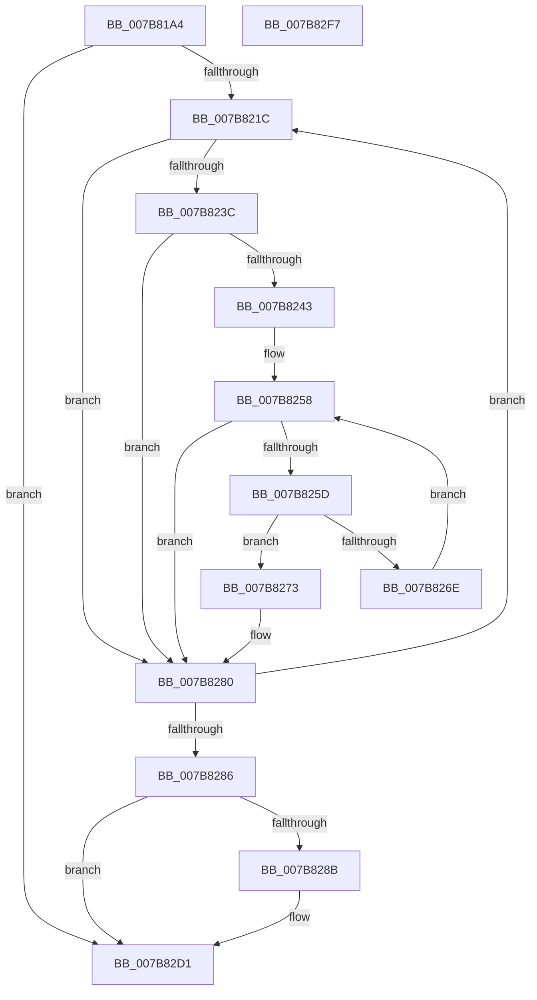

# EtwTraceObject

- RVA: `0x007B81A4`–`0x007B82F8` (길이 `340` bytes)
- VA: `0x00000001407B81A4`
- 실행 섹션: `PAGE`
- PDB 이름 있음: `예`; PDB Function 태그: `아니요`
- unwind 정보 RVA: `0x000D3878`
- 디코드: `89`개 명령, `340/340` bytes 표시
- 미해석 바이트: `0` (있으면 어셈블리에 `.byte`로 보존)

> 이 문서는 커널 이미지의 기계어와 PDB 기호를 분석해 생성했습니다. 4번과 5번은 함수 원형과 자료형을 바이너리 사용 방식에서 추정한 C 해석이며 원본 소스 복구 결과는 아닙니다.

## 1. Dependencies

- 직접 호출 지점: **3**; 고유 호출 대상: **3**
- 직접 호출자로 확인된 함수: **2**
- RIP 상대 이미지 참조: **4**

### Outgoing calls
- `0x007B8265` → [ExCheckSingleFilter](../../text/40/ExCheckSingleFilter_function_0040014C.md) (function, `0x0040014C`)
- `0x007B82CC` → [EtwpTraceKernelEventWithFilter](../../text/49/EtwpTraceKernelEventWithFilter_function_00498540.md) (function, `0x00498540`)
- `0x007B82D9` → [_security_check_cookie](../../text/6A/_security_check_cookie_function_006AC640.md) (function, `0x006AC640`)

### Direct callers
- [ObpDeregisterObject](../9D/ObpDeregisterObject_function_009D7F78.md) at `0x009D7FA6`
- [ObpRegisterObject](../AC/ObpRegisterObject_function_00ACF3EC.md) at `0x00ACF413`

### Static image references
- `0x007B81BA` → RVA `0x00E0A740` (`.data`; read)
- `0x007B81CC` → RVA `0x00000000` (`image boundary/outside`; read)
- `0x007B81E0` → RVA `0x00FC6E4C` (`ALMOSTRO`; read)
- `0x007B8204` → RVA `0x00FC6AA8` (`ALMOSTRO`; read)

## 2. Other-region calls and transfers

- 다른 실행 섹션으로 향하는 call: **3**
  - `0x007B8265` → [ExCheckSingleFilter](../../text/40/ExCheckSingleFilter_function_0040014C.md) (`PAGE` → `.text`)
  - `0x007B82CC` → [EtwpTraceKernelEventWithFilter](../../text/49/EtwpTraceKernelEventWithFilter_function_00498540.md) (`PAGE` → `.text`)
  - `0x007B82D9` → [_security_check_cookie](../../text/6A/_security_check_cookie_function_006AC640.md) (`PAGE` → `.text`)
- 별도 외부 분기/꼬리 이동을 확인하지 못했습니다.

## 3. Assembly (complete function range)

```asm
007B81A4  48 89 5C 24 10                  mov qword ptr [rsp + 0x10], rbx
007B81A9  48 89 6C 24 18                  mov qword ptr [rsp + 0x18], rbp
007B81AE  56                              push rsi
007B81AF  57                              push rdi
007B81B0  41 55                           push r13
007B81B2  41 56                           push r14
007B81B4  41 57                           push r15
007B81B6  48 83 EC 60                     sub rsp, 0x60
007B81BA  48 8B 05 7F 25 65 00            mov rax, qword ptr [rip + 0x65257f]
007B81C1  48 33 C4                        xor rax, rsp
007B81C4  48 89 44 24 58                  mov qword ptr [rsp + 0x58], rax
007B81C9  48 8B DA                        mov rbx, rdx
007B81CC  4C 8D 2D 2D 7E 84 FF            lea r13, [rip - 0x7b81d3]
007B81D3  48 C1 EB 08                     shr rbx, 8
007B81D7  0F 57 C0                        xorps xmm0, xmm0
007B81DA  32 5A 18                        xor bl, byte ptr [rdx + 0x18]
007B81DD  45 33 D2                        xor r10d, r10d
007B81E0  32 1D 66 EC 80 00               xor bl, byte ptr [rip + 0x80ec66]
007B81E6  48 8B EA                        mov rbp, rdx
007B81E9  0F B6 C3                        movzx eax, bl
007B81EC  44 0F B7 F1                     movzx r14d, cx
007B81F0  0F 11 44 24 38                  movups xmmword ptr [rsp + 0x38], xmm0
007B81F5  49 8B 84 C5 00 78 FC 00         mov rax, qword ptr [r13 + rax*8 + 0xfc7800]
007B81FD  44 8B B8 C0 00 00 00            mov r15d, dword ptr [rax + 0xc0]
007B8204  48 8B 05 9D E8 80 00            mov rax, qword ptr [rip + 0x80e89d]
007B820B  44 8B 88 A8 11 00 00            mov r9d, dword ptr [rax + 0x11a8]
007B8212  45 0F BC D9                     bsf r11d, r9d
007B8216  0F 84 B5 00 00 00               je 0x1407b82d1
007B821C  41 8D 41 FF                     lea eax, [r9 - 1]
007B8220  41 8B CB                        mov ecx, r11d
007B8223  44 23 C8                        and r9d, eax
007B8226  48 C1 E1 05                     shl rcx, 5
007B822A  48 8B 05 77 E8 80 00            mov rax, qword ptr [rip + 0x80e877]
007B8231  48 05 CC 11 00 00               add rax, 0x11cc
007B8237  48 03 C1                        add rax, rcx
007B823A  74 44                           je 0x1407b8280
007B823C  8B 40 10                        mov eax, dword ptr [rax + 0x10]
007B823F  84 C0                           test al, al
007B8241  79 3D                           jns 0x1407b8280
007B8243  4B 8D 04 9B                     lea rax, [r11 + r11*4]
007B8247  45 33 C0                        xor r8d, r8d
007B824A  49 8D BD 80 F8 EF 00            lea rdi, [r13 + 0xeff880]
007B8251  48 8D 3C 87                     lea rdi, [rdi + rax*4]
007B8255  0F B7 37                        movzx esi, word ptr [rdi]
007B8258  44 3B C6                        cmp r8d, esi
007B825B  73 23                           jae 0x1407b8280
007B825D  42 8B 54 87 04                  mov edx, dword ptr [rdi + r8*4 + 4]
007B8262  41 8B CF                        mov ecx, r15d
007B8265  E8 E2 7E C4 FF                  call 0x14040014c
007B826A  85 C0                           test eax, eax
007B826C  75 05                           jne 0x1407b8273
007B826E  41 FF C0                        inc r8d
007B8271  EB E5                           jmp 0x1407b8258
007B8273  41 8B CB                        mov ecx, r11d
007B8276  B8 01 00 00 00                  mov eax, 1
007B827B  D3 E0                           shl eax, cl
007B827D  44 0B D0                        or r10d, eax
007B8280  45 0F BC D9                     bsf r11d, r9d
007B8284  75 96                           jne 0x1407b821c
007B8286  45 85 D2                        test r10d, r10d
007B8289  74 46                           je 0x1407b82d1
007B828B  83 64 24 54 00                  and dword ptr [rsp + 0x54], 0
007B8290  48 8D 45 30                     lea rax, [rbp + 0x30]
007B8294  48 89 44 24 38                  mov qword ptr [rsp + 0x38], rax
007B8299  48 8D 4C 24 48                  lea rcx, [rsp + 0x48]
007B829E  0F B6 C3                        movzx eax, bl
007B82A1  45 0F B7 CE                     movzx r9d, r14w
007B82A5  66 89 44 24 40                  mov word ptr [rsp + 0x40], ax
007B82AA  45 8B C2                        mov r8d, r10d
007B82AD  48 8D 44 24 38                  lea rax, [rsp + 0x38]
007B82B2  C7 44 24 50 10 00 00 00         mov dword ptr [rsp + 0x50], 0x10
007B82BA  BA 01 00 00 00                  mov edx, 1
007B82BF  48 89 44 24 48                  mov qword ptr [rsp + 0x48], rax
007B82C4  C7 44 24 20 02 19 60 10         mov dword ptr [rsp + 0x20], 0x10601902
007B82CC  E8 6F 02 CE FF                  call 0x140498540
007B82D1  48 8B 4C 24 58                  mov rcx, qword ptr [rsp + 0x58]
007B82D6  48 33 CC                        xor rcx, rsp
007B82D9  E8 62 43 EF FF                  call 0x1406ac640
007B82DE  4C 8D 5C 24 60                  lea r11, [rsp + 0x60]
007B82E3  49 8B 5B 38                     mov rbx, qword ptr [r11 + 0x38]
007B82E7  49 8B 6B 40                     mov rbp, qword ptr [r11 + 0x40]
007B82EB  49 8B E3                        mov rsp, r11
007B82EE  41 5F                           pop r15
007B82F0  41 5E                           pop r14
007B82F2  41 5D                           pop r13
007B82F4  5F                              pop rdi
007B82F5  5E                              pop rsi
007B82F6  C3                              ret
007B82F7  CC                              int3
```

## 4. C-style interpretation (structured pseudocode)

```c
__int64 __fastcall EtwTraceObject(unsigned __int16 a1, __int64 a2, int a3)
{
    __int64 result;
    __int64 v_r10;
    __int64 v_rbx;
    __int64 v_rsp;
    unsigned __int64 v_stack_m28;
    unsigned __int64 v_stack_m30;
    unsigned int v_stack_m34;
    unsigned int v_stack_m38;
    unsigned __int64 v_stack_m40;
    unsigned __int16 v_stack_m48;
    unsigned __int64 v_stack_m50;
    unsigned int v_stack_m68;
    unsigned __int64 v_stack_p10;
    unsigned __int64 v_stack_p18;

    v_stack_p10 = v_rbx;
    v_stack_p18 = v_rbp;
    v_rsp = (v_rsp) - (96);
    result = (*(unsigned __int64 *)(v_rip + 6628735)) ^ (v_rsp);
    v_stack_m30 = result;
    v_rbx = (a2) >> (8);
    v_rbx = (unsigned __int8)((v_rbx) ^ (*(unsigned __int8 *)(a2 + 24)));
    v_r10 = 0;
    v_rbx = (unsigned __int8)((v_rbx) ^ (*(unsigned __int8 *)(v_rip + 8449126)));
    v_stack_m50 = v_xmm0;
    if (condition_is_equal) goto loc_007B82D1;
loc_007B821C:
    a4 = (unsigned int)(((unsigned int)(*(unsigned int *)(*(unsigned __int64 *)(v_rip + 8448157) + 4520))) & ((unsigned int)((unsigned int)(*(unsigned int *)(*(unsigned __int64 *)(v_rip + 8448157) + 4520)) - 1)));
    a1 = ((unsigned int)((unsigned int)(v_r11))) << (5);
    result = (*(unsigned __int64 *)(v_rip + 8448119)) + (0x11CCULL);
    result = (result) + (a1);
    if (condition_is_equal) goto loc_007B8280;
    if (!sign_flag) goto loc_007B8280;
    a3 = 0;
loc_007B8258:
    if (0 >= ((unsigned int)(*(unsigned __int16 *)(v_rip - 8094163 + 15726720 + v_r11 + v_r11 * 4 * 4)))) goto loc_007B8280;
    result = ExCheckSingleFilter((unsigned int)((unsigned int)((unsigned int)(*(unsigned int *)(*(unsigned __int64 *)(v_rip - 8094163 + (unsigned __int8)(v_rbx) * 8 + 16545792) + 192)))), (unsigned int)(*(unsigned int *)(v_rip - 8094163 + 15726720 + v_r11 + v_r11 * 4 * 4 + a3 * 4 + 4)), a3, a4);
    if ((unsigned int)(result) != 0) goto loc_007B8273;
    a3 = (unsigned int)((a3) + 1);
    goto loc_007B8258;
loc_007B8273:
    result = (unsigned int)((1) << ((unsigned __int8)((unsigned int)((unsigned int)(v_r11)))));
    v_r10 = (unsigned int)((v_r10) | ((unsigned int)(result)));
loc_007B8280:
    if (condition_is_not_equal) goto loc_007B821C;
    if ((unsigned int)(v_r10) != 0) {
        result = a2 + 48;
        v_stack_m50 = result;
        a1 = v_stack_m40;
        result = (unsigned __int8)(v_rbx);
        a4 = a1;
        v_stack_m48 = (unsigned __int16)(result);
        a3 = (unsigned int)(v_r10);
        result = v_stack_m50;
        v_stack_m38 = 16;
        a2 = 1;
        v_stack_m40 = result;
        v_stack_m68 = 0x10601902ULL;
        result = EtwpTraceKernelEventWithFilter(a1, a2, a3, a4);
    }
    a1 = (v_stack_m30) ^ (v_rsp);
    result = _security_check_cookie(a1, a2, a3, a4);
    return result;
}
```

## 5. (Beta) C Style

```c
int64_t EtwTraceObject(uint16_t Arg1, void *Arg2, int32_t Arg3)
{
    uint8_t *arg2 = (uint8_t *)Arg2;

    int64_t result;
    int64_t local_r10;
    int64_t local_rbx;
    int64_t local_rsp;
    uint64_t v_stack_m28;
    uint64_t v_stack_m30;
    uint32_t v_stack_m34;
    uint32_t v_stack_m38;
    uint64_t v_stack_m40;
    uint16_t v_stack_m48;
    uint64_t v_stack_m50;
    uint32_t v_stack_m68;
    uint64_t v_stack_p10;
    uint64_t v_stack_p18;

    v_stack_p10 = local_rbx;
    v_stack_p18 = local_rbp;
    local_rsp = (local_rsp) - (96);
    result = (*(uint64_t *)(v_rip + 0x65257F)) ^ (local_rsp);
    v_stack_m30 = result;
    local_rbx = (Arg2) >> (8);
    local_rbx = (uint8_t)((local_rbx) ^ (*(uint8_t *)(arg2 + 0x18)));
    local_r10 = 0;
    local_rbx = (uint8_t)((local_rbx) ^ (*(uint8_t *)(v_rip + 0x80EC66)));
    v_stack_m50 = v_xmm0;
    if (condition_is_equal) goto loc_007B82D1;
loc_007B821C:
    a4 = (uint32_t)(((uint32_t)(*(uint32_t *)(*(uint64_t *)(v_rip + 0x80E89D) + 0x11A8))) & ((uint32_t)((uint32_t)(*(uint32_t *)(*(uint64_t *)(v_rip + 0x80E89D) + 0x11A8)) - 1)));
    Arg1 = ((uint32_t)((uint32_t)(local_r11))) << (5);
    result = (*(uint64_t *)(v_rip + 0x80E877)) + (0x11CCULL);
    result = (result) + (Arg1);
    if (condition_is_equal) goto loc_007B8280;
    if (!sign_flag) goto loc_007B8280;
    Arg3 = 0;
loc_007B8258:
    if (0 >= ((uint32_t)(*(uint16_t *)(v_rip - 0x7B81D3 + 0xEFF880 + local_r11 + local_r11 * 4 * 4)))) goto loc_007B8280;
    result = ExCheckSingleFilter((uint32_t)((uint32_t)((uint32_t)(*(uint32_t *)(*(uint64_t *)(v_rip - 0x7B81D3 + (uint8_t)(local_rbx) * 8 + 0xFC7800) + 0xC0)))), (uint32_t)(*(uint32_t *)(v_rip - 0x7B81D3 + 0xEFF880 + local_r11 + local_r11 * 4 * 4 + Arg3 * 4 + 0x4)), Arg3, a4);
    if ((uint32_t)(result) != 0) goto loc_007B8273;
    Arg3 = (uint32_t)((Arg3) + 1);
    goto loc_007B8258;
loc_007B8273:
    result = (uint32_t)((1) << ((uint8_t)((uint32_t)((uint32_t)(local_r11)))));
    local_r10 = (uint32_t)((local_r10) | ((uint32_t)(result)));
loc_007B8280:
    if (condition_is_not_equal) goto loc_007B821C;
    if ((uint32_t)(local_r10) != 0) {
        result = Arg2 + 48;
        v_stack_m50 = result;
        Arg1 = v_stack_m40;
        result = (uint8_t)(local_rbx);
        a4 = Arg1;
        v_stack_m48 = (uint16_t)(result);
        Arg3 = (uint32_t)(local_r10);
        result = v_stack_m50;
        v_stack_m38 = 16;
        Arg2 = 1;
        v_stack_m40 = result;
        v_stack_m68 = 0x10601902ULL;
        result = EtwpTraceKernelEventWithFilter(Arg1, Arg2, Arg3, a4);
    }
    Arg1 = (v_stack_m30) ^ (local_rsp);
    result = _security_check_cookie(Arg1, Arg2, Arg3, a4);
    return result;
}
```

### 관측된 메모리 오프셋

구조체 형식이 확인되지 않은 접근은 인자 기준의 오프셋으로만 기록했습니다.

| 기준 인자 | 오프셋 표현 | 폭 (bit) | 접근 |
|---|---:|---:|---|
| `Arg2` | `+ 0x18` | `8` | `R` |
| `Arg2` | `+ 0x30` | `64` | `R` |

## 6. Execution-region graph

[열기: 2D/3D 그래프와 함수 탐색 컨트롤 패널](../../../control-panel.html?section=page&rva=0x007B81A4&view=graph)

- 2D 그래프는 위에서 아래로 흐르고, 3D 그래프는 빈 공간을 드래그해 회전합니다. Shift+드래그는 이동, 휠은 확대·축소, 함수 노드 선택은 대상 보고서 이동입니다.

### Static fallback


