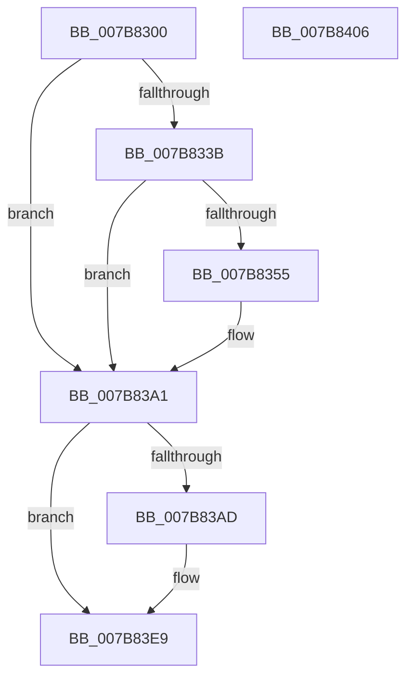

# EtwTraceTimeZoneBiasChange

- RVA: `0x007B8300`–`0x007B8407` (길이 `263` bytes)
- VA: `0x00000001407B8300`
- 실행 섹션: `PAGE`
- PDB 이름 있음: `예`; PDB Function 태그: `아니요`
- unwind 정보 RVA: `0x000D37D8`
- 디코드: `63`개 명령, `263/263` bytes 표시
- 미해석 바이트: `0` (있으면 어셈블리에 `.byte`로 보존)

> 이 문서는 커널 이미지의 기계어와 PDB 기호를 분석해 생성했습니다. 4번과 5번은 함수 원형과 자료형을 바이너리 사용 방식에서 추정한 C 해석이며 원본 소스 복구 결과는 아닙니다.

## 1. Dependencies

- 직접 호출 지점: **4**; 고유 호출 대상: **4**
- 직접 호출자로 확인된 함수: **1**
- RIP 상대 이미지 참조: **5**

### Outgoing calls
- `0x007B834C` → [tlgKeywordOn](../../text/42/tlgKeywordOn_function_0042EAA0.md) (function, `0x0042EAA0`)
- `0x007B839C` → [tlgWriteTransfer_EtwWriteTransfer](../../text/42/tlgWriteTransfer_EtwWriteTransfer_function_004260E0.md) (function, `0x004260E0`)
- `0x007B83E4` → [EtwWrite](../../text/41/EtwWrite_function_0041C720.md) (function, `0x0041C720`)
- `0x007B83F0` → [_security_check_cookie](../../text/6A/_security_check_cookie_function_006AC640.md) (function, `0x006AC640`)

### Direct callers
- [ExpRefreshTimeZoneInformation](../A6/ExpRefreshTimeZoneInformation_function_00A6B46C.md) at `0x00A6B8AB`

### Static image references
- `0x007B8319` → RVA `0x00E0A740` (`.data`; read)
- `0x007B8327` → RVA `0x00E09168` (`.data`; read)
- `0x007B8361` → RVA `0x000540B5` (`.rdata`; read)
- `0x007B83A1` → RVA `0x00EFFA28` (`.data`; read)
- `0x007B83B9` → RVA `0x00022C78` (`.rdata`; read)

## 2. Other-region calls and transfers

- 다른 실행 섹션으로 향하는 call: **4**
  - `0x007B834C` → [tlgKeywordOn](../../text/42/tlgKeywordOn_function_0042EAA0.md) (`PAGE` → `.text`)
  - `0x007B839C` → [tlgWriteTransfer_EtwWriteTransfer](../../text/42/tlgWriteTransfer_EtwWriteTransfer_function_004260E0.md) (`PAGE` → `.text`)
  - `0x007B83E4` → [EtwWrite](../../text/41/EtwWrite_function_0041C720.md) (`PAGE` → `.text`)
  - `0x007B83F0` → [_security_check_cookie](../../text/6A/_security_check_cookie_function_006AC640.md) (`PAGE` → `.text`)
- 별도 외부 분기/꼬리 이동을 확인하지 못했습니다.

## 3. Assembly (complete function range)

```asm
007B8300  48 8B C4                        mov rax, rsp
007B8303  48 89 78 18                     mov qword ptr [rax + 0x18], rdi
007B8307  89 50 10                        mov dword ptr [rax + 0x10], edx
007B830A  89 48 08                        mov dword ptr [rax + 8], ecx
007B830D  55                              push rbp
007B830E  48 8D 68 A1                     lea rbp, [rax - 0x5f]
007B8312  48 81 EC B0 00 00 00            sub rsp, 0xb0
007B8319  48 8B 05 20 24 65 00            mov rax, qword ptr [rip + 0x652420]
007B8320  48 33 C4                        xor rax, rsp
007B8323  48 89 45 47                     mov qword ptr [rbp + 0x47], rax
007B8327  83 3D 3A 0E 65 00 05            cmp dword ptr [rip + 0x650e3a], 5
007B832E  44 8B C2                        mov r8d, edx
007B8331  44 8B C9                        mov r9d, ecx
007B8334  BF 04 00 00 00                  mov edi, 4
007B8339  76 66                           jbe 0x1407b83a1
007B833B  48 BA 00 00 00 00 00 40 00 00   movabs rdx, 0x400000000000
007B8345  48 8D 0D 1C 0E 65 00            lea rcx, [rip + 0x650e1c]
007B834C  E8 4F 67 C7 FF                  call 0x14042eaa0
007B8351  84 C0                           test al, al
007B8353  74 4C                           je 0x1407b83a1
007B8355  83 65 33 00                     and dword ptr [rbp + 0x33], 0
007B8359  48 8D 45 D7                     lea rax, [rbp - 0x29]
007B835D  83 65 43 00                     and dword ptr [rbp + 0x43], 0
007B8361  48 8D 15 4D BD 89 FF            lea rdx, [rip - 0x7642b3]
007B8368  48 89 45 27                     mov qword ptr [rbp + 0x27], rax
007B836C  48 8D 0D F5 0D 65 00            lea rcx, [rip + 0x650df5]
007B8373  48 8D 45 DB                     lea rax, [rbp - 0x25]
007B8377  44 89 4D D7                     mov dword ptr [rbp - 0x29], r9d
007B837B  48 89 45 37                     mov qword ptr [rbp + 0x37], rax
007B837F  45 33 C9                        xor r9d, r9d
007B8382  48 8D 45 07                     lea rax, [rbp + 7]
007B8386  44 89 45 DB                     mov dword ptr [rbp - 0x25], r8d
007B838A  48 89 44 24 28                  mov qword ptr [rsp + 0x28], rax
007B838F  45 33 C0                        xor r8d, r8d
007B8392  89 7C 24 20                     mov dword ptr [rsp + 0x20], edi
007B8396  89 7D 2F                        mov dword ptr [rbp + 0x2f], edi
007B8399  89 7D 3F                        mov dword ptr [rbp + 0x3f], edi
007B839C  E8 3F DD C6 FF                  call 0x1404260e0
007B83A1  48 8B 0D 80 76 74 00            mov rcx, qword ptr [rip + 0x747680]
007B83A8  48 85 C9                        test rcx, rcx
007B83AB  74 3C                           je 0x1407b83e9
007B83AD  83 65 EB 00                     and dword ptr [rbp - 0x15], 0
007B83B1  48 8D 45 67                     lea rax, [rbp + 0x67]
007B83B5  83 65 FB 00                     and dword ptr [rbp - 5], 0
007B83B9  48 8D 15 B8 A8 86 FF            lea rdx, [rip - 0x795748]
007B83C0  48 89 45 DF                     mov qword ptr [rbp - 0x21], rax
007B83C4  41 B9 02 00 00 00               mov r9d, 2
007B83CA  48 8D 45 6F                     lea rax, [rbp + 0x6f]
007B83CE  89 7D E7                        mov dword ptr [rbp - 0x19], edi
007B83D1  48 89 45 EF                     mov qword ptr [rbp - 0x11], rax
007B83D5  45 33 C0                        xor r8d, r8d
007B83D8  48 8D 45 DF                     lea rax, [rbp - 0x21]
007B83DC  89 7D F7                        mov dword ptr [rbp - 9], edi
007B83DF  48 89 44 24 20                  mov qword ptr [rsp + 0x20], rax
007B83E4  E8 37 43 C6 FF                  call 0x14041c720
007B83E9  48 8B 4D 47                     mov rcx, qword ptr [rbp + 0x47]
007B83ED  48 33 CC                        xor rcx, rsp
007B83F0  E8 4B 42 EF FF                  call 0x1406ac640
007B83F5  48 8B BC 24 D0 00 00 00         mov rdi, qword ptr [rsp + 0xd0]
007B83FD  48 81 C4 B0 00 00 00            add rsp, 0xb0
007B8404  5D                              pop rbp
007B8405  C3                              ret
007B8406  CC                              int3
```

## 4. C-style interpretation (structured pseudocode)

```c
__int64 __fastcall EtwTraceTimeZoneBiasChange(int a1, int a2)
{
    __int64 result;
    __int64 v_rsp;
    unsigned __int64 v_stack_m90;
    unsigned int v_stack_m98;
    unsigned __int64 v_stack_p18;

    *(unsigned __int64 *)(v_rsp + 24) = v_rdi;
    *(unsigned int *)(v_rsp + 16) = a2;
    *(unsigned int *)(v_rsp + 8) = a1;
    v_rsp = (v_rsp) - (176);
    result = (*(unsigned __int64 *)(v_rip + 6628384)) ^ (v_rsp);
    *(unsigned __int64 *)(v_rsp - 95 + 71) = result;
    if ((*(unsigned int *)(v_rip + 6622778)) <= 5) goto loc_007B83A1;
    result = tlgKeywordOn(v_rip + 6622748, a2, (unsigned int)(a2), (unsigned int)(a1));
    if ((unsigned __int8)(result) != 0) {
        result = v_rsp - 95 - 41;
        a2 = v_rip - 7750323;
        *(unsigned __int64 *)(v_rsp - 95 + 39) = result;
        a1 = v_rip + 6622709;
        result = v_rsp - 95 - 37;
        *(unsigned int *)(v_rsp - 95 - 41) = (unsigned int)((unsigned int)(a1));
        *(unsigned __int64 *)(v_rsp - 95 + 55) = result;
        a4 = 0;
        result = v_rsp - 95 + 7;
        *(unsigned int *)(v_rsp - 95 - 37) = (unsigned int)((unsigned int)(a2));
        v_stack_m90 = result;
        a3 = 0;
        v_stack_m98 = 4;
        *(unsigned int *)(v_rsp - 95 + 47) = 4;
        *(unsigned int *)(v_rsp - 95 + 63) = 4;
        result = tlgWriteTransfer_EtwWriteTransfer(a1, a2, a3, a4);
    }
    if (*(unsigned __int64 *)(v_rip + 7632512) != 0) {
        result = v_rsp - 95 + 103;
        a2 = v_rip - 7952200;
        *(unsigned __int64 *)(v_rsp - 95 - 33) = result;
        a4 = 2;
        result = v_rsp - 95 + 111;
        *(unsigned int *)(v_rsp - 95 - 25) = 4;
        *(unsigned __int64 *)(v_rsp - 95 - 17) = result;
        a3 = 0;
        result = v_rsp - 95 - 33;
        *(unsigned int *)(v_rsp - 95 - 9) = 4;
        v_stack_m98 = result;
        result = EtwWrite(*(unsigned __int64 *)(v_rip + 7632512), a2, a3, a4);
    }
    a1 = (*(unsigned __int64 *)(v_rsp - 95 + 71)) ^ (v_rsp);
    result = _security_check_cookie(a1, a2, a3, a4);
    v_rsp = (v_rsp) + (176);
    return result;
}
```

## 5. (Beta) C Style

```c
int64_t EtwTraceTimeZoneBiasChange(int32_t Arg1, int32_t Arg2)
{
    int64_t result;
    int64_t local_rsp;
    uint64_t v_stack_m90;
    uint32_t v_stack_m98;
    uint64_t v_stack_p18;

    *(uint64_t *)(local_rsp + 0x18) = local_rdi;
    *(uint32_t *)(local_rsp + 0x10) = Arg2;
    *(uint32_t *)(local_rsp + 0x8) = Arg1;
    local_rsp = (local_rsp) - (176);
    result = (*(uint64_t *)(v_rip + 0x652420)) ^ (local_rsp);
    *(uint64_t *)(local_rsp - 0x5F + 0x47) = result;
    if ((*(uint32_t *)(v_rip + 0x650E3A)) <= 5) goto loc_007B83A1;
    result = tlgKeywordOn(v_rip + 6622748, Arg2, (uint32_t)(Arg2), (uint32_t)(Arg1));
    if ((uint8_t)(result) != 0) {
        result = local_rsp - 95 - 41;
        Arg2 = v_rip - 7750323;
        *(uint64_t *)(local_rsp - 0x5F + 0x27) = result;
        Arg1 = v_rip + 6622709;
        result = local_rsp - 95 - 37;
        *(uint32_t *)(local_rsp - 0x5F - 0x29) = (uint32_t)((uint32_t)(Arg1));
        *(uint64_t *)(local_rsp - 0x5F + 0x37) = result;
        a4 = 0;
        result = local_rsp - 95 + 7;
        *(uint32_t *)(local_rsp - 0x5F - 0x25) = (uint32_t)((uint32_t)(Arg2));
        v_stack_m90 = result;
        a3 = 0;
        v_stack_m98 = 4;
        *(uint32_t *)(local_rsp - 0x5F + 0x2F) = 4;
        *(uint32_t *)(local_rsp - 0x5F + 0x3F) = 4;
        result = tlgWriteTransfer_EtwWriteTransfer(Arg1, Arg2, a3, a4);
    }
    if (*(uint64_t *)(v_rip + 0x747680) != 0) {
        result = local_rsp - 95 + 103;
        Arg2 = v_rip - 7952200;
        *(uint64_t *)(local_rsp - 0x5F - 0x21) = result;
        a4 = 2;
        result = local_rsp - 95 + 111;
        *(uint32_t *)(local_rsp - 0x5F - 0x19) = 4;
        *(uint64_t *)(local_rsp - 0x5F - 0x11) = result;
        a3 = 0;
        result = local_rsp - 95 - 33;
        *(uint32_t *)(local_rsp - 0x5F - 0x9) = 4;
        v_stack_m98 = result;
        result = EtwWrite(*(uint64_t *)(v_rip + 0x747680), Arg2, a3, a4);
    }
    Arg1 = (*(uint64_t *)(local_rsp - 0x5F + 0x47)) ^ (local_rsp);
    result = _security_check_cookie(Arg1, Arg2, a3, a4);
    local_rsp = (local_rsp) + (176);
    return result;
}
```

## 6. Execution-region graph

[열기: 2D/3D 그래프와 함수 탐색 컨트롤 패널](../../../control-panel.html?section=page&rva=0x007B8300&view=graph)

- 2D 그래프는 위에서 아래로 흐르고, 3D 그래프는 빈 공간을 드래그해 회전합니다. Shift+드래그는 이동, 휠은 확대·축소, 함수 노드 선택은 대상 보고서 이동입니다.

### Static fallback


