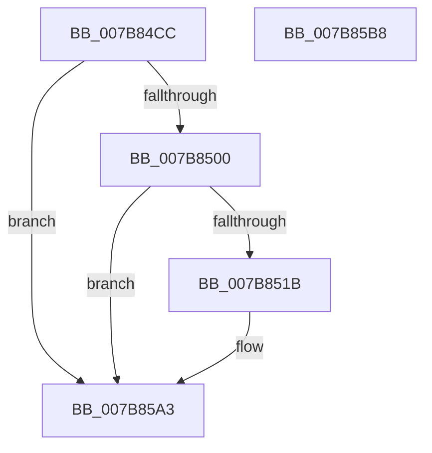

# EtwTraceWin32kFreezeChangeNotifyStop

- RVA: `0x007B84CC`–`0x007B85B9` (길이 `237` bytes)
- VA: `0x00000001407B84CC`
- 실행 섹션: `PAGE`
- PDB 이름 있음: `예`; PDB Function 태그: `아니요`
- unwind 정보 RVA: `0x000C84D0`
- 디코드: `52`개 명령, `237/237` bytes 표시
- 미해석 바이트: `0` (있으면 어셈블리에 `.byte`로 보존)

> 이 문서는 커널 이미지의 기계어와 PDB 기호를 분석해 생성했습니다. 4번과 5번은 함수 원형과 자료형을 바이너리 사용 방식에서 추정한 C 해석이며 원본 소스 복구 결과는 아닙니다.

## 1. Dependencies

- 직접 호출 지점: **3**; 고유 호출 대상: **3**
- 직접 호출자로 확인된 함수: **2**
- RIP 상대 이미지 참조: **3**

### Outgoing calls
- `0x007B850C` → [tlgKeywordOn](../../text/42/tlgKeywordOn_function_0042EAA0.md) (function, `0x0042EAA0`)
- `0x007B859E` → [tlgWriteTransfer_EtwWriteTransfer](../../text/42/tlgWriteTransfer_EtwWriteTransfer_function_004260E0.md) (function, `0x004260E0`)
- `0x007B85AA` → [_security_check_cookie](../../text/6A/_security_check_cookie_function_006AC640.md) (function, `0x006AC640`)

### Direct callers
- [PspPostFreezeOperationWorker](../A9/PspPostFreezeOperationWorker_function_00A94CB0.md) at `0x00A94FFD`
- [PspWin32kProcessFreezeNotify](../AA/PspWin32kProcessFreezeNotify_function_00AA3A88.md) at `0x00AA3B42`

### Static image references
- `0x007B84DF` → RVA `0x00E0A740` (`.data`; read)
- `0x007B84ED` → RVA `0x00E091A0` (`.data`; read)
- `0x007B853A` → RVA `0x000548E7` (`.rdata`; read)

## 2. Other-region calls and transfers

- 다른 실행 섹션으로 향하는 call: **3**
  - `0x007B850C` → [tlgKeywordOn](../../text/42/tlgKeywordOn_function_0042EAA0.md) (`PAGE` → `.text`)
  - `0x007B859E` → [tlgWriteTransfer_EtwWriteTransfer](../../text/42/tlgWriteTransfer_EtwWriteTransfer_function_004260E0.md) (`PAGE` → `.text`)
  - `0x007B85AA` → [_security_check_cookie](../../text/6A/_security_check_cookie_function_006AC640.md) (`PAGE` → `.text`)
- 별도 외부 분기/꼬리 이동을 확인하지 못했습니다.

## 3. Assembly (complete function range)

```asm
007B84CC  66 44 89 44 24 18               mov word ptr [rsp + 0x18], r8w
007B84D2  55                              push rbp
007B84D3  48 8D 6C 24 A9                  lea rbp, [rsp - 0x57]
007B84D8  48 81 EC C0 00 00 00            sub rsp, 0xc0
007B84DF  48 8B 05 5A 22 65 00            mov rax, qword ptr [rip + 0x65225a]
007B84E6  48 33 C4                        xor rax, rsp
007B84E9  48 89 45 47                     mov qword ptr [rbp + 0x47], rax
007B84ED  83 3D AC 0C 65 00 05            cmp dword ptr [rip + 0x650cac], 5
007B84F4  4C 8B D2                        mov r10, rdx
007B84F7  44 8B D9                        mov r11d, ecx
007B84FA  0F 86 A3 00 00 00               jbe 0x1407b85a3
007B8500  BA 04 00 00 00                  mov edx, 4
007B8505  48 8D 0D 94 0C 65 00            lea rcx, [rip + 0x650c94]
007B850C  E8 8F 65 C7 FF                  call 0x14042eaa0
007B8511  33 D2                           xor edx, edx
007B8513  84 C0                           test al, al
007B8515  0F 84 88 00 00 00               je 0x1407b85a3
007B851B  48 8D 45 CB                     lea rax, [rbp - 0x35]
007B851F  66 44 89 45 C7                  mov word ptr [rbp - 0x39], r8w
007B8524  48 89 45 F7                     mov qword ptr [rbp - 9], rax
007B8528  48 8D 0D 71 0C 65 00            lea rcx, [rip + 0x650c71]
007B852F  48 8D 45 C7                     lea rax, [rbp - 0x39]
007B8533  89 55 33                        mov dword ptr [rbp + 0x33], edx
007B8536  48 89 45 07                     mov qword ptr [rbp + 7], rax
007B853A  48 8D 15 A6 C3 89 FF            lea rdx, [rip - 0x763c5a]
007B8541  48 8D 45 77                     lea rax, [rbp + 0x77]
007B8545  44 89 4D CF                     mov dword ptr [rbp - 0x31], r9d
007B8549  48 89 45 17                     mov qword ptr [rbp + 0x17], rax
007B854D  45 33 C9                        xor r9d, r9d
007B8550  41 0F B7 C0                     movzx eax, r8w
007B8554  45 33 C0                        xor r8d, r8d
007B8557  C1 E0 02                        shl eax, 2
007B855A  89 45 2F                        mov dword ptr [rbp + 0x2f], eax
007B855D  48 8D 45 CF                     lea rax, [rbp - 0x31]
007B8561  48 89 45 37                     mov qword ptr [rbp + 0x37], rax
007B8565  48 8D 45 D7                     lea rax, [rbp - 0x29]
007B8569  48 89 44 24 28                  mov qword ptr [rsp + 0x28], rax
007B856E  C7 44 24 20 07 00 00 00         mov dword ptr [rsp + 0x20], 7
007B8576  44 89 5D CB                     mov dword ptr [rbp - 0x35], r11d
007B857A  48 C7 45 FF 04 00 00 00         mov qword ptr [rbp - 1], 4
007B8582  48 C7 45 0F 02 00 00 00         mov qword ptr [rbp + 0xf], 2
007B858A  48 C7 45 1F 02 00 00 00         mov qword ptr [rbp + 0x1f], 2
007B8592  4C 89 55 27                     mov qword ptr [rbp + 0x27], r10
007B8596  48 C7 45 3F 04 00 00 00         mov qword ptr [rbp + 0x3f], 4
007B859E  E8 3D DB C6 FF                  call 0x1404260e0
007B85A3  48 8B 4D 47                     mov rcx, qword ptr [rbp + 0x47]
007B85A7  48 33 CC                        xor rcx, rsp
007B85AA  E8 91 40 EF FF                  call 0x1406ac640
007B85AF  48 81 C4 C0 00 00 00            add rsp, 0xc0
007B85B6  5D                              pop rbp
007B85B7  C3                              ret
007B85B8  CC                              int3
```

## 4. C-style interpretation (structured pseudocode)

```c
__int64 __fastcall EtwTraceWin32kFreezeChangeNotifyStop(int a1, __int64 a2, int a3, int a4)
{
    __int64 result;
    __int64 v_rsp;
    unsigned __int64 v_stack_m18;
    unsigned __int64 v_stack_m20;
    unsigned __int64 v_stack_m28;
    unsigned int v_stack_m2C;
    unsigned int v_stack_m30;
    unsigned __int64 v_stack_m38;
    unsigned __int64 v_stack_m40;
    unsigned __int64 v_stack_m48;
    unsigned __int64 v_stack_m50;
    unsigned __int64 v_stack_m58;
    unsigned __int64 v_stack_m5F;
    unsigned __int64 v_stack_m60;
    unsigned __int64 v_stack_m68;
    unsigned __int64 v_stack_m88;
    unsigned int v_stack_m90;
    unsigned __int64 v_stack_m94;
    unsigned __int16 v_stack_m98;
    unsigned __int64 v_stack_mA0;
    unsigned int v_stack_mA8;
    unsigned __int16 v_stack_p18;

    v_stack_p18 = (unsigned __int16)(a3);
    v_rsp = (v_rsp) - (192);
    result = (*(unsigned __int64 *)(v_rip + 6627930)) ^ (v_rsp);
    v_stack_m18 = result;
    if ((*(unsigned int *)(v_rip + 6622380)) <= 5) goto loc_007B85A3;
    result = tlgKeywordOn(v_rip + 6622356, 4, a3, a4);
    a2 = 0;
    if ((unsigned __int8)(result) != 0) {
        result = v_stack_m94;
        v_stack_m98 = (unsigned __int16)(a3);
        v_stack_m68 = result;
        a1 = v_rip + 6622321;
        result = v_stack_m98;
        v_stack_m2C = 0;
        v_stack_m58 = result;
        a2 = v_rip - 7748698;
        result = v_stack_p18;
        v_stack_m90 = a4;
        v_stack_m48 = result;
        a4 = 0;
        result = (unsigned __int16)(a3);
        a3 = 0;
        result = (unsigned int)((result) << (2));
        v_stack_m30 = (unsigned int)(result);
        result = v_stack_m90;
        v_stack_m28 = result;
        result = v_stack_m88;
        v_stack_mA0 = result;
        v_stack_mA8 = 7;
        v_stack_m94 = (unsigned int)((unsigned int)(a1));
        v_stack_m60 = 4;
        v_stack_m50 = 2;
        v_stack_m40 = 2;
        v_stack_m38 = a2;
        v_stack_m20 = 4;
        result = tlgWriteTransfer_EtwWriteTransfer(a1, a2, a3, a4);
    }
    a1 = (v_stack_m18) ^ (v_rsp);
    result = _security_check_cookie(a1, a2, a3, a4);
    v_rsp = (v_rsp) + (192);
    return result;
}
```

## 5. (Beta) C Style

```c
int64_t EtwTraceWin32kFreezeChangeNotifyStop(int32_t Arg1, int64_t Arg2, int32_t Arg3, int32_t Arg4)
{
    int64_t result;
    int64_t local_rsp;
    uint64_t v_stack_m18;
    uint64_t v_stack_m20;
    uint64_t v_stack_m28;
    uint32_t v_stack_m2C;
    uint32_t v_stack_m30;
    uint64_t v_stack_m38;
    uint64_t v_stack_m40;
    uint64_t v_stack_m48;
    uint64_t v_stack_m50;
    uint64_t v_stack_m58;
    uint64_t v_stack_m5F;
    uint64_t v_stack_m60;
    uint64_t v_stack_m68;
    uint64_t v_stack_m88;
    uint32_t v_stack_m90;
    uint64_t v_stack_m94;
    uint16_t v_stack_m98;
    uint64_t v_stack_mA0;
    uint32_t v_stack_mA8;
    uint16_t v_stack_p18;

    v_stack_p18 = (uint16_t)(Arg3);
    local_rsp = (local_rsp) - (192);
    result = (*(uint64_t *)(v_rip + 0x65225A)) ^ (local_rsp);
    v_stack_m18 = result;
    if ((*(uint32_t *)(v_rip + 0x650CAC)) <= 5) goto loc_007B85A3;
    result = tlgKeywordOn(v_rip + 6622356, 4, Arg3, Arg4);
    Arg2 = 0;
    if ((uint8_t)(result) != 0) {
        result = v_stack_m94;
        v_stack_m98 = (uint16_t)(Arg3);
        v_stack_m68 = result;
        Arg1 = v_rip + 6622321;
        result = v_stack_m98;
        v_stack_m2C = 0;
        v_stack_m58 = result;
        Arg2 = v_rip - 7748698;
        result = v_stack_p18;
        v_stack_m90 = Arg4;
        v_stack_m48 = result;
        Arg4 = 0;
        result = (uint16_t)(Arg3);
        Arg3 = 0;
        result = (uint32_t)((result) << (2));
        v_stack_m30 = (uint32_t)(result);
        result = v_stack_m90;
        v_stack_m28 = result;
        result = v_stack_m88;
        v_stack_mA0 = result;
        v_stack_mA8 = 7;
        v_stack_m94 = (uint32_t)((uint32_t)(Arg1));
        v_stack_m60 = 4;
        v_stack_m50 = 2;
        v_stack_m40 = 2;
        v_stack_m38 = Arg2;
        v_stack_m20 = 4;
        result = tlgWriteTransfer_EtwWriteTransfer(Arg1, Arg2, Arg3, Arg4);
    }
    Arg1 = (v_stack_m18) ^ (local_rsp);
    result = _security_check_cookie(Arg1, Arg2, Arg3, Arg4);
    local_rsp = (local_rsp) + (192);
    return result;
}
```

## 6. Execution-region graph

[열기: 2D/3D 그래프와 함수 탐색 컨트롤 패널](../../../control-panel.html?section=page&rva=0x007B84CC&view=graph)

- 2D 그래프는 위에서 아래로 흐르고, 3D 그래프는 빈 공간을 드래그해 회전합니다. Shift+드래그는 이동, 휠은 확대·축소, 함수 노드 선택은 대상 보고서 이동입니다.

### Static fallback


