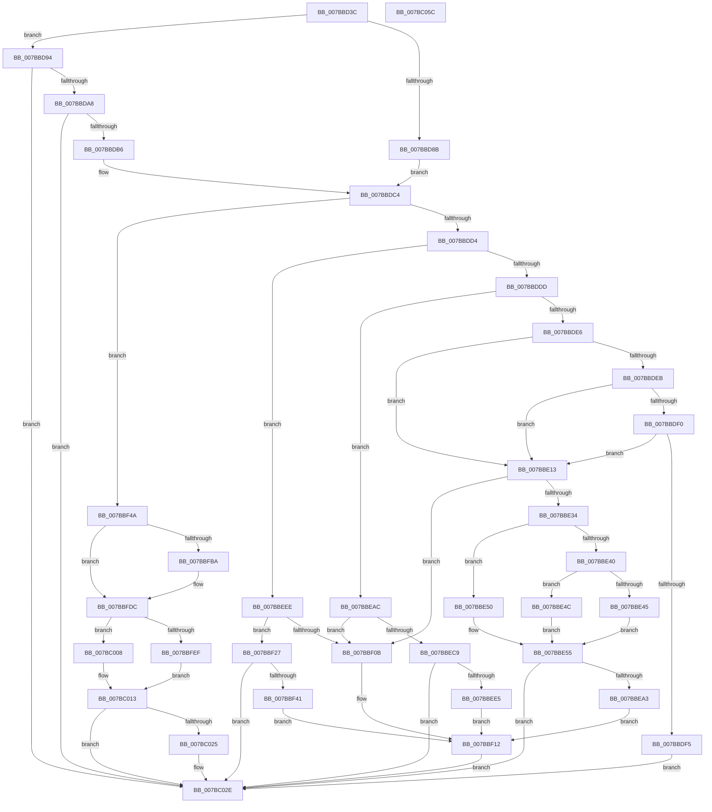

# EtwWmitraceWorker

- RVA: `0x007BBD3C`–`0x007BC05D` (길이 `801` bytes)
- VA: `0x00000001407BBD3C`
- 실행 섹션: `PAGE`
- PDB 이름 있음: `예`; PDB Function 태그: `아니요`
- unwind 정보 RVA: `0x000D3BCC`
- 디코드: `188`개 명령, `801/801` bytes 표시
- 미해석 바이트: `0` (있으면 어셈블리에 `.byte`로 보존)

> 이 문서는 커널 이미지의 기계어와 PDB 기호를 분석해 생성했습니다. 4번과 5번은 함수 원형과 자료형을 바이너리 사용 방식에서 추정한 C 해석이며 원본 소스 복구 결과는 아닙니다.

## 1. Dependencies

- 직접 호출 지점: **23**; 고유 호출 대상: **13**
- 직접 호출자로 확인된 함수: **1**
- RIP 상대 이미지 참조: **26**

### Outgoing calls
- `0x007BBD6E` → [memset](../../text/6C/memset_function_006C6C40.md) (function, `0x006C6C40`)
- `0x007BBD99` → [PsGetSiloBySessionId](../91/PsGetSiloBySessionId_function_00912F94.md) (function, `0x00912F94`)
- `0x007BBE09` → [DbgPrintEx](../../text/35/DbgPrintEx_function_00359290.md) (function, `0x00359290`)
- `0x007BBE18` → [EtwpPrepareWmitraceLoggerInfo](EtwpPrepareWmitraceLoggerInfo_function_007BC064.md) (function, `0x007BC064`)
- `0x007BBE25` → [EtwpQueryTrace](../8B/EtwpQueryTrace_function_008BF8B0.md) (function, `0x008BF8B0`)
- `0x007BBE94` → [EtwEnableTrace](../A5/EtwEnableTrace_function_00A5C850.md) (function, `0x00A5C850`)
- `0x007BBEB1` → [EtwpPrepareWmitraceLoggerInfo](EtwpPrepareWmitraceLoggerInfo_function_007BC064.md) (function, `0x007BC064`)
- `0x007BBEBE` → [EtwpQueryTrace](../8B/EtwpQueryTrace_function_008BF8B0.md) (function, `0x008BF8B0`)
- `0x007BBED6` → [EtwpUpdateTrace](../AB/EtwpUpdateTrace_function_00ABCC7C.md) (function, `0x00ABCC7C`)
- `0x007BBEF3` → [EtwpPrepareWmitraceLoggerInfo](EtwpPrepareWmitraceLoggerInfo_function_007BC064.md) (function, `0x007BC064`)
- `0x007BBF00` → [EtwpQueryTrace](../8B/EtwpQueryTrace_function_008BF8B0.md) (function, `0x008BF8B0`)
- `0x007BBF1D` → [DbgPrintEx](../../text/35/DbgPrintEx_function_00359290.md) (function, `0x00359290`)
- `0x007BBF32` → [EtwpStopTrace](../9B/EtwpStopTrace_function_009BCE84.md) (function, `0x009BCE84`)
- `0x007BBF4F` → [EtwpPrepareWmitraceLoggerInfo](EtwpPrepareWmitraceLoggerInfo_function_007BC064.md) (function, `0x007BC064`)
- `0x007BBF60` → [RtlInitAnsiString](../../text/47/RtlInitAnsiString_function_00470F40.md) (function, `0x00470F40`)
- `0x007BBF76` → [RtlAnsiStringToUnicodeString](../90/RtlAnsiStringToUnicodeString_function_0090BEA0.md) (function, `0x0090BEA0`)
- `0x007BBFC6` → [RtlInitAnsiString](../../text/47/RtlInitAnsiString_function_00470F40.md) (function, `0x00470F40`)
- `0x007BBFD7` → [RtlAnsiStringToUnicodeString](../90/RtlAnsiStringToUnicodeString_function_0090BEA0.md) (function, `0x0090BEA0`)
- `0x007BBFE4` → [EtwpStartTrace](../A9/EtwpStartTrace_function_00A99D08.md) (function, `0x00A99D08`)
- `0x007BC001` → [DbgPrintEx](../../text/35/DbgPrintEx_function_00359290.md) (function, `0x00359290`)
- `0x007BC017` → [RtlFreeAnsiString](../9C/RtlFreeAnsiString_function_009C0800.md) (function, `0x009C0800`)
- `0x007BC029` → [RtlFreeAnsiString](../9C/RtlFreeAnsiString_function_009C0800.md) (function, `0x009C0800`)
- `0x007BC042` → [_security_check_cookie](../../text/6A/_security_check_cookie_function_006AC640.md) (function, `0x006AC640`)

### Direct callers
- [ExpDebuggerWorker](../../pagekd/B8/ExpDebuggerWorker_function_00B89F70.md) at `0x00B8A0BC`

### Static image references
- `0x007BBD53` → RVA `0x00E0A740` (`.data`; read)
- `0x007BBD7C` → RVA `0x00EFF2C4` (`.data`; read)
- `0x007BBD8B` → RVA `0x00FC6AA8` (`ALMOSTRO`; read)
- `0x007BBDC4` → RVA `0x00EFF2A0` (`.data`; read)
- `0x007BBDFA` → RVA `0x00B076F0` (` ?? ::NNGAKEGL::`string'`; read)
- `0x007BBE55` → RVA `0x00EFF2D8` (`.data`; read)
- `0x007BBE5B` → RVA `0x00EFF2DC` (`.data`; read)
- `0x007BBE62` → RVA `0x00EFF2C0` (`.data`; read)
- `0x007BBE72` → RVA `0x00EFF2D0` (`.data`; read)
- `0x007BBE7E` → RVA `0x00EFF2C8` (`.data`; read)
- `0x007BBE8A` → RVA `0x00EFF2EC` (`.data`; read)
- `0x007BBEA3` → RVA `0x00B07780` (` ?? ::NNGAKEGL::`string'`; read)
- `0x007BBEE5` → RVA `0x00B077B0` (` ?? ::NNGAKEGL::`string'`; read)
- `0x007BBF0B` → RVA `0x00B077E0` (` ?? ::NNGAKEGL::`string'`; read)
- `0x007BBF41` → RVA `0x00B07750` (` ?? ::NNGAKEGL::`string'`; read)
- `0x007BBF7B` → RVA `0x00EFF309` (`.data`; read)
- `0x007BBF82` → RVA `0x00EFF390` (`.data`; read)
- `0x007BBF8B` → RVA `0x00EFF394` (`.data`; read)
- `0x007BBF94` → RVA `0x00EFF398` (`.data`; read)
- `0x007BBF9D` → RVA `0x00EFF39C` (`.data`; read)
- `0x007BBFA6` → RVA `0x00EFF3A0` (`.data`; read)
- `0x007BBFAF` → RVA `0x00EFF38C` (`.data`; read)
- `0x007BBFF4` → RVA `0x00B07720` (` ?? ::NNGAKEGL::`string'`; read)
- `0x007BC00D` → RVA `0x00EFF2C0` (`.data`; write)
- `0x007BC02E` → RVA `0x00EFF3A8` (`.data`; write)
- `0x007BC034` → RVA `0x00EFF2A0` (`.data`; write)

## 2. Other-region calls and transfers

- 다른 실행 섹션으로 향하는 call: **7**
  - `0x007BBD6E` → [memset](../../text/6C/memset_function_006C6C40.md) (`PAGE` → `.text`)
  - `0x007BBE09` → [DbgPrintEx](../../text/35/DbgPrintEx_function_00359290.md) (`PAGE` → `.text`)
  - `0x007BBF1D` → [DbgPrintEx](../../text/35/DbgPrintEx_function_00359290.md) (`PAGE` → `.text`)
  - `0x007BBF60` → [RtlInitAnsiString](../../text/47/RtlInitAnsiString_function_00470F40.md) (`PAGE` → `.text`)
  - `0x007BBFC6` → [RtlInitAnsiString](../../text/47/RtlInitAnsiString_function_00470F40.md) (`PAGE` → `.text`)
  - `0x007BC001` → [DbgPrintEx](../../text/35/DbgPrintEx_function_00359290.md) (`PAGE` → `.text`)
  - `0x007BC042` → [_security_check_cookie](../../text/6A/_security_check_cookie_function_006AC640.md) (`PAGE` → `.text`)
- 별도 외부 분기/꼬리 이동을 확인하지 못했습니다.

## 3. Assembly (complete function range)

```asm
007BBD3C  48 89 5C 24 08                  mov qword ptr [rsp + 8], rbx
007BBD41  48 89 7C 24 10                  mov qword ptr [rsp + 0x10], rdi
007BBD46  55                              push rbp
007BBD47  48 8D 6C 24 E0                  lea rbp, [rsp - 0x20]
007BBD4C  48 81 EC 20 01 00 00            sub rsp, 0x120
007BBD53  48 8B 05 E6 E9 64 00            mov rax, qword ptr [rip + 0x64e9e6]
007BBD5A  48 33 C4                        xor rax, rsp
007BBD5D  48 89 45 10                     mov qword ptr [rbp + 0x10], rax
007BBD61  33 D2                           xor edx, edx
007BBD63  48 8D 4C 24 60                  lea rcx, [rsp + 0x60]
007BBD68  41 B8 B0 00 00 00               mov r8d, 0xb0
007BBD6E  E8 CD AE F0 FF                  call 0x1406c6c40
007BBD73  48 83 64 24 40 00               and qword ptr [rsp + 0x40], 0
007BBD79  0F 57 C0                        xorps xmm0, xmm0
007BBD7C  8B 0D 42 35 74 00               mov ecx, dword ptr [rip + 0x743542]
007BBD82  0F 11 44 24 48                  movups xmmword ptr [rsp + 0x48], xmm0
007BBD87  85 C9                           test ecx, ecx
007BBD89  75 09                           jne 0x1407bbd94
007BBD8B  48 8B 3D 16 AD 80 00            mov rdi, qword ptr [rip + 0x80ad16]
007BBD92  EB 30                           jmp 0x1407bbdc4
007BBD94  48 8D 54 24 40                  lea rdx, [rsp + 0x40]
007BBD99  E8 F6 71 15 00                  call 0x140912f94
007BBD9E  8B D8                           mov ebx, eax
007BBDA0  85 C0                           test eax, eax
007BBDA2  0F 88 86 02 00 00               js 0x1407bc02e
007BBDA8  48 8B 44 24 40                  mov rax, qword ptr [rsp + 0x40]
007BBDAD  48 85 C0                        test rax, rax
007BBDB0  0F 84 78 02 00 00               je 0x1407bc02e
007BBDB6  48 8B 80 E0 05 00 00            mov rax, qword ptr [rax + 0x5e0]
007BBDBD  48 8B B8 40 03 00 00            mov rdi, qword ptr [rax + 0x340]
007BBDC4  0F B6 0D D5 34 74 00            movzx ecx, byte ptr [rip + 0x7434d5]
007BBDCB  83 E9 01                        sub ecx, 1
007BBDCE  0F 84 76 01 00 00               je 0x1407bbf4a
007BBDD4  83 E9 01                        sub ecx, 1
007BBDD7  0F 84 11 01 00 00               je 0x1407bbeee
007BBDDD  83 E9 01                        sub ecx, 1
007BBDE0  0F 84 C6 00 00 00               je 0x1407bbeac
007BBDE6  83 E9 01                        sub ecx, 1
007BBDE9  74 28                           je 0x1407bbe13
007BBDEB  83 E9 01                        sub ecx, 1
007BBDEE  74 23                           je 0x1407bbe13
007BBDF0  83 F9 01                        cmp ecx, 1
007BBDF3  74 1E                           je 0x1407bbe13
007BBDF5  BA 03 00 00 00                  mov edx, 3
007BBDFA  4C 8D 05 EF B8 34 00            lea r8, [rip + 0x34b8ef]
007BBE01  BB BB 00 00 C0                  mov ebx, 0xc00000bb
007BBE06  8D 4A 14                        lea ecx, [rdx + 0x14]
007BBE09  E8 82 D4 B9 FF                  call 0x140359290
007BBE0E  E9 1B 02 00 00                  jmp 0x1407bc02e
007BBE13  48 8D 4C 24 60                  lea rcx, [rsp + 0x60]
007BBE18  E8 47 02 00 00                  call 0x1407bc064
007BBE1D  48 8D 54 24 60                  lea rdx, [rsp + 0x60]
007BBE22  48 8B CF                        mov rcx, rdi
007BBE25  E8 86 3A 10 00                  call 0x1408bf8b0
007BBE2A  8B D8                           mov ebx, eax
007BBE2C  85 C0                           test eax, eax
007BBE2E  0F 88 D7 00 00 00               js 0x1407bbf0b
007BBE34  0F B6 0D 65 34 74 00            movzx ecx, byte ptr [rip + 0x743465]
007BBE3B  83 E9 04                        sub ecx, 4
007BBE3E  74 10                           je 0x1407bbe50
007BBE40  83 F9 01                        cmp ecx, 1
007BBE43  74 07                           je 0x1407bbe4c
007BBE45  BB 02 00 00 00                  mov ebx, 2
007BBE4A  EB 09                           jmp 0x1407bbe55
007BBE4C  33 DB                           xor ebx, ebx
007BBE4E  EB 05                           jmp 0x1407bbe55
007BBE50  BB 01 00 00 00                  mov ebx, 1
007BBE55  8B 05 7D 34 74 00               mov eax, dword ptr [rip + 0x74347d]
007BBE5B  48 8D 0D 7A 34 74 00            lea rcx, [rip + 0x74347a]
007BBE62  44 8B 05 57 34 74 00            mov r8d, dword ptr [rip + 0x743457]
007BBE69  44 8B CB                        mov r9d, ebx
007BBE6C  89 44 24 38                     mov dword ptr [rsp + 0x38], eax
007BBE70  33 D2                           xor edx, edx
007BBE72  48 8B 05 57 34 74 00            mov rax, qword ptr [rip + 0x743457]
007BBE79  48 89 44 24 30                  mov qword ptr [rsp + 0x30], rax
007BBE7E  48 8B 05 43 34 74 00            mov rax, qword ptr [rip + 0x743443]
007BBE85  48 89 44 24 28                  mov qword ptr [rsp + 0x28], rax
007BBE8A  8A 05 5C 34 74 00               mov al, byte ptr [rip + 0x74345c]
007BBE90  88 44 24 20                     mov byte ptr [rsp + 0x20], al
007BBE94  E8 B7 09 2A 00                  call 0x140a5c850
007BBE99  8B D8                           mov ebx, eax
007BBE9B  85 C0                           test eax, eax
007BBE9D  0F 89 8B 01 00 00               jns 0x1407bc02e
007BBEA3  4C 8D 05 D6 B8 34 00            lea r8, [rip + 0x34b8d6]
007BBEAA  EB 66                           jmp 0x1407bbf12
007BBEAC  48 8D 4C 24 60                  lea rcx, [rsp + 0x60]
007BBEB1  E8 AE 01 00 00                  call 0x1407bc064
007BBEB6  48 8D 54 24 60                  lea rdx, [rsp + 0x60]
007BBEBB  48 8B CF                        mov rcx, rdi
007BBEBE  E8 ED 39 10 00                  call 0x1408bf8b0
007BBEC3  8B D8                           mov ebx, eax
007BBEC5  85 C0                           test eax, eax
007BBEC7  78 42                           js 0x1407bbf0b
007BBEC9  0F BA 6D A0 13                  bts dword ptr [rbp - 0x60], 0x13
007BBECE  48 8D 54 24 60                  lea rdx, [rsp + 0x60]
007BBED3  48 8B CF                        mov rcx, rdi
007BBED6  E8 A1 0D 30 00                  call 0x140abcc7c
007BBEDB  8B D8                           mov ebx, eax
007BBEDD  85 C0                           test eax, eax
007BBEDF  0F 89 49 01 00 00               jns 0x1407bc02e
007BBEE5  4C 8D 05 C4 B8 34 00            lea r8, [rip + 0x34b8c4]
007BBEEC  EB 24                           jmp 0x1407bbf12
007BBEEE  48 8D 4C 24 60                  lea rcx, [rsp + 0x60]
007BBEF3  E8 6C 01 00 00                  call 0x1407bc064
007BBEF8  48 8D 54 24 60                  lea rdx, [rsp + 0x60]
007BBEFD  48 8B CF                        mov rcx, rdi
007BBF00  E8 AB 39 10 00                  call 0x1408bf8b0
007BBF05  8B D8                           mov ebx, eax
007BBF07  85 C0                           test eax, eax
007BBF09  79 1C                           jns 0x1407bbf27
007BBF0B  4C 8D 05 CE B8 34 00            lea r8, [rip + 0x34b8ce]
007BBF12  BA 03 00 00 00                  mov edx, 3
007BBF17  44 8B C8                        mov r9d, eax
007BBF1A  8D 4A 14                        lea ecx, [rdx + 0x14]
007BBF1D  E8 6E D3 B9 FF                  call 0x140359290
007BBF22  E9 07 01 00 00                  jmp 0x1407bc02e
007BBF27  45 33 C0                        xor r8d, r8d
007BBF2A  48 8D 54 24 60                  lea rdx, [rsp + 0x60]
007BBF2F  48 8B CF                        mov rcx, rdi
007BBF32  E8 4D 0F 20 00                  call 0x1409bce84
007BBF37  8B D8                           mov ebx, eax
007BBF39  85 C0                           test eax, eax
007BBF3B  0F 89 ED 00 00 00               jns 0x1407bc02e
007BBF41  4C 8D 05 08 B8 34 00            lea r8, [rip + 0x34b808]
007BBF48  EB C8                           jmp 0x1407bbf12
007BBF4A  48 8D 4C 24 60                  lea rcx, [rsp + 0x60]
007BBF4F  E8 10 01 00 00                  call 0x1407bc064
007BBF54  48 8D 15 6D 33 74 00            lea rdx, [rip + 0x74336d]
007BBF5B  48 8D 4C 24 48                  lea rcx, [rsp + 0x48]
007BBF60  E8 DB 4F CB FF                  call 0x140470f40
007BBF65  BB 01 00 00 00                  mov ebx, 1
007BBF6A  48 8D 54 24 48                  lea rdx, [rsp + 0x48]
007BBF6F  44 8A C3                        mov r8b, bl
007BBF72  48 8D 4D F0                     lea rcx, [rbp - 0x10]
007BBF76  E8 25 FF 14 00                  call 0x14090bea0
007BBF7B  80 3D 87 33 74 00 00            cmp byte ptr [rip + 0x743387], 0
007BBF82  8B 05 08 34 74 00               mov eax, dword ptr [rip + 0x743408]
007BBF88  89 45 94                        mov dword ptr [rbp - 0x6c], eax
007BBF8B  8B 05 03 34 74 00               mov eax, dword ptr [rip + 0x743403]
007BBF91  89 45 98                        mov dword ptr [rbp - 0x68], eax
007BBF94  8B 05 FE 33 74 00               mov eax, dword ptr [rip + 0x7433fe]
007BBF9A  89 45 90                        mov dword ptr [rbp - 0x70], eax
007BBF9D  8B 05 F9 33 74 00               mov eax, dword ptr [rip + 0x7433f9]
007BBFA3  89 45 A0                        mov dword ptr [rbp - 0x60], eax
007BBFA6  8B 05 F4 33 74 00               mov eax, dword ptr [rip + 0x7433f4]
007BBFAC  89 45 A4                        mov dword ptr [rbp - 0x5c], eax
007BBFAF  8B 05 D7 33 74 00               mov eax, dword ptr [rip + 0x7433d7]
007BBFB5  89 45 9C                        mov dword ptr [rbp - 0x64], eax
007BBFB8  74 22                           je 0x1407bbfdc
007BBFBA  48 8D 15 48 33 74 00            lea rdx, [rip + 0x743348]
007BBFC1  48 8D 4C 24 48                  lea rcx, [rsp + 0x48]
007BBFC6  E8 75 4F CB FF                  call 0x140470f40
007BBFCB  44 8A C3                        mov r8b, bl
007BBFCE  48 8D 54 24 48                  lea rdx, [rsp + 0x48]
007BBFD3  48 8D 4D E0                     lea rcx, [rbp - 0x20]
007BBFD7  E8 C4 FE 14 00                  call 0x14090bea0
007BBFDC  48 8D 54 24 60                  lea rdx, [rsp + 0x60]
007BBFE1  48 8B CF                        mov rcx, rdi
007BBFE4  E8 1F DD 2D 00                  call 0x140a99d08
007BBFE9  8B D8                           mov ebx, eax
007BBFEB  85 C0                           test eax, eax
007BBFED  79 19                           jns 0x1407bc008
007BBFEF  BA 03 00 00 00                  mov edx, 3
007BBFF4  4C 8D 05 25 B7 34 00            lea r8, [rip + 0x34b725]
007BBFFB  44 8B C8                        mov r9d, eax
007BBFFE  8D 4A 14                        lea ecx, [rdx + 0x14]
007BC001  E8 8A D2 B9 FF                  call 0x140359290
007BC006  EB 0B                           jmp 0x1407bc013
007BC008  0F B7 44 24 68                  movzx eax, word ptr [rsp + 0x68]
007BC00D  89 05 AD 32 74 00               mov dword ptr [rip + 0x7432ad], eax
007BC013  48 8D 4D F0                     lea rcx, [rbp - 0x10]
007BC017  E8 E4 47 20 00                  call 0x1409c0800
007BC01C  80 3D E6 32 74 00 00            cmp byte ptr [rip + 0x7432e6], 0
007BC023  74 09                           je 0x1407bc02e
007BC025  48 8D 4D E0                     lea rcx, [rbp - 0x20]
007BC029  E8 D2 47 20 00                  call 0x1409c0800
007BC02E  89 1D 74 33 74 00               mov dword ptr [rip + 0x743374], ebx
007BC034  C6 05 65 32 74 00 00            mov byte ptr [rip + 0x743265], 0
007BC03B  48 8B 4D 10                     mov rcx, qword ptr [rbp + 0x10]
007BC03F  48 33 CC                        xor rcx, rsp
007BC042  E8 F9 05 EF FF                  call 0x1406ac640
007BC047  4C 8D 9C 24 20 01 00 00         lea r11, [rsp + 0x120]
007BC04F  49 8B 5B 10                     mov rbx, qword ptr [r11 + 0x10]
007BC053  49 8B 7B 18                     mov rdi, qword ptr [r11 + 0x18]
007BC057  49 8B E3                        mov rsp, r11
007BC05A  5D                              pop rbp
007BC05B  C3                              ret
007BC05C  CC                              int3
```

## 4. C-style interpretation (structured pseudocode)

```c
__int64 __fastcall EtwWmitraceWorker(__int64 a1, int a2)
{
    __int64 result;
    __int64 v_rbx;
    __int64 v_rsp;
    unsigned __int64 v_stack_m100;
    unsigned __int8 v_stack_m108;
    unsigned __int64 v_stack_m18;
    unsigned __int64 v_stack_m28;
    unsigned __int64 v_stack_m38;
    unsigned __int64 v_stack_m48;
    unsigned __int64 v_stack_m8;
    unsigned int v_stack_m84;
    unsigned int v_stack_m88;
    unsigned int v_stack_m8C;
    unsigned int v_stack_m90;
    unsigned int v_stack_m94;
    unsigned int v_stack_m98;
    unsigned __int16 v_stack_mC0;
    unsigned __int64 v_stack_mC8;
    unsigned __int64 v_stack_mE0;
    unsigned __int64 v_stack_mE8;
    unsigned int v_stack_mF0;
    unsigned __int64 v_stack_mF8;
    unsigned __int64 v_stack_p10;
    unsigned __int64 v_stack_p8;

    v_stack_p8 = v_rbx;
    v_stack_p10 = v_rdi;
    v_rsp = (v_rsp) - (288);
    result = (*(unsigned __int64 *)(v_rip + 6613478)) ^ (v_rsp);
    v_stack_m18 = result;
    a2 = 0;
    result = memset(v_stack_mC8, a2, 176, a4);
    v_stack_mE0 = v_xmm0;
    if ((unsigned int)((unsigned int)(*(unsigned int *)(v_rip + 7615810))) != 0) goto loc_007BBD94;
    goto loc_007BBDC4;
loc_007BBD94:
    result = PsGetSiloBySessionId((unsigned int)(*(unsigned int *)(v_rip + 7615810)), v_stack_mE8, 176, a4);
    if (sign_flag) goto loc_007BC02E;
    if (v_stack_mE8 == 0) goto loc_007BC02E;
loc_007BBDC4:
    a1 = (unsigned int)((*(unsigned __int8 *)(v_rip + 7615701)) - (1));
    if (condition_is_equal) goto loc_007BBF4A;
    a1 = (unsigned int)((a1) - (1));
    if (condition_is_equal) goto loc_007BBEEE;
    a1 = (unsigned int)((a1) - (1));
    if (condition_is_equal) goto loc_007BBEAC;
    a1 = (unsigned int)((a1) - (1));
    if (condition_is_equal) goto loc_007BBE13;
    a1 = (unsigned int)((a1) - (1));
    if (condition_is_equal) goto loc_007BBE13;
    if (((unsigned int)(a1)) == 1) goto loc_007BBE13;
    result = DbgPrintEx(3 + 20, 3, v_rip + 3455215, a4);
    goto loc_007BC02E;
loc_007BBE13:
    result = EtwpPrepareWmitraceLoggerInfo(v_stack_mC8, 3, v_rip + 3455215, a4);
    result = EtwpQueryTrace(*(unsigned __int64 *)(*(unsigned __int64 *)(v_stack_mE8 + 1504) + 832), v_stack_mC8, v_rip + 3455215, a4);
    if (sign_flag) goto loc_007BBF0B;
    a1 = (unsigned int)((*(unsigned __int8 *)(v_rip + 7615589)) - (4));
    if (condition_is_equal) goto loc_007BBE50;
    if (((unsigned int)(a1)) == 1) goto loc_007BBE4C;
    goto loc_007BBE55;
loc_007BBE4C:
    v_rbx = 0;
    goto loc_007BBE55;
loc_007BBE50:
loc_007BBE55:
    v_stack_mF0 = (unsigned int)((unsigned int)(*(unsigned int *)(v_rip + 7615613)));
    a2 = 0;
    v_stack_mF8 = *(unsigned __int64 *)(v_rip + 7615575);
    v_stack_m100 = *(unsigned __int64 *)(v_rip + 7615555);
    v_stack_m108 = (unsigned __int8)(*(unsigned __int8 *)(v_rip + 7615580));
    result = EtwEnableTrace(v_rip + 7615610, a2, (unsigned int)(*(unsigned int *)(v_rip + 7615575)), 1);
    if (!sign_flag) goto loc_007BC02E;
    goto loc_007BBF12;
loc_007BBEAC:
    result = EtwpPrepareWmitraceLoggerInfo(v_stack_mC8, a2, v_rip + 3455190, 1);
    result = EtwpQueryTrace(*(unsigned __int64 *)(*(unsigned __int64 *)(v_stack_mE8 + 1504) + 832), v_stack_mC8, v_rip + 3455190, 1);
    if (sign_flag) goto loc_007BBF0B;
    result = EtwpUpdateTrace(*(unsigned __int64 *)(*(unsigned __int64 *)(v_stack_mE8 + 1504) + 832), v_stack_mC8, v_rip + 3455190, 1);
    if (!sign_flag) goto loc_007BC02E;
    goto loc_007BBF12;
loc_007BBEEE:
    result = EtwpPrepareWmitraceLoggerInfo(v_stack_mC8, v_stack_mC8, v_rip + 3455172, 1);
    result = EtwpQueryTrace(*(unsigned __int64 *)(*(unsigned __int64 *)(v_stack_mE8 + 1504) + 832), v_stack_mC8, v_rip + 3455172, 1);
    if (!sign_flag) goto loc_007BBF27;
loc_007BBF0B:
loc_007BBF12:
    result = DbgPrintEx(3 + 20, 3, v_rip + 3455182, (unsigned int)((unsigned int)(result)));
    goto loc_007BC02E;
loc_007BBF27:
    a3 = 0;
    result = EtwpStopTrace(*(unsigned __int64 *)(*(unsigned __int64 *)(v_stack_mE8 + 1504) + 832), v_stack_mC8, a3, (unsigned int)((unsigned int)(result)));
    if (!sign_flag) goto loc_007BC02E;
    goto loc_007BBF12;
loc_007BBF4A:
    result = EtwpPrepareWmitraceLoggerInfo(v_stack_mC8, v_stack_mC8, v_rip + 3454984, (unsigned int)((unsigned int)(result)));
    result = RtlInitAnsiString(v_stack_mE0, v_rip + 7615341, v_rip + 3454984, (unsigned int)((unsigned int)(result)));
    result = RtlAnsiStringToUnicodeString(v_stack_m38, v_stack_mE0, 1, (unsigned int)((unsigned int)(result)));
    v_stack_m94 = (unsigned int)((unsigned int)(*(unsigned int *)(v_rip + 7615496)));
    v_stack_m90 = (unsigned int)((unsigned int)(*(unsigned int *)(v_rip + 7615491)));
    v_stack_m98 = (unsigned int)((unsigned int)(*(unsigned int *)(v_rip + 7615486)));
    v_stack_m88 = (unsigned int)((unsigned int)(*(unsigned int *)(v_rip + 7615481)));
    v_stack_m84 = (unsigned int)((unsigned int)(*(unsigned int *)(v_rip + 7615476)));
    v_stack_m8C = (unsigned int)((unsigned int)(*(unsigned int *)(v_rip + 7615447)));
    result = (unsigned int)(*(unsigned int *)(v_rip + 7615447));
    if ((*(unsigned __int8 *)(v_rip + 7615367)) != 0) {
        a2 = v_rip + 7615304;
        a1 = v_stack_mE0;
        result = RtlInitAnsiString(a1, a2, 1, (unsigned int)((unsigned int)(result)));
        a3 = 1;
        a2 = v_stack_mE0;
        a1 = v_stack_m48;
        result = RtlAnsiStringToUnicodeString(a1, a2, a3, (unsigned int)((unsigned int)(result)));
    }
    result = EtwpStartTrace(*(unsigned __int64 *)(*(unsigned __int64 *)(v_stack_mE8 + 1504) + 832), v_stack_mC8, a3, (unsigned int)((unsigned int)(result)));
    if (!sign_flag) goto loc_007BC008;
    result = DbgPrintEx(3 + 20, 3, v_rip + 3454757, (unsigned int)((unsigned int)(result)));
    goto loc_007BC013;
loc_007BC008:
    *(unsigned int *)(v_rip + 7615149) = (unsigned int)(v_stack_mC0);
loc_007BC013:
    result = RtlFreeAnsiString(v_stack_m38, 3, v_rip + 3454757, (unsigned int)((unsigned int)(result)));
    if ((*(unsigned __int8 *)(v_rip + 7615206)) != 0) {
        a1 = v_stack_m48;
        result = RtlFreeAnsiString(a1, 3, v_rip + 3454757, (unsigned int)((unsigned int)(result)));
    }
    *(unsigned int *)(v_rip + 7615348) = (unsigned int)((unsigned int)((unsigned int)(result)));
    *(unsigned __int8 *)(v_rip + 7615077) = 0;
    a1 = (v_stack_m18) ^ (v_rsp);
    result = _security_check_cookie(a1, 3, v_rip + 3454757, (unsigned int)((unsigned int)(result)));
    return result;
}
```

## 5. (Beta) C Style

```c
int64_t EtwWmitraceWorker(int64_t Arg1, int32_t Arg2)
{
    int64_t result;
    int64_t local_rbx;
    int64_t local_rsp;
    uint64_t v_stack_m100;
    uint8_t v_stack_m108;
    uint64_t v_stack_m18;
    uint64_t v_stack_m28;
    uint64_t v_stack_m38;
    uint64_t v_stack_m48;
    uint64_t v_stack_m8;
    uint32_t v_stack_m84;
    uint32_t v_stack_m88;
    uint32_t v_stack_m8C;
    uint32_t v_stack_m90;
    uint32_t v_stack_m94;
    uint32_t v_stack_m98;
    uint16_t v_stack_mC0;
    uint64_t v_stack_mC8;
    uint64_t v_stack_mE0;
    uint64_t v_stack_mE8;
    uint32_t v_stack_mF0;
    uint64_t v_stack_mF8;
    uint64_t v_stack_p10;
    uint64_t v_stack_p8;

    v_stack_p8 = local_rbx;
    v_stack_p10 = local_rdi;
    local_rsp = (local_rsp) - (288);
    result = (*(uint64_t *)(v_rip + 0x64E9E6)) ^ (local_rsp);
    v_stack_m18 = result;
    Arg2 = 0;
    result = memset(v_stack_mC8, Arg2, 176, a4);
    v_stack_mE0 = v_xmm0;
    if ((uint32_t)((uint32_t)(*(uint32_t *)(v_rip + 0x743542))) != 0) goto loc_007BBD94;
    goto loc_007BBDC4;
loc_007BBD94:
    result = PsGetSiloBySessionId((uint32_t)(*(uint32_t *)(v_rip + 0x743542)), v_stack_mE8, 176, a4);
    if (sign_flag) goto loc_007BC02E;
    if (v_stack_mE8 == 0) goto loc_007BC02E;
loc_007BBDC4:
    Arg1 = (uint32_t)((*(uint8_t *)(v_rip + 0x7434D5)) - (1));
    if (condition_is_equal) goto loc_007BBF4A;
    Arg1 = (uint32_t)((Arg1) - (1));
    if (condition_is_equal) goto loc_007BBEEE;
    Arg1 = (uint32_t)((Arg1) - (1));
    if (condition_is_equal) goto loc_007BBEAC;
    Arg1 = (uint32_t)((Arg1) - (1));
    if (condition_is_equal) goto loc_007BBE13;
    Arg1 = (uint32_t)((Arg1) - (1));
    if (condition_is_equal) goto loc_007BBE13;
    if (((uint32_t)(Arg1)) == 1) goto loc_007BBE13;
    result = DbgPrintEx(3 + 20, 3, v_rip + 3455215, a4);
    goto loc_007BC02E;
loc_007BBE13:
    result = EtwpPrepareWmitraceLoggerInfo(v_stack_mC8, 3, v_rip + 3455215, a4);
    result = EtwpQueryTrace(*(uint64_t *)(*(uint64_t *)(v_stack_mE8 + 0x5E0) + 0x340), v_stack_mC8, v_rip + 3455215, a4);
    if (sign_flag) goto loc_007BBF0B;
    Arg1 = (uint32_t)((*(uint8_t *)(v_rip + 0x743465)) - (4));
    if (condition_is_equal) goto loc_007BBE50;
    if (((uint32_t)(Arg1)) == 1) goto loc_007BBE4C;
    goto loc_007BBE55;
loc_007BBE4C:
    local_rbx = 0;
    goto loc_007BBE55;
loc_007BBE50:
loc_007BBE55:
    v_stack_mF0 = (uint32_t)((uint32_t)(*(uint32_t *)(v_rip + 0x74347D)));
    Arg2 = 0;
    v_stack_mF8 = *(uint64_t *)(v_rip + 0x743457);
    v_stack_m100 = *(uint64_t *)(v_rip + 0x743443);
    v_stack_m108 = (uint8_t)(*(uint8_t *)(v_rip + 0x74345C));
    result = EtwEnableTrace(v_rip + 7615610, Arg2, (uint32_t)(*(uint32_t *)(v_rip + 0x743457)), 1);
    if (!sign_flag) goto loc_007BC02E;
    goto loc_007BBF12;
loc_007BBEAC:
    result = EtwpPrepareWmitraceLoggerInfo(v_stack_mC8, Arg2, v_rip + 3455190, 1);
    result = EtwpQueryTrace(*(uint64_t *)(*(uint64_t *)(v_stack_mE8 + 0x5E0) + 0x340), v_stack_mC8, v_rip + 3455190, 1);
    if (sign_flag) goto loc_007BBF0B;
    result = EtwpUpdateTrace(*(uint64_t *)(*(uint64_t *)(v_stack_mE8 + 0x5E0) + 0x340), v_stack_mC8, v_rip + 3455190, 1);
    if (!sign_flag) goto loc_007BC02E;
    goto loc_007BBF12;
loc_007BBEEE:
    result = EtwpPrepareWmitraceLoggerInfo(v_stack_mC8, v_stack_mC8, v_rip + 3455172, 1);
    result = EtwpQueryTrace(*(uint64_t *)(*(uint64_t *)(v_stack_mE8 + 0x5E0) + 0x340), v_stack_mC8, v_rip + 3455172, 1);
    if (!sign_flag) goto loc_007BBF27;
loc_007BBF0B:
loc_007BBF12:
    result = DbgPrintEx(3 + 20, 3, v_rip + 3455182, (uint32_t)((uint32_t)(result)));
    goto loc_007BC02E;
loc_007BBF27:
    a3 = 0;
    result = EtwpStopTrace(*(uint64_t *)(*(uint64_t *)(v_stack_mE8 + 0x5E0) + 0x340), v_stack_mC8, a3, (uint32_t)((uint32_t)(result)));
    if (!sign_flag) goto loc_007BC02E;
    goto loc_007BBF12;
loc_007BBF4A:
    result = EtwpPrepareWmitraceLoggerInfo(v_stack_mC8, v_stack_mC8, v_rip + 3454984, (uint32_t)((uint32_t)(result)));
    result = RtlInitAnsiString(v_stack_mE0, v_rip + 7615341, v_rip + 3454984, (uint32_t)((uint32_t)(result)));
    result = RtlAnsiStringToUnicodeString(v_stack_m38, v_stack_mE0, 1, (uint32_t)((uint32_t)(result)));
    v_stack_m94 = (uint32_t)((uint32_t)(*(uint32_t *)(v_rip + 0x743408)));
    v_stack_m90 = (uint32_t)((uint32_t)(*(uint32_t *)(v_rip + 0x743403)));
    v_stack_m98 = (uint32_t)((uint32_t)(*(uint32_t *)(v_rip + 0x7433FE)));
    v_stack_m88 = (uint32_t)((uint32_t)(*(uint32_t *)(v_rip + 0x7433F9)));
    v_stack_m84 = (uint32_t)((uint32_t)(*(uint32_t *)(v_rip + 0x7433F4)));
    v_stack_m8C = (uint32_t)((uint32_t)(*(uint32_t *)(v_rip + 0x7433D7)));
    result = (uint32_t)(*(uint32_t *)(v_rip + 0x7433D7));
    if ((*(uint8_t *)(v_rip + 0x743387)) != 0) {
        Arg2 = v_rip + 7615304;
        Arg1 = v_stack_mE0;
        result = RtlInitAnsiString(Arg1, Arg2, 1, (uint32_t)((uint32_t)(result)));
        a3 = 1;
        Arg2 = v_stack_mE0;
        Arg1 = v_stack_m48;
        result = RtlAnsiStringToUnicodeString(Arg1, Arg2, a3, (uint32_t)((uint32_t)(result)));
    }
    result = EtwpStartTrace(*(uint64_t *)(*(uint64_t *)(v_stack_mE8 + 0x5E0) + 0x340), v_stack_mC8, a3, (uint32_t)((uint32_t)(result)));
    if (!sign_flag) goto loc_007BC008;
    result = DbgPrintEx(3 + 20, 3, v_rip + 3454757, (uint32_t)((uint32_t)(result)));
    goto loc_007BC013;
loc_007BC008:
    *(uint32_t *)(v_rip + 0x7432AD) = (uint32_t)(v_stack_mC0);
loc_007BC013:
    result = RtlFreeAnsiString(v_stack_m38, 3, v_rip + 3454757, (uint32_t)((uint32_t)(result)));
    if ((*(uint8_t *)(v_rip + 0x7432E6)) != 0) {
        Arg1 = v_stack_m48;
        result = RtlFreeAnsiString(Arg1, 3, v_rip + 3454757, (uint32_t)((uint32_t)(result)));
    }
    *(uint32_t *)(v_rip + 0x743374) = (uint32_t)((uint32_t)((uint32_t)(result)));
    *(uint8_t *)(v_rip + 0x743265) = 0;
    Arg1 = (v_stack_m18) ^ (local_rsp);
    result = _security_check_cookie(Arg1, 3, v_rip + 3454757, (uint32_t)((uint32_t)(result)));
    return result;
}
```

## 6. Execution-region graph

[열기: 2D/3D 그래프와 함수 탐색 컨트롤 패널](../../../control-panel.html?section=page&rva=0x007BBD3C&view=graph)

- 2D 그래프는 위에서 아래로 흐르고, 3D 그래프는 빈 공간을 드래그해 회전합니다. Shift+드래그는 이동, 휠은 확대·축소, 함수 노드 선택은 대상 보고서 이동입니다.

### Static fallback


