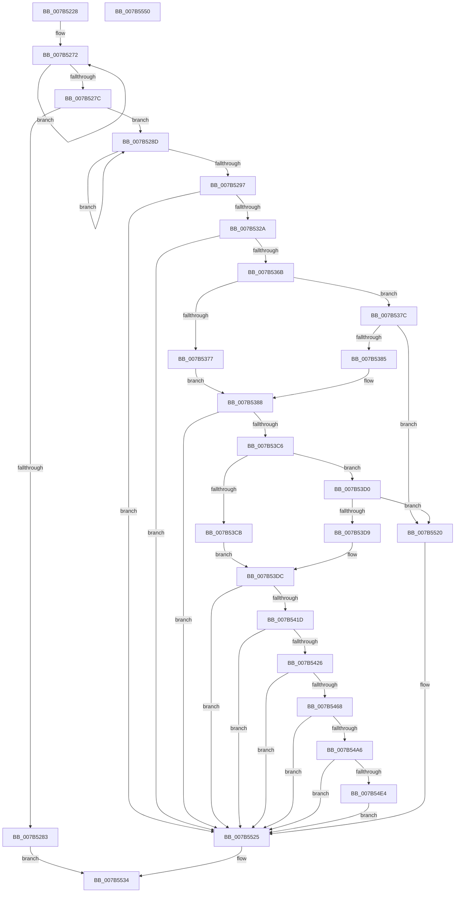

# EtwpAddMicroarchitecturalPmcToPmcGroup

- RVA: `0x007B5228`–`0x007B5551` (길이 `809` bytes)
- VA: `0x00000001407B5228`
- 실행 섹션: `PAGE`
- PDB 이름 있음: `예`; PDB Function 태그: `아니요`
- unwind 정보 RVA: `0x000D33C4`
- 디코드: `208`개 명령, `809/809` bytes 표시
- 미해석 바이트: `0` (있으면 어셈블리에 `.byte`로 보존)

> 이 문서는 커널 이미지의 기계어와 PDB 기호를 분석해 생성했습니다. 4번과 5번은 함수 원형과 자료형을 바이너리 사용 방식에서 추정한 C 해석이며 원본 소스 복구 결과는 아닙니다.

## 1. Dependencies

- 직접 호출 지점: **20**; 고유 호출 대상: **7**
- 직접 호출자로 확인된 함수: **1**
- RIP 상대 이미지 참조: **8**

### Outgoing calls
- `0x007B52AD` → [ExAllocatePool2](../../poolcode/B8/ExAllocatePool2_function_00B820F0.md) (function, `0x00B820F0`)
- `0x007B52C9` → [RtlStringCbPrintfW](../../text/40/RtlStringCbPrintfW_function_0040FB40.md) (function, `0x0040FB40`)
- `0x007B52D5` → [RtlInitUnicodeString](../../text/42/RtlInitUnicodeString_function_0042A780.md) (function, `0x0042A780`)
- `0x007B531B` → [ZwCreateKey](../../text/6A/ZwCreateKey_function_006AD470.md) (function, `0x006AD470`)
- `0x007B5335` → [RtlInitUnicodeString](../../text/42/RtlInitUnicodeString_function_0042A780.md) (function, `0x0042A780`)
- `0x007B535C` → [ZwSetValueKey](../../text/6A/ZwSetValueKey_function_006ADCD0.md) (function, `0x006ADCD0`)
- `0x007B536B` → [KiGetCpuVendor](../../pagelk/B7/KiGetCpuVendor_function_00B7D5B4.md) (function, `0x00B7D5B4`)
- `0x007B5396` → [RtlInitUnicodeString](../../text/42/RtlInitUnicodeString_function_0042A780.md) (function, `0x0042A780`)
- `0x007B53B7` → [ZwSetValueKey](../../text/6A/ZwSetValueKey_function_006ADCD0.md) (function, `0x006ADCD0`)
- `0x007B53ED` → [RtlInitUnicodeString](../../text/42/RtlInitUnicodeString_function_0042A780.md) (function, `0x0042A780`)
- `0x007B540E` → [ZwSetValueKey](../../text/6A/ZwSetValueKey_function_006ADCD0.md) (function, `0x006ADCD0`)
- `0x007B5438` → [RtlInitUnicodeString](../../text/42/RtlInitUnicodeString_function_0042A780.md) (function, `0x0042A780`)
- `0x007B5459` → [ZwSetValueKey](../../text/6A/ZwSetValueKey_function_006ADCD0.md) (function, `0x006ADCD0`)
- `0x007B547A` → [RtlInitUnicodeString](../../text/42/RtlInitUnicodeString_function_0042A780.md) (function, `0x0042A780`)
- `0x007B549B` → [ZwSetValueKey](../../text/6A/ZwSetValueKey_function_006ADCD0.md) (function, `0x006ADCD0`)
- `0x007B54B8` → [RtlInitUnicodeString](../../text/42/RtlInitUnicodeString_function_0042A780.md) (function, `0x0042A780`)
- `0x007B54D9` → [ZwSetValueKey](../../text/6A/ZwSetValueKey_function_006ADCD0.md) (function, `0x006ADCD0`)
- `0x007B54F6` → [RtlInitUnicodeString](../../text/42/RtlInitUnicodeString_function_0042A780.md) (function, `0x0042A780`)
- `0x007B5517` → [ZwSetValueKey](../../text/6A/ZwSetValueKey_function_006ADCD0.md) (function, `0x006ADCD0`)
- `0x007B552D` → [ExFreePoolWithTag](../../poolcode/B8/ExFreePoolWithTag_function_00B82870.md) (function, `0x00B82870`)

### Direct callers
- [EtwpAddMicroarchitecturalPmcToRegistry](EtwpAddMicroarchitecturalPmcToRegistry_function_007B5558.md) at `0x007B5798`

### Static image references
- `0x007B52BA` → RVA `0x00B07420` (` ?? ::NNGAKEGL::`string'`; read)
- `0x007B532A` → RVA `0x00B073F0` (` ?? ::NNGAKEGL::`string'`; read)
- `0x007B5388` → RVA `0x00B073C0` (` ?? ::NNGAKEGL::`string'`; read)
- `0x007B53DF` → RVA `0x00B07410` (` ?? ::NNGAKEGL::`string'`; read)
- `0x007B542A` → RVA `0x00B07350` (` ?? ::NNGAKEGL::`string'`; read)
- `0x007B546C` → RVA `0x00B07300` (` ?? ::NNGAKEGL::`string'`; read)
- `0x007B54AA` → RVA `0x00B07380` (` ?? ::NNGAKEGL::`string'`; read)
- `0x007B54E8` → RVA `0x00B073A0` (` ?? ::NNGAKEGL::`string'`; read)

## 2. Other-region calls and transfers

- 다른 실행 섹션으로 향하는 call: **20**
  - `0x007B52AD` → [ExAllocatePool2](../../poolcode/B8/ExAllocatePool2_function_00B820F0.md) (`PAGE` → `POOLCODE`)
  - `0x007B52C9` → [RtlStringCbPrintfW](../../text/40/RtlStringCbPrintfW_function_0040FB40.md) (`PAGE` → `.text`)
  - `0x007B52D5` → [RtlInitUnicodeString](../../text/42/RtlInitUnicodeString_function_0042A780.md) (`PAGE` → `.text`)
  - `0x007B531B` → [ZwCreateKey](../../text/6A/ZwCreateKey_function_006AD470.md) (`PAGE` → `.text`)
  - `0x007B5335` → [RtlInitUnicodeString](../../text/42/RtlInitUnicodeString_function_0042A780.md) (`PAGE` → `.text`)
  - `0x007B535C` → [ZwSetValueKey](../../text/6A/ZwSetValueKey_function_006ADCD0.md) (`PAGE` → `.text`)
  - `0x007B536B` → [KiGetCpuVendor](../../pagelk/B7/KiGetCpuVendor_function_00B7D5B4.md) (`PAGE` → `PAGELK`)
  - `0x007B5396` → [RtlInitUnicodeString](../../text/42/RtlInitUnicodeString_function_0042A780.md) (`PAGE` → `.text`)
  - `0x007B53B7` → [ZwSetValueKey](../../text/6A/ZwSetValueKey_function_006ADCD0.md) (`PAGE` → `.text`)
  - `0x007B53ED` → [RtlInitUnicodeString](../../text/42/RtlInitUnicodeString_function_0042A780.md) (`PAGE` → `.text`)
  - `0x007B540E` → [ZwSetValueKey](../../text/6A/ZwSetValueKey_function_006ADCD0.md) (`PAGE` → `.text`)
  - `0x007B5438` → [RtlInitUnicodeString](../../text/42/RtlInitUnicodeString_function_0042A780.md) (`PAGE` → `.text`)
  - `0x007B5459` → [ZwSetValueKey](../../text/6A/ZwSetValueKey_function_006ADCD0.md) (`PAGE` → `.text`)
  - `0x007B547A` → [RtlInitUnicodeString](../../text/42/RtlInitUnicodeString_function_0042A780.md) (`PAGE` → `.text`)
  - `0x007B549B` → [ZwSetValueKey](../../text/6A/ZwSetValueKey_function_006ADCD0.md) (`PAGE` → `.text`)
  - `0x007B54B8` → [RtlInitUnicodeString](../../text/42/RtlInitUnicodeString_function_0042A780.md) (`PAGE` → `.text`)
  - `0x007B54D9` → [ZwSetValueKey](../../text/6A/ZwSetValueKey_function_006ADCD0.md) (`PAGE` → `.text`)
  - `0x007B54F6` → [RtlInitUnicodeString](../../text/42/RtlInitUnicodeString_function_0042A780.md) (`PAGE` → `.text`)
  - `0x007B5517` → [ZwSetValueKey](../../text/6A/ZwSetValueKey_function_006ADCD0.md) (`PAGE` → `.text`)
  - `0x007B552D` → [ExFreePoolWithTag](../../poolcode/B8/ExFreePoolWithTag_function_00B82870.md) (`PAGE` → `POOLCODE`)
- 별도 외부 분기/꼬리 이동을 확인하지 못했습니다.

## 3. Assembly (complete function range)

```asm
007B5228  48 89 5C 24 08                  mov qword ptr [rsp + 8], rbx
007B522D  48 89 74 24 20                  mov qword ptr [rsp + 0x20], rsi
007B5232  55                              push rbp
007B5233  57                              push rdi
007B5234  41 54                           push r12
007B5236  41 56                           push r14
007B5238  41 57                           push r15
007B523A  48 8B EC                        mov rbp, rsp
007B523D  48 81 EC 80 00 00 00            sub rsp, 0x80
007B5244  45 33 E4                        xor r12d, r12d
007B5247  4C 8D B2 18 01 00 00            lea r14, [rdx + 0x118]
007B524E  48 8B F1                        mov rsi, rcx
007B5251  44 89 65 D4                     mov dword ptr [rbp - 0x2c], r12d
007B5255  48 83 C9 FF                     or rcx, 0xffffffffffffffff
007B5259  44 89 65 EC                     mov dword ptr [rbp - 0x14], r12d
007B525D  0F 57 C0                        xorps xmm0, xmm0
007B5260  4C 89 65 40                     mov qword ptr [rbp + 0x40], r12
007B5264  48 8B C1                        mov rax, rcx
007B5267  44 89 65 38                     mov dword ptr [rbp + 0x38], r12d
007B526B  48 8B FA                        mov rdi, rdx
007B526E  0F 11 45 C0                     movups xmmword ptr [rbp - 0x40], xmm0
007B5272  48 FF C0                        inc rax
007B5275  66 45 39 24 46                  cmp word ptr [r14 + rax*2], r12w
007B527A  75 F6                           jne 0x1407b5272
007B527C  3D FF 00 00 00                  cmp eax, 0xff
007B5281  72 0A                           jb 0x1407b528d
007B5283  B8 04 00 00 C0                  mov eax, 0xc0000004
007B5288  E9 A7 02 00 00                  jmp 0x1407b5534
007B528D  48 FF C1                        inc rcx
007B5290  66 44 39 24 4E                  cmp word ptr [rsi + rcx*2], r12w
007B5295  75 F6                           jne 0x1407b528d
007B5297  8D 04 4D 00 02 00 00            lea eax, [rcx*2 + 0x200]
007B529E  41 B8 45 74 77 50               mov r8d, 0x50777445
007B52A4  8B D0                           mov edx, eax
007B52A6  B9 00 01 00 00                  mov ecx, 0x100
007B52AB  8B D8                           mov ebx, eax
007B52AD  E8 3E CE 3C 00                  call 0x140b820f0
007B52B2  4C 8B CE                        mov r9, rsi
007B52B5  4C 89 74 24 20                  mov qword ptr [rsp + 0x20], r14
007B52BA  4C 8D 05 5F 21 35 00            lea r8, [rip + 0x35215f]
007B52C1  8B D3                           mov edx, ebx
007B52C3  48 8B C8                        mov rcx, rax
007B52C6  4C 8B F8                        mov r15, rax
007B52C9  E8 72 A8 C5 FF                  call 0x14040fb40
007B52CE  49 8B D7                        mov rdx, r15
007B52D1  48 8D 4D C0                     lea rcx, [rbp - 0x40]
007B52D5  E8 A6 54 C7 FF                  call 0x14042a780
007B52DA  48 8D 45 C0                     lea rax, [rbp - 0x40]
007B52DE  4C 89 64 24 30                  mov qword ptr [rsp + 0x30], r12
007B52E3  0F 57 C0                        xorps xmm0, xmm0
007B52E6  44 89 64 24 28                  mov dword ptr [rsp + 0x28], r12d
007B52EB  45 33 C9                        xor r9d, r9d
007B52EE  48 89 45 E0                     mov qword ptr [rbp - 0x20], rax
007B52F2  4C 8D 45 D0                     lea r8, [rbp - 0x30]
007B52F6  C7 45 D0 30 00 00 00            mov dword ptr [rbp - 0x30], 0x30
007B52FD  BA 06 00 02 00                  mov edx, 0x20006
007B5302  4C 89 65 D8                     mov qword ptr [rbp - 0x28], r12
007B5306  48 8D 4D 40                     lea rcx, [rbp + 0x40]
007B530A  C7 45 E8 40 02 00 00            mov dword ptr [rbp - 0x18], 0x240
007B5311  F3 0F 7F 45 F0                  movdqu xmmword ptr [rbp - 0x10], xmm0
007B5316  4C 89 64 24 20                  mov qword ptr [rsp + 0x20], r12
007B531B  E8 50 81 EF FF                  call 0x1406ad470
007B5320  8B D8                           mov ebx, eax
007B5322  85 C0                           test eax, eax
007B5324  0F 88 FB 01 00 00               js 0x1407b5525
007B532A  48 8D 15 BF 20 35 00            lea rdx, [rip + 0x3520bf]
007B5331  48 8D 4D C0                     lea rcx, [rbp - 0x40]
007B5335  E8 46 54 C7 FF                  call 0x14042a780
007B533A  48 8B 4D 40                     mov rcx, qword ptr [rbp + 0x40]
007B533E  48 8D 47 08                     lea rax, [rdi + 8]
007B5342  41 BE 04 00 00 00               mov r14d, 4
007B5348  48 8D 55 C0                     lea rdx, [rbp - 0x40]
007B534C  44 89 74 24 28                  mov dword ptr [rsp + 0x28], r14d
007B5351  45 8B CE                        mov r9d, r14d
007B5354  45 33 C0                        xor r8d, r8d
007B5357  48 89 44 24 20                  mov qword ptr [rsp + 0x20], rax
007B535C  E8 6F 89 EF FF                  call 0x1406adcd0
007B5361  8B D8                           mov ebx, eax
007B5363  85 C0                           test eax, eax
007B5365  0F 88 BA 01 00 00               js 0x1407b5525
007B536B  E8 44 82 3C 00                  call 0x140b7d5b4
007B5370  8B F0                           mov esi, eax
007B5372  83 F8 02                        cmp eax, 2
007B5375  75 05                           jne 0x1407b537c
007B5377  0F B6 07                        movzx eax, byte ptr [rdi]
007B537A  EB 0C                           jmp 0x1407b5388
007B537C  83 FE 01                        cmp esi, 1
007B537F  0F 85 9B 01 00 00               jne 0x1407b5520
007B5385  0F B7 07                        movzx eax, word ptr [rdi]
007B5388  48 8D 15 31 20 35 00            lea rdx, [rip + 0x352031]
007B538F  89 45 38                        mov dword ptr [rbp + 0x38], eax
007B5392  48 8D 4D C0                     lea rcx, [rbp - 0x40]
007B5396  E8 E5 53 C7 FF                  call 0x14042a780
007B539B  48 8B 4D 40                     mov rcx, qword ptr [rbp + 0x40]
007B539F  48 8D 45 38                     lea rax, [rbp + 0x38]
007B53A3  44 89 74 24 28                  mov dword ptr [rsp + 0x28], r14d
007B53A8  48 8D 55 C0                     lea rdx, [rbp - 0x40]
007B53AC  45 8B CE                        mov r9d, r14d
007B53AF  48 89 44 24 20                  mov qword ptr [rsp + 0x20], rax
007B53B4  45 33 C0                        xor r8d, r8d
007B53B7  E8 14 89 EF FF                  call 0x1406adcd0
007B53BC  8B D8                           mov ebx, eax
007B53BE  85 C0                           test eax, eax
007B53C0  0F 88 5F 01 00 00               js 0x1407b5525
007B53C6  83 FE 02                        cmp esi, 2
007B53C9  75 05                           jne 0x1407b53d0
007B53CB  8A 47 01                        mov al, byte ptr [rdi + 1]
007B53CE  EB 0C                           jmp 0x1407b53dc
007B53D0  83 FE 01                        cmp esi, 1
007B53D3  0F 85 47 01 00 00               jne 0x1407b5520
007B53D9  8A 47 02                        mov al, byte ptr [rdi + 2]
007B53DC  0F B6 C0                        movzx eax, al
007B53DF  48 8D 15 2A 20 35 00            lea rdx, [rip + 0x35202a]
007B53E6  48 8D 4D C0                     lea rcx, [rbp - 0x40]
007B53EA  89 45 38                        mov dword ptr [rbp + 0x38], eax
007B53ED  E8 8E 53 C7 FF                  call 0x14042a780
007B53F2  48 8B 4D 40                     mov rcx, qword ptr [rbp + 0x40]
007B53F6  48 8D 45 38                     lea rax, [rbp + 0x38]
007B53FA  44 89 74 24 28                  mov dword ptr [rsp + 0x28], r14d
007B53FF  48 8D 55 C0                     lea rdx, [rbp - 0x40]
007B5403  45 8B CE                        mov r9d, r14d
007B5406  48 89 44 24 20                  mov qword ptr [rsp + 0x20], rax
007B540B  45 33 C0                        xor r8d, r8d
007B540E  E8 BD 88 EF FF                  call 0x1406adcd0
007B5413  8B D8                           mov ebx, eax
007B5415  85 C0                           test eax, eax
007B5417  0F 88 08 01 00 00               js 0x1407b5525
007B541D  83 FE 02                        cmp esi, 2
007B5420  0F 85 FF 00 00 00               jne 0x1407b5525
007B5426  0F B6 47 02                     movzx eax, byte ptr [rdi + 2]
007B542A  48 8D 15 1F 1F 35 00            lea rdx, [rip + 0x351f1f]
007B5431  48 8D 4D C0                     lea rcx, [rbp - 0x40]
007B5435  89 45 38                        mov dword ptr [rbp + 0x38], eax
007B5438  E8 43 53 C7 FF                  call 0x14042a780
007B543D  48 8B 4D 40                     mov rcx, qword ptr [rbp + 0x40]
007B5441  48 8D 45 38                     lea rax, [rbp + 0x38]
007B5445  44 89 74 24 28                  mov dword ptr [rsp + 0x28], r14d
007B544A  48 8D 55 C0                     lea rdx, [rbp - 0x40]
007B544E  45 8B CE                        mov r9d, r14d
007B5451  48 89 44 24 20                  mov qword ptr [rsp + 0x20], rax
007B5456  45 33 C0                        xor r8d, r8d
007B5459  E8 72 88 EF FF                  call 0x1406adcd0
007B545E  8B D8                           mov ebx, eax
007B5460  85 C0                           test eax, eax
007B5462  0F 88 BD 00 00 00               js 0x1407b5525
007B5468  0F B6 47 03                     movzx eax, byte ptr [rdi + 3]
007B546C  48 8D 15 8D 1E 35 00            lea rdx, [rip + 0x351e8d]
007B5473  48 8D 4D C0                     lea rcx, [rbp - 0x40]
007B5477  89 45 38                        mov dword ptr [rbp + 0x38], eax
007B547A  E8 01 53 C7 FF                  call 0x14042a780
007B547F  48 8B 4D 40                     mov rcx, qword ptr [rbp + 0x40]
007B5483  48 8D 45 38                     lea rax, [rbp + 0x38]
007B5487  44 89 74 24 28                  mov dword ptr [rsp + 0x28], r14d
007B548C  48 8D 55 C0                     lea rdx, [rbp - 0x40]
007B5490  45 8B CE                        mov r9d, r14d
007B5493  48 89 44 24 20                  mov qword ptr [rsp + 0x20], rax
007B5498  45 33 C0                        xor r8d, r8d
007B549B  E8 30 88 EF FF                  call 0x1406adcd0
007B54A0  8B D8                           mov ebx, eax
007B54A2  85 C0                           test eax, eax
007B54A4  78 7F                           js 0x1407b5525
007B54A6  0F B6 47 04                     movzx eax, byte ptr [rdi + 4]
007B54AA  48 8D 15 CF 1E 35 00            lea rdx, [rip + 0x351ecf]
007B54B1  48 8D 4D C0                     lea rcx, [rbp - 0x40]
007B54B5  89 45 38                        mov dword ptr [rbp + 0x38], eax
007B54B8  E8 C3 52 C7 FF                  call 0x14042a780
007B54BD  48 8B 4D 40                     mov rcx, qword ptr [rbp + 0x40]
007B54C1  48 8D 45 38                     lea rax, [rbp + 0x38]
007B54C5  44 89 74 24 28                  mov dword ptr [rsp + 0x28], r14d
007B54CA  48 8D 55 C0                     lea rdx, [rbp - 0x40]
007B54CE  45 8B CE                        mov r9d, r14d
007B54D1  48 89 44 24 20                  mov qword ptr [rsp + 0x20], rax
007B54D6  45 33 C0                        xor r8d, r8d
007B54D9  E8 F2 87 EF FF                  call 0x1406adcd0
007B54DE  8B D8                           mov ebx, eax
007B54E0  85 C0                           test eax, eax
007B54E2  78 41                           js 0x1407b5525
007B54E4  0F B6 47 05                     movzx eax, byte ptr [rdi + 5]
007B54E8  48 8D 15 B1 1E 35 00            lea rdx, [rip + 0x351eb1]
007B54EF  48 8D 4D C0                     lea rcx, [rbp - 0x40]
007B54F3  89 45 38                        mov dword ptr [rbp + 0x38], eax
007B54F6  E8 85 52 C7 FF                  call 0x14042a780
007B54FB  48 8B 4D 40                     mov rcx, qword ptr [rbp + 0x40]
007B54FF  48 8D 45 38                     lea rax, [rbp + 0x38]
007B5503  44 89 74 24 28                  mov dword ptr [rsp + 0x28], r14d
007B5508  48 8D 55 C0                     lea rdx, [rbp - 0x40]
007B550C  45 8B CE                        mov r9d, r14d
007B550F  48 89 44 24 20                  mov qword ptr [rsp + 0x20], rax
007B5514  45 33 C0                        xor r8d, r8d
007B5517  E8 B4 87 EF FF                  call 0x1406adcd0
007B551C  8B D8                           mov ebx, eax
007B551E  EB 05                           jmp 0x1407b5525
007B5520  BB 02 00 00 C0                  mov ebx, 0xc0000002
007B5525  BA 45 74 77 50                  mov edx, 0x50777445
007B552A  49 8B CF                        mov rcx, r15
007B552D  E8 3E D3 3C 00                  call 0x140b82870
007B5532  8B C3                           mov eax, ebx
007B5534  4C 8D 9C 24 80 00 00 00         lea r11, [rsp + 0x80]
007B553C  49 8B 5B 30                     mov rbx, qword ptr [r11 + 0x30]
007B5540  49 8B 73 48                     mov rsi, qword ptr [r11 + 0x48]
007B5544  49 8B E3                        mov rsp, r11
007B5547  41 5F                           pop r15
007B5549  41 5E                           pop r14
007B554B  41 5C                           pop r12
007B554D  5F                              pop rdi
007B554E  5D                              pop rbp
007B554F  C3                              ret
007B5550  CC                              int3
```

## 4. C-style interpretation (structured pseudocode)

```c
__int64 __fastcall EtwpAddMicroarchitecturalPmcToPmcGroup(__int64 a1, __int64 a2)
{
    __int64 result;
    __int64 v_r12;
    __int64 v_rsp;
    unsigned __int64 v_stack_m28;
    unsigned __int64 v_stack_m38;
    unsigned int v_stack_m3C;
    unsigned int v_stack_m40;
    unsigned __int64 v_stack_m48;
    unsigned __int64 v_stack_m50;
    unsigned int v_stack_m54;
    unsigned __int64 v_stack_m58;
    unsigned __int64 v_stack_m68;
    unsigned __int64 v_stack_m78;
    unsigned int v_stack_m80;
    unsigned __int64 v_stack_m88;
    unsigned int v_stack_p10;
    unsigned __int64 v_stack_p18;
    unsigned __int64 v_stack_p20;
    unsigned __int64 v_stack_p8;

    v_stack_p8 = v_rbx;
    v_stack_p20 = v_rsi;
    v_rsp = (v_rsp) - (128);
    v_r12 = 0;
    v_stack_m54 = 0;
    a1 = (a1) | (-1);
    v_stack_m3C = 0;
    v_stack_p18 = 0;
    v_stack_p10 = 0;
    v_stack_m68 = v_xmm0;
loc_007B5272:
    result = (a1) + 1;
    if ((*(unsigned __int16 *)(a2 + 280 + result * 2)) != 0) goto loc_007B5272;
    if (((unsigned int)(result)) < 255) goto loc_007B528D;
    goto loc_007B5534;
loc_007B528D:
    a1 = (a1) + 1;
    if ((*(unsigned __int16 *)(a1 + a1 * 2)) != 0) goto loc_007B528D;
    result = ExAllocatePool2(256, (unsigned int)((unsigned int)(a1 * 2 + 512)), (unsigned int)(0x50777445ULL), a4);
    v_stack_m88 = a2 + 280;
    result = RtlStringCbPrintfW(result, (unsigned int)((unsigned int)((unsigned int)((unsigned int)(a1 * 2 + 512)))), v_rip + 3481951, a1);
    result = RtlInitUnicodeString(v_stack_m68, result, v_rip + 3481951, a1);
    v_stack_m78 = 0;
    v_stack_m80 = 0;
    a4 = 0;
    v_stack_m48 = v_stack_m68;
    v_stack_m58 = 48;
    v_stack_m50 = 0;
    v_stack_m40 = 576;
    v_stack_m38 = v_xmm0;
    v_stack_m88 = 0;
    result = ZwCreateKey(v_stack_p18, (unsigned int)(0x20006ULL), v_stack_m58, a4);
    if (sign_flag) goto loc_007B5525;
    result = RtlInitUnicodeString(v_stack_m68, v_rip + 3481791, v_stack_m58, a4);
    v_stack_m80 = 4;
    a3 = 0;
    v_stack_m88 = a2 + 8;
    result = ZwSetValueKey(v_stack_p18, v_stack_m68, a3, 4);
    if (sign_flag) goto loc_007B5525;
    result = KiGetCpuVendor(v_stack_p18, v_stack_m68, a3, 4);
    if (((unsigned int)(result)) != 2) goto loc_007B537C;
    goto loc_007B5388;
loc_007B537C:
    if (((unsigned int)((unsigned int)((unsigned int)(result)))) != 1) goto loc_007B5520;
loc_007B5388:
    v_stack_p10 = (unsigned int)(*(unsigned __int16 *)(a2));
    result = RtlInitUnicodeString(v_stack_m68, v_rip + 3481649, a3, 4);
    v_stack_m80 = 4;
    v_stack_m88 = v_stack_p10;
    a3 = 0;
    result = ZwSetValueKey(v_stack_p18, v_stack_m68, a3, 4);
    if (sign_flag) goto loc_007B5525;
    if (((unsigned int)((unsigned int)((unsigned int)(result)))) != 2) goto loc_007B53D0;
    goto loc_007B53DC;
loc_007B53D0:
    if (((unsigned int)((unsigned int)((unsigned int)(result)))) != 1) goto loc_007B5520;
loc_007B53DC:
    v_stack_p10 = (unsigned int)((unsigned __int8)(*(unsigned __int8 *)(a2 + 2)));
    result = RtlInitUnicodeString(v_stack_m68, v_rip + 3481642, a3, 4);
    v_stack_m80 = 4;
    v_stack_m88 = v_stack_p10;
    a3 = 0;
    result = ZwSetValueKey(v_stack_p18, v_stack_m68, a3, 4);
    if (sign_flag) goto loc_007B5525;
    if (((unsigned int)((unsigned int)((unsigned int)(result)))) != 2) goto loc_007B5525;
    v_stack_p10 = (unsigned int)(*(unsigned __int8 *)(a2 + 2));
    result = RtlInitUnicodeString(v_stack_m68, v_rip + 3481375, a3, 4);
    v_stack_m80 = 4;
    v_stack_m88 = v_stack_p10;
    a3 = 0;
    result = ZwSetValueKey(v_stack_p18, v_stack_m68, a3, 4);
    if (sign_flag) goto loc_007B5525;
    v_stack_p10 = (unsigned int)(*(unsigned __int8 *)(a2 + 3));
    result = RtlInitUnicodeString(v_stack_m68, v_rip + 3481229, a3, 4);
    v_stack_m80 = 4;
    v_stack_m88 = v_stack_p10;
    a3 = 0;
    result = ZwSetValueKey(v_stack_p18, v_stack_m68, a3, 4);
    if (sign_flag) goto loc_007B5525;
    v_stack_p10 = (unsigned int)(*(unsigned __int8 *)(a2 + 4));
    result = RtlInitUnicodeString(v_stack_m68, v_rip + 3481295, a3, 4);
    v_stack_m80 = 4;
    v_stack_m88 = v_stack_p10;
    a3 = 0;
    result = ZwSetValueKey(v_stack_p18, v_stack_m68, a3, 4);
    if (sign_flag) goto loc_007B5525;
    v_stack_p10 = (unsigned int)(*(unsigned __int8 *)(a2 + 5));
    result = RtlInitUnicodeString(v_stack_m68, v_rip + 3481265, a3, 4);
    v_stack_m80 = 4;
    v_stack_m88 = v_stack_p10;
    a3 = 0;
    result = ZwSetValueKey(v_stack_p18, v_stack_m68, a3, 4);
    goto loc_007B5525;
loc_007B5520:
loc_007B5525:
    result = ExFreePoolWithTag(result, (unsigned int)(0x50777445ULL), a3, 4);
loc_007B5534:
    return (unsigned int)((unsigned int)((unsigned int)(0xC0000002ULL)));
}
```

## 5. (Beta) C Style

```c
int64_t EtwpAddMicroarchitecturalPmcToPmcGroup(void *Arg1, void *Arg2)
{
    uint8_t *arg1 = (uint8_t *)Arg1;
    uint8_t *arg2 = (uint8_t *)Arg2;

    int64_t result;
    int64_t local_r12;
    int64_t local_rsp;
    uint64_t v_stack_m28;
    uint64_t v_stack_m38;
    uint32_t v_stack_m3C;
    uint32_t v_stack_m40;
    uint64_t v_stack_m48;
    uint64_t v_stack_m50;
    uint32_t v_stack_m54;
    uint64_t v_stack_m58;
    uint64_t v_stack_m68;
    uint64_t v_stack_m78;
    uint32_t v_stack_m80;
    uint64_t v_stack_m88;
    uint32_t v_stack_p10;
    uint64_t v_stack_p18;
    uint64_t v_stack_p20;
    uint64_t v_stack_p8;

    v_stack_p8 = local_rbx;
    v_stack_p20 = local_rsi;
    local_rsp = (local_rsp) - (128);
    local_r12 = 0;
    v_stack_m54 = 0;
    Arg1 = (Arg1) | (-1);
    v_stack_m3C = 0;
    v_stack_p18 = 0;
    v_stack_p10 = 0;
    v_stack_m68 = v_xmm0;
loc_007B5272:
    result = (Arg1) + 1;
    if ((*(uint16_t *)(arg2 + 0x118 + result * 2)) != 0) goto loc_007B5272;
    if (((uint32_t)(result)) < 255) goto loc_007B528D;
    goto loc_007B5534;
loc_007B528D:
    Arg1 = (Arg1) + 1;
    if ((*(uint16_t *)(arg1 + arg1 * 2)) != 0) goto loc_007B528D;
    result = ExAllocatePool2(256, (uint32_t)((uint32_t)(Arg1 * 2 + 512)), (uint32_t)(0x50777445ULL), a4);
    v_stack_m88 = Arg2 + 280;
    result = RtlStringCbPrintfW(result, (uint32_t)((uint32_t)((uint32_t)((uint32_t)(Arg1 * 2 + 512)))), v_rip + 3481951, Arg1);
    result = RtlInitUnicodeString(v_stack_m68, result, v_rip + 3481951, Arg1);
    v_stack_m78 = 0;
    v_stack_m80 = 0;
    a4 = 0;
    v_stack_m48 = v_stack_m68;
    v_stack_m58 = 48;
    v_stack_m50 = 0;
    v_stack_m40 = 576;
    v_stack_m38 = v_xmm0;
    v_stack_m88 = 0;
    result = ZwCreateKey(v_stack_p18, (uint32_t)(0x20006ULL), v_stack_m58, a4);
    if (sign_flag) goto loc_007B5525;
    result = RtlInitUnicodeString(v_stack_m68, v_rip + 3481791, v_stack_m58, a4);
    v_stack_m80 = 4;
    a3 = 0;
    v_stack_m88 = Arg2 + 8;
    result = ZwSetValueKey(v_stack_p18, v_stack_m68, a3, 4);
    if (sign_flag) goto loc_007B5525;
    result = KiGetCpuVendor(v_stack_p18, v_stack_m68, a3, 4);
    if (((uint32_t)(result)) != 2) goto loc_007B537C;
    goto loc_007B5388;
loc_007B537C:
    if (((uint32_t)((uint32_t)((uint32_t)(result)))) != 1) goto loc_007B5520;
loc_007B5388:
    v_stack_p10 = (uint32_t)(*(uint16_t *)(arg2));
    result = RtlInitUnicodeString(v_stack_m68, v_rip + 3481649, a3, 4);
    v_stack_m80 = 4;
    v_stack_m88 = v_stack_p10;
    a3 = 0;
    result = ZwSetValueKey(v_stack_p18, v_stack_m68, a3, 4);
    if (sign_flag) goto loc_007B5525;
    if (((uint32_t)((uint32_t)((uint32_t)(result)))) != 2) goto loc_007B53D0;
    goto loc_007B53DC;
loc_007B53D0:
    if (((uint32_t)((uint32_t)((uint32_t)(result)))) != 1) goto loc_007B5520;
loc_007B53DC:
    v_stack_p10 = (uint32_t)((uint8_t)(*(uint8_t *)(arg2 + 0x2)));
    result = RtlInitUnicodeString(v_stack_m68, v_rip + 3481642, a3, 4);
    v_stack_m80 = 4;
    v_stack_m88 = v_stack_p10;
    a3 = 0;
    result = ZwSetValueKey(v_stack_p18, v_stack_m68, a3, 4);
    if (sign_flag) goto loc_007B5525;
    if (((uint32_t)((uint32_t)((uint32_t)(result)))) != 2) goto loc_007B5525;
    v_stack_p10 = (uint32_t)(*(uint8_t *)(arg2 + 0x2));
    result = RtlInitUnicodeString(v_stack_m68, v_rip + 3481375, a3, 4);
    v_stack_m80 = 4;
    v_stack_m88 = v_stack_p10;
    a3 = 0;
    result = ZwSetValueKey(v_stack_p18, v_stack_m68, a3, 4);
    if (sign_flag) goto loc_007B5525;
    v_stack_p10 = (uint32_t)(*(uint8_t *)(arg2 + 0x3));
    result = RtlInitUnicodeString(v_stack_m68, v_rip + 3481229, a3, 4);
    v_stack_m80 = 4;
    v_stack_m88 = v_stack_p10;
    a3 = 0;
    result = ZwSetValueKey(v_stack_p18, v_stack_m68, a3, 4);
    if (sign_flag) goto loc_007B5525;
    v_stack_p10 = (uint32_t)(*(uint8_t *)(arg2 + 0x4));
    result = RtlInitUnicodeString(v_stack_m68, v_rip + 3481295, a3, 4);
    v_stack_m80 = 4;
    v_stack_m88 = v_stack_p10;
    a3 = 0;
    result = ZwSetValueKey(v_stack_p18, v_stack_m68, a3, 4);
    if (sign_flag) goto loc_007B5525;
    v_stack_p10 = (uint32_t)(*(uint8_t *)(arg2 + 0x5));
    result = RtlInitUnicodeString(v_stack_m68, v_rip + 3481265, a3, 4);
    v_stack_m80 = 4;
    v_stack_m88 = v_stack_p10;
    a3 = 0;
    result = ZwSetValueKey(v_stack_p18, v_stack_m68, a3, 4);
    goto loc_007B5525;
loc_007B5520:
loc_007B5525:
    result = ExFreePoolWithTag(result, (uint32_t)(0x50777445ULL), a3, 4);
loc_007B5534:
    return (uint32_t)((uint32_t)((uint32_t)(0xC0000002ULL)));
}
```

### 관측된 메모리 오프셋

구조체 형식이 확인되지 않은 접근은 인자 기준의 오프셋으로만 기록했습니다.

| 기준 인자 | 오프셋 표현 | 폭 (bit) | 접근 |
|---|---:|---:|---|
| `Arg1` | `+ 0x0 + rcx*2` | `16` | `R` |
| `Arg2` | `+ 0x0` | `8` | `R` |
| `Arg2` | `+ 0x0` | `16` | `R` |
| `Arg2` | `+ 0x0 + rax*2` | `16` | `R` |
| `Arg2` | `+ 0x1` | `8` | `R` |
| `Arg2` | `+ 0x2` | `8` | `R` |
| `Arg2` | `+ 0x3` | `8` | `R` |
| `Arg2` | `+ 0x4` | `8` | `R` |
| `Arg2` | `+ 0x5` | `8` | `R` |
| `Arg2` | `+ 0x8` | `64` | `R` |
| `Arg2` | `+ 0x118` | `64` | `R` |

## 6. Execution-region graph

[열기: 2D/3D 그래프와 함수 탐색 컨트롤 패널](../../../control-panel.html?section=page&rva=0x007B5228&view=graph)

- 2D 그래프는 위에서 아래로 흐르고, 3D 그래프는 빈 공간을 드래그해 회전합니다. Shift+드래그는 이동, 휠은 확대·축소, 함수 노드 선택은 대상 보고서 이동입니다.

### Static fallback


