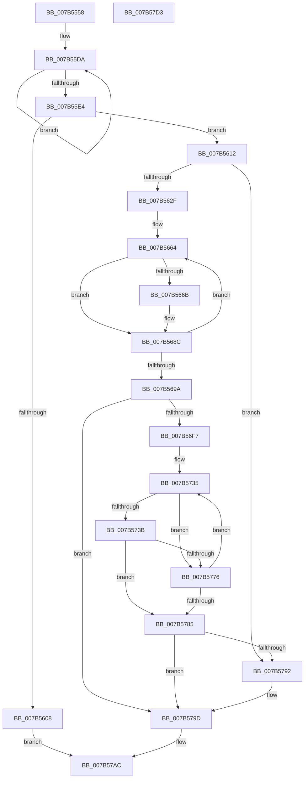

# EtwpAddMicroarchitecturalPmcToRegistry

- RVA: `0x007B5558`–`0x007B57D4` (길이 `636` bytes)
- VA: `0x00000001407B5558`
- 실행 섹션: `PAGE`
- PDB 이름 있음: `예`; PDB Function 태그: `아니요`
- unwind 정보 RVA: `0x000BC0C0`
- 디코드: `166`개 명령, `636/636` bytes 표시
- 미해석 바이트: `0` (있으면 어셈블리에 `.byte`로 보존)

> 이 문서는 커널 이미지의 기계어와 PDB 기호를 분석해 생성했습니다. 4번과 5번은 함수 원형과 자료형을 바이너리 사용 방식에서 추정한 C 해석이며 원본 소스 복구 결과는 아닙니다.

## 1. Dependencies

- 직접 호출 지점: **15**; 고유 호출 대상: **11**
- 직접 호출자로 확인된 함수: **1**
- RIP 상대 이미지 참조: **8**

### Outgoing calls
- `0x007B55C7` → [KiGetCpuVendor](../../pagelk/B7/KiGetCpuVendor_function_00B7D5B4.md) (function, `0x00B7D5B4`)
- `0x007B55FB` → [ExAllocatePool2](../../poolcode/B8/ExAllocatePool2_function_00B820F0.md) (function, `0x00B820F0`)
- `0x007B5620` → [EtwpFindMatchingPmcRegistryGroup](EtwpFindMatchingPmcRegistryGroup_function_007B644C.md) (function, `0x007B644C`)
- `0x007B5652` → [RtlStringCbPrintfW](../../text/40/RtlStringCbPrintfW_function_0040FB40.md) (function, `0x0040FB40`)
- `0x007B5687` → [RtlStringCbPrintfW](../../text/40/RtlStringCbPrintfW_function_0040FB40.md) (function, `0x0040FB40`)
- `0x007B56A1` → [RtlInitUnicodeString](../../text/42/RtlInitUnicodeString_function_0042A780.md) (function, `0x0042A780`)
- `0x007B56E8` → [ZwCreateKey](../../text/6A/ZwCreateKey_function_006AD470.md) (function, `0x006AD470`)
- `0x007B5702` → [RtlInitUnicodeString](../../text/42/RtlInitUnicodeString_function_0042A780.md) (function, `0x0042A780`)
- `0x007B5727` → [ZwSetValueKey](../../text/6A/ZwSetValueKey_function_006ADCD0.md) (function, `0x006ADCD0`)
- `0x007B5742` → [RtlInitUnicodeString](../../text/42/RtlInitUnicodeString_function_0042A780.md) (function, `0x0042A780`)
- `0x007B576B` → [ZwSetValueKey](../../text/6A/ZwSetValueKey_function_006ADCD0.md) (function, `0x006ADCD0`)
- `0x007B5789` → [ZwClose](../../text/6A/ZwClose_function_006AD2B0.md) (function, `0x006AD2B0`)
- `0x007B5798` → [EtwpAddMicroarchitecturalPmcToPmcGroup](EtwpAddMicroarchitecturalPmcToPmcGroup_function_007B5228.md) (function, `0x007B5228`)
- `0x007B57A5` → [ExFreePoolWithTag](../../poolcode/B8/ExFreePoolWithTag_function_00B82870.md) (function, `0x00B82870`)
- `0x007B57B3` → [_security_check_cookie](../../text/6A/_security_check_cookie_function_006AC640.md) (function, `0x006AC640`)

### Direct callers
- [sub_00B3C988](../B3/Unknown_function_00B3C988.md) at `0x00B3D24B`

### Static image references
- `0x007B5574` → RVA `0x00E0A740` (`.data`; read)
- `0x007B5593` → RVA `0x00B074D0` (` ?? ::NNGAKEGL::`string'`; read)
- `0x007B55A5` → RVA `0x00B074C0` (` ?? ::NNGAKEGL::`string'`; read)
- `0x007B55B0` → RVA `0x00B073D0` (` ?? ::NNGAKEGL::`string'`; read)
- `0x007B55CF` → RVA `0x00B07430` (` ?? ::NNGAKEGL::`string'`; read)
- `0x007B5632` → RVA `0x00B07500` (` ?? ::NNGAKEGL::`string'`; read)
- `0x007B5640` → RVA `0x00B07320` (` ?? ::NNGAKEGL::`string'`; read)
- `0x007B566F` → RVA `0x00B074E0` (` ?? ::NNGAKEGL::`string'`; read)

## 2. Other-region calls and transfers

- 다른 실행 섹션으로 향하는 call: **13**
  - `0x007B55C7` → [KiGetCpuVendor](../../pagelk/B7/KiGetCpuVendor_function_00B7D5B4.md) (`PAGE` → `PAGELK`)
  - `0x007B55FB` → [ExAllocatePool2](../../poolcode/B8/ExAllocatePool2_function_00B820F0.md) (`PAGE` → `POOLCODE`)
  - `0x007B5652` → [RtlStringCbPrintfW](../../text/40/RtlStringCbPrintfW_function_0040FB40.md) (`PAGE` → `.text`)
  - `0x007B5687` → [RtlStringCbPrintfW](../../text/40/RtlStringCbPrintfW_function_0040FB40.md) (`PAGE` → `.text`)
  - `0x007B56A1` → [RtlInitUnicodeString](../../text/42/RtlInitUnicodeString_function_0042A780.md) (`PAGE` → `.text`)
  - `0x007B56E8` → [ZwCreateKey](../../text/6A/ZwCreateKey_function_006AD470.md) (`PAGE` → `.text`)
  - `0x007B5702` → [RtlInitUnicodeString](../../text/42/RtlInitUnicodeString_function_0042A780.md) (`PAGE` → `.text`)
  - `0x007B5727` → [ZwSetValueKey](../../text/6A/ZwSetValueKey_function_006ADCD0.md) (`PAGE` → `.text`)
  - `0x007B5742` → [RtlInitUnicodeString](../../text/42/RtlInitUnicodeString_function_0042A780.md) (`PAGE` → `.text`)
  - `0x007B576B` → [ZwSetValueKey](../../text/6A/ZwSetValueKey_function_006ADCD0.md) (`PAGE` → `.text`)
  - `0x007B5789` → [ZwClose](../../text/6A/ZwClose_function_006AD2B0.md) (`PAGE` → `.text`)
  - `0x007B57A5` → [ExFreePoolWithTag](../../poolcode/B8/ExFreePoolWithTag_function_00B82870.md) (`PAGE` → `POOLCODE`)
  - `0x007B57B3` → [_security_check_cookie](../../text/6A/_security_check_cookie_function_006AC640.md) (`PAGE` → `.text`)
- 별도 외부 분기/꼬리 이동을 확인하지 못했습니다.

## 3. Assembly (complete function range)

```asm
007B5558  48 89 5C 24 18                  mov qword ptr [rsp + 0x18], rbx
007B555D  55                              push rbp
007B555E  56                              push rsi
007B555F  57                              push rdi
007B5560  41 54                           push r12
007B5562  41 55                           push r13
007B5564  41 56                           push r14
007B5566  41 57                           push r15
007B5568  48 8D 6C 24 D9                  lea rbp, [rsp - 0x27]
007B556D  48 81 EC B0 00 00 00            sub rsp, 0xb0
007B5574  48 8B 05 C5 51 65 00            mov rax, qword ptr [rip + 0x6551c5]
007B557B  48 33 C4                        xor rax, rsp
007B557E  48 89 45 1F                     mov qword ptr [rbp + 0x1f], rax
007B5582  33 C0                           xor eax, eax
007B5584  0F 57 C0                        xorps xmm0, xmm0
007B5587  48 89 45 F7                     mov qword ptr [rbp - 9], rax
007B558B  33 F6                           xor esi, esi
007B558D  89 45 FF                        mov dword ptr [rbp - 1], eax
007B5590  4C 8B E2                        mov r12, rdx
007B5593  48 8D 05 36 1F 35 00            lea rax, [rip + 0x351f36]
007B559A  48 89 75 BF                     mov qword ptr [rbp - 0x41], rsi
007B559E  48 89 45 07                     mov qword ptr [rbp + 7], rax
007B55A2  4C 8B E9                        mov r13, rcx
007B55A5  48 8D 05 14 1F 35 00            lea rax, [rip + 0x351f14]
007B55AC  48 89 45 0F                     mov qword ptr [rbp + 0xf], rax
007B55B0  48 8D 05 19 1E 35 00            lea rax, [rip + 0x351e19]
007B55B7  48 89 45 17                     mov qword ptr [rbp + 0x17], rax
007B55BB  0F 11 45 D7                     movups xmmword ptr [rbp - 0x29], xmm0
007B55BF  0F 11 45 E7                     movups xmmword ptr [rbp - 0x19], xmm0
007B55C3  0F 11 45 C7                     movups xmmword ptr [rbp - 0x39], xmm0
007B55C7  E8 E8 7F 3C 00                  call 0x140b7d5b4
007B55CC  89 45 B7                        mov dword ptr [rbp - 0x49], eax
007B55CF  4C 8D 3D 5A 1E 35 00            lea r15, [rip + 0x351e5a]
007B55D6  48 83 C8 FF                     or rax, 0xffffffffffffffff
007B55DA  48 FF C0                        inc rax
007B55DD  66 41 39 34 47                  cmp word ptr [r15 + rax*2], si
007B55E2  75 F6                           jne 0x1407b55da
007B55E4  8D 1C 45 02 02 00 00            lea ebx, [rax*2 + 0x202]
007B55EB  41 B8 45 74 77 50               mov r8d, 0x50777445
007B55F1  8B D3                           mov edx, ebx
007B55F3  B9 00 01 00 00                  mov ecx, 0x100
007B55F8  44 8B F3                        mov r14d, ebx
007B55FB  E8 F0 CA 3C 00                  call 0x140b820f0
007B5600  48 8B F8                        mov rdi, rax
007B5603  48 85 C0                        test rax, rax
007B5606  75 0A                           jne 0x1407b5612
007B5608  B8 17 00 00 C0                  mov eax, 0xc0000017
007B560D  E9 9A 01 00 00                  jmp 0x1407b57ac
007B5612  8B 55 B7                        mov edx, dword ptr [rbp - 0x49]
007B5615  44 8B CB                        mov r9d, ebx
007B5618  4D 8B C4                        mov r8, r12
007B561B  48 89 7C 24 20                  mov qword ptr [rsp + 0x20], rdi
007B5620  E8 27 0E 00 00                  call 0x1407b644c
007B5625  8B D8                           mov ebx, eax
007B5627  85 C0                           test eax, eax
007B5629  0F 89 63 01 00 00               jns 0x1407b5792
007B562F  8B 45 B7                        mov eax, dword ptr [rbp - 0x49]
007B5632  4C 8D 05 C7 1E 35 00            lea r8, [rip + 0x351ec7]
007B5639  89 44 24 28                     mov dword ptr [rsp + 0x28], eax
007B563D  4D 8B CF                        mov r9, r15
007B5640  48 8D 05 D9 1C 35 00            lea rax, [rip + 0x351cd9]
007B5647  49 8B D6                        mov rdx, r14
007B564A  48 8B CF                        mov rcx, rdi
007B564D  48 89 44 24 20                  mov qword ptr [rsp + 0x20], rax
007B5652  E8 E9 A4 C5 FF                  call 0x14040fb40
007B5657  48 8D 75 07                     lea rsi, [rbp + 7]
007B565B  49 8B DC                        mov rbx, r12
007B565E  41 BF 03 00 00 00               mov r15d, 3
007B5664  8B 03                           mov eax, dword ptr [rbx]
007B5666  83 F8 FF                        cmp eax, -1
007B5669  74 21                           je 0x1407b568c
007B566B  89 44 24 28                     mov dword ptr [rsp + 0x28], eax
007B566F  4C 8D 05 6A 1E 35 00            lea r8, [rip + 0x351e6a]
007B5676  48 8B 06                        mov rax, qword ptr [rsi]
007B5679  4C 8B CF                        mov r9, rdi
007B567C  49 8B D6                        mov rdx, r14
007B567F  48 89 44 24 20                  mov qword ptr [rsp + 0x20], rax
007B5684  48 8B CF                        mov rcx, rdi
007B5687  E8 B4 A4 C5 FF                  call 0x14040fb40
007B568C  48 83 C3 04                     add rbx, 4
007B5690  48 83 C6 08                     add rsi, 8
007B5694  49 83 EF 01                     sub r15, 1
007B5698  75 CA                           jne 0x1407b5664
007B569A  48 8B D7                        mov rdx, rdi
007B569D  48 8D 4D C7                     lea rcx, [rbp - 0x39]
007B56A1  E8 DA 50 C7 FF                  call 0x14042a780
007B56A6  33 F6                           xor esi, esi
007B56A8  C7 45 D7 30 00 00 00            mov dword ptr [rbp - 0x29], 0x30
007B56AF  48 89 74 24 30                  mov qword ptr [rsp + 0x30], rsi
007B56B4  48 8D 45 C7                     lea rax, [rbp - 0x39]
007B56B8  0F 57 C0                        xorps xmm0, xmm0
007B56BB  89 74 24 28                     mov dword ptr [rsp + 0x28], esi
007B56BF  45 33 C9                        xor r9d, r9d
007B56C2  48 89 74 24 20                  mov qword ptr [rsp + 0x20], rsi
007B56C7  4C 8D 45 D7                     lea r8, [rbp - 0x29]
007B56CB  48 89 75 DF                     mov qword ptr [rbp - 0x21], rsi
007B56CF  BA 1F 00 02 00                  mov edx, 0x2001f
007B56D4  C7 45 EF 40 02 00 00            mov dword ptr [rbp - 0x11], 0x240
007B56DB  48 8D 4D BF                     lea rcx, [rbp - 0x41]
007B56DF  48 89 45 E7                     mov qword ptr [rbp - 0x19], rax
007B56E3  F3 0F 7F 45 F7                  movdqu xmmword ptr [rbp - 9], xmm0
007B56E8  E8 83 7D EF FF                  call 0x1406ad470
007B56ED  8B D8                           mov ebx, eax
007B56EF  85 C0                           test eax, eax
007B56F1  0F 88 A6 00 00 00               js 0x1407b579d
007B56F7  48 8D 15 22 1C 35 00            lea rdx, [rip + 0x351c22]
007B56FE  48 8D 4D C7                     lea rcx, [rbp - 0x39]
007B5702  E8 79 50 C7 FF                  call 0x14042a780
007B5707  48 8B 4D BF                     mov rcx, qword ptr [rbp - 0x41]
007B570B  48 8D 45 B7                     lea rax, [rbp - 0x49]
007B570F  C7 44 24 28 04 00 00 00         mov dword ptr [rsp + 0x28], 4
007B5717  45 8D 4F 04                     lea r9d, [r15 + 4]
007B571B  45 33 C0                        xor r8d, r8d
007B571E  48 89 44 24 20                  mov qword ptr [rsp + 0x20], rax
007B5723  48 8D 55 C7                     lea rdx, [rbp - 0x39]
007B5727  E8 A4 85 EF FF                  call 0x1406adcd0
007B572C  8B D8                           mov ebx, eax
007B572E  4C 8D 7D 07                     lea r15, [rbp + 7]
007B5732  4D 8B F4                        mov r14, r12
007B5735  41 83 3E FF                     cmp dword ptr [r14], -1
007B5739  74 3B                           je 0x1407b5776
007B573B  49 8B 17                        mov rdx, qword ptr [r15]
007B573E  48 8D 4D C7                     lea rcx, [rbp - 0x39]
007B5742  E8 39 50 C7 FF                  call 0x14042a780
007B5747  8B C6                           mov eax, esi
007B5749  48 8D 55 C7                     lea rdx, [rbp - 0x39]
007B574D  C7 44 24 28 04 00 00 00         mov dword ptr [rsp + 0x28], 4
007B5755  41 B9 04 00 00 00               mov r9d, 4
007B575B  45 33 C0                        xor r8d, r8d
007B575E  49 8D 0C 84                     lea rcx, [r12 + rax*4]
007B5762  48 89 4C 24 20                  mov qword ptr [rsp + 0x20], rcx
007B5767  48 8B 4D BF                     mov rcx, qword ptr [rbp - 0x41]
007B576B  E8 60 85 EF FF                  call 0x1406adcd0
007B5770  8B D8                           mov ebx, eax
007B5772  85 C0                           test eax, eax
007B5774  78 0F                           js 0x1407b5785
007B5776  FF C6                           inc esi
007B5778  49 83 C6 04                     add r14, 4
007B577C  49 83 C7 08                     add r15, 8
007B5780  83 FE 03                        cmp esi, 3
007B5783  72 B0                           jb 0x1407b5735
007B5785  48 8B 4D BF                     mov rcx, qword ptr [rbp - 0x41]
007B5789  E8 22 7B EF FF                  call 0x1406ad2b0
007B578E  85 DB                           test ebx, ebx
007B5790  78 0B                           js 0x1407b579d
007B5792  49 8B D5                        mov rdx, r13
007B5795  48 8B CF                        mov rcx, rdi
007B5798  E8 8B FA FF FF                  call 0x1407b5228
007B579D  BA 45 74 77 50                  mov edx, 0x50777445
007B57A2  48 8B CF                        mov rcx, rdi
007B57A5  E8 C6 D0 3C 00                  call 0x140b82870
007B57AA  8B C3                           mov eax, ebx
007B57AC  48 8B 4D 1F                     mov rcx, qword ptr [rbp + 0x1f]
007B57B0  48 33 CC                        xor rcx, rsp
007B57B3  E8 88 6E EF FF                  call 0x1406ac640
007B57B8  48 8B 9C 24 00 01 00 00         mov rbx, qword ptr [rsp + 0x100]
007B57C0  48 81 C4 B0 00 00 00            add rsp, 0xb0
007B57C7  41 5F                           pop r15
007B57C9  41 5E                           pop r14
007B57CB  41 5D                           pop r13
007B57CD  41 5C                           pop r12
007B57CF  5F                              pop rdi
007B57D0  5E                              pop rsi
007B57D1  5D                              pop rbp
007B57D2  C3                              ret
007B57D3  CC                              int3
```

## 4. C-style interpretation (structured pseudocode)

```c
__int64 __fastcall EtwpAddMicroarchitecturalPmcToRegistry(__int64 a1, __int64 a2)
{
    __int64 result;
    __int64 v_r14;
    __int64 v_r15;
    __int64 v_rbx;
    __int64 v_rsi;
    __int64 v_rsp;
    unsigned __int64 v_stack_m40;
    unsigned __int64 v_stack_m48;
    unsigned __int64 v_stack_m50;
    unsigned __int64 v_stack_m58;
    unsigned __int64 v_stack_m5F;
    unsigned int v_stack_m60;
    unsigned __int64 v_stack_m68;
    unsigned int v_stack_m70;
    unsigned __int64 v_stack_m78;
    unsigned __int64 v_stack_m80;
    unsigned __int64 v_stack_m88;
    unsigned __int64 v_stack_m98;
    unsigned __int64 v_stack_mA0;
    unsigned int v_stack_mA8;
    unsigned __int64 v_stack_mB8;
    unsigned int v_stack_mC0;
    unsigned __int64 v_stack_mC8;
    unsigned __int64 v_stack_p18;

    v_stack_p18 = v_rbx;
    v_rsp = (v_rsp) - (176);
    result = (*(unsigned __int64 *)(v_rip + 6640069)) ^ (v_rsp);
    v_stack_m40 = result;
    result = 0;
    v_stack_m68 = 0;
    v_rsi = 0;
    v_stack_m60 = 0;
    v_stack_mA0 = 0;
    v_stack_m58 = v_rip + 3481398;
    v_stack_m50 = v_rip + 3481364;
    v_stack_m48 = v_rip + 3481113;
    v_stack_m88 = v_xmm0;
    v_stack_m78 = v_xmm0;
    v_stack_m98 = v_xmm0;
    result = KiGetCpuVendor(a1, a2, a3, a4);
    v_stack_mA8 = (unsigned int)(result);
    result = (result) | (-1);
loc_007B55DA:
    result = (result) + 1;
    if ((*(unsigned __int16 *)(v_rip + 3481178 + result * 2)) != 0) goto loc_007B55DA;
    result = ExAllocatePool2(256, (unsigned int)((unsigned int)(result * 2 + 514)), (unsigned int)(0x50777445ULL), a4);
    if (result != 0) goto loc_007B5612;
    goto loc_007B57AC;
loc_007B5612:
    v_stack_mC8 = result;
    result = EtwpFindMatchingPmcRegistryGroup(256, (unsigned int)(v_stack_mA8), a2, (unsigned int)((unsigned int)(result * 2 + 514)));
    if (!sign_flag) goto loc_007B5792;
    v_stack_mC0 = (unsigned int)((unsigned int)(v_stack_mA8));
    v_stack_mC8 = v_rip + 3480793;
    result = RtlStringCbPrintfW(result, (unsigned int)((unsigned int)(result * 2 + 514)), v_rip + 3481287, v_rip + 3481178);
loc_007B5664:
    result = (unsigned int)(*(unsigned int *)(a2));
    if (((unsigned int)((unsigned int)(*(unsigned int *)(a2)))) != -1) {
        v_stack_mC0 = (unsigned int)((unsigned int)(*(unsigned int *)(a2)));
        a3 = v_rip + 3481194;
        result = *(unsigned __int64 *)(v_stack_m58);
        a4 = result;
        a2 = (unsigned int)((unsigned int)(result * 2 + 514));
        v_stack_mC8 = result;
        a1 = result;
        result = RtlStringCbPrintfW(a1, a2, a3, a4);
    }
    v_rbx = (a2) + (4);
    v_rsi = (v_stack_m58) + (8);
    v_r15 = (3) - (1);
    if (condition_is_not_equal) goto loc_007B5664;
    result = RtlInitUnicodeString(v_stack_m98, result, a3, a4);
    v_rsi = 0;
    v_stack_m88 = 48;
    v_stack_mB8 = 0;
    v_stack_mC0 = 0;
    a4 = 0;
    v_stack_mC8 = 0;
    v_stack_m80 = 0;
    v_stack_m70 = 576;
    v_stack_m78 = v_stack_m98;
    v_stack_m68 = v_xmm0;
    result = ZwCreateKey(v_stack_mA0, (unsigned int)(0x2001FULL), v_stack_m88, a4);
    if (sign_flag) goto loc_007B579D;
    result = RtlInitUnicodeString(v_stack_m98, v_rip + 3480610, v_stack_m88, a4);
    v_stack_mC0 = 4;
    a3 = 0;
    v_stack_mC8 = v_stack_mA8;
    result = ZwSetValueKey(v_stack_mA0, v_stack_m98, a3, v_r15 + 4);
loc_007B5735:
    if ((*(unsigned int *)(a2)) == -1) goto loc_007B5776;
    result = RtlInitUnicodeString(v_stack_m98, *(unsigned __int64 *)(v_stack_m58), a3, v_r15 + 4);
    v_stack_mC0 = 4;
    a3 = 0;
    v_stack_mC8 = a2 + 0 * 4;
    result = ZwSetValueKey(v_stack_mA0, v_stack_m98, a3, 4);
    if (sign_flag) goto loc_007B5785;
loc_007B5776:
    v_rsi = (unsigned int)((v_rsi) + 1);
    v_r14 = (a2) + (4);
    v_r15 = (v_stack_m58) + (8);
    if (((unsigned int)(v_rsi)) < 3) goto loc_007B5735;
loc_007B5785:
    result = ZwClose(v_stack_mA0, v_stack_m98, a3, 4);
    if (!(sign_flag)) {
        a2 = a1;
        a1 = result;
        result = EtwpAddMicroarchitecturalPmcToPmcGroup(a1, a2, a3, 4);
    }
    result = ExFreePoolWithTag(result, (unsigned int)(0x50777445ULL), a3, 4);
loc_007B57AC:
    a1 = (v_stack_m40) ^ (v_rsp);
    result = _security_check_cookie(a1, (unsigned int)(0x50777445ULL), a3, 4);
    v_rsp = (v_rsp) + (176);
    return result;
}
```

## 5. (Beta) C Style

```c
int64_t EtwpAddMicroarchitecturalPmcToRegistry(int64_t Arg1, void *Arg2)
{
    uint8_t *arg2 = (uint8_t *)Arg2;

    int64_t result;
    int64_t local_r14;
    int64_t local_r15;
    int64_t local_rbx;
    int64_t local_rsi;
    int64_t local_rsp;
    uint64_t v_stack_m40;
    uint64_t v_stack_m48;
    uint64_t v_stack_m50;
    uint64_t v_stack_m58;
    uint64_t v_stack_m5F;
    uint32_t v_stack_m60;
    uint64_t v_stack_m68;
    uint32_t v_stack_m70;
    uint64_t v_stack_m78;
    uint64_t v_stack_m80;
    uint64_t v_stack_m88;
    uint64_t v_stack_m98;
    uint64_t v_stack_mA0;
    uint32_t v_stack_mA8;
    uint64_t v_stack_mB8;
    uint32_t v_stack_mC0;
    uint64_t v_stack_mC8;
    uint64_t v_stack_p18;

    v_stack_p18 = local_rbx;
    local_rsp = (local_rsp) - (176);
    result = (*(uint64_t *)(v_rip + 0x6551C5)) ^ (local_rsp);
    v_stack_m40 = result;
    result = 0;
    v_stack_m68 = 0;
    local_rsi = 0;
    v_stack_m60 = 0;
    v_stack_mA0 = 0;
    v_stack_m58 = v_rip + 3481398;
    v_stack_m50 = v_rip + 3481364;
    v_stack_m48 = v_rip + 3481113;
    v_stack_m88 = v_xmm0;
    v_stack_m78 = v_xmm0;
    v_stack_m98 = v_xmm0;
    result = KiGetCpuVendor(Arg1, Arg2, a3, a4);
    v_stack_mA8 = (uint32_t)(result);
    result = (result) | (-1);
loc_007B55DA:
    result = (result) + 1;
    if ((*(uint16_t *)(v_rip + 0x351E5A + result * 2)) != 0) goto loc_007B55DA;
    result = ExAllocatePool2(256, (uint32_t)((uint32_t)(result * 2 + 514)), (uint32_t)(0x50777445ULL), a4);
    if (result != 0) goto loc_007B5612;
    goto loc_007B57AC;
loc_007B5612:
    v_stack_mC8 = result;
    result = EtwpFindMatchingPmcRegistryGroup(256, (uint32_t)(v_stack_mA8), Arg2, (uint32_t)((uint32_t)(result * 2 + 514)));
    if (!sign_flag) goto loc_007B5792;
    v_stack_mC0 = (uint32_t)((uint32_t)(v_stack_mA8));
    v_stack_mC8 = v_rip + 3480793;
    result = RtlStringCbPrintfW(result, (uint32_t)((uint32_t)(result * 2 + 514)), v_rip + 3481287, v_rip + 3481178);
loc_007B5664:
    result = (uint32_t)(*(uint32_t *)(arg2));
    if (((uint32_t)((uint32_t)(*(uint32_t *)(arg2)))) != -1) {
        v_stack_mC0 = (uint32_t)((uint32_t)(*(uint32_t *)(arg2)));
        a3 = v_rip + 3481194;
        result = *(uint64_t *)(v_stack_m58);
        a4 = result;
        Arg2 = (uint32_t)((uint32_t)(result * 2 + 514));
        v_stack_mC8 = result;
        Arg1 = result;
        result = RtlStringCbPrintfW(Arg1, Arg2, a3, a4);
    }
    local_rbx = (Arg2) + (4);
    local_rsi = (v_stack_m58) + (8);
    local_r15 = (3) - (1);
    if (condition_is_not_equal) goto loc_007B5664;
    result = RtlInitUnicodeString(v_stack_m98, result, a3, a4);
    local_rsi = 0;
    v_stack_m88 = 48;
    v_stack_mB8 = 0;
    v_stack_mC0 = 0;
    a4 = 0;
    v_stack_mC8 = 0;
    v_stack_m80 = 0;
    v_stack_m70 = 576;
    v_stack_m78 = v_stack_m98;
    v_stack_m68 = v_xmm0;
    result = ZwCreateKey(v_stack_mA0, (uint32_t)(0x2001FULL), v_stack_m88, a4);
    if (sign_flag) goto loc_007B579D;
    result = RtlInitUnicodeString(v_stack_m98, v_rip + 3480610, v_stack_m88, a4);
    v_stack_mC0 = 4;
    a3 = 0;
    v_stack_mC8 = v_stack_mA8;
    result = ZwSetValueKey(v_stack_mA0, v_stack_m98, a3, local_r15 + 4);
loc_007B5735:
    if ((*(uint32_t *)(arg2)) == -1) goto loc_007B5776;
    result = RtlInitUnicodeString(v_stack_m98, *(uint64_t *)(v_stack_m58), a3, local_r15 + 4);
    v_stack_mC0 = 4;
    a3 = 0;
    v_stack_mC8 = Arg2 + 0 * 4;
    result = ZwSetValueKey(v_stack_mA0, v_stack_m98, a3, 4);
    if (sign_flag) goto loc_007B5785;
loc_007B5776:
    local_rsi = (uint32_t)((local_rsi) + 1);
    local_r14 = (Arg2) + (4);
    local_r15 = (v_stack_m58) + (8);
    if (((uint32_t)(local_rsi)) < 3) goto loc_007B5735;
loc_007B5785:
    result = ZwClose(v_stack_mA0, v_stack_m98, a3, 4);
    if (!(sign_flag)) {
        Arg2 = Arg1;
        Arg1 = result;
        result = EtwpAddMicroarchitecturalPmcToPmcGroup(Arg1, Arg2, a3, 4);
    }
    result = ExFreePoolWithTag(result, (uint32_t)(0x50777445ULL), a3, 4);
loc_007B57AC:
    Arg1 = (v_stack_m40) ^ (local_rsp);
    result = _security_check_cookie(Arg1, (uint32_t)(0x50777445ULL), a3, 4);
    local_rsp = (local_rsp) + (176);
    return result;
}
```

### 관측된 메모리 오프셋

구조체 형식이 확인되지 않은 접근은 인자 기준의 오프셋으로만 기록했습니다.

| 기준 인자 | 오프셋 표현 | 폭 (bit) | 접근 |
|---|---:|---:|---|
| `Arg2` | `+ 0x0` | `32` | `R` |
| `Arg2` | `+ 0x0 + rax*4` | `64` | `R` |

## 6. Execution-region graph

[열기: 2D/3D 그래프와 함수 탐색 컨트롤 패널](../../../control-panel.html?section=page&rva=0x007B5558&view=graph)

- 2D 그래프는 위에서 아래로 흐르고, 3D 그래프는 빈 공간을 드래그해 회전합니다. Shift+드래그는 이동, 휠은 확대·축소, 함수 노드 선택은 대상 보고서 이동입니다.

### Static fallback


