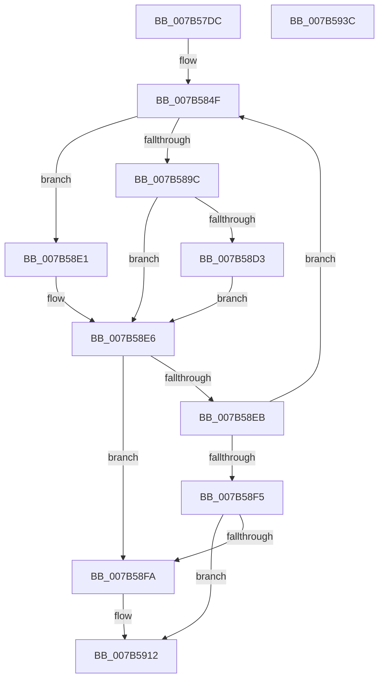

# EtwpAllocatePhysicalPages

- RVA: `0x007B57DC`–`0x007B593D` (길이 `353` bytes)
- VA: `0x00000001407B57DC`
- 실행 섹션: `PAGE`
- PDB 이름 있음: `예`; PDB Function 태그: `아니요`
- unwind 정보 RVA: `0x000D367C`
- 디코드: `98`개 명령, `353/353` bytes 표시
- 미해석 바이트: `0` (있으면 어셈블리에 `.byte`로 보존)

> 이 문서는 커널 이미지의 기계어와 PDB 기호를 분석해 생성했습니다. 4번과 5번은 함수 원형과 자료형을 바이너리 사용 방식에서 추정한 C 해석이며 원본 소스 복구 결과는 아닙니다.

## 1. Dependencies

- 직접 호출 지점: **5**; 고유 호출 대상: **5**
- 직접 호출자로 확인된 함수: **2**
- RIP 상대 이미지 참조: **2**

### Outgoing calls
- `0x007B588C` → [MmAllocatePagesForMdlEx](../../text/3E/MmAllocatePagesForMdlEx_function_003EA8C0.md) (function, `0x003EA8C0`)
- `0x007B58B3` → [memcpy](../../text/6C/memcpy_function_006C6840.md) (function, `0x006C6840`)
- `0x007B58C3` → [ExFreePoolWithTag](../../poolcode/B8/ExFreePoolWithTag_function_00B82870.md) (function, `0x00B82870`)
- `0x007B590D` → [qsort](../../text/50/qsort_function_005009F0.md) (function, `0x005009F0`)
- `0x007B591C` → [_security_check_cookie](../../text/6A/_security_check_cookie_function_006AC640.md) (function, `0x006AC640`)

### Direct callers
- [sub_006EAD16](../../text/6E/Unknown_function_006EAD16.md) at `0x006EAD48`
- [EtwpAllocatePhysicalMemoryForTraceBuffers](../A7/EtwpAllocatePhysicalMemoryForTraceBuffers_function_00A74920.md) at `0x00A749A0`

### Static image references
- `0x007B57F8` → RVA `0x00E0A740` (`.data`; read)
- `0x007B58FA` → RVA `0x007B5A90` (`EtwpComparePfn`; read)

## 2. Other-region calls and transfers

- 다른 실행 섹션으로 향하는 call: **5**
  - `0x007B588C` → [MmAllocatePagesForMdlEx](../../text/3E/MmAllocatePagesForMdlEx_function_003EA8C0.md) (`PAGE` → `.text`)
  - `0x007B58B3` → [memcpy](../../text/6C/memcpy_function_006C6840.md) (`PAGE` → `.text`)
  - `0x007B58C3` → [ExFreePoolWithTag](../../poolcode/B8/ExFreePoolWithTag_function_00B82870.md) (`PAGE` → `POOLCODE`)
  - `0x007B590D` → [qsort](../../text/50/qsort_function_005009F0.md) (`PAGE` → `.text`)
  - `0x007B591C` → [_security_check_cookie](../../text/6A/_security_check_cookie_function_006AC640.md) (`PAGE` → `.text`)
- 별도 외부 분기/꼬리 이동을 확인하지 못했습니다.

## 3. Assembly (complete function range)

```asm
007B57DC  48 89 5C 24 18                  mov qword ptr [rsp + 0x18], rbx
007B57E1  55                              push rbp
007B57E2  56                              push rsi
007B57E3  57                              push rdi
007B57E4  41 54                           push r12
007B57E6  41 55                           push r13
007B57E8  41 56                           push r14
007B57EA  41 57                           push r15
007B57EC  48 8D 6C 24 D9                  lea rbp, [rsp - 0x27]
007B57F1  48 81 EC A0 00 00 00            sub rsp, 0xa0
007B57F8  48 8B 05 41 4F 65 00            mov rax, qword ptr [rip + 0x654f41]
007B57FF  48 33 C4                        xor rax, rsp
007B5802  48 89 45 17                     mov qword ptr [rbp + 0x17], rax
007B5806  48 83 65 0F 00                  and qword ptr [rbp + 0xf], 0
007B580B  B8 00 00 20 00                  mov eax, 0x200000
007B5810  4C 8B E1                        mov r12, rcx
007B5813  48 89 45 CF                     mov qword ptr [rbp - 0x31], rax
007B5817  4C 8B F2                        mov r14, rdx
007B581A  48 89 45 DF                     mov qword ptr [rbp - 0x21], rax
007B581E  BA 61 00 00 00                  mov edx, 0x61
007B5823  C7 45 07 01 00 00 00            mov dword ptr [rbp + 7], 1
007B582A  B8 00 00 01 00                  mov eax, 0x10000
007B582F  89 55 C7                        mov dword ptr [rbp - 0x39], edx
007B5832  33 F6                           xor esi, esi
007B5834  89 55 E7                        mov dword ptr [rbp - 0x19], edx
007B5837  48 89 45 EF                     mov qword ptr [rbp - 0x11], rax
007B583B  33 FF                           xor edi, edi
007B583D  8D 4A C0                        lea ecx, [rdx - 0x40]
007B5840  48 89 45 FF                     mov qword ptr [rbp - 1], rax
007B5844  89 4D D7                        mov dword ptr [rbp - 0x29], ecx
007B5847  89 4D F7                        mov dword ptr [rbp - 9], ecx
007B584A  B9 00 00 E0 FF                  mov ecx, 0xffe00000
007B584F  49 8B C6                        mov rax, r14
007B5852  48 89 7D BF                     mov qword ptr [rbp - 0x41], rdi
007B5856  48 C1 E0 0C                     shl rax, 0xc
007B585A  48 3B C1                        cmp rax, rcx
007B585D  48 89 45 B7                     mov qword ptr [rbp - 0x49], rax
007B5861  4C 8B E8                        mov r13, rax
007B5864  48 8B C7                        mov rax, rdi
007B5867  4C 0F 47 E9                     cmova r13, rcx
007B586B  48 03 C0                        add rax, rax
007B586E  4D 8B CD                        mov r9, r13
007B5871  48 83 CA FF                     or rdx, 0xffffffffffffffff
007B5875  33 C9                           xor ecx, ecx
007B5877  4C 8B 44 C5 CF                  mov r8, qword ptr [rbp + rax*8 - 0x31]
007B587C  8B 44 C5 C7                     mov eax, dword ptr [rbp + rax*8 - 0x39]
007B5880  89 44 24 28                     mov dword ptr [rsp + 0x28], eax
007B5884  C7 44 24 20 01 00 00 00         mov dword ptr [rsp + 0x20], 1
007B588C  E8 2F 50 C3 FF                  call 0x1403ea8c0
007B5891  48 FF C7                        inc rdi
007B5894  4C 8B F8                        mov r15, rax
007B5897  48 85 C0                        test rax, rax
007B589A  74 45                           je 0x1407b58e1
007B589C  8B 58 28                        mov ebx, dword ptr [rax + 0x28]
007B589F  48 8D 50 30                     lea rdx, [rax + 0x30]
007B58A3  48 C1 EB 0C                     shr rbx, 0xc
007B58A7  49 8D 0C F4                     lea rcx, [r12 + rsi*8]
007B58AB  4C 8D 04 DD 00 00 00 00         lea r8, [rbx*8]
007B58B3  E8 88 0F F1 FF                  call 0x1406c6840
007B58B8  33 D2                           xor edx, edx
007B58BA  49 8B CF                        mov rcx, r15
007B58BD  48 03 F3                        add rsi, rbx
007B58C0  4C 2B F3                        sub r14, rbx
007B58C3  E8 A8 CF 3C 00                  call 0x140b82870
007B58C8  B9 00 00 E0 FF                  mov ecx, 0xffe00000
007B58CD  48 39 4D B7                     cmp qword ptr [rbp - 0x49], rcx
007B58D1  76 13                           jbe 0x1407b58e6
007B58D3  41 8B 47 28                     mov eax, dword ptr [r15 + 0x28]
007B58D7  49 3B C5                        cmp rax, r13
007B58DA  48 0F 44 7D BF                  cmove rdi, qword ptr [rbp - 0x41]
007B58DF  EB 05                           jmp 0x1407b58e6
007B58E1  B9 00 00 E0 FF                  mov ecx, 0xffe00000
007B58E6  4D 85 F6                        test r14, r14
007B58E9  74 0F                           je 0x1407b58fa
007B58EB  48 83 FF 05                     cmp rdi, 5
007B58EF  0F 82 5A FF FF FF               jb 0x1407b584f
007B58F5  4D 85 F6                        test r14, r14
007B58F8  75 18                           jne 0x1407b5912
007B58FA  4C 8D 0D 8F 01 00 00            lea r9, [rip + 0x18f]
007B5901  41 B8 08 00 00 00               mov r8d, 8
007B5907  48 8B D6                        mov rdx, rsi
007B590A  49 8B CC                        mov rcx, r12
007B590D  E8 DE B0 D4 FF                  call 0x1405009f0
007B5912  48 8B C6                        mov rax, rsi
007B5915  48 8B 4D 17                     mov rcx, qword ptr [rbp + 0x17]
007B5919  48 33 CC                        xor rcx, rsp
007B591C  E8 1F 6D EF FF                  call 0x1406ac640
007B5921  48 8B 9C 24 F0 00 00 00         mov rbx, qword ptr [rsp + 0xf0]
007B5929  48 81 C4 A0 00 00 00            add rsp, 0xa0
007B5930  41 5F                           pop r15
007B5932  41 5E                           pop r14
007B5934  41 5D                           pop r13
007B5936  41 5C                           pop r12
007B5938  5F                              pop rdi
007B5939  5E                              pop rsi
007B593A  5D                              pop rbp
007B593B  C3                              ret
007B593C  CC                              int3
```

## 4. C-style interpretation (structured pseudocode)

```c
__int64 __fastcall EtwpAllocatePhysicalPages(__int64 a1, __int64 a2)
{
    __int64 result;
    __int64 v_r13;
    __int64 v_r14;
    __int64 v_rbx;
    __int64 v_rdi;
    __int64 v_rsi;
    __int64 v_rsp;
    unsigned __int64 v_stack_m48;
    unsigned __int64 v_stack_m50;
    unsigned int v_stack_m58;
    unsigned __int64 v_stack_m5F;
    unsigned __int64 v_stack_m60;
    unsigned int v_stack_m68;
    unsigned __int64 v_stack_m70;
    unsigned int v_stack_m78;
    unsigned __int64 v_stack_m80;
    unsigned int v_stack_m88;
    unsigned __int64 v_stack_m90;
    unsigned int v_stack_m98;
    unsigned __int64 v_stack_mA0;
    unsigned __int64 v_stack_mA8;
    unsigned int v_stack_mB0;
    unsigned int v_stack_mB8;
    unsigned __int64 v_stack_p18;

    v_stack_p18 = v_rbx;
    v_rsp = (v_rsp) - (160);
    result = (*(unsigned __int64 *)(v_rip + 6639425)) ^ (v_rsp);
    v_stack_m48 = result;
    v_stack_m90 = (unsigned int)(0x200000ULL);
    v_stack_m80 = (unsigned int)(0x200000ULL);
    v_stack_m58 = 1;
    v_stack_m98 = 97;
    v_rsi = 0;
    v_stack_m78 = 97;
    v_stack_m70 = (unsigned int)(0x10000ULL);
    v_rdi = 0;
    v_stack_m60 = (unsigned int)(0x10000ULL);
    v_stack_m88 = (unsigned int)(97 - 64);
    v_stack_m68 = (unsigned int)(97 - 64);
loc_007B584F:
    v_stack_mA0 = 0;
    result = (a2) << (12);
    v_stack_mA8 = result;
    v_r13 = result;
    if (result > ((unsigned int)(0xFFE00000ULL))) { v_r13 = (unsigned int)(0xFFE00000ULL); }
    result = (0) + (0);
    a2 = (97) | (-1);
    a1 = 0;
    v_stack_mB0 = (unsigned int)((unsigned int)(*(unsigned int *)(v_stack_m5F + result * 8 - 57)));
    v_stack_mB8 = 1;
    result = MmAllocatePagesForMdlEx(a1, a2, *(unsigned __int64 *)(v_stack_m5F + result * 8 - 49), v_r13);
    v_rdi = (v_rdi) + 1;
    if (result == 0) goto loc_007B58E1;
    v_rbx = ((unsigned int)(*(unsigned int *)(result + 40))) >> (12);
    result = memcpy(a1 + v_rsi * 8, result + 48, v_rbx * 8, v_r13);
    a2 = 0;
    v_rsi = (v_rsi) + (v_rbx);
    v_r14 = (a2) - (v_rbx);
    result = ExFreePoolWithTag(result, a2, v_rbx * 8, v_r13);
    if (v_stack_mA8 <= ((unsigned int)(0xFFE00000ULL))) goto loc_007B58E6;
    if (((unsigned int)(*(unsigned int *)(result + 40))) == v_r13) { v_rdi = v_stack_mA0; }
    goto loc_007B58E6;
loc_007B58E1:
loc_007B58E6:
    if (v_r14 == 0) goto loc_007B58FA;
    if (v_rdi < 5) goto loc_007B584F;
    result = (unsigned int)(*(unsigned int *)(result + 40));
    if (v_r14 == 0) {
        a4 = v_rip + 399;
        a3 = 8;
        a2 = v_rsi;
        a1 = 0;
        result = qsort(a1, a2, a3, a4);
    }
    a1 = (v_stack_m48) ^ (v_rsp);
    result = _security_check_cookie(a1, a2, a3, a4);
    v_rsp = (v_rsp) + (160);
    return result;
}
```

## 5. (Beta) C Style

```c
int64_t EtwpAllocatePhysicalPages(void *Arg1, int64_t Arg2)
{
    uint8_t *arg1 = (uint8_t *)Arg1;

    int64_t result;
    int64_t local_r13;
    int64_t local_r14;
    int64_t local_rbx;
    int64_t local_rdi;
    int64_t local_rsi;
    int64_t local_rsp;
    uint64_t v_stack_m48;
    uint64_t v_stack_m50;
    uint32_t v_stack_m58;
    uint64_t v_stack_m5F;
    uint64_t v_stack_m60;
    uint32_t v_stack_m68;
    uint64_t v_stack_m70;
    uint32_t v_stack_m78;
    uint64_t v_stack_m80;
    uint32_t v_stack_m88;
    uint64_t v_stack_m90;
    uint32_t v_stack_m98;
    uint64_t v_stack_mA0;
    uint64_t v_stack_mA8;
    uint32_t v_stack_mB0;
    uint32_t v_stack_mB8;
    uint64_t v_stack_p18;

    v_stack_p18 = local_rbx;
    local_rsp = (local_rsp) - (160);
    result = (*(uint64_t *)(v_rip + 0x654F41)) ^ (local_rsp);
    v_stack_m48 = result;
    v_stack_m90 = (uint32_t)(0x200000ULL);
    v_stack_m80 = (uint32_t)(0x200000ULL);
    v_stack_m58 = 1;
    v_stack_m98 = 97;
    local_rsi = 0;
    v_stack_m78 = 97;
    v_stack_m70 = (uint32_t)(0x10000ULL);
    local_rdi = 0;
    v_stack_m60 = (uint32_t)(0x10000ULL);
    v_stack_m88 = (uint32_t)(97 - 64);
    v_stack_m68 = (uint32_t)(97 - 64);
loc_007B584F:
    v_stack_mA0 = 0;
    result = (Arg2) << (12);
    v_stack_mA8 = result;
    local_r13 = result;
    if (result > ((uint32_t)(0xFFE00000ULL))) { local_r13 = (uint32_t)(0xFFE00000ULL); }
    result = (0) + (0);
    Arg2 = (97) | (-1);
    Arg1 = 0;
    v_stack_mB0 = (uint32_t)((uint32_t)(*(uint32_t *)(v_stack_m5F + result * 8 - 0x39)));
    v_stack_mB8 = 1;
    result = MmAllocatePagesForMdlEx(Arg1, Arg2, *(uint64_t *)(v_stack_m5F + result * 8 - 0x31), local_r13);
    local_rdi = (local_rdi) + 1;
    if (result == 0) goto loc_007B58E1;
    local_rbx = ((uint32_t)(*(uint32_t *)(result + 0x28))) >> (12);
    result = memcpy(Arg1 + local_rsi * 8, result + 48, local_rbx * 8, local_r13);
    Arg2 = 0;
    local_rsi = (local_rsi) + (local_rbx);
    local_r14 = (Arg2) - (local_rbx);
    result = ExFreePoolWithTag(result, Arg2, local_rbx * 8, local_r13);
    if (v_stack_mA8 <= ((uint32_t)(0xFFE00000ULL))) goto loc_007B58E6;
    if (((uint32_t)(*(uint32_t *)(result + 0x28))) == local_r13) { local_rdi = v_stack_mA0; }
    goto loc_007B58E6;
loc_007B58E1:
loc_007B58E6:
    if (local_r14 == 0) goto loc_007B58FA;
    if (local_rdi < 5) goto loc_007B584F;
    result = (uint32_t)(*(uint32_t *)(result + 0x28));
    if (local_r14 == 0) {
        a4 = v_rip + 399;
        a3 = 8;
        Arg2 = local_rsi;
        Arg1 = 0;
        result = qsort(Arg1, Arg2, a3, a4);
    }
    Arg1 = (v_stack_m48) ^ (local_rsp);
    result = _security_check_cookie(Arg1, Arg2, a3, a4);
    local_rsp = (local_rsp) + (160);
    return result;
}
```

### 관측된 메모리 오프셋

구조체 형식이 확인되지 않은 접근은 인자 기준의 오프셋으로만 기록했습니다.

| 기준 인자 | 오프셋 표현 | 폭 (bit) | 접근 |
|---|---:|---:|---|
| `Arg1` | `+ 0x0 + rsi*8` | `64` | `R` |

## 6. Execution-region graph

[열기: 2D/3D 그래프와 함수 탐색 컨트롤 패널](../../../control-panel.html?section=page&rva=0x007B57DC&view=graph)

- 2D 그래프는 위에서 아래로 흐르고, 3D 그래프는 빈 공간을 드래그해 회전합니다. Shift+드래그는 이동, 휠은 확대·축소, 함수 노드 선택은 대상 보고서 이동입니다.

### Static fallback


