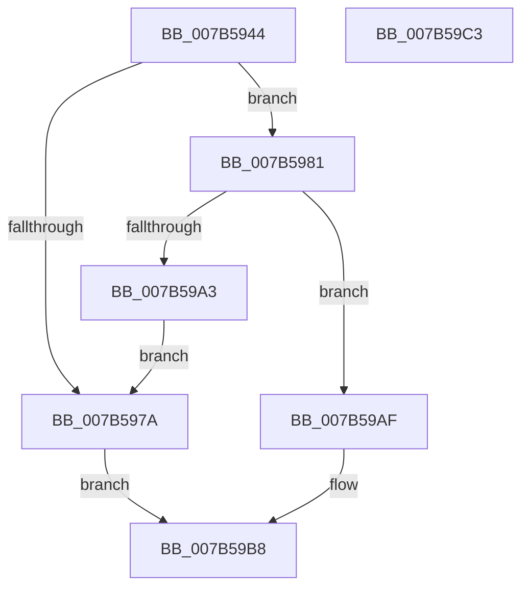

# EtwpAllocatePmcData

- RVA: `0x007B5944`–`0x007B59C4` (길이 `128` bytes)
- VA: `0x00000001407B5944`
- 실행 섹션: `PAGE`
- PDB 이름 있음: `예`; PDB Function 태그: `아니요`
- unwind 정보 RVA: `0x0005CAAC`
- 디코드: `34`개 명령, `128/128` bytes 표시
- 미해석 바이트: `0` (있으면 어셈블리에 `.byte`로 보존)

> 이 문서는 커널 이미지의 기계어와 PDB 기호를 분석해 생성했습니다. 4번과 5번은 함수 원형과 자료형을 바이너리 사용 방식에서 추정한 C 해석이며 원본 소스 복구 결과는 아닙니다.

## 1. Dependencies

- 직접 호출 지점: **4**; 고유 호출 대상: **3**
- 직접 호출자로 확인된 함수: **2**
- RIP 상대 이미지 참조: **1**

### Outgoing calls
- `0x007B5956` → [KeQueryMaximumProcessorCountEx](../../text/26/KeQueryMaximumProcessorCountEx_function_00264D60.md) (function, `0x00264D60`)
- `0x007B596D` → [ExAllocatePool2](../../poolcode/B8/ExAllocatePool2_function_00B820F0.md) (function, `0x00B820F0`)
- `0x007B5996` → [ExAllocatePool2](../../poolcode/B8/ExAllocatePool2_function_00B820F0.md) (function, `0x00B820F0`)
- `0x007B59A8` → [ExFreePoolWithTag](../../poolcode/B8/ExFreePoolWithTag_function_00B82870.md) (function, `0x00B82870`)

### Direct callers
- [EtwpUpdatePmcEvents](EtwpUpdatePmcEvents_function_007B7C58.md) at `0x007B7C8E`
- [EtwpUpdatePmcCounters](../AB/EtwpUpdatePmcCounters_function_00AB63AC.md) at `0x00AB6406`

### Static image references
- `0x007B5981` → RVA `0x00E0EB1C` (`.data`; read)

## 2. Other-region calls and transfers

- 다른 실행 섹션으로 향하는 call: **4**
  - `0x007B5956` → [KeQueryMaximumProcessorCountEx](../../text/26/KeQueryMaximumProcessorCountEx_function_00264D60.md) (`PAGE` → `.text`)
  - `0x007B596D` → [ExAllocatePool2](../../poolcode/B8/ExAllocatePool2_function_00B820F0.md) (`PAGE` → `POOLCODE`)
  - `0x007B5996` → [ExAllocatePool2](../../poolcode/B8/ExAllocatePool2_function_00B820F0.md) (`PAGE` → `POOLCODE`)
  - `0x007B59A8` → [ExFreePoolWithTag](../../poolcode/B8/ExFreePoolWithTag_function_00B82870.md) (`PAGE` → `POOLCODE`)
- 별도 외부 분기/꼬리 이동을 확인하지 못했습니다.

## 3. Assembly (complete function range)

```asm
007B5944  48 89 5C 24 08                  mov qword ptr [rsp + 8], rbx
007B5949  57                              push rdi
007B594A  48 83 EC 20                     sub rsp, 0x20
007B594E  48 8B F9                        mov rdi, rcx
007B5951  B9 FF FF 00 00                  mov ecx, 0xffff
007B5956  E8 05 F4 AA FF                  call 0x140264d60
007B595B  B9 40 00 00 00                  mov ecx, 0x40
007B5960  41 B8 45 74 77 58               mov r8d, 0x58777445
007B5966  8D 14 C5 18 00 00 00            lea edx, [rax*8 + 0x18]
007B596D  E8 7E C7 3C 00                  call 0x140b820f0
007B5972  48 8B D8                        mov rbx, rax
007B5975  48 85 C0                        test rax, rax
007B5978  75 07                           jne 0x1407b5981
007B597A  B8 17 00 00 C0                  mov eax, 0xc0000017
007B597F  EB 37                           jmp 0x1407b59b8
007B5981  8B 15 95 91 65 00               mov edx, dword ptr [rip + 0x659195]
007B5987  B9 40 00 00 00                  mov ecx, 0x40
007B598C  48 C1 E2 02                     shl rdx, 2
007B5990  41 B8 45 74 77 58               mov r8d, 0x58777445
007B5996  E8 55 C7 3C 00                  call 0x140b820f0
007B599B  48 89 03                        mov qword ptr [rbx], rax
007B599E  48 85 C0                        test rax, rax
007B59A1  75 0C                           jne 0x1407b59af
007B59A3  33 D2                           xor edx, edx
007B59A5  48 8B CB                        mov rcx, rbx
007B59A8  E8 C3 CE 3C 00                  call 0x140b82870
007B59AD  EB CB                           jmp 0x1407b597a
007B59AF  48 89 9F 28 04 00 00            mov qword ptr [rdi + 0x428], rbx
007B59B6  33 C0                           xor eax, eax
007B59B8  48 8B 5C 24 30                  mov rbx, qword ptr [rsp + 0x30]
007B59BD  48 83 C4 20                     add rsp, 0x20
007B59C1  5F                              pop rdi
007B59C2  C3                              ret
007B59C3  CC                              int3
```

## 4. C-style interpretation (structured pseudocode)

```c
__int64 __fastcall EtwpAllocatePmcData(__int64 a1)
{
    __int64 result;
    __int64 v_rsp;
    unsigned __int64 v_stack_p8;

    v_stack_p8 = v_rbx;
    v_rsp = (v_rsp) - (32);
    result = KeQueryMaximumProcessorCountEx((unsigned int)(0xFFFFULL), a2, a3, a4);
    result = ExAllocatePool2(64, result * 8 + 24, (unsigned int)(0x58777445ULL), a4);
    if (result != 0) goto loc_007B5981;
loc_007B597A:
    goto loc_007B59B8;
loc_007B5981:
    a2 = ((unsigned int)(*(unsigned int *)(v_rip + 6656405))) << (2);
    result = ExAllocatePool2(64, a2, (unsigned int)(0x58777445ULL), a4);
    *(unsigned __int64 *)(result) = result;
    if (result != 0) goto loc_007B59AF;
    a2 = 0;
    result = ExFreePoolWithTag(result, a2, (unsigned int)(0x58777445ULL), a4);
    goto loc_007B597A;
loc_007B59AF:
    *(unsigned __int64 *)(a1 + 1064) = result;
    result = 0;
loc_007B59B8:
    v_rsp = (v_rsp) + (32);
    return result;
}
```

## 5. (Beta) C Style

```c
int64_t EtwpAllocatePmcData(void *Arg1)
{
    uint8_t *arg1 = (uint8_t *)Arg1;

    int64_t result;
    int64_t local_rsp;
    uint64_t v_stack_p8;

    v_stack_p8 = local_rbx;
    local_rsp = (local_rsp) - (32);
    result = KeQueryMaximumProcessorCountEx((uint32_t)(0xFFFFULL), a2, a3, a4);
    result = ExAllocatePool2(64, result * 8 + 24, (uint32_t)(0x58777445ULL), a4);
    if (result != 0) goto loc_007B5981;
loc_007B597A:
    goto loc_007B59B8;
loc_007B5981:
    a2 = ((uint32_t)(*(uint32_t *)(v_rip + 0x659195))) << (2);
    result = ExAllocatePool2(64, a2, (uint32_t)(0x58777445ULL), a4);
    *(uint64_t *)(result) = result;
    if (result != 0) goto loc_007B59AF;
    a2 = 0;
    result = ExFreePoolWithTag(result, a2, (uint32_t)(0x58777445ULL), a4);
    goto loc_007B597A;
loc_007B59AF:
    *(uint64_t *)(arg1 + 0x428) = result;
    result = 0;
loc_007B59B8:
    local_rsp = (local_rsp) + (32);
    return result;
}
```

### 관측된 메모리 오프셋

구조체 형식이 확인되지 않은 접근은 인자 기준의 오프셋으로만 기록했습니다.

| 기준 인자 | 오프셋 표현 | 폭 (bit) | 접근 |
|---|---:|---:|---|
| `Arg1` | `+ 0x428` | `64` | `W` |

## 6. Execution-region graph

[열기: 2D/3D 그래프와 함수 탐색 컨트롤 패널](../../../control-panel.html?section=page&rva=0x007B5944&view=graph)

- 2D 그래프는 위에서 아래로 흐르고, 3D 그래프는 빈 공간을 드래그해 회전합니다. Shift+드래그는 이동, 휠은 확대·축소, 함수 노드 선택은 대상 보고서 이동입니다.

### Static fallback


