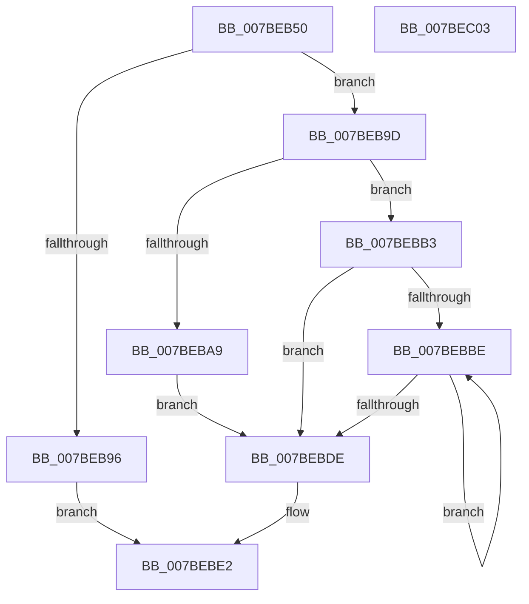

# EtwpBuildMdlForTraceBuffer

- RVA: `0x007BEB50`–`0x007BEC04` (길이 `180` bytes)
- VA: `0x00000001407BEB50`
- 실행 섹션: `PAGE`
- PDB 이름 있음: `예`; PDB Function 태그: `아니요`
- unwind 정보 RVA: `0x000847EC`
- 디코드: `54`개 명령, `180/180` bytes 표시
- 미해석 바이트: `0` (있으면 어셈블리에 `.byte`로 보존)

> 이 문서는 커널 이미지의 기계어와 PDB 기호를 분석해 생성했습니다. 4번과 5번은 함수 원형과 자료형을 바이너리 사용 방식에서 추정한 C 해석이며 원본 소스 복구 결과는 아닙니다.

## 1. Dependencies

- 직접 호출 지점: **3**; 고유 호출 대상: **3**
- 직접 호출자로 확인된 함수: **1**
- RIP 상대 이미지 참조: **0**

### Outgoing calls
- `0x007BEB89` → [IoAllocateMdl](../../text/29/IoAllocateMdl_function_0029EBF0.md) (function, `0x0029EBF0`)
- `0x007BEBAC` → [MmBuildMdlForNonPagedPool](../../text/23/MmBuildMdlForNonPagedPool_function_0023A870.md) (function, `0x0023A870`)
- `0x007BEBC1` → [MmGetPhysicalAddress](../../text/23/MmGetPhysicalAddress_function_0023A500.md) (function, `0x0023A500`)

### Direct callers
- [EtwpPreserveLogger](EtwpPreserveLogger_function_007BEF4C.md) at `0x007BF08B`
- [EtwpPreserveLogger](EtwpPreserveLogger_function_007BEF4C.md) at `0x007BF0D5`

### Static image references
- 디코드된 RIP-relative 메모리 참조가 없습니다.

## 2. Other-region calls and transfers

- 다른 실행 섹션으로 향하는 call: **3**
  - `0x007BEB89` → [IoAllocateMdl](../../text/29/IoAllocateMdl_function_0029EBF0.md) (`PAGE` → `.text`)
  - `0x007BEBAC` → [MmBuildMdlForNonPagedPool](../../text/23/MmBuildMdlForNonPagedPool_function_0023A870.md) (`PAGE` → `.text`)
  - `0x007BEBC1` → [MmGetPhysicalAddress](../../text/23/MmGetPhysicalAddress_function_0023A500.md) (`PAGE` → `.text`)
- 별도 외부 분기/꼬리 이동을 확인하지 못했습니다.

## 3. Assembly (complete function range)

```asm
007BEB50  48 8B C4                        mov rax, rsp
007BEB53  48 89 58 08                     mov qword ptr [rax + 8], rbx
007BEB57  48 89 68 10                     mov qword ptr [rax + 0x10], rbp
007BEB5B  48 89 70 18                     mov qword ptr [rax + 0x18], rsi
007BEB5F  48 89 78 20                     mov qword ptr [rax + 0x20], rdi
007BEB63  41 54                           push r12
007BEB65  41 56                           push r14
007BEB67  41 57                           push r15
007BEB69  48 83 EC 30                     sub rsp, 0x30
007BEB6D  8B 3A                           mov edi, dword ptr [rdx]
007BEB6F  4C 8B F2                        mov r14, rdx
007BEB72  4D 8B E0                        mov r12, r8
007BEB75  48 8B E9                        mov rbp, rcx
007BEB78  33 DB                           xor ebx, ebx
007BEB7A  49 8B CE                        mov rcx, r14
007BEB7D  45 33 C9                        xor r9d, r9d
007BEB80  48 89 58 D8                     mov qword ptr [rax - 0x28], rbx
007BEB84  45 33 C0                        xor r8d, r8d
007BEB87  8B D7                           mov edx, edi
007BEB89  E8 62 00 AE FF                  call 0x14029ebf0
007BEB8E  48 8B F0                        mov rsi, rax
007BEB91  48 85 C0                        test rax, rax
007BEB94  75 07                           jne 0x1407beb9d
007BEB96  BB 9A 00 00 C0                  mov ebx, 0xc000009a
007BEB9B  EB 45                           jmp 0x1407bebe2
007BEB9D  F7 85 30 03 00 00 00 00 00 20   test dword ptr [rbp + 0x330], 0x20000000
007BEBA7  75 0A                           jne 0x1407bebb3
007BEBA9  48 8B CE                        mov rcx, rsi
007BEBAC  E8 BF BC A7 FF                  call 0x14023a870
007BEBB1  EB 2B                           jmp 0x1407bebde
007BEBB3  C1 EF 0C                        shr edi, 0xc
007BEBB6  4C 8D 78 30                     lea r15, [rax + 0x30]
007BEBBA  85 FF                           test edi, edi
007BEBBC  74 20                           je 0x1407bebde
007BEBBE  49 8B CE                        mov rcx, r14
007BEBC1  E8 3A B9 A7 FF                  call 0x14023a500
007BEBC6  48 C1 E8 0C                     shr rax, 0xc
007BEBCA  49 81 C6 00 10 00 00            add r14, 0x1000
007BEBD1  49 89 07                        mov qword ptr [r15], rax
007BEBD4  4D 8D 7F 08                     lea r15, [r15 + 8]
007BEBD8  48 83 EF 01                     sub rdi, 1
007BEBDC  75 E0                           jne 0x1407bebbe
007BEBDE  49 89 34 24                     mov qword ptr [r12], rsi
007BEBE2  48 8B 6C 24 58                  mov rbp, qword ptr [rsp + 0x58]
007BEBE7  8B C3                           mov eax, ebx
007BEBE9  48 8B 5C 24 50                  mov rbx, qword ptr [rsp + 0x50]
007BEBEE  48 8B 74 24 60                  mov rsi, qword ptr [rsp + 0x60]
007BEBF3  48 8B 7C 24 68                  mov rdi, qword ptr [rsp + 0x68]
007BEBF8  48 83 C4 30                     add rsp, 0x30
007BEBFC  41 5F                           pop r15
007BEBFE  41 5E                           pop r14
007BEC00  41 5C                           pop r12
007BEC02  C3                              ret
007BEC03  CC                              int3
```

## 4. C-style interpretation (structured pseudocode)

```c
__int64 __fastcall EtwpBuildMdlForTraceBuffer(__int64 a1, __int64 a2, __int64 a3, int a4)
{
    __int64 result;
    __int64 v_r14;
    __int64 v_rbx;
    __int64 v_rdi;
    __int64 v_rsp;
    unsigned __int64 v_stack_p10;
    unsigned __int64 v_stack_p18;
    unsigned __int64 v_stack_p20;
    unsigned __int64 v_stack_p8;

    *(unsigned __int64 *)(v_rsp + 8) = v_rbx;
    *(unsigned __int64 *)(v_rsp + 16) = v_rbp;
    *(unsigned __int64 *)(v_rsp + 24) = v_rsi;
    *(unsigned __int64 *)(v_rsp + 32) = v_rdi;
    v_rsp = (v_rsp) - (48);
    v_rbx = 0;
    a4 = 0;
    *(unsigned __int64 *)(v_rsp - 40) = 0;
    a3 = 0;
    result = IoAllocateMdl(a2, (unsigned int)((unsigned int)((unsigned int)(*(unsigned int *)(a2)))), a3, a4);
    if (result != 0) goto loc_007BEB9D;
    goto loc_007BEBE2;
loc_007BEB9D:
    if (((*(unsigned int *)(a1 + 816)) & (0x20000000ULL)) != 0) goto loc_007BEBB3;
    result = MmBuildMdlForNonPagedPool(result, (unsigned int)((unsigned int)((unsigned int)(*(unsigned int *)(a2)))), a3, a4);
    goto loc_007BEBDE;
loc_007BEBB3:
    v_rdi = (unsigned int)(((unsigned int)(*(unsigned int *)(a2))) >> (12));
    if ((unsigned int)(v_rdi) == 0) goto loc_007BEBDE;
loc_007BEBBE:
    result = MmGetPhysicalAddress(a2, (unsigned int)((unsigned int)((unsigned int)(*(unsigned int *)(a2)))), a3, a4);
    result = (result) >> (12);
    v_r14 = (a2) + (0x1000ULL);
    *(unsigned __int64 *)(result + 48) = result;
    v_rdi = (v_rdi) - (1);
    if (condition_is_not_equal) goto loc_007BEBBE;
loc_007BEBDE:
    *(unsigned __int64 *)(a3) = result;
loc_007BEBE2:
    v_rsp = (v_rsp) + (48);
    return (unsigned int)((unsigned int)((unsigned int)(0xC000009AULL)));
}
```

## 5. (Beta) C Style

```c
int64_t EtwpBuildMdlForTraceBuffer(void *Arg1, void *Arg2, void *Arg3, int32_t Arg4)
{
    uint8_t *arg1 = (uint8_t *)Arg1;
    uint8_t *arg2 = (uint8_t *)Arg2;
    uint8_t *arg3 = (uint8_t *)Arg3;

    int64_t result;
    int64_t local_r14;
    int64_t local_rbx;
    int64_t local_rdi;
    int64_t local_rsp;
    uint64_t v_stack_p10;
    uint64_t v_stack_p18;
    uint64_t v_stack_p20;
    uint64_t v_stack_p8;

    *(uint64_t *)(local_rsp + 0x8) = local_rbx;
    *(uint64_t *)(local_rsp + 0x10) = local_rbp;
    *(uint64_t *)(local_rsp + 0x18) = local_rsi;
    *(uint64_t *)(local_rsp + 0x20) = local_rdi;
    local_rsp = (local_rsp) - (48);
    local_rbx = 0;
    Arg4 = 0;
    *(uint64_t *)(local_rsp - 0x28) = 0;
    Arg3 = 0;
    result = IoAllocateMdl(Arg2, (uint32_t)((uint32_t)((uint32_t)(*(uint32_t *)(arg2)))), Arg3, Arg4);
    if (result != 0) goto loc_007BEB9D;
    goto loc_007BEBE2;
loc_007BEB9D:
    if (((*(uint32_t *)(arg1 + 0x330)) & (0x20000000ULL)) != 0) goto loc_007BEBB3;
    result = MmBuildMdlForNonPagedPool(result, (uint32_t)((uint32_t)((uint32_t)(*(uint32_t *)(arg2)))), Arg3, Arg4);
    goto loc_007BEBDE;
loc_007BEBB3:
    local_rdi = (uint32_t)(((uint32_t)(*(uint32_t *)(arg2))) >> (12));
    if ((uint32_t)(local_rdi) == 0) goto loc_007BEBDE;
loc_007BEBBE:
    result = MmGetPhysicalAddress(Arg2, (uint32_t)((uint32_t)((uint32_t)(*(uint32_t *)(arg2)))), Arg3, Arg4);
    result = (result) >> (12);
    local_r14 = (Arg2) + (0x1000ULL);
    *(uint64_t *)(result + 0x30) = result;
    local_rdi = (local_rdi) - (1);
    if (condition_is_not_equal) goto loc_007BEBBE;
loc_007BEBDE:
    *(uint64_t *)(arg3) = result;
loc_007BEBE2:
    local_rsp = (local_rsp) + (48);
    return (uint32_t)((uint32_t)((uint32_t)(0xC000009AULL)));
}
```

### 관측된 메모리 오프셋

구조체 형식이 확인되지 않은 접근은 인자 기준의 오프셋으로만 기록했습니다.

| 기준 인자 | 오프셋 표현 | 폭 (bit) | 접근 |
|---|---:|---:|---|
| `Arg1` | `+ 0x330` | `32` | `R` |
| `Arg2` | `+ 0x0` | `32` | `R` |
| `Arg3` | `+ 0x0` | `64` | `W` |

## 6. Execution-region graph

[열기: 2D/3D 그래프와 함수 탐색 컨트롤 패널](../../../control-panel.html?section=page&rva=0x007BEB50&view=graph)

- 2D 그래프는 위에서 아래로 흐르고, 3D 그래프는 빈 공간을 드래그해 회전합니다. Shift+드래그는 이동, 휠은 확대·축소, 함수 노드 선택은 대상 보고서 이동입니다.

### Static fallback


