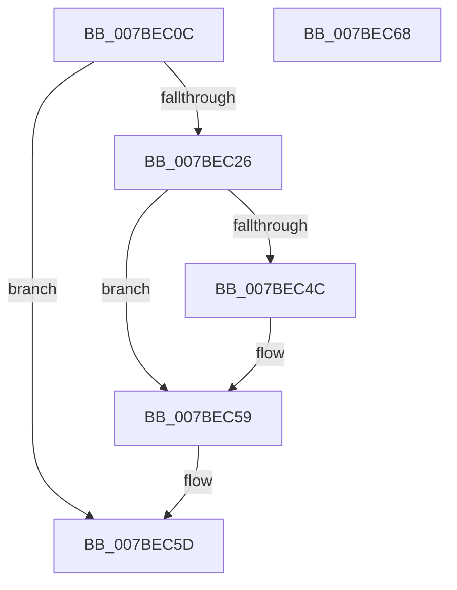

# EtwpCancelMemoryPreservation

- RVA: `0x007BEC0C`–`0x007BEC69` (길이 `93` bytes)
- VA: `0x00000001407BEC0C`
- 실행 섹션: `PAGE`
- PDB 이름 있음: `예`; PDB Function 태그: `아니요`
- unwind 정보 RVA: `0x0005CAAC`
- 디코드: `25`개 명령, `93/93` bytes 표시
- 미해석 바이트: `0` (있으면 어셈블리에 `.byte`로 보존)

> 이 문서는 커널 이미지의 기계어와 PDB 기호를 분석해 생성했습니다. 4번과 5번은 함수 원형과 자료형을 바이너리 사용 방식에서 추정한 C 해석이며 원본 소스 복구 결과는 아닙니다.

## 1. Dependencies

- 직접 호출 지점: **2**; 고유 호출 대상: **2**
- 직접 호출자로 확인된 함수: **3**
- RIP 상대 이미지 참조: **2**

### Outgoing calls
- `0x007BEC33` → `ext-ms-win-ntos-ksr-l1-1-5.dll!KsrFreePersistedMemoryBlock` (import, 간접 대상; import `ext-ms-win-ntos-ksr-l1-1-5.dll!KsrFreePersistedMemoryBlock`)
- `0x007BEC4F` → [EtwpFreeTraceBuffer](../../text/3E/EtwpFreeTraceBuffer_function_003EB978.md) (function, `0x003EB978`)

### Direct callers
- [EtwpKsrCallback](EtwpKsrCallback_function_007BEE10.md) at `0x007BEECA`
- [EtwpFreeSoftRestartContext](../9C/EtwpFreeSoftRestartContext_function_009C1D94.md) at `0x009C1DB9`
- [EtwpSetSoftRestartInformation](../A5/EtwpSetSoftRestartInformation_function_00A53DB8.md) at `0x00A53F8C`

### Static image references
- `0x007BEC29` → RVA `0x00B4AEA0` (`EtwpKsrGuid`; read)
- `0x007BEC33` → RVA `0x00151320` (`ext-ms-win-ntos-ksr-l1-1-5.dll!KsrFreePersistedMemoryBlock (IAT)`; read)

## 2. Other-region calls and transfers

- 다른 실행 섹션으로 향하는 call: **1**
  - `0x007BEC4F` → [EtwpFreeTraceBuffer](../../text/3E/EtwpFreeTraceBuffer_function_003EB978.md) (`PAGE` → `.text`)
- 별도 외부 분기/꼬리 이동을 확인하지 못했습니다.

## 3. Assembly (complete function range)

```asm
007BEC0C  48 89 5C 24 08                  mov qword ptr [rsp + 8], rbx
007BEC11  57                              push rdi
007BEC12  48 83 EC 20                     sub rsp, 0x20
007BEC16  48 8B 99 48 05 00 00            mov rbx, qword ptr [rcx + 0x548]
007BEC1D  48 8B F9                        mov rdi, rcx
007BEC20  80 7B 21 00                     cmp byte ptr [rbx + 0x21], 0
007BEC24  74 37                           je 0x1407bec5d
007BEC26  48 8B 13                        mov rdx, qword ptr [rbx]
007BEC29  48 8D 0D 70 C2 38 00            lea rcx, [rip + 0x38c270]
007BEC30  45 33 C0                        xor r8d, r8d
007BEC33  48 FF 15 E6 26 99 FF            call qword ptr [rip - 0x66d91a]
007BEC3A  0F 1F 44 00 00                  nop dword ptr [rax + rax]
007BEC3F  48 8B 53 08                     mov rdx, qword ptr [rbx + 8]
007BEC43  48 83 23 00                     and qword ptr [rbx], 0
007BEC47  48 85 D2                        test rdx, rdx
007BEC4A  74 0D                           je 0x1407bec59
007BEC4C  48 8B CF                        mov rcx, rdi
007BEC4F  E8 24 CD C2 FF                  call 0x1403eb978
007BEC54  48 83 63 08 00                  and qword ptr [rbx + 8], 0
007BEC59  C6 43 21 00                     mov byte ptr [rbx + 0x21], 0
007BEC5D  48 8B 5C 24 30                  mov rbx, qword ptr [rsp + 0x30]
007BEC62  48 83 C4 20                     add rsp, 0x20
007BEC66  5F                              pop rdi
007BEC67  C3                              ret
007BEC68  CC                              int3
```

## 4. C-style interpretation (structured pseudocode)

```c
__int64 __fastcall EtwpCancelMemoryPreservation(__int64 a1, __int64 a2, int a3)
{
    __int64 result;
    __int64 v_rsp;
    unsigned __int64 v_stack_p8;

    v_stack_p8 = v_rbx;
    v_rsp = (v_rsp) - (32);
    if ((*(unsigned __int8 *)(*(unsigned __int64 *)(a1 + 1352) + 33)) == 0) goto loc_007BEC5D;
    a3 = 0;
    result = ext_ms_win_ntos_ksr_l1_1_5_dll_KsrFreePersistedMemoryBlock(v_rip + 3719792, *(unsigned __int64 *)(*(unsigned __int64 *)(a1 + 1352)), a3, a4);
    if (*(unsigned __int64 *)(*(unsigned __int64 *)(a1 + 1352) + 8) != 0) {
        a1 = a1;
        result = EtwpFreeTraceBuffer(a1, *(unsigned __int64 *)(*(unsigned __int64 *)(a1 + 1352) + 8), a3, a4);
    }
    *(unsigned __int8 *)(*(unsigned __int64 *)(a1 + 1352) + 33) = 0;
loc_007BEC5D:
    v_rsp = (v_rsp) + (32);
    return result;
}
```

## 5. (Beta) C Style

```c
int64_t EtwpCancelMemoryPreservation(void *Arg1, int64_t Arg2, int32_t Arg3)
{
    uint8_t *arg1 = (uint8_t *)Arg1;

    int64_t result;
    int64_t local_rsp;
    uint64_t v_stack_p8;

    v_stack_p8 = local_rbx;
    local_rsp = (local_rsp) - (32);
    if ((*(uint8_t *)(*(uint64_t *)(arg1 + 0x548) + 0x21)) == 0) goto loc_007BEC5D;
    Arg3 = 0;
    result = kernel_indirect_call(v_rip + 3719792, *(uint64_t *)(*(uint64_t *)(arg1 + 0x548)), Arg3, a4);
    if (*(uint64_t *)(*(uint64_t *)(arg1 + 0x548) + 0x8) != 0) {
        Arg1 = Arg1;
        result = EtwpFreeTraceBuffer(Arg1, *(uint64_t *)(*(uint64_t *)(arg1 + 0x548) + 0x8), Arg3, a4);
    }
    *(uint8_t *)(*(uint64_t *)(arg1 + 0x548) + 0x21) = 0;
loc_007BEC5D:
    local_rsp = (local_rsp) + (32);
    return result;
}
```

### 관측된 메모리 오프셋

구조체 형식이 확인되지 않은 접근은 인자 기준의 오프셋으로만 기록했습니다.

| 기준 인자 | 오프셋 표현 | 폭 (bit) | 접근 |
|---|---:|---:|---|
| `Arg1` | `+ 0x548` | `64` | `R` |

## 6. Execution-region graph

[열기: 2D/3D 그래프와 함수 탐색 컨트롤 패널](../../../control-panel.html?section=page&rva=0x007BEC0C&view=graph)

- 2D 그래프는 위에서 아래로 흐르고, 3D 그래프는 빈 공간을 드래그해 회전합니다. Shift+드래그는 이동, 휠은 확대·축소, 함수 노드 선택은 대상 보고서 이동입니다.

### Static fallback


