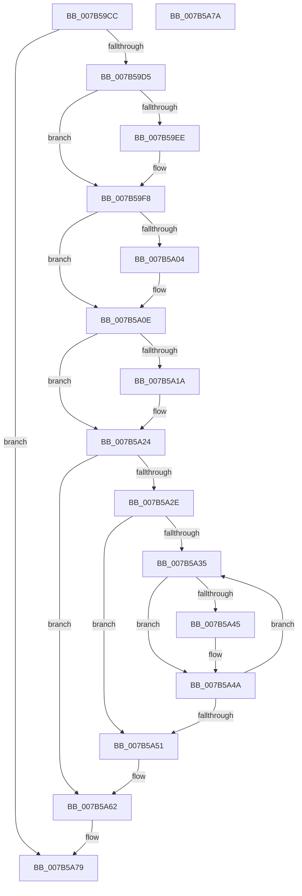

# EtwpCleanupSiloState

- RVA: `0x007B59CC`–`0x007B5A7B` (길이 `175` bytes)
- VA: `0x00000001407B59CC`
- 실행 섹션: `PAGE`
- PDB 이름 있음: `예`; PDB Function 태그: `아니요`
- unwind 정보 RVA: `0x000BF150`
- 디코드: `45`개 명령, `175/175` bytes 표시
- 미해석 바이트: `0` (있으면 어셈블리에 `.byte`로 보존)

> 이 문서는 커널 이미지의 기계어와 PDB 기호를 분석해 생성했습니다. 4번과 5번은 함수 원형과 자료형을 바이너리 사용 방식에서 추정한 C 해석이며 원본 소스 복구 결과는 아닙니다.

## 1. Dependencies

- 직접 호출 지점: **6**; 고유 호출 대상: **2**
- 직접 호출자로 확인된 함수: **3**
- RIP 상대 이미지 참조: **0**

### Outgoing calls
- `0x007B59F3` → [ExFreePoolWithTag](../../poolcode/B8/ExFreePoolWithTag_function_00B82870.md) (function, `0x00B82870`)
- `0x007B5A09` → [ExFreePoolWithTag](../../poolcode/B8/ExFreePoolWithTag_function_00B82870.md) (function, `0x00B82870`)
- `0x007B5A1F` → [ExFreePoolWithTag](../../poolcode/B8/ExFreePoolWithTag_function_00B82870.md) (function, `0x00B82870`)
- `0x007B5A45` → [ExFreeCacheAwareRundownProtection](../../text/48/ExFreeCacheAwareRundownProtection_function_0048FDD0.md) (function, `0x0048FDD0`)
- `0x007B5A5D` → [ExFreePoolWithTag](../../poolcode/B8/ExFreePoolWithTag_function_00B82870.md) (function, `0x00B82870`)
- `0x007B5A6A` → [ExFreePoolWithTag](../../poolcode/B8/ExFreePoolWithTag_function_00B82870.md) (function, `0x00B82870`)

### Direct callers
- [PspInitializeServerSiloDeferred](../77/PspInitializeServerSiloDeferred_function_0077FEE0.md) at `0x00780113`
- [EtwCleanupSiloState](EtwCleanupSiloState_function_007B4B9C.md) at `0x007B4C91`
- [EtwpPreInitializeSiloState](EtwpPreInitializeSiloState_function_007B76BC.md) at `0x007B77A2`

### Static image references
- 디코드된 RIP-relative 메모리 참조가 없습니다.

## 2. Other-region calls and transfers

- 다른 실행 섹션으로 향하는 call: **6**
  - `0x007B59F3` → [ExFreePoolWithTag](../../poolcode/B8/ExFreePoolWithTag_function_00B82870.md) (`PAGE` → `POOLCODE`)
  - `0x007B5A09` → [ExFreePoolWithTag](../../poolcode/B8/ExFreePoolWithTag_function_00B82870.md) (`PAGE` → `POOLCODE`)
  - `0x007B5A1F` → [ExFreePoolWithTag](../../poolcode/B8/ExFreePoolWithTag_function_00B82870.md) (`PAGE` → `POOLCODE`)
  - `0x007B5A45` → [ExFreeCacheAwareRundownProtection](../../text/48/ExFreeCacheAwareRundownProtection_function_0048FDD0.md) (`PAGE` → `.text`)
  - `0x007B5A5D` → [ExFreePoolWithTag](../../poolcode/B8/ExFreePoolWithTag_function_00B82870.md) (`PAGE` → `POOLCODE`)
  - `0x007B5A6A` → [ExFreePoolWithTag](../../poolcode/B8/ExFreePoolWithTag_function_00B82870.md) (`PAGE` → `POOLCODE`)
- 별도 외부 분기/꼬리 이동을 확인하지 못했습니다.

## 3. Assembly (complete function range)

```asm
007B59CC  48 85 C9                        test rcx, rcx
007B59CF  0F 84 A4 00 00 00               je 0x1407b5a79
007B59D5  48 89 5C 24 08                  mov qword ptr [rsp + 8], rbx
007B59DA  57                              push rdi
007B59DB  48 83 EC 20                     sub rsp, 0x20
007B59DF  48 8B D9                        mov rbx, rcx
007B59E2  48 8B 89 88 11 00 00            mov rcx, qword ptr [rcx + 0x1188]
007B59E9  48 85 C9                        test rcx, rcx
007B59EC  74 0A                           je 0x1407b59f8
007B59EE  BA 45 74 77 61                  mov edx, 0x61777445
007B59F3  E8 78 CE 3C 00                  call 0x140b82870
007B59F8  48 8B 8B 20 11 00 00            mov rcx, qword ptr [rbx + 0x1120]
007B59FF  48 85 C9                        test rcx, rcx
007B5A02  74 0A                           je 0x1407b5a0e
007B5A04  BA 45 74 77 50                  mov edx, 0x50777445
007B5A09  E8 62 CE 3C 00                  call 0x140b82870
007B5A0E  48 8B 8B 40 11 00 00            mov rcx, qword ptr [rbx + 0x1140]
007B5A15  48 85 C9                        test rcx, rcx
007B5A18  74 0A                           je 0x1407b5a24
007B5A1A  BA 45 74 77 61                  mov edx, 0x61777445
007B5A1F  E8 4C CE 3C 00                  call 0x140b82870
007B5A24  48 83 BB C0 02 00 00 00         cmp qword ptr [rbx + 0x2c0], 0
007B5A2C  74 34                           je 0x1407b5a62
007B5A2E  33 FF                           xor edi, edi
007B5A30  39 7B 10                        cmp dword ptr [rbx + 0x10], edi
007B5A33  76 1C                           jbe 0x1407b5a51
007B5A35  48 8B 83 C0 02 00 00            mov rax, qword ptr [rbx + 0x2c0]
007B5A3C  48 8B 0C F8                     mov rcx, qword ptr [rax + rdi*8]
007B5A40  48 85 C9                        test rcx, rcx
007B5A43  74 05                           je 0x1407b5a4a
007B5A45  E8 86 A3 CD FF                  call 0x14048fdd0
007B5A4A  FF C7                           inc edi
007B5A4C  3B 7B 10                        cmp edi, dword ptr [rbx + 0x10]
007B5A4F  72 E4                           jb 0x1407b5a35
007B5A51  48 8B 8B C0 02 00 00            mov rcx, qword ptr [rbx + 0x2c0]
007B5A58  BA 45 74 77 61                  mov edx, 0x61777445
007B5A5D  E8 0E CE 3C 00                  call 0x140b82870
007B5A62  BA 45 74 77 61                  mov edx, 0x61777445
007B5A67  48 8B CB                        mov rcx, rbx
007B5A6A  E8 01 CE 3C 00                  call 0x140b82870
007B5A6F  48 8B 5C 24 30                  mov rbx, qword ptr [rsp + 0x30]
007B5A74  48 83 C4 20                     add rsp, 0x20
007B5A78  5F                              pop rdi
007B5A79  C3                              ret
007B5A7A  CC                              int3
```

## 4. C-style interpretation (structured pseudocode)

```c
__int64 __fastcall EtwpCleanupSiloState(__int64 a1)
{
    __int64 result;
    __int64 v_rdi;
    __int64 v_rsp;
    unsigned __int64 v_stack_p8;

    if (a1 == 0) goto loc_007B5A79;
    v_stack_p8 = v_rbx;
    v_rsp = (v_rsp) - (32);
    if (*(unsigned __int64 *)(a1 + 4488) != 0) {
        a2 = 0x61777445ULL;
        result = ExFreePoolWithTag(*(unsigned __int64 *)(a1 + 4488), a2, a3, a4);
    }
    if (*(unsigned __int64 *)(a1 + 4384) != 0) {
        a2 = 0x50777445ULL;
        result = ExFreePoolWithTag(*(unsigned __int64 *)(a1 + 4384), a2, a3, a4);
    }
    if (*(unsigned __int64 *)(a1 + 4416) != 0) {
        a2 = 0x61777445ULL;
        result = ExFreePoolWithTag(*(unsigned __int64 *)(a1 + 4416), a2, a3, a4);
    }
    if ((*(unsigned __int64 *)(a1 + 704)) == 0) goto loc_007B5A62;
    v_rdi = 0;
    if ((*(unsigned int *)(a1 + 16)) <= 0) goto loc_007B5A51;
loc_007B5A35:
    result = *(unsigned __int64 *)(a1 + 704);
    if (*(unsigned __int64 *)(*(unsigned __int64 *)(a1 + 704) + v_rdi * 8) != 0) {
        result = ExFreeCacheAwareRundownProtection(*(unsigned __int64 *)(*(unsigned __int64 *)(a1 + 704) + v_rdi * 8), a2, a3, a4);
    }
    v_rdi = (unsigned int)((v_rdi) + 1);
    if (((unsigned int)(v_rdi)) < (*(unsigned int *)(a1 + 16))) goto loc_007B5A35;
loc_007B5A51:
    result = ExFreePoolWithTag(*(unsigned __int64 *)(a1 + 704), (unsigned int)(0x61777445ULL), a3, a4);
loc_007B5A62:
    result = ExFreePoolWithTag(a1, (unsigned int)(0x61777445ULL), a3, a4);
    v_rsp = (v_rsp) + (32);
loc_007B5A79:
    return result;
}
```

## 5. (Beta) C Style

```c
int64_t EtwpCleanupSiloState(int64_t Arg1)
{
    int64_t result;
    int64_t local_rdi;
    int64_t local_rsp;
    uint64_t v_stack_p8;

    if (Arg1 == 0) goto loc_007B5A79;
    v_stack_p8 = local_rbx;
    local_rsp = (local_rsp) - (32);
    if (*(uint64_t *)(Arg1 + 0x1188) != 0) {
        a2 = 0x61777445ULL;
        result = ExFreePoolWithTag(*(uint64_t *)(Arg1 + 0x1188), a2, a3, a4);
    }
    if (*(uint64_t *)(Arg1 + 0x1120) != 0) {
        a2 = 0x50777445ULL;
        result = ExFreePoolWithTag(*(uint64_t *)(Arg1 + 0x1120), a2, a3, a4);
    }
    if (*(uint64_t *)(Arg1 + 0x1140) != 0) {
        a2 = 0x61777445ULL;
        result = ExFreePoolWithTag(*(uint64_t *)(Arg1 + 0x1140), a2, a3, a4);
    }
    if ((*(uint64_t *)(Arg1 + 0x2C0)) == 0) goto loc_007B5A62;
    local_rdi = 0;
    if ((*(uint32_t *)(Arg1 + 0x10)) <= 0) goto loc_007B5A51;
loc_007B5A35:
    result = *(uint64_t *)(Arg1 + 0x2C0);
    if (*(uint64_t *)(*(uint64_t *)(Arg1 + 0x2C0) + local_rdi * 8) != 0) {
        result = ExFreeCacheAwareRundownProtection(*(uint64_t *)(*(uint64_t *)(Arg1 + 0x2C0) + local_rdi * 8), a2, a3, a4);
    }
    local_rdi = (uint32_t)((local_rdi) + 1);
    if (((uint32_t)(local_rdi)) < (*(uint32_t *)(Arg1 + 0x10))) goto loc_007B5A35;
loc_007B5A51:
    result = ExFreePoolWithTag(*(uint64_t *)(Arg1 + 0x2C0), (uint32_t)(0x61777445ULL), a3, a4);
loc_007B5A62:
    result = ExFreePoolWithTag(Arg1, (uint32_t)(0x61777445ULL), a3, a4);
    local_rsp = (local_rsp) + (32);
loc_007B5A79:
    return result;
}
```

## 6. Execution-region graph

[열기: 2D/3D 그래프와 함수 탐색 컨트롤 패널](../../../control-panel.html?section=page&rva=0x007B59CC&view=graph)

- 2D 그래프는 위에서 아래로 흐르고, 3D 그래프는 빈 공간을 드래그해 회전합니다. Shift+드래그는 이동, 휠은 확대·축소, 함수 노드 선택은 대상 보고서 이동입니다.

### Static fallback


