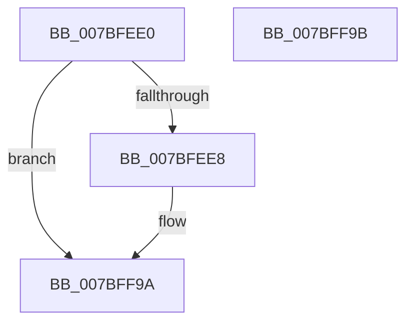

# EtwpClockSourceRunDown

- RVA: `0x007BFEE0`–`0x007BFF9C` (길이 `188` bytes)
- VA: `0x00000001407BFEE0`
- 실행 섹션: `PAGE`
- PDB 이름 있음: `예`; PDB Function 태그: `아니요`
- unwind 정보 RVA: `0x000D3DA8`
- 디코드: `45`개 명령, `188/188` bytes 표시
- 미해석 바이트: `0` (있으면 어셈블리에 `.byte`로 보존)

> 이 문서는 커널 이미지의 기계어와 PDB 기호를 분석해 생성했습니다. 4번과 5번은 함수 원형과 자료형을 바이너리 사용 방식에서 추정한 C 해석이며 원본 소스 복구 결과는 아닙니다.

## 1. Dependencies

- 직접 호출 지점: **4**; 고유 호출 대상: **4**
- 직접 호출자로 확인된 함수: **1**
- RIP 상대 이미지 참조: **2**

### Outgoing calls
- `0x007BFF27` → [guard_dispatch_icall](../../text/6B/guard_dispatch_icall_function_006BAAD0.md) (function, `0x006BAAD0`)
- `0x007BFF38` → [KeGetDynamicTickDisableReason](../../text/4F/KeGetDynamicTickDisableReason_function_004FAD04.md) (function, `0x004FAD04`)
- `0x007BFF79` → [EtwpLogKernelEvent](../../text/25/EtwpLogKernelEvent_function_0025CC00.md) (function, `0x0025CC00`)
- `0x007BFF85` → [_security_check_cookie](../../text/6A/_security_check_cookie_function_006AC640.md) (function, `0x006AC640`)

### Direct callers
- [EtwpKernelTraceRundown](../9E/EtwpKernelTraceRundown_function_009E4080.md) at `0x009E4250`

### Static image references
- `0x007BFEF8` → RVA `0x00E0A740` (`.data`; read)
- `0x007BFF1C` → RVA `0x00E00AD0` (`.data`; read)

## 2. Other-region calls and transfers

- 다른 실행 섹션으로 향하는 call: **4**
  - `0x007BFF27` → [guard_dispatch_icall](../../text/6B/guard_dispatch_icall_function_006BAAD0.md) (`PAGE` → `.text`)
  - `0x007BFF38` → [KeGetDynamicTickDisableReason](../../text/4F/KeGetDynamicTickDisableReason_function_004FAD04.md) (`PAGE` → `.text`)
  - `0x007BFF79` → [EtwpLogKernelEvent](../../text/25/EtwpLogKernelEvent_function_0025CC00.md) (`PAGE` → `.text`)
  - `0x007BFF85` → [_security_check_cookie](../../text/6A/_security_check_cookie_function_006AC640.md) (`PAGE` → `.text`)
- 별도 외부 분기/꼬리 이동을 확인하지 못했습니다.

## 3. Assembly (complete function range)

```asm
007BFEE0  84 D2                           test dl, dl
007BFEE2  0F 84 B2 00 00 00               je 0x1407bff9a
007BFEE8  48 89 5C 24 10                  mov qword ptr [rsp + 0x10], rbx
007BFEED  55                              push rbp
007BFEEE  48 8B EC                        mov rbp, rsp
007BFEF1  48 81 EC 80 00 00 00            sub rsp, 0x80
007BFEF8  48 8B 05 41 A8 64 00            mov rax, qword ptr [rip + 0x64a841]
007BFEFF  48 33 C4                        xor rax, rsp
007BFF02  48 89 45 F0                     mov qword ptr [rbp - 0x10], rax
007BFF06  33 C0                           xor eax, eax
007BFF08  48 8B D9                        mov rbx, rcx
007BFF0B  48 89 45 D0                     mov qword ptr [rbp - 0x30], rax
007BFF0F  48 8D 4D C0                     lea rcx, [rbp - 0x40]
007BFF13  89 45 D8                        mov dword ptr [rbp - 0x28], eax
007BFF16  0F 57 C0                        xorps xmm0, xmm0
007BFF19  88 45 DC                        mov byte ptr [rbp - 0x24], al
007BFF1C  48 8B 05 AD 0B 64 00            mov rax, qword ptr [rip + 0x640bad]
007BFF23  0F 11 45 C0                     movups xmmword ptr [rbp - 0x40], xmm0
007BFF27  E8 A4 AB EF FF                  call 0x1406baad0
007BFF2C  8B 45 C4                        mov eax, dword ptr [rbp - 0x3c]
007BFF2F  89 45 B0                        mov dword ptr [rbp - 0x50], eax
007BFF32  8B 45 C8                        mov eax, dword ptr [rbp - 0x38]
007BFF35  89 45 B4                        mov dword ptr [rbp - 0x4c], eax
007BFF38  E8 C7 AD D3 FF                  call 0x1404fad04
007BFF3D  83 65 EC 00                     and dword ptr [rbp - 0x14], 0
007BFF41  41 B9 01 00 00 00               mov r9d, 1
007BFF47  44 8B 03                        mov r8d, dword ptr [rbx]
007BFF4A  48 8B 93 50 05 00 00            mov rdx, qword ptr [rbx + 0x550]
007BFF51  0F B6 C8                        movzx ecx, al
007BFF54  48 8D 45 B0                     lea rax, [rbp - 0x50]
007BFF58  89 4D B8                        mov dword ptr [rbp - 0x48], ecx
007BFF5B  48 8D 4D E0                     lea rcx, [rbp - 0x20]
007BFF5F  C7 44 24 28 02 18 50 00         mov dword ptr [rsp + 0x28], 0x501802
007BFF67  48 89 45 E0                     mov qword ptr [rbp - 0x20], rax
007BFF6B  C7 45 E8 0C 00 00 00            mov dword ptr [rbp - 0x18], 0xc
007BFF72  66 C7 44 24 20 5A 0F            mov word ptr [rsp + 0x20], 0xf5a
007BFF79  E8 82 CC A9 FF                  call 0x14025cc00
007BFF7E  48 8B 4D F0                     mov rcx, qword ptr [rbp - 0x10]
007BFF82  48 33 CC                        xor rcx, rsp
007BFF85  E8 B6 C6 EE FF                  call 0x1406ac640
007BFF8A  48 8B 9C 24 98 00 00 00         mov rbx, qword ptr [rsp + 0x98]
007BFF92  48 81 C4 80 00 00 00            add rsp, 0x80
007BFF99  5D                              pop rbp
007BFF9A  C3                              ret
007BFF9B  CC                              int3
```

## 4. C-style interpretation (structured pseudocode)

```c
__int64 __fastcall EtwpClockSourceRunDown(__int64 a1, unsigned __int8 a2)
{
    __int64 result;
    __int64 v_rbp;
    __int64 v_rbx;
    __int64 v_rsp;
    unsigned __int64 v_stack_m18;
    unsigned int v_stack_m1C;
    unsigned int v_stack_m20;
    unsigned __int64 v_stack_m28;
    unsigned __int8 v_stack_m2C;
    unsigned int v_stack_m30;
    unsigned __int64 v_stack_m38;
    unsigned int v_stack_m40;
    unsigned int v_stack_m44;
    unsigned __int64 v_stack_m48;
    unsigned int v_stack_m50;
    unsigned int v_stack_m54;
    unsigned int v_stack_m58;
    unsigned int v_stack_m60;
    unsigned __int16 v_stack_m68;
    unsigned __int64 v_stack_p10;

    if (a2 != 0) {
        v_stack_p10 = v_rbx;
        v_rbp = v_rsp;
        v_rsp = (v_rsp) - (128);
        result = *(unsigned __int64 *)(v_rip + 6596673);
        result = (result) ^ (v_rsp);
        v_stack_m18 = result;
        result = 0;
        v_rbx = a1;
        v_stack_m38 = 0;
        a1 = v_stack_m48;
        v_stack_m30 = 0;
        v_stack_m2C = 0;
        result = *(unsigned __int64 *)(v_rip + 6556589);
        v_stack_m48 = v_xmm0;
        result = guard_dispatch_icall(a1, a2, a3, a4);
        result = v_stack_m44;
        v_stack_m58 = (unsigned int)(result);
        result = v_stack_m40;
        v_stack_m54 = (unsigned int)(result);
        result = KeGetDynamicTickDisableReason(a1, a2, a3, a4);
        a4 = 1;
        a3 = *(unsigned int *)(v_rbx);
        a2 = *(unsigned __int64 *)(v_rbx + 1360);
        a1 = (unsigned __int8)(result);
        result = v_stack_m58;
        v_stack_m50 = (unsigned int)(a1);
        a1 = v_stack_m28;
        v_stack_m60 = 0x501802ULL;
        v_stack_m28 = result;
        v_stack_m20 = 12;
        v_stack_m68 = 0xF5AULL;
        result = EtwpLogKernelEvent(a1, a2, a3, a4);
        a1 = v_stack_m18;
        a1 = (a1) ^ (v_rsp);
        result = _security_check_cookie(a1, a2, a3, a4);
        v_rbx = v_stack_p10;
        v_rsp = (v_rsp) + (128);
    }
    return result;
}
```

## 5. (Beta) C Style

```c
int64_t EtwpClockSourceRunDown(void *Arg1, uint8_t Arg2)
{
    uint8_t *arg1 = (uint8_t *)Arg1;

    int64_t result;
    int64_t local_rbp;
    int64_t local_rbx;
    int64_t local_rsp;
    uint64_t v_stack_m18;
    uint32_t v_stack_m1C;
    uint32_t v_stack_m20;
    uint64_t v_stack_m28;
    uint8_t v_stack_m2C;
    uint32_t v_stack_m30;
    uint64_t v_stack_m38;
    uint32_t v_stack_m40;
    uint32_t v_stack_m44;
    uint64_t v_stack_m48;
    uint32_t v_stack_m50;
    uint32_t v_stack_m54;
    uint32_t v_stack_m58;
    uint32_t v_stack_m60;
    uint16_t v_stack_m68;
    uint64_t v_stack_p10;

    if (Arg2 != 0) {
        v_stack_p10 = local_rbx;
        local_rbp = local_rsp;
        local_rsp = (local_rsp) - (128);
        result = *(uint64_t *)(v_rip + 0x64A841);
        result = (result) ^ (local_rsp);
        v_stack_m18 = result;
        result = 0;
        local_rbx = Arg1;
        v_stack_m38 = 0;
        Arg1 = v_stack_m48;
        v_stack_m30 = 0;
        v_stack_m2C = 0;
        result = *(uint64_t *)(v_rip + 0x640BAD);
        v_stack_m48 = v_xmm0;
        result = guard_dispatch_icall(Arg1, Arg2, a3, a4);
        result = v_stack_m44;
        v_stack_m58 = (uint32_t)(result);
        result = v_stack_m40;
        v_stack_m54 = (uint32_t)(result);
        result = KeGetDynamicTickDisableReason(Arg1, Arg2, a3, a4);
        a4 = 1;
        a3 = *(uint32_t *)(local_rbx);
        Arg2 = *(uint64_t *)(local_rbx + 0x550);
        Arg1 = (uint8_t)(result);
        result = v_stack_m58;
        v_stack_m50 = (uint32_t)(Arg1);
        Arg1 = v_stack_m28;
        v_stack_m60 = 0x501802ULL;
        v_stack_m28 = result;
        v_stack_m20 = 12;
        v_stack_m68 = 0xF5AULL;
        result = EtwpLogKernelEvent(Arg1, Arg2, a3, a4);
        Arg1 = v_stack_m18;
        Arg1 = (Arg1) ^ (local_rsp);
        result = _security_check_cookie(Arg1, Arg2, a3, a4);
        local_rbx = v_stack_p10;
        local_rsp = (local_rsp) + (128);
    }
    return result;
}
```

### 관측된 메모리 오프셋

구조체 형식이 확인되지 않은 접근은 인자 기준의 오프셋으로만 기록했습니다.

| 기준 인자 | 오프셋 표현 | 폭 (bit) | 접근 |
|---|---:|---:|---|
| `Arg1` | `+ 0x0` | `32` | `R` |
| `Arg1` | `+ 0x550` | `64` | `R` |

## 6. Execution-region graph

[열기: 2D/3D 그래프와 함수 탐색 컨트롤 패널](../../../control-panel.html?section=page&rva=0x007BFEE0&view=graph)

- 2D 그래프는 위에서 아래로 흐르고, 3D 그래프는 빈 공간을 드래그해 회전합니다. Shift+드래그는 이동, 휠은 확대·축소, 함수 노드 선택은 대상 보고서 이동입니다.

### Static fallback


