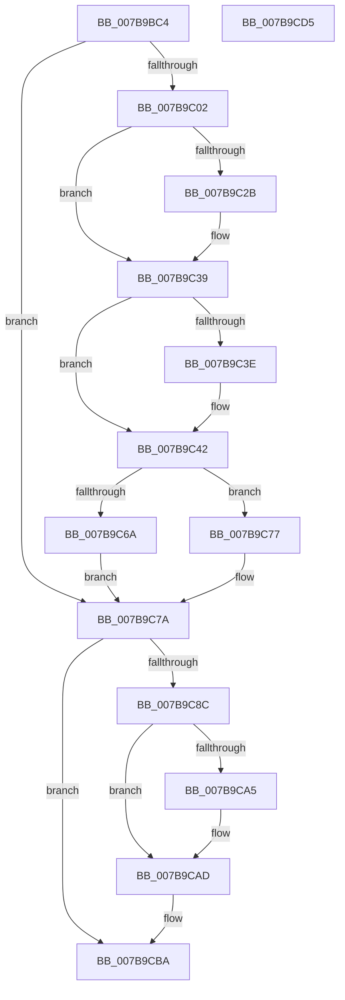

# EtwpCoverageCheckCP

- RVA: `0x007B9BC4`–`0x007B9CD6` (길이 `274` bytes)
- VA: `0x00000001407B9BC4`
- 실행 섹션: `PAGE`
- PDB 이름 있음: `예`; PDB Function 태그: `아니요`
- unwind 정보 RVA: `0x000BEF48`
- 디코드: `73`개 명령, `274/274` bytes 표시
- 미해석 바이트: `0` (있으면 어셈블리에 `.byte`로 보존)

> 이 문서는 커널 이미지의 기계어와 PDB 기호를 분석해 생성했습니다. 4번과 5번은 함수 원형과 자료형을 바이너리 사용 방식에서 추정한 C 해석이며 원본 소스 복구 결과는 아닙니다.

## 1. Dependencies

- 직접 호출 지점: **7**; 고유 호출 대상: **7**
- 직접 호출자로 확인된 함수: **1**
- RIP 상대 이미지 참조: **5**

### Outgoing calls
- `0x007B9BEE` → [EtwpCoverageValidateCP](../../text/46/EtwpCoverageValidateCP_function_0046068C.md) (function, `0x0046068C`)
- `0x007B9C1B` → [KeAbPreAcquire](../../text/21/KeAbPreAcquire_function_00210230.md) (function, `0x00210230`)
- `0x007B9C34` → [ExfAcquirePushLockExclusiveEx](../../text/20/ExfAcquirePushLockExclusiveEx_function_0020FC90.md) (function, `0x0020FC90`)
- `0x007B9C60` → [TelemetryCoverageTableLocateInternal](../../text/4B/TelemetryCoverageTableLocateInternal_function_004BE690.md) (function, `0x004BE690`)
- `0x007B9CA8` → [ExfTryToWakePushLock](../../text/26/ExfTryToWakePushLock_function_00265DD0.md) (function, `0x00265DD0`)
- `0x007B9CB0` → [KeAbPostRelease](../../text/2E/KeAbPostRelease_function_002E1600.md) (function, `0x002E1600`)
- `0x007B9CB5` → [KeLeaveCriticalRegion](../../text/25/KeLeaveCriticalRegion_function_0025D8B0.md) (function, `0x0025D8B0`)

### Direct callers
- [EtwSetProcessTelemetryCoverage](../98/EtwSetProcessTelemetryCoverage_function_009804E0.md) at `0x00980572`

### Static image references
- `0x007B9BF7` → RVA `0x00EFF1B8` (`.data`; read)
- `0x007B9C59` → RVA `0x00E684E0` (`.data`; write)
- `0x007B9C83` → RVA `0x00E684E0` (`.data`; read)
- `0x007B9C8C` → RVA `0x00E684E0` (`.data`; read/write)
- `0x007B9C94` → RVA `0x00EFF1B8` (`.data`; read/write)

## 2. Other-region calls and transfers

- 다른 실행 섹션으로 향하는 call: **7**
  - `0x007B9BEE` → [EtwpCoverageValidateCP](../../text/46/EtwpCoverageValidateCP_function_0046068C.md) (`PAGE` → `.text`)
  - `0x007B9C1B` → [KeAbPreAcquire](../../text/21/KeAbPreAcquire_function_00210230.md) (`PAGE` → `.text`)
  - `0x007B9C34` → [ExfAcquirePushLockExclusiveEx](../../text/20/ExfAcquirePushLockExclusiveEx_function_0020FC90.md) (`PAGE` → `.text`)
  - `0x007B9C60` → [TelemetryCoverageTableLocateInternal](../../text/4B/TelemetryCoverageTableLocateInternal_function_004BE690.md) (`PAGE` → `.text`)
  - `0x007B9CA8` → [ExfTryToWakePushLock](../../text/26/ExfTryToWakePushLock_function_00265DD0.md) (`PAGE` → `.text`)
  - `0x007B9CB0` → [KeAbPostRelease](../../text/2E/KeAbPostRelease_function_002E1600.md) (`PAGE` → `.text`)
  - `0x007B9CB5` → [KeLeaveCriticalRegion](../../text/25/KeLeaveCriticalRegion_function_0025D8B0.md) (`PAGE` → `.text`)
- 별도 외부 분기/꼬리 이동을 확인하지 못했습니다.

## 3. Assembly (complete function range)

```asm
007B9BC4  48 8B C4                        mov rax, rsp
007B9BC7  48 89 58 08                     mov qword ptr [rax + 8], rbx
007B9BCB  48 89 68 10                     mov qword ptr [rax + 0x10], rbp
007B9BCF  48 89 70 20                     mov qword ptr [rax + 0x20], rsi
007B9BD3  57                              push rdi
007B9BD4  41 56                           push r14
007B9BD6  41 57                           push r15
007B9BD8  48 83 EC 20                     sub rsp, 0x20
007B9BDC  48 8B FA                        mov rdi, rdx
007B9BDF  4C 8B F1                        mov r14, rcx
007B9BE2  33 ED                           xor ebp, ebp
007B9BE4  48 8D 50 18                     lea rdx, [rax + 0x18]
007B9BE8  21 68 18                        and dword ptr [rax + 0x18], ebp
007B9BEB  48 8B CF                        mov rcx, rdi
007B9BEE  E8 99 6A CA FF                  call 0x14046068c
007B9BF3  48 83 CB FF                     or rbx, 0xffffffffffffffff
007B9BF7  4C 8D 3D BA 55 74 00            lea r15, [rip + 0x7455ba]
007B9BFE  85 C0                           test eax, eax
007B9C00  74 78                           je 0x1407b9c7a
007B9C02  65 48 8B 04 25 88 01 00 00      mov rax, qword ptr gs:[0x188]
007B9C0B  45 33 C0                        xor r8d, r8d
007B9C0E  33 D2                           xor edx, edx
007B9C10  49 8B CF                        mov rcx, r15
007B9C13  66 01 98 E4 01 00 00            add word ptr [rax + 0x1e4], bx
007B9C1A  90                              nop
007B9C1B  E8 10 66 A5 FF                  call 0x140210230
007B9C20  F0 49 0F BA 2F 00               lock bts qword ptr [r15], 0
007B9C26  48 8B F0                        mov rsi, rax
007B9C29  73 0E                           jae 0x1407b9c39
007B9C2B  4D 8B C7                        mov r8, r15
007B9C2E  48 8B D0                        mov rdx, rax
007B9C31  49 8B CF                        mov rcx, r15
007B9C34  E8 57 60 A5 FF                  call 0x14020fc90
007B9C39  48 85 F6                        test rsi, rsi
007B9C3C  74 04                           je 0x1407b9c42
007B9C3E  C6 46 0A 01                     mov byte ptr [rsi + 0xa], 1
007B9C42  65 48 8B 04 25 88 01 00 00      mov rax, qword ptr gs:[0x188]
007B9C4B  49 8B 76 10                     mov rsi, qword ptr [r14 + 0x10]
007B9C4F  44 8B 5F 08                     mov r11d, dword ptr [rdi + 8]
007B9C53  48 8B CE                        mov rcx, rsi
007B9C56  41 8B D3                        mov edx, r11d
007B9C59  48 89 05 80 E8 6A 00            mov qword ptr [rip + 0x6ae880], rax
007B9C60  E8 2B 4A D0 FF                  call 0x1404be690
007B9C65  44 39 18                        cmp dword ptr [rax], r11d
007B9C68  75 0D                           jne 0x1407b9c77
007B9C6A  8B 46 18                        mov eax, dword ptr [rsi + 0x18]
007B9C6D  BD 01 00 00 00                  mov ebp, 1
007B9C72  89 47 0C                        mov dword ptr [rdi + 0xc], eax
007B9C75  EB 03                           jmp 0x1407b9c7a
007B9C77  21 6F 0C                        and dword ptr [rdi + 0xc], ebp
007B9C7A  65 48 8B 04 25 88 01 00 00      mov rax, qword ptr gs:[0x188]
007B9C83  48 39 05 56 E8 6A 00            cmp qword ptr [rip + 0x6ae856], rax
007B9C8A  75 2E                           jne 0x1407b9cba
007B9C8C  48 83 25 4C E8 6A 00 00         and qword ptr [rip + 0x6ae84c], 0
007B9C94  F0 48 0F C1 1D 1B 55 74 00      lock xadd qword ptr [rip + 0x74551b], rbx
007B9C9D  80 E3 06                        and bl, 6
007B9CA0  80 FB 02                        cmp bl, 2
007B9CA3  75 08                           jne 0x1407b9cad
007B9CA5  49 8B CF                        mov rcx, r15
007B9CA8  E8 23 C1 AA FF                  call 0x140265dd0
007B9CAD  49 8B CF                        mov rcx, r15
007B9CB0  E8 4B 79 B2 FF                  call 0x1402e1600
007B9CB5  E8 F6 3B AA FF                  call 0x14025d8b0
007B9CBA  48 8B 5C 24 40                  mov rbx, qword ptr [rsp + 0x40]
007B9CBF  8B C5                           mov eax, ebp
007B9CC1  48 8B 6C 24 48                  mov rbp, qword ptr [rsp + 0x48]
007B9CC6  48 8B 74 24 58                  mov rsi, qword ptr [rsp + 0x58]
007B9CCB  48 83 C4 20                     add rsp, 0x20
007B9CCF  41 5F                           pop r15
007B9CD1  41 5E                           pop r14
007B9CD3  5F                              pop rdi
007B9CD4  C3                              ret
007B9CD5  CC                              int3
```

## 4. C-style interpretation (structured pseudocode)

```c
__int64 __fastcall EtwpCoverageCheckCP(__int64 a1, __int64 a2, int a3)
{
    __int64 result;
    __int64 v_rbp;
    __int64 v_rbx;
    __int64 v_rsp;
    unsigned __int64 v_stack_p10;
    unsigned __int64 v_stack_p20;
    unsigned __int64 v_stack_p8;

    *(unsigned __int64 *)(v_rsp + 8) = v_rbx;
    *(unsigned __int64 *)(v_rsp + 16) = v_rbp;
    *(unsigned __int64 *)(v_rsp + 32) = v_rsi;
    v_rsp = (v_rsp) - (32);
    v_rbp = 0;
    result = EtwpCoverageValidateCP(a2, v_rsp + 24, a3, a4);
    v_rbx = (v_rbx) | (-1);
    if ((unsigned int)(result) == 0) goto loc_007B9C7A;
    a3 = 0;
    a2 = 0;
    result = KeAbPreAcquire(v_rip + 7624122, a2, a3, a4);
    if (!(condition_is_above_or_equal)) {
        a3 = v_rip + 7624122;
        a2 = result;
        a1 = v_rip + 7624122;
        result = ExfAcquirePushLockExclusiveEx(a1, a2, a3, a4);
    }
    if (result != 0) {
        *(unsigned __int8 *)(result + 10) = 1;
    }
    *(unsigned __int64 *)(v_rip + 7006336) = *(unsigned __int64 *)(gs_base + (0 + 392));
    result = TelemetryCoverageTableLocateInternal(*(unsigned __int64 *)(a1 + 16), (unsigned int)((unsigned int)((unsigned int)(*(unsigned int *)(a2 + 8)))), a3, a4);
    if ((*(unsigned int *)(result)) != ((unsigned int)((unsigned int)(*(unsigned int *)(a2 + 8))))) goto loc_007B9C77;
    *(unsigned int *)(a2 + 12) = (unsigned int)((unsigned int)(*(unsigned int *)(*(unsigned __int64 *)(a1 + 16) + 24)));
    goto loc_007B9C7A;
loc_007B9C77:
loc_007B9C7A:
    if ((*(unsigned __int64 *)(v_rip + 7006294)) != (*(unsigned __int64 *)(gs_base + (0 + 392)))) goto loc_007B9CBA;
    v_rbx = (unsigned __int8)((v_rbx) & (6));
    result = *(unsigned __int64 *)(gs_base + (0 + 392));
    if (((unsigned __int8)(v_rbx)) == 2) {
        a1 = v_rip + 7624122;
        result = ExfTryToWakePushLock(a1, (unsigned int)((unsigned int)((unsigned int)(*(unsigned int *)(a2 + 8)))), a3, a4);
    }
    result = KeAbPostRelease(v_rip + 7624122, (unsigned int)((unsigned int)((unsigned int)(*(unsigned int *)(a2 + 8)))), a3, a4);
    result = KeLeaveCriticalRegion(v_rip + 7624122, (unsigned int)((unsigned int)((unsigned int)(*(unsigned int *)(a2 + 8)))), a3, a4);
loc_007B9CBA:
    v_rsp = (v_rsp) + (32);
    return 1;
}
```

## 5. (Beta) C Style

```c
int64_t EtwpCoverageCheckCP(void *Arg1, void *Arg2, int32_t Arg3)
{
    uint8_t *arg1 = (uint8_t *)Arg1;
    uint8_t *arg2 = (uint8_t *)Arg2;

    int64_t result;
    int64_t local_rbp;
    int64_t local_rbx;
    int64_t local_rsp;
    uint64_t v_stack_p10;
    uint64_t v_stack_p20;
    uint64_t v_stack_p8;

    *(uint64_t *)(local_rsp + 0x8) = local_rbx;
    *(uint64_t *)(local_rsp + 0x10) = local_rbp;
    *(uint64_t *)(local_rsp + 0x20) = local_rsi;
    local_rsp = (local_rsp) - (32);
    local_rbp = 0;
    result = EtwpCoverageValidateCP(Arg2, local_rsp + 24, Arg3, a4);
    local_rbx = (local_rbx) | (-1);
    if ((uint32_t)(result) == 0) goto loc_007B9C7A;
    Arg3 = 0;
    Arg2 = 0;
    result = KeAbPreAcquire(v_rip + 7624122, Arg2, Arg3, a4);
    if (!(condition_is_above_or_equal)) {
        Arg3 = v_rip + 7624122;
        Arg2 = result;
        Arg1 = v_rip + 7624122;
        result = ExfAcquirePushLockExclusiveEx(Arg1, Arg2, Arg3, a4);
    }
    if (result != 0) {
        *(uint8_t *)(result + 0xA) = 1;
    }
    *(uint64_t *)(v_rip + 0x6AE880) = *(uint64_t *)(gs_base + (0 + 0x188));
    result = TelemetryCoverageTableLocateInternal(*(uint64_t *)(arg1 + 0x10), (uint32_t)((uint32_t)((uint32_t)(*(uint32_t *)(arg2 + 0x8)))), Arg3, a4);
    if ((*(uint32_t *)(result)) != ((uint32_t)((uint32_t)(*(uint32_t *)(arg2 + 0x8))))) goto loc_007B9C77;
    *(uint32_t *)(arg2 + 0xC) = (uint32_t)((uint32_t)(*(uint32_t *)(*(uint64_t *)(arg1 + 0x10) + 0x18)));
    goto loc_007B9C7A;
loc_007B9C77:
loc_007B9C7A:
    if ((*(uint64_t *)(v_rip + 0x6AE856)) != (*(uint64_t *)(gs_base + (0 + 0x188)))) goto loc_007B9CBA;
    local_rbx = (uint8_t)((local_rbx) & (6));
    result = *(uint64_t *)(gs_base + (0 + 0x188));
    if (((uint8_t)(local_rbx)) == 2) {
        Arg1 = v_rip + 7624122;
        result = ExfTryToWakePushLock(Arg1, (uint32_t)((uint32_t)((uint32_t)(*(uint32_t *)(arg2 + 0x8)))), Arg3, a4);
    }
    result = KeAbPostRelease(v_rip + 7624122, (uint32_t)((uint32_t)((uint32_t)(*(uint32_t *)(arg2 + 0x8)))), Arg3, a4);
    result = KeLeaveCriticalRegion(v_rip + 7624122, (uint32_t)((uint32_t)((uint32_t)(*(uint32_t *)(arg2 + 0x8)))), Arg3, a4);
loc_007B9CBA:
    local_rsp = (local_rsp) + (32);
    return 1;
}
```

### 관측된 메모리 오프셋

구조체 형식이 확인되지 않은 접근은 인자 기준의 오프셋으로만 기록했습니다.

| 기준 인자 | 오프셋 표현 | 폭 (bit) | 접근 |
|---|---:|---:|---|
| `Arg1` | `+ 0x10` | `64` | `R` |
| `Arg2` | `+ 0x8` | `32` | `R` |
| `Arg2` | `+ 0xC` | `32` | `R/W` |
| `Arg2` | `+ 0xC` | `32` | `W` |

## 6. Execution-region graph

[열기: 2D/3D 그래프와 함수 탐색 컨트롤 패널](../../../control-panel.html?section=page&rva=0x007B9BC4&view=graph)

- 2D 그래프는 위에서 아래로 흐르고, 3D 그래프는 빈 공간을 드래그해 회전합니다. Shift+드래그는 이동, 휠은 확대·축소, 함수 노드 선택은 대상 보고서 이동입니다.

### Static fallback


