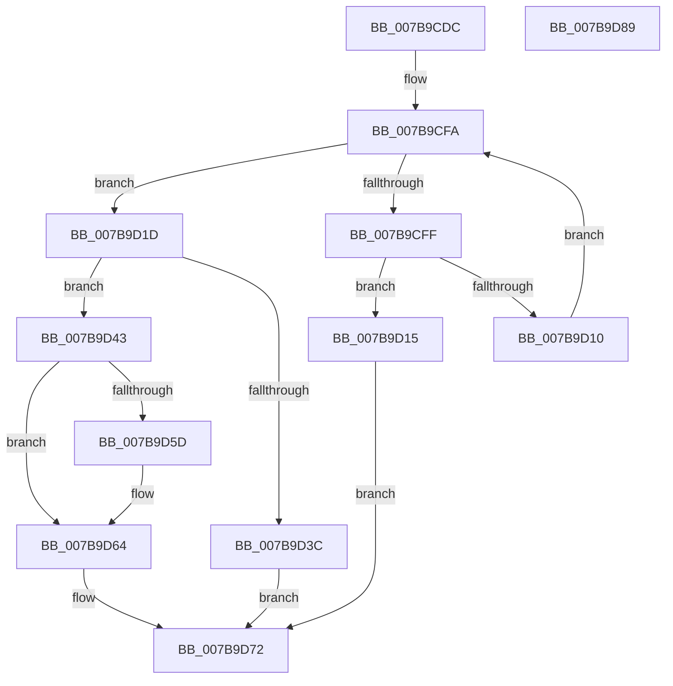

# EtwpCoverageEnsureStringBuffer

- RVA: `0x007B9CDC`–`0x007B9D8A` (길이 `174` bytes)
- VA: `0x00000001407B9CDC`
- 실행 섹션: `PAGE`
- PDB 이름 있음: `예`; PDB Function 태그: `아니요`
- unwind 정보 RVA: `0x0005C954`
- 디코드: `50`개 명령, `174/174` bytes 표시
- 미해석 바이트: `0` (있으면 어셈블리에 `.byte`로 보존)

> 이 문서는 커널 이미지의 기계어와 PDB 기호를 분석해 생성했습니다. 4번과 5번은 함수 원형과 자료형을 바이너리 사용 방식에서 추정한 C 해석이며 원본 소스 복구 결과는 아닙니다.

## 1. Dependencies

- 직접 호출 지점: **2**; 고유 호출 대상: **2**
- 직접 호출자로 확인된 함수: **2**
- RIP 상대 이미지 참조: **0**

### Outgoing calls
- `0x007B9D2D` → [ExAllocatePool2](../../poolcode/B8/ExAllocatePool2_function_00B820F0.md) (function, `0x00B820F0`)
- `0x007B9D4B` → [EtwpCoverageInitializeStringBuffer](../../text/65/EtwpCoverageInitializeStringBuffer_function_00651C30.md) (function, `0x00651C30`)

### Direct callers
- [EtwpCoverageEnsureContext](../70/EtwpCoverageEnsureContext_function_007028E4.md) at `0x00702AC2`
- [EtwpCoverageRecord](../98/EtwpCoverageRecord_function_009821BC.md) at `0x009823AF`

### Static image references
- 디코드된 RIP-relative 메모리 참조가 없습니다.

## 2. Other-region calls and transfers

- 다른 실행 섹션으로 향하는 call: **2**
  - `0x007B9D2D` → [ExAllocatePool2](../../poolcode/B8/ExAllocatePool2_function_00B820F0.md) (`PAGE` → `POOLCODE`)
  - `0x007B9D4B` → [EtwpCoverageInitializeStringBuffer](../../text/65/EtwpCoverageInitializeStringBuffer_function_00651C30.md) (`PAGE` → `.text`)
- 별도 외부 분기/꼬리 이동을 확인하지 못했습니다.

## 3. Assembly (complete function range)

```asm
007B9CDC  48 89 5C 24 08                  mov qword ptr [rsp + 8], rbx
007B9CE1  48 89 6C 24 10                  mov qword ptr [rsp + 0x10], rbp
007B9CE6  48 89 74 24 18                  mov qword ptr [rsp + 0x18], rsi
007B9CEB  57                              push rdi
007B9CEC  48 83 EC 20                     sub rsp, 0x20
007B9CF0  48 8D 71 30                     lea rsi, [rcx + 0x30]
007B9CF4  48 8B E9                        mov rbp, rcx
007B9CF7  4C 8B 06                        mov r8, qword ptr [rsi]
007B9CFA  4C 3B C6                        cmp r8, rsi
007B9CFD  74 1E                           je 0x1407b9d1d
007B9CFF  49 8B 50 10                     mov rdx, qword ptr [r8 + 0x10]
007B9D03  49 2B 50 18                     sub rdx, qword ptr [r8 + 0x18]
007B9D07  48 81 FA 00 02 00 00            cmp rdx, 0x200
007B9D0E  73 05                           jae 0x1407b9d15
007B9D10  4D 8B 00                        mov r8, qword ptr [r8]
007B9D13  EB E5                           jmp 0x1407b9cfa
007B9D15  4C 89 41 28                     mov qword ptr [rcx + 0x28], r8
007B9D19  33 DB                           xor ebx, ebx
007B9D1B  EB 55                           jmp 0x1407b9d72
007B9D1D  BA 00 20 00 00                  mov edx, 0x2000
007B9D22  B9 00 01 00 00                  mov ecx, 0x100
007B9D27  41 B8 45 74 77 56               mov r8d, 0x56777445
007B9D2D  E8 BE 83 3C 00                  call 0x140b820f0
007B9D32  33 DB                           xor ebx, ebx
007B9D34  48 8B F8                        mov rdi, rax
007B9D37  48 85 C0                        test rax, rax
007B9D3A  75 07                           jne 0x1407b9d43
007B9D3C  BB 9A 00 00 C0                  mov ebx, 0xc000009a
007B9D41  EB 2F                           jmp 0x1407b9d72
007B9D43  BA 00 20 00 00                  mov edx, 0x2000
007B9D48  48 8B CF                        mov rcx, rdi
007B9D4B  E8 E0 7E E9 FF                  call 0x140651c30
007B9D50  48 89 7D 28                     mov qword ptr [rbp + 0x28], rdi
007B9D54  48 8B 46 08                     mov rax, qword ptr [rsi + 8]
007B9D58  48 39 30                        cmp qword ptr [rax], rsi
007B9D5B  74 07                           je 0x1407b9d64
007B9D5D  B9 03 00 00 00                  mov ecx, 3
007B9D62  CD 29                           int 0x29
007B9D64  48 89 37                        mov qword ptr [rdi], rsi
007B9D67  48 89 47 08                     mov qword ptr [rdi + 8], rax
007B9D6B  48 89 38                        mov qword ptr [rax], rdi
007B9D6E  48 89 7E 08                     mov qword ptr [rsi + 8], rdi
007B9D72  48 8B 6C 24 38                  mov rbp, qword ptr [rsp + 0x38]
007B9D77  8B C3                           mov eax, ebx
007B9D79  48 8B 5C 24 30                  mov rbx, qword ptr [rsp + 0x30]
007B9D7E  48 8B 74 24 40                  mov rsi, qword ptr [rsp + 0x40]
007B9D83  48 83 C4 20                     add rsp, 0x20
007B9D87  5F                              pop rdi
007B9D88  C3                              ret
007B9D89  CC                              int3
```

## 4. C-style interpretation (structured pseudocode)

```c
__int64 __fastcall EtwpCoverageEnsureStringBuffer(__int64 a1)
{
    __int64 result;
    __int64 v_rbx;
    __int64 v_rsp;
    unsigned __int64 v_stack_p10;
    unsigned __int64 v_stack_p18;
    unsigned __int64 v_stack_p8;

    v_stack_p8 = v_rbx;
    v_stack_p10 = v_rbp;
    v_stack_p18 = v_rsi;
    v_rsp = (v_rsp) - (32);
loc_007B9CFA:
    if ((*(unsigned __int64 *)(a1 + 48)) == (a1 + 48)) goto loc_007B9D1D;
    a2 = (*(unsigned __int64 *)(*(unsigned __int64 *)(a1 + 48) + 16)) - (*(unsigned __int64 *)(*(unsigned __int64 *)(a1 + 48) + 24));
    if (a2 >= 512) goto loc_007B9D15;
    goto loc_007B9CFA;
loc_007B9D15:
    *(unsigned __int64 *)(a1 + 40) = *(unsigned __int64 *)(*(unsigned __int64 *)(a1 + 48));
    v_rbx = 0;
    goto loc_007B9D72;
loc_007B9D1D:
    result = ExAllocatePool2(256, (unsigned int)(0x2000ULL), (unsigned int)(0x56777445ULL), a4);
    v_rbx = 0;
    if (result != 0) goto loc_007B9D43;
    goto loc_007B9D72;
loc_007B9D43:
    result = EtwpCoverageInitializeStringBuffer(result, (unsigned int)(0x2000ULL), (unsigned int)(0x56777445ULL), a4);
    *(unsigned __int64 *)(a1 + 40) = result;
    if ((*(unsigned __int64 *)(*(unsigned __int64 *)(a1 + 48 + 8))) != (a1 + 48)) {
        a1 = 3;
    }
    *(unsigned __int64 *)(result) = a1 + 48;
    *(unsigned __int64 *)(result + 8) = *(unsigned __int64 *)(a1 + 48 + 8);
    *(unsigned __int64 *)(*(unsigned __int64 *)(a1 + 48 + 8)) = result;
    *(unsigned __int64 *)(a1 + 48 + 8) = result;
loc_007B9D72:
    v_rsp = (v_rsp) + (32);
    return (unsigned int)((unsigned int)((unsigned int)(0xC000009AULL)));
}
```

## 5. (Beta) C Style

```c
int64_t EtwpCoverageEnsureStringBuffer(void *Arg1)
{
    uint8_t *arg1 = (uint8_t *)Arg1;

    int64_t result;
    int64_t local_rbx;
    int64_t local_rsp;
    uint64_t v_stack_p10;
    uint64_t v_stack_p18;
    uint64_t v_stack_p8;

    v_stack_p8 = local_rbx;
    v_stack_p10 = local_rbp;
    v_stack_p18 = local_rsi;
    local_rsp = (local_rsp) - (32);
loc_007B9CFA:
    if ((*(uint64_t *)(arg1 + 0x30)) == (Arg1 + 48)) goto loc_007B9D1D;
    a2 = (*(uint64_t *)(*(uint64_t *)(arg1 + 0x30) + 0x10)) - (*(uint64_t *)(*(uint64_t *)(arg1 + 0x30) + 0x18));
    if (a2 >= 512) goto loc_007B9D15;
    goto loc_007B9CFA;
loc_007B9D15:
    *(uint64_t *)(arg1 + 0x28) = *(uint64_t *)(*(uint64_t *)(arg1 + 0x30));
    local_rbx = 0;
    goto loc_007B9D72;
loc_007B9D1D:
    result = ExAllocatePool2(256, (uint32_t)(0x2000ULL), (uint32_t)(0x56777445ULL), a4);
    local_rbx = 0;
    if (result != 0) goto loc_007B9D43;
    goto loc_007B9D72;
loc_007B9D43:
    result = EtwpCoverageInitializeStringBuffer(result, (uint32_t)(0x2000ULL), (uint32_t)(0x56777445ULL), a4);
    *(uint64_t *)(arg1 + 0x28) = result;
    if ((*(uint64_t *)(*(uint64_t *)(arg1 + 0x30 + 0x8))) != (Arg1 + 48)) {
        Arg1 = 3;
    }
    *(void **)(result) = Arg1 + 48;
    *(uint64_t *)(result + 0x8) = *(uint64_t *)(arg1 + 0x30 + 0x8);
    *(uint64_t *)(*(uint64_t *)(arg1 + 0x30 + 0x8)) = result;
    *(uint64_t *)(arg1 + 0x30 + 0x8) = result;
loc_007B9D72:
    local_rsp = (local_rsp) + (32);
    return (uint32_t)((uint32_t)((uint32_t)(0xC000009AULL)));
}
```

### 관측된 메모리 오프셋

구조체 형식이 확인되지 않은 접근은 인자 기준의 오프셋으로만 기록했습니다.

| 기준 인자 | 오프셋 표현 | 폭 (bit) | 접근 |
|---|---:|---:|---|
| `Arg1` | `+ 0x0` | `64` | `R` |
| `Arg1` | `+ 0x8` | `64` | `R` |
| `Arg1` | `+ 0x8` | `64` | `W` |
| `Arg1` | `+ 0x28` | `64` | `W` |
| `Arg1` | `+ 0x30` | `64` | `R` |

## 6. Execution-region graph

[열기: 2D/3D 그래프와 함수 탐색 컨트롤 패널](../../../control-panel.html?section=page&rva=0x007B9CDC&view=graph)

- 2D 그래프는 위에서 아래로 흐르고, 3D 그래프는 빈 공간을 드래그해 회전합니다. Shift+드래그는 이동, 휠은 확대·축소, 함수 노드 선택은 대상 보고서 이동입니다.

### Static fallback


