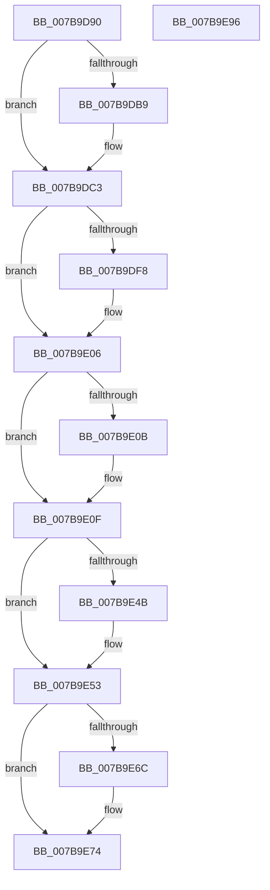

# EtwpCoverageFlushWorkItemCallback

- RVA: `0x007B9D90`–`0x007B9E97` (길이 `263` bytes)
- VA: `0x00000001407B9D90`
- 실행 섹션: `PAGE`
- PDB 이름 있음: `예`; PDB Function 태그: `아니요`
- unwind 정보 RVA: `0x0005C954`
- 디코드: `63`개 명령, `263/263` bytes 표시
- 미해석 바이트: `0` (있으면 어셈블리에 `.byte`로 보존)

> 이 문서는 커널 이미지의 기계어와 PDB 기호를 분석해 생성했습니다. 4번과 5번은 함수 원형과 자료형을 바이너리 사용 방식에서 추정한 C 해석이며 원본 소스 복구 결과는 아닙니다.

## 1. Dependencies

- 직접 호출 지점: **7**; 고유 호출 대상: **7**
- 직접 호출자로 확인된 함수: **0**
- RIP 상대 이미지 참조: **5**

### Outgoing calls
- `0x007B9DBE` → [EtwpCoverageReset](EtwpCoverageReset_function_007B9F4C.md) (function, `0x007B9F4C`)
- `0x007B9DE7` → [KeAbPreAcquire](../../text/21/KeAbPreAcquire_function_00210230.md) (function, `0x00210230`)
- `0x007B9E01` → [ExfAcquirePushLockExclusiveEx](../../text/20/ExfAcquirePushLockExclusiveEx_function_0020FC90.md) (function, `0x0020FC90`)
- `0x007B9E4E` → [EtwpCoverageFlushPending](../AB/EtwpCoverageFlushPending_function_00AB6700.md) (function, `0x00AB6700`)
- `0x007B9E6F` → [ExfTryToWakePushLock](../../text/26/ExfTryToWakePushLock_function_00265DD0.md) (function, `0x00265DD0`)
- `0x007B9E77` → [KeAbPostRelease](../../text/2E/KeAbPostRelease_function_002E1600.md) (function, `0x002E1600`)
- `0x007B9E7C` → [KeLeaveCriticalRegion](../../text/25/KeLeaveCriticalRegion_function_0025D8B0.md) (function, `0x0025D8B0`)

### Direct callers
- 이 함수 시작 RVA로 연결되는 직접 call은 확인되지 않았습니다. 간접 호출은 완전히 역산할 수 없습니다.

### Static image references
- `0x007B9DA4` → RVA `0x00E684F0` (`.data`; read)
- `0x007B9DCC` → RVA `0x00EFF1B8` (`.data`; read)
- `0x007B9E22` → RVA `0x00E684E0` (`.data`; write)
- `0x007B9E53` → RVA `0x00E684E0` (`.data`; read/write)
- `0x007B9E5B` → RVA `0x00EFF1B8` (`.data`; read/write)

## 2. Other-region calls and transfers

- 다른 실행 섹션으로 향하는 call: **5**
  - `0x007B9DE7` → [KeAbPreAcquire](../../text/21/KeAbPreAcquire_function_00210230.md) (`PAGE` → `.text`)
  - `0x007B9E01` → [ExfAcquirePushLockExclusiveEx](../../text/20/ExfAcquirePushLockExclusiveEx_function_0020FC90.md) (`PAGE` → `.text`)
  - `0x007B9E6F` → [ExfTryToWakePushLock](../../text/26/ExfTryToWakePushLock_function_00265DD0.md) (`PAGE` → `.text`)
  - `0x007B9E77` → [KeAbPostRelease](../../text/2E/KeAbPostRelease_function_002E1600.md) (`PAGE` → `.text`)
  - `0x007B9E7C` → [KeLeaveCriticalRegion](../../text/25/KeLeaveCriticalRegion_function_0025D8B0.md) (`PAGE` → `.text`)
- 별도 외부 분기/꼬리 이동을 확인하지 못했습니다.

## 3. Assembly (complete function range)

```asm
007B9D90  48 89 5C 24 08                  mov qword ptr [rsp + 8], rbx
007B9D95  48 89 6C 24 10                  mov qword ptr [rsp + 0x10], rbp
007B9D9A  48 89 74 24 18                  mov qword ptr [rsp + 0x18], rsi
007B9D9F  57                              push rdi
007B9DA0  48 83 EC 20                     sub rsp, 0x20
007B9DA4  48 8B 05 45 E7 6A 00            mov rax, qword ptr [rip + 0x6ae745]
007B9DAB  48 8B F9                        mov rdi, rcx
007B9DAE  83 60 0C 00                     and dword ptr [rax + 0xc], 0
007B9DB2  8B 41 24                        mov eax, dword ptr [rcx + 0x24]
007B9DB5  A8 01                           test al, 1
007B9DB7  74 0A                           je 0x1407b9dc3
007B9DB9  BA 04 00 00 00                  mov edx, 4
007B9DBE  E8 89 01 00 00                  call 0x1407b9f4c
007B9DC3  65 48 8B 04 25 88 01 00 00      mov rax, qword ptr gs:[0x188]
007B9DCC  48 8D 2D E5 53 74 00            lea rbp, [rip + 0x7453e5]
007B9DD3  48 83 CB FF                     or rbx, 0xffffffffffffffff
007B9DD7  45 33 C0                        xor r8d, r8d
007B9DDA  33 D2                           xor edx, edx
007B9DDC  48 8B CD                        mov rcx, rbp
007B9DDF  66 01 98 E4 01 00 00            add word ptr [rax + 0x1e4], bx
007B9DE6  90                              nop
007B9DE7  E8 44 64 A5 FF                  call 0x140210230
007B9DEC  F0 48 0F BA 6D 00 00            lock bts qword ptr [rbp], 0
007B9DF3  48 8B F0                        mov rsi, rax
007B9DF6  73 0E                           jae 0x1407b9e06
007B9DF8  4C 8B C5                        mov r8, rbp
007B9DFB  48 8B D0                        mov rdx, rax
007B9DFE  48 8B CD                        mov rcx, rbp
007B9E01  E8 8A 5E A5 FF                  call 0x14020fc90
007B9E06  48 85 F6                        test rsi, rsi
007B9E09  74 04                           je 0x1407b9e0f
007B9E0B  C6 46 0A 01                     mov byte ptr [rsi + 0xa], 1
007B9E0F  65 48 8B 04 25 88 01 00 00      mov rax, qword ptr gs:[0x188]
007B9E18  48 B9 04 00 00 00 80 F7 FF FF   movabs rcx, 0xfffff78000000004
007B9E22  48 89 05 B7 E6 6A 00            mov qword ptr [rip + 0x6ae6b7], rax
007B9E29  48 B8 20 03 00 00 80 F7 FF FF   movabs rax, 0xfffff78000000320
007B9E33  48 8B 00                        mov rax, qword ptr [rax]
007B9E36  8B 09                           mov ecx, dword ptr [rcx]
007B9E38  48 0F AF C8                     imul rcx, rax
007B9E3C  48 8B 07                        mov rax, qword ptr [rdi]
007B9E3F  48 C1 E9 18                     shr rcx, 0x18
007B9E43  2B 48 10                        sub ecx, dword ptr [rax + 0x10]
007B9E46  3B 4F 1C                        cmp ecx, dword ptr [rdi + 0x1c]
007B9E49  72 08                           jb 0x1407b9e53
007B9E4B  48 8B CF                        mov rcx, rdi
007B9E4E  E8 AD C8 2F 00                  call 0x140ab6700
007B9E53  48 83 25 85 E6 6A 00 00         and qword ptr [rip + 0x6ae685], 0
007B9E5B  F0 48 0F C1 1D 54 53 74 00      lock xadd qword ptr [rip + 0x745354], rbx
007B9E64  80 E3 06                        and bl, 6
007B9E67  80 FB 02                        cmp bl, 2
007B9E6A  75 08                           jne 0x1407b9e74
007B9E6C  48 8B CD                        mov rcx, rbp
007B9E6F  E8 5C BF AA FF                  call 0x140265dd0
007B9E74  48 8B CD                        mov rcx, rbp
007B9E77  E8 84 77 B2 FF                  call 0x1402e1600
007B9E7C  E8 2F 3A AA FF                  call 0x14025d8b0
007B9E81  48 8B 5C 24 30                  mov rbx, qword ptr [rsp + 0x30]
007B9E86  48 8B 6C 24 38                  mov rbp, qword ptr [rsp + 0x38]
007B9E8B  48 8B 74 24 40                  mov rsi, qword ptr [rsp + 0x40]
007B9E90  48 83 C4 20                     add rsp, 0x20
007B9E94  5F                              pop rdi
007B9E95  C3                              ret
007B9E96  CC                              int3
```

## 4. C-style interpretation (structured pseudocode)

```c
__int64 __fastcall EtwpCoverageFlushWorkItemCallback(__int64 a1, __int64 a2, int a3)
{
    __int64 result;
    __int64 v_rbx;
    __int64 v_rsp;
    unsigned __int64 v_stack_p10;
    unsigned __int64 v_stack_p18;
    unsigned __int64 v_stack_p8;

    v_stack_p8 = v_rbx;
    v_stack_p10 = v_rbp;
    v_stack_p18 = v_rsi;
    v_rsp = (v_rsp) - (32);
    result = (unsigned int)(*(unsigned int *)(a1 + 36));
    if ((((unsigned __int8)((unsigned int)(*(unsigned int *)(a1 + 36)))) & (1)) != 0) {
        a2 = 4;
        result = EtwpCoverageReset(a1, a2, a3, a4);
    }
    v_rbx = (v_rbx) | (-1);
    a3 = 0;
    a2 = 0;
    result = KeAbPreAcquire(v_rip + 7623653, a2, a3, a4);
    if (!(condition_is_above_or_equal)) {
        a3 = v_rip + 7623653;
        a2 = result;
        a1 = v_rip + 7623653;
        result = ExfAcquirePushLockExclusiveEx(a1, a2, a3, a4);
    }
    if (result != 0) {
        *(unsigned __int8 *)(result + 10) = 1;
    }
    *(unsigned __int64 *)(v_rip + 7005879) = *(unsigned __int64 *)(gs_base + (0 + 392));
    a1 = ((unsigned int)(*(unsigned int *)(a1))) * (*(unsigned __int64 *)(*(unsigned __int64 *)(gs_base + (0 + 392))));
    a1 = (a1) >> (24);
    a1 = (unsigned int)((a1) - (*(unsigned int *)(*(unsigned __int64 *)(a1) + 16)));
    result = *(unsigned __int64 *)(a1);
    if (((unsigned int)(a1)) >= (*(unsigned int *)(a1 + 28))) {
        a1 = a1;
        result = EtwpCoverageFlushPending(a1, a2, a3, a4);
    }
    v_rbx = (unsigned __int8)((v_rbx) & (6));
    if (((unsigned __int8)(v_rbx)) == 2) {
        a1 = v_rip + 7623653;
        result = ExfTryToWakePushLock(a1, a2, a3, a4);
    }
    result = KeAbPostRelease(v_rip + 7623653, a2, a3, a4);
    result = KeLeaveCriticalRegion(v_rip + 7623653, a2, a3, a4);
    v_rsp = (v_rsp) + (32);
    return result;
}
```

## 5. (Beta) C Style

```c
int64_t EtwpCoverageFlushWorkItemCallback(void *Arg1, int64_t Arg2, int32_t Arg3)
{
    uint8_t *arg1 = (uint8_t *)Arg1;

    int64_t result;
    int64_t local_rbx;
    int64_t local_rsp;
    uint64_t v_stack_p10;
    uint64_t v_stack_p18;
    uint64_t v_stack_p8;

    v_stack_p8 = local_rbx;
    v_stack_p10 = local_rbp;
    v_stack_p18 = local_rsi;
    local_rsp = (local_rsp) - (32);
    result = (uint32_t)(*(uint32_t *)(arg1 + 0x24));
    if ((((uint8_t)((uint32_t)(*(uint32_t *)(arg1 + 0x24)))) & (1)) != 0) {
        Arg2 = 4;
        result = EtwpCoverageReset(Arg1, Arg2, Arg3, a4);
    }
    local_rbx = (local_rbx) | (-1);
    Arg3 = 0;
    Arg2 = 0;
    result = KeAbPreAcquire(v_rip + 7623653, Arg2, Arg3, a4);
    if (!(condition_is_above_or_equal)) {
        Arg3 = v_rip + 7623653;
        Arg2 = result;
        Arg1 = v_rip + 7623653;
        result = ExfAcquirePushLockExclusiveEx(Arg1, Arg2, Arg3, a4);
    }
    if (result != 0) {
        *(uint8_t *)(result + 0xA) = 1;
    }
    *(uint64_t *)(v_rip + 0x6AE6B7) = *(uint64_t *)(gs_base + (0 + 0x188));
    Arg1 = ((uint32_t)(*(uint32_t *)(arg1))) * (*(uint64_t *)(*(uint64_t *)(gs_base + (0 + 0x188))));
    Arg1 = (Arg1) >> (24);
    Arg1 = (uint32_t)((Arg1) - (*(uint32_t *)(*(uint64_t *)(arg1) + 0x10)));
    result = *(uint64_t *)(arg1);
    if (((uint32_t)(Arg1)) >= (*(uint32_t *)(arg1 + 0x1C))) {
        Arg1 = Arg1;
        result = EtwpCoverageFlushPending(Arg1, Arg2, Arg3, a4);
    }
    local_rbx = (uint8_t)((local_rbx) & (6));
    if (((uint8_t)(local_rbx)) == 2) {
        Arg1 = v_rip + 7623653;
        result = ExfTryToWakePushLock(Arg1, Arg2, Arg3, a4);
    }
    result = KeAbPostRelease(v_rip + 7623653, Arg2, Arg3, a4);
    result = KeLeaveCriticalRegion(v_rip + 7623653, Arg2, Arg3, a4);
    local_rsp = (local_rsp) + (32);
    return result;
}
```

### 관측된 메모리 오프셋

구조체 형식이 확인되지 않은 접근은 인자 기준의 오프셋으로만 기록했습니다.

| 기준 인자 | 오프셋 표현 | 폭 (bit) | 접근 |
|---|---:|---:|---|
| `Arg1` | `+ 0x0` | `64` | `R` |
| `Arg1` | `+ 0x1C` | `32` | `R` |
| `Arg1` | `+ 0x24` | `32` | `R` |

## 6. Execution-region graph

[열기: 2D/3D 그래프와 함수 탐색 컨트롤 패널](../../../control-panel.html?section=page&rva=0x007B9D90&view=graph)

- 2D 그래프는 위에서 아래로 흐르고, 3D 그래프는 빈 공간을 드래그해 회전합니다. Shift+드래그는 이동, 휠은 확대·축소, 함수 노드 선택은 대상 보고서 이동입니다.

### Static fallback


