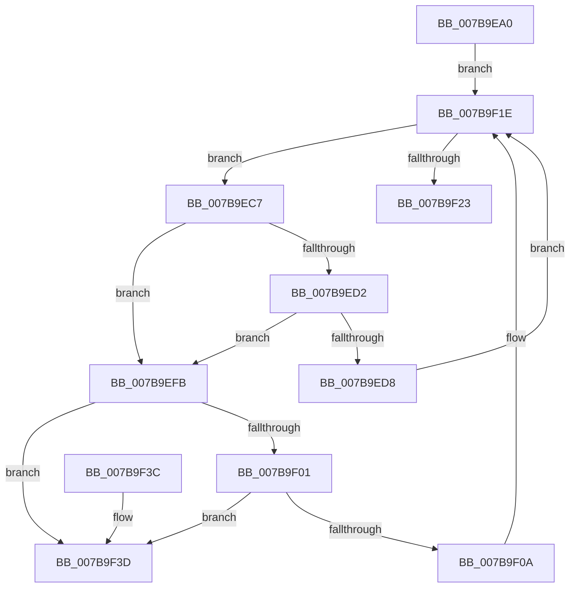

# EtwpCoverageFreeStringBuffers

- RVA: `0x007B9EA0`–`0x007B9F44` (길이 `164` bytes)
- VA: `0x00000001407B9EA0`
- 실행 섹션: `PAGE`
- PDB 이름 있음: `예`; PDB Function 태그: `아니요`
- unwind 정보 RVA: `0x00075210`
- 디코드: `51`개 명령, `164/164` bytes 표시
- 미해석 바이트: `0` (있으면 어셈블리에 `.byte`로 보존)

> 이 문서는 커널 이미지의 기계어와 PDB 기호를 분석해 생성했습니다. 4번과 5번은 함수 원형과 자료형을 바이너리 사용 방식에서 추정한 C 해석이며 원본 소스 복구 결과는 아닙니다.

## 1. Dependencies

- 직접 호출 지점: **2**; 고유 호출 대상: **2**
- 직접 호출자로 확인된 함수: **2**
- RIP 상대 이미지 참조: **0**

### Outgoing calls
- `0x007B9EEC` → [memset](../../text/6C/memset_function_006C6C40.md) (function, `0x006C6C40`)
- `0x007B9F19` → [ExFreePoolWithTag](../../poolcode/B8/ExFreePoolWithTag_function_00B82870.md) (function, `0x00B82870`)

### Direct callers
- [EtwpCoverageEnsureContext](../70/EtwpCoverageEnsureContext_function_007028E4.md) at `0x00702DA4`
- [EtwpCoverageReset](EtwpCoverageReset_function_007B9F4C.md) at `0x007BA08F`

### Static image references
- 디코드된 RIP-relative 메모리 참조가 없습니다.

## 2. Other-region calls and transfers

- 다른 실행 섹션으로 향하는 call: **2**
  - `0x007B9EEC` → [memset](../../text/6C/memset_function_006C6C40.md) (`PAGE` → `.text`)
  - `0x007B9F19` → [ExFreePoolWithTag](../../poolcode/B8/ExFreePoolWithTag_function_00B82870.md) (`PAGE` → `POOLCODE`)
- 별도 외부 분기/꼬리 이동을 확인하지 못했습니다.

## 3. Assembly (complete function range)

```asm
007B9EA0  48 89 5C 24 08                  mov qword ptr [rsp + 8], rbx
007B9EA5  48 89 6C 24 10                  mov qword ptr [rsp + 0x10], rbp
007B9EAA  48 89 74 24 18                  mov qword ptr [rsp + 0x18], rsi
007B9EAF  57                              push rdi
007B9EB0  41 56                           push r14
007B9EB2  41 57                           push r15
007B9EB4  48 83 EC 20                     sub rsp, 0x20
007B9EB8  4C 8D 71 30                     lea r14, [rcx + 0x30]
007B9EBC  44 8B FA                        mov r15d, edx
007B9EBF  49 8B 3E                        mov rdi, qword ptr [r14]
007B9EC2  48 8B E9                        mov rbp, rcx
007B9EC5  EB 57                           jmp 0x1407b9f1e
007B9EC7  48 8B F7                        mov rsi, rdi
007B9ECA  48 8B 3F                        mov rdi, qword ptr [rdi]
007B9ECD  45 85 FF                        test r15d, r15d
007B9ED0  74 29                           je 0x1407b9efb
007B9ED2  48 3B 75 28                     cmp rsi, qword ptr [rbp + 0x28]
007B9ED6  75 23                           jne 0x1407b9efb
007B9ED8  4C 8B 46 10                     mov r8, qword ptr [rsi + 0x10]
007B9EDC  48 8D 5E 28                     lea rbx, [rsi + 0x28]
007B9EE0  4C 2B C6                        sub r8, rsi
007B9EE3  33 D2                           xor edx, edx
007B9EE5  49 83 E8 28                     sub r8, 0x28
007B9EE9  48 8B CB                        mov rcx, rbx
007B9EEC  E8 4F CD F0 FF                  call 0x1406c6c40
007B9EF1  48 89 5E 18                     mov qword ptr [rsi + 0x18], rbx
007B9EF5  48 89 5E 20                     mov qword ptr [rsi + 0x20], rbx
007B9EF9  EB 23                           jmp 0x1407b9f1e
007B9EFB  48 39 77 08                     cmp qword ptr [rdi + 8], rsi
007B9EFF  75 3C                           jne 0x1407b9f3d
007B9F01  48 8B 46 08                     mov rax, qword ptr [rsi + 8]
007B9F05  48 39 30                        cmp qword ptr [rax], rsi
007B9F08  75 33                           jne 0x1407b9f3d
007B9F0A  48 89 38                        mov qword ptr [rax], rdi
007B9F0D  BA 45 74 77 56                  mov edx, 0x56777445
007B9F12  48 8B CE                        mov rcx, rsi
007B9F15  48 89 47 08                     mov qword ptr [rdi + 8], rax
007B9F19  E8 52 89 3C 00                  call 0x140b82870
007B9F1E  49 3B FE                        cmp rdi, r14
007B9F21  75 A4                           jne 0x1407b9ec7
007B9F23  48 8B 5C 24 40                  mov rbx, qword ptr [rsp + 0x40]
007B9F28  48 8B 6C 24 48                  mov rbp, qword ptr [rsp + 0x48]
007B9F2D  48 8B 74 24 50                  mov rsi, qword ptr [rsp + 0x50]
007B9F32  48 83 C4 20                     add rsp, 0x20
007B9F36  41 5F                           pop r15
007B9F38  41 5E                           pop r14
007B9F3A  5F                              pop rdi
007B9F3B  C3                              ret
007B9F3C  CC                              int3
007B9F3D  B9 03 00 00 00                  mov ecx, 3
007B9F42  CD 29                           int 0x29
```

## 4. C-style interpretation (structured pseudocode)

```c
__int64 __fastcall EtwpCoverageFreeStringBuffers(__int64 a1, int a2)
{
    __int64 result;
    __int64 v_rsp;
    unsigned __int64 v_stack_p10;
    unsigned __int64 v_stack_p18;
    unsigned __int64 v_stack_p8;

    v_stack_p8 = v_rbx;
    v_stack_p10 = v_rbp;
    v_stack_p18 = v_rsi;
    v_rsp = (v_rsp) - (32);
    goto loc_007B9F1E;
loc_007B9EC7:
    if ((unsigned int)((unsigned int)(a2)) == 0) goto loc_007B9EFB;
    if ((*(unsigned __int64 *)(a1 + 48)) != (*(unsigned __int64 *)(a1 + 40))) goto loc_007B9EFB;
    a3 = (*(unsigned __int64 *)(*(unsigned __int64 *)(a1 + 48) + 16)) - (*(unsigned __int64 *)(a1 + 48));
    a2 = 0;
    a3 = (a3) - (40);
    result = memset(*(unsigned __int64 *)(a1 + 48) + 40, a2, a3, a4);
    *(unsigned __int64 *)(*(unsigned __int64 *)(a1 + 48) + 24) = *(unsigned __int64 *)(a1 + 48) + 40;
    *(unsigned __int64 *)(*(unsigned __int64 *)(a1 + 48) + 32) = *(unsigned __int64 *)(a1 + 48) + 40;
    goto loc_007B9F1E;
loc_007B9EFB:
    if ((*(unsigned __int64 *)(*(unsigned __int64 *)(*(unsigned __int64 *)(a1 + 48)) + 8)) != (*(unsigned __int64 *)(a1 + 48))) goto loc_007B9F3D;
    if ((*(unsigned __int64 *)(*(unsigned __int64 *)(*(unsigned __int64 *)(a1 + 48) + 8))) != (*(unsigned __int64 *)(a1 + 48))) goto loc_007B9F3D;
    *(unsigned __int64 *)(*(unsigned __int64 *)(*(unsigned __int64 *)(a1 + 48) + 8)) = *(unsigned __int64 *)(*(unsigned __int64 *)(a1 + 48));
    *(unsigned __int64 *)(*(unsigned __int64 *)(*(unsigned __int64 *)(a1 + 48)) + 8) = *(unsigned __int64 *)(*(unsigned __int64 *)(a1 + 48) + 8);
    result = ExFreePoolWithTag(*(unsigned __int64 *)(a1 + 48), (unsigned int)(0x56777445ULL), a3, a4);
loc_007B9F1E:
    if ((*(unsigned __int64 *)(*(unsigned __int64 *)(a1 + 48))) != (a1 + 48)) goto loc_007B9EC7;
    v_rsp = (v_rsp) + (32);
    return result;
loc_007B9F3D:
    return result;
}
```

## 5. (Beta) C Style

```c
int64_t EtwpCoverageFreeStringBuffers(void *Arg1, int32_t Arg2)
{
    uint8_t *arg1 = (uint8_t *)Arg1;

    int64_t result;
    int64_t local_rsp;
    uint64_t v_stack_p10;
    uint64_t v_stack_p18;
    uint64_t v_stack_p8;

    v_stack_p8 = local_rbx;
    v_stack_p10 = local_rbp;
    v_stack_p18 = local_rsi;
    local_rsp = (local_rsp) - (32);
    goto loc_007B9F1E;
loc_007B9EC7:
    if ((uint32_t)((uint32_t)(Arg2)) == 0) goto loc_007B9EFB;
    if ((*(uint64_t *)(arg1 + 0x30)) != (*(uint64_t *)(arg1 + 0x28))) goto loc_007B9EFB;
    a3 = (*(uint64_t *)(*(uint64_t *)(arg1 + 0x30) + 0x10)) - (*(uint64_t *)(arg1 + 0x30));
    Arg2 = 0;
    a3 = (a3) - (40);
    result = memset(*(uint64_t *)(arg1 + 0x30) + 40, Arg2, a3, a4);
    *(uint64_t *)(*(uint64_t *)(arg1 + 0x30) + 0x18) = *(uint64_t *)(arg1 + 0x30) + 40;
    *(uint64_t *)(*(uint64_t *)(arg1 + 0x30) + 0x20) = *(uint64_t *)(arg1 + 0x30) + 40;
    goto loc_007B9F1E;
loc_007B9EFB:
    if ((*(uint64_t *)(*(uint64_t *)(*(uint64_t *)(arg1 + 0x30)) + 0x8)) != (*(uint64_t *)(arg1 + 0x30))) goto loc_007B9F3D;
    if ((*(uint64_t *)(*(uint64_t *)(*(uint64_t *)(arg1 + 0x30) + 0x8))) != (*(uint64_t *)(arg1 + 0x30))) goto loc_007B9F3D;
    *(uint64_t *)(*(uint64_t *)(*(uint64_t *)(arg1 + 0x30) + 0x8)) = *(uint64_t *)(*(uint64_t *)(arg1 + 0x30));
    *(uint64_t *)(*(uint64_t *)(*(uint64_t *)(arg1 + 0x30)) + 0x8) = *(uint64_t *)(*(uint64_t *)(arg1 + 0x30) + 0x8);
    result = ExFreePoolWithTag(*(uint64_t *)(arg1 + 0x30), (uint32_t)(0x56777445ULL), a3, a4);
loc_007B9F1E:
    if ((*(uint64_t *)(*(uint64_t *)(arg1 + 0x30))) != (Arg1 + 48)) goto loc_007B9EC7;
    local_rsp = (local_rsp) + (32);
    return result;
loc_007B9F3D:
    return result;
}
```

### 관측된 메모리 오프셋

구조체 형식이 확인되지 않은 접근은 인자 기준의 오프셋으로만 기록했습니다.

| 기준 인자 | 오프셋 표현 | 폭 (bit) | 접근 |
|---|---:|---:|---|
| `Arg1` | `+ 0x0` | `64` | `R` |
| `Arg1` | `+ 0x28` | `64` | `R` |
| `Arg1` | `+ 0x30` | `64` | `R` |

## 6. Execution-region graph

[열기: 2D/3D 그래프와 함수 탐색 컨트롤 패널](../../../control-panel.html?section=page&rva=0x007B9EA0&view=graph)

- 2D 그래프는 위에서 아래로 흐르고, 3D 그래프는 빈 공간을 드래그해 회전합니다. Shift+드래그는 이동, 휠은 확대·축소, 함수 노드 선택은 대상 보고서 이동입니다.

### Static fallback


