# EtwpCoverageResetCP

- RVA: `0x007BA154`–`0x007BA43D` (길이 `745` bytes)
- VA: `0x00000001407BA154`
- 실행 섹션: `PAGE`
- PDB 이름 있음: `예`; PDB Function 태그: `아니요`
- unwind 정보 RVA: `0x000AA2A0`
- 디코드: `197`개 명령, `745/745` bytes 표시
- 미해석 바이트: `0` (있으면 어셈블리에 `.byte`로 보존)

> 이 문서는 커널 이미지의 기계어와 PDB 기호를 분석해 생성했습니다. 4번과 5번은 함수 원형과 자료형을 바이너리 사용 방식에서 추정한 C 해석이며 원본 소스 복구 결과는 아닙니다.

## 1. Dependencies

- 직접 호출 지점: **15**; 고유 호출 대상: **14**
- 직접 호출자로 확인된 함수: **1**
- RIP 상대 이미지 참조: **8**

### Outgoing calls
- `0x007BA1A9` → [TelemetryCoverageStringHashInternal](../../text/4D/TelemetryCoverageStringHashInternal_function_004D51A0.md) (function, `0x004D51A0`)
- `0x007BA1BB` → [EtwTelemetryCoverageReport](../../text/46/EtwTelemetryCoverageReport_function_00460430.md) (function, `0x00460430`)
- `0x007BA1C8` → [EtwpCoverageValidateCP](../../text/46/EtwpCoverageValidateCP_function_0046068C.md) (function, `0x0046068C`)
- `0x007BA1F6` → [KeAbPreAcquire](../../text/21/KeAbPreAcquire_function_00210230.md) (function, `0x00210230`)
- `0x007BA21B` → [ExfAcquirePushLockExclusiveEx](../../text/20/ExfAcquirePushLockExclusiveEx_function_0020FC90.md) (function, `0x0020FC90`)
- `0x007BA268` → [TelemetryCoverageTableLocateInternal](../../text/4B/TelemetryCoverageTableLocateInternal_function_004BE690.md) (function, `0x004BE690`)
- `0x007BA27E` → [EtwpCoverageFlushPending](../AB/EtwpCoverageFlushPending_function_00AB6700.md) (function, `0x00AB6700`)
- `0x007BA298` → [ExAllocatePool2](../../poolcode/B8/ExAllocatePool2_function_00B820F0.md) (function, `0x00B820F0`)
- `0x007BA31D` → [memcpy](../../text/6C/memcpy_function_006C6840.md) (function, `0x006C6840`)
- `0x007BA392` → [memset](../../text/6C/memset_function_006C6C40.md) (function, `0x006C6C40`)
- `0x007BA3AD` → [TelemetryCoverageTableLocateInternal](../../text/4B/TelemetryCoverageTableLocateInternal_function_004BE690.md) (function, `0x004BE690`)
- `0x007BA3FD` → [ExfTryToWakePushLock](../../text/26/ExfTryToWakePushLock_function_00265DD0.md) (function, `0x00265DD0`)
- `0x007BA409` → [KeAbPostRelease](../../text/2E/KeAbPostRelease_function_002E1600.md) (function, `0x002E1600`)
- `0x007BA40E` → [KeLeaveCriticalRegion](../../text/25/KeLeaveCriticalRegion_function_0025D8B0.md) (function, `0x0025D8B0`)
- `0x007BA420` → [ExFreePoolWithTag](../../poolcode/B8/ExFreePoolWithTag_function_00B82870.md) (function, `0x00B82870`)

### Direct callers
- [sub_00B2A52C](../B2/Unknown_function_00B2A52C.md) at `0x00B2A532`

### Static image references
- `0x007BA18C` → RVA `0x00E0927C` (`.data`; read)
- `0x007BA194` → RVA `0x00E09278` (`.data`; read)
- `0x007BA19D` → RVA `0x00E09270` (`.data`; read)
- `0x007BA1AE` → RVA `0x00E09278` (`.data`; write)
- `0x007BA1E2` → RVA `0x00EFF1B8` (`.data`; read)
- `0x007BA1FB` → RVA `0x00EFF1B8` (`.data`; read/write)
- `0x007BA23C` → RVA `0x00E684E0` (`.data`; write)
- `0x007BA3D5` → RVA `0x00E684E0` (`.data`; read)

## 2. Other-region calls and transfers

- 다른 실행 섹션으로 향하는 call: **14**
  - `0x007BA1A9` → [TelemetryCoverageStringHashInternal](../../text/4D/TelemetryCoverageStringHashInternal_function_004D51A0.md) (`PAGE` → `.text`)
  - `0x007BA1BB` → [EtwTelemetryCoverageReport](../../text/46/EtwTelemetryCoverageReport_function_00460430.md) (`PAGE` → `.text`)
  - `0x007BA1C8` → [EtwpCoverageValidateCP](../../text/46/EtwpCoverageValidateCP_function_0046068C.md) (`PAGE` → `.text`)
  - `0x007BA1F6` → [KeAbPreAcquire](../../text/21/KeAbPreAcquire_function_00210230.md) (`PAGE` → `.text`)
  - `0x007BA21B` → [ExfAcquirePushLockExclusiveEx](../../text/20/ExfAcquirePushLockExclusiveEx_function_0020FC90.md) (`PAGE` → `.text`)
  - `0x007BA268` → [TelemetryCoverageTableLocateInternal](../../text/4B/TelemetryCoverageTableLocateInternal_function_004BE690.md) (`PAGE` → `.text`)
  - `0x007BA298` → [ExAllocatePool2](../../poolcode/B8/ExAllocatePool2_function_00B820F0.md) (`PAGE` → `POOLCODE`)
  - `0x007BA31D` → [memcpy](../../text/6C/memcpy_function_006C6840.md) (`PAGE` → `.text`)
  - `0x007BA392` → [memset](../../text/6C/memset_function_006C6C40.md) (`PAGE` → `.text`)
  - `0x007BA3AD` → [TelemetryCoverageTableLocateInternal](../../text/4B/TelemetryCoverageTableLocateInternal_function_004BE690.md) (`PAGE` → `.text`)
  - `0x007BA3FD` → [ExfTryToWakePushLock](../../text/26/ExfTryToWakePushLock_function_00265DD0.md) (`PAGE` → `.text`)
  - `0x007BA409` → [KeAbPostRelease](../../text/2E/KeAbPostRelease_function_002E1600.md) (`PAGE` → `.text`)
  - `0x007BA40E` → [KeLeaveCriticalRegion](../../text/25/KeLeaveCriticalRegion_function_0025D8B0.md) (`PAGE` → `.text`)
  - `0x007BA420` → [ExFreePoolWithTag](../../poolcode/B8/ExFreePoolWithTag_function_00B82870.md) (`PAGE` → `POOLCODE`)
- 별도 외부 분기/꼬리 이동을 확인하지 못했습니다.

## 3. Assembly (complete function range)

```asm
007BA154  48 89 5C 24 08                  mov qword ptr [rsp + 8], rbx
007BA159  55                              push rbp
007BA15A  56                              push rsi
007BA15B  57                              push rdi
007BA15C  41 54                           push r12
007BA15E  41 55                           push r13
007BA160  41 56                           push r14
007BA162  41 57                           push r15
007BA164  48 83 EC 20                     sub rsp, 0x20
007BA168  45 33 ED                        xor r13d, r13d
007BA16B  4C 8B FA                        mov r15, rdx
007BA16E  44 89 6C 24 68                  mov dword ptr [rsp + 0x68], r13d
007BA173  45 8B F5                        mov r14d, r13d
007BA176  41 8B ED                        mov ebp, r13d
007BA179  44 89 6A 0C                     mov dword ptr [rdx + 0xc], r13d
007BA17D  48 8B F9                        mov rdi, rcx
007BA180  48 B8 7C 03 00 00 80 F7 FF FF   movabs rax, 0xfffff7800000037c
007BA18A  8B 00                           mov eax, dword ptr [rax]
007BA18C  39 05 EA F0 64 00               cmp dword ptr [rip + 0x64f0ea], eax
007BA192  73 2C                           jae 0x1407ba1c0
007BA194  44 39 2D DD F0 64 00            cmp dword ptr [rip + 0x64f0dd], r13d
007BA19B  75 17                           jne 0x1407ba1b4
007BA19D  48 8B 0D CC F0 64 00            mov rcx, qword ptr [rip + 0x64f0cc]
007BA1A4  48 8D 54 24 70                  lea rdx, [rsp + 0x70]
007BA1A9  E8 F2 AF D1 FF                  call 0x1404d51a0
007BA1AE  89 05 C4 F0 64 00               mov dword ptr [rip + 0x64f0c4], eax
007BA1B4  48 8D 0D B5 F0 64 00            lea rcx, [rip + 0x64f0b5]
007BA1BB  E8 70 62 CA FF                  call 0x140460430
007BA1C0  48 8D 54 24 68                  lea rdx, [rsp + 0x68]
007BA1C5  49 8B CF                        mov rcx, r15
007BA1C8  E8 BF 64 CA FF                  call 0x14046068c
007BA1CD  48 83 CB FF                     or rbx, 0xffffffffffffffff
007BA1D1  85 C0                           test eax, eax
007BA1D3  0F 84 F3 01 00 00               je 0x1407ba3cc
007BA1D9  65 48 8B 04 25 88 01 00 00      mov rax, qword ptr gs:[0x188]
007BA1E2  48 8D 0D CF 4F 74 00            lea rcx, [rip + 0x744fcf]
007BA1E9  45 33 C0                        xor r8d, r8d
007BA1EC  33 D2                           xor edx, edx
007BA1EE  66 01 98 E4 01 00 00            add word ptr [rax + 0x1e4], bx
007BA1F5  90                              nop
007BA1F6  E8 35 60 A5 FF                  call 0x140210230
007BA1FB  F0 48 0F BA 2D B3 4F 74 00 00   lock bts qword ptr [rip + 0x744fb3], 0
007BA205  48 8B F0                        mov rsi, rax
007BA208  73 16                           jae 0x1407ba220
007BA20A  4C 8D 05 A7 4F 74 00            lea r8, [rip + 0x744fa7]
007BA211  48 8B D0                        mov rdx, rax
007BA214  48 8D 0D 9D 4F 74 00            lea rcx, [rip + 0x744f9d]
007BA21B  E8 70 5A A5 FF                  call 0x14020fc90
007BA220  48 85 F6                        test rsi, rsi
007BA223  74 04                           je 0x1407ba229
007BA225  C6 46 0A 01                     mov byte ptr [rsi + 0xa], 1
007BA229  65 48 8B 04 25 88 01 00 00      mov rax, qword ptr gs:[0x188]
007BA232  48 B9 04 00 00 00 80 F7 FF FF   movabs rcx, 0xfffff78000000004
007BA23C  48 89 05 9D E2 6A 00            mov qword ptr [rip + 0x6ae29d], rax
007BA243  48 B8 20 03 00 00 80 F7 FF FF   movabs rax, 0xfffff78000000320
007BA24D  48 8B 00                        mov rax, qword ptr [rax]
007BA250  8B 09                           mov ecx, dword ptr [rcx]
007BA252  48 0F AF C8                     imul rcx, rax
007BA256  48 C1 E9 18                     shr rcx, 0x18
007BA25A  89 4F 18                        mov dword ptr [rdi + 0x18], ecx
007BA25D  45 8B 5F 08                     mov r11d, dword ptr [r15 + 8]
007BA261  41 8B D3                        mov edx, r11d
007BA264  48 8B 4F 10                     mov rcx, qword ptr [rdi + 0x10]
007BA268  E8 23 44 D0 FF                  call 0x1404be690
007BA26D  48 89 44 24 78                  mov qword ptr [rsp + 0x78], rax
007BA272  44 39 18                        cmp dword ptr [rax], r11d
007BA275  0F 85 51 01 00 00               jne 0x1407ba3cc
007BA27B  48 8B CF                        mov rcx, rdi
007BA27E  E8 7D C4 2F 00                  call 0x140ab6700
007BA283  48 8B 47 10                     mov rax, qword ptr [rdi + 0x10]
007BA287  B9 00 01 00 00                  mov ecx, 0x100
007BA28C  41 B8 45 74 77 56               mov r8d, 0x56777445
007BA292  8B 50 20                        mov edx, dword ptr [rax + 0x20]
007BA295  C1 E2 02                        shl edx, 2
007BA298  E8 53 7E 3C 00                  call 0x140b820f0
007BA29D  4C 8B F0                        mov r14, rax
007BA2A0  48 85 C0                        test rax, rax
007BA2A3  0F 84 23 01 00 00               je 0x1407ba3cc
007BA2A9  4C 8D 5F 30                     lea r11, [rdi + 0x30]
007BA2AD  49 8B 33                        mov rsi, qword ptr [r11]
007BA2B0  49 3B F3                        cmp rsi, r11
007BA2B3  0F 84 13 01 00 00               je 0x1407ba3cc
007BA2B9  4C 8B 66 18                     mov r12, qword ptr [rsi + 0x18]
007BA2BD  48 8D 4E 28                     lea rcx, [rsi + 0x28]
007BA2C1  49 3B CC                        cmp rcx, r12
007BA2C4  73 45                           jae 0x1407ba30b
007BA2C6  48 8B D3                        mov rdx, rbx
007BA2C9  48 FF C2                        inc rdx
007BA2CC  44 38 2C 11                     cmp byte ptr [rcx + rdx], r13b
007BA2D0  75 F7                           jne 0x1407ba2c9
007BA2D2  44 8B 6C 24 68                  mov r13d, dword ptr [rsp + 0x68]
007BA2D7  49 3B D5                        cmp rdx, r13
007BA2DA  75 24                           jne 0x1407ba300
007BA2DC  4D 8B 17                        mov r10, qword ptr [r15]
007BA2DF  48 8B C1                        mov rax, rcx
007BA2E2  4C 2B D1                        sub r10, rcx
007BA2E5  44 0F B6 00                     movzx r8d, byte ptr [rax]
007BA2E9  46 0F B6 0C 10                  movzx r9d, byte ptr [rax + r10]
007BA2EE  45 2B C1                        sub r8d, r9d
007BA2F1  75 08                           jne 0x1407ba2fb
007BA2F3  48 FF C0                        inc rax
007BA2F6  45 85 C9                        test r9d, r9d
007BA2F9  75 EA                           jne 0x1407ba2e5
007BA2FB  45 85 C0                        test r8d, r8d
007BA2FE  74 10                           je 0x1407ba310
007BA300  48 FF C1                        inc rcx
007BA303  48 03 CA                        add rcx, rdx
007BA306  45 33 ED                        xor r13d, r13d
007BA309  EB B6                           jmp 0x1407ba2c1
007BA30B  48 8B 36                        mov rsi, qword ptr [rsi]
007BA30E  EB A0                           jmp 0x1407ba2b0
007BA310  49 8D 55 01                     lea rdx, [r13 + 1]
007BA314  48 03 D1                        add rdx, rcx
007BA317  4C 2B E2                        sub r12, rdx
007BA31A  4D 8B C4                        mov r8, r12
007BA31D  E8 1E C5 F0 FF                  call 0x1406c6840
007BA322  8B 4C 24 68                     mov ecx, dword ptr [rsp + 0x68]
007BA326  45 33 ED                        xor r13d, r13d
007BA329  FF C1                           inc ecx
007BA32B  45 8B C5                        mov r8d, r13d
007BA32E  48 29 4E 18                     sub qword ptr [rsi + 0x18], rcx
007BA332  41 8B D5                        mov edx, r13d
007BA335  48 8B 46 18                     mov rax, qword ptr [rsi + 0x18]
007BA339  48 89 46 20                     mov qword ptr [rsi + 0x20], rax
007BA33D  48 8B 47 10                     mov rax, qword ptr [rdi + 0x10]
007BA341  FF 40 0C                        inc dword ptr [rax + 0xc]
007BA344  48 8B 44 24 78                  mov rax, qword ptr [rsp + 0x78]
007BA349  44 89 28                        mov dword ptr [rax], r13d
007BA34C  48 8B 47 10                     mov rax, qword ptr [rdi + 0x10]
007BA350  FF 48 20                        dec dword ptr [rax + 0x20]
007BA353  48 8B 4F 10                     mov rcx, qword ptr [rdi + 0x10]
007BA357  44 39 69 04                     cmp dword ptr [rcx + 4], r13d
007BA35B  76 27                           jbe 0x1407ba384
007BA35D  8B C2                           mov eax, edx
007BA35F  44 8B 4C 81 34                  mov r9d, dword ptr [rcx + rax*4 + 0x34]
007BA364  45 85 C9                        test r9d, r9d
007BA367  74 14                           je 0x1407ba37d
007BA369  41 8B C0                        mov eax, r8d
007BA36C  41 FF C0                        inc r8d
007BA36F  45 89 0C 86                     mov dword ptr [r14 + rax*4], r9d
007BA373  48 8B 4F 10                     mov rcx, qword ptr [rdi + 0x10]
007BA377  44 3B 41 20                     cmp r8d, dword ptr [rcx + 0x20]
007BA37B  73 07                           jae 0x1407ba384
007BA37D  FF C2                           inc edx
007BA37F  3B 51 04                        cmp edx, dword ptr [rcx + 4]
007BA382  72 D9                           jb 0x1407ba35d
007BA384  44 8B 41 04                     mov r8d, dword ptr [rcx + 4]
007BA388  33 D2                           xor edx, edx
007BA38A  49 C1 E0 02                     shl r8, 2
007BA38E  48 83 C1 34                     add rcx, 0x34
007BA392  E8 A9 C8 F0 FF                  call 0x1406c6c40
007BA397  48 8B 4F 10                     mov rcx, qword ptr [rdi + 0x10]
007BA39B  41 8B F5                        mov esi, r13d
007BA39E  44 39 69 20                     cmp dword ptr [rcx + 0x20], r13d
007BA3A2  76 1C                           jbe 0x1407ba3c0
007BA3A4  8B C6                           mov eax, esi
007BA3A6  45 8B 1C 86                     mov r11d, dword ptr [r14 + rax*4]
007BA3AA  41 8B D3                        mov edx, r11d
007BA3AD  E8 DE 42 D0 FF                  call 0x1404be690
007BA3B2  FF C6                           inc esi
007BA3B4  44 89 18                        mov dword ptr [rax], r11d
007BA3B7  48 8B 4F 10                     mov rcx, qword ptr [rdi + 0x10]
007BA3BB  3B 71 20                        cmp esi, dword ptr [rcx + 0x20]
007BA3BE  72 E4                           jb 0x1407ba3a4
007BA3C0  8B 41 18                        mov eax, dword ptr [rcx + 0x18]
007BA3C3  BD 01 00 00 00                  mov ebp, 1
007BA3C8  41 89 47 0C                     mov dword ptr [r15 + 0xc], eax
007BA3CC  65 48 8B 04 25 88 01 00 00      mov rax, qword ptr gs:[0x188]
007BA3D5  48 39 05 04 E1 6A 00            cmp qword ptr [rip + 0x6ae104], rax
007BA3DC  75 35                           jne 0x1407ba413
007BA3DE  4C 89 2D FB E0 6A 00            mov qword ptr [rip + 0x6ae0fb], r13
007BA3E5  F0 48 0F C1 1D CA 4D 74 00      lock xadd qword ptr [rip + 0x744dca], rbx
007BA3EE  80 E3 06                        and bl, 6
007BA3F1  80 FB 02                        cmp bl, 2
007BA3F4  75 0C                           jne 0x1407ba402
007BA3F6  48 8D 0D BB 4D 74 00            lea rcx, [rip + 0x744dbb]
007BA3FD  E8 CE B9 AA FF                  call 0x140265dd0
007BA402  48 8D 0D AF 4D 74 00            lea rcx, [rip + 0x744daf]
007BA409  E8 F2 71 B2 FF                  call 0x1402e1600
007BA40E  E8 9D 34 AA FF                  call 0x14025d8b0
007BA413  4D 85 F6                        test r14, r14
007BA416  74 0D                           je 0x1407ba425
007BA418  BA 45 74 77 56                  mov edx, 0x56777445
007BA41D  49 8B CE                        mov rcx, r14
007BA420  E8 4B 84 3C 00                  call 0x140b82870
007BA425  48 8B 5C 24 60                  mov rbx, qword ptr [rsp + 0x60]
007BA42A  8B C5                           mov eax, ebp
007BA42C  48 83 C4 20                     add rsp, 0x20
007BA430  41 5F                           pop r15
007BA432  41 5E                           pop r14
007BA434  41 5D                           pop r13
007BA436  41 5C                           pop r12
007BA438  5F                              pop rdi
007BA439  5E                              pop rsi
007BA43A  5D                              pop rbp
007BA43B  C3                              ret
007BA43C  CC                              int3
```

## 4. C-style interpretation (structured pseudocode)

```c
__int64 __fastcall EtwpCoverageResetCP(__int64 a1, __int64 a2, int a3)
{
    __int64 result;
    __int64 v_r10;
    __int64 v_r12;
    __int64 v_r13;
    __int64 v_rbx;
    __int64 v_rsi;
    __int64 v_rsp;
    unsigned int v_stack_p10;
    unsigned __int64 v_stack_p18;
    unsigned __int64 v_stack_p20;
    unsigned __int64 v_stack_p8;

    v_stack_p8 = v_rbx;
    v_rsp = (v_rsp) - (32);
    v_r13 = 0;
    v_stack_p10 = 0;
    *(unsigned int *)(a2 + 12) = 0;
    if ((*(unsigned int *)(v_rip + 6615274)) >= ((unsigned int)((unsigned int)(*(unsigned int *)(result))))) goto loc_007BA1C0;
    result = (unsigned int)(*(unsigned int *)(result));
    if ((*(unsigned int *)(v_rip + 6615261)) == 0) {
        a1 = *(unsigned __int64 *)(v_rip + 6615244);
        a2 = v_stack_p18;
        result = TelemetryCoverageStringHashInternal(a1, a2, a3, a4);
        *(unsigned int *)(v_rip + 6615236) = (unsigned int)(result);
    }
    result = EtwTelemetryCoverageReport(v_rip + 6615221, a2, a3, a4);
loc_007BA1C0:
    result = EtwpCoverageValidateCP(a2, v_stack_p10, a3, a4);
    v_rbx = (v_rbx) | (-1);
    if ((unsigned int)(result) == 0) goto loc_007BA3CC;
    a3 = 0;
    a2 = 0;
    result = KeAbPreAcquire(v_rip + 7622607, a2, a3, a4);
    if (!(condition_is_above_or_equal)) {
        a3 = v_rip + 7622567;
        a2 = result;
        a1 = v_rip + 7622557;
        result = ExfAcquirePushLockExclusiveEx(a1, a2, a3, a4);
    }
    if (result != 0) {
        *(unsigned __int8 *)(result + 10) = 1;
    }
    *(unsigned __int64 *)(v_rip + 7004829) = *(unsigned __int64 *)(gs_base + (0 + 392));
    a1 = ((unsigned int)(*(unsigned int *)(a1))) * (*(unsigned __int64 *)(*(unsigned __int64 *)(gs_base + (0 + 392))));
    a1 = (a1) >> (24);
    *(unsigned int *)(a1 + 24) = (unsigned int)(a1);
    result = TelemetryCoverageTableLocateInternal(*(unsigned __int64 *)(a1 + 16), (unsigned int)((unsigned int)((unsigned int)(*(unsigned int *)(a2 + 8)))), a3, a4);
    v_stack_p20 = result;
    if ((*(unsigned int *)(result)) != ((unsigned int)((unsigned int)(*(unsigned int *)(a2 + 8))))) goto loc_007BA3CC;
    result = EtwpCoverageFlushPending(a1, (unsigned int)((unsigned int)((unsigned int)(*(unsigned int *)(a2 + 8)))), a3, a4);
    a2 = (unsigned int)(((unsigned int)(*(unsigned int *)(*(unsigned __int64 *)(a1 + 16) + 32))) << (2));
    result = ExAllocatePool2(256, a2, (unsigned int)(0x56777445ULL), a4);
    if (result == 0) goto loc_007BA3CC;
loc_007BA2B0:
    if ((*(unsigned __int64 *)(a1 + 48)) == (a1 + 48)) goto loc_007BA3CC;
loc_007BA2C1:
    if ((*(unsigned __int64 *)(a1 + 48) + 40) >= (*(unsigned __int64 *)(*(unsigned __int64 *)(a1 + 48) + 24))) goto loc_007BA30B;
loc_007BA2C9:
    a2 = (v_rbx) + 1;
    if ((*(unsigned __int8 *)(*(unsigned __int64 *)(a1 + 48) + 40 + a2 * 1)) != 0) goto loc_007BA2C9;
    if (a2 != ((unsigned int)(v_stack_p10))) goto loc_007BA300;
    v_r10 = (*(unsigned __int64 *)(a2)) - (*(unsigned __int64 *)(a1 + 48) + 40);
loc_007BA2E5:
    a3 = (unsigned int)((*(unsigned __int8 *)(*(unsigned __int64 *)(a1 + 48) + 40)) - ((unsigned int)(*(unsigned __int8 *)(*(unsigned __int64 *)(a1 + 48) + 40 + v_r10 * 1))));
    if (condition_is_not_equal) goto loc_007BA2FB;
    result = (*(unsigned __int64 *)(a1 + 48) + 40) + 1;
    if ((unsigned int)(*(unsigned __int8 *)(*(unsigned __int64 *)(a1 + 48) + 40 + v_r10 * 1)) != 0) goto loc_007BA2E5;
loc_007BA2FB:
    if (a3 == 0) goto loc_007BA310;
loc_007BA300:
    a1 = (*(unsigned __int64 *)(a1 + 48) + 40) + 1;
    a1 = (a1) + (a2);
    v_r13 = 0;
    goto loc_007BA2C1;
loc_007BA30B:
    goto loc_007BA2B0;
loc_007BA310:
    a2 = (v_r13 + 1) + (a1);
    v_r12 = (*(unsigned __int64 *)(*(unsigned __int64 *)(a1 + 48) + 24)) - (a2);
    result = memcpy(a1, a2, v_r12, *(unsigned __int8 *)(*(unsigned __int64 *)(a1 + 48) + 40 + v_r10 * 1));
    v_r13 = 0;
    a1 = (unsigned int)(((unsigned int)(v_stack_p10)) + 1);
    *(unsigned __int64 *)(*(unsigned __int64 *)(*(unsigned __int64 *)(a1 + 48)) + 32) = *(unsigned __int64 *)(*(unsigned __int64 *)(*(unsigned __int64 *)(a1 + 48)) + 24);
    *(unsigned int *)(v_stack_p20) = 0;
    if ((*(unsigned int *)(*(unsigned __int64 *)(a1 + 16) + 4)) <= 0) goto loc_007BA384;
loc_007BA35D:
    if ((unsigned int)((unsigned int)(*(unsigned int *)(*(unsigned __int64 *)(a1 + 16) + 0 * 4 + 52))) == 0) goto loc_007BA37D;
    a3 = (unsigned int)((0) + 1);
    *(unsigned int *)(result + 0 * 4) = (unsigned int)((unsigned int)(*(unsigned int *)(*(unsigned __int64 *)(a1 + 16) + 0 * 4 + 52)));
    if (a3 >= (*(unsigned int *)(*(unsigned __int64 *)(a1 + 16) + 32))) goto loc_007BA384;
loc_007BA37D:
    a2 = (unsigned int)((0) + 1);
    if (((unsigned int)(a2)) < (*(unsigned int *)(*(unsigned __int64 *)(a1 + 16) + 4))) goto loc_007BA35D;
loc_007BA384:
    a2 = 0;
    a3 = ((unsigned int)(*(unsigned int *)(*(unsigned __int64 *)(a1 + 16) + 4))) << (2);
    a1 = (*(unsigned __int64 *)(a1 + 16)) + (52);
    result = memset(a1, a2, a3, (unsigned int)(*(unsigned int *)(*(unsigned __int64 *)(a1 + 16) + 0 * 4 + 52)));
    if ((*(unsigned int *)(*(unsigned __int64 *)(a1 + 16) + 32)) <= 0) goto loc_007BA3C0;
loc_007BA3A4:
    result = TelemetryCoverageTableLocateInternal(*(unsigned __int64 *)(a1 + 16), (unsigned int)((unsigned int)((unsigned int)(*(unsigned int *)(result + 0 * 4)))), a3, (unsigned int)(*(unsigned int *)(*(unsigned __int64 *)(a1 + 16) + 0 * 4 + 52)));
    v_rsi = (unsigned int)((0) + 1);
    *(unsigned int *)(result) = (unsigned int)((unsigned int)(*(unsigned int *)(result + 0 * 4)));
    if (((unsigned int)(v_rsi)) < (*(unsigned int *)(*(unsigned __int64 *)(a1 + 16) + 32))) goto loc_007BA3A4;
loc_007BA3C0:
    *(unsigned int *)(a2 + 12) = (unsigned int)((unsigned int)(*(unsigned int *)(*(unsigned __int64 *)(a1 + 16) + 24)));
loc_007BA3CC:
    if ((*(unsigned __int64 *)(v_rip + 7004420)) != (*(unsigned __int64 *)(gs_base + (0 + 392)))) goto loc_007BA413;
    *(unsigned __int64 *)(v_rip + 7004411) = 0;
    v_rbx = (unsigned __int8)((v_rbx) & (6));
    result = *(unsigned __int64 *)(gs_base + (0 + 392));
    if (((unsigned __int8)(v_rbx)) == 2) {
        a1 = v_rip + 7622075;
        result = ExfTryToWakePushLock(a1, (unsigned int)((unsigned int)((unsigned int)(*(unsigned int *)(result + 0 * 4)))), a3, (unsigned int)(*(unsigned int *)(*(unsigned __int64 *)(a1 + 16) + 0 * 4 + 52)));
    }
    result = KeAbPostRelease(v_rip + 7622063, (unsigned int)((unsigned int)((unsigned int)(*(unsigned int *)(result + 0 * 4)))), a3, (unsigned int)(*(unsigned int *)(*(unsigned __int64 *)(a1 + 16) + 0 * 4 + 52)));
    result = KeLeaveCriticalRegion(v_rip + 7622063, (unsigned int)((unsigned int)((unsigned int)(*(unsigned int *)(result + 0 * 4)))), a3, (unsigned int)(*(unsigned int *)(*(unsigned __int64 *)(a1 + 16) + 0 * 4 + 52)));
loc_007BA413:
    if (result != 0) {
        a2 = 0x56777445ULL;
        a1 = result;
        result = ExFreePoolWithTag(a1, a2, a3, (unsigned int)(*(unsigned int *)(*(unsigned __int64 *)(a1 + 16) + 0 * 4 + 52)));
    }
    v_rsp = (v_rsp) + (32);
    return 1;
}
```

## 5. (Beta) C Style

```c
int64_t EtwpCoverageResetCP(void *Arg1, void *Arg2, int32_t Arg3)
{
    uint8_t *arg1 = (uint8_t *)Arg1;
    uint8_t *arg2 = (uint8_t *)Arg2;

    int64_t result;
    int64_t local_r10;
    int64_t local_r12;
    int64_t local_r13;
    int64_t local_rbx;
    int64_t local_rsi;
    int64_t local_rsp;
    uint32_t v_stack_p10;
    uint64_t v_stack_p18;
    uint64_t v_stack_p20;
    uint64_t v_stack_p8;

    v_stack_p8 = local_rbx;
    local_rsp = (local_rsp) - (32);
    local_r13 = 0;
    v_stack_p10 = 0;
    *(uint32_t *)(arg2 + 0xC) = 0;
    if ((*(uint32_t *)(v_rip + 0x64F0EA)) >= ((uint32_t)((uint32_t)(*(uint32_t *)(result))))) goto loc_007BA1C0;
    result = (uint32_t)(*(uint32_t *)(result));
    if ((*(uint32_t *)(v_rip + 0x64F0DD)) == 0) {
        Arg1 = *(uint64_t *)(v_rip + 0x64F0CC);
        Arg2 = v_stack_p18;
        result = TelemetryCoverageStringHashInternal(Arg1, Arg2, Arg3, a4);
        *(uint32_t *)(v_rip + 0x64F0C4) = (uint32_t)(result);
    }
    result = EtwTelemetryCoverageReport(v_rip + 6615221, Arg2, Arg3, a4);
loc_007BA1C0:
    result = EtwpCoverageValidateCP(Arg2, v_stack_p10, Arg3, a4);
    local_rbx = (local_rbx) | (-1);
    if ((uint32_t)(result) == 0) goto loc_007BA3CC;
    Arg3 = 0;
    Arg2 = 0;
    result = KeAbPreAcquire(v_rip + 7622607, Arg2, Arg3, a4);
    if (!(condition_is_above_or_equal)) {
        Arg3 = v_rip + 7622567;
        Arg2 = result;
        Arg1 = v_rip + 7622557;
        result = ExfAcquirePushLockExclusiveEx(Arg1, Arg2, Arg3, a4);
    }
    if (result != 0) {
        *(uint8_t *)(result + 0xA) = 1;
    }
    *(uint64_t *)(v_rip + 0x6AE29D) = *(uint64_t *)(gs_base + (0 + 0x188));
    Arg1 = ((uint32_t)(*(uint32_t *)(arg1))) * (*(uint64_t *)(*(uint64_t *)(gs_base + (0 + 0x188))));
    Arg1 = (Arg1) >> (24);
    *(uint32_t *)(arg1 + 0x18) = (uint32_t)(Arg1);
    result = TelemetryCoverageTableLocateInternal(*(uint64_t *)(arg1 + 0x10), (uint32_t)((uint32_t)((uint32_t)(*(uint32_t *)(arg2 + 0x8)))), Arg3, a4);
    v_stack_p20 = result;
    if ((*(uint32_t *)(result)) != ((uint32_t)((uint32_t)(*(uint32_t *)(arg2 + 0x8))))) goto loc_007BA3CC;
    result = EtwpCoverageFlushPending(Arg1, (uint32_t)((uint32_t)((uint32_t)(*(uint32_t *)(arg2 + 0x8)))), Arg3, a4);
    Arg2 = (uint32_t)(((uint32_t)(*(uint32_t *)(*(uint64_t *)(arg1 + 0x10) + 0x20))) << (2));
    result = ExAllocatePool2(256, Arg2, (uint32_t)(0x56777445ULL), a4);
    if (result == 0) goto loc_007BA3CC;
loc_007BA2B0:
    if ((*(uint64_t *)(arg1 + 0x30)) == (Arg1 + 48)) goto loc_007BA3CC;
loc_007BA2C1:
    if ((*(uint64_t *)(arg1 + 0x30) + 40) >= (*(uint64_t *)(*(uint64_t *)(arg1 + 0x30) + 0x18))) goto loc_007BA30B;
loc_007BA2C9:
    Arg2 = (local_rbx) + 1;
    if ((*(uint8_t *)(*(uint64_t *)(arg1 + 0x30) + 0x28 + arg2 * 1)) != 0) goto loc_007BA2C9;
    if (Arg2 != ((uint32_t)(v_stack_p10))) goto loc_007BA300;
    local_r10 = (*(uint64_t *)(arg2)) - (*(uint64_t *)(arg1 + 0x30) + 40);
loc_007BA2E5:
    Arg3 = (uint32_t)((*(uint8_t *)(*(uint64_t *)(arg1 + 0x30) + 0x28)) - ((uint32_t)(*(uint8_t *)(*(uint64_t *)(arg1 + 0x30) + 0x28 + local_r10 * 1))));
    if (condition_is_not_equal) goto loc_007BA2FB;
    result = (*(uint64_t *)(arg1 + 0x30) + 40) + 1;
    if ((uint32_t)(*(uint8_t *)(*(uint64_t *)(arg1 + 0x30) + 0x28 + local_r10 * 1)) != 0) goto loc_007BA2E5;
loc_007BA2FB:
    if (Arg3 == 0) goto loc_007BA310;
loc_007BA300:
    Arg1 = (*(uint64_t *)(arg1 + 0x30) + 40) + 1;
    Arg1 = (Arg1) + (Arg2);
    local_r13 = 0;
    goto loc_007BA2C1;
loc_007BA30B:
    goto loc_007BA2B0;
loc_007BA310:
    Arg2 = (local_r13 + 1) + (Arg1);
    local_r12 = (*(uint64_t *)(*(uint64_t *)(arg1 + 0x30) + 0x18)) - (Arg2);
    result = memcpy(Arg1, Arg2, local_r12, *(uint8_t *)(*(uint64_t *)(arg1 + 0x30) + 0x28 + local_r10 * 1));
    local_r13 = 0;
    Arg1 = (uint32_t)(((uint32_t)(v_stack_p10)) + 1);
    *(uint64_t *)(*(uint64_t *)(*(uint64_t *)(arg1 + 0x30)) + 0x20) = *(uint64_t *)(*(uint64_t *)(*(uint64_t *)(arg1 + 0x30)) + 0x18);
    *(uint32_t *)(v_stack_p20) = 0;
    if ((*(uint32_t *)(*(uint64_t *)(arg1 + 0x10) + 0x4)) <= 0) goto loc_007BA384;
loc_007BA35D:
    if ((uint32_t)((uint32_t)(*(uint32_t *)(*(uint64_t *)(arg1 + 0x10) + 0x0 * 4 + 0x34))) == 0) goto loc_007BA37D;
    Arg3 = (uint32_t)((0) + 1);
    *(uint32_t *)(result + 0x0 * 4) = (uint32_t)((uint32_t)(*(uint32_t *)(*(uint64_t *)(arg1 + 0x10) + 0x0 * 4 + 0x34)));
    if (Arg3 >= (*(uint32_t *)(*(uint64_t *)(arg1 + 0x10) + 0x20))) goto loc_007BA384;
loc_007BA37D:
    Arg2 = (uint32_t)((0) + 1);
    if (((uint32_t)(Arg2)) < (*(uint32_t *)(*(uint64_t *)(arg1 + 0x10) + 0x4))) goto loc_007BA35D;
loc_007BA384:
    Arg2 = 0;
    Arg3 = ((uint32_t)(*(uint32_t *)(*(uint64_t *)(arg1 + 0x10) + 0x4))) << (2);
    Arg1 = (*(uint64_t *)(arg1 + 0x10)) + (52);
    result = memset(Arg1, Arg2, Arg3, (uint32_t)(*(uint32_t *)(*(uint64_t *)(arg1 + 0x10) + 0x0 * 4 + 0x34)));
    if ((*(uint32_t *)(*(uint64_t *)(arg1 + 0x10) + 0x20)) <= 0) goto loc_007BA3C0;
loc_007BA3A4:
    result = TelemetryCoverageTableLocateInternal(*(uint64_t *)(arg1 + 0x10), (uint32_t)((uint32_t)((uint32_t)(*(uint32_t *)(result + 0x0 * 4)))), Arg3, (uint32_t)(*(uint32_t *)(*(uint64_t *)(arg1 + 0x10) + 0x0 * 4 + 0x34)));
    local_rsi = (uint32_t)((0) + 1);
    *(uint32_t *)(result) = (uint32_t)((uint32_t)(*(uint32_t *)(result + 0x0 * 4)));
    if (((uint32_t)(local_rsi)) < (*(uint32_t *)(*(uint64_t *)(arg1 + 0x10) + 0x20))) goto loc_007BA3A4;
loc_007BA3C0:
    *(uint32_t *)(arg2 + 0xC) = (uint32_t)((uint32_t)(*(uint32_t *)(*(uint64_t *)(arg1 + 0x10) + 0x18)));
loc_007BA3CC:
    if ((*(uint64_t *)(v_rip + 0x6AE104)) != (*(uint64_t *)(gs_base + (0 + 0x188)))) goto loc_007BA413;
    *(uint64_t *)(v_rip + 0x6AE0FB) = 0;
    local_rbx = (uint8_t)((local_rbx) & (6));
    result = *(uint64_t *)(gs_base + (0 + 0x188));
    if (((uint8_t)(local_rbx)) == 2) {
        Arg1 = v_rip + 7622075;
        result = ExfTryToWakePushLock(Arg1, (uint32_t)((uint32_t)((uint32_t)(*(uint32_t *)(result + 0x0 * 4)))), Arg3, (uint32_t)(*(uint32_t *)(*(uint64_t *)(arg1 + 0x10) + 0x0 * 4 + 0x34)));
    }
    result = KeAbPostRelease(v_rip + 7622063, (uint32_t)((uint32_t)((uint32_t)(*(uint32_t *)(result + 0x0 * 4)))), Arg3, (uint32_t)(*(uint32_t *)(*(uint64_t *)(arg1 + 0x10) + 0x0 * 4 + 0x34)));
    result = KeLeaveCriticalRegion(v_rip + 7622063, (uint32_t)((uint32_t)((uint32_t)(*(uint32_t *)(result + 0x0 * 4)))), Arg3, (uint32_t)(*(uint32_t *)(*(uint64_t *)(arg1 + 0x10) + 0x0 * 4 + 0x34)));
loc_007BA413:
    if (result != 0) {
        Arg2 = 0x56777445ULL;
        Arg1 = result;
        result = ExFreePoolWithTag(Arg1, Arg2, Arg3, (uint32_t)(*(uint32_t *)(*(uint64_t *)(arg1 + 0x10) + 0x0 * 4 + 0x34)));
    }
    local_rsp = (local_rsp) + (32);
    return 1;
}
```

### 관측된 메모리 오프셋

구조체 형식이 확인되지 않은 접근은 인자 기준의 오프셋으로만 기록했습니다.

| 기준 인자 | 오프셋 표현 | 폭 (bit) | 접근 |
|---|---:|---:|---|
| `Arg1` | `+ 0x0` | `64` | `R` |
| `Arg1` | `+ 0x10` | `64` | `R` |
| `Arg1` | `+ 0x18` | `32` | `W` |
| `Arg1` | `+ 0x30` | `64` | `R` |
| `Arg2` | `+ 0x0` | `64` | `R` |
| `Arg2` | `+ 0x8` | `32` | `R` |
| `Arg2` | `+ 0xC` | `32` | `W` |

## 6. Execution-region graph

[열기: 2D/3D 그래프와 함수 탐색 컨트롤 패널](../../../control-panel.html?section=page&rva=0x007BA154&view=graph)

- 2D 그래프는 위에서 아래로 흐르고, 3D 그래프는 빈 공간을 드래그해 회전합니다. Shift+드래그는 이동, 휠은 확대·축소, 함수 노드 선택은 대상 보고서 이동입니다.

### Static fallback

```mermaid
flowchart TD
  bb_007BA154[BB_007BA154]
  bb_007BA194[BB_007BA194]
  bb_007BA19D[BB_007BA19D]
  bb_007BA1B4[BB_007BA1B4]
  bb_007BA1C0[BB_007BA1C0]
  bb_007BA1D9[BB_007BA1D9]
  bb_007BA20A[BB_007BA20A]
  bb_007BA220[BB_007BA220]
  bb_007BA225[BB_007BA225]
  bb_007BA229[BB_007BA229]
  bb_007BA27B[BB_007BA27B]
  bb_007BA2A9[BB_007BA2A9]
  bb_007BA2B0[BB_007BA2B0]
  bb_007BA2B9[BB_007BA2B9]
  bb_007BA2C1[BB_007BA2C1]
  bb_007BA2C6[BB_007BA2C6]
  bb_007BA2C9[BB_007BA2C9]
  bb_007BA2D2[BB_007BA2D2]
  bb_007BA2DC[BB_007BA2DC]
  bb_007BA2E5[BB_007BA2E5]
  bb_007BA2F3[BB_007BA2F3]
  bb_007BA2FB[BB_007BA2FB]
  bb_007BA300[BB_007BA300]
  bb_007BA30B[BB_007BA30B]
  bb_007BA310[BB_007BA310]
  bb_007BA35D[BB_007BA35D]
  bb_007BA369[BB_007BA369]
  bb_007BA37D[BB_007BA37D]
  bb_007BA384[BB_007BA384]
  bb_007BA3A4[BB_007BA3A4]
  bb_007BA3C0[BB_007BA3C0]
  bb_007BA3CC[BB_007BA3CC]
  bb_007BA3DE[BB_007BA3DE]
  bb_007BA3F6[BB_007BA3F6]
  bb_007BA402[BB_007BA402]
  bb_007BA413[BB_007BA413]
  bb_007BA418[BB_007BA418]
  bb_007BA425[BB_007BA425]
  bb_007BA43C[BB_007BA43C]
  bb_007BA154 -->|branch| bb_007BA1C0
  bb_007BA154 -->|fallthrough| bb_007BA194
  bb_007BA194 -->|branch| bb_007BA1B4
  bb_007BA194 -->|fallthrough| bb_007BA19D
  bb_007BA19D -->|flow| bb_007BA1B4
  bb_007BA1B4 -->|flow| bb_007BA1C0
  bb_007BA1C0 -->|branch| bb_007BA3CC
  bb_007BA1C0 -->|fallthrough| bb_007BA1D9
  bb_007BA1D9 -->|branch| bb_007BA220
  bb_007BA1D9 -->|fallthrough| bb_007BA20A
  bb_007BA20A -->|flow| bb_007BA220
  bb_007BA220 -->|branch| bb_007BA229
  bb_007BA220 -->|fallthrough| bb_007BA225
  bb_007BA225 -->|flow| bb_007BA229
  bb_007BA229 -->|branch| bb_007BA3CC
  bb_007BA229 -->|fallthrough| bb_007BA27B
  bb_007BA27B -->|branch| bb_007BA3CC
  bb_007BA27B -->|fallthrough| bb_007BA2A9
  bb_007BA2A9 -->|flow| bb_007BA2B0
  bb_007BA2B0 -->|branch| bb_007BA3CC
  bb_007BA2B0 -->|fallthrough| bb_007BA2B9
  bb_007BA2B9 -->|flow| bb_007BA2C1
  bb_007BA2C1 -->|branch| bb_007BA30B
  bb_007BA2C1 -->|fallthrough| bb_007BA2C6
  bb_007BA2C6 -->|flow| bb_007BA2C9
  bb_007BA2C9 -->|branch| bb_007BA2C9
  bb_007BA2C9 -->|fallthrough| bb_007BA2D2
  bb_007BA2D2 -->|branch| bb_007BA300
  bb_007BA2D2 -->|fallthrough| bb_007BA2DC
  bb_007BA2DC -->|flow| bb_007BA2E5
  bb_007BA2E5 -->|branch| bb_007BA2FB
  bb_007BA2E5 -->|fallthrough| bb_007BA2F3
  bb_007BA2F3 -->|branch| bb_007BA2E5
  bb_007BA2F3 -->|fallthrough| bb_007BA2FB
  bb_007BA2FB -->|branch| bb_007BA310
  bb_007BA2FB -->|fallthrough| bb_007BA300
  bb_007BA300 -->|branch| bb_007BA2C1
  bb_007BA30B -->|branch| bb_007BA2B0
  bb_007BA310 -->|branch| bb_007BA384
  bb_007BA310 -->|fallthrough| bb_007BA35D
  bb_007BA35D -->|branch| bb_007BA37D
  bb_007BA35D -->|fallthrough| bb_007BA369
  bb_007BA369 -->|branch| bb_007BA384
  bb_007BA369 -->|fallthrough| bb_007BA37D
  bb_007BA37D -->|branch| bb_007BA35D
  bb_007BA37D -->|fallthrough| bb_007BA384
  bb_007BA384 -->|branch| bb_007BA3C0
  bb_007BA384 -->|fallthrough| bb_007BA3A4
  bb_007BA3A4 -->|branch| bb_007BA3A4
  bb_007BA3A4 -->|fallthrough| bb_007BA3C0
  bb_007BA3C0 -->|flow| bb_007BA3CC
  bb_007BA3CC -->|branch| bb_007BA413
  bb_007BA3CC -->|fallthrough| bb_007BA3DE
  bb_007BA3DE -->|branch| bb_007BA402
  bb_007BA3DE -->|fallthrough| bb_007BA3F6
  bb_007BA3F6 -->|flow| bb_007BA402
  bb_007BA402 -->|flow| bb_007BA413
  bb_007BA413 -->|branch| bb_007BA425
  bb_007BA413 -->|fallthrough| bb_007BA418
  bb_007BA418 -->|flow| bb_007BA425
```


