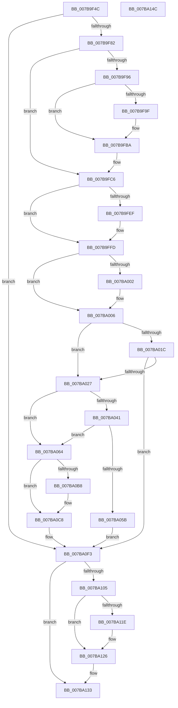

# EtwpCoverageReset

- RVA: `0x007B9F4C`–`0x007BA14D` (길이 `513` bytes)
- VA: `0x00000001407B9F4C`
- 실행 섹션: `PAGE`
- PDB 이름 있음: `예`; PDB Function 태그: `아니요`
- unwind 정보 RVA: `0x000D3ABC`
- 디코드: `125`개 명령, `513/513` bytes 표시
- 미해석 바이트: `0` (있으면 어셈블리에 `.byte`로 보존)

> 이 문서는 커널 이미지의 기계어와 PDB 기호를 분석해 생성했습니다. 4번과 5번은 함수 원형과 자료형을 바이너리 사용 방식에서 추정한 C 해석이며 원본 소스 복구 결과는 아닙니다.

## 1. Dependencies

- 직접 호출 지점: **10**; 고유 호출 대상: **10**
- 직접 호출자로 확인된 함수: **3**
- RIP 상대 이미지 참조: **10**

### Outgoing calls
- `0x007B9FAF` → [TelemetryCoverageStringHashInternal](../../text/4D/TelemetryCoverageStringHashInternal_function_004D51A0.md) (function, `0x004D51A0`)
- `0x007B9FC1` → [EtwTelemetryCoverageReport](../../text/46/EtwTelemetryCoverageReport_function_00460430.md) (function, `0x00460430`)
- `0x007B9FDF` → [KeAbPreAcquire](../../text/21/KeAbPreAcquire_function_00210230.md) (function, `0x00210230`)
- `0x007B9FF8` → [ExfAcquirePushLockExclusiveEx](../../text/20/ExfAcquirePushLockExclusiveEx_function_0020FC90.md) (function, `0x0020FC90`)
- `0x007BA06B` → [EtwpCoverageFlushPending](../AB/EtwpCoverageFlushPending_function_00AB6700.md) (function, `0x00AB6700`)
- `0x007BA082` → [memset](../../text/6C/memset_function_006C6C40.md) (function, `0x006C6C40`)
- `0x007BA08F` → [EtwpCoverageFreeStringBuffers](EtwpCoverageFreeStringBuffers_function_007B9EA0.md) (function, `0x007B9EA0`)
- `0x007BA121` → [ExfTryToWakePushLock](../../text/26/ExfTryToWakePushLock_function_00265DD0.md) (function, `0x00265DD0`)
- `0x007BA129` → [KeAbPostRelease](../../text/2E/KeAbPostRelease_function_002E1600.md) (function, `0x002E1600`)
- `0x007BA12E` → [KeLeaveCriticalRegion](../../text/25/KeLeaveCriticalRegion_function_0025D8B0.md) (function, `0x0025D8B0`)

### Direct callers
- [EtwpCoverageFlushWorkItemCallback](EtwpCoverageFlushWorkItemCallback_function_007B9D90.md) at `0x007B9DBE`
- [EtwpCoverageResetWorkItemCallback](EtwpCoverageResetWorkItemCallback_function_007BA450.md) at `0x007BA464`
- [sub_00B2A52C](../B2/Unknown_function_00B2A52C.md) at `0x00B2A56E`

### Static image references
- `0x007B9F68` → RVA `0x00EFF1B8` (`.data`; read)
- `0x007B9F8E` → RVA `0x00E0924C` (`.data`; read)
- `0x007B9F96` → RVA `0x00E09248` (`.data`; read)
- `0x007B9FA8` → RVA `0x00E09240` (`.data`; read)
- `0x007B9FB4` → RVA `0x00E09248` (`.data`; write)
- `0x007BA00F` → RVA `0x00E684E0` (`.data`; write)
- `0x007BA0B8` → RVA `0x00FC5008` (`ALMOSTRO`; read)
- `0x007BA0FC` → RVA `0x00E684E0` (`.data`; read)
- `0x007BA105` → RVA `0x00E684E0` (`.data`; read/write)
- `0x007BA10D` → RVA `0x00EFF1B8` (`.data`; read/write)

## 2. Other-region calls and transfers

- 다른 실행 섹션으로 향하는 call: **8**
  - `0x007B9FAF` → [TelemetryCoverageStringHashInternal](../../text/4D/TelemetryCoverageStringHashInternal_function_004D51A0.md) (`PAGE` → `.text`)
  - `0x007B9FC1` → [EtwTelemetryCoverageReport](../../text/46/EtwTelemetryCoverageReport_function_00460430.md) (`PAGE` → `.text`)
  - `0x007B9FDF` → [KeAbPreAcquire](../../text/21/KeAbPreAcquire_function_00210230.md) (`PAGE` → `.text`)
  - `0x007B9FF8` → [ExfAcquirePushLockExclusiveEx](../../text/20/ExfAcquirePushLockExclusiveEx_function_0020FC90.md) (`PAGE` → `.text`)
  - `0x007BA082` → [memset](../../text/6C/memset_function_006C6C40.md) (`PAGE` → `.text`)
  - `0x007BA121` → [ExfTryToWakePushLock](../../text/26/ExfTryToWakePushLock_function_00265DD0.md) (`PAGE` → `.text`)
  - `0x007BA129` → [KeAbPostRelease](../../text/2E/KeAbPostRelease_function_002E1600.md) (`PAGE` → `.text`)
  - `0x007BA12E` → [KeLeaveCriticalRegion](../../text/25/KeLeaveCriticalRegion_function_0025D8B0.md) (`PAGE` → `.text`)
- 별도 외부 분기/꼬리 이동을 확인하지 못했습니다.

## 3. Assembly (complete function range)

```asm
007B9F4C  4C 8B DC                        mov r11, rsp
007B9F4F  49 89 5B 10                     mov qword ptr [r11 + 0x10], rbx
007B9F53  49 89 6B 18                     mov qword ptr [r11 + 0x18], rbp
007B9F57  49 89 73 20                     mov qword ptr [r11 + 0x20], rsi
007B9F5B  57                              push rdi
007B9F5C  41 55                           push r13
007B9F5E  41 56                           push r14
007B9F60  48 83 EC 20                     sub rsp, 0x20
007B9F64  48 8B 41 10                     mov rax, qword ptr [rcx + 0x10]
007B9F68  4C 8D 35 49 52 74 00            lea r14, [rip + 0x745249]
007B9F6F  48 83 CB FF                     or rbx, 0xffffffffffffffff
007B9F73  8B EA                           mov ebp, edx
007B9F75  48 8B F9                        mov rdi, rcx
007B9F78  83 78 20 00                     cmp dword ptr [rax + 0x20], 0
007B9F7C  0F 84 71 01 00 00               je 0x1407ba0f3
007B9F82  48 B8 7C 03 00 00 80 F7 FF FF   movabs rax, 0xfffff7800000037c
007B9F8C  8B 00                           mov eax, dword ptr [rax]
007B9F8E  39 05 B8 F2 64 00               cmp dword ptr [rip + 0x64f2b8], eax
007B9F94  73 30                           jae 0x1407b9fc6
007B9F96  83 3D AB F2 64 00 00            cmp dword ptr [rip + 0x64f2ab], 0
007B9F9D  75 1B                           jne 0x1407b9fba
007B9F9F  83 64 24 40 00                  and dword ptr [rsp + 0x40], 0
007B9FA4  49 8D 53 08                     lea rdx, [r11 + 8]
007B9FA8  48 8B 0D 91 F2 64 00            mov rcx, qword ptr [rip + 0x64f291]
007B9FAF  E8 EC B1 D1 FF                  call 0x1404d51a0
007B9FB4  89 05 8E F2 64 00               mov dword ptr [rip + 0x64f28e], eax
007B9FBA  48 8D 0D 7F F2 64 00            lea rcx, [rip + 0x64f27f]
007B9FC1  E8 6A 64 CA FF                  call 0x140460430
007B9FC6  65 48 8B 04 25 88 01 00 00      mov rax, qword ptr gs:[0x188]
007B9FCF  45 33 C0                        xor r8d, r8d
007B9FD2  33 D2                           xor edx, edx
007B9FD4  49 8B CE                        mov rcx, r14
007B9FD7  66 01 98 E4 01 00 00            add word ptr [rax + 0x1e4], bx
007B9FDE  90                              nop
007B9FDF  E8 4C 62 A5 FF                  call 0x140210230
007B9FE4  F0 49 0F BA 2E 00               lock bts qword ptr [r14], 0
007B9FEA  48 8B F0                        mov rsi, rax
007B9FED  73 0E                           jae 0x1407b9ffd
007B9FEF  4D 8B C6                        mov r8, r14
007B9FF2  48 8B D0                        mov rdx, rax
007B9FF5  49 8B CE                        mov rcx, r14
007B9FF8  E8 93 5C A5 FF                  call 0x14020fc90
007B9FFD  48 85 F6                        test rsi, rsi
007BA000  74 04                           je 0x1407ba006
007BA002  C6 46 0A 01                     mov byte ptr [rsi + 0xa], 1
007BA006  65 48 8B 04 25 88 01 00 00      mov rax, qword ptr gs:[0x188]
007BA00F  48 89 05 CA E4 6A 00            mov qword ptr [rip + 0x6ae4ca], rax
007BA016  40 F6 C5 04                     test bpl, 4
007BA01A  74 0B                           je 0x1407ba027
007BA01C  8B 47 24                        mov eax, dword ptr [rdi + 0x24]
007BA01F  A8 01                           test al, 1
007BA021  0F 84 CC 00 00 00               je 0x1407ba0f3
007BA027  48 BE 20 03 00 00 80 F7 FF FF   movabs rsi, 0xfffff78000000320
007BA031  49 BD 04 00 00 00 80 F7 FF FF   movabs r13, 0xfffff78000000004
007BA03B  40 F6 C5 01                     test bpl, 1
007BA03F  75 23                           jne 0x1407ba064
007BA041  48 8B 06                        mov rax, qword ptr [rsi]
007BA044  41 8B 4D 00                     mov ecx, dword ptr [r13]
007BA048  48 0F AF C8                     imul rcx, rax
007BA04C  48 C1 E9 18                     shr rcx, 0x18
007BA050  2B 4F 18                        sub ecx, dword ptr [rdi + 0x18]
007BA053  81 F9 C0 27 09 00               cmp ecx, 0x927c0
007BA059  77 09                           ja 0x1407ba064
007BA05B  83 4F 24 01                     or dword ptr [rdi + 0x24], 1
007BA05F  E9 8F 00 00 00                  jmp 0x1407ba0f3
007BA064  83 67 24 FE                     and dword ptr [rdi + 0x24], 0xfffffffe
007BA068  48 8B CF                        mov rcx, rdi
007BA06B  E8 90 C6 2F 00                  call 0x140ab6700
007BA070  48 8B 4F 10                     mov rcx, qword ptr [rdi + 0x10]
007BA074  33 D2                           xor edx, edx
007BA076  44 8B 41 04                     mov r8d, dword ptr [rcx + 4]
007BA07A  48 83 C1 34                     add rcx, 0x34
007BA07E  49 C1 E0 02                     shl r8, 2
007BA082  E8 B9 CB F0 FF                  call 0x1406c6c40
007BA087  BA 01 00 00 00                  mov edx, 1
007BA08C  48 8B CF                        mov rcx, rdi
007BA08F  E8 0C FE FF FF                  call 0x1407b9ea0
007BA094  48 8B 07                        mov rax, qword ptr [rdi]
007BA097  83 60 04 00                     and dword ptr [rax + 4], 0
007BA09B  48 8B 47 10                     mov rax, qword ptr [rdi + 0x10]
007BA09F  FF 40 18                        inc dword ptr [rax + 0x18]
007BA0A2  48 8B 47 10                     mov rax, qword ptr [rdi + 0x10]
007BA0A6  48 8B 0F                        mov rcx, qword ptr [rdi]
007BA0A9  8B 40 18                        mov eax, dword ptr [rax + 0x18]
007BA0AC  89 01                           mov dword ptr [rcx], eax
007BA0AE  48 8B 4F 10                     mov rcx, qword ptr [rdi + 0x10]
007BA0B2  F6 41 02 01                     test byte ptr [rcx + 2], 1
007BA0B6  75 10                           jne 0x1407ba0c8
007BA0B8  48 8B 05 49 AF 80 00            mov rax, qword ptr [rip + 0x80af49]
007BA0BF  8B 49 18                        mov ecx, dword ptr [rcx + 0x18]
007BA0C2  89 88 7C 03 00 00               mov dword ptr [rax + 0x37c], ecx
007BA0C8  48 8B 06                        mov rax, qword ptr [rsi]
007BA0CB  41 8B 4D 00                     mov ecx, dword ptr [r13]
007BA0CF  48 0F AF C8                     imul rcx, rax
007BA0D3  48 8B 47 10                     mov rax, qword ptr [rdi + 0x10]
007BA0D7  48 C1 E9 18                     shr rcx, 0x18
007BA0DB  89 48 14                        mov dword ptr [rax + 0x14], ecx
007BA0DE  48 8B 47 10                     mov rax, qword ptr [rdi + 0x10]
007BA0E2  48 8B 0F                        mov rcx, qword ptr [rdi]
007BA0E5  8B 40 14                        mov eax, dword ptr [rax + 0x14]
007BA0E8  89 41 14                        mov dword ptr [rcx + 0x14], eax
007BA0EB  48 8B 47 10                     mov rax, qword ptr [rdi + 0x10]
007BA0EF  83 60 20 00                     and dword ptr [rax + 0x20], 0
007BA0F3  65 48 8B 04 25 88 01 00 00      mov rax, qword ptr gs:[0x188]
007BA0FC  48 39 05 DD E3 6A 00            cmp qword ptr [rip + 0x6ae3dd], rax
007BA103  75 2E                           jne 0x1407ba133
007BA105  48 83 25 D3 E3 6A 00 00         and qword ptr [rip + 0x6ae3d3], 0
007BA10D  F0 48 0F C1 1D A2 50 74 00      lock xadd qword ptr [rip + 0x7450a2], rbx
007BA116  80 E3 06                        and bl, 6
007BA119  80 FB 02                        cmp bl, 2
007BA11C  75 08                           jne 0x1407ba126
007BA11E  49 8B CE                        mov rcx, r14
007BA121  E8 AA BC AA FF                  call 0x140265dd0
007BA126  49 8B CE                        mov rcx, r14
007BA129  E8 D2 74 B2 FF                  call 0x1402e1600
007BA12E  E8 7D 37 AA FF                  call 0x14025d8b0
007BA133  48 8B 5C 24 48                  mov rbx, qword ptr [rsp + 0x48]
007BA138  48 8B 6C 24 50                  mov rbp, qword ptr [rsp + 0x50]
007BA13D  48 8B 74 24 58                  mov rsi, qword ptr [rsp + 0x58]
007BA142  48 83 C4 20                     add rsp, 0x20
007BA146  41 5E                           pop r14
007BA148  41 5D                           pop r13
007BA14A  5F                              pop rdi
007BA14B  C3                              ret
007BA14C  CC                              int3
```

## 4. C-style interpretation (structured pseudocode)

```c
__int64 __fastcall EtwpCoverageReset(__int64 a1, int a2, int a3)
{
    __int64 result;
    __int64 v_rbx;
    __int64 v_rsp;
    unsigned __int64 v_stack_p10;
    unsigned __int64 v_stack_p18;
    unsigned __int64 v_stack_p20;
    unsigned int v_stack_p8;

    *(unsigned __int64 *)(v_rsp + 16) = v_rbx;
    *(unsigned __int64 *)(v_rsp + 24) = v_rbp;
    *(unsigned __int64 *)(v_rsp + 32) = v_rsi;
    v_rsp = (v_rsp) - (32);
    v_rbx = (v_rbx) | (-1);
    if ((*(unsigned int *)(*(unsigned __int64 *)(a1 + 16) + 32)) == 0) goto loc_007BA0F3;
    if ((*(unsigned int *)(v_rip + 6615736)) >= ((unsigned int)((unsigned int)(*(unsigned int *)(*(unsigned __int64 *)(a1 + 16)))))) goto loc_007B9FC6;
    result = (unsigned int)(*(unsigned int *)(*(unsigned __int64 *)(a1 + 16)));
    if ((*(unsigned int *)(v_rip + 6615723)) == 0) {
        a2 = v_rsp + 8;
        a1 = *(unsigned __int64 *)(v_rip + 6615697);
        result = TelemetryCoverageStringHashInternal(a1, a2, a3, a4);
        *(unsigned int *)(v_rip + 6615694) = (unsigned int)(result);
    }
    result = EtwTelemetryCoverageReport(v_rip + 6615679, a2, a3, a4);
loc_007B9FC6:
    a3 = 0;
    a2 = 0;
    result = KeAbPreAcquire(v_rip + 7623241, a2, a3, a4);
    if (!(condition_is_above_or_equal)) {
        a3 = v_rip + 7623241;
        a2 = result;
        a1 = v_rip + 7623241;
        result = ExfAcquirePushLockExclusiveEx(a1, a2, a3, a4);
    }
    if (result != 0) {
        *(unsigned __int8 *)(result + 10) = 1;
    }
    *(unsigned __int64 *)(v_rip + 7005386) = *(unsigned __int64 *)(gs_base + (0 + 392));
    if ((((unsigned __int8)((unsigned int)(a2))) & (4)) == 0) goto loc_007BA027;
    if ((((unsigned __int8)((unsigned int)(*(unsigned int *)(a1 + 36)))) & (1)) == 0) goto loc_007BA0F3;
loc_007BA027:
    if ((((unsigned __int8)((unsigned int)(a2))) & (1)) != 0) goto loc_007BA064;
    a1 = ((unsigned int)(*(unsigned int *)(v_r13))) * (*(unsigned __int64 *)(result));
    a1 = (a1) >> (24);
    a1 = (unsigned int)((a1) - (*(unsigned int *)(a1 + 24)));
    if (((unsigned int)(a1)) > 0x927C0ULL) goto loc_007BA064;
    goto loc_007BA0F3;
loc_007BA064:
    result = EtwpCoverageFlushPending(a1, a2, a3, a4);
    a2 = 0;
    a1 = (*(unsigned __int64 *)(a1 + 16)) + (52);
    a3 = ((unsigned int)(*(unsigned int *)(*(unsigned __int64 *)(a1 + 16) + 4))) << (2);
    result = memset(a1, a2, a3, a4);
    result = EtwpCoverageFreeStringBuffers(a1, 1, a3, a4);
    *(unsigned int *)(*(unsigned __int64 *)(a1)) = (unsigned int)((unsigned int)(*(unsigned int *)(*(unsigned __int64 *)(a1 + 16) + 24)));
    result = (unsigned int)(*(unsigned int *)(*(unsigned __int64 *)(a1 + 16) + 24));
    if (((*(unsigned __int8 *)(*(unsigned __int64 *)(a1 + 16) + 2)) & (1)) == 0) {
        result = *(unsigned __int64 *)(v_rip + 8433481);
        a1 = *(unsigned int *)(*(unsigned __int64 *)(a1 + 16) + 24);
        *(unsigned int *)(result + 892) = (unsigned int)(a1);
    }
    a1 = ((unsigned int)(*(unsigned int *)(v_r13))) * (*(unsigned __int64 *)(result));
    a1 = (a1) >> (24);
    *(unsigned int *)(*(unsigned __int64 *)(a1 + 16) + 20) = (unsigned int)(a1);
    *(unsigned int *)(*(unsigned __int64 *)(a1) + 20) = (unsigned int)((unsigned int)(*(unsigned int *)(*(unsigned __int64 *)(a1 + 16) + 20)));
loc_007BA0F3:
    if ((*(unsigned __int64 *)(v_rip + 7005149)) != (*(unsigned __int64 *)(gs_base + (0 + 392)))) goto loc_007BA133;
    v_rbx = (unsigned __int8)((v_rbx) & (6));
    result = *(unsigned __int64 *)(gs_base + (0 + 392));
    if (((unsigned __int8)(v_rbx)) == 2) {
        a1 = v_rip + 7623241;
        result = ExfTryToWakePushLock(a1, 1, a3, a4);
    }
    result = KeAbPostRelease(v_rip + 7623241, 1, a3, a4);
    result = KeLeaveCriticalRegion(v_rip + 7623241, 1, a3, a4);
loc_007BA133:
    v_rsp = (v_rsp) + (32);
    return result;
}
```

## 5. (Beta) C Style

```c
int64_t EtwpCoverageReset(void *Arg1, int32_t Arg2, int32_t Arg3)
{
    uint8_t *arg1 = (uint8_t *)Arg1;

    int64_t result;
    int64_t local_rbx;
    int64_t local_rsp;
    uint64_t v_stack_p10;
    uint64_t v_stack_p18;
    uint64_t v_stack_p20;
    uint32_t v_stack_p8;

    *(uint64_t *)(local_rsp + 0x10) = local_rbx;
    *(uint64_t *)(local_rsp + 0x18) = local_rbp;
    *(uint64_t *)(local_rsp + 0x20) = local_rsi;
    local_rsp = (local_rsp) - (32);
    local_rbx = (local_rbx) | (-1);
    if ((*(uint32_t *)(*(uint64_t *)(arg1 + 0x10) + 0x20)) == 0) goto loc_007BA0F3;
    if ((*(uint32_t *)(v_rip + 0x64F2B8)) >= ((uint32_t)((uint32_t)(*(uint32_t *)(*(uint64_t *)(arg1 + 0x10)))))) goto loc_007B9FC6;
    result = (uint32_t)(*(uint32_t *)(*(uint64_t *)(arg1 + 0x10)));
    if ((*(uint32_t *)(v_rip + 0x64F2AB)) == 0) {
        Arg2 = local_rsp + 8;
        Arg1 = *(uint64_t *)(v_rip + 0x64F291);
        result = TelemetryCoverageStringHashInternal(Arg1, Arg2, Arg3, a4);
        *(uint32_t *)(v_rip + 0x64F28E) = (uint32_t)(result);
    }
    result = EtwTelemetryCoverageReport(v_rip + 6615679, Arg2, Arg3, a4);
loc_007B9FC6:
    Arg3 = 0;
    Arg2 = 0;
    result = KeAbPreAcquire(v_rip + 7623241, Arg2, Arg3, a4);
    if (!(condition_is_above_or_equal)) {
        Arg3 = v_rip + 7623241;
        Arg2 = result;
        Arg1 = v_rip + 7623241;
        result = ExfAcquirePushLockExclusiveEx(Arg1, Arg2, Arg3, a4);
    }
    if (result != 0) {
        *(uint8_t *)(result + 0xA) = 1;
    }
    *(uint64_t *)(v_rip + 0x6AE4CA) = *(uint64_t *)(gs_base + (0 + 0x188));
    if ((((uint8_t)((uint32_t)(Arg2))) & (4)) == 0) goto loc_007BA027;
    if ((((uint8_t)((uint32_t)(*(uint32_t *)(arg1 + 0x24)))) & (1)) == 0) goto loc_007BA0F3;
loc_007BA027:
    if ((((uint8_t)((uint32_t)(Arg2))) & (1)) != 0) goto loc_007BA064;
    Arg1 = ((uint32_t)(*(uint32_t *)(local_r13))) * (*(uint64_t *)(result));
    Arg1 = (Arg1) >> (24);
    Arg1 = (uint32_t)((Arg1) - (*(uint32_t *)(arg1 + 0x18)));
    if (((uint32_t)(Arg1)) > 0x927C0ULL) goto loc_007BA064;
    goto loc_007BA0F3;
loc_007BA064:
    result = EtwpCoverageFlushPending(Arg1, Arg2, Arg3, a4);
    Arg2 = 0;
    Arg1 = (*(uint64_t *)(arg1 + 0x10)) + (52);
    Arg3 = ((uint32_t)(*(uint32_t *)(*(uint64_t *)(arg1 + 0x10) + 0x4))) << (2);
    result = memset(Arg1, Arg2, Arg3, a4);
    result = EtwpCoverageFreeStringBuffers(Arg1, 1, Arg3, a4);
    *(uint32_t *)(*(uint64_t *)(arg1)) = (uint32_t)((uint32_t)(*(uint32_t *)(*(uint64_t *)(arg1 + 0x10) + 0x18)));
    result = (uint32_t)(*(uint32_t *)(*(uint64_t *)(arg1 + 0x10) + 0x18));
    if (((*(uint8_t *)(*(uint64_t *)(arg1 + 0x10) + 0x2)) & (1)) == 0) {
        result = *(uint64_t *)(v_rip + 0x80AF49);
        Arg1 = *(uint32_t *)(*(uint64_t *)(arg1 + 0x10) + 0x18);
        *(uint32_t *)(result + 0x37C) = (uint32_t)(Arg1);
    }
    Arg1 = ((uint32_t)(*(uint32_t *)(local_r13))) * (*(uint64_t *)(result));
    Arg1 = (Arg1) >> (24);
    *(uint32_t *)(*(uint64_t *)(arg1 + 0x10) + 0x14) = (uint32_t)(Arg1);
    *(uint32_t *)(*(uint64_t *)(arg1) + 0x14) = (uint32_t)((uint32_t)(*(uint32_t *)(*(uint64_t *)(arg1 + 0x10) + 0x14)));
loc_007BA0F3:
    if ((*(uint64_t *)(v_rip + 0x6AE3DD)) != (*(uint64_t *)(gs_base + (0 + 0x188)))) goto loc_007BA133;
    local_rbx = (uint8_t)((local_rbx) & (6));
    result = *(uint64_t *)(gs_base + (0 + 0x188));
    if (((uint8_t)(local_rbx)) == 2) {
        Arg1 = v_rip + 7623241;
        result = ExfTryToWakePushLock(Arg1, 1, Arg3, a4);
    }
    result = KeAbPostRelease(v_rip + 7623241, 1, Arg3, a4);
    result = KeLeaveCriticalRegion(v_rip + 7623241, 1, Arg3, a4);
loc_007BA133:
    local_rsp = (local_rsp) + (32);
    return result;
}
```

### 관측된 메모리 오프셋

구조체 형식이 확인되지 않은 접근은 인자 기준의 오프셋으로만 기록했습니다.

| 기준 인자 | 오프셋 표현 | 폭 (bit) | 접근 |
|---|---:|---:|---|
| `Arg1` | `+ 0x0` | `64` | `R` |
| `Arg1` | `+ 0x10` | `64` | `R` |
| `Arg1` | `+ 0x18` | `32` | `R` |
| `Arg1` | `+ 0x24` | `32` | `R` |
| `Arg1` | `+ 0x24` | `32` | `R/W` |

## 6. Execution-region graph

[열기: 2D/3D 그래프와 함수 탐색 컨트롤 패널](../../../control-panel.html?section=page&rva=0x007B9F4C&view=graph)

- 2D 그래프는 위에서 아래로 흐르고, 3D 그래프는 빈 공간을 드래그해 회전합니다. Shift+드래그는 이동, 휠은 확대·축소, 함수 노드 선택은 대상 보고서 이동입니다.

### Static fallback


