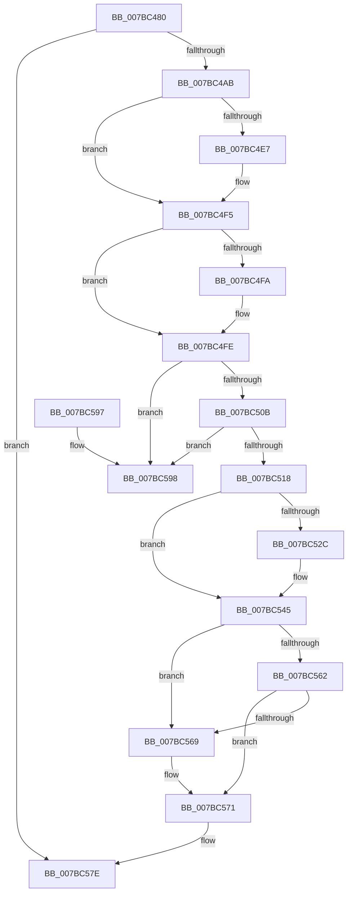

# EtwpDeleteSessionDemuxObject

- RVA: `0x007BC480`–`0x007BC59F` (길이 `287` bytes)
- VA: `0x00000001407BC480`
- 실행 섹션: `PAGE`
- PDB 이름 있음: `예`; PDB Function 태그: `아니요`
- unwind 정보 RVA: `0x00075210`
- 디코드: `77`개 명령, `287/287` bytes 표시
- 미해석 바이트: `0` (있으면 어셈블리에 `.byte`로 보존)

> 이 문서는 커널 이미지의 기계어와 PDB 기호를 분석해 생성했습니다. 4번과 5번은 함수 원형과 자료형을 바이너리 사용 방식에서 추정한 C 해석이며 원본 소스 복구 결과는 아닙니다.

## 1. Dependencies

- 직접 호출 지점: **8**; 고유 호출 대상: **8**
- 직접 호출자로 확인된 함수: **0**
- RIP 상대 이미지 참조: **0**

### Outgoing calls
- `0x007BC4AB` → [PsGetCurrentServerSiloGlobals](../../text/2F/PsGetCurrentServerSiloGlobals_function_002FE1F0.md) (function, `0x002FE1F0`)
- `0x007BC4D7` → [KeAbPreAcquire](../../text/21/KeAbPreAcquire_function_00210230.md) (function, `0x00210230`)
- `0x007BC4F0` → [ExfAcquirePushLockExclusiveEx](../../text/20/ExfAcquirePushLockExclusiveEx_function_0020FC90.md) (function, `0x0020FC90`)
- `0x007BC536` → [RtlRbRemoveNode](../../text/2E/RtlRbRemoveNode_function_002E4C10.md) (function, `0x002E4C10`)
- `0x007BC540` → [ExFreePoolWithTag](../../poolcode/B8/ExFreePoolWithTag_function_00B82870.md) (function, `0x00B82870`)
- `0x007BC56C` → [ExfReleasePushLock](../../text/26/ExfReleasePushLock_function_002638D0.md) (function, `0x002638D0`)
- `0x007BC574` → [KeAbPostRelease](../../text/2E/KeAbPostRelease_function_002E1600.md) (function, `0x002E1600`)
- `0x007BC579` → [KeLeaveCriticalRegion](../../text/25/KeLeaveCriticalRegion_function_0025D8B0.md) (function, `0x0025D8B0`)

### Direct callers
- 이 함수 시작 RVA로 연결되는 직접 call은 확인되지 않았습니다. 간접 호출은 완전히 역산할 수 없습니다.

### Static image references
- 디코드된 RIP-relative 메모리 참조가 없습니다.

## 2. Other-region calls and transfers

- 다른 실행 섹션으로 향하는 call: **8**
  - `0x007BC4AB` → [PsGetCurrentServerSiloGlobals](../../text/2F/PsGetCurrentServerSiloGlobals_function_002FE1F0.md) (`PAGE` → `.text`)
  - `0x007BC4D7` → [KeAbPreAcquire](../../text/21/KeAbPreAcquire_function_00210230.md) (`PAGE` → `.text`)
  - `0x007BC4F0` → [ExfAcquirePushLockExclusiveEx](../../text/20/ExfAcquirePushLockExclusiveEx_function_0020FC90.md) (`PAGE` → `.text`)
  - `0x007BC536` → [RtlRbRemoveNode](../../text/2E/RtlRbRemoveNode_function_002E4C10.md) (`PAGE` → `.text`)
  - `0x007BC540` → [ExFreePoolWithTag](../../poolcode/B8/ExFreePoolWithTag_function_00B82870.md) (`PAGE` → `POOLCODE`)
  - `0x007BC56C` → [ExfReleasePushLock](../../text/26/ExfReleasePushLock_function_002638D0.md) (`PAGE` → `.text`)
  - `0x007BC574` → [KeAbPostRelease](../../text/2E/KeAbPostRelease_function_002E1600.md) (`PAGE` → `.text`)
  - `0x007BC579` → [KeLeaveCriticalRegion](../../text/25/KeLeaveCriticalRegion_function_0025D8B0.md) (`PAGE` → `.text`)
- 별도 외부 분기/꼬리 이동을 확인하지 못했습니다.

## 3. Assembly (complete function range)

```asm
007BC480  48 89 5C 24 08                  mov qword ptr [rsp + 8], rbx
007BC485  48 89 6C 24 10                  mov qword ptr [rsp + 0x10], rbp
007BC48A  48 89 74 24 18                  mov qword ptr [rsp + 0x18], rsi
007BC48F  57                              push rdi
007BC490  41 56                           push r14
007BC492  41 57                           push r15
007BC494  48 83 EC 20                     sub rsp, 0x20
007BC498  48 8B 71 18                     mov rsi, qword ptr [rcx + 0x18]
007BC49C  45 33 FF                        xor r15d, r15d
007BC49F  48 8B F9                        mov rdi, rcx
007BC4A2  48 85 F6                        test rsi, rsi
007BC4A5  0F 84 D3 00 00 00               je 0x1407bc57e
007BC4AB  E8 40 1D B4 FF                  call 0x1402fe1f0
007BC4B0  45 33 C0                        xor r8d, r8d
007BC4B3  33 D2                           xor edx, edx
007BC4B5  4C 8B B0 40 03 00 00            mov r14, qword ptr [rax + 0x340]
007BC4BC  65 48 8B 04 25 88 01 00 00      mov rax, qword ptr gs:[0x188]
007BC4C5  49 8D 9E 10 11 00 00            lea rbx, [r14 + 0x1110]
007BC4CC  66 FF 88 E4 01 00 00            dec word ptr [rax + 0x1e4]
007BC4D3  48 8B CB                        mov rcx, rbx
007BC4D6  90                              nop
007BC4D7  E8 54 3D A5 FF                  call 0x140210230
007BC4DC  F0 48 0F BA 2B 00               lock bts qword ptr [rbx], 0
007BC4E2  48 8B E8                        mov rbp, rax
007BC4E5  73 0E                           jae 0x1407bc4f5
007BC4E7  4C 8B C3                        mov r8, rbx
007BC4EA  48 8B D0                        mov rdx, rax
007BC4ED  48 8B CB                        mov rcx, rbx
007BC4F0  E8 9B 37 A5 FF                  call 0x14020fc90
007BC4F5  48 85 ED                        test rbp, rbp
007BC4F8  74 04                           je 0x1407bc4fe
007BC4FA  C6 45 0A 01                     mov byte ptr [rbp + 0xa], 1
007BC4FE  48 8B 0F                        mov rcx, qword ptr [rdi]
007BC501  48 39 79 08                     cmp qword ptr [rcx + 8], rdi
007BC505  0F 85 8D 00 00 00               jne 0x1407bc598
007BC50B  48 8B 47 08                     mov rax, qword ptr [rdi + 8]
007BC50F  48 39 38                        cmp qword ptr [rax], rdi
007BC512  0F 85 80 00 00 00               jne 0x1407bc598
007BC518  48 89 08                        mov qword ptr [rax], rcx
007BC51B  48 89 41 08                     mov qword ptr [rcx + 8], rax
007BC51F  48 8D 46 20                     lea rax, [rsi + 0x20]
007BC523  4C 89 7F 18                     mov qword ptr [rdi + 0x18], r15
007BC527  48 39 00                        cmp qword ptr [rax], rax
007BC52A  75 19                           jne 0x1407bc545
007BC52C  49 8D 8E 00 11 00 00            lea rcx, [r14 + 0x1100]
007BC533  48 8B D6                        mov rdx, rsi
007BC536  E8 D5 86 B2 FF                  call 0x1402e4c10
007BC53B  33 D2                           xor edx, edx
007BC53D  48 8B CE                        mov rcx, rsi
007BC540  E8 2B 63 3C 00                  call 0x140b82870
007BC545  0F 0D 0B                        prefetchw byte ptr [rbx]
007BC548  48 8B 03                        mov rax, qword ptr [rbx]
007BC54B  48 8B C8                        mov rcx, rax
007BC54E  48 83 E1 F0                     and rcx, 0xfffffffffffffff0
007BC552  48 83 F9 10                     cmp rcx, 0x10
007BC556  48 8D 50 F0                     lea rdx, [rax - 0x10]
007BC55A  49 0F 46 D7                     cmovbe rdx, r15
007BC55E  A8 02                           test al, 2
007BC560  75 07                           jne 0x1407bc569
007BC562  F0 48 0F B1 13                  lock cmpxchg qword ptr [rbx], rdx
007BC567  74 08                           je 0x1407bc571
007BC569  48 8B CB                        mov rcx, rbx
007BC56C  E8 5F 73 AA FF                  call 0x1402638d0
007BC571  48 8B CB                        mov rcx, rbx
007BC574  E8 87 50 B2 FF                  call 0x1402e1600
007BC579  E8 32 13 AA FF                  call 0x14025d8b0
007BC57E  48 8B 5C 24 40                  mov rbx, qword ptr [rsp + 0x40]
007BC583  48 8B 6C 24 48                  mov rbp, qword ptr [rsp + 0x48]
007BC588  48 8B 74 24 50                  mov rsi, qword ptr [rsp + 0x50]
007BC58D  48 83 C4 20                     add rsp, 0x20
007BC591  41 5F                           pop r15
007BC593  41 5E                           pop r14
007BC595  5F                              pop rdi
007BC596  C3                              ret
007BC597  CC                              int3
007BC598  B9 03 00 00 00                  mov ecx, 3
007BC59D  CD 29                           int 0x29
```

## 4. C-style interpretation (structured pseudocode)

```c
__int64 __fastcall EtwpDeleteSessionDemuxObject(__int64 a1, int a2, int a3)
{
    __int64 result;
    __int64 v_r15;
    __int64 v_rsp;
    unsigned __int64 v_stack_p10;
    unsigned __int64 v_stack_p18;
    unsigned __int64 v_stack_p8;

    v_stack_p8 = v_rbx;
    v_stack_p10 = v_rbp;
    v_stack_p18 = v_rsi;
    v_rsp = (v_rsp) - (32);
    v_r15 = 0;
    if (*(unsigned __int64 *)(a1 + 24) == 0) goto loc_007BC57E;
    result = PsGetCurrentServerSiloGlobals(a1, a2, a3, a4);
    a3 = 0;
    a2 = 0;
    result = KeAbPreAcquire(*(unsigned __int64 *)(result + 832) + 4368, a2, a3, a4);
    if (!(condition_is_above_or_equal)) {
        a3 = *(unsigned __int64 *)(result + 832) + 4368;
        a2 = result;
        a1 = *(unsigned __int64 *)(result + 832) + 4368;
        result = ExfAcquirePushLockExclusiveEx(a1, a2, a3, a4);
    }
    if (result != 0) {
        *(unsigned __int8 *)(result + 10) = 1;
    }
    if ((*(unsigned __int64 *)(*(unsigned __int64 *)(a1) + 8)) != a1) goto loc_007BC598;
    if ((*(unsigned __int64 *)(*(unsigned __int64 *)(a1 + 8))) != a1) goto loc_007BC598;
    *(unsigned __int64 *)(*(unsigned __int64 *)(a1 + 8)) = *(unsigned __int64 *)(a1);
    *(unsigned __int64 *)(*(unsigned __int64 *)(a1) + 8) = *(unsigned __int64 *)(a1 + 8);
    *(unsigned __int64 *)(a1 + 24) = 0;
    result = *(unsigned __int64 *)(a1 + 24) + 32;
    if ((*(unsigned __int64 *)(*(unsigned __int64 *)(a1 + 24) + 32)) == (*(unsigned __int64 *)(a1 + 24) + 32)) {
        a1 = *(unsigned __int64 *)(result + 832) + 4352;
        a2 = *(unsigned __int64 *)(a1 + 24);
        result = RtlRbRemoveNode(a1, a2, a3, a4);
        a2 = 0;
        a1 = *(unsigned __int64 *)(a1 + 24);
        result = ExFreePoolWithTag(a1, a2, a3, a4);
    }
    a1 = (*(unsigned __int64 *)(*(unsigned __int64 *)(result + 832) + 4368)) & (-16);
    a2 = *(unsigned __int64 *)(*(unsigned __int64 *)(result + 832) + 4368) - 16;
    if (a1 <= 16) { a2 = 0; }
    if ((((unsigned __int8)(*(unsigned __int64 *)(*(unsigned __int64 *)(result + 832) + 4368))) & (2)) != 0) goto loc_007BC569;
    result = *(unsigned __int64 *)(*(unsigned __int64 *)(result + 832) + 4368);
    if ((((unsigned __int8)(*(unsigned __int64 *)(*(unsigned __int64 *)(result + 832) + 4368))) & (2)) != 0) {
        a1 = *(unsigned __int64 *)(result + 832) + 4368;
        result = ExfReleasePushLock(a1, a2, a3, a4);
    }
    result = KeAbPostRelease(*(unsigned __int64 *)(result + 832) + 4368, a2, a3, a4);
    result = KeLeaveCriticalRegion(*(unsigned __int64 *)(result + 832) + 4368, a2, a3, a4);
loc_007BC57E:
    v_rsp = (v_rsp) + (32);
    return result;
loc_007BC598:
    return result;
}
```

## 5. (Beta) C Style

```c
int64_t EtwpDeleteSessionDemuxObject(void *Arg1, int32_t Arg2, int32_t Arg3)
{
    uint8_t *arg1 = (uint8_t *)Arg1;

    int64_t result;
    int64_t local_r15;
    int64_t local_rsp;
    uint64_t v_stack_p10;
    uint64_t v_stack_p18;
    uint64_t v_stack_p8;

    v_stack_p8 = local_rbx;
    v_stack_p10 = local_rbp;
    v_stack_p18 = local_rsi;
    local_rsp = (local_rsp) - (32);
    local_r15 = 0;
    if (*(uint64_t *)(arg1 + 0x18) == 0) goto loc_007BC57E;
    result = PsGetCurrentServerSiloGlobals(Arg1, Arg2, Arg3, a4);
    Arg3 = 0;
    Arg2 = 0;
    result = KeAbPreAcquire(*(uint64_t *)(result + 0x340) + 4368, Arg2, Arg3, a4);
    if (!(condition_is_above_or_equal)) {
        Arg3 = *(uint64_t *)(result + 0x340) + 4368;
        Arg2 = result;
        Arg1 = *(uint64_t *)(result + 0x340) + 4368;
        result = ExfAcquirePushLockExclusiveEx(Arg1, Arg2, Arg3, a4);
    }
    if (result != 0) {
        *(uint8_t *)(result + 0xA) = 1;
    }
    if ((*(uint64_t *)(*(uint64_t *)(arg1) + 0x8)) != Arg1) goto loc_007BC598;
    if ((*(uint64_t *)(*(uint64_t *)(arg1 + 0x8))) != Arg1) goto loc_007BC598;
    *(uint64_t *)(*(uint64_t *)(arg1 + 0x8)) = *(uint64_t *)(arg1);
    *(uint64_t *)(*(uint64_t *)(arg1) + 0x8) = *(uint64_t *)(arg1 + 0x8);
    *(uint64_t *)(arg1 + 0x18) = 0;
    result = *(uint64_t *)(arg1 + 0x18) + 32;
    if ((*(uint64_t *)(*(uint64_t *)(arg1 + 0x18) + 0x20)) == (*(uint64_t *)(arg1 + 0x18) + 32)) {
        Arg1 = *(uint64_t *)(result + 0x340) + 4352;
        Arg2 = *(uint64_t *)(arg1 + 0x18);
        result = RtlRbRemoveNode(Arg1, Arg2, Arg3, a4);
        Arg2 = 0;
        Arg1 = *(uint64_t *)(arg1 + 0x18);
        result = ExFreePoolWithTag(Arg1, Arg2, Arg3, a4);
    }
    Arg1 = (*(uint64_t *)(*(uint64_t *)(result + 0x340) + 0x1110)) & (-16);
    Arg2 = *(uint64_t *)(*(uint64_t *)(result + 0x340) + 0x1110) - 16;
    if (Arg1 <= 16) { Arg2 = 0; }
    if ((((uint8_t)(*(uint64_t *)(*(uint64_t *)(result + 0x340) + 0x1110))) & (2)) != 0) goto loc_007BC569;
    result = *(uint64_t *)(*(uint64_t *)(result + 0x340) + 0x1110);
    if ((((uint8_t)(*(uint64_t *)(*(uint64_t *)(result + 0x340) + 0x1110))) & (2)) != 0) {
        Arg1 = *(uint64_t *)(result + 0x340) + 4368;
        result = ExfReleasePushLock(Arg1, Arg2, Arg3, a4);
    }
    result = KeAbPostRelease(*(uint64_t *)(result + 0x340) + 4368, Arg2, Arg3, a4);
    result = KeLeaveCriticalRegion(*(uint64_t *)(result + 0x340) + 4368, Arg2, Arg3, a4);
loc_007BC57E:
    local_rsp = (local_rsp) + (32);
    return result;
loc_007BC598:
    return result;
}
```

### 관측된 메모리 오프셋

구조체 형식이 확인되지 않은 접근은 인자 기준의 오프셋으로만 기록했습니다.

| 기준 인자 | 오프셋 표현 | 폭 (bit) | 접근 |
|---|---:|---:|---|
| `Arg1` | `+ 0x0` | `64` | `R` |
| `Arg1` | `+ 0x8` | `64` | `R` |
| `Arg1` | `+ 0x18` | `64` | `R` |
| `Arg1` | `+ 0x18` | `64` | `W` |

## 6. Execution-region graph

[열기: 2D/3D 그래프와 함수 탐색 컨트롤 패널](../../../control-panel.html?section=page&rva=0x007BC480&view=graph)

- 2D 그래프는 위에서 아래로 흐르고, 3D 그래프는 빈 공간을 드래그해 회전합니다. Shift+드래그는 이동, 휠은 확대·축소, 함수 노드 선택은 대상 보고서 이동입니다.

### Static fallback


