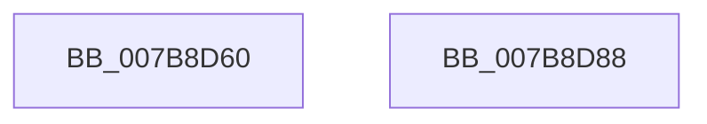

# EtwpDisablePerProcessTracing

- RVA: `0x007B8D60`–`0x007B8D89` (길이 `41` bytes)
- VA: `0x00000001407B8D60`
- 실행 섹션: `PAGE`
- PDB 이름 있음: `예`; PDB Function 태그: `아니요`
- unwind 정보 RVA: `0x000C4794`
- 디코드: `11`개 명령, `41/41` bytes 표시
- 미해석 바이트: `0` (있으면 어셈블리에 `.byte`로 보존)

> 이 문서는 커널 이미지의 기계어와 PDB 기호를 분석해 생성했습니다. 4번과 5번은 함수 원형과 자료형을 바이너리 사용 방식에서 추정한 C 해석이며 원본 소스 복구 결과는 아닙니다.

## 1. Dependencies

- 직접 호출 지점: **1**; 고유 호출 대상: **1**
- 직접 호출자로 확인된 함수: **2**
- RIP 상대 이미지 참조: **1**

### Outgoing calls
- `0x007B8D7E` → [PsEnumProcesses](../91/PsEnumProcesses_function_0091BE84.md) (function, `0x0091BE84`)

### Direct callers
- [EtwpEnableDisableUMGL](../9E/EtwpEnableDisableUMGL_function_009E3C88.md) at `0x009E3DC9`
- [EtwpDisableTraceProviders](../A2/EtwpDisableTraceProviders_function_00A22680.md) at `0x00A2278D`

### Static image references
- `0x007B8D73` → RVA `0x007B8F40` (`EtwpUpdateProcessTracingCallback`; read)

## 2. Other-region calls and transfers

- 다른 실행 섹션으로 향하는 call: **0**
- 별도 외부 분기/꼬리 이동을 확인하지 못했습니다.

## 3. Assembly (complete function range)

```asm
007B8D60  48 8B C4                        mov rax, rsp
007B8D63  48 83 EC 28                     sub rsp, 0x28
007B8D67  48 83 60 10 00                  and qword ptr [rax + 0x10], 0
007B8D6C  48 8D 50 10                     lea rdx, [rax + 0x10]
007B8D70  89 48 10                        mov dword ptr [rax + 0x10], ecx
007B8D73  48 8D 0D C6 01 00 00            lea rcx, [rip + 0x1c6]
007B8D7A  C6 40 14 00                     mov byte ptr [rax + 0x14], 0
007B8D7E  E8 01 31 16 00                  call 0x14091be84
007B8D83  48 83 C4 28                     add rsp, 0x28
007B8D87  C3                              ret
007B8D88  CC                              int3
```

## 4. C-style interpretation (structured pseudocode)

```c
__int64 __fastcall EtwpDisablePerProcessTracing(int a1)
{
    __int64 result;
    __int64 v_rsp;

    v_rsp = (v_rsp) - (40);
    *(unsigned int *)(v_rsp + 16) = a1;
    *(unsigned __int8 *)(v_rsp + 20) = 0;
    result = PsEnumProcesses(v_rip + 454, v_rsp + 16, a3, a4);
    v_rsp = (v_rsp) + (40);
    return result;
}
```

## 5. (Beta) C Style

```c
int64_t EtwpDisablePerProcessTracing(int32_t Arg1)
{
    int64_t result;
    int64_t local_rsp;

    local_rsp = (local_rsp) - (40);
    *(uint32_t *)(local_rsp + 0x10) = Arg1;
    *(uint8_t *)(local_rsp + 0x14) = 0;
    result = PsEnumProcesses(v_rip + 454, local_rsp + 16, a3, a4);
    local_rsp = (local_rsp) + (40);
    return result;
}
```

## 6. Execution-region graph

[열기: 2D/3D 그래프와 함수 탐색 컨트롤 패널](../../../control-panel.html?section=page&rva=0x007B8D60&view=graph)

- 2D 그래프는 위에서 아래로 흐르고, 3D 그래프는 빈 공간을 드래그해 회전합니다. Shift+드래그는 이동, 휠은 확대·축소, 함수 노드 선택은 대상 보고서 이동입니다.

### Static fallback


