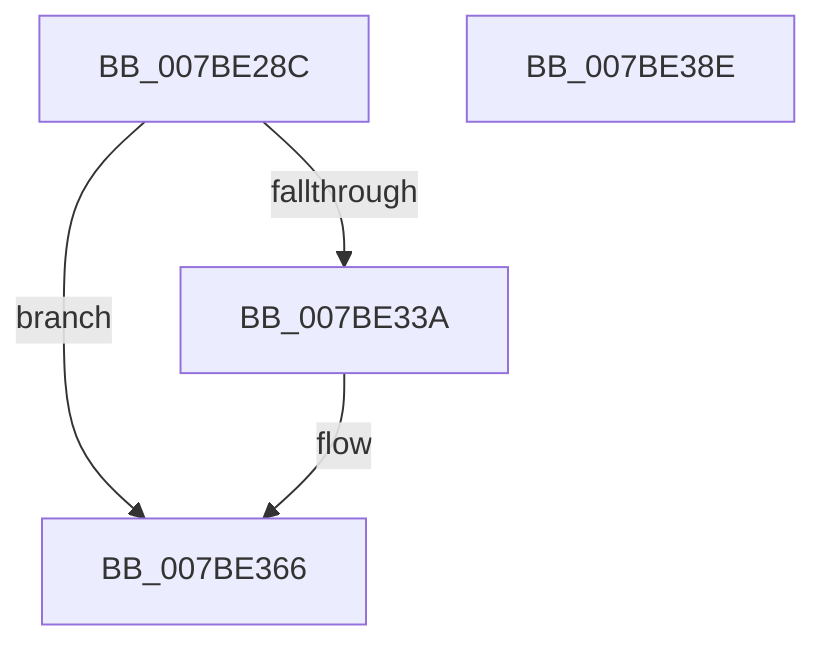

# EtwpEnableKeyProviders

- RVA: `0x007BE28C`–`0x007BE38F` (길이 `259` bytes)
- VA: `0x00000001407BE28C`
- 실행 섹션: `PAGE`
- PDB 이름 있음: `예`; PDB Function 태그: `아니요`
- unwind 정보 RVA: `0x000D3C50`
- 디코드: `63`개 명령, `259/259` bytes 표시
- 미해석 바이트: `0` (있으면 어셈블리에 `.byte`로 보존)

> 이 문서는 커널 이미지의 기계어와 PDB 기호를 분석해 생성했습니다. 4번과 5번은 함수 원형과 자료형을 바이너리 사용 방식에서 추정한 C 해석이며 원본 소스 복구 결과는 아닙니다.

## 1. Dependencies

- 직접 호출 지점: **7**; 고유 호출 대상: **5**
- 직접 호출자로 확인된 함수: **2**
- RIP 상대 이미지 참조: **4**

### Outgoing calls
- `0x007BE2C2` → [memset](../../text/6C/memset_function_006C6C40.md) (function, `0x006C6C40`)
- `0x007BE2D7` → [memset](../../text/6C/memset_function_006C6C40.md) (function, `0x006C6C40`)
- `0x007BE2FC` → [RtlInitializeGenericTableAvl](../../text/46/RtlInitializeGenericTableAvl_function_00466100.md) (function, `0x00466100`)
- `0x007BE330` → [EtwpEnumerateKeyProviders](../AB/EtwpEnumerateKeyProviders_function_00AB029C.md) (function, `0x00AB029C`)
- `0x007BE361` → [EtwpEnumerateKeyProviders](../AB/EtwpEnumerateKeyProviders_function_00AB029C.md) (function, `0x00AB029C`)
- `0x007BE36B` → [EtwpFreeKeyNameList](EtwpFreeKeyNameList_function_007BE660.md) (function, `0x007BE660`)
- `0x007BE37B` → [_security_check_cookie](../../text/6A/_security_check_cookie_function_006AC640.md) (function, `0x006AC640`)

### Direct callers
- [EtwStartAutoLogger](EtwStartAutoLogger_function_007BD2F8.md) at `0x007BE19D`
- [EtwpEnableBootLoggerRegistryProviders](../../init/C4/EtwpEnableBootLoggerRegistryProviders_function_00C4EF8C.md) at `0x00C4F054`

### Static image references
- `0x007BE29A` → RVA `0x00E0A740` (`.data`; read)
- `0x007BE2E2` → RVA `0x00652940` (`EtwpFreeKeyNameEntry`; read)
- `0x007BE2E9` → RVA `0x006527B0` (`EtwpAllocateKeyNameEntry`; read)
- `0x007BE2F0` → RVA `0x004B55C0` (`EtwpAvlCompareKeyNames`; read)

## 2. Other-region calls and transfers

- 다른 실행 섹션으로 향하는 call: **4**
  - `0x007BE2C2` → [memset](../../text/6C/memset_function_006C6C40.md) (`PAGE` → `.text`)
  - `0x007BE2D7` → [memset](../../text/6C/memset_function_006C6C40.md) (`PAGE` → `.text`)
  - `0x007BE2FC` → [RtlInitializeGenericTableAvl](../../text/46/RtlInitializeGenericTableAvl_function_00466100.md) (`PAGE` → `.text`)
  - `0x007BE37B` → [_security_check_cookie](../../text/6A/_security_check_cookie_function_006AC640.md) (`PAGE` → `.text`)
- 별도 외부 분기/꼬리 이동을 확인하지 못했습니다.

## 3. Assembly (complete function range)

```asm
007BE28C  40 53                           push rbx
007BE28E  55                              push rbp
007BE28F  56                              push rsi
007BE290  57                              push rdi
007BE291  41 56                           push r14
007BE293  48 81 EC E0 01 00 00            sub rsp, 0x1e0
007BE29A  48 8B 05 9F C4 64 00            mov rax, qword ptr [rip + 0x64c49f]
007BE2A1  48 33 C4                        xor rax, rsp
007BE2A4  48 89 84 24 D0 01 00 00         mov qword ptr [rsp + 0x1d0], rax
007BE2AC  8B EA                           mov ebp, edx
007BE2AE  49 8B D8                        mov rbx, r8
007BE2B1  33 D2                           xor edx, edx
007BE2B3  48 8B F1                        mov rsi, rcx
007BE2B6  48 8D 4C 24 40                  lea rcx, [rsp + 0x40]
007BE2BB  49 8B F9                        mov rdi, r9
007BE2BE  44 8D 42 68                     lea r8d, [rdx + 0x68]
007BE2C2  E8 79 89 F0 FF                  call 0x1406c6c40
007BE2C7  33 D2                           xor edx, edx
007BE2C9  48 8D 8C 24 B0 00 00 00         lea rcx, [rsp + 0xb0]
007BE2D1  41 B8 20 01 00 00               mov r8d, 0x120
007BE2D7  E8 64 89 F0 FF                  call 0x1406c6c40
007BE2DC  48 83 64 24 20 00               and qword ptr [rsp + 0x20], 0
007BE2E2  4C 8D 0D 57 46 E9 FF            lea r9, [rip - 0x16b9a9]
007BE2E9  4C 8D 05 C0 44 E9 FF            lea r8, [rip - 0x16bb40]
007BE2F0  48 8D 15 C9 72 CF FF            lea rdx, [rip - 0x308d37]
007BE2F7  48 8D 4C 24 40                  lea rcx, [rsp + 0x40]
007BE2FC  E8 FF 7D CA FF                  call 0x140466100
007BE301  44 8B B4 24 30 02 00 00         mov r14d, dword ptr [rsp + 0x230]
007BE309  48 8D 44 24 40                  lea rax, [rsp + 0x40]
007BE30E  44 89 74 24 38                  mov dword ptr [rsp + 0x38], r14d
007BE313  4C 8B CF                        mov r9, rdi
007BE316  48 89 44 24 30                  mov qword ptr [rsp + 0x30], rax
007BE31B  4C 8B C3                        mov r8, rbx
007BE31E  48 8D 84 24 B0 00 00 00         lea rax, [rsp + 0xb0]
007BE326  8B D5                           mov edx, ebp
007BE328  48 8B CE                        mov rcx, rsi
007BE32B  48 89 44 24 20                  mov qword ptr [rsp + 0x20], rax
007BE330  E8 67 1F 2F 00                  call 0x140ab029c
007BE335  48 85 FF                        test rdi, rdi
007BE338  74 2C                           je 0x1407be366
007BE33A  48 8D 44 24 40                  lea rax, [rsp + 0x40]
007BE33F  44 89 74 24 38                  mov dword ptr [rsp + 0x38], r14d
007BE344  48 89 44 24 30                  mov qword ptr [rsp + 0x30], rax
007BE349  45 33 C9                        xor r9d, r9d
007BE34C  48 8D 84 24 B0 00 00 00         lea rax, [rsp + 0xb0]
007BE354  4C 8B C7                        mov r8, rdi
007BE357  8B D5                           mov edx, ebp
007BE359  48 89 44 24 20                  mov qword ptr [rsp + 0x20], rax
007BE35E  48 8B CE                        mov rcx, rsi
007BE361  E8 36 1F 2F 00                  call 0x140ab029c
007BE366  48 8D 4C 24 40                  lea rcx, [rsp + 0x40]
007BE36B  E8 F0 02 00 00                  call 0x1407be660
007BE370  48 8B 8C 24 D0 01 00 00         mov rcx, qword ptr [rsp + 0x1d0]
007BE378  48 33 CC                        xor rcx, rsp
007BE37B  E8 C0 E2 EE FF                  call 0x1406ac640
007BE380  48 81 C4 E0 01 00 00            add rsp, 0x1e0
007BE387  41 5E                           pop r14
007BE389  5F                              pop rdi
007BE38A  5E                              pop rsi
007BE38B  5D                              pop rbp
007BE38C  5B                              pop rbx
007BE38D  C3                              ret
007BE38E  CC                              int3
```

## 4. C-style interpretation (structured pseudocode)

```c
__int64 __fastcall EtwpEnableKeyProviders(__int64 a1, int a2, __int64 a3, __int64 a4, unsigned int a5)
{
    __int64 result;
    __int64 v_rsp;
    unsigned __int64 v_stack_m158;
    unsigned __int64 v_stack_m1C8;
    unsigned int v_stack_m1D0;
    unsigned __int64 v_stack_m1D8;
    unsigned __int64 v_stack_m1E8;
    unsigned __int64 v_stack_m38;

    v_rsp = (v_rsp) - (480);
    result = (*(unsigned __int64 *)(v_rip + 6603935)) ^ (v_rsp);
    v_stack_m38 = result;
    a2 = 0;
    result = memset(v_stack_m1C8, a2, a2 + 104, a4);
    a2 = 0;
    result = memset(v_stack_m158, a2, 288, a4);
    result = RtlInitializeGenericTableAvl(v_stack_m1C8, v_rip - 3181879, v_rip - 1489728, v_rip - 1489321);
    v_stack_m1D0 = (unsigned int)((unsigned int)(a5));
    v_stack_m1D8 = v_stack_m1C8;
    v_stack_m1E8 = v_stack_m158;
    result = EtwpEnumerateKeyProviders(a1, (unsigned int)((unsigned int)((unsigned int)(a2))), a3, a4);
    if (a4 != 0) {
        result = v_stack_m1C8;
        v_stack_m1D0 = (unsigned int)((unsigned int)(a5));
        v_stack_m1D8 = result;
        a4 = 0;
        result = v_stack_m158;
        a3 = 0;
        a2 = (unsigned int)((unsigned int)(a2));
        v_stack_m1E8 = result;
        a1 = a1;
        result = EtwpEnumerateKeyProviders(a1, a2, a3, a4);
    }
    result = EtwpFreeKeyNameList(v_stack_m1C8, a2, a3, a4);
    a1 = (v_stack_m38) ^ (v_rsp);
    result = _security_check_cookie(a1, a2, a3, a4);
    v_rsp = (v_rsp) + (480);
    return result;
}
```

## 5. (Beta) C Style

```c
int64_t EtwpEnableKeyProviders(int64_t Arg1, int32_t Arg2, int64_t Arg3, int64_t Arg4, uint32_t Arg5)
{
    int64_t result;
    int64_t local_rsp;
    uint64_t v_stack_m158;
    uint64_t v_stack_m1C8;
    uint32_t v_stack_m1D0;
    uint64_t v_stack_m1D8;
    uint64_t v_stack_m1E8;
    uint64_t v_stack_m38;

    local_rsp = (local_rsp) - (480);
    result = (*(uint64_t *)(v_rip + 0x64C49F)) ^ (local_rsp);
    v_stack_m38 = result;
    Arg2 = 0;
    result = memset(v_stack_m1C8, Arg2, Arg2 + 104, Arg4);
    Arg2 = 0;
    result = memset(v_stack_m158, Arg2, 288, Arg4);
    result = RtlInitializeGenericTableAvl(v_stack_m1C8, v_rip - 3181879, v_rip - 1489728, v_rip - 1489321);
    v_stack_m1D0 = (uint32_t)((uint32_t)(Arg5));
    v_stack_m1D8 = v_stack_m1C8;
    v_stack_m1E8 = v_stack_m158;
    result = EtwpEnumerateKeyProviders(Arg1, (uint32_t)((uint32_t)((uint32_t)(Arg2))), Arg3, Arg4);
    if (Arg4 != 0) {
        result = v_stack_m1C8;
        v_stack_m1D0 = (uint32_t)((uint32_t)(Arg5));
        v_stack_m1D8 = result;
        Arg4 = 0;
        result = v_stack_m158;
        Arg3 = 0;
        Arg2 = (uint32_t)((uint32_t)(Arg2));
        v_stack_m1E8 = result;
        Arg1 = Arg1;
        result = EtwpEnumerateKeyProviders(Arg1, Arg2, Arg3, Arg4);
    }
    result = EtwpFreeKeyNameList(v_stack_m1C8, Arg2, Arg3, Arg4);
    Arg1 = (v_stack_m38) ^ (local_rsp);
    result = _security_check_cookie(Arg1, Arg2, Arg3, Arg4);
    local_rsp = (local_rsp) + (480);
    return result;
}
```

## 6. Execution-region graph

[열기: 2D/3D 그래프와 함수 탐색 컨트롤 패널](../../../control-panel.html?section=page&rva=0x007BE28C&view=graph)

- 2D 그래프는 위에서 아래로 흐르고, 3D 그래프는 빈 공간을 드래그해 회전합니다. Shift+드래그는 이동, 휠은 확대·축소, 함수 노드 선택은 대상 보고서 이동입니다.

### Static fallback


