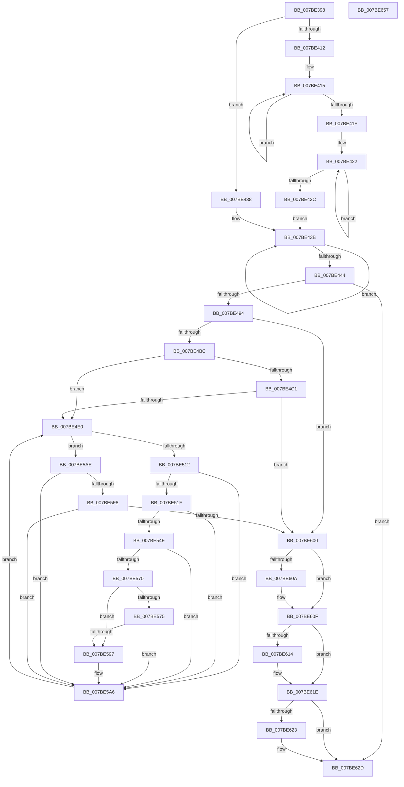

# EtwpEnumerateAutologgerPath

- RVA: `0x007BE398`–`0x007BE658` (길이 `704` bytes)
- VA: `0x00000001407BE398`
- 실행 섹션: `PAGE`
- PDB 이름 있음: `예`; PDB Function 태그: `아니요`
- unwind 정보 RVA: `0x000BC7D8`
- 디코드: `183`개 명령, `704/704` bytes 표시
- 미해석 바이트: `0` (있으면 어셈블리에 `.byte`로 보존)

> 이 문서는 커널 이미지의 기계어와 PDB 기호를 분석해 생성했습니다. 4번과 5번은 함수 원형과 자료형을 바이너리 사용 방식에서 추정한 C 해석이며 원본 소스 복구 결과는 아닙니다.

## 1. Dependencies

- 직접 호출 지점: **16**; 고유 호출 대상: **13**
- 직접 호출자로 확인된 함수: **1**
- RIP 상대 이미지 참조: **3**

### Outgoing calls
- `0x007BE401` → [memset](../../text/6C/memset_function_006C6C40.md) (function, `0x006C6C40`)
- `0x007BE44C` → [RtlInitUnicodeString](../../text/42/RtlInitUnicodeString_function_0042A780.md) (function, `0x0042A780`)
- `0x007BE487` → [ZwOpenKey](../../text/6A/ZwOpenKey_function_006AD310.md) (function, `0x006AD310`)
- `0x007BE4AB` → [ExAllocatePool2](../../poolcode/B8/ExAllocatePool2_function_00B820F0.md) (function, `0x00B820F0`)
- `0x007BE4CF` → [ExAllocatePool2](../../poolcode/B8/ExAllocatePool2_function_00B820F0.md) (function, `0x00B820F0`)
- `0x007BE501` → [ZwEnumerateKey](../../text/6A/ZwEnumerateKey_function_006AD710.md) (function, `0x006AD710`)
- `0x007BE542` → [RtlInsertElementGenericTableAvl](../../text/3E/RtlInsertElementGenericTableAvl_function_003EE510.md) (function, `0x003EE510`)
- `0x007BE567` → [RtlStringCbPrintfW](../../text/40/RtlStringCbPrintfW_function_0040FB40.md) (function, `0x0040FB40`)
- `0x007BE58E` → [RtlStringCbPrintfW](../../text/40/RtlStringCbPrintfW_function_0040FB40.md) (function, `0x0040FB40`)
- `0x007BE5A1` → [EtwStartAutoLogger](EtwStartAutoLogger_function_007BD2F8.md) (function, `0x007BD2F8`)
- `0x007BE5B9` → [RtlNtStatusToDosError](../92/RtlNtStatusToDosError_function_00926C40.md) (function, `0x00926C40`)
- `0x007BE5EB` → [RtlWriteRegistryValue](../A6/RtlWriteRegistryValue_function_00A6C620.md) (function, `0x00A6C620`)
- `0x007BE60A` → [ZwClose](../../text/6A/ZwClose_function_006AD2B0.md) (function, `0x006AD2B0`)
- `0x007BE619` → [ExFreePoolWithTag](../../poolcode/B8/ExFreePoolWithTag_function_00B82870.md) (function, `0x00B82870`)
- `0x007BE628` → [ExFreePoolWithTag](../../poolcode/B8/ExFreePoolWithTag_function_00B82870.md) (function, `0x00B82870`)
- `0x007BE637` → [_security_check_cookie](../../text/6A/_security_check_cookie_function_006AC640.md) (function, `0x006AC640`)

### Direct callers
- [EtwpInitializeAutoLoggers](EtwpInitializeAutoLoggers_function_007BE694.md) at `0x007BE8F6`
- [EtwpInitializeAutoLoggers](EtwpInitializeAutoLoggers_function_007BE694.md) at `0x007BE90A`

### Static image references
- `0x007BE3B7` → RVA `0x00E0A740` (`.data`; read)
- `0x007BE555` → RVA `0x00B07420` (` ?? ::NNGAKEGL::`string'`; read)
- `0x007BE5DB` → RVA `0x00AFF2C0` (` ?? ::NNGAKEGL::`string'`; read)

## 2. Other-region calls and transfers

- 다른 실행 섹션으로 향하는 call: **13**
  - `0x007BE401` → [memset](../../text/6C/memset_function_006C6C40.md) (`PAGE` → `.text`)
  - `0x007BE44C` → [RtlInitUnicodeString](../../text/42/RtlInitUnicodeString_function_0042A780.md) (`PAGE` → `.text`)
  - `0x007BE487` → [ZwOpenKey](../../text/6A/ZwOpenKey_function_006AD310.md) (`PAGE` → `.text`)
  - `0x007BE4AB` → [ExAllocatePool2](../../poolcode/B8/ExAllocatePool2_function_00B820F0.md) (`PAGE` → `POOLCODE`)
  - `0x007BE4CF` → [ExAllocatePool2](../../poolcode/B8/ExAllocatePool2_function_00B820F0.md) (`PAGE` → `POOLCODE`)
  - `0x007BE501` → [ZwEnumerateKey](../../text/6A/ZwEnumerateKey_function_006AD710.md) (`PAGE` → `.text`)
  - `0x007BE542` → [RtlInsertElementGenericTableAvl](../../text/3E/RtlInsertElementGenericTableAvl_function_003EE510.md) (`PAGE` → `.text`)
  - `0x007BE567` → [RtlStringCbPrintfW](../../text/40/RtlStringCbPrintfW_function_0040FB40.md) (`PAGE` → `.text`)
  - `0x007BE58E` → [RtlStringCbPrintfW](../../text/40/RtlStringCbPrintfW_function_0040FB40.md) (`PAGE` → `.text`)
  - `0x007BE60A` → [ZwClose](../../text/6A/ZwClose_function_006AD2B0.md) (`PAGE` → `.text`)
  - `0x007BE619` → [ExFreePoolWithTag](../../poolcode/B8/ExFreePoolWithTag_function_00B82870.md) (`PAGE` → `POOLCODE`)
  - `0x007BE628` → [ExFreePoolWithTag](../../poolcode/B8/ExFreePoolWithTag_function_00B82870.md) (`PAGE` → `POOLCODE`)
  - `0x007BE637` → [_security_check_cookie](../../text/6A/_security_check_cookie_function_006AC640.md) (`PAGE` → `.text`)
- 별도 외부 분기/꼬리 이동을 확인하지 못했습니다.

## 3. Assembly (complete function range)

```asm
007BE398  48 89 5C 24 20                  mov qword ptr [rsp + 0x20], rbx
007BE39D  55                              push rbp
007BE39E  56                              push rsi
007BE39F  57                              push rdi
007BE3A0  41 54                           push r12
007BE3A2  41 55                           push r13
007BE3A4  41 56                           push r14
007BE3A6  41 57                           push r15
007BE3A8  48 8D AC 24 40 FF FF FF         lea rbp, [rsp - 0xc0]
007BE3B0  48 81 EC C0 01 00 00            sub rsp, 0x1c0
007BE3B7  48 8B 05 82 C3 64 00            mov rax, qword ptr [rip + 0x64c382]
007BE3BE  48 33 C4                        xor rax, rsp
007BE3C1  48 89 85 B0 00 00 00            mov qword ptr [rbp + 0xb0], rax
007BE3C8  33 F6                           xor esi, esi
007BE3CA  4C 89 44 24 48                  mov qword ptr [rsp + 0x48], r8
007BE3CF  4C 8B F2                        mov r14, rdx
007BE3D2  89 74 24 34                     mov dword ptr [rsp + 0x34], esi
007BE3D6  4C 8B E1                        mov r12, rcx
007BE3D9  89 74 24 64                     mov dword ptr [rsp + 0x64], esi
007BE3DD  0F 57 C0                        xorps xmm0, xmm0
007BE3E0  89 74 24 7C                     mov dword ptr [rsp + 0x7c], esi
007BE3E4  33 D2                           xor edx, edx
007BE3E6  48 89 74 24 40                  mov qword ptr [rsp + 0x40], rsi
007BE3EB  41 B8 20 01 00 00               mov r8d, 0x120
007BE3F1  40 88 74 24 30                  mov byte ptr [rsp + 0x30], sil
007BE3F6  48 8D 4D 90                     lea rcx, [rbp - 0x70]
007BE3FA  8B FE                           mov edi, esi
007BE3FC  0F 11 44 24 50                  movups xmmword ptr [rsp + 0x50], xmm0
007BE401  E8 3A 88 F0 FF                  call 0x1406c6c40
007BE406  48 83 CB FF                     or rbx, 0xffffffffffffffff
007BE40A  44 8B EE                        mov r13d, esi
007BE40D  4D 85 F6                        test r14, r14
007BE410  74 26                           je 0x1407be438
007BE412  48 8B D3                        mov rdx, rbx
007BE415  48 FF C2                        inc rdx
007BE418  66 41 39 34 56                  cmp word ptr [r14 + rdx*2], si
007BE41D  75 F6                           jne 0x1407be415
007BE41F  48 8B CB                        mov rcx, rbx
007BE422  48 FF C1                        inc rcx
007BE425  66 41 39 34 4C                  cmp word ptr [r12 + rcx*2], si
007BE42A  75 F6                           jne 0x1407be422
007BE42C  48 3B CA                        cmp rcx, rdx
007BE42F  49 8B C4                        mov rax, r12
007BE432  49 0F 46 C6                     cmovbe rax, r14
007BE436  EB 03                           jmp 0x1407be43b
007BE438  49 8B C4                        mov rax, r12
007BE43B  48 FF C3                        inc rbx
007BE43E  66 39 34 58                     cmp word ptr [rax + rbx*2], si
007BE442  75 F7                           jne 0x1407be43b
007BE444  49 8B D4                        mov rdx, r12
007BE447  48 8D 4C 24 50                  lea rcx, [rsp + 0x50]
007BE44C  E8 2F C3 C6 FF                  call 0x14042a780
007BE451  48 8D 44 24 50                  lea rax, [rsp + 0x50]
007BE456  C7 44 24 60 30 00 00 00         mov dword ptr [rsp + 0x60], 0x30
007BE45E  0F 57 C0                        xorps xmm0, xmm0
007BE461  48 89 44 24 70                  mov qword ptr [rsp + 0x70], rax
007BE466  4C 8D 44 24 60                  lea r8, [rsp + 0x60]
007BE46B  48 89 74 24 68                  mov qword ptr [rsp + 0x68], rsi
007BE470  BA 19 00 02 00                  mov edx, 0x20019
007BE475  C7 44 24 78 40 02 00 00         mov dword ptr [rsp + 0x78], 0x240
007BE47D  48 8D 4C 24 40                  lea rcx, [rsp + 0x40]
007BE482  F3 0F 7F 45 80                  movdqu xmmword ptr [rbp - 0x80], xmm0
007BE487  E8 84 EE EE FF                  call 0x1406ad310
007BE48C  85 C0                           test eax, eax
007BE48E  0F 88 99 01 00 00               js 0x1407be62d
007BE494  8D 04 5D 04 01 00 00            lea eax, [rbx*2 + 0x104]
007BE49B  41 B8 45 74 77 74               mov r8d, 0x74777445
007BE4A1  8B D0                           mov edx, eax
007BE4A3  B9 00 01 00 00                  mov ecx, 0x100
007BE4A8  44 8B F8                        mov r15d, eax
007BE4AB  E8 40 3C 3C 00                  call 0x140b820f0
007BE4B0  48 8B D8                        mov rbx, rax
007BE4B3  48 85 C0                        test rax, rax
007BE4B6  0F 84 44 01 00 00               je 0x1407be600
007BE4BC  4D 85 F6                        test r14, r14
007BE4BF  74 1F                           je 0x1407be4e0
007BE4C1  41 B8 45 74 77 74               mov r8d, 0x74777445
007BE4C7  41 8B D7                        mov edx, r15d
007BE4CA  B9 00 01 00 00                  mov ecx, 0x100
007BE4CF  E8 1C 3C 3C 00                  call 0x140b820f0
007BE4D4  48 8B F8                        mov rdi, rax
007BE4D7  48 85 C0                        test rax, rax
007BE4DA  0F 84 20 01 00 00               je 0x1407be600
007BE4E0  48 8B 4C 24 40                  mov rcx, qword ptr [rsp + 0x40]
007BE4E5  48 8D 44 24 34                  lea rax, [rsp + 0x34]
007BE4EA  48 89 44 24 28                  mov qword ptr [rsp + 0x28], rax
007BE4EF  4C 8D 4D 90                     lea r9, [rbp - 0x70]
007BE4F3  45 33 C0                        xor r8d, r8d
007BE4F6  C7 44 24 20 1E 01 00 00         mov dword ptr [rsp + 0x20], 0x11e
007BE4FE  41 8B D5                        mov edx, r13d
007BE501  E8 0A F2 EE FF                  call 0x1406ad710
007BE506  8B F0                           mov esi, eax
007BE508  33 C0                           xor eax, eax
007BE50A  85 F6                           test esi, esi
007BE50C  0F 88 9C 00 00 00               js 0x1407be5ae
007BE512  81 7D 9C 02 01 00 00            cmp dword ptr [rbp - 0x64], 0x102
007BE519  0F 83 87 00 00 00               jae 0x1407be5a6
007BE51F  8B 45 9C                        mov eax, dword ptr [rbp - 0x64]
007BE522  4C 8D 4C 24 30                  lea r9, [rsp + 0x30]
007BE527  48 8B 4C 24 48                  mov rcx, qword ptr [rsp + 0x48]
007BE52C  48 8D 55 A0                     lea rdx, [rbp - 0x60]
007BE530  48 D1 E8                        shr rax, 1
007BE533  33 F6                           xor esi, esi
007BE535  66 89 74 45 A0                  mov word ptr [rbp + rax*2 - 0x60], si
007BE53A  44 8B 45 9C                     mov r8d, dword ptr [rbp - 0x64]
007BE53E  41 83 C0 02                     add r8d, 2
007BE542  E8 C9 FF C2 FF                  call 0x1403ee510
007BE547  40 38 74 24 30                  cmp byte ptr [rsp + 0x30], sil
007BE54C  74 58                           je 0x1407be5a6
007BE54E  48 8D 45 A0                     lea rax, [rbp - 0x60]
007BE552  4D 8B CC                        mov r9, r12
007BE555  4C 8D 05 C4 8E 34 00            lea r8, [rip + 0x348ec4]
007BE55C  48 89 44 24 20                  mov qword ptr [rsp + 0x20], rax
007BE561  49 8B D7                        mov rdx, r15
007BE564  48 8B CB                        mov rcx, rbx
007BE567  E8 D4 15 C5 FF                  call 0x14040fb40
007BE56C  85 C0                           test eax, eax
007BE56E  75 36                           jne 0x1407be5a6
007BE570  4D 85 F6                        test r14, r14
007BE573  74 22                           je 0x1407be597
007BE575  48 8D 45 A0                     lea rax, [rbp - 0x60]
007BE579  4D 8B CE                        mov r9, r14
007BE57C  4C 8D 05 9D 8E 34 00            lea r8, [rip + 0x348e9d]
007BE583  48 89 44 24 20                  mov qword ptr [rsp + 0x20], rax
007BE588  49 8B D7                        mov rdx, r15
007BE58B  48 8B CF                        mov rcx, rdi
007BE58E  E8 AD 15 C5 FF                  call 0x14040fb40
007BE593  85 C0                           test eax, eax
007BE595  75 0F                           jne 0x1407be5a6
007BE597  4C 8B C7                        mov r8, rdi
007BE59A  48 8D 4D A0                     lea rcx, [rbp - 0x60]
007BE59E  48 8B D3                        mov rdx, rbx
007BE5A1  E8 52 ED FF FF                  call 0x1407bd2f8
007BE5A6  41 FF C5                        inc r13d
007BE5A9  E9 32 FF FF FF                  jmp 0x1407be4e0
007BE5AE  8B CE                           mov ecx, esi
007BE5B0  81 FE 1A 00 00 80               cmp esi, 0x8000001a
007BE5B6  0F 44 C8                        cmove ecx, eax
007BE5B9  E8 82 86 16 00                  call 0x140926c40
007BE5BE  B9 04 00 00 00                  mov ecx, 4
007BE5C3  89 44 24 38                     mov dword ptr [rsp + 0x38], eax
007BE5C7  89 4C 24 28                     mov dword ptr [rsp + 0x28], ecx
007BE5CB  48 8D 44 24 38                  lea rax, [rsp + 0x38]
007BE5D0  44 8B C9                        mov r9d, ecx
007BE5D3  48 89 44 24 20                  mov qword ptr [rsp + 0x20], rax
007BE5D8  4D 85 F6                        test r14, r14
007BE5DB  4C 8D 05 DE 0C 34 00            lea r8, [rip + 0x340cde]
007BE5E2  49 8B D6                        mov rdx, r14
007BE5E5  49 0F 44 D4                     cmove rdx, r12
007BE5E9  33 C9                           xor ecx, ecx
007BE5EB  E8 30 E0 2A 00                  call 0x140a6c620
007BE5F0  81 FE 05 00 00 80               cmp esi, 0x80000005
007BE5F6  74 AE                           je 0x1407be5a6
007BE5F8  81 FE 23 00 00 C0               cmp esi, 0xc0000023
007BE5FE  74 A6                           je 0x1407be5a6
007BE600  48 8B 4C 24 40                  mov rcx, qword ptr [rsp + 0x40]
007BE605  48 85 C9                        test rcx, rcx
007BE608  74 05                           je 0x1407be60f
007BE60A  E8 A1 EC EE FF                  call 0x1406ad2b0
007BE60F  48 85 DB                        test rbx, rbx
007BE612  74 0A                           je 0x1407be61e
007BE614  33 D2                           xor edx, edx
007BE616  48 8B CB                        mov rcx, rbx
007BE619  E8 52 42 3C 00                  call 0x140b82870
007BE61E  48 85 FF                        test rdi, rdi
007BE621  74 0A                           je 0x1407be62d
007BE623  33 D2                           xor edx, edx
007BE625  48 8B CF                        mov rcx, rdi
007BE628  E8 43 42 3C 00                  call 0x140b82870
007BE62D  48 8B 8D B0 00 00 00            mov rcx, qword ptr [rbp + 0xb0]
007BE634  48 33 CC                        xor rcx, rsp
007BE637  E8 04 E0 EE FF                  call 0x1406ac640
007BE63C  48 8B 9C 24 18 02 00 00         mov rbx, qword ptr [rsp + 0x218]
007BE644  48 81 C4 C0 01 00 00            add rsp, 0x1c0
007BE64B  41 5F                           pop r15
007BE64D  41 5E                           pop r14
007BE64F  41 5D                           pop r13
007BE651  41 5C                           pop r12
007BE653  5F                              pop rdi
007BE654  5E                              pop rsi
007BE655  5D                              pop rbp
007BE656  C3                              ret
007BE657  CC                              int3
```

## 4. C-style interpretation (structured pseudocode)

```c
__int64 __fastcall EtwpEnumerateAutologgerPath(__int64 a1, __int64 a2, __int64 a3)
{
    __int64 result;
    __int64 v_r13;
    __int64 v_rbx;
    __int64 v_rsi;
    __int64 v_rsp;
    unsigned __int64 v_stack_m158;
    unsigned int v_stack_m15C;
    unsigned __int64 v_stack_m168;
    unsigned __int64 v_stack_m178;
    unsigned int v_stack_m17C;
    unsigned int v_stack_m180;
    unsigned __int64 v_stack_m188;
    unsigned __int64 v_stack_m190;
    unsigned int v_stack_m194;
    unsigned int v_stack_m198;
    unsigned __int64 v_stack_m1A8;
    unsigned __int64 v_stack_m1B0;
    unsigned __int64 v_stack_m1B8;
    unsigned int v_stack_m1C0;
    unsigned int v_stack_m1C4;
    unsigned __int8 v_stack_m1C8;
    unsigned __int64 v_stack_m1D0;
    unsigned int v_stack_m1D8;
    unsigned __int64 v_stack_m48;
    unsigned __int64 v_stack_mF8;
    unsigned __int64 v_stack_p20;

    v_stack_p20 = v_rbx;
    v_rsp = (v_rsp) - (448);
    result = (*(unsigned __int64 *)(v_rip + 6603650)) ^ (v_rsp);
    v_stack_m48 = result;
    v_rsi = 0;
    v_stack_m1B0 = a3;
    v_stack_m1C4 = 0;
    v_stack_m194 = 0;
    v_stack_m17C = 0;
    a2 = 0;
    v_stack_m1B8 = 0;
    v_stack_m1C8 = 0;
    v_stack_m1A8 = v_xmm0;
    result = memset(v_stack_m168, a2, 288, a4);
    v_rbx = (v_rbx) | (-1);
    if (0 == 0) goto loc_007BE438;
loc_007BE415:
    a2 = (v_rbx) + 1;
    if ((*(unsigned __int16 *)(a2 + a2 * 2)) != 0) goto loc_007BE415;
loc_007BE422:
    a1 = (v_rbx) + 1;
    if ((*(unsigned __int16 *)(a1 + a1 * 2)) != 0) goto loc_007BE422;
    if (a1 <= a2) { a1 = a2; }
    goto loc_007BE43B;
loc_007BE438:
loc_007BE43B:
    v_rbx = (v_rbx) + 1;
    if ((*(unsigned __int16 *)(a1 + v_rbx * 2)) != 0) goto loc_007BE43B;
    result = RtlInitUnicodeString(v_stack_m1A8, a1, 288, a4);
    v_stack_m198 = 48;
    v_stack_m188 = v_stack_m1A8;
    v_stack_m190 = 0;
    v_stack_m180 = 576;
    v_stack_m178 = v_xmm0;
    result = ZwOpenKey(v_stack_m1B8, (unsigned int)(0x20019ULL), v_stack_m198, a4);
    if (sign_flag) goto loc_007BE62D;
    result = ExAllocatePool2(256, (unsigned int)((unsigned int)(v_rbx * 2 + 260)), (unsigned int)(0x74777445ULL), a4);
    if (result == 0) goto loc_007BE600;
    if (a2 == 0) goto loc_007BE4E0;
    result = ExAllocatePool2(256, (unsigned int)((unsigned int)((unsigned int)((unsigned int)(v_rbx * 2 + 260)))), (unsigned int)(0x74777445ULL), a4);
    if (result == 0) goto loc_007BE600;
loc_007BE4E0:
    v_stack_m1D0 = v_stack_m1C4;
    a3 = 0;
    v_stack_m1D8 = 286;
    result = ZwEnumerateKey(v_stack_m1B8, 0, a3, v_stack_m168);
    result = 0;
    if (sign_flag) goto loc_007BE5AE;
    if (v_stack_m15C >= 258) goto loc_007BE5A6;
    result = ((unsigned int)(v_stack_m15C)) >> (1);
    v_rsi = 0;
    *(unsigned __int16 *)(v_stack_mF8 + result * 2 - 96) = 0;
    a3 = (unsigned int)(((unsigned int)(v_stack_m15C)) + (2));
    result = RtlInsertElementGenericTableAvl(v_stack_m1B0, v_stack_m158, a3, v_stack_m1C8);
    if (v_stack_m1C8 == 0) goto loc_007BE5A6;
    v_stack_m1D8 = v_stack_m158;
    result = RtlStringCbPrintfW(result, (unsigned int)((unsigned int)(v_rbx * 2 + 260)), v_rip + 3444420, a1);
    if ((unsigned int)(result) != 0) goto loc_007BE5A6;
    if (a2 == 0) goto loc_007BE597;
    v_stack_m1D8 = v_stack_m158;
    result = RtlStringCbPrintfW(result, (unsigned int)((unsigned int)(v_rbx * 2 + 260)), v_rip + 3444381, a2);
    if ((unsigned int)(result) == 0) {
        a3 = result;
        a1 = v_stack_m158;
        a2 = result;
        result = EtwStartAutoLogger(a1, a2, a3, a2);
    }
    v_r13 = (unsigned int)((0) + 1);
    goto loc_007BE4E0;
loc_007BE5AE:
    a1 = 0;
    if (0 == 0x8000001AULL) { a1 = (unsigned int)(result); }
    result = RtlNtStatusToDosError(a1, a2, a3, a2);
    v_stack_m1C0 = (unsigned int)(result);
    v_stack_m1D0 = 4;
    v_stack_m1D8 = v_stack_m1C0;
    if (a2 == 0) { a2 = a1; }
    a1 = 0;
    result = RtlWriteRegistryValue(a1, a2, v_rip + 3411166, 4);
    if (0 == 0x80000005ULL) goto loc_007BE5A6;
    if (0 == 0xC0000023ULL) goto loc_007BE5A6;
loc_007BE600:
    if (v_stack_m1B8 != 0) {
        result = ZwClose(v_stack_m1B8, a2, v_rip + 3411166, 4);
    }
    if (result != 0) {
        a2 = 0;
        a1 = result;
        result = ExFreePoolWithTag(a1, a2, v_rip + 3411166, 4);
    }
    if (result != 0) {
        a2 = 0;
        a1 = result;
        result = ExFreePoolWithTag(a1, a2, v_rip + 3411166, 4);
    }
    a1 = (v_stack_m48) ^ (v_rsp);
    result = _security_check_cookie(a1, a2, v_rip + 3411166, 4);
    v_rsp = (v_rsp) + (448);
    return result;
}
```

## 5. (Beta) C Style

```c
int64_t EtwpEnumerateAutologgerPath(void *Arg1, int64_t Arg2, int64_t Arg3)
{
    uint8_t *arg1 = (uint8_t *)Arg1;

    int64_t result;
    int64_t local_r13;
    int64_t local_rbx;
    int64_t local_rsi;
    int64_t local_rsp;
    uint64_t v_stack_m158;
    uint32_t v_stack_m15C;
    uint64_t v_stack_m168;
    uint64_t v_stack_m178;
    uint32_t v_stack_m17C;
    uint32_t v_stack_m180;
    uint64_t v_stack_m188;
    uint64_t v_stack_m190;
    uint32_t v_stack_m194;
    uint32_t v_stack_m198;
    uint64_t v_stack_m1A8;
    uint64_t v_stack_m1B0;
    uint64_t v_stack_m1B8;
    uint32_t v_stack_m1C0;
    uint32_t v_stack_m1C4;
    uint8_t v_stack_m1C8;
    uint64_t v_stack_m1D0;
    uint32_t v_stack_m1D8;
    uint64_t v_stack_m48;
    uint64_t v_stack_mF8;
    uint64_t v_stack_p20;

    v_stack_p20 = local_rbx;
    local_rsp = (local_rsp) - (448);
    result = (*(uint64_t *)(v_rip + 0x64C382)) ^ (local_rsp);
    v_stack_m48 = result;
    local_rsi = 0;
    v_stack_m1B0 = Arg3;
    v_stack_m1C4 = 0;
    v_stack_m194 = 0;
    v_stack_m17C = 0;
    Arg2 = 0;
    v_stack_m1B8 = 0;
    v_stack_m1C8 = 0;
    v_stack_m1A8 = v_xmm0;
    result = memset(v_stack_m168, Arg2, 288, a4);
    local_rbx = (local_rbx) | (-1);
    if (0 == 0) goto loc_007BE438;
loc_007BE415:
    Arg2 = (local_rbx) + 1;
    if ((*(uint16_t *)(Arg2 + Arg2 * 2)) != 0) goto loc_007BE415;
loc_007BE422:
    Arg1 = (local_rbx) + 1;
    if ((*(uint16_t *)(arg1 + arg1 * 2)) != 0) goto loc_007BE422;
    if (Arg1 <= Arg2) { Arg1 = Arg2; }
    goto loc_007BE43B;
loc_007BE438:
loc_007BE43B:
    local_rbx = (local_rbx) + 1;
    if ((*(uint16_t *)(arg1 + local_rbx * 2)) != 0) goto loc_007BE43B;
    result = RtlInitUnicodeString(v_stack_m1A8, Arg1, 288, a4);
    v_stack_m198 = 48;
    v_stack_m188 = v_stack_m1A8;
    v_stack_m190 = 0;
    v_stack_m180 = 576;
    v_stack_m178 = v_xmm0;
    result = ZwOpenKey(v_stack_m1B8, (uint32_t)(0x20019ULL), v_stack_m198, a4);
    if (sign_flag) goto loc_007BE62D;
    result = ExAllocatePool2(256, (uint32_t)((uint32_t)(local_rbx * 2 + 260)), (uint32_t)(0x74777445ULL), a4);
    if (result == 0) goto loc_007BE600;
    if (Arg2 == 0) goto loc_007BE4E0;
    result = ExAllocatePool2(256, (uint32_t)((uint32_t)((uint32_t)((uint32_t)(local_rbx * 2 + 260)))), (uint32_t)(0x74777445ULL), a4);
    if (result == 0) goto loc_007BE600;
loc_007BE4E0:
    v_stack_m1D0 = v_stack_m1C4;
    Arg3 = 0;
    v_stack_m1D8 = 286;
    result = ZwEnumerateKey(v_stack_m1B8, 0, Arg3, v_stack_m168);
    result = 0;
    if (sign_flag) goto loc_007BE5AE;
    if (v_stack_m15C >= 258) goto loc_007BE5A6;
    result = ((uint32_t)(v_stack_m15C)) >> (1);
    local_rsi = 0;
    *(uint16_t *)(v_stack_mF8 + result * 2 - 0x60) = 0;
    Arg3 = (uint32_t)(((uint32_t)(v_stack_m15C)) + (2));
    result = RtlInsertElementGenericTableAvl(v_stack_m1B0, v_stack_m158, Arg3, v_stack_m1C8);
    if (v_stack_m1C8 == 0) goto loc_007BE5A6;
    v_stack_m1D8 = v_stack_m158;
    result = RtlStringCbPrintfW(result, (uint32_t)((uint32_t)(local_rbx * 2 + 260)), v_rip + 3444420, Arg1);
    if ((uint32_t)(result) != 0) goto loc_007BE5A6;
    if (Arg2 == 0) goto loc_007BE597;
    v_stack_m1D8 = v_stack_m158;
    result = RtlStringCbPrintfW(result, (uint32_t)((uint32_t)(local_rbx * 2 + 260)), v_rip + 3444381, Arg2);
    if ((uint32_t)(result) == 0) {
        Arg3 = result;
        Arg1 = v_stack_m158;
        Arg2 = result;
        result = EtwStartAutoLogger(Arg1, Arg2, Arg3, Arg2);
    }
    local_r13 = (uint32_t)((0) + 1);
    goto loc_007BE4E0;
loc_007BE5AE:
    Arg1 = 0;
    if (0 == 0x8000001AULL) { Arg1 = (uint32_t)(result); }
    result = RtlNtStatusToDosError(Arg1, Arg2, Arg3, Arg2);
    v_stack_m1C0 = (uint32_t)(result);
    v_stack_m1D0 = 4;
    v_stack_m1D8 = v_stack_m1C0;
    if (Arg2 == 0) { Arg2 = Arg1; }
    Arg1 = 0;
    result = RtlWriteRegistryValue(Arg1, Arg2, v_rip + 3411166, 4);
    if (0 == 0x80000005ULL) goto loc_007BE5A6;
    if (0 == 0xC0000023ULL) goto loc_007BE5A6;
loc_007BE600:
    if (v_stack_m1B8 != 0) {
        result = ZwClose(v_stack_m1B8, Arg2, v_rip + 3411166, 4);
    }
    if (result != 0) {
        Arg2 = 0;
        Arg1 = result;
        result = ExFreePoolWithTag(Arg1, Arg2, v_rip + 3411166, 4);
    }
    if (result != 0) {
        Arg2 = 0;
        Arg1 = result;
        result = ExFreePoolWithTag(Arg1, Arg2, v_rip + 3411166, 4);
    }
    Arg1 = (v_stack_m48) ^ (local_rsp);
    result = _security_check_cookie(Arg1, Arg2, v_rip + 3411166, 4);
    local_rsp = (local_rsp) + (448);
    return result;
}
```

### 관측된 메모리 오프셋

구조체 형식이 확인되지 않은 접근은 인자 기준의 오프셋으로만 기록했습니다.

| 기준 인자 | 오프셋 표현 | 폭 (bit) | 접근 |
|---|---:|---:|---|
| `Arg1` | `+ 0x0 + rcx*2` | `16` | `R` |

## 6. Execution-region graph

[열기: 2D/3D 그래프와 함수 탐색 컨트롤 패널](../../../control-panel.html?section=page&rva=0x007BE398&view=graph)

- 2D 그래프는 위에서 아래로 흐르고, 3D 그래프는 빈 공간을 드래그해 회전합니다. Shift+드래그는 이동, 휠은 확대·축소, 함수 노드 선택은 대상 보고서 이동입니다.

### Static fallback


