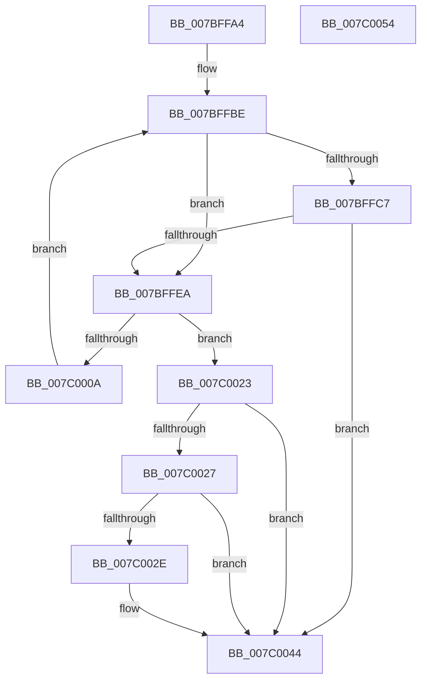

# EtwpEnumerateWorkingSet

- RVA: `0x007BFFA4`–`0x007C0055` (길이 `177` bytes)
- VA: `0x00000001407BFFA4`
- 실행 섹션: `PAGE`
- PDB 이름 있음: `예`; PDB Function 태그: `아니요`
- unwind 정보 RVA: `0x00060BC4`
- 디코드: `49`개 명령, `177/177` bytes 표시
- 미해석 바이트: `0` (있으면 어셈블리에 `.byte`로 보존)

> 이 문서는 커널 이미지의 기계어와 PDB 기호를 분석해 생성했습니다. 4번과 5번은 함수 원형과 자료형을 바이너리 사용 방식에서 추정한 C 해석이며 원본 소스 복구 결과는 아닙니다.

## 1. Dependencies

- 직접 호출 지점: **4**; 고유 호출 대상: **4**
- 직접 호출자로 확인된 함수: **1**
- RIP 상대 이미지 참조: **0**

### Outgoing calls
- `0x007BFFDC` → [ExAllocatePool2](../../poolcode/B8/ExAllocatePool2_function_00B820F0.md) (function, `0x00B820F0`)
- `0x007BFFFA` → [MiGetWorkingSetInfoEx](../../text/29/MiGetWorkingSetInfoEx_function_0029E640.md) (function, `0x0029E640`)
- `0x007C0017` → [ExFreePoolWithTag](../../poolcode/B8/ExFreePoolWithTag_function_00B82870.md) (function, `0x00B82870`)
- `0x007C003F` → [EtwLogPfnInfoRundown](EtwLogPfnInfoRundown_function_007BFDF0.md) (function, `0x007BFDF0`)

### Direct callers
- [EtwpProcessEnumCallback](../8A/EtwpProcessEnumCallback_function_008A5F40.md) at `0x008A61A8`
- [EtwpProcessEnumCallback](../8A/EtwpProcessEnumCallback_function_008A5F40.md) at `0x008A62D5`

### Static image references
- 디코드된 RIP-relative 메모리 참조가 없습니다.

## 2. Other-region calls and transfers

- 다른 실행 섹션으로 향하는 call: **3**
  - `0x007BFFDC` → [ExAllocatePool2](../../poolcode/B8/ExAllocatePool2_function_00B820F0.md) (`PAGE` → `POOLCODE`)
  - `0x007BFFFA` → [MiGetWorkingSetInfoEx](../../text/29/MiGetWorkingSetInfoEx_function_0029E640.md) (`PAGE` → `.text`)
  - `0x007C0017` → [ExFreePoolWithTag](../../poolcode/B8/ExFreePoolWithTag_function_00B82870.md) (`PAGE` → `POOLCODE`)
- 별도 외부 분기/꼬리 이동을 확인하지 못했습니다.

## 3. Assembly (complete function range)

```asm
007BFFA4  48 89 5C 24 08                  mov qword ptr [rsp + 8], rbx
007BFFA9  48 89 74 24 10                  mov qword ptr [rsp + 0x10], rsi
007BFFAE  57                              push rdi
007BFFAF  48 83 EC 20                     sub rsp, 0x20
007BFFB3  48 8B DA                        mov rbx, rdx
007BFFB6  48 8B F1                        mov rsi, rcx
007BFFB9  BF 00 10 00 00                  mov edi, 0x1000
007BFFBE  48 8B 43 30                     mov rax, qword ptr [rbx + 0x30]
007BFFC2  48 85 C0                        test rax, rax
007BFFC5  75 23                           jne 0x1407bffea
007BFFC7  48 C1 E7 05                     shl rdi, 5
007BFFCB  8D 48 40                        lea ecx, [rax + 0x40]
007BFFCE  41 B8 45 74 77 74               mov r8d, 0x74777445
007BFFD4  48 8D 57 10                     lea rdx, [rdi + 0x10]
007BFFD8  48 89 53 38                     mov qword ptr [rbx + 0x38], rdx
007BFFDC  E8 0F 21 3C 00                  call 0x140b820f0
007BFFE1  48 89 43 30                     mov qword ptr [rbx + 0x30], rax
007BFFE5  48 85 C0                        test rax, rax
007BFFE8  74 5A                           je 0x1407c0044
007BFFEA  4C 8B 4B 38                     mov r9, qword ptr [rbx + 0x38]
007BFFEE  48 8D 8E 00 04 00 00            lea rcx, [rsi + 0x400]
007BFFF5  4C 8B C0                        mov r8, rax
007BFFF8  33 D2                           xor edx, edx
007BFFFA  E8 41 E6 AD FF                  call 0x14029e640
007BFFFF  4C 8B 4B 30                     mov r9, qword ptr [rbx + 0x30]
007C0003  3D 04 00 00 C0                  cmp eax, 0xc0000004
007C0008  75 19                           jne 0x1407c0023
007C000A  49 8B 79 08                     mov rdi, qword ptr [r9 + 8]
007C000E  33 D2                           xor edx, edx
007C0010  49 8B C9                        mov rcx, r9
007C0013  48 83 C7 40                     add rdi, 0x40
007C0017  E8 54 28 3C 00                  call 0x140b82870
007C001C  48 83 63 30 00                  and qword ptr [rbx + 0x30], 0
007C0021  EB 9B                           jmp 0x1407bffbe
007C0023  85 C0                           test eax, eax
007C0025  78 1D                           js 0x1407c0044
007C0027  49 83 79 08 00                  cmp qword ptr [r9 + 8], 0
007C002C  74 16                           je 0x1407c0044
007C002E  48 8B 53 20                     mov rdx, qword ptr [rbx + 0x20]
007C0032  48 8B CE                        mov rcx, rsi
007C0035  44 8B 02                        mov r8d, dword ptr [rdx]
007C0038  48 8B 92 50 05 00 00            mov rdx, qword ptr [rdx + 0x550]
007C003F  E8 AC FD FF FF                  call 0x1407bfdf0
007C0044  48 8B 5C 24 30                  mov rbx, qword ptr [rsp + 0x30]
007C0049  48 8B 74 24 38                  mov rsi, qword ptr [rsp + 0x38]
007C004E  48 83 C4 20                     add rsp, 0x20
007C0052  5F                              pop rdi
007C0053  C3                              ret
007C0054  CC                              int3
```

## 4. C-style interpretation (structured pseudocode)

```c
__int64 __fastcall EtwpEnumerateWorkingSet(__int64 a1, __int64 a2)
{
    __int64 result;
    __int64 v_rdi;
    __int64 v_rsp;
    unsigned __int64 v_stack_p10;
    unsigned __int64 v_stack_p8;

    v_stack_p8 = v_rbx;
    v_stack_p10 = v_rsi;
    v_rsp = (v_rsp) - (32);
loc_007BFFBE:
    if (*(unsigned __int64 *)(a2 + 48) != 0) goto loc_007BFFEA;
    v_rdi = ((unsigned int)(0x1000ULL)) << (5);
    *(unsigned __int64 *)(a2 + 56) = v_rdi + 16;
    result = ExAllocatePool2(*(unsigned __int64 *)(a2 + 48) + 64, v_rdi + 16, (unsigned int)(0x74777445ULL), a4);
    *(unsigned __int64 *)(a2 + 48) = result;
    if (result == 0) goto loc_007C0044;
loc_007BFFEA:
    a2 = 0;
    result = MiGetWorkingSetInfoEx(a1 + 1024, a2, result, *(unsigned __int64 *)(a2 + 56));
    if (((unsigned int)(result)) != 0xC0000004ULL) goto loc_007C0023;
    a2 = 0;
    v_rdi = (*(unsigned __int64 *)(*(unsigned __int64 *)(a2 + 48) + 8)) + (64);
    result = ExFreePoolWithTag(*(unsigned __int64 *)(a2 + 48), a2, result, *(unsigned __int64 *)(a2 + 48));
    goto loc_007BFFBE;
loc_007C0023:
    if (sign_flag) goto loc_007C0044;
    if ((*(unsigned __int64 *)(*(unsigned __int64 *)(a2 + 48) + 8)) != 0) {
        a2 = *(unsigned __int64 *)(a2 + 32);
        a1 = a1;
        a3 = *(unsigned int *)(a2);
        a2 = *(unsigned __int64 *)(a2 + 1360);
        result = EtwLogPfnInfoRundown(a1, a2, a3, *(unsigned __int64 *)(a2 + 48));
    }
    v_rsp = (v_rsp) + (32);
    return result;
}
```

## 5. (Beta) C Style

```c
int64_t EtwpEnumerateWorkingSet(void *Arg1, void *Arg2)
{
    uint8_t *arg1 = (uint8_t *)Arg1;
    uint8_t *arg2 = (uint8_t *)Arg2;

    int64_t result;
    int64_t local_rdi;
    int64_t local_rsp;
    uint64_t v_stack_p10;
    uint64_t v_stack_p8;

    v_stack_p8 = local_rbx;
    v_stack_p10 = local_rsi;
    local_rsp = (local_rsp) - (32);
loc_007BFFBE:
    if (*(uint64_t *)(arg2 + 0x30) != 0) goto loc_007BFFEA;
    local_rdi = ((uint32_t)(0x1000ULL)) << (5);
    *(uint64_t *)(arg2 + 0x38) = local_rdi + 16;
    result = ExAllocatePool2(*(uint64_t *)(arg2 + 0x30) + 64, local_rdi + 16, (uint32_t)(0x74777445ULL), a4);
    *(uint64_t *)(arg2 + 0x30) = result;
    if (result == 0) goto loc_007C0044;
loc_007BFFEA:
    Arg2 = 0;
    result = MiGetWorkingSetInfoEx(Arg1 + 1024, Arg2, result, *(uint64_t *)(arg2 + 0x38));
    if (((uint32_t)(result)) != 0xC0000004ULL) goto loc_007C0023;
    Arg2 = 0;
    local_rdi = (*(uint64_t *)(*(uint64_t *)(arg2 + 0x30) + 0x8)) + (64);
    result = ExFreePoolWithTag(*(uint64_t *)(arg2 + 0x30), Arg2, result, *(uint64_t *)(arg2 + 0x30));
    goto loc_007BFFBE;
loc_007C0023:
    if (sign_flag) goto loc_007C0044;
    if ((*(uint64_t *)(*(uint64_t *)(arg2 + 0x30) + 0x8)) != 0) {
        Arg2 = *(uint64_t *)(arg2 + 0x20);
        Arg1 = Arg1;
        a3 = *(uint32_t *)(arg2);
        Arg2 = *(uint64_t *)(arg2 + 0x550);
        result = EtwLogPfnInfoRundown(Arg1, Arg2, a3, *(uint64_t *)(arg2 + 0x30));
    }
    local_rsp = (local_rsp) + (32);
    return result;
}
```

### 관측된 메모리 오프셋

구조체 형식이 확인되지 않은 접근은 인자 기준의 오프셋으로만 기록했습니다.

| 기준 인자 | 오프셋 표현 | 폭 (bit) | 접근 |
|---|---:|---:|---|
| `Arg1` | `+ 0x400` | `64` | `R` |
| `Arg2` | `+ 0x20` | `64` | `R` |
| `Arg2` | `+ 0x30` | `64` | `R` |
| `Arg2` | `+ 0x30` | `64` | `R/W` |
| `Arg2` | `+ 0x30` | `64` | `W` |
| `Arg2` | `+ 0x38` | `64` | `R` |
| `Arg2` | `+ 0x38` | `64` | `W` |

## 6. Execution-region graph

[열기: 2D/3D 그래프와 함수 탐색 컨트롤 패널](../../../control-panel.html?section=page&rva=0x007BFFA4&view=graph)

- 2D 그래프는 위에서 아래로 흐르고, 3D 그래프는 빈 공간을 드래그해 회전합니다. Shift+드래그는 이동, 휠은 확대·축소, 함수 노드 선택은 대상 보고서 이동입니다.

### Static fallback


