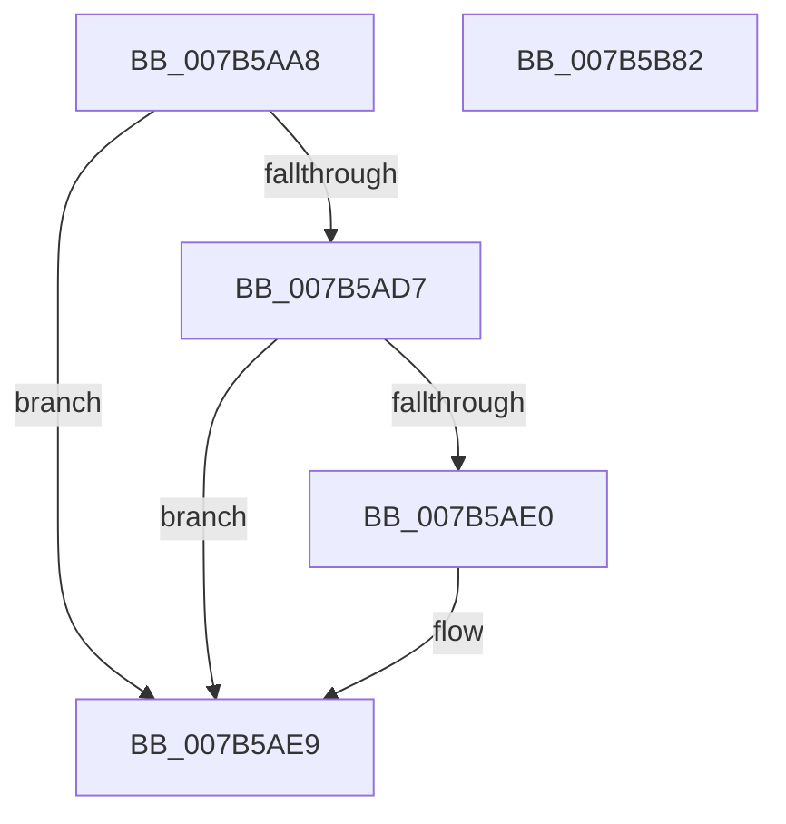

# EtwpEventWriteDebugLookupFailed

- RVA: `0x007B5AA8`–`0x007B5B83` (길이 `219` bytes)
- VA: `0x00000001407B5AA8`
- 실행 섹션: `PAGE`
- PDB 이름 있음: `예`; PDB Function 태그: `아니요`
- unwind 정보 RVA: `0x0009EA9C`
- 디코드: `49`개 명령, `219/219` bytes 표시
- 미해석 바이트: `0` (있으면 어셈블리에 `.byte`로 보존)

> 이 문서는 커널 이미지의 기계어와 PDB 기호를 분석해 생성했습니다. 4번과 5번은 함수 원형과 자료형을 바이너리 사용 방식에서 추정한 C 해석이며 원본 소스 복구 결과는 아닙니다.

## 1. Dependencies

- 직접 호출 지점: **2**; 고유 호출 대상: **2**
- 직접 호출자로 확인된 함수: **1**
- RIP 상대 이미지 참조: **4**

### Outgoing calls
- `0x007B5B68` → [EtwWrite](../../text/41/EtwWrite_function_0041C720.md) (function, `0x0041C720`)
- `0x007B5B74` → [_security_check_cookie](../../text/6A/_security_check_cookie_function_006AC640.md) (function, `0x006AC640`)

### Direct callers
- [EtwpProviderArrivalCallback](../A0/EtwpProviderArrivalCallback_function_00A03F94.md) at `0x00A04113`

### Static image references
- `0x007B5AB6` → RVA `0x00E0A740` (`.data`; read)
- `0x007B5AC4` → RVA `0x00EFF840` (`.data`; read)
- `0x007B5B05` → RVA `0x00021EE0` (`.rdata`; read)
- `0x007B5B2C` → RVA `0x000105E0` (`.rdata`; read)

## 2. Other-region calls and transfers

- 다른 실행 섹션으로 향하는 call: **2**
  - `0x007B5B68` → [EtwWrite](../../text/41/EtwWrite_function_0041C720.md) (`PAGE` → `.text`)
  - `0x007B5B74` → [_security_check_cookie](../../text/6A/_security_check_cookie_function_006AC640.md) (`PAGE` → `.text`)
- 별도 외부 분기/꼬리 이동을 확인하지 못했습니다.

## 3. Assembly (complete function range)

```asm
007B5AA8  40 55                           push rbp
007B5AAA  48 8D 6C 24 B9                  lea rbp, [rsp - 0x47]
007B5AAF  48 81 EC A0 00 00 00            sub rsp, 0xa0
007B5AB6  48 8B 05 83 4C 65 00            mov rax, qword ptr [rip + 0x654c83]
007B5ABD  48 33 C4                        xor rax, rsp
007B5AC0  48 89 45 37                     mov qword ptr [rbp + 0x37], rax
007B5AC4  4C 8B 15 75 9D 74 00            mov r10, qword ptr [rip + 0x749d75]
007B5ACB  33 D2                           xor edx, edx
007B5ACD  41 F6 41 62 02                  test byte ptr [r9 + 0x62], 2
007B5AD2  89 55 D7                        mov dword ptr [rbp - 0x29], edx
007B5AD5  74 12                           je 0x1407b5ae9
007B5AD7  49 8B 41 50                     mov rax, qword ptr [r9 + 0x50]
007B5ADB  48 85 C0                        test rax, rax
007B5ADE  74 09                           je 0x1407b5ae9
007B5AE0  8B 80 D0 01 00 00               mov eax, dword ptr [rax + 0x1d0]
007B5AE6  89 45 D7                        mov dword ptr [rbp - 0x29], eax
007B5AE9  49 8B 41 20                     mov rax, qword ptr [r9 + 0x20]
007B5AED  45 33 C0                        xor r8d, r8d
007B5AF0  48 8B 4D 77                     mov rcx, qword ptr [rbp + 0x77]
007B5AF4  48 83 C0 28                     add rax, 0x28
007B5AF8  48 89 45 E7                     mov qword ptr [rbp - 0x19], rax
007B5AFC  41 B9 05 00 00 00               mov r9d, 5
007B5B02  89 55 03                        mov dword ptr [rbp + 3], edx
007B5B05  48 8D 15 D4 C3 86 FF            lea rdx, [rip - 0x793c2c]
007B5B0C  48 C7 45 EF 10 00 00 00         mov qword ptr [rbp - 0x11], 0x10
007B5B14  48 8B 81 90 00 00 00            mov rax, qword ptr [rcx + 0x90]
007B5B1B  48 89 45 F7                     mov qword ptr [rbp - 9], rax
007B5B1F  0F B7 81 88 00 00 00            movzx eax, word ptr [rcx + 0x88]
007B5B26  49 8B CA                        mov rcx, r10
007B5B29  89 45 FF                        mov dword ptr [rbp - 1], eax
007B5B2C  48 8D 05 AD AA 85 FF            lea rax, [rip - 0x7a5553]
007B5B33  48 89 45 07                     mov qword ptr [rbp + 7], rax
007B5B37  48 8D 45 D7                     lea rax, [rbp - 0x29]
007B5B3B  48 89 45 17                     mov qword ptr [rbp + 0x17], rax
007B5B3F  48 8D 45 7F                     lea rax, [rbp + 0x7f]
007B5B43  48 89 45 27                     mov qword ptr [rbp + 0x27], rax
007B5B47  48 8D 45 E7                     lea rax, [rbp - 0x19]
007B5B4B  48 89 44 24 20                  mov qword ptr [rsp + 0x20], rax
007B5B50  48 C7 45 0F 02 00 00 00         mov qword ptr [rbp + 0xf], 2
007B5B58  48 C7 45 1F 04 00 00 00         mov qword ptr [rbp + 0x1f], 4
007B5B60  48 C7 45 2F 04 00 00 00         mov qword ptr [rbp + 0x2f], 4
007B5B68  E8 B3 6B C6 FF                  call 0x14041c720
007B5B6D  48 8B 4D 37                     mov rcx, qword ptr [rbp + 0x37]
007B5B71  48 33 CC                        xor rcx, rsp
007B5B74  E8 C7 6A EF FF                  call 0x1406ac640
007B5B79  48 81 C4 A0 00 00 00            add rsp, 0xa0
007B5B80  5D                              pop rbp
007B5B81  C3                              ret
007B5B82  CC                              int3
```

## 4. C-style interpretation (structured pseudocode)

```c
__int64 __fastcall EtwpEventWriteDebugLookupFailed(__int64 a1, int a2, int a3, __int64 a4, __int64 a5, __int64 a6)
{
    __int64 result;
    __int64 v_rsp;
    unsigned __int64 v_stack_m18;
    unsigned __int64 v_stack_m20;
    unsigned __int64 v_stack_m28;
    unsigned __int64 v_stack_m30;
    unsigned __int64 v_stack_m38;
    unsigned __int64 v_stack_m40;
    unsigned __int64 v_stack_m48;
    unsigned int v_stack_m4C;
    unsigned __int64 v_stack_m4F;
    unsigned int v_stack_m50;
    unsigned __int64 v_stack_m58;
    unsigned __int64 v_stack_m60;
    unsigned __int64 v_stack_m68;
    unsigned int v_stack_m78;
    unsigned __int64 v_stack_m88;

    v_rsp = (v_rsp) - (160);
    result = (*(unsigned __int64 *)(v_rip + 6638723)) ^ (v_rsp);
    v_stack_m18 = result;
    a2 = 0;
    v_stack_m78 = 0;
    if (((*(unsigned __int8 *)(a4 + 98)) & (2)) == 0) goto loc_007B5AE9;
    result = *(unsigned __int64 *)(a4 + 80);
    if (*(unsigned __int64 *)(a4 + 80) != 0) {
        result = *(unsigned int *)(*(unsigned __int64 *)(a4 + 80) + 464);
        v_stack_m78 = (unsigned int)(result);
    }
    a3 = 0;
    result = (*(unsigned __int64 *)(a4 + 32)) + (40);
    v_stack_m68 = result;
    v_stack_m4C = 0;
    v_stack_m60 = 16;
    v_stack_m58 = *(unsigned __int64 *)(a5 + 144);
    v_stack_m50 = (unsigned int)(*(unsigned __int16 *)(a5 + 136));
    v_stack_m48 = v_rip - 8017235;
    v_stack_m38 = v_stack_m78;
    v_stack_m28 = a6;
    v_stack_m88 = v_stack_m68;
    v_stack_m40 = 2;
    v_stack_m30 = 4;
    v_stack_m20 = 4;
    result = EtwWrite(*(unsigned __int64 *)(v_rip + 7642485), v_rip - 7945260, a3, 5);
    a1 = (v_stack_m18) ^ (v_rsp);
    result = _security_check_cookie(a1, v_rip - 7945260, a3, 5);
    v_rsp = (v_rsp) + (160);
    return result;
}
```

## 5. (Beta) C Style

```c
int64_t EtwpEventWriteDebugLookupFailed(int64_t Arg1, int32_t Arg2, int32_t Arg3, void *Arg4, void *Arg5, int64_t Arg6)
{
    uint8_t *arg4 = (uint8_t *)Arg4;
    uint8_t *arg5 = (uint8_t *)Arg5;

    int64_t result;
    int64_t local_rsp;
    uint64_t v_stack_m18;
    uint64_t v_stack_m20;
    uint64_t v_stack_m28;
    uint64_t v_stack_m30;
    uint64_t v_stack_m38;
    uint64_t v_stack_m40;
    uint64_t v_stack_m48;
    uint32_t v_stack_m4C;
    uint64_t v_stack_m4F;
    uint32_t v_stack_m50;
    uint64_t v_stack_m58;
    uint64_t v_stack_m60;
    uint64_t v_stack_m68;
    uint32_t v_stack_m78;
    uint64_t v_stack_m88;

    local_rsp = (local_rsp) - (160);
    result = (*(uint64_t *)(v_rip + 0x654C83)) ^ (local_rsp);
    v_stack_m18 = result;
    Arg2 = 0;
    v_stack_m78 = 0;
    if (((*(uint8_t *)(arg4 + 0x62)) & (2)) == 0) goto loc_007B5AE9;
    result = *(uint64_t *)(arg4 + 0x50);
    if (*(uint64_t *)(arg4 + 0x50) != 0) {
        result = *(uint32_t *)(*(uint64_t *)(arg4 + 0x50) + 0x1D0);
        v_stack_m78 = (uint32_t)(result);
    }
    Arg3 = 0;
    result = (*(uint64_t *)(arg4 + 0x20)) + (40);
    v_stack_m68 = result;
    v_stack_m4C = 0;
    v_stack_m60 = 16;
    v_stack_m58 = *(uint64_t *)(arg5 + 0x90);
    v_stack_m50 = (uint32_t)(*(uint16_t *)(arg5 + 0x88));
    v_stack_m48 = v_rip - 8017235;
    v_stack_m38 = v_stack_m78;
    v_stack_m28 = Arg6;
    v_stack_m88 = v_stack_m68;
    v_stack_m40 = 2;
    v_stack_m30 = 4;
    v_stack_m20 = 4;
    result = EtwWrite(*(uint64_t *)(v_rip + 0x749D75), v_rip - 7945260, Arg3, 5);
    Arg1 = (v_stack_m18) ^ (local_rsp);
    result = _security_check_cookie(Arg1, v_rip - 7945260, Arg3, 5);
    local_rsp = (local_rsp) + (160);
    return result;
}
```

### 관측된 메모리 오프셋

구조체 형식이 확인되지 않은 접근은 인자 기준의 오프셋으로만 기록했습니다.

| 기준 인자 | 오프셋 표현 | 폭 (bit) | 접근 |
|---|---:|---:|---|
| `Arg4` | `+ 0x20` | `64` | `R` |
| `Arg4` | `+ 0x50` | `64` | `R` |
| `Arg4` | `+ 0x62` | `8` | `R` |
| `Arg5` | `+ 0x88` | `16` | `R` |
| `Arg5` | `+ 0x90` | `64` | `R` |

## 6. Execution-region graph

[열기: 2D/3D 그래프와 함수 탐색 컨트롤 패널](../../../control-panel.html?section=page&rva=0x007B5AA8&view=graph)

- 2D 그래프는 위에서 아래로 흐르고, 3D 그래프는 빈 공간을 드래그해 회전합니다. Shift+드래그는 이동, 휠은 확대·축소, 함수 노드 선택은 대상 보고서 이동입니다.

### Static fallback


