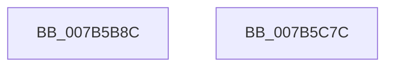

# EtwpEventWriteEnableInfo

- RVA: `0x007B5B8C`–`0x007B5C7D` (길이 `241` bytes)
- VA: `0x00000001407B5B8C`
- 실행 섹션: `PAGE`
- PDB 이름 있음: `예`; PDB Function 태그: `아니요`
- unwind 정보 RVA: `0x000B11FC`
- 디코드: `49`개 명령, `241/241` bytes 표시
- 미해석 바이트: `0` (있으면 어셈블리에 `.byte`로 보존)

> 이 문서는 커널 이미지의 기계어와 PDB 기호를 분석해 생성했습니다. 4번과 5번은 함수 원형과 자료형을 바이너리 사용 방식에서 추정한 C 해석이며 원본 소스 복구 결과는 아닙니다.

## 1. Dependencies

- 직접 호출 지점: **2**; 고유 호출 대상: **2**
- 직접 호출자로 확인된 함수: **1**
- RIP 상대 이미지 참조: **3**

### Outgoing calls
- `0x007B5C62` → [EtwWrite](../../text/41/EtwWrite_function_0041C720.md) (function, `0x0041C720`)
- `0x007B5C6E` → [_security_check_cookie](../../text/6A/_security_check_cookie_function_006AC640.md) (function, `0x006AC640`)

### Direct callers
- [EtwpTracingProvEnableCallback](../AC/EtwpTracingProvEnableCallback_function_00AC28B0.md) at `0x00AC29D1`
- [EtwpTracingProvEnableCallback](../AC/EtwpTracingProvEnableCallback_function_00AC28B0.md) at `0x00AC2B12`

### Static image references
- `0x007B5B9E` → RVA `0x00E0A740` (`.data`; read)
- `0x007B5C3F` → RVA `0x00EFF840` (`.data`; read)
- `0x007B5C46` → RVA `0x00021DF0` (`.rdata`; read)

## 2. Other-region calls and transfers

- 다른 실행 섹션으로 향하는 call: **2**
  - `0x007B5C62` → [EtwWrite](../../text/41/EtwWrite_function_0041C720.md) (`PAGE` → `.text`)
  - `0x007B5C6E` → [_security_check_cookie](../../text/6A/_security_check_cookie_function_006AC640.md) (`PAGE` → `.text`)
- 별도 외부 분기/꼬리 이동을 확인하지 못했습니다.

## 3. Assembly (complete function range)

```asm
007B5B8C  44 88 44 24 18                  mov byte ptr [rsp + 0x18], r8b
007B5B91  55                              push rbp
007B5B92  48 8D 6C 24 A9                  lea rbp, [rsp - 0x57]
007B5B97  48 81 EC B0 00 00 00            sub rsp, 0xb0
007B5B9E  48 8B 05 9B 4B 65 00            mov rax, qword ptr [rip + 0x654b9b]
007B5BA5  48 33 C4                        xor rax, rsp
007B5BA8  48 89 45 47                     mov qword ptr [rbp + 0x47], rax
007B5BAC  48 8D 42 28                     lea rax, [rdx + 0x28]
007B5BB0  41 0F B6 C8                     movzx ecx, r8b
007B5BB4  48 89 45 D7                     mov qword ptr [rbp - 0x29], rax
007B5BB8  41 B9 07 00 00 00               mov r9d, 7
007B5BBE  48 C1 E1 05                     shl rcx, 5
007B5BC2  48 8D 45 77                     lea rax, [rbp + 0x77]
007B5BC6  48 89 45 E7                     mov qword ptr [rbp - 0x19], rax
007B5BCA  45 33 C0                        xor r8d, r8d
007B5BCD  48 8D 82 86 00 00 00            lea rax, [rdx + 0x86]
007B5BD4  48 C7 45 DF 10 00 00 00         mov qword ptr [rbp - 0x21], 0x10
007B5BDC  48 03 C1                        add rax, rcx
007B5BDF  48 C7 45 EF 01 00 00 00         mov qword ptr [rbp - 0x11], 1
007B5BE7  48 89 45 F7                     mov qword ptr [rbp - 9], rax
007B5BEB  48 8D 82 90 00 00 00            lea rax, [rdx + 0x90]
007B5BF2  48 03 C1                        add rax, rcx
007B5BF5  48 C7 45 FF 02 00 00 00         mov qword ptr [rbp - 1], 2
007B5BFD  48 89 45 07                     mov qword ptr [rbp + 7], rax
007B5C01  48 8D 82 98 00 00 00            lea rax, [rdx + 0x98]
007B5C08  48 03 C1                        add rax, rcx
007B5C0B  48 C7 45 0F 08 00 00 00         mov qword ptr [rbp + 0xf], 8
007B5C13  48 89 45 17                     mov qword ptr [rbp + 0x17], rax
007B5C17  48 8D 82 84 00 00 00            lea rax, [rdx + 0x84]
007B5C1E  48 03 C1                        add rax, rcx
007B5C21  48 C7 45 1F 08 00 00 00         mov qword ptr [rbp + 0x1f], 8
007B5C29  48 89 45 27                     mov qword ptr [rbp + 0x27], rax
007B5C2D  48 8D 82 88 00 00 00            lea rax, [rdx + 0x88]
007B5C34  48 03 C1                        add rax, rcx
007B5C37  48 C7 45 2F 01 00 00 00         mov qword ptr [rbp + 0x2f], 1
007B5C3F  48 8B 0D FA 9B 74 00            mov rcx, qword ptr [rip + 0x749bfa]
007B5C46  48 8D 15 A3 C1 86 FF            lea rdx, [rip - 0x793e5d]
007B5C4D  48 89 45 37                     mov qword ptr [rbp + 0x37], rax
007B5C51  48 8D 45 D7                     lea rax, [rbp - 0x29]
007B5C55  48 89 44 24 20                  mov qword ptr [rsp + 0x20], rax
007B5C5A  48 C7 45 3F 04 00 00 00         mov qword ptr [rbp + 0x3f], 4
007B5C62  E8 B9 6A C6 FF                  call 0x14041c720
007B5C67  48 8B 4D 47                     mov rcx, qword ptr [rbp + 0x47]
007B5C6B  48 33 CC                        xor rcx, rsp
007B5C6E  E8 CD 69 EF FF                  call 0x1406ac640
007B5C73  48 81 C4 B0 00 00 00            add rsp, 0xb0
007B5C7A  5D                              pop rbp
007B5C7B  C3                              ret
007B5C7C  CC                              int3
```

## 4. C-style interpretation (structured pseudocode)

```c
__int64 __fastcall EtwpEventWriteEnableInfo(__int64 a1, __int64 a2, int a3)
{
    __int64 result;
    __int64 v_rsp;
    unsigned __int64 v_stack_m18;
    unsigned __int64 v_stack_m20;
    unsigned __int64 v_stack_m28;
    unsigned __int64 v_stack_m30;
    unsigned __int64 v_stack_m38;
    unsigned __int64 v_stack_m40;
    unsigned __int64 v_stack_m48;
    unsigned __int64 v_stack_m50;
    unsigned __int64 v_stack_m58;
    unsigned __int64 v_stack_m5F;
    unsigned __int64 v_stack_m60;
    unsigned __int64 v_stack_m68;
    unsigned __int64 v_stack_m70;
    unsigned __int64 v_stack_m78;
    unsigned __int64 v_stack_m80;
    unsigned __int64 v_stack_m88;
    unsigned __int64 v_stack_m98;
    unsigned __int8 v_stack_p18;

    v_stack_p18 = (unsigned __int8)(a3);
    v_rsp = (v_rsp) - (176);
    result = (*(unsigned __int64 *)(v_rip + 6638491)) ^ (v_rsp);
    v_stack_m18 = result;
    v_stack_m88 = a2 + 40;
    a1 = ((unsigned __int8)(a3)) << (5);
    v_stack_m78 = v_stack_p18;
    a3 = 0;
    v_stack_m80 = 16;
    result = (a2 + 134) + (a1);
    v_stack_m70 = 1;
    v_stack_m68 = result;
    result = (a2 + 144) + (a1);
    v_stack_m60 = 2;
    v_stack_m58 = result;
    result = (a2 + 152) + (a1);
    v_stack_m50 = 8;
    v_stack_m48 = result;
    result = (a2 + 132) + (a1);
    v_stack_m40 = 8;
    v_stack_m38 = result;
    result = (a2 + 136) + (a1);
    v_stack_m30 = 1;
    v_stack_m28 = result;
    v_stack_m98 = v_stack_m88;
    v_stack_m20 = 4;
    result = EtwWrite(*(unsigned __int64 *)(v_rip + 7642106), v_rip - 7945821, a3, 7);
    a1 = (v_stack_m18) ^ (v_rsp);
    result = _security_check_cookie(a1, v_rip - 7945821, a3, 7);
    v_rsp = (v_rsp) + (176);
    return result;
}
```

## 5. (Beta) C Style

```c
int64_t EtwpEventWriteEnableInfo(int64_t Arg1, void *Arg2, int32_t Arg3)
{
    uint8_t *arg2 = (uint8_t *)Arg2;

    int64_t result;
    int64_t local_rsp;
    uint64_t v_stack_m18;
    uint64_t v_stack_m20;
    uint64_t v_stack_m28;
    uint64_t v_stack_m30;
    uint64_t v_stack_m38;
    uint64_t v_stack_m40;
    uint64_t v_stack_m48;
    uint64_t v_stack_m50;
    uint64_t v_stack_m58;
    uint64_t v_stack_m5F;
    uint64_t v_stack_m60;
    uint64_t v_stack_m68;
    uint64_t v_stack_m70;
    uint64_t v_stack_m78;
    uint64_t v_stack_m80;
    uint64_t v_stack_m88;
    uint64_t v_stack_m98;
    uint8_t v_stack_p18;

    v_stack_p18 = (uint8_t)(Arg3);
    local_rsp = (local_rsp) - (176);
    result = (*(uint64_t *)(v_rip + 0x654B9B)) ^ (local_rsp);
    v_stack_m18 = result;
    v_stack_m88 = Arg2 + 40;
    Arg1 = ((uint8_t)(Arg3)) << (5);
    v_stack_m78 = v_stack_p18;
    Arg3 = 0;
    v_stack_m80 = 16;
    result = (Arg2 + 134) + (Arg1);
    v_stack_m70 = 1;
    v_stack_m68 = result;
    result = (Arg2 + 144) + (Arg1);
    v_stack_m60 = 2;
    v_stack_m58 = result;
    result = (Arg2 + 152) + (Arg1);
    v_stack_m50 = 8;
    v_stack_m48 = result;
    result = (Arg2 + 132) + (Arg1);
    v_stack_m40 = 8;
    v_stack_m38 = result;
    result = (Arg2 + 136) + (Arg1);
    v_stack_m30 = 1;
    v_stack_m28 = result;
    v_stack_m98 = v_stack_m88;
    v_stack_m20 = 4;
    result = EtwWrite(*(uint64_t *)(v_rip + 0x749BFA), v_rip - 7945821, Arg3, 7);
    Arg1 = (v_stack_m18) ^ (local_rsp);
    result = _security_check_cookie(Arg1, v_rip - 7945821, Arg3, 7);
    local_rsp = (local_rsp) + (176);
    return result;
}
```

### 관측된 메모리 오프셋

구조체 형식이 확인되지 않은 접근은 인자 기준의 오프셋으로만 기록했습니다.

| 기준 인자 | 오프셋 표현 | 폭 (bit) | 접근 |
|---|---:|---:|---|
| `Arg2` | `+ 0x28` | `64` | `R` |
| `Arg2` | `+ 0x84` | `64` | `R` |
| `Arg2` | `+ 0x86` | `64` | `R` |
| `Arg2` | `+ 0x88` | `64` | `R` |
| `Arg2` | `+ 0x90` | `64` | `R` |
| `Arg2` | `+ 0x98` | `64` | `R` |

## 6. Execution-region graph

[열기: 2D/3D 그래프와 함수 탐색 컨트롤 패널](../../../control-panel.html?section=page&rva=0x007B5B8C&view=graph)

- 2D 그래프는 위에서 아래로 흐르고, 3D 그래프는 빈 공간을 드래그해 회전합니다. Shift+드래그는 이동, 휠은 확대·축소, 함수 노드 선택은 대상 보고서 이동입니다.

### Static fallback


