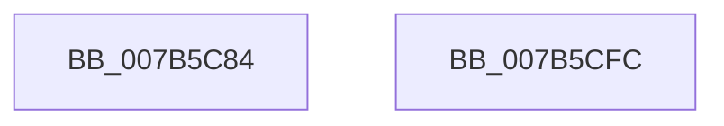

# EtwpEventWriteGuidEntry

- RVA: `0x007B5C84`–`0x007B5CFD` (길이 `121` bytes)
- VA: `0x00000001407B5C84`
- 실행 섹션: `PAGE`
- PDB 이름 있음: `예`; PDB Function 태그: `아니요`
- unwind 정보 RVA: `0x000AF370`
- 디코드: `26`개 명령, `121/121` bytes 표시
- 미해석 바이트: `0` (있으면 어셈블리에 `.byte`로 보존)

> 이 문서는 커널 이미지의 기계어와 PDB 기호를 분석해 생성했습니다. 4번과 5번은 함수 원형과 자료형을 바이너리 사용 방식에서 추정한 C 해석이며 원본 소스 복구 결과는 아닙니다.

## 1. Dependencies

- 직접 호출 지점: **2**; 고유 호출 대상: **2**
- 직접 호출자로 확인된 함수: **1**
- RIP 상대 이미지 참조: **2**

### Outgoing calls
- `0x007B5CE5` → [EtwWrite](../../text/41/EtwWrite_function_0041C720.md) (function, `0x0041C720`)
- `0x007B5CF2` → [_security_check_cookie](../../text/6A/_security_check_cookie_function_006AC640.md) (function, `0x006AC640`)

### Direct callers
- [EtwpTracingProvEnableCallback](../AC/EtwpTracingProvEnableCallback_function_00AC28B0.md) at `0x00AC299F`
- [EtwpTracingProvEnableCallback](../AC/EtwpTracingProvEnableCallback_function_00AC28B0.md) at `0x00AC2AE1`

### Static image references
- `0x007B5C8B` → RVA `0x00E0A740` (`.data`; read)
- `0x007B5C9A` → RVA `0x00EFF840` (`.data`; read)

## 2. Other-region calls and transfers

- 다른 실행 섹션으로 향하는 call: **2**
  - `0x007B5CE5` → [EtwWrite](../../text/41/EtwWrite_function_0041C720.md) (`PAGE` → `.text`)
  - `0x007B5CF2` → [_security_check_cookie](../../text/6A/_security_check_cookie_function_006AC640.md) (`PAGE` → `.text`)
- 별도 외부 분기/꼬리 이동을 확인하지 못했습니다.

## 3. Assembly (complete function range)

```asm
007B5C84  4C 8B DC                        mov r11, rsp
007B5C87  48 83 EC 78                     sub rsp, 0x78
007B5C8B  48 8B 05 AE 4A 65 00            mov rax, qword ptr [rip + 0x654aae]
007B5C92  48 33 C4                        xor rax, rsp
007B5C95  48 89 44 24 60                  mov qword ptr [rsp + 0x60], rax
007B5C9A  48 8B 0D 9F 9B 74 00            mov rcx, qword ptr [rip + 0x749b9f]
007B5CA1  49 8D 40 28                     lea rax, [r8 + 0x28]
007B5CA5  49 89 43 B8                     mov qword ptr [r11 - 0x48], rax
007B5CA9  41 B9 03 00 00 00               mov r9d, 3
007B5CAF  49 8B 80 80 02 00 00            mov rax, qword ptr [r8 + 0x280]
007B5CB6  49 89 43 C8                     mov qword ptr [r11 - 0x38], rax
007B5CBA  49 8D 40 58                     lea rax, [r8 + 0x58]
007B5CBE  49 89 43 D8                     mov qword ptr [r11 - 0x28], rax
007B5CC2  45 33 C0                        xor r8d, r8d
007B5CC5  49 8D 43 B8                     lea rax, [r11 - 0x48]
007B5CC9  49 C7 43 C0 10 00 00 00         mov qword ptr [r11 - 0x40], 0x10
007B5CD1  49 89 43 A8                     mov qword ptr [r11 - 0x58], rax
007B5CD5  49 C7 43 D0 04 00 00 00         mov qword ptr [r11 - 0x30], 4
007B5CDD  49 C7 43 E0 02 00 00 00         mov qword ptr [r11 - 0x20], 2
007B5CE5  E8 36 6A C6 FF                  call 0x14041c720
007B5CEA  48 8B 4C 24 60                  mov rcx, qword ptr [rsp + 0x60]
007B5CEF  48 33 CC                        xor rcx, rsp
007B5CF2  E8 49 69 EF FF                  call 0x1406ac640
007B5CF7  48 83 C4 78                     add rsp, 0x78
007B5CFB  C3                              ret
007B5CFC  CC                              int3
```

## 4. C-style interpretation (structured pseudocode)

```c
__int64 __fastcall EtwpEventWriteGuidEntry(__int64 a1, __int64 a2, __int64 a3)
{
    __int64 result;
    __int64 v_rsp;
    unsigned __int64 v_stack_m18;

    v_rsp = (v_rsp) - (120);
    result = (*(unsigned __int64 *)(v_rip + 6638254)) ^ (v_rsp);
    v_stack_m18 = result;
    *(unsigned __int64 *)(v_rsp - 72) = a3 + 40;
    *(unsigned __int64 *)(v_rsp - 56) = *(unsigned __int64 *)(a3 + 640);
    *(unsigned __int64 *)(v_rsp - 40) = a3 + 88;
    a3 = 0;
    *(unsigned __int64 *)(v_rsp - 64) = 16;
    *(unsigned __int64 *)(v_rsp - 88) = v_rsp - 72;
    *(unsigned __int64 *)(v_rsp - 48) = 4;
    *(unsigned __int64 *)(v_rsp - 32) = 2;
    result = EtwWrite(*(unsigned __int64 *)(v_rip + 7642015), a2, a3, 3);
    a1 = (v_stack_m18) ^ (v_rsp);
    result = _security_check_cookie(a1, a2, a3, 3);
    v_rsp = (v_rsp) + (120);
    return result;
}
```

## 5. (Beta) C Style

```c
int64_t EtwpEventWriteGuidEntry(int64_t Arg1, int64_t Arg2, void *Arg3)
{
    uint8_t *arg3 = (uint8_t *)Arg3;

    int64_t result;
    int64_t local_rsp;
    uint64_t v_stack_m18;

    local_rsp = (local_rsp) - (120);
    result = (*(uint64_t *)(v_rip + 0x654AAE)) ^ (local_rsp);
    v_stack_m18 = result;
    *(void **)(local_rsp - 0x48) = Arg3 + 40;
    *(uint64_t *)(local_rsp - 0x38) = *(uint64_t *)(arg3 + 0x280);
    *(void **)(local_rsp - 0x28) = Arg3 + 88;
    Arg3 = 0;
    *(uint64_t *)(local_rsp - 0x40) = 16;
    *(uint64_t *)(local_rsp - 0x58) = local_rsp - 72;
    *(uint64_t *)(local_rsp - 0x30) = 4;
    *(uint64_t *)(local_rsp - 0x20) = 2;
    result = EtwWrite(*(uint64_t *)(v_rip + 0x749B9F), Arg2, Arg3, 3);
    Arg1 = (v_stack_m18) ^ (local_rsp);
    result = _security_check_cookie(Arg1, Arg2, Arg3, 3);
    local_rsp = (local_rsp) + (120);
    return result;
}
```

### 관측된 메모리 오프셋

구조체 형식이 확인되지 않은 접근은 인자 기준의 오프셋으로만 기록했습니다.

| 기준 인자 | 오프셋 표현 | 폭 (bit) | 접근 |
|---|---:|---:|---|
| `Arg3` | `+ 0x28` | `64` | `R` |
| `Arg3` | `+ 0x58` | `64` | `R` |
| `Arg3` | `+ 0x280` | `64` | `R` |

## 6. Execution-region graph

[열기: 2D/3D 그래프와 함수 탐색 컨트롤 패널](../../../control-panel.html?section=page&rva=0x007B5C84&view=graph)

- 2D 그래프는 위에서 아래로 흐르고, 3D 그래프는 빈 공간을 드래그해 회전합니다. Shift+드래그는 이동, 휠은 확대·축소, 함수 노드 선택은 대상 보고서 이동입니다.

### Static fallback


