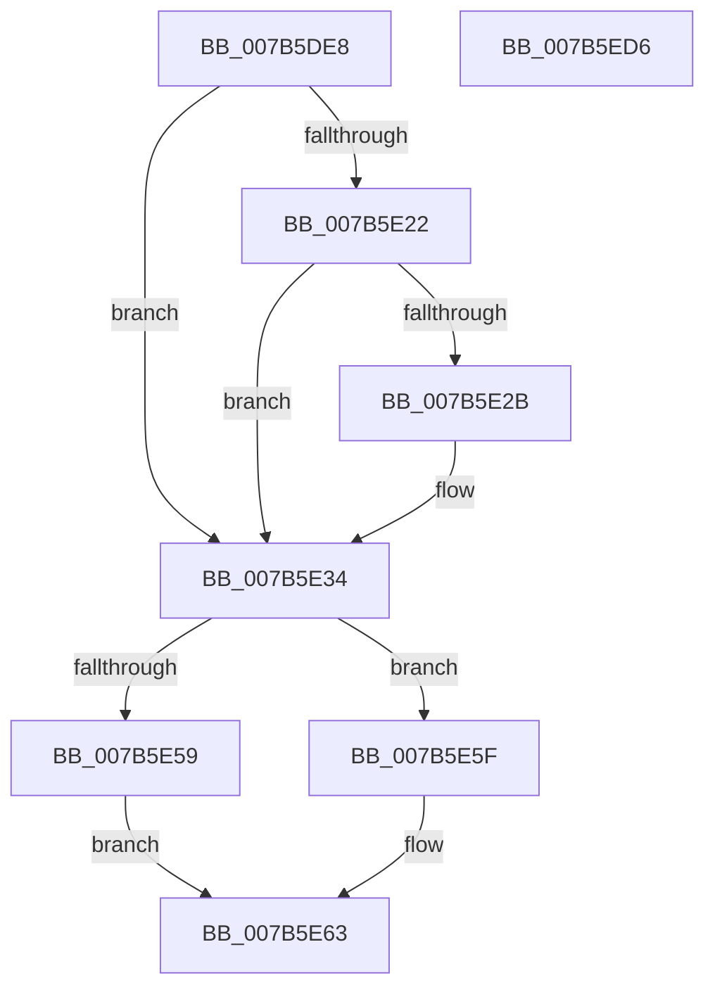

# EtwpEventWriteRegEntry

- RVA: `0x007B5DE8`–`0x007B5ED7` (길이 `239` bytes)
- VA: `0x00000001407B5DE8`
- 실행 섹션: `PAGE`
- PDB 이름 있음: `예`; PDB Function 태그: `아니요`
- unwind 정보 RVA: `0x000AC058`
- 디코드: `55`개 명령, `239/239` bytes 표시
- 미해석 바이트: `0` (있으면 어셈블리에 `.byte`로 보존)

> 이 문서는 커널 이미지의 기계어와 PDB 기호를 분석해 생성했습니다. 4번과 5번은 함수 원형과 자료형을 바이너리 사용 방식에서 추정한 C 해석이며 원본 소스 복구 결과는 아닙니다.

## 1. Dependencies

- 직접 호출 지점: **2**; 고유 호출 대상: **2**
- 직접 호출자로 확인된 함수: **1**
- RIP 상대 이미지 참조: **3**

### Outgoing calls
- `0x007B5EBC` → [EtwWrite](../../text/41/EtwWrite_function_0041C720.md) (function, `0x0041C720`)
- `0x007B5EC8` → [_security_check_cookie](../../text/6A/_security_check_cookie_function_006AC640.md) (function, `0x006AC640`)

### Direct callers
- [EtwpTracingProvEnableCallback](../AC/EtwpTracingProvEnableCallback_function_00AC28B0.md) at `0x00AC2B45`

### Static image references
- `0x007B5DF6` → RVA `0x00E0A740` (`.data`; read)
- `0x007B5E04` → RVA `0x00EFF840` (`.data`; read)
- `0x007B5E8C` → RVA `0x00021668` (`.rdata`; read)

## 2. Other-region calls and transfers

- 다른 실행 섹션으로 향하는 call: **2**
  - `0x007B5EBC` → [EtwWrite](../../text/41/EtwWrite_function_0041C720.md) (`PAGE` → `.text`)
  - `0x007B5EC8` → [_security_check_cookie](../../text/6A/_security_check_cookie_function_006AC640.md) (`PAGE` → `.text`)
- 별도 외부 분기/꼬리 이동을 확인하지 못했습니다.

## 3. Assembly (complete function range)

```asm
007B5DE8  40 55                           push rbp
007B5DEA  48 8D 6C 24 A9                  lea rbp, [rsp - 0x57]
007B5DEF  48 81 EC C0 00 00 00            sub rsp, 0xc0
007B5DF6  48 8B 05 43 49 65 00            mov rax, qword ptr [rip + 0x654943]
007B5DFD  48 33 C4                        xor rax, rsp
007B5E00  48 89 45 47                     mov qword ptr [rbp + 0x47], rax
007B5E04  4C 8B 15 35 9A 74 00            mov r10, qword ptr [rip + 0x749a35]
007B5E0B  48 8D 4A 62                     lea rcx, [rdx + 0x62]
007B5E0F  45 33 C0                        xor r8d, r8d
007B5E12  0F 57 C0                        xorps xmm0, xmm0
007B5E15  F6 01 02                        test byte ptr [rcx], 2
007B5E18  0F 11 45 CF                     movups xmmword ptr [rbp - 0x31], xmm0
007B5E1C  44 89 45 C7                     mov dword ptr [rbp - 0x39], r8d
007B5E20  74 12                           je 0x1407b5e34
007B5E22  48 8B 42 50                     mov rax, qword ptr [rdx + 0x50]
007B5E26  48 85 C0                        test rax, rax
007B5E29  74 09                           je 0x1407b5e34
007B5E2B  8B 80 D0 01 00 00               mov eax, dword ptr [rax + 0x1d0]
007B5E31  89 45 C7                        mov dword ptr [rbp - 0x39], eax
007B5E34  48 8B 42 20                     mov rax, qword ptr [rdx + 0x20]
007B5E38  48 83 C0 28                     add rax, 0x28
007B5E3C  48 C7 45 EF 10 00 00 00         mov qword ptr [rbp - 0x11], 0x10
007B5E44  48 89 45 E7                     mov qword ptr [rbp - 0x19], rax
007B5E48  48 8B 42 28                     mov rax, qword ptr [rdx + 0x28]
007B5E4C  48 C7 45 FF 10 00 00 00         mov qword ptr [rbp - 1], 0x10
007B5E54  48 85 C0                        test rax, rax
007B5E57  74 06                           je 0x1407b5e5f
007B5E59  48 83 C0 28                     add rax, 0x28
007B5E5D  EB 04                           jmp 0x1407b5e63
007B5E5F  48 8D 45 CF                     lea rax, [rbp - 0x31]
007B5E63  48 89 45 F7                     mov qword ptr [rbp - 9], rax
007B5E67  41 B9 06 00 00 00               mov r9d, 6
007B5E6D  48 8D 42 64                     lea rax, [rdx + 0x64]
007B5E71  48 89 4D 07                     mov qword ptr [rbp + 7], rcx
007B5E75  48 89 45 17                     mov qword ptr [rbp + 0x17], rax
007B5E79  49 8B CA                        mov rcx, r10
007B5E7C  48 8D 42 66                     lea rax, [rdx + 0x66]
007B5E80  48 C7 45 0F 02 00 00 00         mov qword ptr [rbp + 0xf], 2
007B5E88  48 89 45 27                     mov qword ptr [rbp + 0x27], rax
007B5E8C  48 8D 15 D5 B7 86 FF            lea rdx, [rip - 0x79482b]
007B5E93  48 8D 45 C7                     lea rax, [rbp - 0x39]
007B5E97  48 C7 45 1F 01 00 00 00         mov qword ptr [rbp + 0x1f], 1
007B5E9F  48 89 45 37                     mov qword ptr [rbp + 0x37], rax
007B5EA3  48 8D 45 E7                     lea rax, [rbp - 0x19]
007B5EA7  48 89 44 24 20                  mov qword ptr [rsp + 0x20], rax
007B5EAC  48 C7 45 2F 01 00 00 00         mov qword ptr [rbp + 0x2f], 1
007B5EB4  48 C7 45 3F 04 00 00 00         mov qword ptr [rbp + 0x3f], 4
007B5EBC  E8 5F 68 C6 FF                  call 0x14041c720
007B5EC1  48 8B 4D 47                     mov rcx, qword ptr [rbp + 0x47]
007B5EC5  48 33 CC                        xor rcx, rsp
007B5EC8  E8 73 67 EF FF                  call 0x1406ac640
007B5ECD  48 81 C4 C0 00 00 00            add rsp, 0xc0
007B5ED4  5D                              pop rbp
007B5ED5  C3                              ret
007B5ED6  CC                              int3
```

## 4. C-style interpretation (structured pseudocode)

```c
__int64 __fastcall EtwpEventWriteRegEntry(__int64 a1, __int64 a2, int a3)
{
    __int64 result;
    __int64 v_rsp;
    unsigned __int64 v_stack_m18;
    unsigned __int64 v_stack_m20;
    unsigned __int64 v_stack_m28;
    unsigned __int64 v_stack_m30;
    unsigned __int64 v_stack_m38;
    unsigned __int64 v_stack_m40;
    unsigned __int64 v_stack_m48;
    unsigned __int64 v_stack_m50;
    unsigned __int64 v_stack_m58;
    unsigned __int64 v_stack_m5F;
    unsigned __int64 v_stack_m60;
    unsigned __int64 v_stack_m68;
    unsigned __int64 v_stack_m70;
    unsigned __int64 v_stack_m78;
    unsigned __int64 v_stack_m90;
    unsigned int v_stack_m98;
    unsigned __int64 v_stack_mA8;

    v_rsp = (v_rsp) - (192);
    result = (*(unsigned __int64 *)(v_rip + 6637891)) ^ (v_rsp);
    v_stack_m18 = result;
    a3 = 0;
    v_stack_m90 = v_xmm0;
    v_stack_m98 = 0;
    if (((*(unsigned __int8 *)(a2 + 98)) & (2)) == 0) goto loc_007B5E34;
    result = *(unsigned __int64 *)(a2 + 80);
    if (*(unsigned __int64 *)(a2 + 80) != 0) {
        result = *(unsigned int *)(*(unsigned __int64 *)(a2 + 80) + 464);
        v_stack_m98 = (unsigned int)(result);
    }
    result = (*(unsigned __int64 *)(a2 + 32)) + (40);
    v_stack_m70 = 16;
    v_stack_m78 = result;
    v_stack_m60 = 16;
    if (*(unsigned __int64 *)(a2 + 40) == 0) goto loc_007B5E5F;
    result = (*(unsigned __int64 *)(a2 + 40)) + (40);
    goto loc_007B5E63;
loc_007B5E5F:
loc_007B5E63:
    v_stack_m68 = v_stack_m90;
    v_stack_m58 = a2 + 98;
    v_stack_m48 = a2 + 100;
    v_stack_m50 = 2;
    v_stack_m38 = a2 + 102;
    v_stack_m40 = 1;
    v_stack_m28 = v_stack_m98;
    v_stack_mA8 = v_stack_m78;
    v_stack_m30 = 1;
    v_stack_m20 = 4;
    result = EtwWrite(*(unsigned __int64 *)(v_rip + 7641653), v_rip - 7948331, a3, 6);
    a1 = (v_stack_m18) ^ (v_rsp);
    result = _security_check_cookie(a1, v_rip - 7948331, a3, 6);
    v_rsp = (v_rsp) + (192);
    return result;
}
```

## 5. (Beta) C Style

```c
int64_t EtwpEventWriteRegEntry(int64_t Arg1, void *Arg2, int32_t Arg3)
{
    uint8_t *arg2 = (uint8_t *)Arg2;

    int64_t result;
    int64_t local_rsp;
    uint64_t v_stack_m18;
    uint64_t v_stack_m20;
    uint64_t v_stack_m28;
    uint64_t v_stack_m30;
    uint64_t v_stack_m38;
    uint64_t v_stack_m40;
    uint64_t v_stack_m48;
    uint64_t v_stack_m50;
    uint64_t v_stack_m58;
    uint64_t v_stack_m5F;
    uint64_t v_stack_m60;
    uint64_t v_stack_m68;
    uint64_t v_stack_m70;
    uint64_t v_stack_m78;
    uint64_t v_stack_m90;
    uint32_t v_stack_m98;
    uint64_t v_stack_mA8;

    local_rsp = (local_rsp) - (192);
    result = (*(uint64_t *)(v_rip + 0x654943)) ^ (local_rsp);
    v_stack_m18 = result;
    Arg3 = 0;
    v_stack_m90 = v_xmm0;
    v_stack_m98 = 0;
    if (((*(uint8_t *)(arg2 + 0x62)) & (2)) == 0) goto loc_007B5E34;
    result = *(uint64_t *)(arg2 + 0x50);
    if (*(uint64_t *)(arg2 + 0x50) != 0) {
        result = *(uint32_t *)(*(uint64_t *)(arg2 + 0x50) + 0x1D0);
        v_stack_m98 = (uint32_t)(result);
    }
    result = (*(uint64_t *)(arg2 + 0x20)) + (40);
    v_stack_m70 = 16;
    v_stack_m78 = result;
    v_stack_m60 = 16;
    if (*(uint64_t *)(arg2 + 0x28) == 0) goto loc_007B5E5F;
    result = (*(uint64_t *)(arg2 + 0x28)) + (40);
    goto loc_007B5E63;
loc_007B5E5F:
loc_007B5E63:
    v_stack_m68 = v_stack_m90;
    v_stack_m58 = Arg2 + 98;
    v_stack_m48 = Arg2 + 100;
    v_stack_m50 = 2;
    v_stack_m38 = Arg2 + 102;
    v_stack_m40 = 1;
    v_stack_m28 = v_stack_m98;
    v_stack_mA8 = v_stack_m78;
    v_stack_m30 = 1;
    v_stack_m20 = 4;
    result = EtwWrite(*(uint64_t *)(v_rip + 0x749A35), v_rip - 7948331, Arg3, 6);
    Arg1 = (v_stack_m18) ^ (local_rsp);
    result = _security_check_cookie(Arg1, v_rip - 7948331, Arg3, 6);
    local_rsp = (local_rsp) + (192);
    return result;
}
```

### 관측된 메모리 오프셋

구조체 형식이 확인되지 않은 접근은 인자 기준의 오프셋으로만 기록했습니다.

| 기준 인자 | 오프셋 표현 | 폭 (bit) | 접근 |
|---|---:|---:|---|
| `Arg2` | `+ 0x0` | `8` | `R` |
| `Arg2` | `+ 0x20` | `64` | `R` |
| `Arg2` | `+ 0x28` | `64` | `R` |
| `Arg2` | `+ 0x50` | `64` | `R` |
| `Arg2` | `+ 0x62` | `64` | `R` |
| `Arg2` | `+ 0x64` | `64` | `R` |
| `Arg2` | `+ 0x66` | `64` | `R` |

## 6. Execution-region graph

[열기: 2D/3D 그래프와 함수 탐색 컨트롤 패널](../../../control-panel.html?section=page&rva=0x007B5DE8&view=graph)

- 2D 그래프는 위에서 아래로 흐르고, 3D 그래프는 빈 공간을 드래그해 회전합니다. Shift+드래그는 이동, 휠은 확대·축소, 함수 노드 선택은 대상 보고서 이동입니다.

### Static fallback


