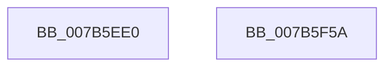

# EtwpEventWriteRegistrationStatus

- RVA: `0x007B5EE0`–`0x007B5F5B` (길이 `123` bytes)
- VA: `0x00000001407B5EE0`
- 실행 섹션: `PAGE`
- PDB 이름 있음: `예`; PDB Function 태그: `아니요`
- unwind 정보 RVA: `0x00065FB8`
- 디코드: `27`개 명령, `123/123` bytes 표시
- 미해석 바이트: `0` (있으면 어셈블리에 `.byte`로 보존)

> 이 문서는 커널 이미지의 기계어와 PDB 기호를 분석해 생성했습니다. 4번과 5번은 함수 원형과 자료형을 바이너리 사용 방식에서 추정한 C 해석이며 원본 소스 복구 결과는 아닙니다.

## 1. Dependencies

- 직접 호출 지점: **2**; 고유 호출 대상: **2**
- 직접 호출자로 확인된 함수: **2**
- RIP 상대 이미지 참조: **3**

### Outgoing calls
- `0x007B5F43` → [EtwWrite](../../text/41/EtwWrite_function_0041C720.md) (function, `0x0041C720`)
- `0x007B5F50` → [_security_check_cookie](../../text/6A/_security_check_cookie_function_006AC640.md) (function, `0x006AC640`)

### Direct callers
- [EtwpSetProviderTraitsKm](../9F/EtwpSetProviderTraitsKm_function_009F3424.md) at `0x009F3505`
- [EtwpSetProviderTraitsUm](../9F/EtwpSetProviderTraitsUm_function_009F3514.md) at `0x009F36DF`

### Static image references
- `0x007B5EE7` → RVA `0x00E0A740` (`.data`; read)
- `0x007B5EFA` → RVA `0x000230E8` (`.rdata`; read)
- `0x007B5F01` → RVA `0x00EFF840` (`.data`; read)

## 2. Other-region calls and transfers

- 다른 실행 섹션으로 향하는 call: **2**
  - `0x007B5F43` → [EtwWrite](../../text/41/EtwWrite_function_0041C720.md) (`PAGE` → `.text`)
  - `0x007B5F50` → [_security_check_cookie](../../text/6A/_security_check_cookie_function_006AC640.md) (`PAGE` → `.text`)
- 별도 외부 분기/꼬리 이동을 확인하지 못했습니다.

## 3. Assembly (complete function range)

```asm
007B5EE0  4C 8B DC                        mov r11, rsp
007B5EE3  48 83 EC 68                     sub rsp, 0x68
007B5EE7  48 8B 05 52 48 65 00            mov rax, qword ptr [rip + 0x654852]
007B5EEE  48 33 C4                        xor rax, rsp
007B5EF1  48 89 44 24 50                  mov qword ptr [rsp + 0x50], rax
007B5EF6  49 8B 41 20                     mov rax, qword ptr [r9 + 0x20]
007B5EFA  48 8D 15 E7 D1 86 FF            lea rdx, [rip - 0x792e19]
007B5F01  48 8B 0D 38 99 74 00            mov rcx, qword ptr [rip + 0x749938]
007B5F08  48 83 C0 28                     add rax, 0x28
007B5F0C  49 89 43 C8                     mov qword ptr [r11 - 0x38], rax
007B5F10  41 B9 02 00 00 00               mov r9d, 2
007B5F16  83 64 24 3C 00                  and dword ptr [rsp + 0x3c], 0
007B5F1B  49 8D 43 28                     lea rax, [r11 + 0x28]
007B5F1F  C7 44 24 38 10 00 00 00         mov dword ptr [rsp + 0x38], 0x10
007B5F27  45 33 C0                        xor r8d, r8d
007B5F2A  49 89 43 D8                     mov qword ptr [r11 - 0x28], rax
007B5F2E  49 8D 43 C8                     lea rax, [r11 - 0x38]
007B5F32  83 64 24 4C 00                  and dword ptr [rsp + 0x4c], 0
007B5F37  49 89 43 B8                     mov qword ptr [r11 - 0x48], rax
007B5F3B  C7 44 24 48 04 00 00 00         mov dword ptr [rsp + 0x48], 4
007B5F43  E8 D8 67 C6 FF                  call 0x14041c720
007B5F48  48 8B 4C 24 50                  mov rcx, qword ptr [rsp + 0x50]
007B5F4D  48 33 CC                        xor rcx, rsp
007B5F50  E8 EB 66 EF FF                  call 0x1406ac640
007B5F55  48 83 C4 68                     add rsp, 0x68
007B5F59  C3                              ret
007B5F5A  CC                              int3
```

## 4. C-style interpretation (structured pseudocode)

```c
__int64 __fastcall EtwpEventWriteRegistrationStatus(__int64 a1, __int64 a2, int a3, __int64 a4)
{
    __int64 result;
    __int64 v_rsp;
    unsigned __int64 v_stack_m18;
    unsigned int v_stack_m1C;
    unsigned int v_stack_m20;
    unsigned int v_stack_m2C;
    unsigned int v_stack_m30;

    v_rsp = (v_rsp) - (104);
    result = (*(unsigned __int64 *)(v_rip + 6637650)) ^ (v_rsp);
    v_stack_m18 = result;
    result = (*(unsigned __int64 *)(a4 + 32)) + (40);
    *(unsigned __int64 *)(v_rsp - 56) = result;
    v_stack_m30 = 16;
    a3 = 0;
    *(unsigned __int64 *)(v_rsp - 40) = v_rsp + 40;
    *(unsigned __int64 *)(v_rsp - 72) = v_rsp - 56;
    v_stack_m20 = 4;
    result = EtwWrite(*(unsigned __int64 *)(v_rip + 7641400), v_rip - 7941657, a3, 2);
    a1 = (v_stack_m18) ^ (v_rsp);
    result = _security_check_cookie(a1, v_rip - 7941657, a3, 2);
    v_rsp = (v_rsp) + (104);
    return result;
}
```

## 5. (Beta) C Style

```c
int64_t EtwpEventWriteRegistrationStatus(int64_t Arg1, int64_t Arg2, int32_t Arg3, void *Arg4)
{
    uint8_t *arg4 = (uint8_t *)Arg4;

    int64_t result;
    int64_t local_rsp;
    uint64_t v_stack_m18;
    uint32_t v_stack_m1C;
    uint32_t v_stack_m20;
    uint32_t v_stack_m2C;
    uint32_t v_stack_m30;

    local_rsp = (local_rsp) - (104);
    result = (*(uint64_t *)(v_rip + 0x654852)) ^ (local_rsp);
    v_stack_m18 = result;
    result = (*(uint64_t *)(arg4 + 0x20)) + (40);
    *(uint64_t *)(local_rsp - 0x38) = result;
    v_stack_m30 = 16;
    Arg3 = 0;
    *(uint64_t *)(local_rsp - 0x28) = local_rsp + 40;
    *(uint64_t *)(local_rsp - 0x48) = local_rsp - 56;
    v_stack_m20 = 4;
    result = EtwWrite(*(uint64_t *)(v_rip + 0x749938), v_rip - 7941657, Arg3, 2);
    Arg1 = (v_stack_m18) ^ (local_rsp);
    result = _security_check_cookie(Arg1, v_rip - 7941657, Arg3, 2);
    local_rsp = (local_rsp) + (104);
    return result;
}
```

### 관측된 메모리 오프셋

구조체 형식이 확인되지 않은 접근은 인자 기준의 오프셋으로만 기록했습니다.

| 기준 인자 | 오프셋 표현 | 폭 (bit) | 접근 |
|---|---:|---:|---|
| `Arg4` | `+ 0x20` | `64` | `R` |

## 6. Execution-region graph

[열기: 2D/3D 그래프와 함수 탐색 컨트롤 패널](../../../control-panel.html?section=page&rva=0x007B5EE0&view=graph)

- 2D 그래프는 위에서 아래로 흐르고, 3D 그래프는 빈 공간을 드래그해 회전합니다. Shift+드래그는 이동, 휠은 확대·축소, 함수 노드 선택은 대상 보고서 이동입니다.

### Static fallback


